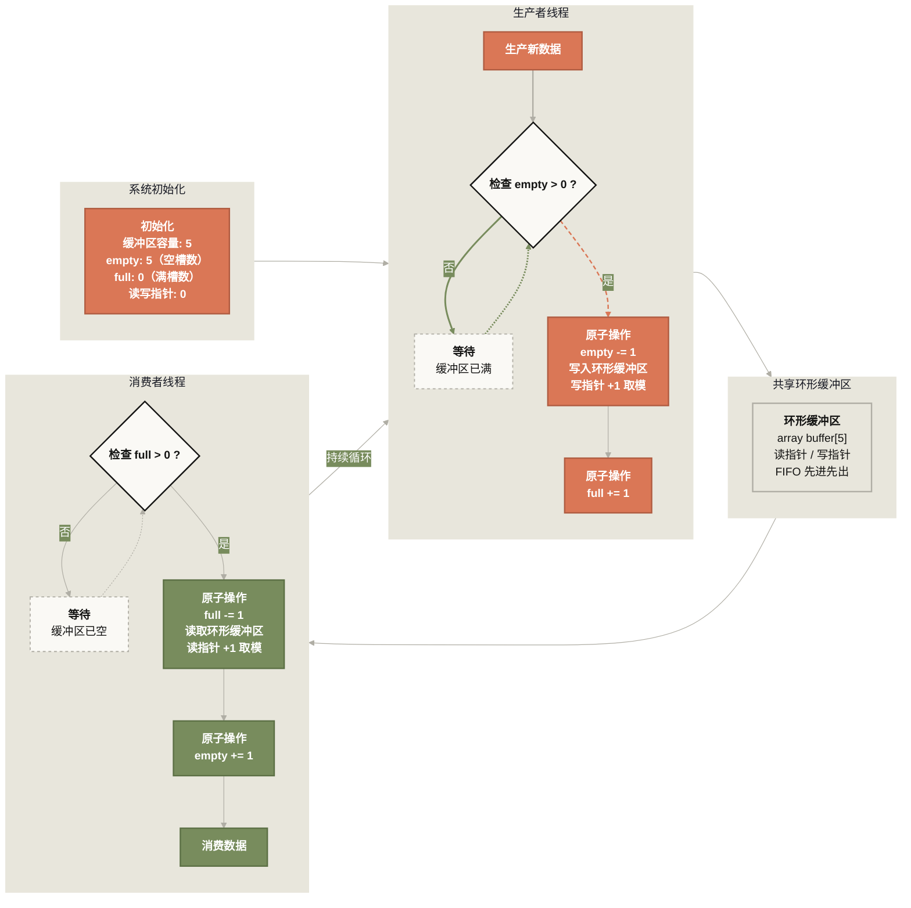
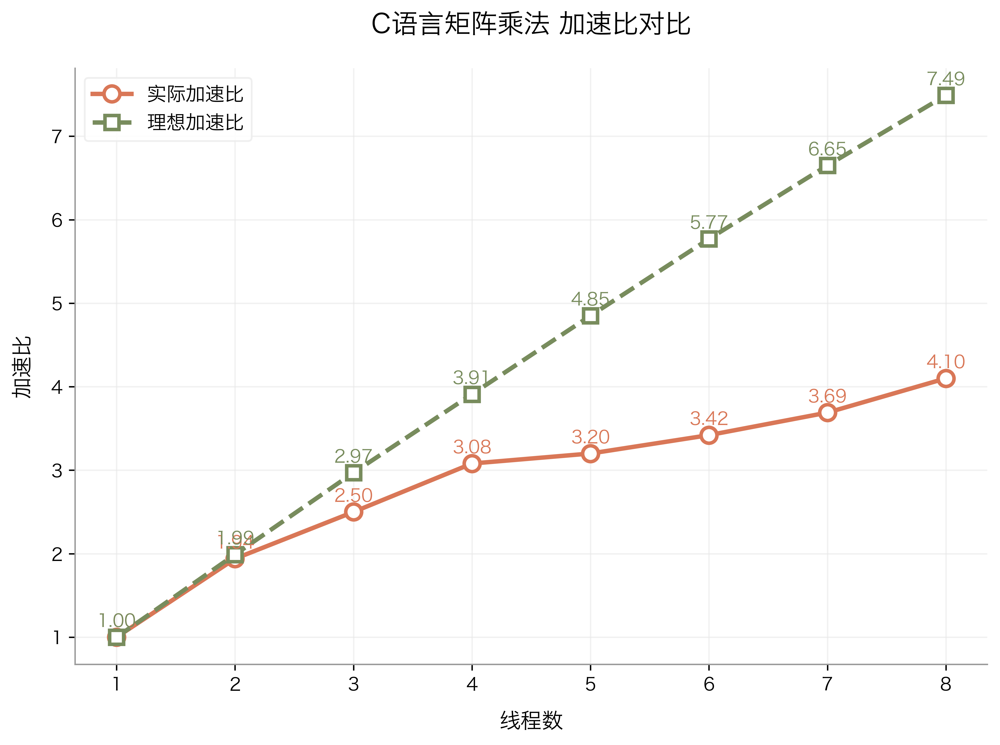
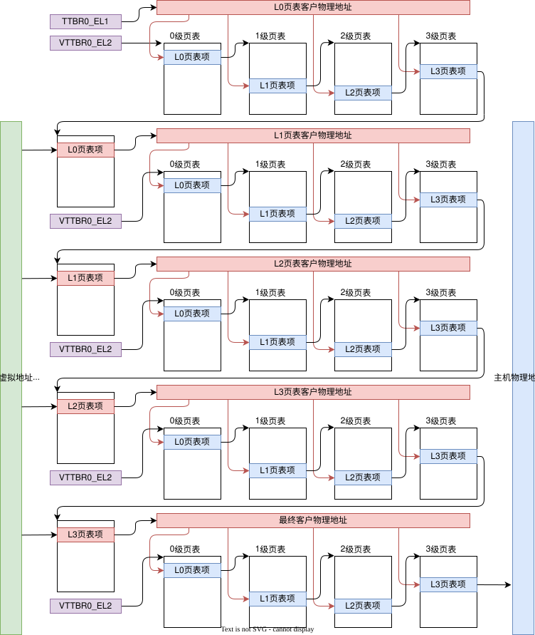

# 第 1 章 操作系统概述

## `1.1` 操作系统的概念

- `1.1.1` 操作系统的含义

    操作系统是管理硬件资源、控制程序运行、改善人机界面和为应用软件提供支持的一种系统软件

    - 操作系统是硬件与应用之间的软件层：操作系统位于硬件层之上、应用层之下
        - **对上构筑应用生态**：为应用程序提供运行环境和服务接口
        - **对下管理硬件**：直接控制CPU、内存、I/O设备等物理资源

    ```mermaid
    flowchart LR
        subgraph 应用层
            A1[应用]
            A2[服务: 通信服务、<br/>存储服务、<br/>计算服务]
        end
        
        subgraph 操作系统层
            B1[单机框架<br/>资源管理、<br/>任务调度]
            B2[分布式框架<br/>集群管理、<br/>云服务组件]
            B3[操作系统内核<br/>内核和硬件驱动]
        end
        
        subgraph 硬件层
            C1[硬件: CPU、<br/>XPU、<br/>FPGA]
        end
        
        A1 --> A2
        A2 --> B1
        A2 --> B2
        B1 --> B3
        B2 --> B3
        B3 --> C1
    ```

- `1.1.2` 操作系统提供的服务

    1. **计算资源的抽象**

        ```mermaid
        flowchart LR
            subgraph 物理资源
                P1[物理 CPU]
                P2[物理内存]
                P3[物理 I/O 设备]
            end
            
            subgraph 抽象层
                A1[进程/线程<br/>数量不受物理CPU限制]
                A2[虚拟内存<br/>大小不受物理内存限制]
                A3[文件<br/>统一操作接口]
            end
            
            subgraph 应用视角
                U1["应用看到“无限”的CPU"]
                U2["应用看到“无限”的内存"]
                U3["应用看到统一的文件"]
            end
            
            P1 --> A1 --> U1
            P2 --> A2 --> U2
            P3 --> A3 --> U3
        ```

        | 抽象对象     | 物理限制               | 抽象后                 | 核心机制                   |
        | ------------ | ---------------------- | ---------------------- | -------------------------- |
        | **CPU**      | 物理核心数有限         | 进程/线程，数量不受限  | 时间片轮转、调度算法       |
        | **内存**     | 物理内存容量有限       | 虚拟内存，地址空间巨大 | 分页/分段、虚拟地址映射    |
        | **I/O 设备** | 设备类型各异、接口不同 | 统一抽象为"文件"       | 设备驱动、VFS 虚拟文件系统 |

    2. **线程间的同步**

        - **应用自定义同步原语**：如 `spinlock`（自旋锁）
        - **操作系统提供高效同步原语**：如 `pthread_mutex`（互斥锁），与线程切换配合更高效

        > 操作系统提供的同步原语通常比用户态实现更高效，因为它们可以直接利用内核的调度机制

    3. **进程间的通信**

        | 通信方式             | 示例            | 特点                                   |
        | -------------------- | --------------- | -------------------------------------- |
        | 网络方式进程通信     | `loopback` 设备 | 基于**网络**协议栈，通用但开销大       |
        | 操作系统本地通信机制 | `pipe`（管道）  | 语义丰富、更高效，专为**本地通信**优化 |

- `1.1.3` 操作系统对应用的管理

    - 生命周期管理：应用的**加载**、**迁移**、**销毁**等操作

        例如：双击图标启动程序（加载）、程序关闭（销毁）

    - 计算资源的分配

        | 资源类型    | 分配机制                             |
        | :---------- | :----------------------------------- |
        | **CPU**     | 线程的调度机制（时间片分配）         |
        | **内存**    | 物理内存的分配（堆、栈管理）         |
        | **I/O设备** | 设备的复用与分配（多进程共享打印机） |

    - 安全与隔离

        - **应用程序内部**：访问控制机制（权限管理）
        - **应用程序之间**：隔离机制，包括**错误隔离**（一个程序崩溃不影响其他程序）和**性能隔离**（防止一个程序独占资源）

- `1.1.4` 服务与管理

    操作系统为应用程序提供服务，也对应用程序进行管理，但**管理和服务的目标有可能存在冲突**

    | 维度         | 服务的目标               | 管理的目标                 | 冲突示例                                                     |
    | ------------ | ------------------------ | -------------------------- | ------------------------------------------------------------ |
    | **侧重点**   | 单个应用的运行效率最大化 | 系统的资源整体利用率最大化 | —                                                            |
    | **调度策略** | 希望独占资源、减少切换   | 希望公平分配、提高吞吐量   | 细粒度的时间片轮转 `RR` 导致大量<br/>上下文切换，反而降低效率 |

- `1.1.5` 应用程序与操作系统的交互：系统调用

    **系统调用**是应用程序调用操作系统内核功能的机制，实现应用本身不能实现的功能，

    应用程序运行在**用户态**，没有直接访问硬件和内核资源的权限，必须通过系统调用陷入**内核态**，由操作系统内核代为执行特权操作（如文件读写、内存分配、进程创建等）

    - `printf("Hello World!\n")` $\rightarrow$ `write(1, "Hello World!\n", 13)` $\rightarrow$ `sys_write()`
        - `printf()`：C 标准库函数（用户态），负责格式化输出
        - `write()`：POSIX 标准库函数（用户态），封装了系统调用的入口
        - `sys_write()`：操作系统内核函数（内核态），真正执行向文件描述符写入数据的操作

    - **系统调用的特点**

        操作系统通过封装，让应用程序调用系统调用**看起来和调用普通函数完全一样**，但二者本质不同：

        | 对比维度 | 普通函数调用 | 系统调用               |
        | -------- | ------------ | ---------------------- |
        | 运行状态 | 始终在用户态 | 需要切换到内核态       |
        | 权限级别 | 无特权       | 拥有内核特权           |
        | 执行效率 | 高           | 较低（涉及上下文切换） |
        | 实现方式 | 直接函数跳转 | 通过异常指令触发       |

- `1.1.6` ARM 架构下的 SVC 系统调用机制

    **ARM 架构**下的系统调用使用监管者调用 `SVC`（Supervisor Call）指令触发异常，陷入内核态

    ```mermaid
    graph LR
        A[用户态<br/>应用程序] --> B["调用C<br/>库函数<br/>write()"]
        B --> D[执行SVC #0指令<br/>触发异常]
        D --> E[CPU切换到内核态<br/>查找异常向量表<br/>跳转到对应的<br/>异常处理函数]
        E --> H["根据系统调用号<br/>查找系统调用表<br/>"]
        H --> I["执行内核函数<br/>sys_write()"]
        I --> J[返回结果<br/>到用户态]
        J --> A
    ```

    - **异常向量表**：内核预先定义的一张表，存储了各种异常（包括系统调用、中断、错误等）的处理函数入口地址
    - **系统调用表**：内核维护的一张函数指针表，每个系统调用对应一个唯一的**系统调用号**（如 `__NR_write` 对应 `sys_write` 函数）
    - **参数传递**：ARM 架构下，系统调用的参数通过寄存器传递（r0-r3），系统调用号通过 r7 寄存器传递

- `1.1.7` 操作系统的核心功能：资源管理

    操作系统的核心职责是**公平、高效地管理计算机的所有硬件资源**（CPU、内存、磁盘、网络等），防止单个恶意或错误的应用程序独占所有资源，导致整个系统崩溃，下面给出了一些可能导致系统崩溃的情形：

    - 死循环：`while(True)`

        操作系统的应对：系统调度（时间片轮转）/信号机制（通过信号强制打断当前进程的执行）

    - Fork 炸弹：`while(True) { fork(); }`

        > `fork()` 系统调用会创建一个新的子进程，子进程会复制父进程的代码和数据
        >
        > 这段代码会无限循环创建子进程，指数级增长的进程会迅速耗尽系统的 PID 资源、内存资源和 CPU 资源，导致系统完全卡死
    
    - 操作系统的应对：
        - **虚拟化技术**：将应用程序运行在虚拟机或容器中，限制其资源使用上限
        - **万能方法**：重启机器（当系统完全无响应时）
        - **制度约束**：如 AppStore 的程序预审准入机制，禁止恶意应用上架
        - **技术限制**：现代操作系统会限制单个用户能创建的最大进程数（通过 `ulimit -u` 命令查看和修改）

## `1.2` 操作系统的历史

- `1.2.1` 批处理操作系统：GM-NAA I/O

    - 诞生背景：早期计算机没有操作系统，完全依赖人工手动输入纸带 / 卡片程序，CPU 大量时间处于等待状态，硬件利用率极低
    - 基础信息：1956 年由 Robert L. Patrick 与 Owen Mock 开发，运行在 IBM 704 大型计算机上
    - 核心功能：将多个用户的作业提前批量准备，一次性输入计算机后由系统自动按顺序执行，全程减少人工干预
    - 历史定位：公认的最早批处理系统之一，是操作系统的雏形，首次显著提升了计算机的任务执行效率

- `1.2.2` 通用操作系统：OS/360

    - 诞生背景：早期操作系统与特定硬件深度绑定，不同型号计算机需要从零开发专属系统，研发成本高、复用性差
    - 基础信息：1964 年 IBM 推出 System/360 OS
    - 核心里程碑：**全球首个通用操作系统**，首次实现操作系统与计算机硬件的分离，同一款系统可适配 IBM 360 系列不同性能、不同定位的硬件设备
    - 关键人物与贡献：
        - 架构师 Gene Amdahl：提出计算机领域经典的阿姆达尔定律，用于计算并行系统的性能提升上限
        - 项目经理 Fred Brooks：1999 年图灵奖得主，著有软件工程经典著作《人月神话》；该项目暴露的大型软件管理难题，直接催生了**软件工程**学科
    - 历史定位：标志着操作系统从硬件附属功能升级为独立软件产品，是操作系统产业成型的标志性节点

- `1.2.3` 分时与多任务技术路线：Multics → Unix → Linux

    这条技术线是现代操作系统的核心脉络，呈现清晰的思想传承关系，奠定了所有类 Unix 系统的架构基础

    1. **Multics（1964）：思想源头**
        - 研发背景：由 Fernando Corbató（1990 年图灵奖得主）牵头，MIT、通用电气、贝尔实验室联合研发
        - 核心创新：首次实现成熟的分时技术，同时提出层次化文件系统、动态链接、安全权限等现代操作系统的核心概念
        - 定位：商业落地不算成功，但几乎所有现代操作系统的设计思想都能追溯至此，是操作系统领域的 “思想实验室”
    2. **Unix（1969）：工程落地**
        - 研发背景：Multics 项目终止后，贝尔实验室的 Ken Thompson、Dennis Ritchie（二人共获 1983 年图灵奖）在小型机上开发的简化版多任务系统
        - 核心贡献：设计了 Shell 命令行解释器，完善了层次化文件系统；后续用 C 语言重写系统，实现了跨硬件的可移植性
        - 定位：首个工程化落地的多任务分时系统，是所有类 Unix 系统的共同祖先
    3. **Linux（1991）：开源普及**
        - 开发者：Linus Torvalds
        - 核心特性：基于 Unix 设计思想开发的开源操作系统内核，完全开放源码、免费使用
        - 定位：当前全球最流行的开源操作系统，在服务器、移动端（安卓内核基于 Linux）、嵌入式设备等领域占据绝对主导地位

- `1.2.4` 图形界面技术路线：Xerox Alto → Mac OS → Windows

    这条技术线打破了命令行的高使用门槛，直接推动了个人计算机的全民普及，同样存在清晰的技术传承

    1. **Xerox Alto（1973）：技术原型**
        - 研发方：施乐帕克研究中心（Xerox PARC），核心设计者 Chuck Thacker 获 2009 年图灵奖
        - 里程碑：**全球首个图形化操作系统**，首次引入鼠标、窗口、图标等交互范式
        - 定位：图形界面的技术原型，奠定了现代图形交互的全部基础逻辑
    2. **Mac OS（1983 年 Apple Lisa 首发）：商业化落地**
        - 背景：乔布斯访问施乐 PARC 后，买断图形界面技术的商用权限并落地到苹果个人电脑上
        - 定位：首个成功商业化的图形界面个人电脑系统
    3. **Windows 1.0（1985）：大众普及**
        - 微软推出的图形界面操作系统，凭借硬件兼容性优势快速普及
        - 定位：推动图形界面系统在全球个人用户中全面落地，让普通大众也能轻松操作计算机

## `1.3` 复杂系统

- `1.3.1` 操作系统的复杂性

    | 操作系统   | 发布时间 | 代码行数  |
    | ---------- | -------- | --------- |
    | UNIX V6    | 1975     | 1 万行    |
    | Linux 0.01 | 1991     | 8102 行   |
    | Linux 5.7  | 2020     | 2870 万行 |
    | Windows XP | 2001     | 4500 万行 |
    | Windows 8  | 2012     | 6000 万行 |
    | Windows 10 | 2015+    | 超 1 亿行 |

    > 操作系统的代码规模呈爆炸式增长，复杂性也随之提升，因此**结构化设计是维持系统可维护性的关键**，以结构化的设计来权衡不同目标、需求之间的冲突

- `1.3.2` 设计思想

    - 操作系统的双重目标

        操作系统的设计需要在**用户需求**与**系统实现**之间取得平衡：

        | 维度         | 目标内容                                     | 本质含义                                         |
        | :----------- | :------------------------------------------- | :----------------------------------------------- |
        | **用户目标** | 方便使用、容易学习、功能齐全、安全、流畅……   | 关注**用户体验**，解决"好不好用"的问题           |
        | **系统目标** | 容易设计、容易维护、灵活性、可靠性、高效性…… | 关注**工程质量**，解决"好不好造、好不好修"的问题 |

        > 这两类目标往往存在**冲突**，例如功能齐全（用户目标）可能导致系统复杂、难以维护（系统目标），OS设计的艺术就在于找到平衡点

    - 策略与机制的分离

        这是操作系统设计中最重要的一条原则，被广泛应用于 Linux、Windows、macOS 等现代操作系统中

        | 术语                 | 定义                                     | 特性                         |
        | :------------------- | :--------------------------------------- | :--------------------------- |
        | **策略** `Policy`    | **要做什么** —— 决定"做不做、怎么做决策" | 相对**动态**，可根据需求调整 |
        | **机制** `Mechanism` | **怎么做** —— 提供"执行决策的能力"       | 相对**静态**，是底层支撑能力 |

        > 操作系统可以通过**仅调整策略**来适应不同应用场景（如服务器追求吞吐量、嵌入式追求实时性），而无需修改底层机制，这大大提升了系统的**灵活性**和**可维护性**

        示例：

        | 例子 | 策略（做什么）                           | 机制（怎么做）                                     |
        | ---- | ---------------------------------------- | -------------------------------------------------- |
        | 登录 | 什么用户、以什么权限登录                 | 输入处理、策略文件管理、桌面启动加载等             |
        | 调度 | 调度算法：时间片轮转、最早截止时间优先等 | 调度队列、调度实体（如线程）的表示、调度中断处理等 |

    - M.A.L.H. 设计原则

        - **模块化** `Modularity` ：分治法，将复杂系统拆分为多个独立的模块

            - **高内聚**：一个模块内部功能紧密相关，只完成一个特定任务
            - **低耦合**：模块之间的依赖关系尽可能少，修改一个模块不会对其他模块产生太大影响
            - 适用场景：复杂系统的初步分解，将大问题拆分为多个小问题逐个解决

        - **抽象** `Abstract` ：隐藏模块的内部实现细节，只向外部暴露简洁的接口

            就像 C++ 中的类，使用者只需要知道类的公共方法怎么用，不需要知道方法内部的具体实现

            - 优势：降低系统复杂度，提高代码复用性，便于模块的替换和升级

        - **分层** `Layering` ：将系统按功能水平划分为若干层，每层只依赖其下层，为上层提供服务

            强调**层内功能的完整性**，下层已经建立一套完整机制，上层在下层的基础上建立另一套完整机制

            - 典型示例：TCP/IP 网络协议栈、传统的 UNIX 操作系统分层架构

        - **层级** `Hierarchy` ：将系统按包含关系组织成树形结构，大的子系统由多个小的子系统组成

            使系统中的各模块具有天然的包含关系，强调整体与部分的从属关系

            - 典型示例：操作系统中的进程树、文件系统的目录结构

## `1.4` 操作系统的内核结构

- `1.4.1` 内核的概念及其必要性

    多个应用程序需要共享硬件设备，需要内核来**统一硬件的访问**来避免直接访问硬件导致的冲突和混乱

    - 内核的核心职责

        - **硬件资源管理**：CPU、内存、I/O设备的分配与调度
        - **多任务协调**：进程/线程调度，实现并发执行
        - **安全隔离**：通过特权级机制保护系统稳定

    - 没有内核的操作系统：简要结构 `Simple Structure` 

        这是早期操作系统的结构形式，代表案例是 `Microsoft Disk Operating System (MS-DOS)`

        - 无内存管理、无特权级隔离，整个系统就是一个大程序
        - 应用程序和操作系统代码运行在同一权限级别，没有明确的用户态 / 内核态区分

        - **优缺点**
            - 优点：运行速度快，无特权级切换开销
            - 缺点：一个程序崩溃会导致整个系统崩溃，稳定性极差

- `1.4.2` 宏内核 `Monolithic Kernel`

    宏内核是目前主流的内核结构之一，代表系统是 Linux

    - 整个系统分为内核与应用两层，内核运行在**特权级**（内核态），集中控制所有计算资源（进程管理、内存管理、文件系统、设备驱动、IPC 等）；应用运行在**非特权级**（用户态），受内核管理，**通过系统调用使用内核提供的服务**
    - 内核是一个整体，所有功能模块都运行在同一地址空间内，模块间直接调用函数
    - 优缺点分析：

    | 优点                               | 缺点                                                         |
    | ---------------------------------- | ------------------------------------------------------------ |
    | 功能丰富，社区生态完善             | 安全性与可靠性差：模块间无强隔离，一个模块故障会导致整个内核崩溃 |
    | 性能高：模块间直接调用，无额外开销 | 实时性支持弱：系统复杂，无法完成最坏情况下的时延分析         |
    | 应用场景广泛，经过大量场景优化     | 系统庞大，阻碍创新：Linux 内核代码量超 2000 万行，修改和维护成本极高 |

    - **宏内核难以满足的场景**
        - 向上 / 向下扩展困难：难以适配从 KB 级到 TB 级的不同场景
        - 硬件异构性支持差：难以长期支持定制化硬件的特定需求
        - 功能安全与信息安全：无法通过汽车安全完整性认证 `ASIL-D` ，存在大量安全漏洞 `CVE`
        - 确定性时延：Linux 花费十余年合并实时补丁，仍无法完全支持确定性时延（系统响应、任务调度的延迟波动极小、**上限可精准预判**），难以用于工业控制、自动驾驶等场景

- `1.4.3` 微内核 `Micro-kernel`

    微内核的核心设计原则是**最小化内核功能**，将传统内核中的大部分服务（如文件系统、设备驱动）移到用户态进程中，这些进程被称为 “服务 `Server` ”，仅保留最基础的进程调度、进程间通信 `IPC` 、内存管理等核心功能在内核中

    - 微内核与宏内核的架构对比

        ```mermaid
        graph LR
        	subgraph "微内核架构"
            	direction LR
                B1[应用] --> B2[系统调用接口]
                B2 --> B3[微内核]
                B3 -->|IPC| B4[文件系统服务]
                B3 -->|IPC| B5[设备驱动服务]
                B3 -->|IPC| B6[网络服务]
                B3 -->|IPC| B7[内存管理服务]
                B3 -->|IPC| B8[进程调度服务]
            end
            subgraph "宏内核架构"
            	direction LR
                A1[应用] --> A2[系统调用接口]
                A2 --> A3[内核态]
                A3 --> A4[文件系统]
                A3 --> A5[设备驱动]
                A3 --> A6[网络协议栈]
                A3 --> A7[内存管理]
                A3 --> A8[进程调度]
            end
        ```

        >微内核中，文件系统、设备驱动、网络协议栈等都作为**用户态服务**运行，通过进程间通信与内核通信

        以文件创建的流程进行对比：

        - 宏内核的处理流程

            宏内核中，文件系统、设备驱动都运行在内核态，应用创建文件时，直接通过系统调用进入内核，内核内部依次执行文件系统逻辑、磁盘驱动逻辑，无需跨进程通信，效率高但耦合度高

            ```mermaid
            graph LR
                App[Application] -->|系统调用| FS["File System<br/>(内核态)"]
                FS -->|内核内调用| Disk["Disk Driver<br/>(内核态)"]
                Disk --> DiskHW[Disk Hardware]
            ```

        - 微内核处理流程

            微内核中，文件系统、磁盘驱动是独立的用户态服务，应用创建文件时，需通过 IPC 与文件系统服务通信，文件系统服务再通过 IPC 与磁盘驱动服务通信，最终由内核完成底层交互，尽管 IPC 带来额外开销，但服务间实现了完全的隔离

            ```mermaid
            graph TD
                App[App] -->|IPC| MK[Microkernel]
                MK -->|IPC| FS[File System]
                FS -->|IPC| MK
                MK -->|IPC| DD[Disk Driver]
                DD --> MK
                MK --> Disk[Disk Hardware]
            ```

    - 微内核的发展历史

        | 时间    | 里程碑系统 / 概念           | 核心贡献                                                     |
        | ------- | --------------------------- | ------------------------------------------------------------ |
        | 1969 年 | RC 4000 多路编程系统        | 提出模块化设计、消息通信机制、<br/>“分离策略与机制” 的原则，启发后续微内核设计 |
        | 1985 年 | Mach 微内核发布（CMU 开发） | 推动微内核实用化，被 NeXT 采用<br/>后被苹果收购，影响 macOS / 早期 iOS 的内核设计 |
        | 1986 年 | Mach 2.5                    | 大量复用 BSD 代码，<br/>性能比 UNIX 差 25%，但实现商业成功   |
        | 1990 年 | Mach 3.0                    | 去除 BSD 代码，重写 IPC 提升性能，<br/>提出`continuation`优化上下文切换 |
        | 后续    | L3/L4、seL4、QNX 等         | 解决 IPC 性能瓶颈，实现形式化验证、实时性优化，<br/>推动微内核在工业、安全领域的应用 |

        - Mash 微内核
            - 核心功能：
                1. 任务与线程管理：任务为资源分配单位，线程为执行单位，支持自定义调度策略
                2. 进程间通信：通过端口实现进程间消息传递
                3. 内存对象管理：支持虚拟内存管理，允许用户态实现页面调度 `Paging` ，应用可自建管理自己的虚拟内存
                4. 系统调用重定向 `Redirection` ：允许发生中断/异常时直接执行用户的二进制代码（而不默认进入原生内核处理逻辑），支持用户态处理系统调用，便于调试、二进制翻译等扩展（而无需对内核做出修改）
                5. 设备与分布式支持：通过 IPC 连接设备，支持同步 / 异步设备，可将任务透明映射到集群节点
                6. 用户态的多进程：类似用户态的线程库，支持 `wait()` / `signal()` 等原语，一个或多个用户态线程可映射到同一个内核线程
            - 局限性：早期版本依赖 BSD 代码，内核体积较大，IPC 性能不足，被后续 L4 等系统优化
        - L3/L4：极致 IPC 性能优化
            - 核心改进：IPC 性能比 Mach 快 20 倍，仅传递寄存器信息，限制消息长度，由用户态判断权限，内核去除了 IPC 的权限检查等冗余逻辑
            - 影响：启发了 Pistachio、L4/MIPS、Fiasco 等后续微内核的设计思路
        - seL4：首个形式化验证的微内核
            - 基于 L4 架构，通过 `Endpoint` 实现 IPC，引入 `Capability` 机制进行权限判断，实现精细化权限管理
            - 仅 8700 行 C 代码，是**首个完成形式化验证的内核**，无缓冲区溢出、空指针等错误，安全性极高
            - 对 C 语言施加严格限制（如不使用函数指针、不适用 union），便于验证；原型先用 Haskell 实现，再手动转换为 C 代码
        - QNX Neutrino：工业级实时微内核
            - 背景：1980 年发布，2004 年被 Harman 国际收购，2010 年被黑莓收购，是 Quick UNIX 的缩写
            - 核心特点：满足硬实时要求，广泛应用于交通、能源、医疗、航空航天领域（如黑莓手机、汽车电子系统），通过软件总线连接用户态服务，隔离性与稳定性极强
        - MINIX：教学与嵌入式微内核
            - 背景：由 Andrew Tanenbaum 教授开发，最初用于操作系统教学，后续被用于 Intel 的管理引擎 ME 模块中
            - 特点：结构简单、源码精简，适合学习微内核原理，也是很多嵌入式场景的选择
        - Google Fuchsia：面向未来的微内核系统
            - 背景：Google 开发的全新操作系统，使用 Zircon 微内核，仅提供 IPC、进程管理、地址空间管理等核心功能
            - 架构：分层设计，底层为 Zircon 内核，上层为 Bootstrap 服务、系统核心服务、Runtime 层，支持跨设备运行，目标覆盖手机、电脑、物联网设备等多个场景
        - 原生鸿蒙 HarmonyOS NEXT ：国产分布式微内核系统
            - 背景：2024 年 10 月正式发布，采用分布式软总线架构，基于微内核设计，支持多设备资源共享与协同
            - 架构：内核层包含微内核、Linux 内核、LiteOS 等多种内核适配，向上提供统一的系统调用接口，实现 “一次开发，多端部署”，组件化架构支持弹性扩展，适配手机、平板、IoT 设备等多种终端

    - 优缺点分析

        | 优点     | 详细解释                                                     | 实际意义                                                 |
        | -------- | ------------------------------------------------------------ | -------------------------------------------------------- |
        | 易于扩展 | 直接添加用户态进程即可为系统新增服务<br/>无需修改内核        | 新增功能只需开发独立服务，迭代成本低                     |
        | 易于移植 | 大部分模块与底层硬件无关<br/>仅需适配微内核的硬件抽象层      | 可快速移植到不同 CPU 架构（如 ARM、x86）和硬件平台       |
        | 更加可靠 | 内核态运行的代码量大幅减少<br/>潜在 bug 集中在少量核心代码中 | 内核崩溃概率显著降低，系统整体稳定性提升                 |
        | 更加安全 | 服务间存在进程粒度隔离<br/>单个服务漏洞无法直接影响其他服务或内核 | 攻击面大幅缩小，即使某一服务被攻破，也难以突破到系统核心 |
        | 更加健壮 | 单个模块故障不会导致整个系统崩溃<br/>服务可独立重启          | 关键场景（如工业控制、车载系统）中，故障影响可控         |

        > 上世纪 80-90 年代，微内核一度被视为 “下一代操作系统” 的代名词，其模块化、高安全的特性被寄予厚望

        | 缺点             | 详细解释                                                     | 量化对比 / 说明                                              |
        | ---------------- | ------------------------------------------------------------ | ------------------------------------------------------------ |
        | 性能较差         | 模块交互从宏内核的函数调用变为进程间通信，存在额外开销       | 宏内核函数调用约需 **30 个时钟周期**，<br/>微内核同步 IPC 调用约需 **4500 个时钟周期**；<br/>部分场景中通信开销占比可达 30% |
        | 生态欠缺         | 尚未形成类似 Linux 的广泛开发者社区<br/>驱动、软件支持不足   | 开发工具链、第三方库、硬件驱动的适配成本高，商用系统生态成熟度低 |
        | 兼容性与重用问题 | 为兼容宏内核系统的 POSIX 接口<br/>需要在用户态实现兼容层，引入额外复杂度 | 兼容层本身也会带来性能损耗，且难以完全模拟宏内核的行为       |

    - 混合内核架构

        为平衡微内核的安全性与宏内核的性能，将**对性能要求极高的模块（如设备驱动、文件系统核心逻辑）重新放回内核态**，同时保留微内核的核心架构与隔离特性，形成 “混合内核”

        ```mermaid
        graph TB
            subgraph 混合内核架构
            direction TD
                H["应用程序<br/>(用户态)"] --> I["用户态服务<br/>(部分服务,<br/>如 Win32 子系统)"] --> J["内核态<br/>(核心微内核+<br/>关键性能模块)"] --> K[硬件]
            end
            subgraph 微内核架构
            direction TD
                D["应用程序<br/>(用户态)"] --> E["服务进程<br/>(文件系统、<br/>驱动等, 用户态)"] --> F["微内核<br/>(仅 IPC、调度、内存管理)"] --> G[硬件]
            end
            subgraph 宏内核架构
            direction TD
                A["应用程序<br/>(用户态)"] --> B["内核态<br/>(包含文件系统、<br/>驱动、调度器等)"] --> C[硬件]
            end
        ```

        - Windows NT 内核架构

            ```mermaid
            flowchart TD
                subgraph 用户态
                	direction LR
                    A["Integral 子系统<br/>(I/O、对象管理、安全、进程)"]
                    B["环境子系统<br/>(POSIX、Win32、OS/2)"]
                end
                
                subgraph 内核态
                	direction LR
                    C["Executive 服务<br/>(I/O 管理器、安全监控器、IPC、虚拟内存等)"]
                    D[内核态驱动]
                    E["Microkernel<br/>(进程间同步等核心功能)"]
                    F["硬件抽象层(HAL)"]
                end
                B --> A
                A --> C
                C --> D
                C --> E
                D --> F
                E --> F
                F --> Hardware[硬件]
            ```

            核心设计：用户态的子系统处理环境兼容与部分逻辑，内核态的 Executive 服务提供核心功能，微内核仅保留最基础的同步与调度能力，兼顾兼容性与性能

        - MacOS（XNU 内核）架构

            - 内核组成：基于 Mach 2.5 微内核打造，同时整合了 BSD 代码，提供文件系统、网络、POSIX 接口等传统宏内核服务
            - 分层结构：
                1. 底层：Mach 微内核（进程调度、IPC、内存管理）
                2. 中层：BSD 层（文件系统、网络协议栈、POSIX 兼容）
                3. 上层：系统框架与应用层（Aqua GUI、Carbon/Cocoa API）

    - 大模型时代的操作系统内核

        随着 AI 大模型的普及，操作系统需要适配新的交互模式与算力需求，目前主流演进路线分为三类：

        | 路线     | 核心思路                                                 | 优势与局限                                               | 说明                                                         |
        | -------- | -------------------------------------------------------- | -------------------------------------------------------- | ------------------------------------------------------------ |
        | 渐进路线 | 在传统操作系统上叠加大模型与智能体，保持兼容             | 快速实现，开发成本低，但模型能力受限于传统系统的抽象接口 | 传统应用 + 大模型并行运行<br/>底层仍依赖传统 OS 管理硬件     |
        | 激进路线 | 用大模型取代传统内核，直接管理硬件资源                   | 充分智能化，但软件格局变化过大，兼容性与稳定性风险极高   | 大模型作为 “内核”<br/>直接对接处理器、内存、存储等硬件       |
        | 融合路线 | 为大模型原生设计操作系统，在系统层提供智能交互与算力供给 | 兼顾能力与兼容性，是目前最被看好的折中方案               | 系统提供智能抽象接口<br/>支持传统应用与 AI 应用，底层优化算力调度与安全 |

    - 不同操作系统架构的交互方式对比

        ```mermaid
        flowchart LR
            subgraph 混合内核
            	direction LR
                G[用户态应用] -->|系统调用/IPC| H[用户态子系统/服务]
                H -->|系统调用| I["内核态<br/>(核心服务+微内核)"]
            end
            subgraph 微内核
            	direction LR
                C[用户态应用] -->|IPC| D["用户态服务<br/>(文件系统)"]
                D -->|IPC| E["用户态服务<br/>(驱动)"]
                E -->|IPC| F["微内核<br/>(调度、内存)"]
            end
            subgraph 宏内核
            	direction LR
                A[用户态应用] -->|系统调用| B["内核态<br/>(文件系统、驱动、调度器)"]
                B -->|函数调用| B
            end
        ```

        - 宏内核：用户态应用通过一次系统调用进入内核，内核内部通过函数调用交互，性能最高但耦合度高
        - 微内核：用户态应用与服务、服务与内核之间均通过 IPC 通信，隔离性强但性能开销大
        - 混合内核：部分服务运行在用户态（IPC 交互），核心性能模块运行在内核态（函数调用 / 直接交互），折中平衡

- `1.4.4` 外核 `Exokernel`

    外核 `Exokernel` 的核心理念是**不提供硬件抽象**，认为 “只要内核提供硬件，就不能实现性能最大化”，它遵循**端到端原则** `End-to-end Principle` ：只有应用才知道最适合的抽象方式，因此内核无需为所有应用提供统一的硬件抽象层

    - **核心职责**

        - 资源管理：仅负责将计算资源与**应用**进行绑定，以及资源的回收（不管理资源，只管理应用）
        - 隔离保障：保证多个应用之间的资源隔离，防止相互干扰
        - 权限控制：追踪计算资源的拥有权，保证资源的保护与访问权限管理

    - 外核与微内核

        | 维度       | 微内核架构                                                  | 外核架构                                                     |
        | ---------- | ----------------------------------------------------------- | ------------------------------------------------------------ |
        | 硬件管理   | 系统模块只管理一个硬件<br/>让所有应用通过该模块同时使用硬件 | 把时间切片内的资源完全分配给一个应用<br/>该应用可访问所有硬件资源 |
        | 抽象层位置 | 内核态提供统一硬件抽象层                                    | 用户态的 LibOS 为每个应用提供定制化硬件抽象                  |
        | 性能开销   | 模块间 IPC 通信开销大，多应用共享硬件易产生瓶颈             | 应用直接通过 LibOS 与硬件交互<br/>无统一抽象层开销           |

    - Exokernel + LibOS 工作模式

        - 库 OS 的定义与作用

            库 OS `LibOS` 是运行在用户态的操作系统抽象库，它将对硬件的抽象以库的形式提供给应用，实现了**策略与机制分离**

            - 高度定制化：不同应用可使用不同的 LibOS（如 POSIX/VM、POSIX / 网络），甚至完全自定义
            - 更高性能：LibOS 与应用及其他代码之间通过函数调用直接交互，避免了系统调用的开销，实现**高性能**

            | 特征               | 说明                                                         |
            | ------------------ | ------------------------------------------------------------ |
            | **策略与机制分离** | 外核只负责**机制**（保护、绑定、回收），LibOS 负责**策略**（如何管理内存、如何调度 I/O） |
            | **高度定制化**     | 不同应用可使用不同的 LibOS，甚至完全自定义                   |
            | **更高性能**       | LibOS 与应用代码通过**函数调用**直接交互，无需系统调用开销   |

        - 工作流程

            ```mermaid
            graph LR
                A[应用] --> B[LibOS/库]
                B --> C[外核（Exokernel）]
                C --> D[硬件（TLB/内存/存储/网络）]
            ```

            > 应用通过 LibOS 实现硬件交互，LibOS 仅需向 Exokernel 申请资源，Exokernel 负责资源的绑定与回收，确保应用间隔离

    - 外核的核心技术

        外核要实现 “保护但不管理” ，需要解决三个关键问题：

        ```mermaid
        flowchart LR
            A[问题1: 如何让LibOS<br/>安全绑定资源？] --> B[安全绑定<br/>Secure Binding]
            C[问题2: 如何<br/>回收资源？] --> D[显式回收<br/>Visible Revocation]
            E[问题3: LibOS<br/>不合作怎么办？] --> F[中止协议<br/>Abort Protocol]
        ```

        - 安全绑定 `Secure binding`
            - 核心目标：将 LibOS 与计算资源绑定，使**授权** `Authorization` 与**资源使用** `Use` 相解耦，内核在"绑定时刻"进行授权检查，后续访问通过轻量级机制快速验证，实现**可用性**（允许 LibOS 访问某些资源）与**隔离性**（避免这些资源被其他 LibOS 访问）
            - 实现方式：软件缓存 `Software Caching`  利用软件修改页表，保证 LibOS 只使用自己的物理内存；每次 TLB miss 时，由 `Exokernel` 遍历页表并填写 TLB 项，同时检查 LibOS 对内存的使用是否合法
        - 显式资源回收 `Visible revocation`
            - 核心逻辑：`Exokernel` 显式告知应用资源的分配情况，应用需在租期结束前主动归还资源
            - 违约处理：若应用不归还资源，`Exokernel` 将通过**中止协议** `Abort protocol` 强制中止应用，解除资源与应用的绑定关系，重新回收资源
        - **设计原则：管理与保护分离**
            - 管理：由外核负责资源的分配、回收与权限追踪
            - 保护：由外核在资源访问时进行合法性检查，确保应用无法越权访问其他应用的资源

    - 单内核 `Unikernel`

        `Unikernel` 是虚拟化环境下的 LibOS 实现，每个虚拟机只使用内核态，内核态中只运行一个应用 + LibOS，通过虚拟化层实现不同实例间的隔离

        - 适合容器等轻量级虚拟化场景，每个容器就是一个虚拟机，运行定制的 LibOS 以实现高性能，减少传统操作系统的冗余开销
        - **开源项目案例**
            - Rumpkernel：POSIX 接口、BSD 兼容的运行时环境，运行在 Xen 虚拟化平台之上
            - Drawbridge：微软推出的兼容 Win32 接口的运行时环境
            - OSv：与 Linux 兼容的应用环境，采用单地址空间设计，专为云原生应用优化
        - **Linux 作为 LibOS 的探索（LKL 项目）**
            - LKL（Linux kernel library）将 Linux 系统调用变为普通函数调用，可提供统一的 POSIX 兼容性
            - 仍在探索阶段，需解决 `fork ()` 等系统调用的适配问题

- `1.4.5` 多内核 `Multkernel`

    - 产生背景：多核与异构

        随着多核异构硬件的普及，传统操作系统面临两大核心挑战：

        - **Cache 一致性难题**：内核共享状态需要跨核同步，随着核数增加，性能开销呈指数级增长，甚至出现 “性能不升反降” 的问题
        - **异构设备通信瓶颈**：GPU、NPU 等设备越来越多，设备本身也越来越智能（自带独立 CPU），通过 PCIe 或系统总线与主 CPU 通信，延迟高、效率低

    - Multikernel 核心设计思路

        - **状态划分而非共享**：每个硬件节点（CPU 核、GPU 等）维护独立的状态副本，避免跨核同步开销
        - **显式消息通信**：节点间通过异步消息传递进行交互，而非隐式共享内存
        - **分布式系统架构**：整个操作系统被拆分为多个独立的 OS node，运行在不同硬件上，通过高速互连机制通信

    - 典型实现案例

        | 项目              | 特点                                                         | 现状         |
        | ----------------- | ------------------------------------------------------------ | ------------ |
        | **Barrelfish**    | 来自 ETH Zurich 和微软研究院，支持异构 CPU<br/>约 10000 行 C 代码，提供通用异构消息抽象 | 已停止维护   |
        | **Popcorn Linux** | 支持 ARM/x86 等异构架构，同一套代码编译为不同 ISA 的 Linux 内核副本<br/>同时提供 OS 服务 | 学术研究项目 |

- `1.4.6` 不同操作系统架构的对比

    | 架构类型 | 核心功能位置                                                 | 用户态 / 内核态划分                        | 系统调用方式                              |
    | -------- | ------------------------------------------------------------ | ------------------------------------------ | ----------------------------------------- |
    | 简要结构 | 全部在内核态（无明确分层）                                   | 无严格划分，<br/>共享地址空间              | 直接函数调用                              |
    | 宏内核   | 全部核心功能（进程、内存、<br/>文件、驱动等）均在内核态      | 严格划分，<br/>用户态 App 无法直接访问内核 | 一次系统调用<br/>（单次上下文切换）       |
    | 微内核   | 仅最基础功能（IPC、中断、<br/>基本内存管理）在内核态，其余为用户态服务 | 严格划分，<br/>所有非核心服务运行在用户态  | 多次系统调用 + IPC<br/>（多次上下文切换） |
    | 外核     | 仅资源隔离与分配功能在内核态，<br/>不提供任何系统抽象        | 严格划分，<br/>应用直接管理硬件资源        | 极少量系统调用<br/>（仅资源申请 / 释放）  |
    | 多内核   | 每个 CPU 核心对应一个独立轻量级<br/>内核实例，功能分布式部署 | 严格划分，<br/>内核间通过消息传递通信      | 本地系统调用 + <br/>跨核消息传递          |

    | 架构类型 | 性能表现                           | 安全性                                | 可扩展性                     |
    | -------- | ---------------------------------- | ------------------------------------- | ---------------------------- |
    | 简要结构 | 极高（无上下文切换）               | 极差（无隔离）                        | 极差（代码强耦合）           |
    | 宏内核   | 很高（内核内直接函数调用）         | 较差（单模块崩溃导致<br/>全系统宕机） | 一般（模块间紧密耦合）       |
    | 微内核   | 较低（频繁上下文切换开销）         | 很高（服务间完全隔离）                | 极好（服务独立，可动态替换） |
    | 外核     | 极高（几乎无内核抽象开销）         | 较好（内核保证硬件资源隔离）          | 极好（应用可自定义所有抽象） |
    | 多内核   | 极高（无全局锁竞争，多核线性扩展） | 很好（内核实例间隔离）                | 极好（可扩展至数百核）       |

    1. 简要结构 `Simple Structure`

        所有代码（应用 + 操作系统）都运行在内核态，代码间通过直接函数调用交互，完全没有系统调用的概念

        - 无模块化设计，整个操作系统是单一整体程序

        - 无特权级隔离，应用可直接访问所有硬件和系统内部数据

        - 优势：实现最简单，无任何上下文切换开销，性能达到理论极限

        - 劣势：
          - 安全性几乎为零：单个应用错误可直接摧毁整个系统
          - 不支持多任务：只能运行单个应用或协作式多任务
          - 可扩展性为零：添加功能需修改全部内核代码

        **典型应用**：MS-DOS、8051 单片机控制系统等资源极度受限的场景

    2. 宏内核 `Monolithic Kernel`

        所有操作系统核心功能打包在一个大内核程序中运行在内核态，而应用运行在用户态，通过**一次系统调用**切换到内核态执行功能，内核内部模块间通过直接函数调用通信

        - 内核是单一静态二进制文件，包含进程、内存、文件、驱动、网络等全部核心功能

        - 系统调用仅需一次上下文切换，性能接近硬件极限

        - 现代宏内核引入动态模块机制（如 Linux 内核模块），缓解了可扩展性问题

        - 劣势：
          - 可靠性差：内核中任何模块的bug（如驱动漏洞）都会导致全系统崩溃
          - 调试困难：内核代码庞大复杂，定位问题难度大

        **典型应用**：Linux（最广泛使用的宏内核）、FreeBSD、Solaris 等传统 Unix 系统

    3. 微内核 `Microkernel`

        内核仅保留最基础的 IPC、中断处理、基本内存管理功能，其他所有功能（文件系统、驱动、网络、图形界面）都作为独立用户态服务运行

        应用调用服务时，需经过**用户态 $\rightarrow$ 内核态 $\rightarrow$ 用户态服务 $\rightarrow$ 内核态 $\rightarrow$ 用户态**多次上下文切换和 IPC 通信

        - 内核体积极小（通常仅数万行代码），可靠性极高

        - 服务间完全隔离：单个服务崩溃不会影响内核和其他服务，可自动重启

        - 可扩展性极强：可动态添加、删除、替换服务，无需重启系统

        - 主要劣势：性能开销大，频繁的上下文切换和 IPC 通信会显著降低系统效率

        - 现代主流系统多采用**混合内核**架构，将性能关键模块移回内核态，保留微内核的隔离优势

        **典型应用**：

        - 纯微内核：QNX（汽车电子、工业控制）、Minix（教学系统）
        - 混合内核：macOS/iOS XNU、Windows NT 内核、Android 的 Linux 内核+用户态服务

    4. 外核 `Exokernel`

        外核是最极端的最小化内核架构，内核仅负责硬件资源的安全隔离与分配，不提供任何传统操作系统抽象（如文件、进程、虚拟内存），应用程序直接访问硬件资源，自行实现所有需要的系统抽象

        - 内核唯一职责：安全地多路复用硬件资源，防止应用间互相干扰

        - 应用可根据自身需求定制所有抽象，获得理论最高性能

        - 优势：性能极高（几乎无内核抽象开销）、可扩展性无限

        - 劣势：
          - 开发难度极大：应用开发者需自行实现所有操作系统功能
          - 兼容性差：不同应用使用的抽象无法互通

        - 通常与库操作系统 `LibOS` 结合使用，提供标准抽象库供应用链接

        **典型应用**：MIT Exokernel、Xok、Unikernel（云计算单内核镜像）

    5. 多内核 `Multikernel`

        专门为多核处理器设计的分布式架构，将每个 CPU 核心视为独立计算机，每个核心运行一个独立的轻量级内核实例

        内核间通过消息传递通信，而非共享内存；应用可运行在单个或多个内核实例上，通过本地系统调用或跨核消息访问资源

        - 彻底抛弃传统共享内存模型，消除了多核间的全局锁竞争问题

        - 多核扩展性极佳：可线性扩展至数百甚至数千个CPU核心

        - 本地系统调用无锁开销，跨核通信开销远低于共享内存锁

        - 安全性好：单个核心的内核崩溃不会影响其他核心

        - 劣势：实现复杂，传统共享内存应用需修改才能高效运行

        **典型应用**：Barrelfish（微软/ETH联合开发）、FOS（斯坦福大学）、Helios（异构多核系统）

# 第 2 章 硬件环境与软件抽象

## `2.1` ARM 架构概述

- `2.1.1` ARM 的应用领域

    ARM 架构最初就是为**低功耗嵌入式设备**设计的，这使其成为智能手机处理器的绝对主流：

    | 厂商         | 代表芯片                 | 应用场景       |
    | ------------ | ------------------------ | -------------- |
    | **华为海思** | 麒麟 9000（5nm 工艺）    | 华为旗舰手机   |
    | **高通**     | 骁龙 8 GenX 系列         | 安卓旗舰手机   |
    | **联发科**   | 天玑 9000 系列           | 中高端安卓手机 |
    | **苹果**     | A17 Pro（iPhone 15 Pro） | iPhone 系列    |

    > ARM 采用 **RISC（精简指令集计算机）** 设计哲学，指令长度固定、执行周期短，相比 x86 的 CISC 架构，在同等性能下功耗显著更低

- `2.1.2` ARMv8 架构

    ARMv8 是 ARM 架构的**重大里程碑**，首次引入 64 位支持

    | 特性     | ARMv7（前代）            | ARMv8（升级）                        |
    | -------- | ------------------------ | ------------------------------------ |
    | 物理寻址 | 最大 4GB                 | 超过 4GB（实际可达 48bit 物理地址）  |
    | 虚拟地址 | 32 位                    | **64 位虚拟地址**                    |
    | 指令集   | A32（ARM）、T32（Thumb） | **A64（新增）** + A32/T32 兼容       |
    | 执行状态 | ARM/Thumb                | **AArch64** + AArch32                |
    | 安全特性 | TrustZone                | 硬件加速加密、新异常模型             |
    | 自旋锁   | 软件实现                 | **低功耗、高性能自旋锁（事件信号）** |

    - **AArch64 vs AArch32**：ARMv8 的两种执行状态，AArch64 是全新的 64 位执行环境，AArch32 兼容 32 位 ARMv7 代码
    - **自旋锁（Spinlock）**：多核同步机制，ARMv8 引入 **WFE（Wait For Event）** 和 **SEV（Send Event）** 指令，实现低功耗自旋等待，避免忙等浪费电能
    - **硬件加速加密**：支持 AES、SHA-1、SHA-256 等算法的硬件加速指令，提升安全处理性能

- `2.1.3` ARMv8 基础平台架构

    ARMv8 基础平台采用**冯诺依曼架构**，核心组件包括：处理器、存储器、输入输出设备

    - 基础冯诺依曼架构

        | 组件                          | 功能                                  |
        | ----------------------------- | ------------------------------------- |
        | **Processor cluster**         | 处理器集群，包含一个或多个 Core       |
        | **Memory bus**                | 内存总线，连接处理器与存储器/外设     |
        | **Address decoding**          | 地址解码，将物理地址映射到具体设备    |
        | **Image loader**              | 镜像加载器，负责加载操作系统/固件镜像 |
        | **Non-Secure RAM/Peripheral** | 非安全区域的内存和外设资源            |

    - 中断控制器

        | 属性         | 说明                                                         |
        | ------------ | ------------------------------------------------------------ |
        | **全称**     | Generic Interrupt Controller（通用中断控制器）               |
        | **功能**     | 管理所有外设中断，分发到对应处理器核心                       |
        | **中断类型** | 软件触发中断（SGI）、私有外设中断（PPI）、共享外设中断（SPI） |
        | **考试重点** | GIC 是 ARM 多核系统的核心组件，负责中断仲裁和分发            |

    - 计时器系统

        | 计时器类型                   | 功能说明     | 典型应用           |
        | ---------------------------- | ------------ | ------------------ |
        | **时钟（Clock）**            | 提供系统节拍 | 操作系统调度、延时 |
        | **看门狗计数器（Watchdog）** | 检测系统死锁 | 系统复位保护       |
        | **时间计数器（Timer）**      | 精确计时     | 定时任务、超时检测 |

    - 安全扩展 `TrustZone`

        | 安全组件                           | 功能说明                                                     |
        | ---------------------------------- | ------------------------------------------------------------ |
        | **安全隔离模块**                   | 通过 TrustZone 将系统分为安全世界（Secure）和非安全世界（Non-secure） |
        | **可信看门狗（Trusted Watchdog）** | 安全世界的看门狗，防止安全服务被攻击                         |
        | **随机数生成器（RNG）**            | 硬件真随机数生成，用于加密密钥生成                           |
        | **非易失性计数器**                 | 防回滚攻击，确保固件版本只能升级                             |
        | **根键存储器**                     | 安全存储设备根密钥，不可被非安全世界访问                     |

        > 通过 **NS-bit（非安全位）** 区分两个世界,处理器状态寄存器中的 NS 位决定当前访问的是安全世界还是非安全世界资源：安全世界拥有更高的特权级别，可以访问所有资源；非安全世界只能访问非安全资源

    - 辅助外设系统

        | 外设                  | 全称                                        | 功能                                 |
        | --------------------- | ------------------------------------------- | ------------------------------------ |
        | **UART**              | Universal Asynchronous Receiver/Transmitter | 通用异步收发器，串口通信（调试必备） |
        | **Networking**        | 网络接口                                    | 以太网等网络连接                     |
        | **Block storage**     | 块存储                                      | SD 卡、eMMC 等存储设备               |
        | **Virtio devices**    | 虚拟化设备                                  | 虚拟机与宿主机的半虚拟化通信         |
        | **Host filesystem**   | 主机文件系统                                | 访问宿主机文件系统                   |
        | **System Controller** | 系统控制器                                  | 电源管理、复位控制等                 |
        | **CLCD**              | Color LCD                                   | 彩色液晶显示控制器                   |

- `2.1.4` ARM 开发板实例：树莓派（Raspberry Pi）

## `2.2` 硬件执行逻辑

- `2.2.1` 冯・诺依曼架构

    冯・诺依曼架构是现代计算机的基础架构，由冯・诺依曼于 1945 年提出，核心思想是**存储程序**和**指令与数据统一存储**

    ```mermaid
    flowchart LR
        A[输入/输出] <--> B[中央处理单元CPU] <--> C[存储器内存]
    ```

    - 输入 / 输出：负责计算机与外部设备之间的数据交互

    - 中央处理单元 CPU：包含运算单元（执行算术逻辑运算）和控制单元（解析指令、控制硬件协同工作）

    - 存储器：特指内存，用于临时存储指令和数据

    - 核心工作流程：CPU 不断循环执行 “取指 - 译码 - 执行” 三个步骤，从内存中依次读取指令并执行，直到程序结束

    - 冯・诺依曼架构的局限性：冯・诺依曼瓶颈

        在冯诺依曼架构中，指令和数据**共用同一套存储器、同一组总线**，CPU 要不断从内存读取指令、读写数据

        由于 CPU 的运算速度远高于内存的读写速度，也远高于总线传输速度，导致高速 CPU 频繁等待低速内存 / 总线，整机性能被内存和总线死死限制，这个瓶颈统称**冯・诺依曼瓶颈**，具体可细分为两个典型问题：

        - **内存墙**：CPU 计算速度 >> 内存访问速度，CPU 大部分时间处于空闲等待状态；
        - **总线冲突**：同一时刻，总线只能传输指令 **或** 数据，二者不能并行传输，互相抢占资源、彼此等待

- `2.2.2` 应用程序的硬件执行环境

    ```mermaid
    flowchart LR
        A[用户程序] -->|系统调用| B[操作系统]
        B --> C[硬件CPU/内存/外设]
    ```

    - 操作系统本质上也是一个运行在硬件之上的特殊程序，由大量 CPU 指令组成，**拥有特权指令**，可以直接操作硬件资源

    - 用户程序不能直接访问硬件资源，必须通过**系统调用**向操作系统请求服务，由操作系统代为访问硬件

    - **指令集架构**  `Instruction Set Architecture (ISA`) ：是硬件和软件之间的接口，定义了 CPU 支持的所有指令、寄存器、内存模型等规范，与硬件深度绑定，不同 ISA 的程序不能直接在对方的 CPU 上运行（例如 x86 程序不能直接在 ARM CPU 上运行）

        ARM 架构将 ISA 分为两层：

        ```mermaid
        flowchart LR
            U[用户程序] -->|普通操作| UI[用户ISA]
            U -->|系统调用| OS[操作系统]
            OS -->|普通操作| UI
            OS -->|特权操作| SI[系统ISA]
            UI & SI --> H[硬件CPU]
        ```

        - **用户 ISA**：所有程序都能使用的指令集，如数据运算、分支跳转等
        - **系统 ISA**：只有操作系统能使用的特权指令集，用于控制硬件

- `2.2.3` 源代码与机器指令

    ```mermaid
    flowchart LR
        A["源代码<br>人类可读的高级语言<br>例：int add(int a, int b) { return a+b; }"] -->|编译过程<br>gcc -o hello.o hello.c| B[汇编程序<br>人类可读的低级语言<br>例：_add: add w0, w1, w0; ret]
        B -->|汇编过程| C[机器程序<br>CPU可直接执行的二进制代码<br>例：20000000b c0035fd6]
    ```

    - 源代码：给程序员看的，使用自然语言风格的语法，便于编写和维护
    - 机器码：给 CPU 看的，由 0 和 1 组成，是 CPU 唯一能直接识别和执行的代码
    - 编译和汇编：是将人类可读的代码转换为 CPU 可执行代码的必要过程

- `2.2.4` 程序的运行流程

    ```mermaid
    flowchart LR
        A[硬盘：<br>存储程序的机器码文件] -->|程序启动时| B[内存：<br>机器码被复制到内存中<br>分配连续的地址空间]
        C[CPU：<br>程序计数器PC<br>记录下一条指令的地址] -->|读取指令| B
        C -->|执行指令| D[更新PC]
        D --> C
    ```

    - 程序启动：操作系统将硬盘中的可执行文件加载到内存中，为其分配独立的地址空间
    - 执行开始：CPU 将程序计数器 (PC) 设置为程序第一条指令的地址
    - 循环执行：CPU 从 PC 指向的内存地址读取指令，解析并执行，然后自动更新 PC 的值，指向下一条指令

- `2.2.5` 大小端存储模式

    大小端模式描述了多字节数据在内存中的存储顺序

    ```mermaid
    flowchart LR
        subgraph "小端模式（变量*a=0x12345678，首地址0x8000）"
            A[0x8000] --> 78(最低字节0x78)
            B[0x8001] --> 56(次低字节0x56)
            C[0x8002] --> 34(次高字节0x34)
            D[0x8003] --> 12(最高字节0x12)
        end
        subgraph "大端模式（变量*b=0x12345678，首地址0xc000）"
            E[0xc000] --> 112(最高字节0x12)
            F[0xc001] --> 134(次高字节0x34)
            G[0xc002] --> 156(次低字节0x56)
            H[0xc003] --> 178(最低字节0x78)
        end
    ```

    - **小端模式** `Little Endian` ：**低字节存储在低地址，高字节存储在高地址**，x86、ARM 等主流架构均采用小端模式
    - **大端模式** `Big Endian` ：**高字节存储在低地址，低字节存储在高地址**，常用于网络协议、部分嵌入式系统

- `2.2.6` 程序计数器 的更新方式

    程序计数器 (PC) 是 CPU 中最重要的寄存器之一，**永远存储下一条要执行的指令的内存地址**

    ```mermaid
    flowchart TD
        A[PC指向当前指令地址] --> B[CPU执行当前指令]
        B -->|无跳转指令<br>或跳转条件不成立| C[顺序执行<br>PC += 指令长度<br>ARM指令通常为4字节]
        B -->|跳转指令<br>且条件成立<br>如bne/beq指令| D[跳转执行<br>PC = 目标指令地址]
    ```

    - **顺序执行**：默认方式，执行完一条指令后，PC 自动增加指令的长度，指向下一条连续的指令
    - **跳转执行**：当执行到跳转指令且跳转条件满足时，PC 被直接设置为目标指令的地址，程序流程发生改变

## `2.3` ARM 汇编语言

- `2.3.1` ARM64 寄存器系统

    - 通用寄存器（X0-X30）

        ARM64 架构包含 31 个 64 位通用寄存器，每个寄存器有明确的分工：

        | 寄存器范围    | 功能分类                        | 核心规则                                                     |
        | ------------- | ------------------------------- | ------------------------------------------------------------ |
        | `X0` - `X7`   | 参数与返回值寄存器              | - X0：同时作为**第一个参数**和**函数返回值**<br/>- X1-X7：依次传递第 2-8 个参数<br/>- 超过 8 个参数通过栈传递 |
        | `X8`          | 系统调用专用寄存器              | 存放系统调用号（如 Linux 中 `X8=64` 表示 `write` 系统调用）  |
        | `X9` - `X15`  | 临时寄存器                      | 函数可以直接使用，无需保存；**调用其他函数时可能被破坏**     |
        | `X16` - `X18` | 平台相关寄存器                  | - X16/X17：用于间接调用和平台特定操作<br/>- X18：在 Windows ARM64 中用作 TLS 指针，Linux 中一般保留 |
        | `X19` - `X28` | 被调用者保存寄存器              | 函数使用前必须先保存原值，返回前必须恢复；<br/>**调用其他函数时不会被破坏** |
        | `X29`         | 帧指针 `Frame Pointer (FP)`     | 指向当前函数栈帧的底部，用于栈回溯和调试                     |
        | `X30`         | 链接寄存器 `Link Register (LR)` | 存储函数返回地址，`RET` 指令会跳转到 X30 指向的地址          |

    - 寄存器多模态 `Register Banks`

        每个 64 位通用寄存器支持两种访问形式：

        - **32 位形式**：以 `W` 开头（如 `W0-W30` ），仅访问寄存器低 32 位，高 32 位自动清零
        - **64 位形式**：以 `X` 开头（如 `X0-X30` ），访问完整 64 位寄存器

        > ARM64 还支持 128 位向量寄存器 `V0-V31` ，可按不同宽度（8/16/32/64/128 位）访问（如`S0`/`D0`/`Q0`）

- `2.3.2` ARM64 汇编指令

    ARM64（ARMv8-A）采用**加载 - 存储架构** `Load-Store Architecture` ：只有加载 / 存储指令能访问内存，所有运算指令只能操作寄存器

    - 数据处理指令

        所有数据处理指令的通用格式：`指令 目标寄存器, 源寄存器1, 操作数2` ，操作数 2 可以是立即数（# 开头）或另一个寄存器

        1. 数据搬移指令

            | 指令 | 语法          | 功能                  | 示例                            | 说明                    |
            | ---- | ------------- | --------------------- | ------------------------------- | ----------------------- |
            | MOV  | `MOV Rd, Op2` | Rd = Op2              | `MOV X0, #10` <br/>`MOV W1, W2` | 最常用的数据搬移指令    |
            | MVN  | `MVN Rd, Op2` | Rd = ~Op2（按位取反） | `MVN X0, #0`                    | X0 = 0xFFFFFFFFFFFFFFFF |

            > 立即数范围限制：ARM64 的 MOV 指令只能加载 **16 位以内的无符号立即数**或**按 16 位对齐的立即数**，超过范围需要用 LDR 伪指令

        2. 算术运算指令

            | 指令 | 语法                  | 功能                     | 示例                  |
            | ---- | --------------------- | ------------------------ | --------------------- |
            | ADD  | `ADD Rd, Rn, Op2`     | Rd = Rn + Op2            | `ADD X0, X1, X2`      |
            | SUB  | `SUB Rd, Rn, Op2`     | Rd = Rn - Op2            | `SUB W0, W1, #5`      |
            | MUL  | `MUL Rd, Rn, Rm`      | Rd = Rn × Rm（低 64 位） | `MUL X0, X1, X2`      |
            | MADD | `MADD Rd, Rn, Rm, Ra` | Rd = Ra + Rn × Rm        | `MADD W0, W1, W2, W3` |
            | SDIV | `SDIV Rd, Rn, Rm`     | Rd = Rn / Rm（有符号）   | `SDIV X0, X1, X2`     |
            | UDIV | `UDIV Rd, Rn, Rm`     | Rd = Rn / Rm（无符号）   | `UDIV W0, W1, W2`     |

            > ARM64 没有专门的取负指令，取负可以用 `NEG Rd, Rn` （等价于  `SUB Rd, XZR, Rn` ，读取 `XZR` 永远得到 0，只是别名而非单独的指令）

        3. 逻辑运算指令

            | 指令 | 语法              | 功能                       | 示例                |                 |
            | ---- | ----------------- | -------------------------- | ------------------- | --------------- |
            | AND  | `AND Rd, Rn, Op2` | Rd = Rn & Op2（按位与）    | `AND X0, X1, #0xFF` |                 |
            | ORR  | `ORR Rd, Rn, Op2` | Rd = Rn \| Op2（按位或）   | `ORR W0, W1, W2`    |                 |
            | EOR  | `EOR Rd, Rn, Op2` | Rd = Rn ^ Op2（按位异或）  | `EOR X0, X0, X0`    | 清零 X0         |
            | BIC  | `BIC Rd, Rn, Op2` | Rd = Rn & (~Op2)（位清除） | `BIC X0, X1, #0xF`  | 清除 X0 低 4 位 |

        4. 移位运算指令

            | 指令 | 语法             | 功能                        | 示例             | 关键区别      |
            | ---- | ---------------- | --------------------------- | ---------------- | ------------- |
            | LSL  | `LSL Rd, Rn, #n` | 逻辑左移 n 位，低位补 0     | `LSL X0, X1, #3` | 等价于 × 2ⁿ   |
            | LSR  | `LSR Rd, Rn, #n` | 逻辑右移 n 位，高位补 0     | `LSR W0, W1, #4` | 无符号数 ÷ 2ⁿ |
            | ASR  | `ASR Rd, Rn, #n` | 算术右移 n 位，高位补符号位 | `ASR X0, X1, #2` | 有符号数 ÷ 2ⁿ |
            | ROR  | `ROR Rd, Rn, #n` | 循环右移 n 位，低位移到高位 | `ROR X0, X1, #8` |               |

            > 移位指令可以单独使用，也可以作为其他指令的操作数 2 的修饰符，如 `ADD X0, X1, X2, LSL #2`  （等价于 `X0 = X1 + (X2 << 2) = X1 + X2 * 4`）

    - 访存指令

        ARM64 只有 `LDR`（加载）和 `STR`（存储）两类访存指令，所有内存读写都必须通过它们

        1. 基础加载存储指令：`指令 目标寄存器, [地址表达式]`

            > 指令后缀决定操作的数据长度：
            >
            > - 无后缀：64 位（双字，D）
            >
            > - W：32 位（字，W）
            >
            > - H：16 位（半字，H）
            >
            > - B：8 位（字节，B）
            >
            > - S 前缀：有符号扩展（如 SB、SH）

            | 指令             | 功能                             | 示例                |
            | ---------------- | -------------------------------- | ------------------- |
            | LDR Xd, [addr]   | 从 addr 加载 64 位数据到 Xd      | `LDR X0, [X1]`      |
            | LDR Wd, [addr]   | 从 addr 加载 32 位数据到 Wd      | `LDR W0, [X1, #4]`  |
            | LDRB Wd, [addr]  | 从 addr 加载 8 位无符号数据到 Wd | `LDRB W0, [X1]`     |
            | LDRSB Wd, [addr] | 从 addr 加载 8 位有符号数据到 Wd | `LDRSB W0, [X1]`    |
            | STR Xd, [addr]   | 将 Xd 的 64 位数据存储到 addr    | `STR X0, [SP, #16]` |
            | STR Wd, [addr]   | 将 Wd 的 32 位数据存储到 addr    | `STR W0, [X1, #8]!` |

        2. 寻址方式

            | 寻址方式   | 语法             | 操作逻辑                                                     | 示例                 |
            | ---------- | ---------------- | ------------------------------------------------------------ | -------------------- |
            | 基址寻址   | `[Rn]`           | 地址 = Rn，使用 Rn 中存储的地址对应的数据<br/>（而不是其中数据本身） | `LDR X0, [X1]`       |
            | 变址寻址   | `[Rn, #offset]`  | 地址 = Rn + offset，Rn 不变                                  | `LDR X0, [X1, #16]`  |
            | 前变址寻址 | `[Rn, #offset]!` | 地址 = Rn + offset，然后 Rn = Rn + offset                    | `LDR X0, [X1, #16]!` |
            | 后变址寻址 | `[Rn], #offset`  | 地址 = Rn，然后 Rn = Rn + offset                             | `LDR X0, [X1], #16`  |

            > 前变址有感叹号`!`，后变址没有；只有前变址和后变址会修改基址寄存器 Rn 的值

    - 分支与函数调用指令

        1. 无条件跳转指令

            | 指令 | 语法      | 功能                                  | 示例     |
            | ---- | --------- | ------------------------------------- | -------- |
            | B    | `B label` | 跳转到标签 `label` 对应的代码地址执行 | `B loop` |
            | BR   | `BR Rn`   | 跳转到寄存器 Rn 中的地址执行          | `BR X0`  |

        2. 函数调用与返回指令

            | 指令 | 语法       | 功能                                                         | 示例        |
            | ---- | ---------- | ------------------------------------------------------------ | ----------- |
            | BL   | `BL label` | 1. 将下一条指令地址存入 X30（LR）<br/>2. 跳转到标签 `label` 对应的代码地址执行 | `BL printf` |
            | BLR  | `BLR Rn`   | 1. 将下一条指令地址存入 X30（LR）<br/>2. 跳转到寄存器 Rn 中的地址执行 | `BLR X1`    |
            | RET  | `RET`      | 跳转到 X30（LR）中的地址执行                                 | `RET`       |

            示例：

            ```asm
            // 调用函数add(1, 2)
            MOV X0, #1      ; 第一个参数
            MOV X1, #2      ; 第二个参数
            BL add          ; 调用函数
            // 函数定义
            add:
            ADD X0, X0, X1  ; X0 = X0 + X1
            RET             ; 返回
            ```

        3. 比较分支指令

            | 指令   | 语法             | 功能                                |
            | ------ | ---------------- | ----------------------------------- |
            | `CBZ`  | `CBZ Rn, label`  | 比较寄存器是否为 0，为 0 则跳转     |
            | `CBNZ` | `CBNZ Rn, label` | 比较寄存器是否不为 0，不为 0 则跳转 |

            | 特性                 | `CBZ Rn, label` | 传统写法 `CMP Rn, #0; BEQ label` |
            | -------------------- | --------------- | -------------------------------- |
            | 指令条数             | **1 条**        | 2 条                             |
            | 执行周期             | **1 个周期**    | 2 个周期                         |
            | 是否修改 CPSR 标志位 | **不修改**      | 会修改 Z/N/C/V 所有标志位        |
            | 跳转范围             | ±1MB            | ±128MB                           |

    - 栈操作指令

        ARM64 没有专门的 PUSH 和 POP 指令，栈操作通过 STR/LDR 配合栈指针 SP 实现，栈是**向下生长**的（地址从高到低）

        1. 单寄存器栈操作

            ```asm
            // 压栈：先减小SP，再存储
            SUB SP, SP, #16  ; 栈指针向下移动16字节（预留空间）
            STR X0, [SP, #8] ; 将X0存入SP+8的位置
            STR X1, [SP]     ; 将X1存入SP的位置
            
            // 出栈：先加载，再增大SP
            LDR X1, [SP]
            LDR X0, [SP, #8]
            ADD SP, SP, #16  ; 恢复栈指针
            ```

        2. 多寄存器栈操作（`STP` / `LDP`）

            ```asm
            // 压栈X29和X30
            STP X29, X30, [SP, #-16]!  ; 等价于：SUB SP, SP, #16; STR X29, [SP]; STR X30, [SP, #8]
            
            // 出栈X29和X30
            LDP X29, X30, [SP], #16    ; 等价于：LDR X29, [SP]; LDR X30, [SP, #8]; ADD SP, SP, #16
            ```

        3. 函数调用中的栈帧保存

            - 栈帧 `Stack Frame` ：每个函数执行时，在栈中分配的连续内存空间，用于存放：

                - 函数参数（超过 8 个时，超出部分通过栈传递）
                - 局部变量
                - 被调用者保存的寄存器（如 X19-X29、X30）
                - 帧指针（FP，Frame Pointer）与栈指针（SP，Stack Pointer）

            - 函数调用中的栈帧操作

                ```asm
                func:
                    ; 1. 栈帧分配（保存X29/X30，设置FP）
                    stp x29, x30, [sp, -#frame_size]!  ; frame_size 必须是16的倍数
                    mov x29, sp                         ; 设置当前帧指针
                
                    ; 2. 保存被调用者保存寄存器（X19-X28，根据需要选择）
                    str x19, [sp, #16]
                    str x20, [sp, #24]
                
                    ; 3. 函数体（业务逻辑、调用子函数等）
                    ...
                
                    ; 4. 恢复被调用者保存寄存器
                    ldr x19, [sp, #16]
                    ldr x20, [sp, #24]
                
                    ; 5. 释放栈帧，恢复X29/X30并返回
                    ldp x29, x30, [sp], #frame_size
                    ret
                ```

            - 栈帧的生命周期

                - **函数调用前**：SP 指向栈顶，无当前函数的栈帧
                - **函数执行时**：
                    - 分配栈帧（SP 向下移动），保存 X29/X30 和被调用者保存寄存器
                    - 设置 FP（X29）指向当前栈帧起始位置，后续栈操作以 FP 为基准
                    - 调用子函数时，子函数会在当前栈帧下方分配自己的栈帧（栈嵌套）
                - **函数返回前**：恢复寄存器、释放栈帧（SP 向上移动），回到调用前的栈状态
                - **返回后**：SP 恢复，当前函数的栈帧失效，控制权交还给调用函数

    - 比较与条件执行指令

        1. 比较指令

            比较指令不修改目标寄存器，只修改 CPSR 寄存器的标志位：

            - N（负标志）：结果为负时置 1
            - Z（零标志）：结果为零时置 1
            - C（进位标志）：无符号运算产生进位 / 借位时置 1
            - V（溢出标志）：有符号运算产生溢出时置 1

            | 指令 | 语法          | 功能                              |
            | ---- | ------------- | --------------------------------- |
            | CMP  | `CMP Rn, Op2` | 计算 Rn - Op2，根据结果设置标志位 |
            | CMN  | `CMN Rn, Op2` | 计算 Rn + Op2，根据结果设置标志位 |
            | TST  | `TST Rn, Op2` | 计算 Rn & Op2，根据结果设置标志位 |
            | TEQ  | `TEQ Rn, Op2` | 计算 Rn ^ Op2，根据结果设置标志位 |

        2. 条件后缀

            几乎所有 ARM 指令都可以加条件后缀，只有当条件满足时才执行指令

            | 后缀 | 条件               | 标志位状态 | 含义             |
            | ---- | ------------------ | ---------- | ---------------- |
            | EQ   | 相等               | Z=1        | Equal            |
            | NE   | 不等               | Z=0        | Not Equal        |
            | GT   | 大于（有符号）     | Z=0 且 N=V | Greater Than     |
            | LT   | 小于（有符号）     | N≠V        | Less Than        |
            | GE   | 大于等于（有符号） | N=V        | Greater or Equal |
            | LE   | 小于等于（有符号） | Z=1 或 N≠V | Less or Equal    |
            | HI   | 高于（无符号）     | C=1 且 Z=0 | Higher           |
            | LO   | 低于（无符号）     | C=0        | Lower            |
            | CS   | 进位置位           | C=1        | Carry Set        |
            | CC   | 进位清零           | C=0        | Carry Clear      |

            ```asm
            CMP X0, X1      ; 比较X0和X1
            ADDGT X2, X3, X4; 如果X0 > X1(GT)，执行X2 = X3 + X4
            MOVLE X2, X5    ; 如果X0 ≤ X1(LE)，执行X2 = X5
            ```

        3. 条件跳转指令

            ```asm
            CMP X0, #0
            BEQ zero_case   ; 如果X0等于0(EQ)，跳转到zero_case
            BNE non_zero_case ; 否则(NE)跳转到non_zero_case
            ```

    - 系统调用指令

        | 指令 | 语法       | 功能                         |
        | ---- | ---------- | ---------------------------- |
        | SVC  | `SVC #imm` | 触发系统调用，立即数通常为 0 |

        - **Linux ARM64 系统调用约定**：
            1. 系统调用号存入 X8 寄存器
            2. 参数依次存入 X0-X5 寄存器
            3. 执行 `SVC #0` 触发系统调用
            4. 返回值存入 X0 寄存器

        **示例**：write 系统调用（向标准输出写字符串）

        ```asm
        MOV X0, #1          ; 文件描述符：stdout(1)
        ADR X1, msg         ; 字符串地址
        MOV X2, #13         ; 字符串长度
        MOV X8, #64         ; 系统调用号：write(64)
        SVC #0              ; 执行系统调用
        ```

    - 伪指令

        伪指令不是真正的 CPU 指令，由汇编器在编译时转换为真正的指令

        | 伪指令  | 语法               | 功能                                      |
        | ------- | ------------------ | ----------------------------------------- |
        | .global | `.global label`    | 将 label 声明为全局符号，可被其他文件引用 |
        | .equ    | `.equ NAME, value` | 定义常量，NAME 等价于 value               |
        | ADR     | `ADR Rd, label`    | 将 label 的相对地址加载到 Rd              |
        | LDR     | `LDR Rd, =value`   | 将任意 32 位 / 64 位立即数加载到 Rd       |

        **示例**：加载大立即数

        ```asm
        LDR X0, =0x123456789ABCDEF0  ; 加载64位立即数，MOV指令无法直接实现
        ```

- `2.3.3` ARM64 过程调用标准

    | 寄存器    | 类别                                  | 特性             | 用途                                                         |
    | --------- | ------------------------------------- | ---------------- | ------------------------------------------------------------ |
    | `X0-X7`   | 参数 / 返回值寄存器                   | 调用者保存       | 传递第 1-8 个参数；<br/>X0/X1 同时作为返回值寄存器           |
    | `X8`      | 间接结果 / 平台寄存器                 | 调用者保存       | Linux 中用作系统调用号；<br/>部分平台用作间接返回值指针      |
    | `X9-X15`  | 临时寄存器<br/>`Caller-saved`         | 调用者可修改     | 函数可以直接使用，无需保存；<br/>调用其他函数时会被破坏      |
    | `X16-X18` | 平台相关临时寄存器（IP0/IP1/PR）      | 调用者保存       | 用于动态链接、平台特定操作<br/>非通用场景尽量避免使用        |
    | `X19-X28` | 被调用者保存寄存器<br/>`Callee-saved` | 被调用者必须保存 | 函数使用前必须存入栈，返回前必须恢复；<br/>调用其他函数时不会被破坏 |
    | `X29`     | 帧指针（FP）                          | 被调用者保存     | 标记当前栈帧起始位置，调试时用于栈回溯                       |
    | `X30`     | 链接寄存器（LR）                      | 被调用者保存     | 保存函数返回地址<br/>`BL` 指令自动写入，`RET` 指令读取       |

    - **调用者保存 vs 被调用者保存**：
        - 调用者保存寄存器（X0-X18）：调用函数前，如果需要保留这些寄存器的值，必须自己存入栈
        - 被调用者保存寄存器（X19-X29）：被调用函数如果要使用这些寄存器，必须先保存原值，返回前恢复，否则会破坏调用函数的状态
    - **栈对齐要求**：ARM64 强制要求 `SP` 必须始终是 **16 字节对齐** 的，否则会触发硬件异常

- `2.3.4` 应用程序依赖的处理器状态

    应用程序的执行，就是 CPU 根据自身硬件状态，不断从内存取指、执行、更新状态的过程

    - CPU 硬件状态：程序运行的 “状态机”

        - 通用寄存器组：程序的 “临时数据工作台”，是 CPU 内部速度最快的存储单元

        - 状态 / 控制寄存器：程序执行环境的 “控制器”

            - **条件码标志位（N/Z/C/V）**：

                - 由算术 / 逻辑指令（加 `.S` 后缀表示设置状态标记位，如 `ADDS`）或比较指令（`CMP/TST`）自动更新

                    > 普通的 `ADD/SUB` 指令默认不更新标志位，只有加 `.S` 后缀或使用专门的比较指令才会更新

                - 是条件指令（`BEQ/BGT/CBZ`）的判断依据，程序的分支、循环逻辑完全依赖这些标志位的状态

            - **特权级别（EL0-EL3）**：

                - ARM64 的特权级别决定了程序的访问权限：用户态程序运行在 EL0，内核态运行在 EL1
                - 用户态程序无法直接修改内核寄存器、访问内核内存或执行特权指令（如直接修改栈指针到内核栈），这是操作系统隔离用户程序的基础

            - **其他控制寄存器**：如系统控制寄存器、线程 ID 寄存器等，用于配置 CPU 的运行模式和系统行为

        - 程序计数器 `Program Counter (PC)` ：程序控制流的 “指挥棒”，存放下一条要执行的指令的内存地址

        - 栈指针 `Stack Pointer (SP)` ：指向当前栈的栈顶，是程序动态状态的 “入口”

    - 内存中的运行时状态：程序的 “存储载体”

        CPU 的状态是临时的，程序的静态指令和动态数据都存储在内存中，是程序运行的基础

        - 可执行指令流：就是编译生成的机器指令，被存放在内存的代码段中，PC 寄存器不断指向这些指令，CPU 逐条取指执行，实现程序的顺序逻辑

        - 运行时栈：用于存储程序的动态状态，包括局部变量、被调用者保存的寄存器、函数返回地址、栈帧信息等

    - 状态交互逻辑：程序执行的完整闭环

        程序的执行，就是 CPU 硬件状态和内存状态不断交互的过程，分为 5 个阶段：

        1. **取指**：CPU 根据 PC 的值，从内存的指令流中取出下一条指令
        2. **译码**：解析指令的类型（算术、逻辑、访存、跳转等）
        3. **执行**：根据指令修改通用寄存器的值，更新状态寄存器的条件码，或修改 PC/SP 的值
        4. **访存**：如果是 `LDR/STR` 指令，根据寄存器中的地址访问内存的栈或数据段，读写数据
        5. **写回**：将运算结果写回通用寄存器，更新 CPU 状态

## `2.4` 内存模型

- `2.4.1` 内存管理的问题

    冯诺依曼架构的核心是，程序和数据以相同的二进制形式存储在**同一个内存**中，使用**统一的地址空间**进行寻址，这导致 CPU  无法通过地址本身区分读取的是指令还是数据，这是所有内存管理问题的根源

    1. **权限管理问题**：内核代码是操作系统的核心，一旦被修改会导致系统崩溃；内核数据包含进程表、文件系统等关键状态，被随意写入会破坏系统稳定性，操作系统需要**限制普通应用对内核区域的访问**
    2. **内存容量适配问题**：同一款 CPU 可以运行在内存容量差异巨大的计算机上（从几 GB 到几百 GB），操作系统不能将地址空间固定在某个特定大小，需要动态适应不同的物理内存
    3. **外设统一管理问题**：计算机有键盘、鼠标、硬盘、显卡等大量不同类型的外设，每个外设都有独立的控制寄存器和数据缓冲区，操作系统需要统一访问接口，让 CPU 能够以统一的方式访问和管理这些外设

- `2.4.2` 内存权限分级机制

    为了解决权限管理问题，操作系统对内存区域进行了**缓存特性**和**访问权限**的双重分级：

    - 缓存特性分级

        | 内存区域                            | 缓存特性       | 原因                                                         |
        | ----------------------------------- | -------------- | ------------------------------------------------------------ |
        | 外设                                | 顺序且不可缓存 | 外设寄存器状态实时变化（如键盘输入），缓存会导致读取到旧数据 |
        | 内核数据 / 指令<br/>应用数据 / 指令 | 可以缓存       | 内存中的数据和指令在被修改前是稳定的，缓存能大幅提升 CPU 访问速度 |

    - 访问权限与特权级划分

        ```mermaid
        graph TD
            subgraph "特权级(仅内核态可访问)"
                A[外设] --> A1[可读可写不可执行]
                B[内核数据] --> B1[可读可写不可执行]
                C[内核指令] --> C1[可执行、只读]
            end
            
            subgraph "普通级(用户态可访问)"
                D[应用数据] --> D1[可读可写不可执行]
                E[应用指令] --> E1[可执行、只读]
            end
        ```

        - 内核指令设置为**只读**：防止恶意程序篡改操作系统核心代码
        - 应用数据设置为**不可执行**：这是现代操作系统防止缓冲区溢出攻击的核心手段，即使攻击者将恶意代码写入数据段，CPU 也无法执行

- `2.4.3` 统一内存映射

    虚拟地址空间是解决**内存容量适配**和**权限管理**问题的最终方案

    > CPU 不再直接使用物理地址访问内存，而是使用**虚拟地址**，虚拟地址通过内存管理单元自动转换为物理地址
    >
    > 操作系统为每个进程提供一个**独立、连续**的虚拟地址空间，无需关心实际物理内存的大小和分布

    ```mermaid
    graph TD
        subgraph 虚拟地址空间 [虚拟地址空间范围]
            A[外设] --> B[内核数据]
            B --> C[内核指令]
            C --> D["Fault(地址不存在)"]
            D --> E[应用数据]
            E --> F[应用指令]
        end
        
        0xFFFF,FFFF,FFFF,FFFF --- A
        0xFFFF,0000,0000,0000 --- C
        0x0000,FFFF,FFFF,FFFF --- D
        0x0 --- F
    ```

    - **普通应用地址空间**：低地址区域（`0x0` ~ `0x0000,FFFF,FFFF,FFFF` ，共 128 TB），分配给用户态进程，每个进程拥有独立的用户空间

        > **为什么是 128 TB？** 在 64 位系统中，实际只使用 48 位有效地址，形成 256 TB 总空间，对半分给用户和内核各 128 TB

    - **内核与外设地址空间**：高地址区域（`0xFFFF,0000,0000,0000` ~ `0xFFFF,FFFF,FFFF,FFFF`），所有进程共享，仅内核态可访问

    - **Fault 区域**：用户空间和内核空间之间的地址空洞，任何访问都会触发页错误，用于捕获非法内存访问

## `2.5` 特权级模型

ARMv8-A 架构通过**异常级别** `Exception Level (EL)` 实现权限隔离，级别越高，特权越大

- `2.5.1` 异常级别划分

    | 异常级别 | 特权等级       | 典型运行实体                    | 核心功能                                                |
    | -------- | -------------- | ------------------------------- | ------------------------------------------------------- |
    | `EL0`    | 最低（用户态） | 普通应用程序                    | 执行用户代码，无硬件操作权限                            |
    | `EL1`    | 内核态         | 操作系统内核                    | 管理系统资源，处理系统调用和大部分异常                  |
    | `EL2`    | 虚拟化态       | 虚拟机监控器 `Hypervisor`       | 实现硬件虚拟化，管理多个虚拟机                          |
    | `EL3`    | 最高（安全态） | 安全监控器<br/>`Secure Monitor` | 实现 `TrustZone` 安全扩展，负责普通世界与安全世界的切换 |

    - EL0 $\rightarrow$ EL1 的切换触发条件

        CPU 从用户态 `EL0` 进入内核态 `EL1` 只有以下三种情况，这是操作系统获取控制权的唯一途径：

        1. **执行系统调用**：用户程序主动调用 `svc`（Supervisor Call）指令，请求操作系统提供服务
        2. **指令触发异常**：用户程序执行了非法指令（如除以零、访问非法内存）
        3. **外设中断**：CPU 收到外部设备发来的中断信号（如键盘输入、网络数据包到达）

- `2.5.2` 双世界架构

    ```mermaid
    flowchart TD
        subgraph "普通世界"
        	direction TD
            EL0a[应用] --> EL1a[操作系统] --> EL2[虚拟机监控器]
        end
        subgraph "安全世界"
        	direction TD
            EL0b[可信应用] --> EL1b[可信内核] --> EL2b[可信虚拟机监控器]
        end
        
        EL3["安全监控器(EL3)"] --> 普通世界 & 安全世界
    ```

    - **简化场景**：如果不开启虚拟化和 TrustZone 安全功能，系统仅需使用**EL0 和 EL1**两个级别，EL2 和 EL3 可以完全忽略
    - 安全世界用于运行敏感代码（如加密算法、指纹识别），与普通世界完全隔离，即使普通世界的操作系统被攻破，安全世界的数据仍然安全

- `2.5.3` ARM 中常见的非通用寄存器

    - 特殊功能寄存器

        | 寄存器 | EL0 访问 | EL1 访问 | 核心功能                                                  |
        | ------ | -------- | -------- | --------------------------------------------------------- |
        | PC     | ✓        | ✓        | 程序计数器，保存下一条要执行的指令地址                    |
        | SP_EL0 | ✓        | ✓        | 用户栈指针，指向 EL0 态的栈顶                             |
        | SP_EL1 | ✗        | ✓        | 内核栈指针，指向 EL1 态的栈顶                             |
        | PSTATE | ✓        | ✓        | 程序状态寄存器，保存当前 CPU 状态（如条件标志、中断使能） |

    - 系统级寄存器（仅 EL1 及以上可访问）

        | 寄存器   | 核心功能                                                     |
        | -------- | ------------------------------------------------------------ |
        | ELR_EL1  | 异常链接寄存器，保存异常发生时的**返回地址**（PC 值）        |
        | SPSR_EL1 | 保存的程序状态寄存器，异常发生时自动保存 PSTATE 的值         |
        | VBAR_EL1 | 异常向量表基地址寄存器，指向操作系统的异常处理函数入口表     |
        | ESR_EL1  | 异常症状寄存器，记录异常发生的原因（如系统调用号、非法内存地址） |

    - **异常处理流程**：当异常发生时，CPU 自动将当前 PC 值存入 `ELR_EL1` ，将 PSTATE 存入 `SPSR_EL1` ，然后根据 `VBAR_EL1` 找到对应的异常处理函数，切换到 EL1 态执行

        异常返回时，从 `ELR_EL1` 恢复 PC，从 `SPSR_EL1` 恢复 PSTATE，回到 EL0 态继续执行

## `2.6` 设备与中断

- `2.6.1` 中断及其相关的基本概念

    中断是**暂停原有正在执行的工作，转而去处理新的紧急事件，处理完毕后自动恢复原有工作**的机制

    - 轮询机制 `Polling`

        又称为忙等待机制，处理器周期性、循环地主动查询外部设备状态，判断设备是否完成数据交互请求，若未就绪则持续循环检测，直至设备状态满足处理条件

        - 同步执行：CPU 执行流与设备状态检测强绑定
        - 资源损耗：CPU 全程占用，空闲周期产生无效算力消耗
        - 实现复杂度：逻辑简单，无需额外中断硬件、特权切换逻辑

    - 事件驱动机制

        处理器正常执行主指令流，任务完成 / 事件产生后主动向 CPU 发送硬件信号（中断请求），触发 CPU 暂停当前任务，跳转至预设处理逻辑，处理完成后恢复原执行流

        - 异步触发：设备事件发生时刻独立于 CPU 指令流，不可预测
        - 资源高效：CPU 仅在事件发生时介入处理，空闲时段可执行正常任务
        - 实现复杂度：依赖中断控制器、中断向量表、上下文管理等软硬件协同

    | 对比维度   | 轮询机制                   | 中断驱动机制                    |
    | ---------- | -------------------------- | ------------------------------- |
    | 交互模式   | 主机主动查询               | 事件方主动通知                  |
    | 执行属性   | 同步                       | 异步                            |
    | CPU 利用率 | 低（忙等待）               | 高（按需响应）                  |
    | 硬件依赖   | 无特殊要求                 | 依赖中断控制器、中断引脚        |
    | 适用场景   | 低速单设备、嵌入式极简系统 | 通用计算机、多并发 I/O 设备系统 |

- `2.6.2` 中断与异常

    | 通用概念             | 产生来源         | 同步 / 异步 | 与当前指令的关系               | 典型例子                                        |
    | -------------------- | ---------------- | ----------- | ------------------------------ | ----------------------------------------------- |
    | **中断** `Interrupt` | **外部硬件设备** | 异步        | 完全无关，随时可能发生         | 键盘输入、鼠标点击<br/>磁盘读写完成、定时器中断 |
    | **异常** `Exception` | **软件程序执行** | 同步        | 直接相关，由当前执行的指令触发 | 除以零、缺页异常<br/>系统调用、非法指令         |

    - 异步：事件的发生时间不可预测，CPU 无法提前知道什么时候会有键盘输入

    - 同步：事件必然在执行某条特定指令时发生，比如执行 `div 0` 指令一定会触发除零异常

    - 不同体系结构的术语对应

        | 通用概念 | 产生原因       | AArch64 (ARM64) 术语      | x86-64 术语             |
        | -------- | -------------- | ------------------------- | ----------------------- |
        | 中断     | 硬件产生，异步 | 异步异常(重置 / 中断)     | 中断(可屏蔽 / 不可屏蔽) |
        | 异常     | 软件产生，同步 | 同步异常(终止 / 异常指令) | 异常(Fault/Trap/Abort)  |

    - ARM64 中的中断（异步异常）

        - **重置** `Reset` ：最高级别的异常，优先级高于所有其他异常
            - 触发条件：系统首次上电、看门狗定时器超时、软件触发重启
            - 作用：执行 CPU 核心和系统的初始化代码
        - **中断** `Interrupt` ：由 CPU 外部的硬件设备触发
            - 典型例子：定时器中断 (操作系统调度的基础)、键盘中断、网络中断

    - ARM64 中的异常（同步异常）

        - **中止** `Abort` ：失败的指令获取或数据访问

            - 典型例子：访问不存在的内存地址、访问无权限的内存区域

        - **异常生成指令** `Exception generating instructions` 

            这是用户态程序主动进入内核态的唯一方式，对应不同的特权级切换：

            - `SVC` (Supervisor Call)：用户态 (EL0) → 操作系统内核态 (EL1)，用于实现系统调用
            - `HVC` (Hypervisor Call)：客户系统 → 虚拟机管理器 (EL2)
            - `SMC` (Secure Mode Call)：普通世界 (Normal World) → 安全世界 (Secure World, EL3)

    - X86-64 架构的中断

        1. **可屏蔽中断**：可以通过 CPU 的中断标志位暂时屏蔽

            典型例子：键盘中断、网络中断、磁盘中断

        2. **不可屏蔽中断 (NMI)**：无法被屏蔽，必须立即处理

            典型例子：内存校验错误、硬件严重故障

    - X86-64 架构的异常

        1. **错误** `Fault` ：可恢复异常，处理完成后返回触发异常的指令重新执行

            典型例子：缺页异常 (页面不在内存中，从磁盘加载后可继续执行)

        2. **陷阱** `Trap`：无需恢复，处理完成后返回下一条指令执行

            典型例子：系统调用 (int 3、syscall 指令)、断点调试

        3. **中止** `Abort` ：严重错误，程序无法继续执行，只能终止

            典型例子：双重错误、硬件故障

- `2.6.3` 中断控制器

    ARM64 系统中，中断控制器 `Generic Interrupt Controller (GIC)` 是整个中断系统的核心枢纽，负责收集所有外设的中断请求，进行优先级排序和路由分发，最终发送给指定的 CPU 核心处理

    - **安全域隔离**：ARM TrustZone 技术将系统分为安全世界和非安全世界，GIC 支持中断的安全隔离，安全中断只能由安全世界的 CPU 处理，非安全中断只能由非安全世界处理

    - **GIC 的核心位置**：所有外设（包括安全和非安全外设）的中断信号都必须先发送到 GIC，由 GIC 统一管理后再分发给 CPU

    - 中断控制器需要解决的核心问题

        - **优先级管理**：如何为不同中断源分配不同优先级，以及如何处理**嵌套中断**（低优先级中断处理过程中出现高优先级中断）
        - **中断分发**：在多核处理器系统中，决定将哪个中断发送给哪个 CPU 核心处理
        - **软硬件协同**：如何与操作系统的中断处理程序配合，实现中断的注册、响应、处理和清除

    - GIC 的两大核心功能与架构

        - **分发功能**：管理系统中所有的中断源，为每个中断配置优先级，根据优先级和路由规则将中断请求发送到对应的 CPU 核心

            $\rightarrow$ **分发器** `Distributor` ：全局中断管理单元，负责管理所有共享中断（SPI），配置中断的优先级、触发方式、目标 CPU 核等

        - **CPU 接口功能**：每个 CPU 核心都有一个对应的 GIC CPU 接口，负责与 CPU 核心进行通信，包括发送中断请求、接收中断确认、通知中断处理完成

            $\rightarrow$ CPU 接口 `CPU Interface` ：每个 CPU 核对应一个 CPU 接口，负责向 CPU 核传递中断，以及管理 CPU 核的中断屏蔽状态

    - GIC 的中断类型

        | 中断类型 | 全称         | 中断号范围 | 特点与用途                           |
        | -------- | ------------ | ---------- | ------------------------------------ |
        | SGI      | 软件生成中断 | 0~15       | 由软件触发，用于 CPU 核之间的通信    |
        | PPI      | 私有外设中断 | 16~31      | 每个 CPU 核私有，如本地定时器中断    |
        | SPI      | 共享外设中断 | 32~1019    | 所有 CPU 核共享，如 UART、以太网中断 |

        | 中断类型 | 全称                   | 核心特点                                               | 典型用途                                                    |
        | -------- | ---------------------- | ------------------------------------------------------ | ----------------------------------------------------------- |
        | IRQ      | Interrupt Request      | 普通中断，优先级低，处理慢<br/>支持多个同时触发        | 绝大多数外设中断<br/>（如串口、网卡、硬盘）                 |
        | FIQ      | Fast Interrupt Request | 快速中断，优先级最高<br/>同一时刻只能有一个 FIQ 被触发 | 对实时性要求极高的可信中断源<br/>（如系统定时器、安全监控） |
        | SError   | System Error           | 系统错误异常，属于异步中止<br/>原因难以定位            | 缓存行写回内存时的错误、<br/>总线访问错误、硬件故障         |

    - GIC 中断状态机

        GIC 将每个中断源的生命周期划分为四个有限状态，状态之间的转换由硬件和软件共同控制：

        ```mermaid
        stateDiagram-v2
            [*] --> Inactive
            Inactive --> Pending: 外设触发中断
            Pending --> Inactive: 中断被清除（未处理）
            Pending --> Active: CPU响应并开始处理
            Pending --> Active_and_pending: 同一中断源再次触发
            Active --> Inactive: 中断处理完成
            Active_and_pending --> Active: 当前处理完成，开始处理下一个
            Active_and_pending --> Inactive: 所有未处理中断被清除
        ```

        - 未触发 `Inactive` ：中断源没有被触发，处于空闲状态
        - 待处理 `Pending` ：中断源已经被触发，但 CPU 还没有响应和处理
        - 正在处理 `Active` ：CPU 已经响应中断，正在执行中断处理程序
        - 处理中且有新请求 `Active and pending` ：同一个中断源的一个实例正在被 CPU 处理，同时又有一个新的该中断源的请求到达，处于等待状态
        - **中断处理的生命周期：**
            1. **外设触发中断** → 信号通过中断线送达 GIC
            2. **GIC Distributor 仲裁** → 根据优先级和路由配置决定目标 CPU
            3. **CPU 接收中断** → 读取 `GICC_IAR`（Interrupt Acknowledge Register）获取中断号
            4. **执行 ISR** → 根据中断号调用对应的中断服务程序
            5. **中断完成** → 向 `GICC_EOIR`（End of Interrupt Register）写入中断号，GIC 状态变为 Inactive

    - 中断的两种触发方式

        1. 电平触发中断

            外设向 GIC 发送一个**持续的电平信号**（通常是高电平），直到中断被处理后外设才会清除该电平

            - **GIC 到 CPU 的信号**：持续的电平信号

            - **典型特点**：
                - 只要外设保持有效电平，中断就会一直处于 Pending 状态
                - 如果 CPU 处理完中断后，外设还没有清除电平，会立即再次触发中断（根据电平触发，不计数）
                - 不会丢事件（只要没处理，外设会保持高电平）
                - 适用于需要持续提醒 CPU 处理的设备（如串口接收数据）

        2. 边沿触发中断

            外设向 GIC 发送一个**短暂的脉冲信号**（上升沿或下降沿），只在信号边沿触发一次

            - **GIC 到 CPU 的信号**：持续的电平信号

            - **典型特点**：
                - 只在信号边沿触发一次，即使外设保持电平，也不会再次触发
                - 同一个中断源的多个脉冲会被 GIC 记录为多个 Pending 请求，需要计数进行处理
                - 可能丢事件（如果发送脉冲信号时 CPU 没有收到，这一次中断请求就会被忽略）
                - 适用于一次性事件的通知（如按键按下、定时器溢出）

- `2.6.4` 设备的内存映射

    内存映射 I/O `Memory-Mapped I/O (MMIO)` 是 ARM 架构中 CPU 与外设通信的**标准方式**

    核心思想：**将外设的控制寄存器、数据寄存器、状态寄存器等全部映射到物理内存的特定地址段**，这样 CPU 不需要专门的 I/O 指令，就可以使用**访问普通内存的指令**（`ldr` 加载、`str` 存储） 来读写外设寄存器，从而控制外设工作

- `2.6.5` 中断和异常的处理

    中断与异常使用同一套处理流程，差异仅体现在处理程序 `Handler` 的选择上

    - 异常处理的执行事项

        | 阶段   | 核心任务                                                     | 目的                     |
        | ------ | ------------------------------------------------------------ | ------------------------ |
        | 进入时 | 保存处理器状态（PSTATE/PC 等）<br/>切换至高特权级执行环境<br/>选择异常处理代码<br/>隔离用户态与内核态 | 保证上下文安全、权限隔离 |
        | 处理时 | 获取异常信息（错误原因、系统调用参数等）                     | 针对性处理问题           |
        | 返回时 | 恢复处理器状态切回低特权级，继续原执行流                     | 保证程序正常运行         |

    - AArch64 中断与异常处理核心流程

        ```mermaid
        graph
            A[EL0下正常执行] --> B[CPU发生中断/异常]
            B --> C[进入EL1]
            C --> C1[保存处理器状态/<br/>错误信息到寄存器]
            C1 --> D[查询异常向量表（EVT），选择handler]
            D --> E[EL1下执行handler]
            E --> F[eret指令返回]
            F --> A
        ```

        1. 发生 - 信息保存

            硬件会自动将关键上下文保存到专用寄存器中，这些寄存器**用户态（EL0）无法访问**，保证了安全性：

            | 处理器状态           | 目标寄存器                  | 说明                           |
            | -------------------- | --------------------------- | ------------------------------ |
            | PSTATE（处理器状态） | `SPSR_EL1`                  | 保存异常发生时的状态           |
            | PC（当前指令地址）   | `ELR_EL1`                   | 异常返回时恢复执行地址         |
            | 异常发生原因         | `ESR_EL1`                   | 记录同步错误、系统调用号等信息 |
            | 中断来源             | GIC 相关寄存器（MMIO 读取） | 识别具体中断设备               |

        2. 发生 - 进入 EL1

            - 硬件自动修改处理器状态，从 EL0 切换至 EL1（内核态特权级）
            - 栈指针自动切换为 `SP_EL1`（内核栈），实现用户栈与内核栈的隔离；也可通过配置 `SPSel` 寄存器，强制 EL1 使用`SP_EL0`

        3. 寻找 Handler ：异常向量表 `EVT`

            异常向量表是一组独立的入口向量，每个向量对应一段跳转至异常 Handler 的汇编代码，

            - **位置**：基地址由 `VBAR_EL1` 寄存器指定，每个异常类型对应固定偏移地址

                > 以 EL0 下 AArch64 状态的同步异常为例，其入口地址为 `VBAR_EL1 + 0x400`，对应 SVC 系统调用、内存访问权限错误等场景

            - **分类依据**：入口地址由以下 3 个维度决定：

                1. 异常类型（同步 / Sync、IRQ、FIQ、SError）
                2. 异常发生时的特权级（EL0/EL1）
                3. 处理器运行状态（使用的栈指针/运行状态）

        4. `eret` 指令：异常返回

            `eret` 是 AArch64 中专门用于从异常处理返回的指令，执行以下操作：

            1. 将 `ELR_EL1` 的值恢复到 PC，回到异常发生时的指令地址
            2. 将 `SPSR_EL1` 的值恢复到 PSTATE，恢复处理器状态
            3. 特权级切回 EL0，栈指针自动切换为 `SP_EL0` ，继续用户程序执行

    - ARM64 与 X86-64 中断与异常处理对比

        | 阶段         | AArch64                                   | x86-64                                 |
        | ------------ | ----------------------------------------- | -------------------------------------- |
        | 信息保存     | 硬件自动保存到专用寄存器（SPSR/ELR/ESR）  | 硬件自动将上下文和错误码压入内核栈     |
        | handler 查找 | 异常向量表（EVT），基地址由`VBAR_EL1`指定 | 中断描述符表（IDT），存储 handler 地址 |
        | 返回指令     | `eret`                                    | `iret`                                 |
        | 栈切换       | 自动切换 `SP_EL1`                         | 硬件根据 TSS 自动切换内核栈            |

    - Linux 中断处理理念：`Top half` & `Bottom half`

        > 中断处理要 “快进快出”，不能在中断上下文执行耗时操作

        - 上半部分 `Top half` ：在中断上下文执行，仅做紧急、必要的（最少的）工作，耗时极短，执行后立即返回
        - 下半部分 `Bottom half` ：将耗时操作推迟到非中断上下文执行，支持多种实现方式

# 第 3 章 虚拟内存管理

## `3.1` 物理内存

- `3.1.1` 物理内存的概念

    物理内存就是常说的 “内存条”，数据必须从磁盘加载到物理内存后，才能被 CPU 访问；操作系统和应用程序的代码、数据都存储在这里

    - 早期计算机系统的情况与内存管理
        - 硬件：物理内存容量小
        - 软件：单个应用程序 + 简单操作系统
        - 直接面对物理内存编程，各自使用物理内存的一部分，互相不隔离
    - 多重编程时代的情况与内存管理
        - 多用户多程序同时运行
        - 分时复用 CPU 资源（保存/恢复寄存器）和物理内存资源
        - **问题**：将全部内存写入磁盘开销太高；没有地址隔离（程序可互相窥探 / 修改数据）；无法高效复用资源

- `3.1.2` 物理地址的缺陷

    | 缺陷         | 具体表现                                                     |
    | ------------ | ------------------------------------------------------------ |
    | **地址暴露** | 物理地址对应用是"可见的"，应用知道自己在内存中的确切位置     |
    | **相互影响** | 一个应用会因其他应用的加载而受到影响（地址冲突、重定位问题） |
    | **安全隐患** | 一个应用可通过自身内存地址，猜测出其他应用的加载位置，可能恶意访问 |

    如何让操作系统和不同应用程序高效、安全地共享物理内存？$\rightarrow$ 让应用看不到物理地址（虚拟内存），即

    - 应用对物理地址**不可知**
    - 一个应用不用关心其他应用占了什么地址
    - 不受其他应用的影响
    - **看不见其他应用的信息 → 带来更强的隔离能力**

## `3.2` 虚拟内存

> "All problems in computer science can be solved by another level of indirection." —— David Wheeler
>
> （计算机科学中的所有问题都可以通过增加一个间接层来解决）

- `3.2.1` 虚拟内存抽象

    虚拟内存是一种"抽象"——程序以为自己独占整个内存，实际上操作系统在背后做地址映射和调度

    | 层面                    | 作用                                     |
    | ----------------------- | ---------------------------------------- |
    | **CPU**                 | 支持虚拟内存功能，新增虚拟地址空间       |
    | **操作系统**            | 配置并使能虚拟内存机制                   |
    | **所有软件（包括 OS）** | 均使用虚拟地址，**无法直接访问物理地址** |

- `3.2.2` 虚拟地址与地址翻译过程

    - 虚拟内存抽象下，程序使用虚拟地址访问主存，虚拟地址会被硬件**自动地**翻译成物理地址，**每个应用程序拥有独立的虚拟地址空间**：

        - 应用程序认为自己独占整个内存
        - 应用程序不再看到物理地址
        - 应用加载时**不用**再为地址加一个偏移量（解决了早期重定位问题）

        > 虚拟地址空间的独立性是现代操作系统实现**进程隔离**和**内存保护**的基础

    - 地址翻译由内存管理单元 `Memory Management Unit (MMU)` 硬件完成，**翻译规则取决于虚拟内存采用的组织机制**：分段机制与分页机制

- `3.2.3` 分段机制 `Segmentation`

    分段是早期的虚拟内存实现方式，核心思想是按程序的逻辑模块（如代码段、数据段、栈段）划分虚拟地址空间

    - 分段的核心概念

        - 虚拟地址空间被分成若干个**不同大小的段**，每个段对应程序的一个逻辑部分（如 `.text` 代码段、`.data` 数据段）
        - 虚拟地址分为两部分：**段号 + 段内地址（偏移量）**
        - 物理内存也以段为单位分配，虚拟地址空间中相邻的段，对应的物理内存可以不相邻，这为内存管理提供了灵活性

    - 段表与地址翻译流程

        段表存储了每个段的起始地址、长度等信息，是 MMU 进行地址翻译的依据，翻译步骤如下：

        | 段号 | 起始地址    | 本段长度 |
        | ---- | ----------- | -------- |
        | 0    | `0x0200000` | 16 M     |
        | 1    | `0x0500000` | 2 M      |
        | 2    | `0x0800000` | 512 K    |
        | 3    | `0x2000000` | 256 M    |

        1. 从虚拟地址中提取**段号**和**段内偏移**（假设需要读取段号为 1 ，段内偏移为 `0x350` 的数据）
        2. 段表基址寄存器给出段表的起始地址（假设为 `0xf000300` ），MMU 根据段号找到段表中对应的条目
        3. 段表条目包含该段的**起始物理地址**（段号 1 的起始地址为 `0x0500000`）和**段长度**（2 M）
        4. 检查段内偏移是否超过段长度（`0x350` < 2 M，合法）
        5. 物理地址 = 段起始地址 + 段内偏移 = `0x0500000 + 0x350 = 0x500350`

    - 分段机制的优缺点分析

        | 优点                                       | 缺点                                   |
        | ------------------------------------------ | -------------------------------------- |
        | 符合程序逻辑结构（代码段、数据段、堆、栈） | **外部碎片**问题严重                   |
        | 便于保护和共享                             | 分配粒度太粗                           |
        | 段长可动态变化                             | 段与段之间留下碎片空间，降低主存利用率 |

        > 分段产生的是**外部碎片** `External Fragmentation` ，即内存中有足够的总空闲空间，但没有足够大的**连续**空间来满足分配请求

- `3.2.4` 分页机制

    分页是为解决分段机制**外部碎片**问题提出的更细粒度内存管理方案，是现代操作系统的核心内存管理方式

    - 分页的基本原理

        - 内存划分规则

            - **物理内存**：被划分为**连续、等长的小块**，称为**物理页（页帧）**`Page Frame (PF)` 
            - **虚拟内存**：每个进程的虚拟地址空间同样被划分为与物理页**长度完全相等**的小块，称为**虚拟页** `Vitural Page (VP)`
            - 页长由硬件决定，主流系统默认页大小为 4 KB ，也支持 2 MB 、1 GB 等大页模式

        - 虚拟地址拆分

            任何虚拟地址都可以被拆分为两部分：`虚拟地址 = 虚拟页号 + 页内偏移`

            - **虚拟页号**：标识该地址属于哪个虚拟页，用于在页表中查找对应的物理页号
            - **页内偏移**：标识该地址在虚拟页内的具体位置，直接映射到物理页内的相同偏移量

            分页映射关系：**任意虚拟页可以映射到任意物理页**，这种灵活的动态映射彻底解决了外部碎片问题

            > 若页大小为 4 KB（2^12^ ），则页内偏移占 **12 位**，剩余高位为页号

        - 分页机制核心优势

            - 彻底消除外部碎片，内存分配以页为单位，仅存在少量页内碎片
            - 实现进程地址空间隔离，每个进程只能访问自己的虚拟地址空间
            - 为虚拟内存的核心功能（请求调页、页面置换、内存共享）奠定基础

    - 核心数据结构：页表

        **页表** `Page Table`  是一个数据结构，包含多个**页表项** `Page Table Entry (PTE)` ，用于存储**虚拟页到物理页的映射关系**

        - 页表基本结构

            页表由多个页表项组成，每个虚拟页对应一个页表项，页表项中主要存储：

            - 该虚拟页映射到的**物理页号**
            - 控制位：有效位（标识该页是否在内存中）、读写权限位、修改位、访问位等

        - **进程独立页表机制**

            **每个进程都拥有自己独立的页表**，这是实现进程地址空间隔离的核心机制：

            - 不同进程可以使用相同的虚拟地址，但通过各自的页表会映射到不同的物理页
            - 进程无法直接访问其他进程的页表，从而保证了进程间的内存安全
            - 进程切换时，操作系统会将当前进程的页表基址加载到 CPU 的页表基址寄存器中

- `3.2.5` 单级页表的局限性与多级页表

    - 页表的大小估算

        - 对于 **32 位地址空间**：地址空间大小为 2^32^  = 4 GB，假设页大小为 4 KB = 2^12^  B；页表项大小为 4 字节

            - 虚拟页数量 $=$ 地址空间大小 $\div$ 页大小 $=2^{32}\div 2^{12}=2^{20}=1048576$ 
            - 页表项总共大小 = $2^{20}\times 4=$ 4 MB

        - 对于 **64 位地址空间**：地址空间大小为 2^64^ ，假设页大小为 4 KB = 2^12^  B；页表项大小为 8 字节

            - 虚拟页数量 $=2^{64}\div 2^{12}=2^{54}$
            - 页表项总共大小 $=2^{54}\times8=2^{55}=3,6028,7970,1896,3968$ B $=32768$ TB

            显然，64 位系统下单级页表的大小是不可接受的，无法在实际系统中使用

        > 问题根源：单级页表需要为**所有可能的虚拟页**预先分配页表项，但实际上，绝大多数进程的虚拟地址空间**大部分都未被使用**（存在大量 "空洞"），导致绝大多数页表项被浪费

    - 多级页表的设计

        多级页表的核心思想是**将页号再次拆分**，实现页表的 "按需分配"：

        - 将原来的虚拟页号拆分为多级页号（如一级页号、二级页号）
        - 只有当高一级页表项有效时，才需要分配对应的低一级页表
        - 对于未使用的虚拟地址空间，不需要分配对应的低一级页表，大大节省空间

        ```mermaid
        graph LR
            subgraph 一级页表
                L1_0[条目0] --> L2_0[二级页表0]
                L1_1[条目1: null] -.->|不存在| X1[二级页表1: 不存在]
                L1_2[条目2: null] -.->|不存在| X2[二级页表2: 不存在]
                L1_3[条目3] --> L2_3[二级页表3]
                L1_4[条目4: null] -.->|不存在| X4[二级页表4: 不存在]
                L1_5[条目5: null] -.->|不存在| X5[二级页表5: 不存在]
                L1_6[条目6] --> L2_6[二级页表6]
                L1_7[条目7: null] -.->|不存在| X7[二级页表7: 不存在]
            end
            
            subgraph 二级页表0
                L2_0_0[条目0.0 → 页0x3A]
                L2_0_1[条目0.1: null]
                L2_0_2[条目0.2 → 页0x7F]
                L2_0_3[条目0.3: null]
            end
            
            subgraph 二级页表3
                L2_3_0[条目3.0: null]
                L2_3_1[条目3.1 → 页0x12]
                L2_3_2[条目3.2: null]
                L2_3_3[条目3.3: null]
            end
            
            subgraph 二级页表6
                L2_6_0[条目6.0 → ...]
                L2_6_1[条目6.1: null]
                L2_6_2[条目6.2: null]
                L2_6_3[条目6.3 → ...]
            end
            
            L2_0 --> L2_0_0
            L2_0 --> L2_0_1
            L2_0 --> L2_0_2
            L2_0 --> L2_0_3
            
            L2_3 --> L2_3_0
            L2_3 --> L2_3_1
            L2_3 --> L2_3_2
            L2_3 --> L2_3_3
            
            L2_6 --> L2_6_0
            L2_6 --> L2_6_1
            L2_6 --> L2_6_2
            L2_6 --> L2_6_3
        ```

        > 只需要为实际使用的虚拟地址空间分配页表，大幅减少内存占用，能支持更大的虚拟地址空间，是现代操作系统普遍采用的方案

## `3.3` 分页机制

- `3.3.1` 从字典树到多级页表

    | 多级页表                      | R-way 字典树                        |
    | ----------------------------- | ----------------------------------- |
    | 虚拟页号的每一个索引段        | 单词的每一个字符                    |
    | 每一级页表                    | 字典树的每一层节点                  |
    | 页表项 (PTE)                  | 字典树的节点                        |
    | 页表项中的 “下一级页表基地址” | 字典树节点的子节点指针              |
    | 页表项中的 “物理页号”         | 字典树节点的 “值”（单词的存储位置） |

    > 多级页表**没有减少页表总占用空间**，反而增加了页表项总开销，它减少的是**需要常驻内存的页表空间**（未使用的页表可换出到磁盘）
    >
    > 多级页表**减慢了地址转换速度**（每增加一级就多一次内存访问），因此必须配合 TLB（快表）使用

- `3.3.2` AArch64 中的**四级页表**

    以下的内容以 AArch64 架构最常见的配置为例：**页大小 4KB + 4 级页表 + 48 位虚拟地址** `Virtual Address (VA)` 

    - 虚拟地址结构

        - 页大小为 **4 KB**，因此**页内偏移**需要 log~2~(4KB) = 12 位（高位表示页，低位表示偏移）二进制表示
        - AArch64 虚拟地址有效空间为 **48 位**，因此虚拟页号位数 = 48 - 12 = **36 位**

        $\rightarrow$ 36 位虚拟页号被**平均分成 4 份**，对应四级页表的索引：`虚拟页号_0`、`虚拟页号_1`、`虚拟页号_2`、`虚拟页号_3` ；每份 9 位索引可表示 2^9^ = 512 个页表项，即每级页表最多包含 512 个表项，每个表项都指向一个子页表

        | 位域      | 名称     | 位数  | 说明                                       |
        | --------- | -------- | ----- | ------------------------------------------ |
        | `[47:39]` | L0 索引  | 9 位  | 索引 L0 级页表，指向 L1 级页表             |
        | `[38:30]` | L1 索引  | 9 位  | 索引 L1 级页表，每个 L1 项覆盖 512 GB      |
        | `[29:21]` | L2 索引  | 9 位  | 索引 L2 级页表，每个 L2 项覆盖 1GB         |
        | `[20:12]` | L3 索引  | 9 位  | 索引 L3 级页表，每个 L3 项映射 4 KB 物理页 |
        | `[11: 0]` | 页内偏移 | 12 位 | 物理页内的字节偏移（4 KB = 2^12^ ）        |

    - 四级页表查找过程

        ```mermaid
        flowchart TD
            subgraph Register[寄存器]
                TTBR[TTBR0_EL1 / TTBR1_EL1<br>页表基地址寄存器]
            end
        
            subgraph L0Table[L0级页表]
                direction LR
                L0Entry0["<abbr title='指向L1页表'>L0项0</abbr>"]
                L0Entry1["..."]
                L0Entry511["<abbr title='指向L1页表'>L0项511</abbr>"]
            end
        
            subgraph L1Table[L1级页表]
                L1Entry0["L1项0<br>→ 2MB块 或 L2表"]
                L1Entry1["..."]
                L1Entry511["L1项511<br>→ 2MB块 或 L2表"]
            end
        
            subgraph L2Table[L2级页表]
                L2Entry0["L2项0<br>→ 4KB页 或 L3表"]
                L2Entry1["..."]
                L2Entry511["L2项511<br>→ 4KB页 或 L3表"]
            end
        
            subgraph L3Table[L3级页表]
                L3Entry0["L3项0<br>→ 4KB物理页"]
                L3Entry1["..."]
                L3Entry511["L3项511<br>→ 4KB物理页"]
            end
        
            TTBR --> L0Table
            VA_L0["L0索引 (VA[47:39])"] -.-> L0Table
            L0Table --> L1Table
            VA_L1["L1索引 (VA[38:30])"] -.-> L1Table
            L1Table --> L2Table
            VA_L2["L2索引 (VA[29:21])"] -.-> L2Table
            L2Table --> L3Table
            VA_L3["L3索引 (VA[20:12])"] -.-> L3Table
        
            subgraph Final[最终物理地址]
                PA["物理页号 + 页内偏移<br>（页内偏移直接使用VA[11:0]）"]
            end
        
            L3Table --> PA
        ```

        1. **L0 级页表的查找**：页表基址寄存器 `TTBRx_EL1` 寄存器指向 L0 级页表的物理基地址

            MMU 提取虚拟地址的 `[47:39]` 位作为 L0 表索引，从 L0 表中读出对应 L0 页表项中存储的 L1 级页表的物理基地址

            > 0 级页表只有一个，这个 0 级页表最多包含 512 个页表项

        2. **L1 级页表的查找**：提取虚拟地址的 `[38:30]` 作为 L1 表索引，从 L1 页表中查找对应项，L1 项有两种可能：

            - **块描述符** `Block Descriptor` ：直接映射一个 1GB 的大块物理内存，查找到此结束
            - **表描述符** `Table Descriptor` ：指向 L2 级页表的物理基地址，继续下一级查找

            > 系统中最多有 512 个 1 级页表，每个 1 级页表最多包含 512 个页表项

        3. **L2 级页表的查找**：提取虚拟地址的 `[29:21]` 作为 L2 表索引，从 L2 页表中查找对应项，L2 项也有两种可能：

            - **块描述符**：直接映射一个 2 MB 的物理块（2 MB 大页）
            - **表描述符**：指向 L3 级页表

            > 系统中最多有 512 $\times$ 512 个 2 级页表，每个 2 级页表最多包含 512 个页表项

        4. **L3 级页表的查找**：提取虚拟地址的 `[20:12]` 作为 L3 表索引，从 L3 页表中查找对应项

            L3 项**只能是页描述符**，指向一个 4 KB 的物理页

            > 系统中最多有 512 $\times$ 512 $\times$ 512 个 3 级页表，每个 3 级页表最多包含 512 个页表项

        5. **最终地址组装**：将 L3 页表项中的物理页号与虚拟地址的低 12 位（页内偏移）拼接，得到完整的物理地址

        > AArch64 支持灵活的页表级别配置，如上所述，L1 或 L2 级页表的表项可以配置为块描述符，直接完成地址转换而不必继续向下查找
        >
        > 这正是**大页映射机制**的基础——例如将 L1 项配置为块描述符，可以一次性映射 1 GB 的连续物理内存，大幅减少页表层级

- `3.3.3` 页表基地址寄存器 `TTBR`

    AArch64 提供两个页表基地址寄存器：

    | 寄存器      | 用途                    | 选择方式        |
    | ----------- | ----------------------- | --------------- |
    | `TTBR0_EL1` | 用户程序页表（EL0）     | 虚拟地址高位为0 |
    | `TTBR1_EL1` | 操作系统内核页表（EL1） | 虚拟地址高位为1 |

    - 在 Linux 操作系统中，内存空间被明确划分为两部分：低地址区域供用户应用程序使用，由 `TTBR0_EL1` 指向其页表；高地址区域供内核使用，由 `TTBR1_EL1` 指向内核页表
    - 进程切换时，操作系统只需将新进程的页表基地址写入 `TTBR0_EL1` 即可完成用户空间的切换，而 `TTBR1_EL1` 中的内核页表保持不变
    - 这种分离设计使得内核地址空间在所有进程间共享，避免了进程切换时刷新内核 TLB 条目，提升了系统性能

- `3.3.4` AArch64 页表项 —— 以 L3 级页表项为例

    AArch64 采用 64 位长描述符格式的页表项，以 4KB 页大小为例（Linux 默认配置），第 3 级（最后一级）页表项直接映射物理页面，其结构如下：

    | 位段范围 | 字段名称              | 作用                                                         |
    | -------- | --------------------- | ------------------------------------------------------------ |
    | 63-52    | Upper attributes      | 高位属性，包含执行权限、脏位管理等                           |
    | 51-48    | RES0                  | 保留位，必须为 0                                             |
    | 47-12    | Output address[47:12] | 物理页号（PPN），与 12 位页内偏移拼接成 48 位物理地址        |
    | 11-2     | Lower attributes      | 低位属性，包含访问权限、内存类型等                           |
    | 1        | 类型位                | 区分`Page Descriptor` 与 `Block Descriptor`（第 3 级页表中必须为 1） |
    | 0        | Valid 位              | 1 表示该页表项有效，0 表示无效，访问无效项触发缺页异常       |

    > 页表项的低两位（bit `[1:0]` ）共同标识类型
    >
    > - `0b00` / `0b10`：无效描述符
    > - `0b01`：块描述符（用于大页映射，仅存在于 L0-L2 级）
    > - `0b11`：表描述符（L0-L2 级）/ 页描述符（L3 级）

    - 高位属性 `Upper Attributes` 详解

        1. XN 位（第 54 位，eXecution Never）：控制 EL0（用户态）的执行权限

            - 取值：1 表示 EL0 不能执行该页的代码，0 表示允许执行

            - 应用场景：用于实现数据页不可执行安全机制，防止缓冲区溢出攻击

        2. PXN 位（第 53 位，Privileged Execution Never）：控制 EL1（内核态）的执行权限

            - 取值：1 表示 EL1 不能执行该页的代码，0 表示允许执行

            - 应用场景：防止内核漏洞执行用户态恶意代码，增强系统安全性

        3. DBM 位（第 51 位，Dirty Bit Modifier）：选择脏位的管理方式

            - DBM=1：启用硬件自动脏位跟踪，写操作时硬件自动更新 AP [2] 位标记页面为脏
            - DBM=0：禁用硬件脏位，写操作触发权限异常，由软件手动设置脏位

            - 优势：启用硬件脏位可显著减少缺页异常次数，提升系统性能

    - 低位属性 `Lower Attributes` 详解

        1. AP `[2:1]` 位（第 7-6 位，Access Permissions）：控制不同异常级别的读写权限

            | AP[2:1] | 更高异常级（EL1）访问权限 | EL0（用户态）访问权限 | 典型应用场景   |
            | ------- | ------------------------- | --------------------- | -------------- |
            | 00      | 读 / 写                   | 不可访问              | 内核私有数据页 |
            | 01      | 读 / 写                   | 读 / 写               | 用户态数据页   |
            | 10      | 只读                      | 不可访问              | 内核代码段     |
            | 11      | 只读                      | 只读                  | 共享库代码段   |

        2. AF 位（第 10 位，Access Flag）：追踪页面是否被访问过

            - 取值：0 表示页面未被访问，第一次访问时触发访问异常；1 表示已被访问
            - 应用场景：操作系统页面置换算法（如 LRU）通过 AF 位统计页面访问频率，选择最久未使用的页面换出

        3. Shareability 字段（第 9-8 位，SH）：控制内存的共享属性，用于多核系统的缓存一致性：

            - 00：Non-shareable（非共享）：仅当前 CPU 核可访问，无需缓存一致性
            - 01：Reserved（保留）：不可使用
            - 10：Outer Shareable（外部共享）：整个系统的 CPU 核和外设均可访问
            - 11：Inner Shareable（内部共享）：同一个 CPU 簇内的核共享

        4. AttrIndx `[2:0]` 位（第 4-2 位，Attribute Index）：索引 MAIR_EL1（内存属性间接寄存器）中的 8 个内存属性条目

            主要内存类型：

            - **Normal（普通内存）**：可缓存，用于代码和数据段，缓存策略由 MAIR_EL1 定义
            - **Device（设备内存）**：不可缓存，用于访问外设寄存器，防止缓存导致读写不一致，又细分为四种子类型

- `3.3.5` 页表使能机制 `Enabling`

    - CPU 启动流程

        1. 上电默认进入**物理寻址模式**（实模式）：直接使用物理地址访问内存
        2. 系统软件完成页表初始化，配置页表基地址寄存器（TTBR0_EL1 用于用户空间，TTBR1_EL1 用于内核空间）
        3. 设置系统控制寄存器使能 MMU，进入**虚拟寻址模式**

    - AArch64 与 x86_64 使能方式对比

        | 架构    | 控制寄存器 | 使能位            | 作用                                |
        | ------- | ---------- | ----------------- | ----------------------------------- |
        | AArch64 | SCTLR_EL1  | 第 0 位（M 位）   | 置 1 后在 EL0 和 EL1 权限级使能 MMU |
        | x86_64  | CR0        | 第 31 位（PG 位） | 置 1 后使能分页机制，进入保护模式   |

- `3.3.6` 时间换空间的权衡

    - 多级页表成功减少页表所占空间
        - 单级页表需要为整个虚拟地址空间连续分配页表项，在 48 位地址空间下需要 2^48^ 页，这是完全不可行的
        - 多级页表通过按需分配各级页表，只为实际使用的虚拟地址区域创建页表结构，大幅节省内存
    - 但是，多级页表的设计增加访存次数
        - 在 4 级页表配置下，访问一个内存地址需要 4 次页表遍历访问，再加上 1 次最终的内存访问，共 5 次内存操作
        - 页表级数越多，地址翻译的访存延迟越长
    - 地址翻译开销优化方向：TLB 缓存

## `3.4` TLB 缓存

- `3.4.1` TLB 概述

    转址旁路缓存 `Translation Lookaside Buffer (TLB)` 是**位于 CPU 内部的高速缓存**，核心作用是**加速虚拟地址到物理地址的转换过程**，避免频繁访问内存中的页表所带来的性能开销

    - TLB 参与的地址翻译

        ```mermaid
        graph LR
            A[虚拟<br/>地址] --> B[虚拟页号<br/>+<br/>页内偏移]
            B --> C{TLB<br/>命中?}
            C -->|是| D[物理页号<br/>+<br/>页内偏移<br/>=<br/>物理地址]
            C -->|否| E[遍历<br/>多级<br/>页表]
            E --> F[更新<br/>TLB<br/>缓存]
            F --> D
        ```

        - **TLB 命中**：直接从 TLB 获取物理页号，无需访问内存中的页表
        - **TLB 未命中**：硬件自动遍历内存中的多级页表，获取映射关系后存入 TLB，再进行地址翻译

    - TLB 的基本特性

        - 容量有限：通常只有几十到几百个缓存项（因为 CPU 内部高速缓存成本极高）
        - 管理方式：
            - **硬件管理 TLB**（主流 x86、AArch64）：TLB 未命中时由硬件自动遍历页表，对操作系统透明
            - **软件管理 TLB**（如 MIPS）：TLB 未命中时触发异常，由操作系统负责遍历页表并更新 TLB，优点是灵活性高

- `3.4.2` TLB 刷新（TLB Flush）

    TLB 使用**虚拟地址**作为索引，当进程切换导致页表基地址改变时，旧的 TLB 项对应的映射关系已经失效，必须刷新 TLB 以避免地址翻译错误

    | 架构    | 页表基地址寄存器                                | 系统调用时的 TLB 处理                                        |
    | ------- | ----------------------------------------------- | ------------------------------------------------------------ |
    | AArch64 | TTBR0_EL1（用户空间）<br/>TTBR1_EL1（内核空间） | 系统调用仅切换特权级，不切换页表基地址，无需刷新 TLB         |
    | x86_64  | CR3（唯一基地址寄存器）                         | 内核映射到所有进程的高地址空间，系统调用无需切换 CR3<br/>避免了 TLB 刷新开销 |

- `3.4.3` 降低 TLB 刷新带来的开销

    核心思想：为每个进程的页表添加唯一标签，TLB 项中同时存储标签和虚拟页号，切换进程时仅需切换标签，旧条目无需刷新，只要新进程发现标签不匹配就会忽略 TLB 中存储的对应项

    - X86_64：进程上下文 ID `Process Context ID (PCID)`

        - PCID 存储在 CR3 寄存器的低 12 位（页表 4KB 对齐，低 12 位原本未使用）

        - 内核页表隔离 `KPTI` 之后变得至关重要：KPTI 将内核和用户页表完全分离，每次系统调用 / 中断都会切换 CR3

            如果没有 PCID，每次切换都需要刷新整个 TLB，性能损失高达 30% 以上；有了 PCID，内核和用户可以使用不同的 PCID，切换时无需刷新 TLB

    - AArch64：地址空间 ID `Address Space ID (ASID)`

        - 16 位长度，存储在 TTBR0_EL1 寄存器的高 16 位

        - 操作系统为每个进程分配唯一的 ASID，TLB 项中包含 ASID 字段

        - 16 位 ASID 最多支持**65536 个进程同时运行**，当 ASID 耗尽时，操作系统需要回收旧 ASID 并刷新对应 TLB

        - 带 ASID 的虚拟地址格式：

            ```
            +----------------+----------------------+--------------+
            | ASID(16位)      | 虚拟页号(36位)         | 页内偏移(12位)|
            +----------------+----------------------+--------------+
            ```

        - ASID 工作流程

            ```mermaid
            graph LR
                A[应用A: <br/>ASID = 8 +<br/>虚拟页号A] --> C[TLB查找]
                B[应用B: <br/>ASID = 1 +<br/>虚拟页号B] --> C
                C --> D{ASID+虚拟页号匹配?}
                D -->|是| E[输出物理页号]
                D -->|否| F[忽略]
            ```

    - Linux 内核中的 TLB 管理

        Linux 内核提供了一系列 TLB 操作函数，用于在页表修改时使失效的 TLB 项失效，以下是 AArch64 架构下 `flush_tlb_mm` 函数的核心逻辑：

        ```c
        static inline void flush_tlb_mm(struct mm_struct *mm)
        {
            unsigned long asid;
            dsb(ishst);          // 确保之前的内存操作完成
            asid = __TLBI_VADDR(0, ASID(mm));  // 构造包含ASID的地址
            __tlbi(aside1is, asid);  // 使指定ASID的所有用户TLB项失效
            __tlbi_user(aside1is, asid);
            dsb(ish);           // 数据同步屏障，确保TLB失效操作在所有核心完成
        }
        ```

        - `tlbi` 指令：AArch64 架构专用的 TLB 失效指令，支持按 ASID、虚拟地址等多种粒度失效
        - `dsb` 指令：数据同步屏障，确保多核系统中所有 CPU 都完成了 TLB 失效操作，保证内存一致性

## `3.5` 直接映射

- `3.5.1` CPU 与操作系统内存处理的矛盾

    > **所有汇编语言指令（包括操作系统内核的指令）涉及的地址都是虚拟地址**，CPU 硬件设计上只接受虚拟地址输入，不直接识别物理地址

    - 页表里需要存物理地址：存储虚拟页号到物理页号的映射关系，**页表项中保存的是物理地址**
    - 页表由操作系统维护：操作系统所有的操作都是基于虚拟地址进行的，操作系统只能向其中写入虚拟地址

    $\rightarrow$ 操作系统怎么填页表里的物理地址？

- `3.5.2` 直接映射 `Direct Mapping` 

    操作系统内核将自身使用的虚拟内存与物理内存建立**简单的线性映射关系**，内核虚拟地址与物理地址一一对应

    以 Linux 64 位系统为例，直接映射区的虚拟地址与物理地址之间存在如下线性转换关系：

    ```
    内核虚拟地址 = 固定基址（如0xffff880000000000）+ 物理地址
    物理地址 = 内核虚拟地址 - 固定基址
    ```

    - 这样设计的好处极其巧妙：

    | 场景             | 具体操作                                                     |
    | :--------------- | :----------------------------------------------------------- |
    | 访问任意物理地址 | 操作系统只需将物理地址加上基址偏移，就能生成对应的内核虚拟地址，然后正常访问该物理内存 |
    | 填充页表项       | 需要填写物理地址时，操作系统通过直接映射快速找到目标物理页，获取其物理页帧号填入页表 |

    正因为存在直接映射区，即使某个虚拟地址 `A→B` 的映射尚未建立，操作系统仍然可以**通过直接映射区以物理地址为基准的虚拟地址**来访问物理地址 `B` ，从而完成页表填充等操作

- `3.5.3` 操作系统的再翻译

    > 当内核需要读取或修改用户进程的页表时，从用户页表基址寄存器（TTBR0_EL1）中得到的是用户页表的物理地址，但内核不能直接将这个物理地址交给 CPU 使用，如何处理？

    1. 操作系统首先识别出这是一个物理地址

    2. 利用**直接映射的基址**，计算出对应的内核虚拟地址：`内核虚拟地址 = 直接映射区基址 + 物理地址`

        > 这一步将从虚拟地址翻译得的物理地址再次翻译为了虚拟地址
        >
        > 这一次的翻译通过直接映射进行，无通过原有四级页表进行，效率高很多

    3. 此时操作系统就可以用这个虚拟地址去正常访问该物理内存的内容了

    > 这一过程对于 MMU 来说是透明的：操作系统最终发出的仍然是虚拟地址，MMU 会通过内核页表（直接映射区）将其转换回原来的物理地址

## `3.6` 虚拟内存段分布

- `3.6.1` 内存区域分布

    - 利用 `/proc/<pid>/maps` 查看虚拟内存区域的分布

        ```
        645360083000-645360084000 r--p 00000000 08:02 795759 /home/yxsu/hello-vm.o
        ```

        - `Address`：虚拟内存的起始地址和结束地址（十六进制），图片中用棕色标出

        - `Perms`：权限标记，共5个字符，含义如下：

            | 权限位 | 含义   | 权限位 | 含义                           |
            | :----- | :----- | :----- | :----------------------------- |
            | r      | 可读   | s      | 共享（shared）                 |
            | w      | 可写   | p      | 私有（private, copy-on-write） |
            | x      | 可执行 | -      | 该权限被禁用                   |

            例如 `r--p` 表示：可读、不可写、不可执行、私有；`r-xp` 表示可读可执行、私有

        - `Offset`：如果该区域是从文件映射的，此字段表示映射在文件中的起始偏移量；若为 0 表示从文件开头开始映射

        - `Dev`：设备号（主设备号:次设备号），如`08:02`

        - `Inode`：文件索引节点号，0表示无关联文件（如 BSS 段的情况）

        - `Pathname`：映射的文件路径，特殊区域会显示特殊标签，如`[heap]`（堆）、`[stack]`（栈）、`[vdso]`（虚拟动态共享对象）

    - 动态加载的代码库

        | 特性     | Windows                          | Linux                            |
        | -------- | -------------------------------- | -------------------------------- |
        | 文件后缀 | `.dll`                           | `.so` (Shared Object)            |
        | 加载时机 | 程序启动/运行时                  | 程序启动/运行时（**动态链接**）  |
        | 共享机制 | 多个应用共享同一DLL              | 多个进程共享同一SO文件           |
        | 核心优势 | **节省内存**、代码复用、便于更新 | **节省内存**、代码复用、便于更新 |

        - 优点：
            - **节省内存和磁盘**：多个进程共享同一份代码
            - **更新方便**：更新库文件后无需重新链接所有依赖的应用
            - **模块化**：便于大型项目的模块化开发和部署
        - 缺点：
            - 运行时加载带来额外开销
            - 需要生成位置无关代码，可能影响性能
            - 存在“DLL 地狱”等依赖管理问题

    -  应用程序的内存布局

        ```c
        char str[] = "Hello VM!";
        int main(void) {
            printf("%s\n", str);
            printf("The (data) address of str is %p.\n", str);
            printf("The (code) address of main is %p.\n", main);
        }
        ```
        
        对于上述简单 C 程序，我们可以写出它的内存布局如下所示：
        
        ```mermaid
        flowchart BT
            subgraph 高地址
                A["栈 stack<br>（向下增长）"]
            end
            subgraph 中间区域
                B["内存映射区<br>（共享库、动态加载）"]
                C["堆 heap<br>（向上增长）"]
            end
            subgraph 数据段
                D[".bss<br>未初始化全局/静态变量"]
                E[".data<br>已初始化全局/静态变量"]
                F[".rodata<br>只读数据/常量"]
            end
            subgraph 代码段
                G[".text<br>可执行机器指令"]
            end
            subgraph "文件头,低地址"
                H["ELF Header<br>文件头信息"]
            end
            
            H --> G
            G --> F
            F --> E
            E --> D
            D --> C
            C --> B
            B --> A
        ```
        
        | 段/区域        | 内容示例                                            | 特点                             |
        | :------------- | :-------------------------------------------------- | :------------------------------- |
        | **.text**      | main函数的机器指令                                  | 只读+可执行，多个进程可共享      |
        | **.data**      | 已初始化全局变量（如`char str[]`）                  | 读写，有初始值                   |
        | **.bss**       | 未初始化的全局/静态变量                             | 不占用磁盘空间，加载时初始化为 0 |
        | **.rodata**    | 字符串常量`"Hello VM!"`                             | 只读                             |
        | **堆**         | malloc动态分配                                      | 运行时动态分配，地址向上增长     |
        | **栈**         | 局部变量、函数调用帧                                | 运行时自动管理，地址向下增长     |
        | **内存映射区** | 共享库（如 libc.so.6，Linux 系统核心 C 标准动态库） | 运行时加载，代码段共享           |

- `3.6.2` 链接器 `Linker` 与可执行文件 `ELF`

    - 链接器的核心职责

        1. **符号解析**：将多个 ELF 目标文件 中的符号引用与定义进行匹配
        2. **重定位**：为代码和数据分配最终的运行时地址
        3. **补全信息**：
            - 头部信息（文件类型、入口点等）
            - 各代码段的位置和标签
            - 函数名解析（类似"地址簿"功能）

        > **核心原理**：程序本身是**分段编译、加载**的，链接器负责将这些分散的段整合成完整的 ELF 可执行文件

    - 可执行与可链接格式文件 ELF

        可执行与可链接格式 `Executable and Linkable Format (ELF)` 是 Linux/Android 系统下的标准文件格式，适用于：可执行文件（如 `hello-vm.o`）、共享库（`.so` 文件）、目标文件（`.o` 文件）

        ```mermaid
        flowchart TD
            subgraph ELF文件
                A["ELF Header\n（文件头，64字节）"]
                B["Program Header Table\n（程序头表）"]
                C["Sections\n（节区，实际内容）"]
                D["Section Header Table\n（节头表）"]
            end
            
            A --> B
            B --> C
            C --> D
        ```

        - ELF头部结构体定义 `elf64_hdr`

            ```c
            typedef struct elf64_hdr {
                unsigned char e_ident[EI_NIDENT];  /* ELF "magic number" */
                Elf64_Half    e_type;              /* 文件类型 */
                Elf64_Half    e_machine;           /* 目标架构 */
                Elf64_Word    e_version;           /* 版本号 */
                Elf64_Addr    e_entry;             /* 入口点虚拟地址 */
                Elf64_Off     e_phoff;             /* 程序头表文件偏移 */
                Elf64_Off     e_shoff;             /* 节头表文件偏移 */
                Elf64_Word    e_flags;             /* 处理器特定标志 */
                Elf64_Half    e_ehsize;            /* ELF头大小 */
                Elf64_Half    e_phentsize;         /* 程序头表项大小 */
                Elf64_Half    e_phnum;             /* 程序头表项数量 */
                Elf64_Half    e_shentsize;         /* 节头表项大小 */
                Elf64_Half    e_shnum;             /* 节头表项数量 */
                Elf64_Half    e_shstrndx;          /* 节名字符串表索引 */
            } Elf64_Ehdr;
            ```

            e_ident 字段（前 16 字节）：

            | 字节 | 字段           | 说明                                         |
            | ---- | -------------- | -------------------------------------------- |
            | 0-3  | Magic Number   | 固定为 `0x7F 'E' 'L' 'F'`                    |
            | 4    | EI\_CLASS      | `ELFCLASS32` = 32 位 ,  `ELFCLASS64` = 64 位 |
            | 5    | EI\_DATA       | `ELFDATA2LSB` = 小端 ,  `ELFDATA2MSB` = 大端 |
            | 6    | EI\_VERSION    | 固定为 `EV_CURRENT (1)`                      |
            | 7    | EI\_OSABI      | 操作系统 ABI 标识                            |
            | 8    | EI\_ABIVERSION | ABI 版本                                     |
            | 9-15 | 填充           | 对齐填充，无实际意义                         |

- `3.6.3` 段 `Segment` 与节 `Section`

    - **节（Section）**：链接视角的最小单元，用于编译器和链接器组织文件内容
    - **段（Segment）**：执行视角的最小单元，用于加载器将ELF内容映射到内存，一个段由**多个相同权限的节**组成

    **为什么需要区分段和节？**

    内存分配以**页**为单位（通常4KB），如果按照节的粒度分配内存，一个节可能只有几十字节，会造成大量内部碎片

    因此ELF采用“分段合并”策略：将具有**相同权限**的多个节合并成一个段进行内存映射，例如：

    - 只读可执行的节（`.text`）→ 合并为代码段
    - 只读不可执行的节（`.rodata` 、`.init`）→ 可能合并为只读段
    - 可读可写的节（`.data` 、`.bss` 、`.init_array` 等）→ 合并为数据段

    ```mermaid
    flowchart TB
        subgraph 节Section
            S1[".text<br>机器代码"]
            S2[".rodata<br>只读常量"]
            S3[".init<br>初始化代码"]
            S4[".data<br>已初始化数据"]
            S5[".bss<br>未初始化数据"]
        end
        
        subgraph 段Segment
            SE1["代码段<br>LOAD  r-x"]
            SE2["数据段<br>LOAD  rw-"]
        end
        
        S1 --> SE1
        S2 --> SE2
        S3 --> SE1
        S4 --> SE2
        S5 --> SE2
    ```

    ELF 提供了两个视图：

    - **链接视图** `Linking View` ：通过节头表 `Section Header Table` 访问，供编译链接时使用
    - **执行视图** `Execution View` ：通过程序头表 `Program Header Table` 访问，供程序加载时使用

    可执行文件与可重定位文件的区别在于：可执行文件包含程序头表，可直接加载运行；可重定位文件（`.o`）只有节头表，需要通过链接器处理

- `3.6.4` 应用程序的加载与启动

    - **加载** `Load`

        将 ELF 文件中的段按照**加载内存地址** `Load Memory Address (LMA)` 从磁盘复制到物理内存（或建立虚拟内存映射）

        对于现代操作系统而言，这一步实际上是通过 `mmap` 系统调用建立**虚拟地址与物理内存/文件的映射关系**，而非立即复制全部内容

    - **执行** `Execute`

        将ELF文件中的段放到**虚拟内存地址** `Virtual Memory Address (VMA)`，设置程序计数器到 ELF 头中 `e_entry` 指定的入口地址，然后开始执行

## `3.7` 管理页表映射

- `3.7.1` 统一的页表框架

    Linux 内核在 ARM64 架构下默认采用**四级页表结构**，Linux 4.11 及以上版本支持五级页表（增加 P4D）以支持更大的物理地址空间

    | 页表层级         | 全称                        | 作用                                |
    | ---------------- | --------------------------- | ----------------------------------- |
    | 0 级页表         | Page Global Directory (PGD) | 页表根目录，每个进程独占一个        |
    | 1 级页表         | Page Upper Directory (PUD)  | 全局目录的下一级索引                |
    | 2 级页表         | Page Middle Directory (PMD) | 上层目录的下一级索引                |
    | 3 级页表         | Page Table (PT)             | 最后一级，存储物理页号和权限位      |
    | 4 级页表 (4.11+) | Page 4th Directory (P4D)    | 扩展支持 5 级页表，适配更大地址空间 |

- `3.7.2` 页表管理核心代码

    1. 进程页表结构

        ```c
        struct process {
            // 进程上下文信息
            struct context *ctx;
            // 页表基地址（物理地址，MMU只能识别物理地址）
            u64 pgtbl;
            // 其他进程信息
            //......
        };
        ```

    2. 核心操作函数

        - `void add_mapping(u64 pgtbl, u64 va, u64 pa)` ：在页表中添加虚拟地址 `va` 到物理地址 `pa` 的映射
        - `void delete_mapping(u64 pgtbl, u64 va)` ：删除虚拟地址 `va` 对应的页表映射

    3. 页表基础操作

        1. 获取下一级页表：`get_next_pgtbl_page`

            ```c
            /**
             * 在多级页表遍历时，获取下一级页表的虚拟地址
             * 如果当前页表项为空（即下一级页表不存在），则自动分配一个新的页表页
             * 并建立从当前页表项到该物理页的映射
             *
             * @param pgtbl  当前页表的虚拟地址（指针指向一个包含若干页表项的数组）
             * @param index  要访问的页表项在当前页表中的索引（下标）
             * @return 下一级页表页在内核地址空间中的虚拟地址
             *
             * 注意：页表项中存储的是物理地址（供 MMU 使用），但内核代码需要访问这些页表页来修改或遍历，
             *       因此必须通过 paddr_to_vaddr() 将物理地址转换为内核可直接读写的虚拟地址
             */
            u64 get_next_pgtbl_page(u64 *pgtbl, u32 index) {
                u64 pgtbl_entry;   // 当前页表项的值（存储的是物理地址 + 权限位）
            
                // 1. 读取当前页表中第 index 个页表项
                pgtbl_entry = pgtbl[index];
            
                // 2. 检查该页表项是否为 0（通常表示下一级页表尚未分配，即“页表空洞”）
                if (pgtbl_entry == 0) {
                    // 2.1 分配一个全新的物理页，用作下一级页表
                    //     alloc_pgtbl_page() 返回的是该物理页的物理地址（且页面已清零）
                    pgtbl_entry = alloc_pgtbl_page();
            
                    // 2.2 将新页面的物理地址填入当前页表项，并设置必需的权限位（如可读/可写/用户态访问等）
                    //     some_permission 通常包括 PTE_P（存在位）、PTE_RW（读写位）等
                    pgtbl[index] = pgtbl_entry | some_permission;
                }
            
                // 3. 此时 pgtbl_entry 包含了下一级页表的物理地址（低 12 位可能含有权限标志，需要屏蔽）
                //    将物理地址转换为内核可以直接访问的虚拟地址
                return paddr_to_vaddr(pgtbl_entry);
            }
            ```

            - 页表项存储的是**下一级页表的物理地址** + 权限位
            - 内核只能通过虚拟地址访问内存，因此必须调用 `paddr_to_vaddr` 进行地址转换
            - 页表采用 "按需分配" 策略，只有当需要时才分配页表页，节省内存

        2. 添加页表映射：`add_mapping`

            ```c
            /**
             * 在指定进程的页表中，为虚拟地址 va 添加映射到物理地址 pa
             * 采用四级页表结构：PGD -> PUD -> PMD -> PT
             * 如果遍历过程中某一级页表不存在，则通过 get_next_pgtbl_page 自动分配新的页表页
             *
             * @param p   目标进程的控制块（包含页表根物理地址 p->pgtbl）
             * @param va  需要映射的虚拟地址（已按页对齐，或函数内部负责对齐）
             * @param pa  需要映射到的物理地址（通常是某个物理页的起始地址）
             */
            void add_mapping(struct process *p, u64 va, u64 pa) {
                u64 *pgtbl_page;   // 当前正在处理的页表页的虚拟地址（内核可直接访问）
                u32 index;         // 当前页表页中要访问的页表项索引（0~511 或 0~4095，取决于层级）
            
                // ========== 第 0 级：全局页目录 (PGD, Page Global Directory) ==========
                // 获取进程页表根（物理地址）在内核中的虚拟地址，以便直接读写页表项
                pgtbl_page = (u64 *)paddr_to_vaddr(p->pgtbl);
                // 从虚拟地址 va 中提取 PGD 索引（通常是最高几位，如 bits 47-39）
                index = L0_INDEX(va);
                // 获取下一级页表（PUD）的虚拟地址；如果 PGD 中该索引为空，则自动分配一个新 PUD 页
                pgtbl_page = get_next_pgtbl_page(pgtbl_page, index);
            
                // ========== 第 1 级：页上级目录 (PUD, Page Upper Directory) ==========
                // 提取 PUD 索引（如 bits 38-30）
                index = L1_INDEX(va);
                // 获取再下一级页表（PMD）的虚拟地址；若缺失则自动分配 PMD 页
                pgtbl_page = get_next_pgtbl_page(pgtbl_page, index);
            
                // ========== 第 2 级：页中间目录 (PMD, Page Middle Directory) ==========
                // 提取 PMD 索引（如 bits 29-21）
                index = L2_INDEX(va);
                // 获取最后一级页表（PT）的虚拟地址；若缺失则自动分配 PT 页
                pgtbl_page = get_next_pgtbl_page(pgtbl_page, index);
            
                // ========== 第 3 级：页表 (PT, Page Table) ==========
                // 提取 PT 索引（如 bits 20-12）
                index = L3_INDEX(va);
                // 在页表项中填入物理地址和必要的权限位（存在位、读/写位、用户/内核等）
                // some_permission 通常包括 PAGE_PRESENT、PAGE_RW、PAGE_USER 等宏的组合
                pgtbl_page[index] = pa | some_permission;
            }
            ```

            > 逐级遍历四级页表，自动分配不存在的页表页，最后在 PT 页表中建立虚拟地址到物理地址的映射

        3. 删除页表映射：`delete_mapping`

            ```c
            void delete_mapping(u64 pgtbl, u64 va) {
                // 1. 类似add_mapping，逐级查找对应页表项
                // 2. 将页表项清零，删除映射
                // 3. 必须刷新TLB，否则CPU会使用旧的缓存条目
                flush_tlb(pgtbl, va);
            }
            ```

            > 删除映射后必须调用 `flush_tlb` 刷新 TLB，否则会导致地址转换错误

- `3.7.3` 页表映射管理策略

    1. 立即映射：`mmap`

        ```c
        #include <stdio.h>
        #include <string.h>
        #include <sys/mman.h>
        
        int main() {
            char *buf;          // 声明一个字符指针，用于接收 mmap 返回的地址
        
            // mmap 函数：在进程的虚拟地址空间中创建一个映射
            // 参数详解：
            //   1. (void *) 0x50000000  : 期望的映射起始地址（仅为提示，内核可能调整）
            //   2. 0x2000               : 映射区域的大小，这里是 8KB（0x2000 = 8192 字节）
            //   3. PROT_READ | PROT_WRITE: 映射区域的保护权限（可读、可写）
            //   4. MAP_ANONYMOUS | MAP_PRIVATE:
            //      - MAP_ANONYMOUS : 匿名映射（不与任何文件关联，初始化为0）
            //      - MAP_PRIVATE   : 私有映射（写入操作不会回写到底层，且写时复制）
            //   5. -1                : 文件描述符（匿名映射时固定为 -1）
            //   6. 0                 : 文件偏移量（匿名映射时忽略）
            // 返回值：成功时返回映射区的起始地址，失败时返回 MAP_FAILED（即 (void *)-1）
            buf = mmap((void *) 0x50000000, 0x2000, 
                       PROT_READ | PROT_WRITE, 
                       MAP_ANONYMOUS | MAP_PRIVATE, 
                       -1, 0);
            printf("mmap返回地址: %p\n", buf);
        
            strcpy(buf, "Hello, mmap!");
            printf("读取内容: %s\n", buf);
            return 0;
        }
        ```

        - 参数详解：

            - `addr`：期望的虚拟地址起始位置，内核会尽量满足
            - `length`：映射区域长度（字节）
            - `prot`：保护权限（读 / 写 / 执行）
            - `flags`：映射类型（匿名 / 文件、私有 / 共享）
            - `fd`：文件描述符（匿名映射为 - 1）
            - `offset`：文件偏移（匿名映射为 0）

        - `mmap` 立即映射实现原理

            ```c
            void sys_mmap(u64 addr, u64 length, ...) {
                // 步骤1：计算需要映射的物理页面数
                // 假设 length 是页面大小的整数倍（实际系统会向上取整）
                u64 page_num = length / PAGE_SIZE;   // PAGE_SIZE 是系统定义的页面大小（如 4096 字节）
            
                // 步骤2：获取当前进程的页表根地址（如 x86-64 下的 CR3 寄存器值）
                // 每个进程拥有独立的页表，通过页表实现虚拟地址到物理地址的转换
                u64 pgtbl = get_current_process_pgtbl();
            
                // 步骤3：循环为每一个虚拟页面分配物理页，并建立映射关系
                while (page_num > 0) {
                    // 3.1 从物理内存分配器（如伙伴系统）中分配一个空闲的物理页
                    // 返回该物理页的起始物理地址（PA）
                    u64 pa = alloc_page();   // 例如 pa = 0x12340000（物理地址）
            
                    // 3.2 在页表中添加一条映射：虚拟地址 addr -> 物理地址 pa
                    // 同时会设置页表项的保护位（可读/可写/可执行等），此处省略细节
                    add_mapping(pgtbl, addr, pa);
            
                    // 3.3 移动到下一个虚拟页（虚拟地址增加一个页面的大小）
                    addr += PAGE_SIZE;
            
                    // 3.4 剩余待映射的页面数减1
                    page_num--;
                }
                // 注意：成功建立映射后，用户程序即可通过虚拟地址 addr_start 访问对应的物理内存
            }
            ```

    2. 延迟映射

        延迟映射是操作系统的一种内存管理策略，**先声明虚拟内存区域，只有当进程第一次访问该区域时，才分配物理内存并建立页表映射**

        - 核心数据结构

            ```c
            // 进程描述符
            struct process {
                struct context *ctx;         // 进程上下文
                struct vmspace *vmspace;     // 虚拟地址空间管理结构
            };
            
            // 虚拟地址空间
            struct vmspace {
                u64 pgtbl;                   // 页表基地址
                list vmregions;              // 虚拟内存区域链表
            };
            
            // 单个虚拟内存区域
            struct vmregion {
                u64 start;                  // 起始虚拟地址
                u64 end;                    // 结束虚拟地址
                u64 perm;                   // 访问权限
            };
            ```

        - 延迟映射流程

            1. **声明阶段**：用户调用 `mmap` 申请虚拟内存，内核仅记录虚拟地址范围和权限，**不分配物理内存、不修改页表**，直接返回虚拟地址
            2. **等待阶段**：虚拟地址合法但无物理映射，页表项全为无效状态
            3. **触发阶段**：首次访问该虚拟地址，CPU 查页表失败，触发**缺页异常**，切换到内核态
            4. **校验阶段**：内核检查地址合法性和访问权限，不合法则发送段错误信号终止进程，合法则进入正常的物理内存分配流程
            5. **映射阶段**：分配空闲物理页，逐级建立页表映射，刷新 TLB 缓存
            6. **恢复阶段**：切回用户态，重新执行触发异常的指令；后续访问直接使用已建立的映射，不再触发异常

        - 优缺点分析

            - **优点**：
                1. **节省物理内存**：只分配进程真正使用的内存，避免浪费
                2. **加快程序启动**：`mmap` 调用无需等待物理内存分配，程序启动更快
            - **缺点**：
                1. **首次访问性能开销**：第一次访问虚拟页时会触发缺页异常，需要操作系统介入处理，存在短暂延迟
                2. 实现复杂度高于立即映射

        - Linux 虚拟地址空间管理结构体 `mm_struct`

            Linux 内核使用 `mm_struct` 结构体管理进程的虚拟地址空间，是进程地址空间的核心

            ```c
            struct mm_struct {
                pgd_t *pgd;                    // 第一级页表（PGD）的指针
                struct vm_area_struct *mmap;   // 虚拟内存区域链表
                struct rb_root mm_rb;          // 虚拟内存区域红黑树（用于快速查找）
                // ...其他字段
            };
            ```

            - **链表 + 红黑树双索引**：虚拟内存区域既通过 `mmap` 字段组成链表，又通过 `mm_rb` 字段组织为红黑树，兼顾遍历和查找效率
            - `task_struct` ：进程描述符中包含 `struct mm_struct *mm` 字段，指向进程的地址空间管理结构

        - 缺页异常 `Page Fault` 处理流程

            当当进程访问未建立映射的虚拟地址时，CPU 触发缺页异常，操作系统需进行处理

            1. 顶层入口：`do_translation_fault`

                ```mermaid
                graph TD
                    A[do_translation_fault] --> B{地址类型}
                    B -->|用户虚拟地址| C[do_page_fault]
                    B -->|内核虚拟地址/不规范地址| D[do_bad_area]
                    D --> E{异常模式}
                    E -->|用户模式| F[__do_user_fault]
                    E -->|内核模式| G[__do_kernel_fault]
                    F --> H[force_sig_info]
                ```

                按地址类型分流：

                - 如果是**用户虚拟地址**：交给 `do_page_fault` 处理（这是 90% 正常缺页的去向）

                - 如果是**内核虚拟地址**或**不规范地址**（比如地址未对齐、超出 CPU 支持的地址范围）：交给 `do_bad_area` 处理（属于内核错误）

                    $\rightarrow$ 按运行模式分流（仅用户虚拟地址）

                    - 如果异常发生在**用户模式**（用户进程运行时触发）：交给 `__do_user_fault` ，最终通过 `force_sig_info` 向进程发送信号
                    - 如果异常发生在**内核模式**（内核代码运行时访问用户地址触发）：交给 `__do_kernel_fault` 处理

            2. 用户态缺页处理：`do_page_fault`

                ```mermaid
                graph TD
                    A[do_page_fault] --> B{是否用户态访问?}
                    B -->|是| C[检查地址合法性与权限]
                    C -->|不合法/权限错误| D[die/发送段错误信号]
                    C -->|合法| E[处理页错误]
                    E --> F{处理结果}
                    F -->|成功| G[返回用户态继续执行]
                    F -->|失败（内存不足）| H[内存不足处理]
                    B -->|否（内核态访问）| I[__do_kernel_fault]
                ```

                1. 前置过滤（直接排除不能处理的情况）

                    先检查当前是否处于**禁止缺页处理**的特殊场景：

                    - 原子上下文（比如持有自旋锁时）：不能睡眠等待内存分配
                    - 内核线程本身：内核线程没有用户地址空间
                    - 其他内核禁用缺页的场景

                    如果满足以上任意一条，直接跳转到 `__do_kernel_fault` ，终止处理

                2. 合法性校验（不合格直接终止进程）

                    这一步是判断 "这个异常是正常的内存管理需求，还是程序的非法访问"；只要满足以下任意一个条件，就直接调用 `die` 函数终止进程：

                    1. 应用访问的地址超过了内核地址空间的上限（用户进程不能访问内核地址）
                    2. 内核模式下，用用户空间的权限去访问用户地址（权限不匹配）
                    3. 这次异常没有对应的异常修正程序（内核无法修复这个错误）

                3. 正常缺页处理（完成内存映射）

                    如果通过了所有校验，就进入真正的内存映射流程：

                    1. 标记页为 "年轻"（`pte_mkyoung`）：告诉内核这个页最近被使用过，在内存不足时会优先保留
                    2. 如果是写访问，标记页为 "脏"（`pte_mkdirty`）：表示页内容已经被修改，后续换出内存时需要写回磁盘
                    3. 更新页表的访问权限标志（`ptep_set_access_flags`）
                    4. 检查页表项是否发生了变化：
                        - 如果变化了：更新 MMU 缓存，让 CPU 能看到最新的页表
                        - 如果没变化：刷新 TLB，修复可能存在的 "伪错误"（TLB 缓存和页表不一致导致的假异常

            3. 核心处理：`handle_pte_fault`

                ```mermaid
                flowchart TD
                    A[handle_pte_fault] --> B{页表项状态判断}
                    B -->|页表项无效| C[处理页表项无效的情况]
                    C -->|私有匿名映射| D[do_anonymous_page]
                    C -->|文件/共享匿名映射| E[do_fault]
                    B -->|页不在内存中| F[do_swap_page]
                    B -->|页在内存中| G[处理页在内存中的情况]
                    G --> H[处理写访问的情况]
                    H -->|页表项无写权限| I[执行写时拷贝<br>do_wp_page]
                    H -->|页表项有写权限| J[pte_mkdirty<br>设置脏位]
                    G --> K[pte_mkyoung<br>设置访问位]
                    G --> L[ptep_set_access_flags<br>更新页表访问标志]
                    L --> M{页表项是否发生变化}
                    M -->|是| N[update_mmu_cache<br>更新MMU缓存]
                    M -->|否| O[flush_tlb_fix_spurious_fault<br>处理虚假缺页]
                ```

                1. 页表项无效（最常见场景）

                    - 触发条件：页表项（PTE）的`_PAGE_PRESENT`位为 0，表示**从未为这个虚拟页分配过物理内存**，这是延迟映射首次访问时的标准路径

                    - 处理逻辑：内核根据映射类型的不同，采用完全不同的处理方式
                        - **私有匿名映射**（`MAP_PRIVATE | MAP_ANONYMOUS`）：调用 `do_anonymous_page`
                            - 直接从空闲物理内存池分配一个全新的、清零的物理页
                            - 建立虚拟地址到该物理页的映射
                            - 典型场景：`malloc` 分配的堆内存、`mmap` 匿名映射的内存
                        - **文件映射 / 共享匿名映射**：调用 `do_fault`
                            - 如果是文件映射：从磁盘文件中读取对应偏移的数据到物理页
                            - 如果是共享匿名映射：分配物理页并初始化
                            - 典型场景：`mmap` 映射的可执行文件代码段、数据段，共享内存

                2. 页不在内存中（被换出）

                    - 触发条件：页表项的 `_PAGE_PRESENT` 位为 0，但 `_PAGE_SWAP` 位为 1，表示**这个虚拟页曾经分配过物理内存，但因为内存不足被换出到磁盘交换分区**

                    - 处理逻辑：调用 `do_swap_page`，从页表项中提取交换分区的位置信息，并从交换分区中读取数据到一个新的物理页，重新建立虚拟地址到该物理页的映射，最后释放交换分区中对应的空间

                3. 页在内存中（写时复制 / 权限更新）

                    - 触发条件：页表项的 `_PAGE_PRESENT` 位为 1，表示物理页已经存在，但存在以下问题：
                        1. 访问权限不匹配（比如对只读页执行写操作）
                        2. 需要更新页的访问标记（年轻位、脏位）

                    - 处理逻辑：这是写时复制（COW）机制的核心实现路径：
                        1. **非写访问**：调用 `pte_mkyoung` ，将页表项的 `_PAGE_ACCESSED` 位置 1，告诉内核这个页最近被使用过，在 LRU 置换算法中会被优先保留
                        2. **写访问**：首先判断是否为**写时复制** `COW` 页：页表项的 `_PAGE_WRITE` 位为 0，但 `_PAGE_DIRTY` 位为 1
                            - 如果是 COW 页：调用 `do_wp_page`，执行写时复制
                                - 分配一个新的物理页，将原物理页的内容完整复制到新页，将页表项指向新的物理页，并设置可写权限
                                - 原物理页的引用计数减 1，当引用计数为 0 时释放
                            - 如果不是 COW 页：调用 `pte_mkdirty` ，将页表项的 `_PAGE_DIRTY` 位置 1，表示页内容已被修改，后续换出时需要写回磁盘

                4. 统一收尾流程

                    无论走哪个分支，最后都会执行以下步骤：

                    1. **更新页表访问权限**：调用 `ptep_set_access_flags` ，将最新的访问权限、年轻位、脏位等信息写入页表项
                    2. **同步硬件缓存**
                        - 如果页表项发生了实质性变化：调用 `update_mmu_cache` ，更新 CPU 的 MMU 缓存
                        - 如果页表项没有变化：调用 `flush_tlb_fix_spurious_fault` ，刷新 TLB，修复 "TLB 缓存与页表不一致" 导致的假异常

            4. 缺页异常与段错误

                | 对比维度 | 缺页异常                                                   | 段错误（Segmentation Fault）                               |
                | -------- | ---------------------------------------------------------- | ---------------------------------------------------------- |
                | 触发条件 | 虚拟地址已分配（在进程合法地址范围内），但未建立物理页映射 | 虚拟地址未分配（不在进程任何内存区域内），或访问权限不匹配 |
                | 本质     | 合法地址的正常内存管理流程                                 | 非法地址访问，属于程序错误                                 |
                | 内核处理 | 分配物理页、建立页表映射、刷新 TLB，恢复进程继续执行       | 发送 `SIGSEGV` 信号，进程默认崩溃退出                      |
                | 典型示例 | 延迟映射后首次访问 `mmap` 分配的内存                       | 访问空指针：`char *p = NULL; *p = 'a';`                    |

## `3.8` 扩展功能

- `3.8.1` 共享内存与写时拷贝 `Copy-on-Write (COW)`

    写时拷贝是一种延迟复制的优化策略，核心思想是：**多个进程初始时共享同一物理内存页，仅当某个进程需要修改该页内容时，才为该进程创建一份独立的物理副本**

    - 实现原理

        - **修改页表项权限**：初始时，将共享页的页表项标记为**只读**，所有进程都指向同一份物理内存

        - **缺页异常触发**：当进程尝试修改该页时，会触发缺页异常（写保护错误）

        - **缺页时拷贝与恢复**：操作系统捕获异常后，为修改进程分配新的物理页，复制原页内容，更新该进程的页表映射为新页，并恢复其写权限；其他进程仍指向原共享页

    - 典型场景：`fork()` 系统调用

        `fork()` 创建子进程时，传统方式会完整复制父进程的所有内存，开销极大，`COW` 的优化：

        - **节约物理内存**：父子进程初始共享所有内存页，仅修改时才复制副本
        - **性能加速**：避免了不必要的内存复制，尤其在 `fork()` 后立即调用 `exec()`（加载新程序）的场景，几乎无复制开销

    ```mermaid
    sequenceDiagram
        participant A as 程序A
        participant P as 物理内存
        participant B as 程序B
        Note over A,B: 初始状态：A和B共享物理页
        A->>P: 映射到物理页X
        B->>P: 映射到物理页X
        Note over A,B: B尝试修改共享页
        B->>P: 发起写操作（触发写保护异常）
        P->>OS: 报告缺页异常
        OS->>P: 分配新物理页X'，复制X的内容
        OS->>B: 更新B的页表，映射到X'，恢复写权限
        Note over A,B: 最终状态：A仍映射X，B映射独立的X'
    ```

- `3.8.2` 内存压缩

    - 内存去重

        内存去重 `Memory Deduplication` 是一种基于写时拷贝的优化技术，操作系统主动扫描内存中内容完全相同的物理页，将它们合并为一份共享副本，仅当进程修改时再触发 COW 复制

        - 典型案例：Linux KSM（Kernel Same-page Merging）
            - **工作机制**：
            - KSM 后台线程定期扫描标记为可合并（`MADV_MERGEABLE`）的内存页
            - 找到内容相同的页后，合并为一个共享页，所有进程的页表都指向该页，并标记为只读
            - 当进程修改合并后的页时，触发 COW，为该进程创建独立副本
            - **优势**：显著减少多进程场景下的物理内存占用，如虚拟化、容器环境中多个相同操作系统实例的场景
        - 潜在安全隐患
            - **侧信道攻击风险**：攻击者可通过内存去重的行为（如页合并、缺页异常）推断目标进程是否存在特定数据（如密码、密钥）
            - **信息泄露**：若进程共享的页被恶意进程探测，可能泄露敏感信息的存在性

    - 内存压缩

        当物理内存不足时，操作系统选择**最近最少使用（LRU）** 的内存页进行压缩，释放出空闲内存；被压缩的页仍保留在物理内存中，无需写入磁盘，访问时再解压

        - 典型案例

            1. **Windows 10/11**：系统会自动压缩不常用的内存页，压缩后的数据仍驻留内存，访问时直接解压，避免磁盘 IO 开销
            2. **Linux zswap**：作为交换分区的缓存层，将即将换出的页压缩后写入内存中的 zswap 区域，减少甚至避免磁盘 IO，提升设备寿命与性能

        - 内存压缩 Vs. 磁盘交换 `Swap`

            | 对比维度     | 内存压缩                            | 磁盘交换                         |
            | ------------ | ----------------------------------- | -------------------------------- |
            | 存储位置     | 物理内存                            | 磁盘（SSD/HDD）                  |
            | 访问延迟     | 低（内存访问 + 解压，仍远低于磁盘） | 高（磁盘 IO 延迟极高）           |
            | 性能影响     | 小，主要开销为压缩 / 解压 CPU 消耗  | 大，严重时会导致系统卡顿、响应慢 |
            | 设备寿命影响 | 无额外磁盘写入                      | 频繁写入会加速 SSD 磨损          |

- `3.8.3` 大页

    大页是解决多级页表地址转换开销大、TLB 命中率低问题的关键优化技术

    - 核心原理：在多级页表的**中间级提前终止地址转换**，让中间级的页表项直接指向一个更大的连续物理内存块（大页），而不是指向下一级页表

    - ARMv8-A 大页大小计算

        > 所有大页大小都遵循**通用计算公式**：大页大小 = $2^{\text{剩余未使用的页表索引位数 + 页内偏移位数}}$

        在 4 级页表、4KB 基础页（12 位偏移）的标准配置下：

        - L2 级终止的大页：L2 页表项的第 1 位（块位）为 0 时，不再指向 L3 页表

            未使用的页表索引是 L3 的 9 位，加上页内偏移 12 位，总共 21 位 $\rightarrow$ 大页大小 = 2^21^ 字节 = 2MB

        - L1 级终止的大页：L1 页表项的块位为 0 时，不再指向 L2 页表

            未使用的页表索引是 L2 (9 位) + L3 (9 位) = 18 位，加上页内偏移 12 位，总共 30 位 $\rightarrow$ 大页大小 = 2^30^ 字节 = 1GB

    - 大页的利弊分析

        1. 核心优势

            - **大幅提升 TLB 命中率**：1 个 2MB 大页 = 512 个 4KB 普通页，1 个 1GB 大页 = 262,144 个 4KB 普通页，相同内存空间只需更少 TLB 项

            - **降低地址转换开销**：普通页需遍历 4 级页表，2MB 大页只需 3 级，1GB 大页只需 2 级

            - **节省页表内存**：无需维护最后几级的页表，减少内核内存占用

        2. 典型应用

            - **显式大页**：Linux 的 `hugetlbfs` API，允许应用主动申请大页，适合数据库、虚拟化等高性能场景

            - **透明大页（THP）**：内核自动合并连续 4KB 页为 2MB 大页，对应用完全透明

        3. 主要弊端

            - **内存内部碎片**：若应用只使用大页的一小部分，剩余内存无法被其他进程使用

            - **分配困难**：大页需要连续物理内存，内存碎片化严重时可能分配失败

            - **管理复杂度提升**：内核需同时管理普通页和大页，增加了出错概率

# 第 4 章 物理内存管理

## `4.1` 目标与评价维度

- `4.1.1` 内存控制器 `Memory Controller`

    内存控制器是操作系统与物理内存硬件之间的桥梁，它为操作系统提供了一个**高度抽象的物理内存视图**

    - 内存变成了逐字节可寻址的 “大数组”，屏蔽了如底层 DRAM 的 Bank、Rank、行列解码等硬件细节
    - 操作系统只需基于这个抽象数组进行物理页 `Page Frame` （页框）的分配与回收

    > 内存控制器属于**硬件层面的抽象**，不是操作系统软件实现的

- `4.1.2` 物理内存管理中的碎片问题

    1. 外部碎片 `External Fragmentation`

        **含义**：内存中存在大量**空闲但不连续**的小块区域，导致无法满足较大的连续内存分配请求

        **产生原因**：**分段机制** `Segmentation` 和**动态分区分配**中，各段/分区长度不一，频繁分配与回收后，剩余空闲区被分割成许多无法合并的小碎片

        ```
        ┌─────────┬─────────┬─────────┬─────────┬─────────┐
        │  已分配  │  外部    │  已分配  │  外部    │  已分配  │
        │  (A)    │  碎片1   │  (B)    │  碎片2   │  (C)    │
        │  4KB    │  2KB    │  8KB    │  3KB    │  4KB    │
        └─────────┴─────────┴─────────┴─────────┴─────────┘
                 ↑ 总空闲 5KB，但无法分配一个 5KB 的连续段！
        ```

    2. 内部碎片 `Internal Fragmentation`

        **定义**：分配给进程的内存块**大于其实际需要**，导致块内部出现无法被利用的剩余空间

        **产生原因**：**分页机制**（Paging）中，页大小固定（通常为 4KB），若进程最后一页只用了 1KB，剩余 3KB 即为内部碎片

        ```
        ┌─────────────────────────────────────┐
        │          已分配的页（4KB）             │
        ├──────────┬──────────────────────────┤
        │  已使用   │       内部碎片（未使用）     │
        │   1KB    │            3KB           │
        └──────────┴──────────────────────────┘
                 ↑ 这 3KB 已被"分配"但无法给其他进程使用
        ```

- `4.1.3` 物理内存管理的评价指标

    | 评价维度           | 关注点                    | 权衡 `Tradeoff`          |
    | ------------------ | ------------------------- | ------------------------ |
    | **内存资源利用率** | 外部碎片 + 内部碎片的总量 | 复杂算法碎片少，但开销大 |
    | **分配速度**       | 从请求到返回内存的时间    | 简单算法快，但碎片多     |
    | **算法复杂度**     | 分配/释放的时间复杂度     | O(1) ~ O(n) 不等         |

    > 更好的碎片整理算法通常需要更多的计算开销和元数据维护，因此需要在**内存利用率**与**分配速度**之间做权衡

## `4.2` 基于位图的连续物理页分配

- `4.2.1` 基本概念

    这是最基础的物理内存分配方法，适用于**连续页框分配**场景

    ```mermaid
    graph LR
        subgraph 位图区
            B0[bitmap_0：8 bits]
            B1[bitmap_1：8 bits]
            BN[...<br/>bitmap_N]
        end
        
        subgraph 物理内存区
            P0[页0：4KB]
            P1[页1：4KB]
            P2[页2：4KB]
            P3[...]
            P8[页8：4KB]
            PN[页N：4KB]
        end
        
        B0 -->|bit 0| P0
        B0 -->|bit 1| P1
        B0 -->|bit 2| P2
        B1 -->|bit 0| P8
        BN -->|bit N| PN
    ```

- `4.2.2` 代码实现

    ```c
    // 假设有 N 个 4KB 物理页，每个比特位对应一页
    #define N 1024
    bit bitmap[N];  // 0 = 空闲，1 = 已分配
    
    u64 alloc_pages(u64 n) {
        int i, j, find;
        for (i = 0; i < N; ++i) {
            find = 1;
            // 从第 i 页开始，检查连续 n 页是否都空闲
            for (j = 0; j < n; ++j) {
                if (bitmap[i+j] != 0) {
                    find = 0;
                    break;
                }
            }
            if (find) {
                // 标记为已分配
                for (j = i; j < i+n; ++j)
                    bitmap[j] = 1;
                return FREE_MEM_START + i * 4K;  // 返回起始地址
            }
        }
        return -1;  // 分配失败
    }
    
    void free_pages(u64 addr, u64 n) {
        int page_idx = (addr - FREE_MEM_START) / 4K;
        for (int i = 0; i < n; ++i) {
            bitmap[page_idx + i] = 0;  // 标记为空闲
        }
    }
    ```

- `4.2.3` 算法分析

    | 优点                               | 缺点                                                     |
    | ---------------------------------- | -------------------------------------------------------- |
    | 实现简单，元数据开销小（1 bit/页） | 分配效率低，需线性扫描                                   |
    | 释放操作极快                       | **外部碎片严重**：连续分配需求可能失败，即使总空闲页足够 |
    | 适合小内存嵌入式系统               | 不适合频繁分配/释放场景                                  |

    - 分配算法时间复杂度$O(N\times n)$  ，需要线性扫描位图并检查连续性
    - 释放算法时间复杂度 $O(n)$，仅需标记对应位

## `4.3` 伙伴系统

- `4.3.1` 基本概念

    **伙伴系统 `Buddy System`** 是操作系统中用于管理**连续物理内存页**的一种经典算法

    - 核心思想：将物理内存划分为大小为 **2 的幂次方**的块，通过"分割"与"合并"机制高效管理内存分配与回收

    - 基本概念：

        - **最小单位**：物理页（Page），通常为 **4KB**

        - **块大小**：2^k^×4KB ，其中 *k*  称为**阶（order）**

        - **管理粒度**：order=0 表示 1 页 (4KB)，order=1 表示 2 页 (8KB)，order=2 表示 4 页 (16KB)，依此类推

    > 两个大小相同、物理地址相邻的内存块互为"伙伴"，需分配小块则拆分伙伴块，内存释放后逐级合并空闲块

- `4.3.2` 内存分配流程

    ```mermaid
    flowchart LR
        A["请求<br/>分配<br/>N KB<br/>内存"] --> B{"N ≤ 当前<br/>空闲块?"}
        B -->|是| C{"N ≤ 当前<br/>空闲块/2？"}
        C -->|是| J["对半拆分<br/>当前<br/>空闲块"]
        J --> C
        C -->|否| K["直接分配"]
        B -->|否| D["向上<br/>查找<br/>更大<br/>空闲块"]
        D --> E["找到<br/>2^k<br/>大小的<br/>空闲块"]
        E --> F["对半<br/>拆分为<br/>2^(k-1)<br/>伙伴块"]
        F --> G{"一半是否<br/>满足需求?"}
        G -->|是| H["分配一半,<br/>另一半挂入<br/>空闲链表"]
        G -->|否| I["继续<br/>拆分..."]
        I --> F
    ```

- `4.3.3` 空闲块管理：链表数组 `free_area[]`

    伙伴系统使用**链表数组**来管理不同大小的空闲块，这是其高效性的关键数据结构
    $$
    \begin{array}c
    \text{free\_area}[0]&\Leftrightarrow&4KB&\Leftrightarrow&4KB&\Leftrightarrow&4KB&\Leftrightarrow&\cdots\\
    \text{free\_area}[1]&\Leftrightarrow&8KB&\Leftrightarrow&8KB&\Leftrightarrow&\cdots\\
    \text{free\_area}[2]&\Leftrightarrow&16KB&\Leftrightarrow&\cdots\\
    \cdots
    \end{array}
    $$

    - 链表采用双向循环链表实现

        - 优势：块的插入、删除、相邻伙伴合并均为 \(O(1)\(，适配伙伴系统频繁拆分、合并的场景

        - 每个空闲块内嵌前驱、后继指针，串联同等级空闲块

    - 优点

        1. 块大小严格为 2 的幂，拆分、合并规则固定，因此分配、释放、合并效率极高，均为常数时间
        2. 仅**同尺寸、地址配对**的块可合并，不会产生大量外部碎片，内存规整

    - 缺点

        1. 存在**内部碎片**：申请尺寸无法恰好匹配 \(2^k\( 时，多余空间无法利用
        2. 内存划分死板，不支持任意尺寸块灵活管理

- `4.3.4` 内存释放与伙伴块合并机制

    - 伙伴块的判断

        拆分自同一个空闲块，物理地址相邻、大小相同的块互为伙伴块

        > 由于每个块的大小均为 2^k^ ，互为伙伴的两个块的物理地址仅有一位不同 → `地址一 ^ 地址二 == 块大小`
        >
        > 这意味着将地址的第 $k$ 位取反，即可得到伙伴地址，无需遍历链表：伙伴地址 = 当前地址 $\oplus$ $(1 \ll k)$

    - 内存释放与伙伴块的合并

        1. 释放一个块后，检查其**伙伴块**是否也处于空闲状态
        2. 若伙伴空闲，则两者合并为一个更高order的块
        3. 合并后递归向上检查，直到无法继续合并

        ```mermaid
        flowchart LR
            A["释放一个<br/>内存块"] --> B["查找其<br/>伙伴块"]
            B --> C{"伙伴是<br/>否空闲?"}
            C -->|是| D["合并为<br/>更大块"]
            D --> E{"能否继续<br/>合并?"}
            E -->|是| B
            E -->|否| F["挂入对应<br/>order<br/>空闲链表"]
            C -->|否| F
        ```

## `4.4` SLAB 分配器

- `4.4.1` 建立在伙伴系统上的分配器

    伙伴系统分配的最小单位是一个物理页（4KB），但操作系统中的结构体通常只有几十到几百字节，这意味着如果直接用伙伴系统分配小对象，会造成严重的**内部碎片**

    → 解决方法： SLAB 分配器家族

    ```mermaid
    graph LR
        A["内存<br/>分配<br/>请求"] --> B{"大小≥<br/>1页?"}
        B -->|是| C["伙伴系统<br/>直接分配"]
        B -->|否| D["SLAB<br/>分配器<br/>处理"]
        
        D --> E["从伙伴系统<br/>申请一页<br/>或多页"]
        E --> F["将页划分为<br/>多个固定<br/>大小对象"]
        F --> G["建立<br/>对象<br/>缓存池"]
        G --> H["快速分配<br/>/回收<br/>小对象"]
    ```

    | 分配器家族 | 特点                             | 适用场景          |
    | ---------- | -------------------------------- | ----------------- |
    | **SLAB**   | 传统实现，队列管理复杂           | 早期Linux版本     |
    | **SLUB**   | 简化设计，摒弃复杂队列，保留接口 | **现代Linux主流** |
    | **SLOB**   | 极简实现，适合小内存环境         | 嵌入式系统        |

    - **伙伴系统**负责底层物理页框的分配（解决外部碎片）
    - **SLAB 分配器**从伙伴系统获取内存（称为 slab），细分为小对象缓存（解决内部碎片）
    - 两者协同，构成 Linux 内存分配的完整体系

- `4.4.2` SLUB 分配器核心设计

    1. **从伙伴系统获取大块内存**（通常是 2^n^ 个页）
    2. **细分为固定大小的小块**进行管理（划分专属内存池），每种尺寸的对象只从对应池子申请 / 释放，不同尺寸互不混用
    3. **块大小通常为 2^n^ 字节**（一般 3 ≤ n < 12，即 8B ~ 2KB）
    4. **可额外增加特殊大小**（如 96 字节、192 字节）以减小内部碎片
    5. 采用**最佳适配 `Best Fit` 策略**定位资源池，尽可能减少浪费，降低内部碎片率
    6. Slab 的内部组织为空闲链表，**未被使用的空闲对象**通过指针串联

- `4.4.3` SLUB 的数据结构

    - 核心结构体 `keme_cache`（Slab 缓存）

        ```c
        struct kmem_cache {
            struct kmem_cache_cpu __percpu *cpu_slab;  // 每CPU缓存，避免锁竞争
            slab_flags_t flags;
            unsigned long min_partial;                  // 节点partial链表最少保留数
            unsigned int size;                          // 对象总大小（含元数据）
            unsigned int object_size;                   // 对象原始大小
            unsigned int offset;                        // 空闲指针偏移量
            unsigned int cpu_partial;                   // 每CPU partial最大数量
            struct kmem_cache_order_objects oo;         // 高16位=页数，低16位=对象数
            struct kmem_cache_node *node[MAX_NUMNODES]; // NUMA节点管理
            // ...
        };
        ```

        - `size` Vs. `object_size`：`size` 包含元数据（如 redzone、padding），`object_size` 是用户实际请求大小
        - `oo` 字段：高16位存储 slab 所需物理页个数，低16位存储可容纳对象总数

    - 三个关键指针

        ```mermaid
        graph TD
            subgraph 128字节资源池
                C[current] -->|指向| S1[当前slab]
                P[partial] -->|指向| S2[部分空闲slab链表]
                F[full] -->|指向| S3[全满slab链表]
            end
            
            S1 -->|已分配/空闲| O1[固定小块对象...]
            S2 -->|部分已分配| O2[固定小块对象...]
            S3 -->|全部已分配| O3[固定小块对象...]
        ```

        | 指针        | 作用                    | 状态                                  |
        | ----------- | ----------------------- | ------------------------------------- |
        | **Current** | 指向当前正在使用的 slab | 优先从这里分配                        |
        | **Partial** | 指向未满 slab 链表      | 当 Current 指向的 slab 满时从这里补充 |
        | **Full**    | 指向全满 slab 链表      | 无空闲对象                            |

- `4.4.4` SLUB 对象分配流程

    1. **优先使用 Current slab**：从 Current 指向的 slab 的空闲链表中取出一个空闲对象，完成分配
    2. **Current slab 满时的处理**：如果 Current 指向的 slab 已经没有空闲对象：
        - 从 Partial 链表中取出第一个部分空闲的 slab，将 Current 指针指向这个新的 slab
        - 从这个新的 Current slab 中分配空闲对象
        - 将原来已经填满的 slab 移动到 Full 链表中
    3. **Partial 链表为空时的处理**：如果 Partial 链表也没有空闲 slab，则向伙伴系统申请一块新的物理内存，创建一个新的 slab，将 Current 指向它并进行分配

    ```mermaid
    flowchart LR
        A[收到128字节<br>对象分配请求] --> B{current slab<br>有空闲对象?}
        B -->|是| C[从current slab<br>分配对象, 返回]
        B -->|否| D{partial<br>链表非空?}
        D -->|是| E[从partial取出<br>第一个slab作为<br>新的current]
        E --> F[将原满的slab<br>移到full链表]
        F --> C
        D -->|否| G[向伙伴系统<br>申请新物理页, <br>创建新slab]
        G --> H[将current<br>指向新slab]
        H --> C
    ```

- `4.4.5` SLUB 对象释放流程

    1. **定位所属 slab**：根据对象的物理地址，找到它所属的 slab 块
    2. **归还对象到空闲链表**：将释放的对象重新插入该 slab 的空闲链表中
    3. **调整 slab 所属链表**：
        - 如果该 slab 之前在 Full 链表中（释放前是全满状态），现在有了空闲对象，将其从 full 链表移动到 partial 链表
        - 如果该 slab 释放后变成了**完全空闲**状态（所有对象都已释放），则将其从 partial 链表中移除，并归还给伙伴系统，以回收物理内存

    ```mermaid
    flowchart LR
        A[收到<br>128<br>字节<br>对象<br>释放<br>请求] --> B[根据<br>对象<br>地址<br>找到<br>所属<br>slab]
        B --> C[将对象<br>归还到<br>slab的<br>空闲链表]
        C --> D{slab<br>之前在<br>full<br>链表?}
        D -->|是| E[将slab<br>从full<br>移到<br>partial<br>链表]
        E --> F{slab<br>现在<br>是否<br>完全<br>空闲?}
        D -->|否| F
        F -->|是| G[将slab从<br>partial<br>链表<br>移除, <br>归还给<br>伙伴<br>系统]
        F -->|否| H[释放<br>完成]
        G --> H
    ```

## `4.5` Linux 内核内存管理架构

- `4.5.1` Linux 内存管理架构

    ```mermaid
    flowchart TD    
        subgraph 用户空间
            APP1[应用程序] -->|malloc/free| PTM[ptmalloc]
            APP2[应用程序] -->|malloc/free| JEM[jemalloc]
            APP3[应用程序] -->|malloc/free| TCM[tcmalloc]
        end
        
        PTM -->|brk/mmap| SYS1[系统调用]
        JEM -->|brk/mmap| SYS1
        TCM -->|brk/mmap| SYS1
        
        subgraph 内核空间
            SYS1 --> VM[虚拟内存管理]
            VM -->|缺页异常处理| PD[页分配器<br/>伙伴系统]
            VM -->|页表管理| PD
            
            PD --> BA[块分配器<br/>SLAB/SLUB]
            BA -->|kmalloc/kfree| KO[内核对象]
            
            VM --> CMA[连续内存分配器<br/>CMA]
            VM --> OOM[内存耗尽杀手<br/>OOM Killer]
            VM --> MC[内存控制组]
        end
        
        	    
        subgraph 硬件层
        	direction LR
            CPU[处理器] --> MMU[内存管理单元<br/>MMU]
            MMU --> TLB[页表缓存<br/>TLB]
            MMU --> PM[物理内存]
        end
        
        KO ~~~ CPU
    ```

- `4.5.2` 用户空间与内核空间

    | 维度         | 用户空间                             | 内核空间                            |
    | ------------ | ------------------------------------ | ----------------------------------- |
    | **接口**     | `malloc()` / `free()`                | `kmalloc()` / `kfree()`             |
    | **分配器**   | ptmalloc (glibc)、jemalloc、tcmalloc | SLUB (默认)                         |
    | **申请单位** | 向内核以**页**为单位申请             | 页分配器 (伙伴系统)                 |
    | **细分方式** | 划分成小内存块给应用程序             | 划分成小内存块给内核对象            |
    | **系统调用** | `brk`、`mmap`、`munmap`              | `sys_brk`、`sys_mmap`、`sys_munmap` |

    - 用户空间的内存管理

        - **标准接口**：`malloc()` 和 `free()` 是 C 标准库提供的通用内存分配 / 释放接口，所有 C/C++ 应用程序默认使用
        - **工作原理**：
            1. 用户调用 `malloc()` 时，实际调用的是用户空间内存分配器的实现
            2. 分配器首先在自己管理的内存池中查找可用块
            3. 如果内存池不足，通过系统调用 `brk` 或 `mmap` 向内核申请**以页为单位**的大块内存
            4. 分配器将大块内存切分成小块分配给应用程序
            5. 用户调用 `free()` 时，内存块被归还给分配器的内存池，不一定立即返回给内核

        | 分配器   | 开发者    | 特点                                                         | 适用场景                                  |
        | -------- | --------- | ------------------------------------------------------------ | ----------------------------------------- |
        | ptmalloc | GNU glibc | 标准默认实现，兼容性好；<br/>多线程性能较差，容易产生内存碎片 | 通用单线程应用，对兼容性要求高的场景      |
        | tcmalloc | Google    | 多线程性能优异，内存碎片少；<br/>有一定的内存开销            | 高并发多线程服务，如 Web 服务器、数据库   |
        | jemalloc | FreeBSD   | 性能接近 tcmalloc，内存利用率更高；<br/>可配置性强           | 大型应用，如 Redis、Firefox、Android 系统 |

    - 内核空间的内存管理

        - 系统调用接口

            - `sys_brk`：用于扩大或缩小进程的堆空间，适合分配小块内存
            - `sys_mmap`：在进程的虚拟地址空间中创建一个新的内存映射区域，适合分配大块内存
            - `sys_munmap`：释放 `sys_mmap` 创建的内存映射区域

        - 延迟分配物理内存策略

            Linux 内核采用 "按需分配" 策略，当应用程序申请虚拟内存时，内核只分配虚拟地址空间，不立即分配物理内存

            **工作流程**：

            1. 应用程序调用 `malloc()` 获得虚拟地址
            2. 第一次访问该虚拟地址时，CPU 触发**缺页异常**
            3. 内核的缺页异常处理程序被调用
            4. 处理程序从页分配器申请物理页，并建立虚拟地址到物理地址的映射
            5. 应用程序继续执行，完成内存访问

        - 内核空间的扩展功能

            1. 连续内存分配器 `CMA`
                - **作用**：为驱动程序预留大块连续的物理内存空间，解决设备 DMA 传输对连续物理内存的需求
                - **特点**：如果驱动程序不使用预留的内存，内核可以将其分配给应用程序使用，提高内存利用率
            2. 内存控制组 `Memory Cgroup`
                - **功能**：限制、记录和隔离一组进程的内存使用量
                - **应用场景**：容器技术（如 Docker、Kubernetes）中，限制每个容器的内存使用上限，防止单个容器耗尽整个系统的内存
            3. 内存耗尽杀手 `OOM Killer`
                - **触发条件**：当系统内存严重不足，且页回收机制无法释放足够内存时
                - **工作原理**：内核根据进程的内存使用量、运行时间、优先级等因素计算一个 "badness" 分数，杀死分数最高的进程，释放内存以保证系统继续运行
            4. 其他扩展功能
                - **页回收**：当系统内存不足时，回收不常用的物理页（如将匿名页交换到 swap 分区，将文件页写回磁盘）
                - **内存碎片整理**：将分散的空闲物理页合并成连续的大块内存，满足大内存分配需求

## `4.6` 换页机制

- `4.6.1` 物理内存的超售与按需分配

    - **超售**  `Over-commit`

        操作系统允许所有进程申请的虚拟内存总和**超过**实际物理内存与交换空间之和

        >  Linux 默认允许超售，其阈值计算为 `CommitLimit = Swap + RAM × overcommit_ratio / 100`

    - **按需分配** `Demand Paging`

        进程通过`malloc()`等函数申请内存时，操作系统仅分配**虚拟地址空间**并标记页表项为"无效"；

        只有当进程**首次访问**该内存时，才通过缺页异常触发物理内存分配

    $\rightarrow$ 这让多个应用可以使用相同物理内存空间，打破了"物理容量=可用内存"的限制，通过**时间换空间**的策略提升内存利用率

- `4.6.2` 缺页异常 `Page Fault`

    缺页异常是当进程访问的虚拟页**不在物理内存**中时，由内存管理单元 `MMU` 触发的硬件异常 

    | 常见触发缺页异常的情形类型     | 描述                   | 处理方式                |
    | ------------------------------ | ---------------------- | ----------------------- |
    | **分配了虚拟页但未分配物理页** | 首次访问按需分配的页   | 分配物理页帧，建立映射  |
    | **物理页已分配但找不到**       | 页被换出到磁盘 Swap 区 | 执行换入 `Swap-in` 操作 |

- `4.6.3` 换页机制 `Swapping`

    - 换页机制是虚拟内存系统的核心实现手段 ：

        1. **Swap 分区**：**磁盘上**划分专门区域作为内存的后备存储
        2. **换出** `Swap-out`：将不常用的物理页写入磁盘，释放页帧
        3. **换入** `Swap-in`：当访问被换出的页时，从磁盘读回内存

    - 换页机制执行流程

        1. 物理页换出到 Swap 分区

            > 当物理内存即将满时，操作系统选择一个暂时不使用的物理页，将其内容写入磁盘的 Swap 分区

        2. 回收物理内存空间

            > （上述换出的）物理页的内容成功写入 Swap 分区后，操作系统将该物理页标记为 "空闲"，回收其物理内存空间

        3. 新虚拟页映射到空闲物理页

            > 当应用需要使用新的虚拟页时，操作系统可以将其映射到刚才回收的空闲物理页

        4. 缺页时将旧页换入物理内存

            > 当应用需要访问之前被换出的虚拟页时，发生缺页异常，操作系统将该页从 Swap 分区换入物理内存
            >
            > 换入的物理页位置**不一定与换出时的位置相同**

    - 换页机制的触发时机：**换页操作并不是等到物理内存完全耗尽时才开始执行**

        - 操作系统会设置一个**空闲内存阈值**，当物理内存的空闲空间低于这个阈值时，系统会自动启动**换页守护进程**

            > 换页守护进程：Linux 中为 kswapd，Windows 中为 System 进程的相关线程

        - 这样做的目的是避免当进程突然需要大量内存时，系统因为没有空闲内存而不得不立即进行大量换页操作，导致系统卡顿甚至死机

- `4.6.4` 按需分配的权衡与优化

    | 维度         | 优势                   | 劣势                     |
    | ------------ | ---------------------- | ------------------------ |
    | **资源利用** | 节约内存资源，支持超售 | 缺页异常导致访问延迟增加 |
    | **性能影响** | 提高多道程序度         | 磁盘 I/O 速度远低于内存  |

    - **平衡策略**
        1. **利用时空局部性**：程序倾向于重复访问近期访问过的页和相邻地址的页
        2. **预取** `Prefetching` **机制**：在缺页异常处理时，不仅读入所需页，还预读相邻页
        3. **精心设计的换出策略**：选择最不可能被访问的页换出，减少未来缺页次数

## `4.7` 页替换策略

当**物理内存不足**且发生**缺页异常**时，操作系统需要选择一个**物理页框**中的页面换出，此时需要页替换策略决定**换出哪一页**

- `4.7.1` `MIN` 策略

    选择**未来不再被访问**或**最长时间内不再被访问**的页面换出

    **特点**：

    - **理论最优**：可获得最低的缺页率
    - **不可实现**：需要预知未来的访问序列（实际系统中无法做到）
    - **作用**：作为其他算法的性能上限 `benchmark`

    ```mermaid
    graph LR
        A[发生缺页] --> B[查看未来<br/>访问序列]
        B --> C{是否存在<br/>永不再访问<br/>的页?}
        C -->|是| D[换出该页]
        C -->|否| E[计算每页<br/>下次被访问<br/>的距离]
        E --> F[换出距离<br/>最远的页]
    ```

- `4.7.2` 先进先出 `FIFO` 策略

    用**队列**记录访问过的物理页号，新页加入队尾，**换出队头**（最早进入的页）

    **特点**：

    - **实现简单**：只需维护一个队列
    - **缺陷**：可能换出经常使用的页（如某页很早进入但一直在被使用）
    - **Belady 异常**：页框数增加，缺页率反而增加的异常现象（FIFO特有）

    ```mermaid
    graph LR
        A[新页到达] --> B[加入队列尾部]
        B --> C{缺页?}
        C -->|是| D[换出队列头部]
        C -->|否| E[继续执行]
        D --> F[新页装入队尾]
    ```

- `4.7.3` `Second Chance` 策略（第二次机会 / 时钟算法 Clock）

    FIFO 的改进版，给每个页一个**访问标记位** `Reference Bit`

    **规则**：

    - 如果要访问的页已在内存中，将其标记位置 **1**
    - 需要换页时，检查队头：
        - 若标记位为 **0**：直接换出
        - 若标记位为 **1**：给它"第二次机会"，标记位置 **0**，将其移到队尾，继续检查下一个

    **特点**：

    - 兼顾了 FIFO 的简单性和 LRU 的部分思想
    - 避免了将频繁使用的页过早换出
    - 是实际系统中常用的近似 LRU 算法

    ```mermaid
    graph LR
        A[需要换页] --> B{队头标记位=0?}
        B -->|是| C[直接换出队头]
        B -->|否| D[标记位置0]
        D --> E[移到队尾]
        E --> B
    ```

- `4.7.4` 最近最少使用 LRU 策略

    基于局部性原理——最近被访问的页很可能很快再次被访问，选择**最久未被访问**的页面换出

    - 使用 **哈希表 + 双向链表**：
        - 哈希表：key→链表节点，实现O(1)查找
        - 双向链表：按访问时间排序，头节点为最久未用，尾节点为最近使用

    ```mermaid
    graph LR
        E[访问/插入] --> F{存在于 Hash?}
        F -->|存在| G[移到链表尾部]
        F -->|不存在| H[插入尾部]
        H --> I{容量满?}
        I -->|是| J[移除头部]
        I -->|否| K[直接插入]
    ```

    

- `4.7.5` 最近最常使用 `MRU` 策略

    假设程序不会访问相同的地址（即刚访问过的页不会再被访问），选择**最近被访问**的页面换出

    **适用场景**：某些特殊的数据库查询模式，但**实际操作系统中极少使用**

- `4.7.6` 颠簸现象 `Thrashing`

    若替换策略选不好，物理页**刚被使用就被换出**，很快又被换入，导致**频繁换入换出**，严重降低系统性能，这种现象称为颠簸

    ```mermaid
    graph LR
        A[缺页频繁] --> B[CPU利用率下降]
        B --> C[调度器加载更多进程<br/>以期提高 CPU 利用率]
        C --> D[内存更加紧张]
        D --> E[更多缺页异常]
        E --> A
    ```

## `4.8` 工作集模型

工作集模型  `Working Set Method` 是操作系统虚拟内存管理中的核心理论之一，旨在基于**程序局部性原理**量化进程的活跃内存需求，从而指导内存分配与页面置换策略，有效预防系统颠簸 `Thrashing`

- `4.8.1` 工作集模型的概念

    - **定义**：对于进程 $P$，在时刻 $t$ 的工作集 $W(t, \Delta)$ 定义为在时间区间 $(t-\Delta, t]$ 内该进程所**访问过的所有不同页面**的集合

        工作集大小记为 $WSS(t, \Delta) = |W(t, \Delta)|$

    | 符号             | 含义                                 |
    | :--------------- | :----------------------------------- |
    | $t$              | 当前观察时刻                         |
    | $\Delta$         | 工作集窗口大小（时间长度或引用次数） |
    | $W(t, \Delta)$   | 时刻 $t$ 的工作集（页面集合）        |
    | $WSS(t, \Delta)$ | 工作集大小（集合中页面数量）         |

    > **直观理解**：把进程比作一个正在写作的学生，他的"工作集"就是在过去一小时内（$\Delta=1$小时）他**频繁查阅**的几本参考书和笔记

- `4.8.2` 核心思想：时空局部性原理

    - **时间局部性** `Temporal Locality`：如果一个页面被访问，那么它在不久的将来很可能再次被访问
    - **空间局部性** `Spatial Locality`：如果一个页面被访问，那么与它相邻的页面也很可能被访问

    $\rightarrow$ 进程在任意时刻只会集中访问其地址空间中的**一小部分活跃页面**，而非全部页面，这部分活跃页面就是工作集

- `4.8.3` 工作集的实现机制

    工作集模型通过**周期性扫描物理页**，结合访问位和时间戳来动态维护每个进程的工作集

    1. 周期性扫描与访问位

        操作系统会周期性地扫描所有分配给进程的物理页：

        - 每个页表项中都包含一个**访问位** `Reference Bit`
        - 当进程访问某一页时，硬件会自动将该页的访问位置为 1，表示该页在本次扫描周期内曾被访问过

    2. 时间戳更新与状态重置（时刻 t~1~ 操作）

        - 对于访问位为 1 的页，说明在本次扫描周期内被访问过
        - 操作系统会将该页的**上次使用时间戳**更新为 t~1~
        - 然后将访问位重置为 0，以便记录下一个周期的访问情况

    3. 页淘汰规则（一段时间后的时刻 t~2~ 操作）

        - 对于访问位仍为 0 的页，说明在 $[t_1,  t_2]$ 这个周期内没有被访问过
        - 计算该页的未访问时长：$\Delta t = t_2 - \text{上次使用时间戳}$
        - 如果 $\Delta t >$ 工作集窗口大小 $x$，说明该页已经超出了工作集范围，此时可以将该页从物理内存中换出，释放内存空间
        - （当然也会对访问位为 1 的页进行时间戳更新与状态重置的工作）

    ```mermaid
    flowchart LR
        A[开始扫描] --> B{访问位<br/>是否<br/>为1?}
        B -->|是| C[更新<br/>时间戳<br/>为当前<br/>时间]
        C --> D[重置<br/>访问位<br/>为0]
        D --> E[继续<br/>扫描<br/>下一页]
        B -->|否| F[计算<br/>未访问<br/>时长<br/>Δt]
        F --> G{Δt ><br/>窗口<br/>大小<br/>x?}
        G -->|是| H[将该页<br/>标记为<br/>可换出]
        H --> E
        G -->|否| E
        E --> I{所有页<br/>扫描<br/>完毕?}
        I -->|否| B
        I -->|是| J[等待<br/>下一个<br/>扫描<br/>周期]
    ```

# 第 5 章 进程与线程

## `5.1` 进程

- `5.1.1` 进程的诞生与概念

    1. 早期计算机采用**批处理系统**，一次只能执行一个任务，任务 1 结束后，由**监控程序**加载任务 2，串行执行

    2. 分时 `Time-Sharing` 操作系统

        **当一个任务需要等待（如 I/O 操作）时，CPU 切换到其他任务执行**，使 I/O 任务与其他任务"同时"推进

    3. 进程的抽象

        为了管理并发执行的多任务，操作系统提出**进程 `Process`** 作为任务的抽象实体

        - 进程是**运行中的程序**，是操作系统进行资源分配和调度的基本单位
        - 每个进程拥有独立的执行状态，需要不断被操作系统**调度**
        - 处理器在不同进程间切换称为**上下文切换 `Context Switch`**

- `5.1.2` 进程的状态

    | 状态     | 英文         | 含义                                                   |
    | -------- | ------------ | ------------------------------------------------------ |
    | **新生** | `New`        | 进程刚被创建，尚未进入就绪队列                         |
    | **就绪** | `Ready`      | 进程已具备运行条件，等待 CPU 调度                      |
    | **运行** | `Running`    | 进程正在 CPU 上执行指令                                |
    | **阻塞** | `Blocked`    | 进程等待某事件（如 I/O 完成），即使 CPU 空闲也不能运行 |
    | **终止** | `Terminated` | 进程执行完毕，正在回收资源                             |

    ```mermaid
    stateDiagram-v2
        [*] --> 新生 : 创建进程
        新生 --> 就绪 : 初始化完成<br/>(创建成功)
        就绪 --> 运行 : 被调度器选中<br/>(调度)
        运行 --> 就绪 : 时间片用完<br/>或被抢占<br/>(中断)
        运行 --> 阻塞 : 等待外部事件<br/>如I/O请求<br/>(主动请求)
        阻塞 --> 就绪 : 外部事件完成<br/>如I/O完成<br/>(被动唤醒)
        运行 --> 终止 : 执行完毕<br/>或异常退出<br/>(退出)
        终止 --> [*] : 资源回收
        
        note right of 阻塞
            阻塞态不能直接转到运行态
            必须先进入就绪队列
            等待调度器重新调度
        end note
    ```

- Linux 系统中的进程状态

    | Linux状态 | 内核宏                 | 含义                                      | 对应理论状态 |
    | --------- | ---------------------- | ----------------------------------------- | ------------ |
    | **R**     | `TASK_RUNNING`         | 运行或就绪，在运行队列中                  | 就绪/运行    |
    | **S**     | `TASK_INTERRUPTIBLE`   | 可中断睡眠，等待事件或信号（轻/中度睡眠） | 阻塞         |
    | **D**     | `TASK_UNINTERRUPTIBLE` | 不可中断睡眠，只能被事件唤醒（深度睡眠）  | 阻塞         |
    | **T**     | `TASK_STOPPED`         | 被信号停止                                | 阻塞/挂起    |
    | **t**     | `TASK_TRACED`          | 被调试器跟踪                              | 阻塞/挂起    |
    | **Z**     | `EXIT_ZOMBIE`          | 僵尸态，已退出但父进程未回收              | 终止过渡态   |

    ```mermaid
    stateDiagram-v2
        [*] --> 就绪 : fork()创建
        就绪 --> 运行 : schedule()调度
        运行 --> 就绪 : 时间片用完/被抢占
        
        运行 --> 轻度睡眠 : 等待资源<br/>(可中断)
        运行 --> 中度睡眠 : 等待资源<br/>(可中断，killable)
        运行 --> 深度睡眠 : 等待资源<br/>(不可中断)
        
        轻度睡眠 --> 就绪 : 资源可用/收到信号
        中度睡眠 --> 就绪 : 资源可用/收到致命信号
        深度睡眠 --> 就绪 : 资源可用<br/>(不响应信号)
        
        运行 --> 停止 : 收到SIGSTOP<br/>或被调试器跟踪
        停止 --> 就绪 : 收到SIGCONT
        
        运行 --> 僵尸 : 进程退出<br/>父进程未wait()
        僵尸 --> 终止 : 父进程wait()回收
        运行 --> 终止 : 正常结束
        
        note right of 就绪
            Linux中"运行"和"就绪"
            都对应 TASK_RUNNING 状态，由调度器统一管理
        end note
    ```

- `5.1.3` 进程的数据结构

    - 应用程序的原始形态：ELF 文件格式

        可执行与可链接格式 `Executable and Linkable Format  (ELF)` 是 Linux/Android 系统中可执行文件、共享库（`.so`/`.a`）和目标文件（`.o`）的标准格式

        ```mermaid
        graph LR
            subgraph ELF文件容器
                A[ELF Header<br/>文件魔数/类型/入口点]
                B[Program Header Table<br/>程序头表：加载视角]
                C[Sections<br/>各种节区]
                D[Section Header Table<br/>节头表：链接视角]
            end
            
            C --> C1[.text<br/>代码段]
            C --> C2[.rodata<br/>只读数据]
            C --> C3[.data<br/>已初始化数据]
            C --> C4[.bss<br/>未初始化数据]
            C --> C5[.symtab<br/>符号表]
            C --> C6[.strtab<br/>字符串表]
        ```

        | 概念              | 面向对象        | 作用                     | 类比         |
        | ----------------- | --------------- | ------------------------ | ------------ |
        | **节（Section）** | 链接器          | 存放代码、数据、符号表等 | 书的"章节"   |
        | **段（Segment）** | 加载器/操作系统 | 运行时内存映射单位       | 书的"装订册" |
        | **程序头表**      | 操作系统        | 描述如何创建进程映像     | 阅读指南     |
        | **节头表**        | 链接器/调试器   | 描述每个节的元信息       | 编辑手册     |

        - 系统加载 ELF 文件时并非将整个文件读入内存，而是根据程序头表**将需要的段映射到虚拟地址空间**，而后开始执行

    - 进程控制块 PCB

        进程创建后，操作系统需要管理其运行所需的全部信息，存放在**进程控制块 `Process Control Block (PCB)`** 中

        ```mermaid
        graph LR
            PCB[PCB / task_struct] --> ID[标识符信息<br/>pid, tgid, ppid]
            PCB --> MEM[内存信息<br/>vmspace, mm_struct]
            PCB --> CPU[处理器上下文<br/>context / cpu_context]
            PCB --> STACK[内核栈指针<br/>stack / sp]
            PCB --> FILES[文件信息<br/>打开文件列表]
            PCB --> STATE[进程状态<br/>运行/就绪/阻塞]
            PCB --> SCHED[调度信息<br/>优先级, 时间片]
        ```

        - 以简化的结构体方面理解

            ```c
            struct process_v1 {
                struct context *ctx;      // 处理器上下文（寄存器现场）
                struct vmspace *vmspace;  // 虚拟地址空间（包含页表基址）
                void *stack;              // 内核栈指针
            };
            ```

        - Linux 中的 PCB

            在 Linux 内核中，进程被称为**任务 `task`**，其 PCB 是 `task_struct` 结构体，包含以下关键字段

            | 字段类别   | 代表字段                             | 含义                     |
            | ---------- | ------------------------------------ | ------------------------ |
            | **状态**   | `state`                              | 运行态、就绪态、阻塞态等 |
            | **标识**   | `pid`, `tgid`                        | 进程ID、线程组ID         |
            | **亲属**   | `real_parent`, `children`, `sibling` | 父子进程关系（树形组织） |
            | **内存**   | `mm`, `active_mm`                    | 用户空间内存描述符       |
            | **文件**   | `fs`, `files`                        | 文件系统信息和打开文件表 |
            | **调度**   | `prio`, `utime`, `stime`             | 优先级、用户/内核CPU时间 |
            | **上下文** | `thread`                             | 保存 CPU 寄存器状态      |

        - 进程的创建

            ```c
            int process_create(char *path, char *argv[], char *envp[]) {
                // 1. 创建新的 PCB
                struct process *new_proc = alloc_process();
                
                // 2. 创建页表并初始化虚拟地址空间
                new_proc->vmspace = init_vmspace();
                new_proc->vmspace->pgdir = alloc_new_page();
                
                // 3. 分配内核栈
                init_kern_stack(new_proc->stack);
                
                // 4. 加载可执行文件（ELF）并映射程序段
                struct file *file = load_elf_file(path);
                for (loadable_seg in file.segs)
                    vmspace_map(new_proc->vmspace, loadable_seg);
                
                // 5. 分配用户栈：环境变量、参数
                void *stack = alloc_stack(STACKSIZE);
                vmspace_map(cur_proc->vmspace, stack);
                
                // 6. 构建栈帧
                prepare_env(stack, argv, envp);
                
                // 7. 初始化寄存器上下文
                init_process_ctx(new_proc->ctx);
                
                // 8. 返回
                return new_proc->pid;
            }
            ```

        - 进程的上下文切换

            上下文切换是进程管理的核心机制，指 CPU 从一个进程切换到另一个进程执行的过程

            ```mermaid
            sequenceDiagram
                participant P1 as 进程1 用户态
                participant K as 内核态
                participant P2 as 进程2 用户态
                
                P1->>K: 中断/系统调用
                Note over K: 1. 保存 P1 通用寄存器到内核栈 pt_regs
                Note over K: 2. 保存 P1 上下文到 PCB1.cpu_context
                Note over K: 3. 调度器选择 P2
                Note over K: 4. 切换页表：PCB2.pgd → TTBR0_EL1
                Note over K: 5. 切换内核栈：PCB2.stack → SP_EL1
                Note over K: 6. 恢复 P2 上下文从 PCB2.cpu_context
                K->>P2: 返回用户态（eret）
                
                P2->>K: 中断/系统调用
                Note over K: 保存 P2 上下文到 PCB2
                Note over K: 恢复 P1 上下文从 PCB1
                K->>P1: 返回用户态，继续执行
            ```

            

        | 步骤             | 操作内容                            | 硬件/数据结构                                 | 关键说明                     |
        | :--------------- | :---------------------------------- | :-------------------------------------------- | :--------------------------- |
        | **进入内核态**   | 触发异常入口                        | CPU 自动将 `PC→ELR\_EL1`，`PSTATE→SPSR\_EL1`  | 硬件自动完成                 |
        | **保存现场**     | 保存 `x0-x30`，`sp_el0` 到内核栈    | `struct pt_regs`                              | 位于进程内核栈顶部           |
        | **保存上下文**   | 保存 `x19-x28`，`fp, sp, pc` 到 PCB | `struct cpu_context` in `task_struct->thread` | 用于后续线程切换             |
        | **切换地址空间** | 新进程页表基址写入 `TTBR0_EL1`      | `mm_struct->pgd`                              | MMU 后续使用新页表做地址转换 |
        | **切换内核栈**   | 新进程内核栈顶写入 `SP_EL1`         | `task_struct->stack`                          | 确保内核代码在新栈上执行     |
        | **恢复与返回**   | 从 PCB 恢复寄存器，eret 返回        | `cpu_context`→寄存器, ELR\_EL1→PC             | 进程仿佛从未被打断           |

- `5.1.4` 进程的基本操作

    - 进程的基本操作接口

        1. 进程的创建：`fork()` 家族

            | 接口              | 所属标准        | 核心特点                        | 适用场景                     |
            | ----------------- | --------------- | ------------------------------- | ---------------------------- |
            | `fork()`          | POSIX           | 完整复制地址空间（COW优化）     | 通用进程创建，Pre-fork服务器 |
            | `vfork()`         | POSIX（已废弃） | 共享父进程地址空间，父进程阻塞  | 仅用于 fork+exec 场景        |
            | `clone()`         | Linux特有       | 精细化控制共享资源（线程/进程） | 线程库实现、容器技术         |
            | `posix_spawn()`   | POSIX.1-2001    | 声明式配置，内核可优化路径      | 嵌入式、大内存进程启动       |
            | `CreateProcess()` | Windows API     | 参数复杂，功能全面              | Windows平台进程创建          |

        2. 进程执行：`exec()` 函数族

            `exec()` 不是创建新进程，而是**替换当前进程的地址空间**：

            - 加载新的可执行文件到内存
            - 重置堆、栈、代码段
            - **保留进程 ID（PID）**
            - 保留除 `FD_CLOEXEC` 外的文件描述符

            常见形式：`execl()`, `execv()`, `execle()`, `execve()` 等

        3. 进程同步：`wait()` / `waitpid()`

            用于父进程回收子进程资源，获取退出状态，防止僵尸进程产生

        4. 进程退出：`exit()` / `_exit()`

            - `exit()`：C 标准库函数，执行清理操作（刷新缓冲区、调用 atexit 处理器），最终调用 `_exit()`
            - `_exit()`：系统调用，直接终止进程，释放资源

    - 线程的创建与`fork()` 函数

        - `fork()` 的基本语义

            `fork()` 表示为调用进程创建一个完全相同的新进程，创建后调用该函数的进程自动成为父进程，新进程为子进程

            两个进程均为独立进程，拥有不同的 PID，可以并行执行互不干扰，会共享部分数据结构

        - `fork()` 的参考实现

            ```c
            // fork() 系统调用：创建一个与调用进程几乎完全相同的新进程（子进程）
            int fork(void)
            {
                // 1. 创建一个新的进程控制块（PCB），用于管理新进程
                struct process *new_proc = alloc_process();
            
                // 2. 虚拟内存初始化：为新进程分配一个页目录（页表基地址）
                new_proc->vmspace->pgdir = alloc_new_page();
            
                // 3. 虚拟内存初始化：将父进程的虚拟内存空间完整拷贝到子进程
                //    这一步通常是“写时复制（COW）”的基础，或直接复制页表项
                copy_vmspace(new_proc->vmspace, cur_pro->vmspace);
            
                // 4. 上下文初始化：将父进程的寄存器上下文（通用寄存器、程序计数器等）完整拷贝
                //    这样子进程会从 fork() 调用处继续执行
                copy_context(new_proc->ctx, old_proc->ctx);
            
                // 5. 内核栈初始化：拷贝父进程的内核栈内容到子进程的内核栈
                //    栈中保存了函数调用链、局部变量等信息
                copy_stack(new_proc->stack, old_proc->stack);
            
                // ... 后续步骤（如设置子进程 PID、状态为就绪、加入调度队列等）
            }
            ```

        - `fork()` 的返回值

            | 返回值             | 含义                   | 执行主体 |
            | ------------------ | ---------------------- | -------- |
            | `-1`               | 创建失败               | 父进程   |
            | `0`                | 创建成功，当前为子进程 | 子进程   |
            | `>0`（子进程 PID） | 创建成功，当前为父进程 | 父进程   |

            ```mermaid
            graph TD
                A[父进程执行 fork] --> B{返回值判断}
                B -->|pid < 0| C[错误处理]
                B -->|pid == 0| D[子进程执行路径]
                B -->|pid > 0| E[父进程执行路径]
                D --> F[子进程独立运行]
                E --> G[父进程继续运行]
                F --> H[子进程 exit]
                G --> I[父进程 wait/waitpid]
                H --> J[子进程变为僵尸态]
                I --> K[父进程回收子进程资源]
                K --> L[子进程彻底消失]
            ```

            > `fork()` 之后，子进程创建后会与父进程从**相同的代码位置**（fork() 后）开始独立执行，但具有不同的返回值，因此可以通过条件分支进入不同的逻辑路径

        - 写时复制 `Copy-on-Write (COW)`

            现代操作系统采用 **COW 机制**：

            1. **fork 瞬间**：父子进程共享相同的物理内存页，页表项标记为**只读**
            2. **任意进程执行写操作**：触发页错误（Page Fault），内核复制该物理页，重新建立可写映射
            3. **结果**：只有被修改的内存页才会真正复制，大幅提升效率

            ```mermaid
            sequenceDiagram
                participant 用户 as 用户进程
                participant FS as 文件系统
                participant A as 文件A的数据块
                participant B_new as 新分配的数据块
                
                用户->>FS: 写入文件B的某个数据块
                FS->>FS: 检测到该块被文件A和B共享
                FS->>A: 读取原始数据块内容
                FS->>B_new: 分配新数据块
                FS->>B_new: 将原始数据写入新块
                FS->>B_new: 在新块上应用用户的修改
                FS->>FS: 更新文件B的Inode指针<br/>指向新数据块
                FS-->>用户: 写入完成
                
                Note over A,B_new: 文件A仍指向原块<br/>文件B指向新块
            ```
    
            
    
            ```c
            int main() {
                int x = 10;
                pid_t pid = fork();
                
                if (pid == 0) {
                    x += 5;                        // 子进程修改自己的副本（COW触发）
                    printf("Child: x = %d\n", x);  // 输出 15
                } else {
                    wait(NULL);                    // 阻塞父进程，等待子进程完成
                    printf("Parent: x = %d\n", x); // 输出 10（未被修改）
                }
                return 0;
            }
            ```
    
        - 文件描述符共享机制
    
            ```c
            int fd = open("test.txt", O_WRONLY | O_TRUNC | O_CREAT, 0644);
            write(fd, "Hello", 5);  // 写入5字节，偏移量变为5
            
            if (fork() == 0) {
                // 子进程
                write(fd, "World", 5);  // 从偏移量5开始写，最终文件内容为 "HelloWorld"
                close(fd);  // 仅减少引用计数，不影响父进程
                exit(0);
            } else {
                wait(NULL);
                write(fd, "!", 1);  // 从偏移量10开始写，最终内容为 "HelloWorld!"
                close(fd);
            }
            ```
    
            - **fork 后**，子进程获得父进程**文件描述符表的副本**
            - 但副本中的 fd **指向相同的内核文件表项**（open file description）
            - 因此父子进程**共享文件偏移量、文件状态标志**等
    
        - 进程树与进程组
    
            - `fork()` 建立了进程间的父子关系，形成**进程树**，使用 `pstree` 命令可直观查看进程树结构
    
            - 进程组 `Process Group`：一组相关进程的集合，通常用于信号分发，同一进程组中的进程会同时收到终端信号（如 Ctrl+C 产生的 SIGINT），Linux 中使用 `ps -exif` 查看
    
        - `fork()` 的替代接口演进
    
            - `fork()` 的接口十分简洁，将进程的创建与执行进行了解耦，提高了灵活度，但是：
                - 其完全拷贝内存的设计过于粗暴（不如 `clone()` ）
                - 性能与可拓展性差（不如 `vfork()` 和 `spawm()`）
                - 不可组合性（仅复制调用 `fork()` 的线程导致其他线程状态的丢失）
    
            → 设计了更多的接口来解决 `fork()` 的问题
    
            1. `vfork()`：解决 `fork()` 后立即 `exec()` 造成的无效内存复制问题
                - **不复制**父进程的地址空间（甚至不复制页表），子进程**直接共享**父进程的内存
                - **父进程阻塞**，直到子进程调用 `exec()` 或 `_exit()`
                - 子进程在此期间**严禁修改内存**（包括全局变量、栈变量），否则会导致父进程状态混乱
    
                ```c
                // vfork() 系统调用：创建子进程，但与父进程共享地址空间，且阻塞父进程
                int vfork(void)
                {
                    // 1. 创建一个新的进程控制块（PCB），用于管理新进程
                    struct process *new_proc = alloc_process();
                
                    // 2. 虚拟内存初始化：直接共享父进程的页表（关键差异！）
                    //    子进程不拷贝页表，直接和父进程共用同一份虚拟内存空间
                    new_proc->vmspace->pgdir = cur_proc->vmspace->pgdir;
                
                    // 3. 上下文初始化：将父进程的寄存器上下文完整拷贝给子进程
                    //    子进程会从 vfork() 调用处继续执行
                    copy_context(new_proc->ctx, old_proc->ctx);
                
                    // 4. 阻塞父进程，直到子进程退出或调用 exec()
                    //    避免父子进程同时操作共享内存导致冲突
                    block_process(cur_proc);
                
                    // ... 后续步骤（设置子进程 PID、加入调度队列等）
                }
                ```
    
            2. `posix_spawn()` ：现代标准接口
    
                在语义上等价于 `fork() + exec()` ，但允许内核优化实现
    
                - **声明式配置**：通过 `file_actions` 预先声明 fd 操作（open/dup/close），无需在 fork/exec 间隙执行代码
                - **性能优化**：glibc 2.24+ 在 Linux 上使用 `clone(CLONE_VFORK | CLONE_VM)` 实现，避免页表复制
                - **可移植性**：适用于无 MMU 的嵌入式系统
    
                ```c
                // 功能：创建一个新进程并立即执行指定程序，是 fork+exec 的高效替代品
                int posix_spawn(
                    pid_t *pid,              // 输出参数：用于存放新建子进程的PID
                    char *path,              // 要执行的二进制程序文件路径
                    struct file_actions *fa, // 文件操作：如重定向、关闭文件等
                    struct spawn_attr *sa,   // 进程属性：如UID、GID、调度策略等
                    char **argv,             // 传递给新程序的命令行参数
                    char **envp              // 传递给新程序的环境变量
                ) {
                    // 1. 调用 vfork 创建子进程
                    // vfork 特点：共享父进程地址空间，不拷贝内存，父进程阻塞
                    int cpid = vfork();
                
                    // 2. 子进程执行分支（vfork 返回 0 表示当前是子进程）
                    if (cpid == 0) {
                        // 执行 exec 前的准备工作
                        // 处理文件描述符：重定向、关闭不需要的文件
                        do_file_actions(fa);
                        // 设置进程属性：用户ID、组ID、信号掩码、调度策略等
                        do_spawn_attr(sa);
                        // 执行新程序：替换当前进程的地址空间，执行 path 指向的程序
                        execve(path, argv, envp);
                    }
                    // 3. 父进程执行分支（vfork 返回子进程 PID）
                    else {
                        // 将子进程 PID 写入输出参数
                        *pid = cpid;
                        // 父进程返回 0，表示创建成功
                        return 0;
                    }
                }
                
                int posix_spawn(pid_t *pid, char *path, struct file_actions *fa,
                                struct spawn_attr *sa, char **argv, char **envp)
                {
                    // 调用vfork创建子进程：共享父进程地址空间，父进程阻塞
                    int cpid = vfork();
                
                    // vfork返回0 → 当前执行流是子进程
                    if(cpid == 0){
                        // 子进程：执行文件描述符操作（重定向、关闭无用文件）
                        do_file_actions(fa);
                        // 子进程：设置进程属性（UID/GID、信号掩码、调度参数）
                        do_spawn_attr(sa);
                        // 加载并执行新程序，替换子进程全部地址空间
                        execve(path, argv, envp);
                    }
                    // 非0 → 当前执行流是父进程，返回值为子进程PID
                    else{
                        // 将子进程PID写入输出参数，供外部使用
                        *pid = cpid;
                        // 父进程返回0，表示posix_spawn调用成功
                        return 0;
                    }
                }
                ```
    
            3. `clone()`：Linux 底层实现
    
                `clone()` 是 Linux 特有的系统调用，`fork()`、`pthread_create()` 等均基于它实现
                
                ```c
                // clone() 系统调用函数原型
                // 参数说明：
                // fn:      子进程/线程启动后执行的函数
                // stack:   分配给子进程/线程的栈空间
                // flags:   控制创建行为的标志位（决定父子进程间共享哪些资源）
                // arg:     传递给 fn 函数的参数
                // ...:     可选扩展参数（如父子进程TID地址、TLS区域等）
                int clone(int (*fn)(void *), void *stack, int flags, void *arg, ...
                    /* pid_t *parent_tid, void *tls, pid_t *child_tid */);
                
                // clone() 的参考实现（核心逻辑）
                int clone(..., int flags, ...) {
                    // 1. 创建一个新的进程控制块（PCB），用于管理新进程/线程
                    struct process *new_proc = alloc_process();
                
                    // 2. 根据 flags 决定虚拟内存的处理方式
                    // 如果设置了 CLONE_VM 标志，则新进程与父进程共享地址空间（用于线程）
                    if (flags & CLONE_VM) {
                        // 直接使用父进程的页表基地址，不拷贝
                        new_proc->vmspace->pgdir = cur_proc->vmspace->pgdir;
                    } else {
                        // 否则，分配新的页表，并拷贝父进程的虚拟内存空间（用于进程）
                        new_proc->vmspace->pgdir = alloc_new_page();
                        copy_vmspace(new_proc->vmspace, cur_proc->vmspace);
                    }
                
                    // 3. 上下文初始化：拷贝父进程的寄存器上下文
                    // 新进程/线程会从 clone 系统调用返回处，或指定的 fn 函数开始执行
                    copy_context(new_proc->ctx, old_proc->ctx);
                
                    // 4. 如果设置了 CLONE_VFORK 标志，则阻塞父进程
                    // 直到子进程调用 exec 或退出，避免共享地址空间导致的冲突
                    if (flags & CLONE_VFORK) {
                        block_process(cur_proc);
                    }
                
                    // ... 后续处理（设置 PID、加入调度队列等）
                }
                ```
    
        - 跨平台对比：Windows `CreateProcess`
    
            Windows 没有 `fork()` 概念，使用 `CreateProcess()` 创建新进程：
    
            ```c
            #include <windows.h>   // Windows 系统API头文件
            #include <stdio.h>     // 标准输入输出头文件
            #include <tchar.h>     // 通用字符集支持（兼容ANSI/Unicode）
            
            // Windows 平台创建新进程的核心API
            // 返回值：BOOL 类型，非0表示成功，0表示失败
            BOOL CreateProcessA(
                [in, optional]     LPCSTR lpApplicationName,       // 要执行的可执行文件路径（可选，也可通过命令行指定）
                [in, out, optional] LPSTR lpCommandLine,          // 命令行参数（包含程序名和参数）
                [in, optional]     LPSECURITY_ATTRIBUTES lpProcessAttributes,  // 新进程对象的安全属性（NULL表示默认）
                [in, optional]     LPSECURITY_ATTRIBUTES lpThreadAttributes,   // 主线程对象的安全属性（NULL表示默认）
                [in]               BOOL bInheritHandles,          // 是否继承父进程的句柄（TRUE/ FALSE）
                [in]               DWORD dwCreationFlags,          // 进程创建标志（如是否调试、是否后台运行等）
                [in, optional]     LPVOID lpEnvironment,           // 新进程的环境变量（NULL表示继承父进程的）
                [in, optional]     LPCSTR lpCurrentDirectory,    // 新进程的当前工作目录（NULL表示继承父进程的）
                [in]               LPSTARTUPINFOA lpStartupInfo,  // STARTUPINFO 结构体，指定窗口、标准输入输出等启动信息
                [out]              LPPROCESS_INFORMATION lpProcessInformation // 输出参数，返回新进程和主线程的句柄、ID
            );
            
            // 程序入口（支持Unicode/ANSI的通用入口）
            void _tmain( int argc, TCHAR *argv[] ) {
                // 定义两个关键结构体
                STARTUPINFO si;                // 进程启动信息结构体
                PROCESS_INFORMATION pi;        // 进程创建后返回的信息结构体
            
                // 初始化结构体内存为0，避免垃圾值导致异常
                ZeroMemory( &si, sizeof(si) );
                si.cb = sizeof(si);            // 必须设置结构体大小，是Windows API的惯例
                ZeroMemory( &pi, sizeof(pi) );
            
                // 调用 CreateProcess 创建子进程
                if( !CreateProcess(
                    NULL,                       // lpApplicationName: 不指定程序路径，从lpCommandLine解析
                    argv[1],                    // lpCommandLine: 命令行参数（argv[1]为要运行的程序路径）
                    NULL,                       // lpProcessAttributes: 进程安全属性，默认
                    NULL,                       // lpThreadAttributes: 线程安全属性，默认
                    FALSE,                      // bInheritHandles: 不继承父进程的句柄
                    0,                          // dwCreationFlags: 无特殊创建标志
                    NULL,                       // lpEnvironment: 继承父进程的环境变量
                    NULL,                       // lpCurrentDirectory: 继承父进程的当前目录
                    &si,                        // lpStartupInfo: 传入初始化好的启动信息
                    &pi                         // lpProcessInformation: 接收新进程的信息
                )) {
                    // 创建失败时打印错误码
                    printf( "CreateProcess failed (%d).\n", GetLastError() );
                    return;
                }
            
                // 等待子进程执行结束（阻塞直到子进程退出）
                WaitForSingleObject( pi.hProcess, INFINITE );
            
                // 关闭进程句柄和线程句柄，释放内核资源
                CloseHandle( pi.hProcess );
                CloseHandle( pi.hThread );
            }
            ```
    
    - 线程的执行与 `exec()` 函数
    
        - `exec` 的本质：进程替换而非创建
    
        | 特性         | `fork()`           | `exec()`                   |
        | ------------ | ------------------ | -------------------------- |
        | **进程数量** | 创建新进程（1变2） | 不创建新进程（保持1个）    |
        | **PID变化**  | 子进程获得新PID    | **PID保持不变**            |
        | **地址空间** | 复制（COW优化）    | **完全替换**               |
        | **代码执行** | 父子从同一位置继续 | 从新程序入口开始           |
        | **返回值**   | 有返回值           | **成功不返回，失败返回-1** |
    
        > `exec` 不是"启动新程序"，而是**当前进程的"变身"**——用新程序的可执行文件替换当前进程的代码段、数据段、堆栈段，但保留进程控制块（PCB）中的大部分属性
    
        - `execve` 系统调用
    
            ```c
            #include <unistd.h>
            
            int execve(const char *pathname, char *const argv[], char *const envp[]);
            ```
    
            | 参数       | 名称             | 含义                                       | 示例                                         |
            | ---------- | ---------------- | ------------------------------------------ | -------------------------------------------- |
            | `pathname` | 可执行文件的位置 | 必须是**完整路径**（绝对或相对）           | `"/bin/ls"` 或 `"./myecho"`                  |
            | `argv`     | 运行参数         | 命令行参数数组，`argv[0]` 通常为程序名本身 | `{"./myecho", "hello", "world", NULL}`       |
            | `envp`     | 环境变量         | 环境变量字符串数组，格式为 `"KEY=VALUE"`   | `{"PATH=/usr/bin", "HOME=/home/user", NULL}` |
    
            - `argv` 和 `envp` 数组**必须以 `NULL` 结尾**
            - `argv[0]` 通常设置为可执行文件的名称（不带路径），这是 Unix 约定而非强制要求
            - 若 `pathname` 不是以 `/` 开头的绝对路径，则按**相对路径**从当前工作目录查找

        - 地址空间重置机制
    
            `exec` 在载入可执行文件后会重置地址空间，这是 `exec` 的核心行为
    
            ```mermaid
            sequenceDiagram
                participant P as 原进程<br/>（调用exec前）
                participant K as 内核
                participant N as 新程序<br/>（exec后）
                
                P->>K: 调用 execve(pathname, argv, envp)
                K->>K: 验证文件可执行性<br/>（权限、格式）
                K->>K: 释放原地址空间<br/>（代码段、数据段、堆、栈）
                K->>K: 分配新地址空间
                K->>K: 加载新程序到内存<br/>（ELF解析、段映射）
                K->>K: 初始化堆栈<br/>（传入argv、envp、辅助向量）
                K->>N: 跳转到新程序入口点<br/>（_start → main）
                
                Note over P,N: PID不变，但执行内容完全替换
            ```
    
            | 保留不变                                     | 被替换/重置              |
            | -------------------------------------------- | ------------------------ |
            | 进程ID（PID）                                | 代码段                   |
            | 父进程ID（PPID）                             | 数据段                   |
            | 进程组ID                                     | 堆                       |
            | 会话ID                                       | 栈                       |
            | 控制终端                                     | 信号处理函数（恢复默认） |
            | 当前工作目录                                 | 未处理信号（清空）       |
            | 根目录                                       | 文件锁（清除）           |
            | **文件描述符**（默认保留，除非 `O_CLOEXEC`） | 内存映射（`mmap`）       |
    
        - 典型使用模式：`fork() + exec()`

            单独使用 `exec` 会"自杀式"替换当前进程，在实际工程中，`exec` 几乎总是与 `fork` 配合使用
    
            ```mermaid
            graph TD
                A[父进程] -->|fork| B[子进程]
                B -->|exec| C[新程序<br/>如ls/myecho]
                A -->|waitpid| D[回收子进程]
                B -.->|PID不变| C
            ```

            
    
    - 线程的同步与 `wait()` 系列函数
    
        - `wait()`
    
            ```c
            #include <sys/wait.h>
            pid_t wait(int *status);
            ```
    
            - **功能**：阻塞等待任意一个子进程变为僵尸态，回收其资源
            - **返回值**：成功返回子进程 PID，失败返回 `-1`（`errno = ECHILD` 表示无子进程）
            - **参数**：`status` 用于获取子进程退出状态，不关心可传 `NULL`
    
        - `waitpid()`
    
            ```c
            pid_t waitpid(pid_t pid, int *status, int options);
            ```
    
            | 参数      | 取值         | 含义                                  |
            | --------- | ------------ | ------------------------------------- |
            | `pid`     | `-1`         | 等待任意子进程（同 `wait()`）         |
            |           | `>0`         | 等待指定 PID 的子进程                 |
            |           | `0`          | 等待与当前进程同进程组的子进程        |
            |           | `<-1`        | 等待指定进程组内的子进程              |
            | `options` | `WNOHANG`    | 非阻塞，立即返回（无子进程退出返回0） |
            |           | `WUNTRACED`  | 也返回已停止（stopped）的子进程       |
            |           | `WCONTINUED` | 也返回由停止转为运行的子进程          |

## `5.2` 线程

- `5.2.1` 线程的概念
  
    - 线程与进程
    
        线程的诞生源于**进程的三大固有缺陷**：
    
        | 缺陷             | 具体表现                                   | 线程的解决方式                               |
        | ---------------- | ------------------------------------------ | -------------------------------------------- |
        | **创建开销大**   | 进程创建需分配数据、代码、堆、栈等完整资源 | 线程仅包含运行时最小状态（寄存器+栈）        |
        | **隔离性过强**   | 进程间通信需内核介入，开销大               | 同一进程内线程共享地址空间，数据共享无需 IPC |
        | **无法内部并行** | 单进程只能串行执行，无法利用多核           | 同一进程的多个线程可在不同处理器上并行执行   |
    
        - 线程：更加轻量级的运行时抽象
    
            > 线程是 CPU 调度的基本单位，是进程内的独立执行流
    
        - **线程与进程的核心区别**：
    
            - **进程**是资源分配的基本单位（拥有代码、数据、堆、栈、打开文件等）
            - **线程**是调度的基本单位（只拥有运行必需的最小状态：寄存器集合+栈）
    
            ```mermaid
            graph LR
                A[调度基本单位] --由进程变为--> B[线程]
                C[每个线程] --独立拥有--> D[状态信息]
                E[上下文切换单位] --由进程变为--> F[线程]
            ```
    
            
    
        - **一个进程包含多个线程的优势**
    
            1. **共享同一地址空间** → 数据共享和交互极其高效
            2. **允许进程内并行** → 多线程可在多核 CPU 上同时执行
            3. **切换开销小** → 线程上下文切换只需保存/恢复寄存器和栈指针
    
    - 多线程进程的地址空间
    
        ```mermaid
        flowchart LR
            A[内核代码及数据<br/>内核栈1,内核栈2,...] --> B[栈区]
            B --> C[线程栈1]
            C --> D[...]
            D --> F[内存映射区域<br/>代码库]
            subgraph 共享区域
                
                F --> G[用户堆<br/>共享数据区<br/>代码段]
            end
            
        ```
    
        - **地址空间分配规则**：
    
            - **私有区域**：每个线程拥有独立的**用户栈**（用于函数调用、局部变量）和**内核栈**（用于系统调用时的内核态执行）
            - **共享区域**：代码段、数据段（全局变量）、堆区、打开的文件描述符等由进程内所有线程共享
    
            > 线程栈通常位于共享区（mmap 区域），由 pthread 库通过 `mmap` 分配，默认大小 8MB，不支持动态增长
            >
            > 主线程栈位于传统栈区，支持动态增长
    
    
    - 用户态线程与内核态线程
    
        | 类型           | 可见性     | 创建者          | 信息存储位置 | 别称                            |
        | -------------- | ---------- | --------------- | ------------ | ------------------------------- |
        | **内核态线程** | 内核可见   | 内核创建        | 内核空间     | 内核线程、轻量级进程 `LWP`      |
        | **用户态线程** | 内核不可见 | 应用/线程库创建 | 应用数据区   | 纤程 `Fiber` 、协程 `Coroutine` |
    
        - 内核态线程的创建、调度、销毁完全由操作系统管理，是"真正"的调度实体
        - 用户态线程对内核透明，其管理由用户空间的线程库完成，切换无需内核介入
    


- `5.2.2` 线程模型：三种映射关系

    ```mermaid
    graph LR
        subgraph 多对一模型
            U1[用户线程1] --> K1[内核线程]
            U2[用户线程2] --> K1
            U3[用户线程3] --> K1
        end
        
        subgraph 一对一模型
            U4[用户线程1] --> K2[内核线程1]
            U5[用户线程2] --> K3[内核线程2]
            U6[用户线程3] --> K4[内核线程3]
        end
        
        subgraph 多对多模型
            U7[用户线程1] --> K5[内核线程1]
            U8[用户线程2] --> K5
            U9[用户线程3] --> K6[内核线程2]
        end
    ```

    1. 多对一模型 `Many-to-One`
        - **映射关系**：多个用户线程 → 一个内核线程
        - **优点**：内核管理简单，线程切换在用户空间完成，效率高
        - **致命缺点**：
            - 任一时刻只有一个用户线程能访问内核
            - 一个线程阻塞（如 I/O），系统阻塞内核线程，整个进程的所有线程都阻塞
            - **无法利用多核处理器**（因为只有一个内核线程）
        - **现状**：已被主流操作系统弃用，仅存于早期用户态线程库
    2. 一对一模型 `One-to-One`
        - **映射关系**：一个用户线程 → 一个内核线程
        - **优点**：
            - 一个线程阻塞不影响其他线程
            - **真正的并行能力**（多个内核线程可在多核上同时执行）
        - **缺点**：内核线程数量大，创建和切换开销较大；操作系统通常限制内核线程总数
        - **采用系统**：**Windows、Linux、macOS（OS X）、Solaris 9及以后版本**
    3. 多对多模型 `Many-to-Many, Scheduler Activation`
        - **映射关系**：N个用户线程 → M个内核线程（N > M）
        - **核心思想**：多路复用，内核线程数量与应用程序/机器相关，而非与用户线程数量绑定
        - **优点**：
            - 解决了多对一的可扩展性问题（支持多核并行）
            - 解决了一对一的线程数量限制问题（用户线程可任意创建）
            - 一个线程阻塞时，内核可调度另一个线程执行
        - **缺点**：实现复杂，需要内核与用户态线程库紧密协作
        - **历史沿革**：**Solaris 9 之前**使用该模型，Solaris 9 之后改回一对一模型；在虚拟化领域有广泛应用

- `5.2.3` 线程的数据结构

    线程控制块 `Thread Control Block (TCB)` 是操作系统管理线程的核心数据结构，一对一模型的 TCB 分层结构如下所示

    | 层次          | 对应结构                                 | 说明                                                         |
    | ------------- | ---------------------------------------- | ------------------------------------------------------------ |
    | **内核态TCB** | Linux: `task_struct`                     | 与 PCB 结构类似，Linux 中进程和线程使用**同一种数据结构** `task_struct` 表示，上下文切换时由内核使用 |
    | **应用态TCB** | Linux: `pthread` 结构体<br/>Windows: TIB | 由线程库定义，存储线程 ID、栈地址、调度优先级、取消状态等，可视为内核 TCB 的扩展 |

    > **Linux 特殊设计**：Linux 没有严格区分进程和线程的内核数据结构，线程被视为"共享地址空间的轻量级进程" `LWP` ，每个线程都有独立的 `task_struct`，但通过 `mm_struct` 共享同一地址空间

- `5.2.4` 线程本地存储 TLS

    - 问题背景

        多线程共享同一进程的代码段和数据段，当多个线程执行相同代码时，对于**全局变量**，不同线程可能需要独立的副本

        > **经典案例**：`errno` 全局变量用于标记系统调用的错误码，若线程 A 的系统调用失败设置了 `errno` ，线程 B 同时执行系统调用也会修改 `errno` ，导致 A 读取到错误的错误码，因此 `errno` 必须被实现为每个线程私有的变量

    - 线程本地存储 `Thread Local Storage (TLS)`

        TLS 允许定义每个线程独有数据，访问方式与全局变量相同，但物理存储上每个线程拥有独立副本，可通过 TCB 索引

        | 方式                | 层次          | 语法示例               | 特点                                 |
        | ------------------- | ------------- | ---------------------- | ------------------------------------ |
        | `__thread` 关键字   | 编译器/语言层 | `__thread int id;`     | GCC 扩展，高效，访问速度接近全局变量 |
        | `pthread_key_t` API | 运行时库层    | `pthread_key_create()` | 可存储任意类型，支持析构函数         |

        - **TLC 寻址模式**：基地址+偏移量

            - **x86/x86_64**：使用 **FS 段寄存器**（Linux x86_64）或 GS 段寄存器指向当前线程的 TLS 基地址
            - **AArch64**：使用特殊寄存器 `tpidr_el0`（Thread Pointer ID Register）存储 TLS 基地址

            > **原理说明**：线程切换时，内核会保存/恢复 FS/GS 段寄存器或 `tpidr_el0` 的值，确保每个线程访问 TLS 时都能定位到自己的私有数据块

- `5.2.5` 线程的基本操作：以 pthreads 为例


    1. 线程创建：`pthread_create`
    
        - **核心作用**：在当前进程中创建一个新的执行线程
    
        - **内核态操作**：创建对应的内核态线程控制块和内核栈
    
        - **应用态操作**：创建用户态 TCB（线程控制块）、应用栈和 TLS（线程本地存储）
    
        - **函数原型**：
    
            ```c
            int pthread_create(pthread_t *thread, const pthread_attr_t *attr,
                               void *(*start_routine)(void *), void *arg);
            ```
    
        - **参数说明**：
    
            - `thread`：输出参数，返回新创建线程的 ID
            - `attr`：线程属性（如栈大小、调度策略），`NULL` 表示使用默认属性
            - `start_routine`：线程入口函数，必须是返回 `void*`、参数为 `void*` 的函数
            - `arg`：传递给入口函数的参数
    
        - **返回值**：成功返回 0，失败返回非 0 错误码
    
    2. 线程合并：`pthread_join`
    
        - **核心作用**：阻塞当前线程，等待指定线程执行完成，并获取其返回值
    
        - **形象理解**：是 `pthread_create()` 的 "逆向操作"——`fork()` 创建子进程，`wait()` 等待子进程结束；`pthread_create()` 创建线程，`pthread_join()` 等待线程结束
    
        - **函数原型**：
    
            ```c
            int pthread_join(pthread_t thread, void **retval);
            ```
    
        - **参数说明**：
    
            - `thread`：要等待的线程 ID
            - `retval`：输出参数，用于接收线程的返回值（即 `pthread_exit()` 的参数），不需要返回值时传 `NULL`
    
        - **重要注意事项**：
    
            - 一个线程只能被 `join` 一次，多次 `join` 会返回错误
            - 如果被等待的线程已经结束，`pthread_join()` 会立即返回
            - 未被 `join` 的线程结束后会成为 "僵尸线程"，浪费系统资源
    
    3. 线程退出：`pthread_exit`
    
        - **核心作用**：终止当前线程的执行，并设置返回值
    
        - **函数原型**：
    
            ```c
            void pthread_exit(void *retval);
            ```
    
        - **关键区别**：
    
            - 线程从入口函数 `return` 返回，等价于调用 `pthread_exit(返回值)`
            - 主线程调用 `pthread_exit()` ：主线程终止，但其他线程会继续运行，直到所有线程结束进程才退出
            - 任何线程调用 `exit()` ：整个进程立即终止，所有线程都会被杀死
    
    4. 线程暂停：`pthread_yield`
    
        - **核心作用**：主动让出 CPU 资源，将当前线程从运行态切换到就绪态，让调度器选择其他线程运行
    
        - **函数原型**：
    
            ```c
            int pthread_yield(void);
            ```
    
        - **使用场景**：当线程没有紧急任务需要执行时，主动让出 CPU，提高系统整体效率
    
        - **注意事项**：`pthread_yield()` 只是让出 CPU，不使线程阻塞，线程仍处于就绪队列，可能会被调度器立即再次选中
    
    5. 示例程序
    
        ```c
        #include <stdio.h>
        #include <pthread.h>
        #include <unistd.h>
        #include <stdlib.h>
        #include <sched.h>      // sched_yield() 的头文件（POSIX标准）
        
        /* 
         * 线程函数：线程创建、让出CPU和线程退出
         * 
         * 参数说明：
         *   arg - 指向动态分配int的指针，表示线程ID
         *       使用动态分配而非直接传地址，避免主线程for循环中
         *       变量i被修改导致的竞态条件
         * 
         * 返回值：
         *   通过pthread_exit返回线程ID * 100，供主线程通过pthread_join获取
         */
        void *thread_routine(void *arg) {
            // 解引用获取线程ID，然后立即释放动态分配的参数内存
            // 避免内存泄漏
            int thread_id = *(int *)arg;
            free(arg);
        
            printf("  [线程%d] 已启动，开始执行任务\n", thread_id);
        
            /* 
             * 循环执行5次任务
             * 每次执行后调用sched_yield()主动让出CPU
             * 
             * sched_yield() vs pthread_yield()：
             * - sched_yield() 是POSIX.1-2001标准函数，跨平台兼容性更好
             * - pthread_yield() 不是POSIX标准，在部分系统（如macOS）上已被弃用
             * - 两者功能相同：将当前线程放到调度队列末尾，让其他同优先级线程运行
             * - 注意：sched_yield()只是建议调度器，不保证一定切换线程
             */
            for (int i = 1; i <= 5; i++) {
                printf("  [线程%d] 执行第%d次任务\n", thread_id, i);
                
                // 主动让出CPU时间片，给其他就绪线程执行机会
                // 在高并发场景下，适当yield可减少锁竞争，提高整体吞吐量
                sched_yield();
            }
        
            printf("  [线程%d] 任务完成，准备退出\n", thread_id);
            
            /*
             * pthread_exit - 终止调用线程
             * 
             * 功能：立即终止当前线程，并设置线程返回值
             * 参数：retval - 线程退出状态，可被pthread_join获取
             * 
             * 重要特性：
             * 1. 主线程调用pthread_exit不会导致进程终止，其他线程继续运行
             * 2. 线程函数中return语句等价于pthread_exit(return_value)
             * 3. 若线程被取消（pthread_cancel），retval为PTHREAD_CANCELED
             * 4. pthread_exit之后的代码永远不会执行
             * 
             * 类型转换说明：
             * (void *)(long)(thread_id * 100) 是线程返回值的常见写法
             * 将int先转long（保证指针足够容纳），再转void*
             * 在64位系统上，void*是8字节，long也是8字节，不会截断
             */
            pthread_exit((void *)(long)(thread_id * 100));
        
            // 以下代码永远不会执行，因为pthread_exit已经终止了线程
            printf("  [线程%d] 这行代码永远不会被打印\n", thread_id);
        }
        
        int main() {
            pthread_t threads[3];
            
            printf("=== 主线程开始运行 ===\n\n");
        
            /*
             * 创建3个工作线程
             * 
             * pthread_create参数说明：
             *   thread   - 输出参数，保存新线程的标识符
             *   attr     - 线程属性（NULL表示使用默认属性）
             *   start_routine - 线程入口函数
             *   arg      - 传递给线程函数的参数（仅一个void*）
             * 
             * 返回值：
             *   成功返回0，失败返回错误码（不设置errno）
             *   因此不能用perror直接打印，需手动处理
             * 
             * 线程ID传递方案对比：
             *   错误方案：直接传&i（主线程的循环变量地址）
             *           所有线程可能读到相同的i值（竞态条件）
             *   正确方案：为每个线程malloc独立内存（本代码采用）
             *           或使用全局数组 threads[i] = i+1; 传&threads[i]
             */
            for (int i = 0; i < 3; i++) {
                // 动态分配内存用于传递线程ID
                // 每个线程有独立的内存空间，避免数据竞争
                int *id = malloc(sizeof(int));
                if (id == NULL) {
                    perror("malloc失败");
                    exit(EXIT_FAILURE);
                }
                *id = i + 1;
        
                // 创建新线程
                int ret = pthread_create(&threads[i], NULL, thread_routine, id);
                if (ret != 0) {
                    // pthread_create失败不设置errno，需用strerror_r或手动打印
                    fprintf(stderr, "pthread_create失败: 错误码 %d\\n", ret);
                    free(id);  // 创建失败也要释放内存，避免泄漏
                    exit(EXIT_FAILURE);
                }
                printf("[主线程] 成功创建线程%d (TID: %lu)\\n", 
                       i + 1, (unsigned long)threads[i]);
            }
        
            printf("\\n[主线程] 所有线程已创建，开始等待它们完成...\\n\\n");
        
            /*
             * 等待所有线程结束并回收资源
             * 
             * pthread_join功能：
             *   1. 阻塞等待指定线程终止（类似进程中的waitpid）
             *   2. 获取线程的退出状态（retval）
             *   3. 回收线程占用的系统资源（若不join，线程资源泄漏）
             * 
             * 参数说明：
             *   thread   - 要等待的线程标识符
             *   retval   - 输出参数，接收线程的退出值
             *             为NULL时表示不关心返回值
             * 
             * 重要注意事项：
             *   1. 一个线程只能被join一次，重复join行为未定义
             *   2. 线程结束后若未被join，会变为"僵尸线程"，资源不释放
             *   3. 若线程已分离（pthread_detach），不能再join
             *   4. 主线程应join所有工作线程，避免主线程先退出导致进程终止
             */
            for (int i = 0; i < 3; i++) {
                void *retval;
                
                int ret = pthread_join(threads[i], &retval);
                if (ret != 0) {
                    fprintf(stderr, "pthread_join失败: 错误码 %d\\n", ret);
                    exit(EXIT_FAILURE);
                }
        
                // 将void*转换回long，获取线程返回值
                // 注意：实际项目中应确保类型匹配，避免数据截断
                printf("[主线程] 线程%d已结束，返回值: %ld\\n", 
                       i + 1, (long)retval);
            }
        
            printf("\\n=== 所有线程已完成，主线程退出 ===\\n");
            return 0;
        }
        ```

- `5.2.6` 上下文切换

    - 什么是线程上下文？

        线程上下文 `Thread Context` 是指 CPU 在某一时刻的完整执行状态，决定了线程"从哪里继续执行"，在 ARM64 架构下，上下文主要包括：

        | 类别           | 寄存器            | 功能说明                                                   |
        | -------------- | ----------------- | ---------------------------------------------------------- |
        | **通用寄存器** | `x0-x30`          | 64位通用数据/地址寄存器，其中 `x0-x7` 传参，`x0` 存返回值  |
        | **程序计数器** | `PC (elr_el1)`    | 记录当前执行指令地址，异常时自动保存到 ELR\_EL1            |
        | **栈指针**     | `sp_el0 / sp_el1` | 用户态/内核态双栈指针，ARM64 硬件隔离                      |
        | **CPU状态**    | `spsr_el1`        | 保存 PSTATE（条件码 NZCV 、中断掩码 DAIF 、异常级别 EL等） |

        > **ARM64 寄存器约定**：`x0-x7` 用于参数传递和返回值；`x8` 为间接结果寄存器；`x9-x15` 为调用者保存的临时寄存器；`x16-x17` 为过程内调用临时寄存器；`x18` 为平台保留寄存器（ Linux 内核中指向当前进程的 `task_struct` ）；`x19-x28` 为被调用者保存的寄存器；`x29` 为帧指针（FP）；`x30` 为链接寄存器（LR）

    - 上下文切换的三个步骤

        ```mermaid
        graph TD
            A[用户态执行] -->|异常/中断/SVC| B[1. 进入内核态<br/>保存上下文]
            B -->|调度器决策| C[2. 切换页表和内核栈<br/>★执行分界点★]
            C --> D[3. 恢复上下文<br/>ERET返回用户态]
            D --> E[目标线程用户态执行]
        ```

        1. 进入内核态，保存上下文

            - 触发方式：应用线程可通过三种方式进入内核态（EL1）
                - **异常**（如缺页异常、非法指令）
                - **中断**（如时钟中断、I/O中断）
                - **系统调用**（`svc`指令）

            - **硬件自动完成的保存**

                当从 EL0 进入 EL1 时，**ARM64 硬件自动完成**以下操作：

                ```mermaid
                graph TD
                    A[异常发生] --> B[硬件自动保存]
                    B --> C[ELR_EL1 ← PC<br/>保存返回地址]
                    B --> D[SPSR_EL1 ← PSTATE<br/>保存CPU状态]
                    B --> E[SP ← SP_EL1<br/>切换到内核栈]
                ```

                - **ELR_EL1**（Exception Link Register）：保存异常发生时的 PC 值，即返回用户态时应继续执行的指令地址
                - **SPSR_EL1**（Saved Program Status Register）：保存异常发生时的 PSTATE，包括条件码、中断使能状态、异常级别等
                - **SP 切换**：从 SP_EL0（用户栈）切换到 SP_EL1（内核栈）

            - 硬件保存了"最关键"的三个寄存器后，软件负责保存剩余的通用寄存器

        2. 切换页表和内核栈

            这是上下文切换的**核心决策阶段**：

            ```mermaid
            graph LR
                A[调度器确定下一个线程] --> B[切换页表<br/>TTBR0_EL1 ← 目标页表基地址]
                B --> C[切换内核栈<br/>找到目标TCB → 修改sp_el1]
                C --> D[★ 线程执行的分界点 ★<br/>切换后开始执行目标线程代码]
            ```

            - 页表切换
                - **TTBR0_EL1**（Translation Table Base Register 0）：保存用户空间页表的物理基地址
                - 进程切换时，必须更新此寄存器以指向新进程的页表，否则虚拟地址翻译会错误
            - 内核栈切换
                - 从目标线程的 TCB 中找到其内核栈顶指针
                - 修改 `sp_el1` 的值至目标内核栈
                - **这是线程切换执行的"分界点"**——从此刻起，CPU 执行的是目标线程的内核代码

        3. 恢复上下文，返回用户态

            - 软件恢复：从内核栈弹出寄存器，将寄存器中的值恢复为切换之前的值

            - 硬件恢复：ERET 指令

                `eret`（Exception Return）指令由硬件执行一系列原子操作：

                - **PC 恢复**：从 ELR_EL1 读取返回地址，程序从系统调用的下一条指令继续执行
                - **PSTATE 恢复**：从 SPSR_EL1 恢复条件码、中断掩码等状态
                - **栈切换**：SP 从 SP_EL1（内核栈）切回 SP_EL0（用户栈）
                - **权限降级**：从 EL1（内核态）回到 EL0（用户态）

        4. 上下文切换小结

            1. **两次权限等级切换**：EL0 → EL1（进入），EL1 → EL0（返回）
            2. **三次栈切换**：T1用户栈 → T1内核栈 → T2内核栈 → T2用户栈
            3. **一个分界点**：内核栈的切换是线程切换执行的"分界点"

## `5.3` 纤程 `Fiber`

- `5.3.1` 纤程的概念

    - 线程的局限性

        - **复杂应用对调度存在更多需求**
            - **生产者-消费者模型**：生产者完成后，消费者最好**马上被调度**（内核调度器信息不足，无法做到及时调度）
            - 内核调度器基于时间片/优先级，不了解应用层语义
        - **"短命"线程开销过大**：例如 Web 服务器处理请求
            - 执行时间亚毫秒级，但是内核线程初始化时间长（分配栈、加入调度队列）
            - 线程上下文切换频繁，开销大（需陷入内核态）

    - 纤程的概念

        纤程是比线程更轻量级的**用户态运行时抽象**，不单独对应内核线程，一个内核线程可对应多个纤程（多对一模型）

        **核心优势**：

        1. **无需创建内核线程**，开销极小
        2. **上下文切换快**：不进入内核态，仅保存/恢复寄存器
        3. **用户态自主调度**：应用自己决定何时切换，可做出最优调度决策

- `5.3.2` Linux 与纤程

    Linux 通过 `<ucontext.h>` 提供用户态上下文切换机制，每个 `ucontext_t` 可看作一个纤程

    | `<ucontext.h>` 核心函数           | 功能                               | 类比             |
    | --------------------------------- | ---------------------------------- | ---------------- |
    | `getcontext(ctx)`                 | 保存当前上下文到 `ucontext_t` 结构 | "拍照"当前状态   |
    | `setcontext(ctx)`                 | 跳转到指定上下文执行               | "穿越"到目标状态 |
    | `makecontext(ctx, fn, argc, ...)` | 修改上下文，绑定新函数和栈         | "设定"新任务     |
    | `swapcontext(old, new)`           | 原子操作：保存当前 + 跳转目标      | "交换"状态       |

    - 核心优势
        - 纤程切换及时，能够在某一纤程完成后**立即**通过 `swapcontext` 切换到另一纤程
        - 对该线程来说这是"最优调度"（内核调度器难以做到）
        - 上下文切换**不进入内核态**，开销极小，即使频繁切换也不会造成很大负担

    ```c
    #include <stdio.h>
    #include <stdlib.h>
    #include <ucontext.h>
    
    /* 每个纤程的栈大小：1MB，必须是 getpagesize() 的整数倍，且足够容纳函数调用链 */
    #define STACK_SIZE (1024 * 1024)
    
    /* 
     * 三个全局上下文变量：
     *   main_ctx  : 保存 main 函数的执行现场，用于从纤程切回主流程
     *   func1_ctx : 保存纤程1（func1）的执行现场
     *   func2_ctx : 保存纤程2（func2）的执行现场
     */
    ucontext_t main_ctx, func1_ctx, func2_ctx;
    
    /**
     * ---------------------------------------------------------------------------
     * 纤程1：func1
     * ---------------------------------------------------------------------------
     * 执行逻辑：
     *   1. 首次运行：打印进入信息，通过 swapcontext 主动让出 CPU，切回 main
     *   2. 恢复运行：当 main 通过 setcontext 再次激活时，从 swapcontext 的下一条
     *      语句继续执行，打印恢复信息，然后函数正常返回
     * 
     * 注意：func1 正常返回（执行到函数末尾）时，会触发 uc_link 机制，
     *          自动跳转到 func1_ctx.uc_link 指向的上下文（即 main_ctx）
     */
    void func1() {
        /* ===== 第一次运行：从 makecontext 绑定后首次进入 ===== */
        printf("[func1] 进入 func1，第一次运行\n");
    
        /*
         * swapcontext(&func1_ctx, &main_ctx)
         *   - 保存 func1 的当前现场到 func1_ctx（记录当前 PC/SP/寄存器）
         *   - 恢复 main_ctx 保存的现场，跳转到 main 中上次 swapcontext 的位置
         *   - 此后 func1 处于"挂起"状态，等待下一次被调度
         */
        if (swapcontext(&func1_ctx, &main_ctx) == -1) {
            perror("swapcontext func1 -> main");
            exit(1);
        }
    
        /* 
         * ===== 恢复运行：从 setcontext(&func1_ctx) 跳转回来后继续执行此处 =====
         * 此时 func1_ctx 已被 swapcontext 更新为"挂起点"的状态
         */
        printf("[func1] 恢复运行，即将退出（正常 return）\n");
    
        /* 
         * 函数正常返回，由于 func1_ctx 是通过 makecontext 创建的，且设置了
         * uc_link = &main_ctx，因此 return 后会自动跳转到 main_ctx 继续执行
         */
    }
    
    /**
     * ---------------------------------------------------------------------------
     * 纤程2：func2
     * ---------------------------------------------------------------------------
     * 执行逻辑与 func1 完全对称，用于演示多个纤程之间的独立调度
     */
    void func2() {
        printf("[func2] 进入 func2，第一次运行\n");
    
        /* 挂起 func2，保存现场到 func2_ctx，恢复 main_ctx 切回 main */
        if (swapcontext(&func2_ctx, &main_ctx) == -1) {
            perror("swapcontext func2 -> main");
            exit(1);
        }
    
        printf("[func2] 恢复运行，即将退出（正常 return）\n");
        /* 正常 return，通过 uc_link 自动回到 main_ctx */
    }
    
    /**
     * ---------------------------------------------------------------------------
     * 主函数：纤程调度器
     * ---------------------------------------------------------------------------
     * 主函数扮演"调度器"角色，负责初始化纤程、按序激活它们、处理返回
     */
    int main() {
        /*
         * 为两个纤程分配私有栈空间
         * 注意：这里使用局部数组作为栈，要求 main 函数不能提前返回，
         *       否则栈内存被释放，纤程再次运行时会导致栈溢出/崩溃
         * 生产环境建议使用 malloc/mmap 分配堆内存或独立栈区
         */
        char stack1[STACK_SIZE];
        char stack2[STACK_SIZE];
    
        /* ========================================================================
         * 阶段1：getcontext() —— "拍照"当前 CPU 状态
         * ========================================================================
         * 此时 getcontext 保存的是 main 函数的执行现场
         * 后续通过 makecontext 修改其中的 PC/SP，使其指向纤程入口
         * 
         * 为什么先 getcontext 再 makecontext？
         *   因为 makecontext 要求传入的 ctx 已通过 getcontext 初始化（获取了
         *   当前寄存器集合的合法副本），否则栈指针等关键寄存器未定义
         */
        printf("=== 阶段1：getcontext() 获取上下文模板 ===\n");
        
        if (getcontext(&func1_ctx) == -1) {
            perror("getcontext func1");
            exit(1);
        }
        if (getcontext(&func2_ctx) == -1) {
            perror("getcontext func2");
            exit(1);
        }
    
        /* ========================================================================
         * 阶段2：初始化纤程栈与后继链接
         * ========================================================================
         * 为每个纤程配置独立的运行时栈，防止栈冲突
         * ss_sp   : 栈底指针（栈从高地址向低地址增长时，ss_sp 指向栈起始位置）
         * ss_size : 栈大小（字节）
         * uc_link : 纤程正常返回后的"着陆点"
         */
        func1_ctx.uc_stack.ss_sp   = stack1;        // 纤程1的栈底
        func1_ctx.uc_stack.ss_size = STACK_SIZE;    // 栈容量 1MB
        func1_ctx.uc_link          = &main_ctx;     // func1 正常 return 后回到 main
    
        func2_ctx.uc_stack.ss_sp   = stack2;
        func2_ctx.uc_stack.ss_size = STACK_SIZE;
        func2_ctx.uc_link          = &main_ctx;
    
        /* ========================================================================
         * 阶段3：makecontext() —— "设定"纤程入口函数
         * ========================================================================
         * 修改 func1_ctx/func2_ctx，将程序计数器（PC）指向函数入口，
         * 将栈指针（SP）指向各自栈顶，准备首次运行
         * 
         * 参数说明：makecontext(ctx, func, argc, ...)
         *   ctx  : 要修改的上下文
         *   func : 纤程入口函数（必须是无参或匹配 argc 的函数）
         *   argc : 传入 func 的参数个数（本例为 0）
         */
        printf("\n=== 阶段2：makecontext() 绑定入口函数 ===\n");
        makecontext(&func1_ctx, func1, 0);  // 纤程1入口：func1，无参数
        makecontext(&func2_ctx, func2, 0);  // 纤程2入口：func2，无参数
    
        /* ========================================================================
         * 阶段4：swapcontext() —— 首次调度 func1
         * ========================================================================
         * swapcontext(&main_ctx, &func1_ctx) 执行原子操作：
         *   1. 保存 main 的当前现场到 main_ctx（记录当前 PC/SP）
         *   2. 恢复 func1_ctx 的现场，跳转到 func1 函数开头执行
         * 
         * 此后 main 处于"挂起"状态，func1 开始运行
         */
        printf("\n=== 阶段3：swapcontext()  main -> func1 ===\n");
        if (swapcontext(&main_ctx, &func1_ctx) == -1) {
            perror("swapcontext main -> func1");
            exit(1);
        }
    
        /* 
         * ===== 从 func1 切回后继续执行此处 =====
         * main_ctx 被 swapcontext 更新为"挂起点"状态（即本行代码的位置）
         * 因此下次从 func1 return 或通过 uc_link 跳转回来时，会从这里继续
         */
        printf("[main] 回到 main，从 func1 返回\n");
    
        /* ========================================================================
         * 阶段5：swapcontext() —— 调度 func2
         * ========================================================================
         * 同样的机制：保存 main 现场到 main_ctx（覆盖之前保存的状态），
         * 恢复 func2_ctx，跳转到 func2 开头
         */
        printf("\n=== 阶段4：swapcontext()  main -> func2 ===\n");
        if (swapcontext(&main_ctx, &func2_ctx) == -1) {
            perror("swapcontext main -> func2");
            exit(1);
        }
    
        printf("[main] 回到 main，从 func2 返回\n");
    
        /* ========================================================================
         * 阶段6：setcontext() —— 单向跳转到 func1（不保存当前现场）
         * ========================================================================
         * setcontext(&func1_ctx) 与 swapcontext 的关键区别：
         *   - swapcontext : 双向交换，保存旧现场 + 恢复新现场
         *   - setcontext  : 单向跳转，不保存当前现场，直接覆盖 CPU 状态
         * 
         * 此时 func1_ctx 保存的是 func1 中 swapcontext(&func1_ctx, &main_ctx)
         * 之后的现场（即 func1 中第二次 printf 的位置）
         * 因此 setcontext 后，func1 从"恢复运行"处继续执行，而非从头开始
         * 
         * 陷阱提示：
         *   由于 setcontext 不保存 main 的现场，main 中 setcontext 之后的代码
         *   若未通过其他方式恢复，将永远无法再次回到此处（除非通过 uc_link）
         */
        printf("\n=== 阶段5：setcontext() 单向跳转 func1 ===\n");
        if (setcontext(&func1_ctx) == -1) {
            perror("setcontext func1");
            exit(1);
        }
    
        /* 
         * 由于 setcontext 是单向跳转且未保存当前现场，以下代码永远不会执行
         * 但 func1 正常 return 后，会通过 uc_link = &main_ctx 回到 main
         * 而 main_ctx 此时保存的是"阶段5 setcontext 之前"的状态（阶段4 swapcontext 后的位置），
         * 因此控制流会回到 printf("[main] 回到 main，从 func2 返回\n") 之后，继续执行以下代码
         */
        printf("[main] main 结束\n");
        return 0;
    }
    ```

- `5.3.3` Windows 和编程语言支持

    - `Fiber` API

        Windows 提供与 ucontext 类似的纤程机制：

        | 函数                   | 功能                                   |
        | ---------------------- | -------------------------------------- |
        | `ConvertThreadToFiber` | 将当前线程转换为纤程（创建状态保存区） |
        | `CreateFiber`          | 创建新纤程（分配栈，设定起始函数）     |
        | `SwitchToFiber`        | 切换到指定纤程执行                     |
        | `DeleteFiber`          | 删除纤程                               |

    - **纤程本地存储 `FLS`**

        - 类似线程本地存储 `TLS` ，但针对纤程
        - 一个内核线程对应单个纤程时：`FLS` 与 `TLS` 结构相同
        - 一个内核线程对应多个纤程时：`TLS` 可分裂为多个 `FLS`（每个纤程独立）

    - 纤程与协程

        > **纤程**是操作系统/运行时库提供的**底层机制**（如 ucontext、Fiber）
        > **协程**是高级编程语言在语法层面的**抽象封装**（如 C++20、Python、Go、Lua）

        - 许多高级语言对协程提供原生支持：
            - **Go**：goroutine（语言级轻量线程）
            - **Python**：`async`/`await` 语法
            - **C++20**：`co_await`、`co_yield`、`co_return` 关键字
            - **Lua**：coroutine 库
        - 协程的状态：新生／暂停／终止／执行

        ```mermaid
        stateDiagram-v2
            [*] --> 新生: 创建
            新生 --> 运行: resume / 调度
            
            state 运行 {
                [*] --> 执行中
                执行中 --> 挂起: yield / co_await
                挂起 --> 执行中: resume
            }
            
            运行 --> 终止: return / co_return / 异常
            终止 --> [*]: 销毁
            
            note right of 运行
                纤程: setcontext/swapcontext
                协程: co_await / co_yield / co_return
            end note
        ```

        

- `5.3.4` Go 语言简介与协程

    - Go 简介

        **Go 是静态强类型编程语言**，语法风格与 C/C++ 相近，但具备现代语言的简洁性

        | 特性             | 说明                            | 示例                             |
        | ---------------- | ------------------------------- | -------------------------------- |
        | **静态强类型**   | 变量类型在编译期确定，类型安全  | `var x int = 10`                 |
        | **自动类型推断** | 编译器自动推导变量类型          | `x := 10` （自动推断 x 为 int）  |
        | **多返回值**     | 函数可返回多个值                | `func swap(a, b int) (int, int)` |
        | **内置并发**     | 语言级支持 goroutine 和 channel | `go func()`                      |

        1. 面向接口，而非面向对象

            Go 没有 `class` 关键字，采用 **struct + interface** 组合实现面向对象特性：

            ```go
            // 定义结构体（类似 C 的 struct）
            type SomeClass struct {
                PublicVariable  string  // 大写开头 = 公有
                privateVariable string  // 小写开头 = 私有
            }
            
            // 定义接口（隐式实现，无需显式声明）
            type Stringer interface {
                String() string
            }
            
            // 为结构体绑定方法（值接收者）
            func (c SomeClass) String() string {
                return c.publicVariable
            }
            
            // 为结构体绑定方法（指针接收者）
            func (c *SomeClass) SetPublicVariable(val string) {
                c.publicVariable = val
            }
            
            func main() {
                someInstance := SomeClass{"Hello", "World"}
                someInstance.SetPublicVariable("New Value")
                result := someInstance.String()
            }
            ```

        2. 接口的隐式实现

            Go 的接口实现是**隐式**的——只要类型实现了接口的所有方法，就自动满足该接口，无需 `implements` 关键字

            ```go
            type Animal interface {
                Move()
                Eat()
            }
            
            type Dog struct{}
            
            // Dog 自动实现 Animal 接口（无需声明）
            func (d Dog) Move() { fmt.Println("Dog moves") }
            func (d Dog) Eat()  { fmt.Println("Dog eats") }
            
            func main() {
                var a Animal = Dog{} // 合法：Dog 实现了 Animal 的所有方法
                a.Move()
            }
            ```

        3. 内置并发：友好的协程体验

            **goroutine** 是 Go 语言的核心并发原语，由 Go 运行时 `runtime` 管理，而非操作系统内核

            ```go
            func main() {
                go asyncTask()  // 启动一个 goroutine 执行 asyncTask
                fmt.Println("This is a synchronized task")
                time.Sleep(1 * time.Second) // 等待 goroutine 完成
            }
            
            func asyncTask() {
                fmt.Println("This is an asynchronized task")
            }
            ```

            - `go asyncTask()` 会**立即返回**，主线程继续执行后续代码
            - `asyncTask` 在新的 goroutine 中**并发执行**
            - 若主函数退出，所有 goroutine 会被强制终止

    - 协程之间的通信与管道 `Channal`

        **Channel 是 goroutine 之间通信的管道**，遵循 Go 的设计哲学：**"不要通过共享内存来通信，而要通过通信来共享内存"**

        ```go
        ch := make(chan int)      // 无缓冲 channel（同步）
        ch := make(chan int, 3)   // 有缓冲 channel（异步，缓冲区大小为3）
        ```

        | 类型       | 特点                          | 适用场景                |
        | ---------- | ----------------------------- | ----------------------- |
        | **无缓冲** | 发送/接收必须同时就绪，强同步 | 需要确保数据被立即处理  |
        | **有缓冲** | 发送方在缓冲区未满时不阻塞    | 生产者-消费者，削峰填谷 |

    - Go 中的经典并发模型

        1. Ping-Pong 交替

            两个 goroutine 通过 channel 互相发送信号，实现交替执行

            ```go
            package main
            
            import "fmt"
            
            func main() {
                ping := make(chan int)
                pong := make(chan int)
                
                // Ping 协程
                go func() {
                    for {
                        <-ping    // 等待 ping 信号
                        fmt.Println("Ping")
                        pong <- 1 // 发送 pong 信号
                    }
                }()
                
                // Pong 协程
                go func() {
                    for {
                        <-pong    // 等待 pong 信号
                        fmt.Println("Pong")
                        ping <- 1 // 发送 ping 信号
                    }
                }()
                
                ping <- 1 // 启动：先发送 ping 信号
                select {} // 阻塞主线程（防止退出）
            }
            ```

            1. 主线程向 `ping` 发送信号 → Ping 协程打印 "Ping" → 向 `pong` 发送信号
            2. Pong 协程收到信号 → 打印 "Pong" → 向 `ping` 发送信号
            3. 循环往复，实现交替输出

        2. Timer / Ticker（定时器）

            - `Timer`：一次性定时器，到时间后发送一个信号

                ```go
                timer := time.NewTimer(2 * time.Second)
                <-timer.C  // 阻塞等待2秒
                fmt.Println("Timer expired!")
                ```

            - `Ticker`：周期性定时器，每隔一段时间发送信号

                ```go
                ticker := time.NewTicker(1 * time.Second)
                for {
                    <-ticker.C
                    fmt.Println("Tick!")
                }
                ```

        3. 多路管道联合使用：渐入效果（Fade - in）

            多个生产者 goroutine 向同一个 channel 发送数据

            ```go
            // 生产者函数：不断向通道 ch 发送自增数字
            // ch：发送数据的通道
            // d：发送间隔时间
            func producer(ch chan int, d time.Duration) {
            	i := 0 // 每个生产者自己的计数器，从0开始
            	for {
            		i++         // 数字自增
            		ch <- i     // 把数字发送到通道（阻塞式发送）
            		time.Sleep(d) // 休眠指定时间，再发下一个
            	}
            }
            
            // 消费者函数：从 out 通道读取数据并打印
            func reader(out chan int) {
            	for {
            		result := <-out // 从 out 通道阻塞读取数据
            		fmt.Println("read: ", result) // 打印读到的数据
            	}
            }
            
            func main() {
            	// 创建两个无缓冲 int 类型通道
            	ch := make(chan int)   // 生产者通道：两个生产者往这里发
            	out := make(chan int) // 消费者通道：reader 从这里读
            
            	// 启动两个生产者协程
            	go producer(ch, 1*time.Second)  // 协程1：每秒发一个数字
            	go producer(ch, 3*time.Second)  // 协程2：每3秒发一个数字
            
            	// 启动一个消费者协程
            	go reader(out)
            
            	// main 协程：做数据中转
            	// 从 ch 读一个值 → 立刻发送到 out
            	for {
            		out <- <-ch
            	}
            }
            ```

        4. 质数筛 `Sieve of Eratosthenes`

            ```go
            // 生成自然数序列：2, 3, 4, 5...
            func Generate(ch chan<- int) {
                for i := 2; ; i++ {
                    ch <- i
                }
            }
            
            // 过滤掉能被 prime 整除的数
            func Filter(in <-chan int, out chan<- int, prime int) {
                for {
                    num := <-in
                    if num%prime != 0 {
                        out <- num
                    }
                }
            }
            
            func main() {
                ch := make(chan int)
                go Generate(ch)
                
                // 生成 10 个质数
                for i := 0; i < 10; i++ {
                    prime := <-ch
                    fmt.Printf("%d ", prime) // 输出质数
                    
                    ch1 := make(chan int)
                    go Filter(ch, ch1, prime)
                    ch = ch1 // 将下一个 filter 的输出作为新的输入
                }
            }
            ```

            1. 生成器 goroutine 输出自然数序列：$2, 3, 4, 5, 6, 7, 8...$
            2. 第一个 filter 接收序列，发现 2 是质数，过滤掉所有 2 的倍数
            3. 将过滤后的序列传给下一个 filter，发现 3 是质数，过滤所有 3 的倍数
            4. 以此类推，每个质数对应一个 filter goroutine

    - Goroutine 与线程

        | 维度     | 操作系统线程     | goroutine          |
        | -------- | ---------------- | ------------------ |
        | 调度者   | OS 内核          | Go runtime         |
        | 栈大小   | 固定 1-8MB       | 初始 2KB，动态伸缩 |
        | 切换开销 | 微秒级（内核态） | 纳秒级（用户态）   |
        | 创建开销 | 大（需内核资源） | 极小（用户态分配） |
        | 并发数量 | 数千级           | 数百万级           |

- `5.3.5` 进程、线程与纤程、协程

    | **维度**           | **进程 `Process`**                           | **线程 `Thread`**                      | **纤程 `Fiber`**                              | **协程 `Coroutine`**                               |
    | ------------------ | -------------------------------------------- | -------------------------------------- | --------------------------------------------- | -------------------------------------------------- |
    | **定义**           | 操作系统资源分配的基本单位，拥有独立地址空间 | 进程内的执行单元，共享进程地址空间     | 用户态轻量级线程，不对应内核线程              | 语言级或库级实现的协作式多任务单元                 |
    | **别名**           | Process                                      | Thread / Kernel Thread                 | User Thread / Green Thread                    | Coroutine / Goroutine (Go)                         |
    | **层级**           | 操作系统内核                                 | 操作系统内核                           | 用户空间（运行时库）                          | 用户空间（语言运行时/编译器）                      |
    | **调度者**         | 操作系统内核调度器                           | 操作系统内核调度器                     | **用户程序自主调度**                          | **语言运行时/编译器调度**                          |
    | **调度方式**       | 抢占式调度                                   | 抢占式调度                             | **协作式调度**（主动让出）                    | **协作式调度**（主动挂起/恢复）                    |
    | **上下文切换**     | 需切换页表、刷新 TLB，**开销最大**           | 需保存寄存器、切换内核栈，**开销较大** | 仅保存/恢复寄存器，**开销小**                 | 极轻量，通常仅保存程序计数器和栈指针，**开销最小** |
    | **切换是否进内核** | **是**（内核态）                             | **是**（内核态）                       | **否**（用户态）                              | **否**（用户态）                                   |
    | **地址空间**       | **独立**（进程隔离）                         | **共享**（同一进程内）                 | **共享**（同一进程内）                        | **共享**（同一进程/线程内）                        |
    | **栈空间**         | 独立堆栈，通常较大                           | 独立栈（1-8 MB）                       | 用户分配，通常较小 (KB 级)                    | 极小（Go goroutine 初始 2KB）                      |
    | **创建销毁开销**   | 大（分配独立资源）                           | 中（需内核参与）                       | 小（用户态分配）                              | 极小（语言级分配）                                 |
    | **并发数量级**     | 数十~数百                                    | 数千                                   | 数万~数十万                                   | **数百万**（Go 可达百万级）                        |
    | **阻塞影响**       | 仅影响当前进程                               | 仅影响当前线程                         | **阻塞整个内核线程**（多对一模型）            | 仅阻塞当前协程，不影响其他协程                     |
    | **数据共享**       | 需 IPC（管道、共享内存等）                   | 直接共享进程内存（需同步机制）         | 直接共享进程内存                              | 直接共享，通过 channel/消息传递                    |
    | **典型 API**       | `fork()`, `exec()`, `wait()`                 | `pthread_create()`, `CreateThread()`   | `ucontext` (Linux), `Fiber` (Windows)         | `go` (Go), `async/await` (Python/C++20)            |
    | **代表技术**       | Linux 进程、Windows 进程                     | POSIX pthread、Win32 Thread            | Linux `makecontext/setcontext`、Windows Fiber | Go goroutine、C++20 coroutine、Python asyncio      |
    | **适用场景**       | 资源隔离、多进程服务、浏览器标签页           | 多核并行计算、I/O 并发                 | 用户态自主调度、游戏引擎、旧版运行时          | 高并发网络服务、异步 I/O、生成器、流处理           |

    | 上下文**切换内容**     | **进程**              | **线程**             | **纤程**             | **协程**                |
    | ---------------------- | --------------------- | -------------------- | -------------------- | ----------------------- |
    | 寄存器状态             | ✅ 保存/恢复           | ✅ 保存/恢复          | ✅ 保存/恢复          | ✅ 保存/恢复             |
    | 程序计数器（PC）       | ✅                     | ✅                    | ✅                    | ✅                       |
    | 栈指针（SP）           | ✅                     | ✅                    | ✅                    | ✅                       |
    | 内核栈切换             | ❌（无）               | ✅                    | ❌                    | ❌                       |
    | 页表/TLB刷新           | ✅                     | ❌ (同进程内不刷新)   | ❌                    | ❌                       |
    | 特权级切换 (用户↔内核) | ✅                     | ✅                    | ❌                    | ❌                       |
    | 调度队列操作           | ✅（内核队列）         | ✅（内核队列）        | ❌（用户态链表）      | ❌（用户态链表）         |
    | **典型耗时**           | **微秒级（~1-10μs）** | **微秒级（~1-5μs）** | **纳秒级（~100ns）** | **纳秒级（~10-100ns）** |

# 第 6 章 操作系统调度

## `6.1` 调度的含义

- `6.1.1` 调度的背景

    - **核心矛盾：任务数远多于处理器数**，如果不进行调度，多个任务将争夺 CPU 资源，导致系统陷入混乱
    - 调度器通过**时间复用** `Time Multiplexing` 让单个处理器在宏观上"同时"服务多个任务，这是操作系统实现并发的基石

- `6.1.2` 调度的基本机制

    **调度，就是协调请求对于资源的使用**，当多个任务（请求）竞争有限的系统资源（CPU、内存、I/O 设备等），调度器作为“中间层”，负责将资源合理分配给各个请求，确保系统高效、有序运行

    | 组件                     | 功能                                                    |
    | ------------------------ | ------------------------------------------------------- |
    | **运行队列（就绪队列）** | 存放所有等待 CPU 的任务                                 |
    | **调度器 `Scheduler`**   | 决策下一个执行哪个任务、在哪个 CPU 上执行、执行多长时间 |
    | CPU 核心                 | 实际执行任务的物理处理器                                |

    - 触发调度调度器的常见情形
        - 执行结束但尚未完成（时间片用完）
        - 等待 I/O 请求（如读写磁盘、网络请求）
        - 进入睡眠状态（Sleep）
        - 被中断（Interrupt）
        - 主动放弃 CPU
        - ...
    - 调度决策的内容
        - **下一个执行的任务是谁？**（调度算法/策略）
        - **在哪个 CPU 上执行？**（多处理器调度/亲和性）
        - **执行多长时间？**（时间片长度）

- `6.1.3` 广泛存在的调度

    - 调度不仅限于 CPU，凡是**资源有限且请求众多**的场景都需要调度

        | 场景                | 调度对象     | **调度目的**                                            |
        | ------------------- | ------------ | ------------------------------------------------------- |
        | **CPU调度**         | 进程/线程    | **实现多任务并发**，提高CPU利用率，平衡响应时间与公平性 |
        | **I/O（磁盘）调度** | 磁盘读写请求 | **减少磁头寻道时间**，提高磁盘吞吐量与I/O效率           |
        | **打印机调度**      | 打印任务队列 | **有序处理打印请求**，避免任务冲突，提高外设利用率      |
        | **内存调度**        | 内存页面/段  | **提高内存利用率**，减少缺页中断，保证进程正常运行      |
        | **网络包调度**      | 数据包       | **公平分配带宽**，降低传输延迟，防止网络拥塞            |

    - 不同系统类型有不同的调度目标

        | 系统类型       | 核心目标       | 原因与说明                                                   |
        | -------------- | -------------- | ------------------------------------------------------------ |
        | **批处理系统** | **高吞吐量**   | 处理存货清单、账目等大型作业，追求单位时间内完成最多作业     |
        | **交互式系统** | **低响应时间** | 用户坐在终端前操作，要求按键后立刻反馈（如桌面系统、服务器） |
        | **网络服务器** | **可扩展性**   | 随着并发连接数增加，系统性能应线性或近似线性增长             |
        | **移动设备**   | **低能耗**     | 电池供电，需在性能与续航间平衡                               |
        | **实时系统**   | **实时性**     | 必须在严格截止期限（Deadline）内完成任务，如工业控制、航空航天 |

- `6.1.4` 调度的目标与挑战

    - 调度器的目标

        | 目标             | 含义                                                  |
        | ---------------- | ----------------------------------------------------- |
        | **降低周转时间** | 降低任务从第一次进入系统到**执行结束**的总时间        |
        | **降低响应时间** | 降低任务从第一次进入系统到**首次运行/首次输出**的时间 |
        | **实时性**       | 在任务的**截止时间内**完成任务                        |
        | **公平性**       | 每个任务都有机会执行，不能饿死 `Starvation`           |
        | **开销低**       | 调度器是为了优化系统，而非制造性能 BUG                |
        | **可扩展**       | 随着任务数量增加，仍能正常工作                        |

        > **周转时间**与**响应时间**是调度领域最核心的两个性能指标，但二者经常存在冲突
        >
        > 例如，时间片轮转（RR）算法响应时间极优，但周转时间可能较差；短作业优先（SJF）周转时间最优，但响应时间可能很长

    - 调度器面临的挑战

        1. **缺少信息（没有正确答案）**：调度器在决策时无法预知未来，不知道任务还需要运行多久、何时会发起I/O请求、何时有新任务到达，所有决策都是基于有限信息的"最优猜测"

        2. **工作场景动态变化**：系统负载随时变化，高峰期可能有数千个任务，空闲期可能只有几个，调度策略需要自适应，而非一成不变

        3. **线程/任务间的复杂交互**：任务之间可能存在同步、互斥、通信关系，一个任务可能因等待另一个任务持有的资源而阻塞，这给调度带来额外复杂性（如经典的**优先级反转**问题）

        4. **调度目标多样性**：不同系统关注不同指标，甚至同一系统内不同用户也有不同需求（如前台用户要响应快，后台任务要高吞吐）

        5. **多方面存在取舍**

        - **调度开销 Vs. 调度效果**：更精细的调度策略往往带来更高的上下文切换开销
        - **优先级 Vs. 公平**：高优先级任务优先执行可能导致低优先级任务饿死
        - **能耗 Vs. 性能**：移动设备上高性能意味着高能耗，调度器需动态权衡

## `6.2` 调度的机制

- `6.2.1` 机制与策略

    | 维度         | 策略 `Policy`      | 机制 `Mechanism`       |
    | ------------ | ------------------ | ---------------------- |
    | **核心问题** | **做什么**（What） | **怎么做**（How）      |
    | **抽象层级** | 上层分析、解决问题 | 底层实现某一策略或功能 |
    | **关系特征** | 策略指导机制的选择 | 机制支撑策略的落地     |

    > 良好的操作系统设计应将策略与机制解耦
    >
    > 机制提供通用能力，策略决定如何使用这些能力

- `6.2.2` 调度的对象基础：进程的状态（回顾）

    | 状态         | 含义                                            |
    | ------------ | ----------------------------------------------- |
    | **新生状态** | 进程刚被创建，尚未完成初始化，未进入就绪队列    |
    | **就绪状态** | 进程已具备运行条件，等待调度器分配CPU           |
    | **运行状态** | 进程正在处理器上执行指令                        |
    | **阻塞状态** | 进程因等待某事件（如I/O完成、信号量）而暂停执行 |
    | **终止状态** | 进程执行完毕，正在等待系统回收资源              |

- `6.2.3` 三级调度体系

    1. 长期调度 `Long-Term Scheduling`
        - 核心职责：决定**哪些任务可以被创建为进程并进入内存**
        - 作用范围：控制进程**新生 → 就绪**的准入过程
        - 关键特征：
            - 限制真正被短期调度的进程数量（控制多道程序度）
            - 管理系统整体资源利用率，平衡 I/O 密集型与 CPU 密集型作业的配比
            - "只管大局"——不是所有任务都能立即进入内存运行
    2. 中期调度 `Medium-Term Scheduling`
        - 核心职责：在内存紧张时，将部分进程**换出 `Swap Out`** 到磁盘，必要时再**换入 `Swap In`**
        - 作用范围：引入**挂起 `Suspend`** 状态，管理就绪与阻塞的挂起版本
        - 触发场景：
            - 内存空间不足，需要腾挪空间
            - 进程频繁触发缺页异常或长时间未响应，影响整体性能
            - 优先换出挂起进程到硬盘（交换区）
        - 新增状态：
            - **挂起就绪 `Ready-Suspend`**：进程在外存中，只要调入内存即可运行
            - **挂起阻塞 `Blocked-Suspend`**：进程在外存中等待某事件，事件发生后变为挂起就绪
    3. 短期调度 `Short-Term Scheduling`
        - 核心职责：负责**运行状态相关的调度**，即从就绪队列中选择哪个进程获得 CPU
        - 作用范围：控制**就绪 ↔ 运行 ↔ 阻塞**的核心循环
        - 关键特征：
            - 调度频率最高（毫秒级甚至微秒级）
            - 必须是极快的算法，因为每次进程切换都伴随上下文切换开销
            - 直接决定用户感受到的响应速度和系统吞吐量

    | 调度类型 | 别名     | 控制范围            | 频率 | 核心目标                     |
    | -------- | -------- | ------------------- | ---- | ---------------------------- |
    | 长期调度 | 作业调度 | 新生→就绪（准入）   | 极低 | 控制多道程序度，平衡系统负载 |
    | 中期调度 | 交换调度 | 内存↔外存（挂起）   | 中等 | 提升内存利用率，缓解内存压力 |
    | 短期调度 | CPU调度  | 就绪↔运行→阻塞→就绪 | 极高 | 减少响应时间，提高CPU吞吐量  |

- `6.2.4` Linux 中的调度策略

    Linux内核采用**模块化调度类 `Scheduler Class`** 设计，不同场景选用不同策略

    1. 完全公平调度器 `Completely Fair Scheduler (CFS)`
        - **目标**：在所有普通进程之间**按比例公平**分配CPU时间
        - **适用策略**：
            - `SCHED_OTHER`：默认策略，普通用户进程
            - `SCHED_BATCH`：批处理风格，适合 CPU 密集型后台任务，减少调度频率
            - `SCHED_IDLE`：极低优先级，仅在 CPU 空闲时执行
        - **核心思想**：引入**虚拟运行时间 `vruntime`**，每个进程有一个 vruntime 值，调度器总是选择 vruntime 最小的进程运行
        - **公平公式**：$vruntime_{new} = vruntime_{old} + \Delta t \times \frac{weight_{nice=0}}{weight_{current}}$
            - 权重越大（nice 值越小，优先级越高），vruntime 增长越慢，获得更多CPU时间
            - 所有进程的 vruntime 趋向一致，实现"比例公平"而非"绝对平均"
    2. 实时调度器 `Real-Time Scheduler (RT)`
        - **目标**：满足严格的时间确定性要求，保证高优先级任务立即抢占CPU
        - **优先级范围**：1 ~ 99（静态优先级，数值越大优先级越高），远高于 CFS 的 nice 值范围（-20 ~ 19）
        - **适用策略**：
            - `SCHED_FIFO`（先进先出）：同优先级任务按就绪顺序执行，**无时间片限制**，一直运行直到主动放弃（阻塞/终止）或被更高优先级任务抢占
            - `SCHED_RR`（时间片轮转）：在`SCHED_FIFO`基础上，为同优先级任务分配固定时间片（默认100ms），时间片耗尽后放到同优先级队列尾部轮转

## `6.3` 单核调度策略

### `6.3.1` 经典调度

- `6.3.1.0` 抢占式调度与非抢占式调度

    | 类型         | 定义                                                     |
    | ------------ | -------------------------------------------------------- |
    | **非抢占式** | 一旦任务获得 CPU，必须执行完毕或主动放弃才切换           |
    | **抢占式**   | 任务运行一定时间后，可被系统强制切换（通过时钟中断实现） |

    > 抢占式的核心意义在于**响应性**，系统可以在更短的时间尺度上重新决策，从而快速响应新到达的短任务或高优先级任务

- `6.3.1.1` 先到先服务 `First Come First Served (FCFS)`

    按任务到达就绪队列的先后顺序执行，**非抢占式**，谁先排队，谁先被服务

    - **优点**：实现简单、直观公平，无饥饿风险
    - **缺点**：**平均周转时间与响应时间可能很长**，若长任务先到达，短任务需要长时间等待（护航效应 `Convoy Effect`）

    - **对 I/O 密集型任务不友好**
        - 若一个 I/O 密集型任务先到达，它会在 CPU 上运行一小段时间后去等待 I/O；
        - 在 FCFS 下，即使其阻塞，后续任务也必须等其“CPU 时间段”全部完成后才能执行
        - 实际上 CPU 在 I/O 阻塞期间执行后续任务，却因非抢占和排队顺序被浪费

- `6.3.1.2` 最短任务优先 `Shortest Job Fist (SJF)`

    从就绪队列中选择**估计运行时间最短**的任务执行，**非抢占式**

    - **优点**：在所有非抢占算法中，**平均等待时间与平均周转时间理论上最优**
    - **缺点**：
        - **不公平，可能导致长任务饿死**：若短任务源源不断到达，长任务可能永远得不到调度
        - **平均响应时间仍较长**：因为它是非抢占的，一旦开始执行就必须做完
        - **需要预知任务运行时间**：实际系统中很难精确估计

- `6.3.1.3` 最短完成时间任务优先 `Shortest Time-to-Completion First (STCF)`

    每当新任务到达或时钟中断发生时，系统选择**剩余运行时间最短**的任务执行，若新到达任务比当前运行任务的剩余时间更短，则**抢占**当前任务

    - **优点**：平均周转时间非常短，响应性优于 SJF
    - **缺点**：
        1. **会打断正在运行的任务**：抢占式，上下文切换开销增加
        2. **仍需估计剩余时间**，实现复杂
        3. 长任务仍可能因持续到来的短任务而被“饿死”

    > STCF/SRTF 是 SJF 的抢占式版本
    >
    > 当新工作进入系统时，调度程序会确定**剩余工作和新工作中谁的剩余时间最少**，然后调度该工作
    >
    > 在周转时间指标上，STCF 是最优的；但它对响应时间和交互性支持不佳

- `6.3.1.4` 时间片轮转 `Round Robin (RR)`

    将就绪队列视为一个循环队列，每个任务每次只执行一个固定时长（时间片 `Quantum`），时间片到则强制切换到下一个任务（**抢占式调度**）

    - **优点**：**绝对公平**，每个任务都能定期获得 CPU；**平均响应时间极短**，适合交互式任务
    - **缺点**：**牺牲周转时间**，任务被切成碎片执行，完成时间明显变长

### `6.3.2` 优先级调度

- `6.3.2.1` 任务的优先级

    - **系统任务 vs. 用户任务**：如内核线程、中断处理 vs. 普通应用程序
    - **前台任务 vs. 后台任务**：如交互式视频播放 vs. 后台编译

    - **如果不加区分**，会产生严重后果：后台的繁重编译运算可能抢占前台视频播放的 CPU 时间，导致视频卡顿；系统关键的中断处理若被延迟，可能导致硬件数据丢失

    > **优先级的本质作用**：通过为不同任务赋予不同的调度权重，确保**重要且紧急**的任务被优先调度，从而保障系统的基本性能与用户体验

- `6.3.2.2` 经典调度策略中隐含的优先级逻辑

    | 调度策略             | 优先级确定依据               | 特点                                                     |
    | -------------------- | ---------------------------- | -------------------------------------------------------- |
    | **先来先服务**       | 到达时间越早，优先级越高     | 实现简单，但可能产生护航效应 `Convoy Effect`             |
    | **最短任务优先**     | 预估运行时间越短，优先级越高 | 非抢占式，平均周转时间最优，但需预知运行时间             |
    | **最短完成时间优先** | 剩余完成时间越短，优先级越高 | 抢占式，每当新任务到达即重新比较剩余时间，可破解护航问题 |
    | **时间片轮转**       | 所有任务优先级平等           | 按时间片轮流执行，响应时间好，但周转时间较差             |

- `6.3.2.3` 优先级的确定

    在实际系统中，优先级并非单纯由到达时间或运行时间决定，还需结合任务属性

    1. **有明确截止时间的实时任务** → 优先级最高（如自动驾驶系统中的紧急刹车任务、医院监护系统的实时报警任务等）
    2. **交互式任务** → 分配较高优先级（如鼠标响应、键盘输入、UI 刷新）
    3. **批处理任务** → 优先级较低（如后台数据备份、日志压缩）

- `6.3.2.4` 基于多级队列的调度策略

    当系统中同时存在多种类型的任务时，单一调度策略难以兼顾所有需求，**多级队列 `Multi-Level Queue`** 的核心设计如下

    ```mermaid
    graph TD
        Ready[就绪态] -->|进入对应队列| Q0[队列0<br/>优先级最高]
        Q0 -->|调度| CPU[CPU]
        Q0 -.->|若队列0为空| Q1[队列1<br/>优先级次高]
        Q1 -->|调度| CPU
        Q1 -.->|若队列1为空| Q2[队列2<br/>优先级更低]
        Q2 -->|调度| CPU
        Q2 -.->|若队列2为空| Qn[队列3...]
        CPU -->|时间片耗尽/I/O阻塞| Block[阻塞/等待队列]
        Block -->|事件完成| Ready
    ```

    - 维护多个优先级队列
    - **高优先级队列的任务优先执行**（严格优先）
    - **同一优先级队列内部**使用时间片轮转调度，保证同优先级任务间的公平性

- `6.3.2.5` Linux 调度机制

    ```mermaid
    graph LR
        subgraph RT[实时运行队列 rt_rq]
            direction TB
            A[active<br/>活跃队列指针]
            B[bitmap<br/>优先级位图]
            Q[Queue_0 Quene_1... Queue_MAX_RT_PRIO - 1<br/>优先级队列]
        end
        
        A --> B
        B -->|O1定位最高非空优先级| Q
        Q -->|取出 sched_rt_entity| E[run_list / time_slice]
        E --> CPU[CPU]
    ```

    - `queue[0..MAX_RT_PRIO-1]`：每个实时优先级对应一个队列，Linux 实时优先级范围为 0~99，数值越小优先级越高
    - `bitmap`：用一个位（bit）标记对应优先级队列是否非空，通过一条 CPU 指令（如 `find_first_bit`）即可在常数时间内找到最高优先级的非空队列，实现 O(1) 调度
    - `run_list` / `time_slice`：实时调度实体，记录任务在队列中的链表节点和时间片

- `6.3.2.6` 特殊操作的调度

    考虑 I/O 操作的调度：

    - 如果将 I/O 操作设置为低优先级任务，等到 I/O 任务进行时可能存在多个 I/O 任务轮转，会使 CPU 长时间处于等待输入的状态，没有很好利用 I/O 与 CPU 可并行工作的特性
    - 如果将 I/O 操作设置为高优先级任务，可能带来优先级反转问题（详见 `8.6.3`）和低优先级任务的饥饿

    → 需要合理安排任务的优先级，具体来说，高优先级应当赋予

    1. **I/O绑定的任务**：提升整体资源利用率（CPU 与 I/O 并行）
    2. **用户主动设置的重要任务**：如实时音视频、关键控制循环
    3. **时延要求极高的任务**：必须在截止期限前完成
    4. **等待时间过长的任务**：防止饥饿，保证基本公平性
    5. **为了公平性**：在动态系统中平衡长短任务的等待时间

- `6.3.2.7` 多级反馈队列 `Multi-Level Feedback Queue (MLFQ)`

    - **新进程默认进入最高优先级队列**（Q0），基于"乐观假设"——新进程可能是短任务或交互式任务
    - **各队列时间片递增**：Q0 时间片最短，Q1 较长，Q2 更长...
    - **用完时间片降级**：若进程在 Q0 用完时间片仍未完成，降级到 Q1 ；在 Q1 用完再降级到 Q2，以此类推，使长任务（CPU密集型）逐渐沉到底层
    - **主动释放保级**：若进程在时间片用完前主动阻塞（如等待 I/O），则**保留在原队列**（不降级），I/O 密集型任务因此长期留在高层，获得快速响应
    - **定时提升（Boost）**：为防止底层长任务饥饿，系统周期性地将所有等待过久任务的优先级提升至最高队列，重启竞争

    ```mermaid
    sequenceDiagram
        %% 定义参与者：核心组件
        participant 新进程
        participant Q1 as Q1<br/>最高优先级<br/>短时间片
        participant Q2 as Q2<br/>中优先级<br/>中时间片
        participant Q3 as Q3<br/>最低优先级<br/>长时间片
        participant CPU
        participant I/O设备
    
        %% 第一步：新进程默认进入最高优先级队列
        新进程->>Q1: 提交新进程
        Q1->>CPU: 调度Q1进程
    
        %% 第二步：执行最高优先级时间片，分支判断
        CPU->>CPU: 执行Q1短时间片
        alt 时间片耗尽 进程未完成
            CPU->>Q2: 降级至Q2
        else 执行中触发I/O请求
            CPU->>I/O设备: 暂停CPU，发起I/O
            I/O设备-->>CPU: I/O操作完成
            I/O设备->>Q2: 重回Q2 (主动释放保级)
        end
    
        %% 第三步：Q1为空时，调度中优先级队列
        Q2->>CPU: Q1无进程，调度Q2
        CPU->>CPU: 执行Q2中时间片
        CPU->>Q3: 时间片耗尽，降级至Q3
    
        %% 第四步：Q1/Q2均为空时，调度最低优先级队列
        Q3->>CPU: Q1/Q2均空，调度Q3
        CPU->>CPU: 执行Q3长时间片
    
        %% 第五步：高优先级抢占核心规则
        opt 新进程到达 / I/O完成进程返回
        	新进程->>Q1:提交新进程
            Q1->>CPU: 抢占CPU
            CPU->>Q1: 暂停Q3，立即执行Q1
        end
    ```

### `6.3.3` 公平共享调度

- `6.3.3.1` 公平共享调度的基本原则

    | 原则         | 说明                                                         |
    | ------------ | ------------------------------------------------------------ |
    | **比例性**   | 每个用户占用的资源与其权重成比例，而非与任务数量相关         |
    | **可计算性** | 设定**"权重值"**（或份额）确定相对比例，绝对值不重要，只看相对比值 |
    | **无饿死**   | 任何拥有非零权重的任务都能获得CPU时间，不会被完全剥夺        |

    > 权重值只表示**相对比例**，即权重本身的绝对数值无意义，比例关系才重要

- `6.3.3.2` 权重值的表示与计算：`Ticket` 机制

    > `Ticket` 是任务（或用户）的**权重凭证**，总票数 *T*  为所有任务 ticket 之和
    >
    > 每个任务获得 CPU 时间的理论比例等于其 ticket 占总 ticket 的比例

    - 彩票调度 `Lottery Scheduling`

        - 执行步骤
            1. **计算总票数**：$T=∑_{i=1}^{n}\text{ticket}s_i$
            2. **生成中奖号码**：随机生成 $R∈[0,T)$
            3. **确定中奖任务**：遍历任务链表，累加 ticket 值，找到第一个使累加和 $\ge R$  的任务
            4. **调度执行**：该任务获得一个时间片的 CPU 时间

        - 示例：A1（20 票），A2（30 票），B1（50 票），总票数 $T=100$

            - 若 $R=15$ ，落在 $[0,20)$，调度 A1

            - 若 $R=35$ ，落在 $[20,50)$，调度 A2

            - 若 $R=51$ ，落在 $[50,100)$，调度 B1

    - 彩票调度的实现优化：跳表机制

        **跳表优化**：跳表可以提供期望 $O(\log n)$  的查找效率，用于快速定位中奖任务

        ```c
        /*
         * 【为什么彩票调度需要跳表？】
         * 跳表通过多层索引，将 O(n) 的线性扫描优化到期望 O(log n)
         */
        
        #define MAX_LEVEL 16    // 跳表支持的最大层数
                                // 16层足以支持 2^16 = 65536 个节点规模的查找
                                // 概率上，超过16层的概率极低：(0.5)^16 ≈ 0.0015%
        
        #define P 0.5           // 节点"升层"概率，即抛一枚不均匀硬币
                                // 经典跳表使用 P=0.5，平衡空间开销与查询效率
                                // 数学期望：每个节点平均有 1/(1-P) = 2 层指针
        
        /* ============================================================
         * 节点结构：每个任务（进程）在跳表中对应一个节点
         * ============================================================ */
        typedef struct Node {
            int key;               // 【前缀和】该节点及其之前所有节点的 tickets 累加值
                                   // 例如：节点A(ticket=20), 节点B(ticket=30)
                                   // 则 B.key = 20 + 30 = 50
                                   // 在彩票调度中，key 定义了该任务占据的"彩票区间终点"
            
            int tickets;           // 【彩票数】该任务拥有的 ticket 数量
                                   // 决定该任务在总资源中的权重比例
            
            struct Process *proc;  // 【进程指针】指向实际的进程控制块（PCB）
                                   // 当该任务被抽中时，通过此指针调度对应进程上CPU
            
            struct Node *next[MAX_LEVEL];  
                                   // 【多层前向指针数组】
                                   // next[0] 是第1层（底层，最密集，类似普通链表）
                                   // next[1] 是第2层（索引层，每隔若干节点一个）
                                   // next[level-1] 是最高层（最稀疏，大步长跳跃）
                                   // 层数越高，一次跨越的节点越多，查询越快
        } Node;
        
        /* ============================================================
         * 跳表结构：管理整个跳表
         * ============================================================ */
        typedef struct SkipList {
            Node *head;            // 【头节点】哨兵节点（sentinel），不存储实际任务
                                   // 头节点的 next[] 数组指向各层的起始节点
                                   // 所有层的查找都从头节点开始
            
            int level;             // 【当前最高有效层数】
                                   // 跳表是"动态生长"的：初始可能只有1层
                                   // 随着节点增多，某些节点升到高层，level 逐渐增大
                                   // 但永远不会超过 MAX_LEVEL
        } SkipList;
        
        /* ============================================================
         * 随机层级生成函数 —— 跳表的"灵魂"
         * ============================================================
         * 【数学原理】
         * 每个节点的层数服从几何分布（Geometric Distribution）：
         * - 第1层：概率 1（所有节点都有底层指针）
         * - 第2层：概率 P（抛硬币正面，升一层）
         * - 第3层：概率 P^2（连续两次正面）
         * - 第k层：概率 P^(k-1)
         * 
         * 【期望分析】
         * 平均层数 E = 1 + P + P^2 + ... = 1/(1-P) = 2（当P=0.5时）
         * 这意味着：每个节点平均只有2个指针，空间开销仅为普通链表的2倍
         * 
         * 【时间复杂度】
         * 期望查询/插入/删除：O(log n)
         * 最坏情况：O(n)（但概率极低，取决于随机数质量）
         */
        int random_level() {
            int lvl = 1;           // 【基础层】所有节点至少拥有第1层（lvl=1对应next[0]）
                                   // 这保证每个节点都在最底层链表中，不会"悬空"
            
            // 【抛硬币循环】决定节点要升多少层
            // rand() 生成 [0, RAND_MAX] 的随机整数
            // RAND_MAX * P 是阈值，rand() < 阈值 的概率即为 P（约50%）
            while (rand() < RAND_MAX * P && lvl < MAX_LEVEL)
                lvl++;             // 【升层】幸运！硬币是正面，再升一层
                                   // 继续抛下一枚硬币，决定是否继续升
                                   // 一旦抛到反面（rand() >= 阈值），循环结束
            
            return lvl;            // 【返回最终层数】范围 [1, MAX_LEVEL]
                                   // 返回值表示该节点需要分配 next[0..lvl-1] 共 lvl 个指针
        }
        
        /*
         * ============================================================
         * 【在彩票调度中的使用方式】（补充说明，非代码部分）
         * ============================================================
         * 
         * 1. 【初始化】所有任务按 ticket 前缀和有序插入跳表
         *    节点顺序：A(ticket=20, key=20) → B(ticket=30, key=50) → C(ticket=50, key=100)
         * 
         * 2. 【抽奖】生成 R ∈ [0, 100)，从 head 最高层开始查找：
         *    - 高层大步跳跃：如果 next->key < R，向右跳
         *    - 遇到 next->key >= R，下降到下一层继续
         *    - 最终在底层定位到第一个 key >= R 的节点，即为中奖任务
         * 
         * 3. 【复杂度对比】
         *    - 普通链表：O(n) 线性扫描累加 ticket
         *    - 跳表：O(log n) 层级跳跃，适合大规模任务队列
         * 
         */
        ```

    - 彩票的转让

        客户端向服务端发起请求后阻塞等待响应，此时客户端的 ticket 被"闲置"，而服务端急需 CPU 资源处理请求

        → 客户端临时将自己的 ticket 转让给服务端，确保服务端可以尽可能使用更多资源、迅速处理，服务端处理完毕后返还

        - **作用**：
            - 确保服务端在关键路径上获得更多资源
            - 避免客户端阻塞期间浪费其 CPU 份额
            - 适用于同步通信、锁竞争等需要"临时让渡"资源的场景

- `6.3.3.3` 步幅调度 `Stride Scheduling`

    - 随机的弊端与彩票调度的局限

        1. 不精确：伪随机≠真随机

            计算机中的随机数均为**伪随机数**（由确定性算法生成，存在固定周期与可预测性），无法实现理论上的 “真随机”，可能导致调度序列出现规律偏差

        2. CPU 时间占比存在误差

            随机调度的公平性是体现在总体的统计角度的，从局部的调度看，仍然可能出现短时间内某个任务可能连续多次被选中或完全不被选中的情况

        3. 存在不确定性

            随机调度的执行顺序与完成时间无法提前预测，可能导致关键任务的响应时间不可控，无法满足实时系统对确定性延迟的要求

    - 步幅调度的核心概念

        简单来说，步幅调度是**彩票调度的确定性版本**，通过**虚拟时间（Pass）**的精确累加，实现严格的确定性公平共享

        | 概念                            | 定义                                                     | 作用                             |
        | ------------------------------- | -------------------------------------------------------- | -------------------------------- |
        | **Stride（步幅）**              | $\text{stride} = \frac{\text{MaxStride}}{\text{ticket}}$ | 任务每次执行后增加的虚拟时间间隔 |
        | **Pass（通行证/累计虚拟时间）** | 任务历次执行 stride 的累加值                             | 表示任务在"虚拟时间轴"上的进度   |
        | **MaxStride**                   | 一个足够大的整数常数                                     | 保证 stride 计算精度，避免浮点数 |

        > 考虑到避免 Stride 为浮点数，MaxStride 可以设为所有 Stride 的最小公倍数

    - 运行流程

        ```c
        // 1. 选择并移除运行队列中虚拟时间最小的任务
        task = remove_queue_min(q);
        
        // 2. 调度该任务并让其执行一个时间片
        schedule(task);
        
        // 3. 使用该任务的步幅计算调度后的虚拟时间
        task->pass += task->stride;
        
        // 4. 将任务重新插入运行队列
        insert_queue(q, current);
        ```

        ```mermaid
        flowchart TD
            A[开始调度] --> B{运行队列是否为空?}
            B -->|否| D[遍历队列寻找最小 Pass 值]
            B -->|是并空闲等待| B
            D --> E{存在多个最小 Pass?}
            E -->|是| F[按固定规则打破平局<br/>如PID顺序并开始执行<br/>]
            E -->|否| G[选中该任务开始执行]
            G --> H[Pass += Stride]
            F --> H
            H -->|任务重新入队| B
        
        ```

    - Linux CFS 完全公平调度器

        `Completely Fair Scheduler (CFS)` 自 Linux 2.6.23 起成为默认调度器，其核心思想正是**步幅调度的工程实现**

        | 步幅调度             | Linux CFS（实现）                     | 说明                                         |
        | -------------------- | ------------------------------------- | -------------------------------------------- |
        | **Pass（虚拟时间）** | **vruntime（虚拟运行时间）**          | vruntime 等价于步幅调度中的 pass             |
        | **Stride（步幅）**   | **权重权重转换 + 实际执行时间加权**   | CFS 中 vruntime 增速与实际执行时间和权重相关 |
        | **最小 Pass 优先**   | **红黑树最左节点（最小 vruntime）**   | O (log n) 插入，O(1) 选取最小值              |
        | **Ticket（份额）**   | **nice 值映射的 weight 数组**         | $nice∈[-20,19]$ 映射到权重 88761~15          |
        | **运行队列**         | **cfs\_rq.tasks\_timeline（红黑树）** | 按 vruntime 排序的自平衡二叉搜索树           |

        - CFS 调度流程详解
            1. **入队（enqueue）**：进程变为可运行时，计算其 vruntime，插入红黑树对应位置
            2. 调度（schedule）**：每次调度选取红黑树**最左节点（vruntime 最小者）
            3. **执行与更新**：进程运行 `delta_exec` 时间后，`vruntime += delta_exec × (NICE_0_LOAD / weight)`
            4. **出队（dequeue）**：进程阻塞或退出时，从红黑树移除
            5. **唤醒补偿**：睡眠进程唤醒时，vruntime 被设置为 `rq->min_vruntime`，防止其因睡眠获得不公平优势

- `6.3.3.4` 权重与优先级的区别

    | 维度         | 权重（Weight/Ticket）           | 优先级（Priority）                 |
    | ------------ | ------------------------------- | ---------------------------------- |
    | **影响对象** | 任务对CPU的**占用比例**         | 任务对CPU的**使用顺序**            |
    | **公平性**   | 按比例分配，**无饿死**          | 高优先级优先，**可能饿死**低优先级 |
    | **数学本质** | 比例份额 $\frac{w_i}{\sum w_j}$ | 全序关系 $p_1 > p_2 > p_3$         |
    | **典型算法** | 彩票调度、步幅调度、CFS         | 多级队列、实时调度                 |

### `6.3.4` 实时调度

- `6.3.4.1` 实时系统与实时调度

    在实时系统中，**每个任务都有截止时间 `Deadline`**，根据超时后果的严重程度，实时系统分为两类

    | 类型   | 定义                               | 典型场景                         | 超时后果                       |
    | :----- | :--------------------------------- | :------------------------------- | :----------------------------- |
    | 软实时 | 允许偶尔超时，系统可降级运行       | 视频播放、音频流、网页渲染       | 画质下降、卡顿，**不造成灾难** |
    | 硬实时 | 必须在截止时间内完成，否则系统失效 | 自动驾驶刹车、飞机飞控、医疗设备 | **严重后果**，可能危及生命安全 |

    - 实时系统中的确定性时延
        - 普通系统中，**程序运行时间是稳定的，但调度不稳定**—— 这意味着代码本身的执行时间是确定的，但何时被调度执行却不可预测
        - **实时操作系统的核心特征——确定性 `Determinism`**
            - 完成时间有**明确上界** `Worst-Case Execution Time (WCET)`
            - 调度时延**可以被准确预测**

- `6.3.4.2` CPU 利用率与可调度性基础

    - 基本假设（简化模型）

        - 只考虑**周期任务**，且任务间**无依赖关系**
        - **周期 = 截止时间**（Period = Deadline）
        - 任务参数：$C_i$（执行时间 `Computation Time`），$T_i$（周期 `Period`）

    - CPU 利用率公式：$U=∑_{i=1}^n\frac{C_i}{T_i}$，其中 $\frac{C_i}{T_i}$ 称为任务 i 的**个体利用率**

    - 可调度性：满足实时调度要求的**必要条件**是 $U\le1$

        > **直观理解**：如果所有任务需要的 CPU 时间总和超过 100%，那么无论采用何种调度，都必然有任务无法按时完成

- `6.3.4.3` 速率单调调度 `Rate-Monotonic (RM)`

    RM 是一种**静态优先级实时调度算法**，在所有**固定优先级**调度算法中，RM是最优的

    - **优先级分配规则**：任务周期越短，优先级越高（速率越高→优先级越高）
    - **调度方式**：**抢占式** `Preemptive` ——高优先级任务可立即打断低优先级任务
    - 由于算法的静态性，对于 $U\rightarrow1$ 的情形，RM 可能会调度失败

- `6.3.4.4` 最早截止时间优先 `Earliest Deadline First (EDF)`

    EDF 是一种**动态优先级实时调度算法**，是单处理器上的**最优算法**，只要 $U\le 1$，EDF 一定能找到可行调度

    - **优先级分配规则**：每次调度时，选择**绝对截止时间最近**的任务执行
    - **抢占式调度**：新到达任务的截止时间更近时，立即抢占 CPU
    - **动态性**：优先级随时间变化，同一任务在不同周期的优先级不同
    - EDF 的多米诺效应：当 $U>1$（任务集本身不可调度）时，EDF 会导致**多数任务都错过截止时间**，形成连锁反应

## `6.4` 多核调度策略

- `6.4.1` 线程依赖与协同调度

    在多核调度中，需要考虑任务之间的依赖关系，有些任务一定要在某些任务之后完成

    1. 整体同步并行 `Bulk Synchronous Parallelism (BSP)` 模型

        - 计算过程划分为多个**超级步（Super Step）**
        - 每个超级步包含三个阶段（严格串行）
            1. **本地计算**：各处理器独立执行本地任务
            2. **全局通信**：处理器间通过消息传递交换数据
            3. **路障同步（Barrier Sync）**：所有处理器完成本步后，才能进入下一步

        > 简单来说，没有依赖关系的并行执行，有依赖关系的等待下一轮运行

    2. 群组调度 `Gang Scheduling`

        将没有依赖关系的任务分为同一组，**以组为单位进行调度**

- `6.4.2` 缓存不友好与两级调度

    多核让一个进程的不同线程可以在不同的 CPU 上运行，而任务运行在不同的 CPU 上需要切换上下文，造成大量**内存访问延迟**和**总线流量**，对缓存不友好

    - 缓存友好的**两级调度**

        - **全局调度器**：负责任务的初始分配和跨核迁移
        - **本地调度器**：每个逻辑核心独立维护一个 `struct rq`（运行队列），负责具体的调度决策
        - 任务一旦分配到某核心，尽量**保持在该核心运行**，提升缓存命中率

        - Linux 中采用的多核调度就是标准的两级调度

- `6.4.3` 负载均衡与负载追踪

    使用两级调度时，如果某核心正在运行计算密集型线程，则只有其任务繁重而其他核心闲置或轻载，导致负载不均衡

    - 负载均衡 `Load Balance`：将任务从**高负载 CPU** 迁移到**低负载 CPU**

        **关键难点**：需要追踪 CPU 的负载情况，不能简单用任务数量代表真实负载

        | 方式               | 机制                                                   | 说明               |
        | ------------------ | ------------------------------------------------------ | ------------------ |
        | **推迁移（Push）** | 定期检查各核心负载，主动将过载核心的任务推送到轻载核心 | 系统级守护进程实现 |
        | **拉迁移（Pull）** | 空闲核心主动从繁忙核心的就绪队列"拉取"任务             | 响应速度快         |

        > 缓存友好要求任务固定在某核心以利用缓存，而负载均衡要求任务迁移以平衡负载，现代 OS 需要在二者间折中

    - 基于调度实体的负载追踪 `Per Entity Load Tracking (PELT)`

        - 传统基于运行队列的负载追踪的缺陷

            - 队列长不一定负载高（可能是多个轻量任务）
            - 无法确定应迁移哪个任务（缺少个体负载信息）

        - PELT 的运行流程

            1. **时间窗口划分**：将物理时间切分为 **1024μs（约 1ms）**的周期序列：

            2. **瞬时负载计算**

                在每个周期内，若调度实体处于可运行状态（`runnable`，包括 `running` 和 `ready`）的时间为 $x$，则线程 t 在该周期内对系统负载的贡献为：$L_{t,i} = CpuScaleFactor \times \frac{x}{1024}$

                - 其中 `CpuScaleFactor` 代表了 CPU 性能，高性能 CPU 的 Factor 更高
                - 负载在每个 CPU 上独立计算，通过 Factor 标准化后可跨 CPU 比较

            3. **总负载的计算**

                总负载不是简单累加，而是对历史负载进行**指数衰减**：

                $$L = L_0 + L_1 \cdot y + L_2 \cdot y^2 + L_3 \cdot y^3 + \cdots$$

                - $L_0$：当前周期的瞬时负载
                - $y$：衰减因子，满足 $y^{32} = 0.5$（即经过32个周期后，历史负载贡献衰减一半）
                - $y \approx 0.978572$

                - 通常使用递推公式进行计算：$\text{Load}_t = L_{t,i} + y \cdot \text{Load}_{t-1}$，其中 $L_{t,i}$ 为当前周期新产生的负载贡献

- `6.4.4` 调度算法总结

    | 类别           | 策略/算法               | 核心特征                                 |
    | -------------- | ----------------------- | ---------------------------------------- |
    | **经典调度**   | FCFS（先来先服务）      | 公平、简单，但对短作业不利，非抢占       |
    |                | SJF（短作业优先）/SRTF  | 平均等待时间最短，可能饥饿长作业，非抢占 |
    |                | RR（时间片轮转）        | 分时系统基础，响应快，抢占               |
    | **优先级调度** | 多级优先级队列          | 静态优先级，高优先级优先                 |
    |                | 多级反馈队列（MLFQ）    | 动态调整优先级，兼顾交互与计算型任务     |
    | **公平共享**   | 彩票调度、步幅调度      | 按比例分配 CPU 时间                      |
    |                | CFS（完全公平调度）     | Linux 默认调度器，基于 vruntime 红黑树   |
    | **实时调度**   | EDF（最早截止时间优先） | 动态优先级，截止期越早优先级越高，非抢占 |

## `6.5` 调度进阶机制：处理器亲和性

- `6.5.1` 核心概念

    **处理器亲和性**是指操作系统允许进程或线程显式指定其希望在哪些CPU核心（逻辑核心）上运行的机制

    > 在多核系统中，进程在不同 CPU 之间迁移会带来**缓存失效** `Cache Miss` ——原 CPU 上的 L1/L2 缓存数据在新 CPU 上无法直接使用，必须重新从内存或共享缓存加载
    >
    > 对于需要频繁访问特定内存区域的高性能计算程序，强制绑定到特定 CPU 可以显著提升性能

- `6.5.2` 关键API与代码解析

    ```c
    #include <sched.h>
    #include <stdio.h>
    #include <sys/sysinfo.h>
    
    int main() {
        cpu_set_t mask;
        // 初始化mask的CPU集合为空
        CPU_ZERO(&mask);
        
        // 在mask的CPU集合中加入逻辑核心0和逻辑核心2
        CPU_SET(0, &mask);
        CPU_SET(2, &mask);
        
        // 根据mask设置当前任务的亲和性
        sched_setaffinity(0, sizeof(mask), &mask);
    }
    ```

    | 函数/宏                              | 作用                                       |
    | ------------------------------------ | ------------------------------------------ |
    | `CPU_ZERO(&mask)`                    | 清空 CPU 集合，将所有位设为 0              |
    | `CPU_SET(cpu, &mask)`                | 将指定 CPU 编号加入集合（对应位设为 1）    |
    | `CPU_CLR(cpu, &mask)`                | 将指定 CPU 编号从集合移除                  |
    | `CPU_ISSET(cpu, &mask)`              | 检查指定 CPU 是否在集合中                  |
    | `sched_setaffinity(pid, size, mask)` | 为进程设置亲和性掩码；`pid=0` 表示当前进程 |

    > `sched_setaffinity `的 `mask` 是一个**位图 `Bitmap`**，每一位代表一个逻辑 CPU
    >
    > 例如，若系统有 8 核，则 `cpu_set_t` 至少有8个有效位

    - Linux 内核为每个 CPU 维护一个可运行进程队列 `Run Queue (struct rq)`，设置亲和性本质上是将进程从原 CPU 的运行队列迁移到目标 CPU 的运行队列

## `6.6` 现代 Linux 能耗感知调度器 `Energy Aware Scheduling （EAS）`

- `6.6.1` 能耗感知调度器的硬件基础

    现代移动设备和部分桌面处理器采用**异构多核架构**，将高性能大核 `Big Core` 与高能效小核 `Little Core` 集成在同一芯片上

- `6.6.2` CPU 核心的能耗模型

    - **功耗与电压平方成正比**（$P \propto V^2$）：降压是节能最有效的手段
    - **功耗与频率线性成正比**（$P \propto f$）：降频可直接降低功耗
    - **电压与频率强耦合**：高频运行需要更高电压维持信号完整性，因此降频通常可同步降压，实现"立方级"节能效果

- `6.6.3` 性能标准化：`Capacity` 机制

    为了让调度器在不同架构、不同频率的 CPU 之间进行公平决策，Linux引入了**算力 `Capacity`** 标准化机制

    - 将系统中性能最强的CPU的算力定义为 **1024**
    - 其他CPU的算力按比例折算

    **计算公式**： CPU某一频率点的算力 = 该频点频率/该 CPU 最大频率×该 CPU 最大算力 

- `6.6.4` 操作性能点 `Operating Performance Point (OPP)`

    OPP 是处理器厂商预定义的**电压-频率对（voltage / frequency tuple）**，每个 OPP 对应一个稳定的运行状态，包含

    - 特定频率 *f* 
    - 维持该频率所需的最小电压 *V* 
    - 对应的功耗 $P$ 和算力 $Capacity$

- `6.6.5` EAS 核心调度机制

    EAS 的核心思想是：**替代传统 CFS 调度器的唤醒负载均衡代码，在任务唤醒时为其选择最节能的 CPU**

    - EAS **仅适用于异构多核架构 CPU**，同构多核系统节能潜力有限
    - 当任一 CPU 利用率超过其算力的 **80%** 时，系统标记为 "overutilized"，EAS 自动禁用，优先保证性能
    - EAS 必须与 `schedutil` 调速器配合使用，因为 EAS 假设 CPU 频率请求与利用率成正比

# 第 7 章 进程间通信

## `7.1` 通信基础

- `7.1.1` 进程的概念

    - 进程是计算机程序运行时的抽象

        | 属性         | 含义                                 | 具体组成                                                |
        | ------------ | ------------------------------------ | ------------------------------------------------------- |
        | **静态部分** | 从可执行文件直接载入内存的代码与数据 | 代码段、数据段（已初始化/未初始化）                     |
        | **动态部分** | 程序运行期间动态变化的状态与内存区域 | 程序计数器（PC）、堆（Heap）、栈（Stack）、内存映射区域 |

    - 进程具有独立的虚拟地址空间

        - 进程的虚拟地址空间通常采用"**代码段（TEXT）→ 数据段（DATA/BSS）→ 堆 → 共享区/内存映射 → 栈**"的自底向上布局

            每个进程拥有独立的页表，将虚拟地址映射到物理内存，从而形成"独占全部内存"的假象

        ```tex
        高地址
        ├─ 内核代码及数据  ← 内核空间，所有进程共享
        ├─ 内核栈         ← 内核态运行时的函数调用栈
        ├─ 用户栈         ← 动态部分：函数调用、局部变量，向下增长
        ├─ 内存映射区域    ← 动态部分：动态库（.so/.dll）映射
        │   （代码库）
        ├─ 用户堆         ← 动态部分：malloc/new动态分配，向上增长
        ├─ 数据           ← 静态部分：全局变量、静态变量
        ├─ 代码           ← 静态部分：可执行指令
        低地址 0x0000
        ```

        - **静态部分**：在程序启动时从可执行文件载入，运行期间大小基本固定
        - **动态部分**：运行时不断变化，堆向上增长（动态内存分配），栈向下增长（函数调用），两者相向扩展，中间为空闲区域
        - **内核空间**：存放操作系统内核代码和数据，以及内核栈；用户进程在正常情况下无法直接访问，需通过**系统调用**陷入内核态

- `7.1.2` 独立进程及其困境

    - 独立进程：一个进程就是一个完整应用

        - **核心特征**：进程之间互不影响——既不会影响其他进程的执行，也不会被其他进程影响
        - 每个应用内部功能高度复杂（要实现其需要的所有功能）

    - 独立进程带来的问题

        | 问题                    | 现象描述                                                     | 本质原因                             |
        | ----------------------- | ------------------------------------------------------------ | ------------------------------------ |
        | **问题1：大量重复实现** | 邮件软件和聊天软件各自维护一套数据库（实现A与实现B）         | 进程地址空间隔离，无法直接共享代码   |
        | **问题2：低效实现**     | 聊天软件团队精心优化数据库；邮件软件团队重心在UI，借用低效开源数据库 | 缺乏专业化分工与统一标准服务         |
        | **问题3：没有信息共享** | 两者都需监控系统资源，但各自重复计算                         | 进程间内存隔离，计算结果无法直接共享 |

    → 从**资源浪费**（重复实现）→ **质量参差**（低效实现）→ **计算冗余**（无信息共享），充分说明，**纯粹的进程隔离在面对复杂应用需求时存在显著缺陷**

- `7.1.3` 协作进程

    协作进程是通过**进程间通信 `IPC`** 机制，**可以影响其他进程执行，或者被其他进程影响**的进程

    | 优势         | 具体阐释                                                     |
    | ------------ | ------------------------------------------------------------ |
    | **模块化**   | 将数据库抽离为独立进程，邮件、聊天等应用通过 IPC 调用，实现"一份实现，多处复用" |
    | **加速计算** | 专业团队专注优化数据库进程，其他团队专注业务逻辑，整体性能提升 |
    | **信息共享** | 系统资源监控数据由专门进程计算，通过 IPC 共享给所有需要的应用，避免重复计算 |

- `7.1.4` 进程间通信

    进程间通信 `Inter-process Communication (IPC)` 是指两个或多个不同进程，通过**内核**或其他共享资源进行通信，以传递**控制信息或数据**（称为消息）的机制

    - 进程间通信一定要有操作系统的支持

        进程具有独立的虚拟地址空间，彼此隔离，若没有内核介入或内核提供的共享机制，进程 A 无法直接读写进程 B 的内存

        只有作为资源管理者的操作系统，才有权限和必要为进程间通信提供安全、受控的通信通道

    | 角色对                | 适用场景                           |
    | --------------------- | ---------------------------------- |
    | **发送者 / 接收者**   | 消息传递型通信（如消息队列、管道） |
    | **客户端 / 服务端**   | 请求-响应型通信（如网络服务、RPC） |
    | **调用者 / 被调用者** | 远程过程调用（RPC）或系统调用场景  |

## `7.2` 共享内存通信

- `7.2.1` 共享内存的本质：打破进程隔离

    - 操作系统为两个（或多个）进程的虚拟地址空间，映射到**同一块物理内存区域**
    - 进程A写入的数据，进程B可以直接读取，**无需内核介入数据拷贝**，因此是最高效的 IPC 方式

    | 特征         | 说明                                           |
    | ------------ | ---------------------------------------------- |
    | **速度快**   | 直接内存访问，无数据拷贝开销                   |
    | **需同步**   | 操作系统不保证访问顺序，需进程自行协调         |
    | **打破隔离** | 默认情况下进程内存相互隔离，共享内存需显式申请 |

- `7.2.2` 经典实现：循环缓冲区 `Circular Buffer`

    ```c
    /* ============================================
     * 共享内存 - 有界缓冲区
     * 实现方式：循环队列 + 忙等待（轮询）同步
     * ============================================ */
    
    /* 缓冲区大小宏定义
     * 值为10，但由于采用"牺牲一个存储单元"策略区分满/空状态，
     * 实际最大可用容量为 BUFFER_SIZE - 1 = 9 个数据项 */
    #define BUFFER_SIZE 10
    
    /* 数据项结构体定义
     * 在实际应用中，此处可包含消息类型、数据载荷、发送时间戳、校验和等字段 */
    typedef struct {
        // ... 具体字段根据业务需求填充
    } item;
    
    /* ============================================
     * 以下三个变量必须位于共享内存区域中，
     * 生产者进程和消费者进程通过操作系统API（如shmget/shmat）映射到同一块物理内存，
     * 从而实现跨进程的数据可见性
     * ============================================ */
    
    /* 共享数据缓冲区：循环队列的底层存储数组 */
    item buffer[BUFFER_SIZE];  
    
    /* 写入指针（in）：由生产者（发送者）维护
     * 指向下一个待写入数据的位置，取值范围 [0, BUFFER_SIZE-1] */
    int in = 0;                
    
    /* 读取指针（out）：由消费者（接收者）维护
     * 指向下一个待读取数据的位置，取值范围 [0, BUFFER_SIZE-1] */
    int out = 0;               
    
    
    /* ============================================
     * 生产者（发送者）进程逻辑
     * 功能：不断生成数据项并放入共享缓冲区
     * ============================================ */
    while (new_package) {                    // 外层循环：持续监听新的生产任务
        
        // 【内层循环】缓冲区满检测 —— 核心同步机制（忙等待/自旋等待）
        // 判满条件：(in + 1) % BUFFER_SIZE == out
        // 原理：若生产者再前进一步就会追上消费者，说明缓冲区已被填满
        // 注意：此处故意浪费一个数组单元，用于区分"缓冲区满"和"缓冲区空"两种状态
        while (((in + 1) % BUFFER_SIZE) == out) {
            ; // 忙等待（Busy Waiting / Spinlock）
              // 进程持续占用CPU进行空转，不断轮询条件是否满足
              // 缺陷：造成CPU资源浪费，且响应延迟取决于调度器时间片分配
        }
        
        // 临界区开始：此时已确认缓冲区存在可用空间
        
        buffer[in] = item;                  // 将新生成的数据项写入当前in指向的槽位
        
        in = (in + 1) % BUFFER_SIZE;        // 写入指针循环后移
                                            // 使用模运算实现环形缓冲区逻辑：
                                            // 当 in 到达数组末尾（索引9）时，
                                            // (9 + 1) % 10 = 0，自动回绕到数组头部
    }
    
    
    /* ============================================
     * 消费者（接收者）进程逻辑
     * 功能：不断从共享缓冲区取出数据项
     * ============================================ */
    while (wait_package) {                   // 外层循环：持续监听新的消费请求
        
        // 【内层循环】缓冲区空检测 —— 核心同步机制（忙等待/自旋等待）
        // 判空条件：in == out
        // 原理：当读写指针重合时，说明缓冲区中所有有效数据均已被消费完毕
        while (in == out) {
            ; // 忙等待（Busy Waiting）
              // 消费者进程空转，直到生产者写入新数据并更新 in 指针
              // 与生产者同理，此方式效率低下，仅适用于理论教学或极短等待场景
        }
        
        // 临界区开始：此时已确认缓冲区存在有效数据
        
        item = buffer[out];                 // 从当前out指向的槽位读取数据项
        
        out = (out + 1) % BUFFER_SIZE;      // 读取指针循环后移
                                            // 同样通过模运算实现环形回绕，
                                            // 确保与生产者的写入位置不会越界
        
        return item;                        // 将取出的数据项返回给上层业务逻辑处理
    }
    ```

    - 轮询 `Polling` 问题：使用 while 循环进行轮询，CPU 处于空转状态导致了资源的浪费

        可以改成定期检查，但是增加了响应延迟，且无法保证实时性

- `7.2.3` 共享内存的核心挑战：同步问题

    | 约束                           | 含义                               | 违反后果                   |
    | ------------------------------ | ---------------------------------- | -------------------------- |
    | **发送者不能覆盖未读取的数据** | 写入时，必须确保该位置数据已被消费 | 数据丢失，消费者读到旧数据 |
    | **接收者不能读取空数据**       | 读取时，必须确保该位置已有有效数据 | 读到垃圾数据，逻辑错误     |

    > 共享内存本身**不提供任何同步机制**，只负责把同一块物理内存映射到多个进程，但**不控制访问顺序**
    >
    > 如果两个进程同时写入同一位置，或消费者读取了尚未写入的数据，都会导致严重错误

## `7.3` 消息传递

- `7.3.1` 消息传递与消息系统

    - 消息传递是操作系统提供的一种**高级进程通信机制**

        进程间的数据交换以**格式化的消息（Message）**为单位，消息通常包含消息头（发送/接收进程ID、消息类型、长度等）和消息体（实际数据）

        进程通过操作系统提供的两个**原语（Primitive）**完成通信：

        - **Send(message)**：发送消息
        - **Receive(message)**：接收消息

        > **原语**是由若干条机器指令构成的完成特定功能的一段程序，执行期间不可分割（原子性）

    - 消息系统的优势
        - **低时延**：消息可立即转发，无需等待对方显式同步
        - **不浪费计算资源**：通过内核介入管理，避免了忙等待

- `7.3.2` 直接通信 `Direct Communication`

    直接通信要求发送进程**显式指定接收进程的标识（如 PID / 进程名）**，如同"点名道姓"的传递方式

    - **基本原语（对称寻址）：**
        - `Send(P, message)`：向进程P发送消息
        - `Receive(Q, message)`：从进程Q接收消息
    - **非对称寻址变体：**
        - `Send(P, message)`：向进程P发送
        - `Receive(id, message)`：接收来自任何进程的消息，参数 `id` 返回实际发送方的标识
    - 通信链路的特性
        - **自动建立**：当两个进程需要通信时，连接自动创建；
        - **唯一对应**：一个连接唯一对应一对进程；
        - **单向或双向**：链路默认单向，但大部分情况下可双向通信

    ```c
    // 发送者（快递员）
    while (new_package) {
        buffer[in] = item;
        in = (in + 1) % BUFFER_SIZE;
        Send(XiaoMing, "Package");  // 阻塞，直到小明接收
    }
    
    // 接收者（小明）
    while (wait_package) {
        Recv(Expressman, Msg);      // 阻塞，直到快递员发送
        item = buffer[out];
        out = (out + 1) % BUFFER_SIZE;
    }
    // 关键要点：Recv 会阻塞等待，直到 Send 发送消息过来
    ```

- `7.3.3` 间接通信 `Indirect Communication`

    - 信箱机制 `Mailbox`

        直接通信中，发送方必须知道接收方的标识，且接收方必须及时就绪，双方**耦合度过高**

        → 考虑通过**信箱（也称端口 `Port`）**作为中间实体暂存消息，发送方将消息投入信箱，接收方从信箱中取走消息

        - **基本原语：**
            - `Send(M, message)`：向信箱 M 发送消息
            - `Receive(M, message)`：从信箱 M 接收消息
        - 信箱的特性
            - **唯一标识**：每个信箱有唯一的ID
            - **多对多关系**：多个进程可向同一信箱发送，也可从同一信箱接收
            - **连接建立**：仅当进程共享一个信箱时，通信链路才建立
            - **链路多样性**：一对进程可共享多个信箱（多个连接），链路可以是单向或双向

    - 信箱共享的挑战

        当多个进程共享一个信箱时，发送消息后有多个线程执行 `Receive`，谁会收到消息？

        | 方案       | 机制     | 特点                                                   |
        | ---------- | -------- | ------------------------------------------------------ |
        | **方案一** | 限制共享 | 一个连接（信箱）最多只能被**两个进程**共享（一对一）   |
        | **方案二** | 互斥接收 | 同一时间，**最多允许一个进程**执行接收操作             |
        | **方案三** | 系统指定 | 系统**任意选择一个接收者**，并通知发送者谁是最终接收者 |

    - 消息传递中的同步与异步

        | 名称     | 发送者行为                 | 接收者行为                 | 特点                 |
        | -------- | -------------------------- | -------------------------- | -------------------- |
        | 同步通信 | 发送后等待，直到消息被接收 | 等待，直到消息可用         | 低时延、编程模型简单 |
        | 异步通信 | 发送后立即返回，继续执行   | 立即返回（可能收到空消息） | 带宽高、吞吐量大     |

        消息传递中的同步与异步，本质上是**阻塞 `Blocking` 与非阻塞 `Non-blocking`** 的问题，消息的发送与接收可以独立选择，形成了四种不同的组合：

        1. **阻塞 Send + 阻塞 Receive**：双方必须"碰面"，称为**集合点 `Rendezvous`**
        2. **阻塞 Send + 非阻塞 Receive**：发送方等待确认，接收方轮询
        3. **非阻塞 Send + 阻塞 Receive**：发送方持续发送，接收方等待消息（典型生产者-消费者）
        4. **非阻塞 Send + 非阻塞 Receive**：完全异步，需额外同步机制

    - 超时机制 `Time-out`

        纯阻塞通信可能导致**无限等待**（如接收进程崩溃），造成发送进程的资源浪费甚至死锁，超时机制是阻塞与异步之间的折中方案

        - 带超时的原语

        ```
        Send(A, message, Time-out)
        Receive(Mailbox, Msg, Time-out)
        ```

        - 若在规定时间内完成通信，正常返回；若超时，返回错误信息，发送方可选择重试或放弃

        - **特殊超时选项：**

            - **Time-out = ∞**：等价于永久阻塞（纯同步）
            - **Time-out = 0**：等价于非阻塞（纯异步）

        - 安全意义

            超时机制可避免**拒绝服务攻击 `DoS`** ——恶意进程长期不接收消息导致发送方无限阻塞

    - 通信连接的缓冲机制

        消息在链路上传递时，通常需要**临时队列（缓冲）**来协调发送方和接收方的速度差异

        | 缓冲类型     | 容量      | 发送者行为                   | 接收者行为                     |
        | ------------ | --------- | ---------------------------- | ------------------------------ |
        | **零容量**   | 0         | 必须阻塞，直到接收者取走消息 | 等待消息到来                   |
        | **有限容量** | N（固定） | 队列未满不阻塞；**满则阻塞** | 队列非空立即接收；**空则阻塞** |
        | **无限容量** | ∞         | **永不阻塞**                 | 空则阻塞，否则立即接收         |

        - **零容量** = **无缓冲消息系统**，要求发送方和接收方**严格同步**，任何一方未就绪，另一方必须等待
        - **有限/无限容量** = **自动缓冲消息系统**，通过缓冲区解耦发送方和接收方的执行节奏

        > 缓冲容量直接决定了 `Send()` 是否需要阻塞：零容量强制同步；无限容量允许发送方全速生产

## `7.4` 管道

- `7.4.1` 协程级管道：`Go Channel`

    Channel 是 Go 语言中协程 `goroutine` 之间通信的管道，基于 **Communicating Sequential Processes (CSP)** 并发模型设计，遵循"**通过通信共享内存，而非通过共享内存通信**"的哲学

    ```go
    func longTask(signal chan int) {
        for {
            v := <-signal       // 从channel接收信号
            if v == 1 { break } // 接收到终止信号，退出循环
        }
    }
    func main() {
        sig := make(chan int)   // 无缓冲channel，会阻塞直到有接收方
        go longTask(sig)        // 启动协程
        time.Sleep(3 * time.Second)
        sig <- 1                // 发送终止信号
    }
    ```

    > 主协程通过 `channel` 向子协程发送控制信号，实现协程间的**同步与协作终止**

- `7.4.2` 进程级管道：`Unix Pipe`

    **管道 `Pipe`** 是 Unix/Linux 内核中用于进程间通信的最古老机制，本质上是内核维护的一块**环形缓冲区 `Ring Buffer`**，通过文件描述符进行操作，体现"**一切皆文件**"的设计哲学

    - **经典应用场景**：Shell 命令管道： `ls | grep fork`

        - `ls` 进程将标准输出（stdout）重定向到管道写端
        - `grep` 进程将标准输入（stdin）重定向到管道读端
        - 内核缓冲区作为中间层，实现两个无亲缘关系进程的数据传递

    - C 语言中的管道

    - 管道的特性

        | 特点                   | 详细说明                                       |
        | ---------------------- | ---------------------------------------------- |
        | **单向通信（半双工）** | 数据只能沿一个方向流动，双向通信需建立两个管道 |
        | **面向字节流**         | 数据以字节流形式传输，无消息边界，无数据类型   |
        | **基于文件描述符**     | 通过`read()`/`write()`操作，像操作文件一样使用 |
        | **缓冲区大小固定**     | 通常为4KB（1页内存），写满时阻塞，读空时阻塞   |

        - **亲缘进程限制**：匿名管道只能用于具有共同祖先的进程（父子、兄弟），因为文件描述符需通过 `fork()` 继承
        - **生命周期随进程**：所有持有管道描述符的进程退出后，内核自动释放管道
        - **内核自动同步互斥**：同一时刻只允许一个进程读写，通过阻塞实现生产-消费同步

    - 管道的实现示意：

        ```c
        // 以 Xv6(Unix V6) 中的实现为例进行分析
        // 管道数据结构：内核中管道的核心表示
        // 每个管道实例在内核中对应一个此结构体，通过文件描述符fd[0](读)和fd[1](写)访问
        struct pipe {
            struct spinlock lock;    // 自旋锁，保护本结构体的并发访问
                                     // 注意：Xv6中sleep()会自动释放并重新获取此锁
            
            char data[PIPESIZE];     // 环形缓冲区，PIPESIZE = 512字节（Xv6定义）
                                     // 物理上是一个数组，逻辑上通过取模实现环形复用
            
            uint nread;              // 累计读取的字节总数（单调递增，不取模回绕）
                                     // 设计意图：通过 nwrite - nread 计算缓冲区实际数据量
                                     // 同时避免"满"与"空"状态的判断歧义
            
            uint nwrite;             // 累计写入的字节总数（单调递增，不取模回绕）
                                     // 实际写入位置索引：data[nwrite % PIPESIZE]
            
            int readopen;            // 读端文件描述符是否仍处于打开状态
                                     // 0 = 所有读端均已关闭，写操作应返回错误
            
            int writeopen;           // 写端文件描述符是否仍处于打开状态
                                     // 0 = 所有写端均已关闭，读操作应返回EOF（0字节）
        };
        
        // pipewrite: 向管道写入数据（内核态函数，由sys_write系统调用分发）
        // 参数: p - 管道结构体指针
        //       addr - 用户空间待写入数据的首地址
        //       n - 请求写入的字节数
        // 返回值: 实际写入的字节数，或-1表示错误
        int pipewrite(struct pipe *p, char *addr, int n) {
            int i;                   // 循环计数器，遍历待写入的每个字节
            
            acquire(&p->lock);       // 【互斥】获取管道自旋锁
                                     // 保证同一时刻只有一个进程在读写管道缓冲区
                                     // 这是生产者-消费者模型中的"临界区"保护
            
            // 逐字节写入（Xv6简化设计：每次只写一个字节到缓冲区）
            for(i = 0; i < n; i++) {
                
                // 【同步 - 检查缓冲区是否已满】
                // 条件解释：nwrite == nread + PIPESIZE 表示写指针比读指针多一圈
                //           即缓冲区512字节已全部被写入但尚未被读取
                while(p->nwrite == p->nread + PIPESIZE) {
                    
                    // 【错误处理1】读端已全部关闭
                    // 如果没有任何进程持有读端fd，继续写入无意义，应返回错误
                    // 对应用户态行为：write()返回-1，并设置errno=EPIPE
                    if(p->readopen == 0 || myproc()->killed) {
                        release(&p->lock);   // 释放锁，避免死锁
                        return -1;           // 返回错误码
                    }
                    
                    // 【同步 - 唤醒读进程】
                    // 缓冲区已满说明有大量数据待消费，唤醒可能在等待的读进程
                    // 注意：wakeup是"建议性"的，如果没有读进程在等待，此调用无影响
                    wakeup(&p->nread);
                    
                    // 【同步 - 写进程阻塞】
                    // sleep(chan, lock): 原子地释放lock并阻塞当前进程
                    // 等待条件：直到有读进程消费数据后唤醒&p->nwrite
                    // 被唤醒后会自动重新获取lock，继续检查while条件
                    sleep(&p->nwrite, &p->lock);
                }
                
                // 【数据写入】
                // 计算环形缓冲区索引：nwrite % PIPESIZE 将线性计数映射到[0, 511]
                // 然后nwrite自增，为下一次写入做准备
                p->data[p->nwrite++ % PIPESIZE] = addr[i];
            }
            
            // 【收尾 - 唤醒读进程】
            // 循环结束后，缓冲区中已有新数据，唤醒可能在等待的读进程
            // 这是必要的：如果读进程因缓冲区为空而阻塞，现在可以开始读取了
            wakeup(&p->nread);
            
            release(&p->lock);       // 【互斥】释放自旋锁
            return n;                // 返回实际写入的字节数（Xv6中总是等于请求数n）
        }
        
        // piperead: 从管道读取数据（内核态函数，由sys_read系统调用分发）
        // 参数: p - 管道结构体指针
        //       addr - 用户空间缓冲区首地址，用于存放读取的数据
        //       n - 请求读取的最大字节数
        // 返回值: 实际读取的字节数
        //         0 表示写端已关闭且缓冲区为空（EOF，文件结束）
        //         -1 表示进程被kill
        int piperead(struct pipe *p, char *addr, int n) {
            int i;                   // 循环计数器
            
            acquire(&p->lock);       // 【互斥】获取管道自旋锁
            
            // 【同步 - 检查缓冲区是否为空】
            // 条件解释：nread == nwrite 表示读指针追上写指针，缓冲区无数据
            // 附加条件：p->writeopen 为真表示写端仍打开，数据可能还在写入中
            //           若写端已关闭(writeopen==0)且为空，则直接返回0(EOF)
            while(p->nread == p->nwrite && p->writeopen) {
                
                // 【错误处理】当前进程是否被kill信号终止
                // 如果是，不应继续等待，立即返回错误
                if(myproc()->killed) {
                    release(&p->lock);
                    return -1;
                }
                
                // 【同步 - 读进程阻塞】
                // 缓冲区为空且写端仍打开，读进程需要等待数据到来
                // sleep在&p->nread上等待，直到写进程写入数据后wakeup(&p->nread)
                sleep(&p->nread, &p->lock);
            }
            
            // 【数据读取】
            // 逐字节读取，最多读取n个字节或直到缓冲区为空
            for(i = 0; i < n; i++) {
                
                // 【边界检查】读指针再次追上写指针，数据已读完
                // 注意：这里用break而非while，因为可能只读了部分请求的数据
                if(p->nread == p->nwrite) break;
                
                // 计算环形缓冲区索引并读取
                // nread++ 先取值后自增，与pipewrite中的nwrite++对应
                addr[i] = p->data[p->nread++ % PIPESIZE];
            }
            
            // 【收尾 - 唤醒写进程】
            // 读取操作释放了缓冲区空间，唤醒可能在等待的写进程
            // 这是必要的：如果写进程因缓冲区满而阻塞，现在可以继续写入了
            wakeup(&p->nwrite);
            
            release(&p->lock);       // 【互斥】释放自旋锁
            return i;                // 返回实际读取的字节数（可能小于n）
        }
        ```

    - 管道的优点与问题

        | 优点                     | 问题/局限性                                |
        | ------------------------ | ------------------------------------------ |
        | 设计和实现简单           | 缺少消息类型，接收者需自行解析字节流       |
        | 针对简单通信场景十分有效 | 缓冲区大小预先分配且固定（通常4KB）        |
        | 内核自动处理同步互斥     | **只能单向通信**（半双工）                 |
        | 遵循Unix"一切皆文件"思想 | （一个管道实例）只能支持最多两个进程间通信 |

## `7.5` 消息队列

- `7.5.1` 消息队列基础

    消息队列是一种以**链表方式**组织消息的进程间通信（IPC）机制

    - **核心特征**：

        - **访问权限**：任何有权限的进程都可以访问队列，进行写入或读取操作

        - **通信模式**：支持**异步通信（非阻塞）**，发送方无需等待接收方处理完毕

    - **消息格式**：**类型 + 数据**

        - **类型字段**：由一个整型（`long` 类型）表示，具体意义由用户自定义

        - **数据字段**：实际传输的内容，长度可固定或可变

    - 消息队列属于**间接消息传递**

        - 发送方和接收方**不直接建立连接**
        - 通过**共享一个队列**来建立间接连接
        - 队列作为中介，解耦了通信双方

- `7.5.2` Protobuf 构建与消息队列

    **Protobuf（Protocol Buffers）** 是 Google 开发的一种语言中立、平台中立、可扩展的序列化结构数据格式

    | 特性             | 说明                                                         |
    | ---------------- | ------------------------------------------------------------ |
    | **封装字段访问** | 自动生成 getter/setter，各语言命名风格保持一致               |
    | **序列化 API**   | 提供 `SerializeToString` / `ParseFromString` 或 `proto.Marshal` / `proto.Unmarshal` |
    | **跨语言兼容**   | 所有语言共享同一份 `.proto` 文件与同一套 wire format         |

- `7.5.3` 消息队列的组织与操作

    - 基本组织原则

        - `First-In-First-Out (FIFO)`：先进先出
        - **写入**：增加在队列**尾部**
        - **读取**：默认从**队首**获取消息

    - 按类型查询机制：`Recv(A, type, message)`

        | 类型参数   | 行为                           |
        | ---------- | ------------------------------ |
        | `type = 0` | 返回第一个消息（纯 FIFO 模式） |
        | `type > 0` | 返回第一个类型为 `type` 的消息 |

- `7.5.4` 消息队列与管道

    | 对比维度       | 消息队列                             | 管道                             |
    | -------------- | ------------------------------------ | -------------------------------- |
    | **缓存区设计** | 链表组织，动态分配资源，可设很大上限 | 固定缓冲区间，分配过大易造成浪费 |
    | **消息格式**   | 带类型的数据（类型 + 数据）          | 纯数据（字节流）                 |
    | **连接进程数** | 多个发送者和接收者                   | 两个端口，最多对应两个进程       |
    | **消息管理**   | FIFO + 基于类型的查询                | 仅 FIFO                          |

# 第 8 章 同步原语

## `8.1` 同步问题的背景

### `8.1.1` 多核场景

- `8.1.1.1` 多核技术的背景

    1. **单核性能瓶颈**：随着半导体工艺发展，CPU 主频提升遇到了物理和功耗的双重限制（如 "功耗墙""发热问题"），无法再通过单纯提高频率实现性能的线性增长
    2. **多核架构的兴起**：为突破性能瓶颈，CPU 厂商转向增加核心数（即多核处理器），通过并行处理提升整体算力，桌面、移动平台均已全面进入多核时代

- `8.1.1.2` 多核面临的挑战

    1. 正确性问题

        考虑这样一个多线程的计数器：

        ```c
        volatile int balance = 0;  // 共享变量
        
        void *mythread(void *arg) {
            int i;
            for (i = 0; i < 20000; i++) {
                balance++;  // 自增操作
            }
            printf("Balance is %d\n", balance);
            return NULL;
        }
        
        int main(int argc, char *argv[]) {
            pthread_t p1, p2, p3;
            pthread_create(&p1, NULL, mythread, (void *)"A");  // 创建3个线程
            pthread_create(&p2, NULL, mythread, (void *)"B");
            pthread_create(&p3, NULL, mythread, (void *)"C");
            pthread_join(p1, NULL);  // 等待线程执行完成
            pthread_join(p2, NULL);
            pthread_join(p3, NULL);
            printf("Final Balance is %d\n", balance);
        }
        ```

        问题分析：

        1. `balance++`实际分为三步执行
            - 读取：从内存中读取 `balance` 的值（如 10）
            - 修改：将值加 1（变为 11）
            - 写回：将新值写回内存
        2. **并发执行导致指令交错**：例如线程 A 读取 `balance=10` 后，线程 B 也读取了 `balance=10`，两者都加 1 后写回 11，最终 `balance` 只增加了 1，而非预期的 2
        3. **结果表现**：3 个线程各循环 20000 次，预期结果为 60000，但实际运行结果会小于 60000，且每次运行结果不同

    2. 性能可扩展性问题

        共享资源竞争、锁开销、缓存一致性协议开销等，会导致线程数增加时性能无法线性提升，甚至下降

### `8.1.2` 生产者消费者模型



- `8.1.2.1` 生产者消费者问题概述

    生产者消费者问题，也叫「有限缓冲区问题」，描述两类并发线程如何在共享的**有限容量缓冲区**中安全协作：

    - **生产者线程**：生产数据 / 产品，放入缓冲区；若缓冲区满则等待
    - **消费者线程**：从缓冲区取出数据 / 产品，进行消费；若缓冲区空则等待
    - **缓冲区**：大小为 `N` 的先进先出（FIFO）队列，是线程间的共享资源

- `8.1.2.2` 单生产者、单消费者情形

    1. 关键共享变量定义

        ```c
        volatile int empty_slot = 5;  // 空槽数，对应信号量empty，初值=缓冲区容量5
        volatile int filled_slot = 0; // 满槽数，对应信号量full，初值=0
        ```
        `volatile` 关键字：强制变量每次从内存读取，避免编译器优化导致的线程间数据不一致，是多线程场景的必要修饰

    2. 生产者线程逻辑

        ```c
        void producer(void) {
            int new_msg;
            while (TRUE) {
                new_msg = produce_new();  // 步骤1：生产产品
                while (empty_slot == 0);  // 步骤2：缓冲区满则等待
                empty_slot--;             // 申请到空槽，空槽数减1
                buffer_add(new_msg);      // 步骤3：将产品写入缓冲区
                filled_slot++;            // 满槽数加1，通知消费者有新数据
            }
        }
        ```
        核心逻辑：生产 → 等待空槽 → 写入缓冲区 → 通知消费者

    3. 消费者线程逻辑

        ```c
        void consumer(void) {
            int cur_msg;
            while (TRUE) {
                while (filled_slot == 0);  // 步骤1：缓冲区空则自旋等待（简化版P操作）
                filled_slot--;             // 申请到产品，满槽数减1
                cur_msg = buffer_remove(); // 步骤2：从缓冲区取出产品
                empty_slot++;              // 空槽数加1，通知生产者有空位
                consume_msg(cur_msg);      // 步骤3：消费产品
            }
        }
        ```
        核心逻辑：等待数据 → 取出产品 → 通知生产者 → 消费产品

    → 在「单生产者 + 单消费者」场景下，对 `empty_slot` 和 `filled_slot` 的修改不会出现竞态条件（仅一个线程修改变量），因此**无需额外互斥锁保护**

- `8.1.2.3` 多生产者、单消费者情形

    1. 多生产者带来的竞争情况

        1. 数据覆盖问题
            - **执行过程**：
                1. 生产者 1 读取 `buffer_write_cnt=2`，生产者 2 也同时读取 `buffer_write_cnt=2`
                2. 生产者 1 先将数据写入 `buffer[2]`
                3. 生产者 2 随后也将数据写入 `buffer[2]`，覆盖了生产者 1 写入的数据
            - **后果**：缓冲区中丢失了生产者 1 的消息，数据一致性被破坏
        2. 计数错误问题
            - **执行过程**：
                1. 生产者 1 读取 `buffer_write_cnt=2`，生产者 2 也读取 `buffer_write_cnt=2`
                2. 生产者 1 执行 `buffer_write_cnt++`，将值更新为 `3`
                3. 生产者 2 也执行 `buffer_write_cnt++`，但它基于之前读取的 `2` 计算，最终也将值更新为 `3`
            - **后果**：`buffer_write_cnt` 只增加了 1（应增加 2），导致后续写入位置错误，进一步加剧数据混乱

    2. 竞态条件 `Race Condition`

        也称为竞态条件、竞争冒险，指**多个线程 / 进程同时访问共享资源，且最终结果依赖于这些线程 / 进程的执行时序（指令执行的相对顺序）**，导致结果不可预测的现象

        - **核心特征**：程序的行为不再由代码逻辑唯一确定，而是取决于线程调度的随机性，属于典型的并发安全问题
        - **产生的三个必要条件**
            1. **共享资源**：多个线程需要访问同一共享数据
            2. **并发执行**：线程 / 进程在 CPU 上交替执行，指令被打断、交错执行
            3. **非原子操作**：对共享资源的操作不是不可分割的原子操作

### `8.1.3` 临界区问题

- `8.1.3.1` 临界区与临界区问题

    1. **临界区 `Critical Section`**：线程中访问共享资源的代码片段，多个线程不能同时执行这段代码，否则会引发竞争条件
    2. **临界区问题**：如何设计一套机制，让多个线程在并发执行时，能够**安全、有序地访问临界区**，避免竞争条件导致的数据错误

    ```c
    // 临界区问题的一般结构
    while (TRUE) {
        申请进入临界区;   // 进入区（Entry Section）
        临界区部分;      // 访问共享资源的代码
        标示退出临界区;   // 退出区（Exit Section）
        其它代码;        // 剩余区（Remainder Section）
    }
    ```

- `8.1.3.2` 解决临界区问题的一般方法

    | 条件                            | 定义                                                         |
    | ------------------------------- | ------------------------------------------------------------ |
    | **互斥访问 `Mutual Exclusion`** | 同一时刻，最多只有一个线程能进入临界区执行                   |
    | **空闲让进**                    | 当没有线程在临界区执行时，必须允许一个申请进入的线程立即进入临界区，避免资源空闲浪费 |
    | **有限等待**                    | 线程申请进入临界区后，必须在**有限时间内**获得许可，不能无限期等待（避免饥饿问题） |

    → 例如，在单核场景下，线程的调度切换依赖于硬件中断；在线程进入临界区前**关闭硬件中断**，禁止 CPU 响应中断，线程调度器就无法抢占 CPU，当前线程就能独占 CPU 执行临界区代码，直到线程退出临界区后再开启硬件中断，使系统恢复正常调度

## `8.2` 互斥锁

### `8.2.1` 皮特森算法

| 变量     | 含义                                                     |
| -------- | -------------------------------------------------------- |
| `flag[]` | 布尔数组，`flag[i]=TRUE` 表示线程 `i` **申请进入临界区** |
| `turn`   | 整数变量，取值为`0`或`1`，表示当前 "谦让" 给哪个线程     |

```c
// 皮特森算法伪代码示意
// 线程0
while (TRUE) {
    flag[0] = TRUE;    // 步骤1：声明我要进入临界区
    turn = 1;          // 步骤2：谦让，把进入机会让给线程1
    while (flag[1] == TRUE && turn == 1); // 步骤3：等待，直到对方不申请或轮到我
    // 临界区（Critical Section）
    flag[0] = FALSE;   // 步骤4：退出临界区，释放申请标记
    // 其他代码（剩余区）
}

// 线程1
while (TRUE) {
    flag[1] = TRUE;    // 步骤1：声明我要进入临界区
    turn = 0;          // 步骤2：谦让，把进入机会让给线程0
    while (flag[0] == TRUE && turn == 0); // 步骤3：等待，直到对方不申请或轮到我
    // 临界区（Critical Section）
    flag[1] = FALSE;   // 步骤4：退出临界区，释放申请标记
    // 其他代码（剩余区）
}
```

- `8.2.1.1` 解决临界区问题的原理

    1. `flag[]`：解决 "互斥" 的基础

        - 两个线程都通过 `flag[i]=TRUE` 声明 "我要进临界区"，让对方知道我的申请状态
        - 但如果只有 `flag[]`，会出现**死锁**：两个线程都设置了 `flag[i]=TRUE`，互相等待对方退出

    2. `turn`：解决 "死锁" 的关键

        - `turn` 变量强制实现 "谦让"：线程 0 设置 `turn=1`，线程 1 设置 `turn=0`，本质是把决定权交给对方
        - 当两个线程同时申请时，`turn` 最终只会是一个值（0 或 1），**只有一个线程能跳出 while 循环进入临界区**，避免了死锁和同时进入的问题 

    3. 为什么不会出现同时进入临界区的情况 ？

        1. 线程执行顺序中，`flag[i] = TRUE` 必须在 `turn` 赋值之前

        2. 若线程 0 先执行 `flag[0] = TRUE` 和 `turn = 1`，此时线程 1 执行 `flag[1] = TRUE` 和 `turn = 0`：

            - 线程 0 的 while 条件：`flag[1] = TRUE` 且 `turn = 1` → `turn `已被线程 1 改为 `0`，条件不成立，线程 0 进入临界区
            - 线程 1 的 while 条件：`flag[0] = TRUE` 且 `turn = 0` → 条件成立，线程 1 阻塞等待

        3. 反之亦然，`turn` 的二选一特性保证了同一时间只有一个线程能跳出循环

        4. 具体地说，假设两个线程同时进入临界区，那么两个线程都必须跳出 while 循环

            - 对于线程 0，需满足 `flag[1] = FALSE` 或 `turn ≠ 1`

            - 对于线程 1，需满足`flag[0] = FALSE` 或 `turn ≠ 0`

            - 两个线程都设置了 `flag[i] = TRUE`，因此只能依赖 `turn` 变量

            而 `turn` 只能取 0 或 1，任意时刻不可能同时满足 `turn ≠ 1`和 `turn ≠ 0`，因此矛盾，互斥成立

- `8.2.1.2` 皮特森算法的局限性

    1. 原始算法仅支持**两个线程**，扩展到多线程时需要修改逻辑

    2. 依赖**指令按序执行**，现代 CPU 的乱序执行、指令重排序会导致算法失效（需内存屏障配合）

        - 现代 CPU 为了性能，会对指令进行重排序（如将 `turn = 1` 提前到 `flag[0] = TRUE` 之前执行）

        - 若线程 0 的指令被重排序为：`turn = 1` → `flag[0] = TRUE`，线程 1 在 `turn = 1` 时读取 `flag[0]` 仍为 `FALSE`，会直接进入临界区，导致两个线程同时进入临界区，破坏互斥性

    3. 线程优先级反转、调度延迟可能影响公平性

### `8.2.2` 原子操作

- `8.2.2.1` 原子操作的概念

    **问题根源**：生产者 - 消费者模型中，对共享变量的读写操作（如 `buffer_write_cnt` 的自增）被打断，导致数据不一致例如生产者 1 读数据后被打断，生产者 2 修改了同一变量，最终两者的写入结果互相覆盖，导致计数错误

    - **原子操作**就是**不可被打断的一个或一系列操作**，执行过程中其他 CPU 核心 / 线程无法看到中间状态，要么全部执行成功，要么完全不执行（`all-or-nothing`），如同执行一条指令

- `8.2.2.2` 常见的原子操作

    1. 比较与置换 `Compare-And-Swap (CAS)`

        ```c
        int CAS(int *addr, int expected, int new_value) {
            int tmp = *addr;
            if(*addr == expected)
                *addr = new_value;
            return tmp;
        }
        ```

        > **CAS 的 ABA 问题**：
        >
        > - 场景：线程 A 读取变量值为`a`，准备 CAS 修改为 `b`；线程 B 将变量修改为 `c`，再改回 `a`；线程 A 执行 CAS 时，发现变量值仍为 `a`，误以为未被修改，导致逻辑错误
        > - 原因：CAS 只看**最终值是否一样**，不看**中间有没有变动**
        > - 解决方法：使用带版本号的 CAS（如 Java 的 `AtomicStampedReference`），每次修改同时更新版本号，避免 ABA 问题

    2. 拿取并累加 `Fetch-And-Add (FAA)`

        ```c
        int FAA(int *addr, int add_value) {
            int tmp = *addr;
            *addr = tmp + add_value;
            return tmp;
        }
        ```

    > 以上 C 代码仅表示逻辑，真正的原子操作需要**硬件支持**，由一条汇编指令完成

- `8.2.2.3` 硬件层面的原子操作实现
    1. Intel 锁总线 `Bus Lock` 实现
        - **原理**：CPU 执行原子操作时，通过 `LOCK` 信号锁定系统总线，独占对内存的访问权，此时其他 CPU 核心无法访问共享变量，直到操作完成
        - **流程示例**：
            1. CPU0 发起 CAS 操作，锁定总线，独占访问共享变量
            2. CPU1 同时发起 CAS 操作，但总线被锁，无法修改数据，只能等待
            3. CPU0 操作完成后释放总线，CPU1 才能继续执行
        - **缺点**：锁总线会阻塞所有 CPU 核心对总线的访问，性能开销较大，现代 Intel CPU 会结合缓存一致性协议优化，仅锁定缓存行而非整个总线
    2. ARM `Load-Linked/Store-Conditional (LL/SC)` 实现
        - **原理**：分为两步：
            1. `ldxr`（Load-Linked）：读取共享变量，并在本地 Monitor 中标记该地址被监视
            2. `stxr`（Store-Conditional）：尝试写入新值，若监视的地址未被其他 CPU 修改，则写入成功；否则写入失败，需要重试
        - **流程示例**：
            1. CPU0 执行 `ldxr` 读取变量，Monitor 标记地址
            2. CPU1 同时执行 `ldxr` 读取同一变量，Monitor 也标记该地址
            3. CPU0 执行 `stxr` 写入，若地址未被修改则成功；若 CPU1 先修改了地址，CPU0 的 `stxr` 会失败，需要重试
        - **优势**：无需锁定总线，仅在写入时检查地址是否被修改，性能开销更低，更适合多核场景

### `8.2.3` 互斥锁抽象

#### `8.2.3.0` 互斥锁概论

- `8.2.3.0.1` 互斥锁与临界区问题

    - 临界区的本质：当多个线程 / 进程同时访问**共享资源**（如共享变量、文件、设备）时，若操作不是原子的，就会出现数据竞争，导致结果错误

    → 希望能够**保证多个线程对临界区的访问是互斥的，同一时间只有一个线程能进入临界区，避免数据竞争**（由互斥锁来保证）

- `8.2.3.0.2` 互斥锁 `Mutex` 

    - 互斥锁（Mutex，全称 Mutual Exclusion）是一种同步原语，用于保护临界区，实现线程间的互斥访问

        它有两个核心操作：

        - 加锁 `lock()`：尝试获取锁，若锁已被占用，则阻塞或自旋等待
        - 解锁 `unlock()`：释放锁，允许其他等待的线程获取锁

    - **互斥锁的基本逻辑**

        ```c
        mutex_t mutex = MUTEX_INITIALIZER; // 初始化锁
        
        // 线程A
        lock(&mutex);       // 加锁：进入临界区前获取锁
        /* 临界区：访问共享资源的代码 */
        unlock(&mutex);     // 解锁：退出临界区后释放锁
        
        // 线程B
        lock(&mutex);       // 尝试获取锁，若被占用则等待
        /* 临界区：访问共享资源的代码 */
        unlock(&mutex);
        ```

#### `8.2.3.1` （普通）自旋锁

- `8.2.3.1.1` 自旋锁的概念

    **自旋锁是采用忙等待方式实现的互斥锁，用 CPU 空转换上下文切换开销**

    线程获取锁失败时不阻塞，而是循环检查锁状态，这就是所谓的自旋

- `8.2.3.1.2` （普通）自旋锁 `spin lock`

    ```c
    // 利用原子操作实现互斥锁
    // 初始化锁：0表示空闲，1表示被占用
    void lock_init(int *lock) {
        *lock = 0;
    }
    
    // 获取锁：循环CAS直到成功
    void lock(int *lock) {
        // atomic_CAS(lock, 期望旧值, 新值)：原子操作
        while(atomic_CAS(lock, 0, 1) != 0) 
            ; // 锁被占用时，循环自旋等待
    }
    
    // 释放锁：直接设置为空闲
    void unlock(int *lock) {
        *lock = 0;
    }
    ```

    - 要点：`CAS`操作保证 "读 - 修改 - 写" 的原子性，避免竞争条件

    | 优点                           | 缺点                                           |
    | ------------------------------ | ---------------------------------------------- |
    | 无上下文切换开销，响应快       | 等待时占用 CPU 资源（忙等待）                  |
    | 适用于临界区执行时间短的场景   | 批准进入临界区的过程很随意，不保证公平         |
    | 实现简单，无需操作系统调度支持 | 存在线程永远无法进入临界区、出现线程饥饿的可能 |

#### `8.2.3.2` 排号自旋锁

- `8.3.3.2.1` 排号自旋锁的优化

    对于普通自旋锁，多个线程同时抢锁时，没有任何公平性保证，新的、优先级高的线程可能反复抢到锁，而老的线程可能永远抢不到，导致**饥饿 `Starvation`**

    → 排号自旋锁 `Ticket Lock` 通过 `next` 变量原子分配唯一的 ticket 号，线程按 ticket 号顺序获得锁，**严格保证了线程的获取顺序和到达顺序一致**，同时也消除了线程饥饿问题

- `8.2.3.2.2` 排号自旋锁的核心实现

    ```c
    struct lock {
        volatile int owner;  // 当前持有锁的线程号（当前用餐的食客）
        volatile int next;   // 下一个可用的ticket号（下一张号票）
    };
    
    void lock_init(struct lock *lock) {
        lock->owner = 0;
        lock->next = 0;
    }
    
    void lock(struct lock *lock) {
        // 步骤1：原子操作领取ticket号
        volatile int my_ticket = atomic_FAA(&lock->next, 1);
        // 步骤2：自旋等待叫号
        while (lock->owner != my_ticket);
    }
    
    void unlock(struct lock *lock) {
        lock->owner++;
    }
    ```

    1. 初始化时，`owner`和`next`都为 0，相当于 "餐厅刚开门，还没人排队"
    
    2. `atomic_FAA(&lock->next, 1)`：**原子 Fetch-And-Add 操作**，它会原子地读取 `lock->next` 的当前值，然后将其加 1，并返回读取到的旧值
    
        这个过程不可分割，保证每个线程拿到的 ticket 号是唯一的
    
    3. `while`循环：线程自旋等待，直到`owner`等于自己的 ticket 号，才退出循环进入临界区
    
    4. 当前持有锁的线程执行完临界区后，将`owner`加 1，相当于 "叫下一个号"，下一个 ticket 号的线程会退出循环获得锁

## `8.3` 条件变量

- `8.3.1` 从自旋锁到条件变量

    - 自旋锁的执行过程中会有大量的 `while` 死循环，CPU 空转浪费资源

        → 结合线程状态，用**将线程切换为阻塞态**来替换原有的死循环，将 CPU 资源留给有需要的线程

    - 条件变量的核心思想：实现"**等待某个条件成立**"和"**通知条件已成立**"，进而与操作系统配合切换线程的状态，解决自旋锁中 CPU 空转的问题

    > 互斥锁解决"**能不能进**"的问题，条件变量解决"**什么时候进**"的问题，两者解决的不是同一个问题

- `8.3.2` 条件变量的简单实现

    1. 条件变量的核心接口

        1. `cond_wait(cond, mutex)`：**挂起**当前线程，等待条件满足
        2. `cond_signal(cond)`：**唤醒**一个正在等待该条件的线程

        一个处于挂起状态的线程是无法唤醒自己的，一**定有另外一个线程来负责调用 `cond_signal()`**（而非像锁一样在同一个线程中获取锁和解锁）

    2. 生产者 - 消费者问题的条件变量解法

        ```c
        /* =============================================================================
         * 一、条件变量的基本实现
        =============================================================================
         * 
         * 条件变量本质上是"线程等待队列 + 原子阻塞/唤醒机制"。
         * 它必须与互斥锁配合使用，不能单独使用。
         */
        struct cond {
            struct thread *wait_list;  // 等待该条件的线程队列（FIFO链表）
        };
        
        /**
         * @brief 条件变量等待（核心原语）
         * 
         * 【执行流程 - 三步原子操作】
         * 1. 将当前线程加入条件变量的等待队列 wait_list；
         * 2. 原子性地释放互斥锁 mutex，并将当前线程状态置为阻塞（BLOCKED）；
         *    → 这一步必须是"原子"的！若在释放锁之后、阻塞之前发生线程切换，
         *      其他线程可能在此期间执行 cond_signal，导致本次信号永久丢失（Lost Wake-up）。
         * 3. 当被 cond_signal / cond_broadcast 唤醒后，重新竞争并获取互斥锁 mutex，
         *    然后返回调用者。
         * 
         * 【为什么返回后需要重新加锁？】
         * 调用者通常会在 cond_wait 之后立即访问共享状态（如 empty_slot--），
         * 因此 cond_wait 返回时必须保证调用者再次持有锁，以维持互斥不变性。
         */
        void cond_wait(struct cond *cond, struct lock *mutex) {
            list_append(cond->wait_list, thread_self());  // ① 加入等待队列
            atomic_block_unlock(mutex);                   // ② 原子操作：挂起线程 + 释放锁
            lock(mutex);                                  // ③ 被唤醒后：重新获取互斥锁
        }
        
        /**
         * @brief 条件变量信号（唤醒单个线程）
         * 
         * 从等待队列中移除队首线程，并将其状态从阻塞（BLOCKED）改为就绪（READY）。
         * 若等待队列为空，则本次 signal 不产生任何效果（信号丢失，但无危害）。
         */
        void cond_signal(struct cond *cond) {
            if (!list_empty(cond->wait_list)) {
                wakeup(list_remove(cond->wait_list));  // 唤醒一个等待线程
            }
        }
        
        /**
         * @brief 条件变量广播（唤醒全部线程）
         * 
         * 一次性唤醒等待队列中的所有线程。适用于"状态发生全局变化"的场景。
         * 被唤醒的线程会重新竞争互斥锁，只有一个（或少数）能通过 while 条件检查，
         * 其余线程将再次 cond_wait。这也是"惊群效应"（Thundering Herd）的来源。
         */
        void cond_broadcast(struct cond *cond) {
            while (!list_empty(cond->wait_list)) {
                wakeup(list_remove(cond->wait_list));
            }
        }
        
        /* =============================================================================
         * 二、共享状态与同步原语定义
        =============================================================================
         */
        
        int empty_slot = 5;   // 当前空闲槽位数（初始时缓冲区全空，故为5）
        int filled_slot = 0;  // 当前已填充槽位数（初始为0）
        
        /* 
         * 条件变量：作为"事件通知"的抽象记号，本身不保存计数，只维护等待队列。
         * - empty_cond：标记"缓冲区有空位"这一条件成立；
         * - filled_cond：标记"缓冲区有数据"这一条件成立。
         */
        struct cond empty_cond, filled_cond;
        
        /*
         * 互斥锁：保护对应的共享计数器。
         * - empty_cnt_lock：保护 empty_slot 的读写（防止多个生产者同时修改空槽数）；
         * - filled_cnt_lock：保护 filled_slot 的读写（防止多个消费者同时修改满槽数）。
         */
        struct lock empty_cnt_lock, filled_cnt_lock;
        
        /* =============================================================================
         * 三、生产者线程
        =============================================================================
         */
        void producer(void) {
            int new_msg;
            
            while (TRUE) {                    // 无限循环：持续生产
                new_msg = produce_new();      // ① 在临界区外生产数据（耗时操作，避免持有锁）
                
                /* -------------------------------------------------------------
                 * 阶段一：申请空槽（P(empty_slot) 的等价逻辑）
                 * ------------------------------------------------------------- */
                lock(&empty_cnt_lock);        // 进入"空槽计数"临界区
                
                /*
                 * 【核心考点：为什么必须用 while，不能用 if？】
                 * 
                 * 原因 A - 虚假唤醒（Spurious Wakeup）：
                 * 操作系统或硬件可能在未收到 cond_signal 的情况下意外唤醒线程。
                 * 若用 if，线程被虚假唤醒后会直接执行 empty_slot--，而此时 empty_slot 可能仍为 0，
                 * 导致空槽数变为负数，引发缓冲区越界或逻辑错误。
                 * 
                 * 原因 B - 多生产者竞争（惊群效应 / Thundering Herd）：
                 * 若多个生产者同时被 cond_broadcast 唤醒，只有一个能抢到 empty_cnt_lock 并执行。
                 * 当它释放锁后，其他生产者获得锁，但此时 empty_slot 可能再次变为 0，
                 * 必须用 while 重新检查。
                 * 
                 * 结论：条件变量的标准使用范式是"锁 + while + wait"。
                 */
                while (empty_slot == 0) {     // ② 检查条件：没有空位？
                    /*
                     * ③ 条件不满足：原子性地释放 empty_cnt_lock，阻塞在 empty_cond 上。
                     * 当被消费者通过 cond_signal(&empty_cond) 唤醒后，
                     * 本函数内部会自动重新获取 empty_cnt_lock，然后返回。
                     */
                    cond_wait(&empty_cond, &empty_cnt_lock);
                }
                
                /*
                 * ④ 通过 while 检查后，保证 empty_slot > 0。
                 * 此时线程持有 empty_cnt_lock，可以安全地修改共享状态。
                 */
                empty_slot--;                 // 占用一个空槽
                
                unlock(&empty_cnt_lock);      // 退出"空槽计数"临界区
                
                /* -------------------------------------------------------------
                 * 阶段二：将数据放入缓冲区
                 * ------------------------------------------------------------- */
                buffer_add_safe(new_msg);     // ⑤ 写入缓冲区（假设此操作线程安全）
                
                /* -------------------------------------------------------------
                 * 阶段三：通知消费者"有数据了"（V(filled_slot) 的等价逻辑）
                 * ------------------------------------------------------------- */
                lock(&filled_cnt_lock);       // 进入"满槽计数"临界区
                
                filled_slot++;                // ⑥ 增加已填充槽位数
                
                /*
                 * ⑦ 唤醒一个（或多个）因"无数据可消费"而阻塞的消费者。
                 * 注意：cond_signal 不要求调用者知道是否有等待者；若无人等待，信号直接丢弃。
                 * 这里使用 cond_signal 而非 cond_broadcast，因为每次只生产了一个数据，
                 * 唤醒一个消费者即可，避免不必要的上下文切换。
                 */
                cond_signal(&filled_cond);
                
                unlock(&filled_cnt_lock);     // 退出"满槽计数"临界区
            }
        }
        
        /* =============================================================================
         * 四、消费者线程
        =============================================================================
         */
        void consumer(void) {
            int cur_msg;
            
            while (TRUE) {                    // 无限循环：持续消费
                
                /* -------------------------------------------------------------
                 * 阶段一：申请数据（P(filled_slot) 的等价逻辑）
                 * ------------------------------------------------------------- */
                lock(&filled_cnt_lock);       // 进入"满槽计数"临界区
                
                /*
                 * 同样必须使用 while 包裹 cond_wait：
                 * - 防止虚假唤醒导致在 filled_slot == 0 时执行 filled_slot--；
                 * - 防止多个消费者被同时唤醒后竞争，后获得锁的消费者面对空缓冲区。
                 */
                while (filled_slot == 0) {    // ② 检查条件：没有数据？
                    /*
                     * ③ 条件不满足：原子性地释放 filled_cnt_lock，阻塞在 filled_cond 上。
                     * 当被生产者通过 cond_signal(&filled_cond) 唤醒后，
                     * 自动重新获取 filled_cnt_lock。
                     */
                    cond_wait(&filled_cond, &filled_cnt_lock);
                }
                
                /*
                 * ④ 通过 while 检查后，保证 filled_slot > 0。
                 * 安全地消费一个数据名额。
                 */
                filled_slot--;                // 减少已填充槽位数
                
                unlock(&filled_cnt_lock);      // 退出"满槽计数"临界区
                
                /* -------------------------------------------------------------
                 * 阶段二：从缓冲区取出数据
                 * ------------------------------------------------------------- */
                cur_msg = buffer_remove_safe(); // ⑤ 读取缓冲区（假设线程安全）
                
                /* -------------------------------------------------------------
                 * 阶段三：通知生产者"有空位了"（V(empty_slot) 的等价逻辑）
                 * ------------------------------------------------------------- */
                lock(&empty_cnt_lock);         // 进入"空槽计数"临界区
                
                empty_slot++;                  // ⑥ 释放一个空槽
                
                /*
                 * ⑦ 唤醒一个因"无空位"而阻塞的生产者。
                 * 生产者被唤醒后，会在 cond_wait 返回处重新持有 empty_cnt_lock，
                 * 并通过 while 检查 empty_slot > 0，随后开始生产。
                 */
                cond_signal(&empty_cond);
                
                unlock(&empty_cnt_lock);       // 退出"空槽计数"临界区
                
                /* -------------------------------------------------------------
                 * 阶段四：消费数据（在锁外执行，减少临界区长度）
                 * ------------------------------------------------------------- */
                consume_msg(cur_msg);          // ⑧ 处理数据（耗时操作，不持有任何锁）
            }
        }
        
        /* =============================================================================
         * 五、关键机制图解与逻辑关系
        =============================================================================
         * 
         * 【线程状态转换 - 以消费者为例】
         * 
         *   运行态 ──lock(&filled_cnt_lock)──→ 临界区检查 filled_slot
         *      │
         *      ▼ filled_slot == 0
         *   cond_wait(&filled_cond, &filled_cnt_lock)
         *      │    ├─ ① list_append 到 filled_cond.wait_list
         *      │    ├─ ② atomic_block_unlock(&filled_cnt_lock) → 释放锁 + 阻塞
         *      │    ▼
         *   阻塞态（等待"有数据"事件）
         *      │
         *      │ 生产者执行 cond_signal(&filled_cond)
         *      ▼
         *   就绪态 ←────────────────────────── 被 wakeup()
         *      │
         *      ▼ 调度器调度
         *   运行态 ←─ cond_wait 内部重新 lock(&filled_cnt_lock) ─┘
         *      │
         *      ▼ filled_slot > 0（while 保证）
         *   filled_slot-- → unlock → 继续执行
         */
        ```

## `8.4` 信号量

### `8.4.0` 条件变量的局限性

- **"条件"与"变量"分离**：程序员心里想的条件是 `empty_slot != 0`，但代码中 `cond_empty` 的定义与这个条件声明是物理分离的
- **语义不透明**：新程序员很难从代码中直接看出 `empty_cond` 对应的是哪个条件
- **维护困难**：容易写错对应关系，导致逻辑错误

→ 条件变量只提供了"等待/唤醒"的机制，但**没有将"等待的条件"本身封装进原语中**；程序员需要自行维护额外的状态变量（如 `empty_slot`、`filled_slot`）和对应的锁，这增加了心智负担

### `8.4.1` 信号量与 PV 原语

- 信号量 `Semaphore` 是对条件变量的**简化设计**，其核心思想是：**根据剩余资源的数量决定线程执行或等待**

    |    操作    |       名称       | 逻辑含义                   | 代码示意                       |
    | :--------: | :--------------: | :------------------------- | :----------------------------- |
    | **P 操作** | Proberen（检验） | 申请资源，若资源不足则阻塞 | `wait(S)`: `while(S<=0); S--;` |
    | **V 操作** | Verhogen（自增） | 释放资源，唤醒等待线程     | `signal(S)`: `S++;`            |

- 生产者 - 消费者问题的信号量解法

    ```c
    // 定义信号量结构体
    struct sem {
        // value 为正：表示剩余可用资源数量
        // value 为负：其绝对值表示正在等待资源的线程数量
        int value;
    
        // wakeup：记录应当被唤醒的线程数量
        // 用于解决条件变量的“惊群效应"，确保signal唤醒的线程数与资源数匹配
        int wakeup;
    
        // sem_lock：保护信号量内部状态的互斥锁
        // 因为 value 和 wakeup 会被多个线程同时读写，必须用锁保护
        struct lock sem_lock;
    
        // sem_cond：条件变量，用于让等待资源的线程在此阻塞
        // 当资源不足时，线程挂起自己并等待别人来唤醒
        struct cond sem_cond;
    };
    
    // ============================================
    // wait 操作：申请资源（P操作 / Proberen）
    // 语义：我要用一个资源，如果没有了就排队等
    // ============================================
    void wait(struct sem *S) {
        // 先加锁，保护信号量的共享状态（value, wakeup）
        // 保证同一时刻只有一个线程修改信号量内部数据
        lock(&S->sem_lock);
    
        // 申请一个资源，资源数减1
        // 【关键】先减后判断！即使资源不够也先减，这样 value 为负时，
        // 其绝对值正好等于正在排队的线程数量
        S->value--;
    
        // 如果 value < 0，说明资源不足（减之前就已经不够了），当前线程需要等待
        if (S->value < 0) {
            do {
                // cond_wait 会自动释放 sem_lock 并让线程进入睡眠状态
                // 这样其他线程才有机会进入临界区去释放资源
                // 被唤醒后，cond_wait 会自动重新获取 sem_lock
                cond_wait(&S->sem_cond, &S->sem_lock);
                
                // 【初学者重点】为什么要用 do-while 而不是 if？
                // 1. 防止"虚假唤醒"：操作系统可能偶尔无故唤醒线程
                // 2. 防止"惊群效应"：如果有多个线程被唤醒，但只有一个资源，
                //    需要确保只有拿到"wakeup名额"的线程才能继续执行
            } while (S->wakeup == 0);  // 如果 wakeup == 0，说明还没轮到我，继续睡
    
            // 消耗一次唤醒信号，当前线程成功被唤醒并准备拿走资源
            // 这相当于从"待唤醒名额"中核销一个
            S->wakeup--;
        }
    
        // 解锁，释放对信号量的保护，让其他线程可以操作信号量
        unlock(&S->sem_lock);
    }
    
    // ============================================
    // signal 操作：释放资源（V操作 / Verhogen）
    // 语义：我归还一个资源，如果有线程在排队，叫醒一个
    // ============================================
    void signal(struct sem *S) {
        // 先加锁，保护信号量的共享状态
        lock(&S->sem_lock);
    
        // 释放一个资源，资源数加1
        S->value++;
    
        // 如果 value <= 0，说明有线程正在等待资源
        // 【理解技巧】：
        //   - 若 value 原来是 -2（2人排队），加1后变为 -1，仍 <= 0，说明还有人等，需要唤醒
        //   - 若 value 原来是 0（刚好用完，无人排队），加1后变为 1，> 0，无需唤醒
        //   - 若 value 原来是 1（还剩1个），加1后变为 2，> 0，无需唤醒
        if (S->value <= 0) {
            // 记录一次唤醒信号：告诉等待的线程"有一个名额可以醒来拿资源了"
            S->wakeup++;
            
            // 发送条件变量信号，唤醒一个正在 cond_wait 上睡觉的线程
            // 注意：cond_signal 只会唤醒一个线程（而不是全部），避免惊群
            cond_signal(&S->sem_cond);
        }
    
        // 解锁，释放对信号量的保护
        unlock(&S->sem_lock);
    }
    
    // empty_slot：表示缓冲区中"空槽位"的数量
    // 初值 = 缓冲区大小 n（一开始全是空的）
    sem_t empty_slot;
    
    // filled_slot：表示缓冲区中"已填充槽位"（产品）的数量
    // 初值 = 0（一开始没有产品）
    sem_t filled_slot;
    
    // 生产者进程：不断制造产品放入缓冲区
    void producer(void) {
        while(TRUE) {
            // 生产一个新产品（这一步在临界区外，提高并发度）
            new_msg = produce_new();
    
            // P(empty_slot)：申请一个空槽位
            // 如果缓冲区满了（empty_slot == 0），这里会阻塞，直到消费者取走产品
            wait(&empty_slot);
    
            // 【临界区】将产品放入缓冲区
            // 此时一定有空位，因为 wait 已经确保了这一点
            buffer_add_safe(new_msg);
    
            // V(filled_slot)：增加一个已填充位，通知消费者"有新产品了"
            signal(&filled_slot);
        }
    }
    
    // 消费者进程：不断从缓冲区取出产品消费
    void consumer(void) {
        while(TRUE) {
            // P(filled_slot)：申请一个产品
            // 如果缓冲区空了（filled_slot == 0），这里会阻塞，直到生产者放入产品
            wait(&filled_slot);
    
            // 【临界区】从缓冲区取出产品
            // 此时一定有产品，因为 wait 已经确保了这一点
            cur_msg = buffer_remove_safe();
    
            // V(empty_slot)：释放一个空位，通知生产者"有空地方了"
            signal(&empty_slot);
    
            // 消费产品（这一步在临界区外，提高并发度）
            consume_msg(cur_msg);
        }
    }
    ```

## `8.5` 读写锁

- `8.5.1` 读写锁

    1. 公告栏问题

        **场景描述**：想象校园里的公告栏（共享数据）：

        - **写者 `Writer`**：发布通知的人，需要更新公告栏内容
        - **读者 `Reader`**：查看通知的学生群体，需要读取公告栏内容
        - 特点
            1. 读者只读内容，多个读者之间是不互斥的（**操作类型的异质性**——读操作和写操作对数据一致性的威胁程度完全不同）
            2. 需要通过设计来避免

    2. 互斥锁的局限性

        - **互斥锁所有线程均互斥**：同一时刻只能有一个线程进入临界区
        - **对只读线程过于严厉**：即使多个线程只是读取（不修改）共享数据，也必须排队进入

        问题在于读者之间本可以安全并行，但互斥锁强制串行化，造成性能浪费

    3. 读写锁

        区分读者与写者，**允许多个读者同时进入临界区**，但是读者与写者之间互斥

        | 访问组合    | 是否允许并行 | 原因                               |
        | ----------- | ------------ | ---------------------------------- |
        | 读者 + 读者 | ✅ **允许**   | 只读操作不修改数据，互不干扰       |
        | 读者 + 写者 | ❌ **互斥**   | 防止读者读到写者修改中的不一致数据 |
        | 写者 + 写者 | ❌ **互斥**   | 防止两个写者同时修改导致数据混乱   |

        ```c
        struct rwlock lock;      // 声明读写锁
        char data[SIZE];         // 共享数据
        
        // ========== 读者线程 ==========
        void reader(void) {
            lock_reader(&lock);     // 获取读锁（共享）
            read_data(data);        // 读临界区：多个读者可同时执行
            unlock_reader(&lock);   // 释放读锁
        }
        
        // ========== 写者线程 ==========
        void writer(void) {
            lock_writer(&lock);     // 获取写锁（独占）
            update_data(data);      // 写临界区：独占执行
            unlock_writer(&lock);   // 释放写锁
        }
        ```

        - 读者加锁时，如果没有写者持有锁，可直接进入，并允许其他读者同时进入
        - 写者加锁时，必须等待所有读者和写者退出后才能独占临界区
        - 适用于**写者较少、读者较多**的场景（如配置文件读取、缓存查询等）

    4. **读写锁的偏向性**

        1. 偏向性的体现
            $$
            \boxed{
            \begin{array}c
            \boxed{\text{读者}}~~\boxed{\text{读者}}~~\boxed{\text{读者}}\\
            \downarrow ~~~~~~\downarrow ~~~~~~\downarrow\\
            \boxed{~~~~~~~\boxed{\text{读者}}\\~~~~~~~\text{临界区}~~~~~~~}\\
            \uparrow\\
            \boxed{写者}\\
            \text{下一个谁进入临界区？}
            \end{array}
            }\\\\
            \text{有读者在临界区} \rightarrow \text{有写者在临界区} \rightarrow \text{另一个读者能否进入临界区？}\\
            $$

            - 偏向写者的读写锁：后序读者必须等待写者进入并离开后才可进入，更公平
            - 偏向读者的读写锁：后序读者可以直接进入临界区，具有更好的并行性

        2. 读者优先 `Reader-Preference` 的读写锁

            只要有读者持有读锁，后续到达的读者都可以直接进入，写者必须等待**所有读者**（包括后续新来的读者）完成

            ```c
            /**
             * ============================================================
             * 读者优先型读写锁（Reader-Preference RWLock）实现
             * ============================================================
             * 
             * 【核心设计思想】
             *  1. 读者之间不互斥：允许多个读者同时进入临界区读数据
             *  2. 读者与写者互斥：只要有读者在读，写者就必须阻塞等待
             *  3. 写者与写者互斥：writer_lock 保证同一时间只有一个写者
             * 
             * 【实现策略】
             *  采用"读者计数器 + 双重互斥锁"方案：
             *  - reader_cnt：记录当前正在读操作的读者总数
             *  - reader_lock：保护 reader_cnt 的互斥锁（防止多个读者同时修改计数器导致竞态）
             *  - writer_lock：全局互斥锁，用于隔离"写者"与"所有读者"
             * 
             * 【关键机制】
             *  - 第一个读者负责"关门"：获取 writer_lock，阻止写者进入
             *  - 最后一个读者负责"开门"：释放 writer_lock，允许写者进入
             *  - 中间进出的读者只修改计数器，不触碰 writer_lock
             * 
             * ============================================================
             */
            
            // 读写锁结构体
            struct rwlock {
                int reader_cnt;          // 当前正在执行读操作的读者数量
                           // 当 reader_cnt > 0 时，表示"有读者在临界区内"
                           // 当 reader_cnt == 0 时，表示"没有读者，写者可以申请进入"
                
                struct lock reader_lock; // 保护 reader_cnt 的互斥锁
                           // 作用：确保多个读者同时对 reader_cnt 进行 +1 / -1 时是线程安全的
                           // 注意：reader_lock 只保护计数器，不保护临界区数据本身
                
                struct lock writer_lock; // 全局写锁 / 读写隔离锁
                           // 作用：
                           // 1. 写者进入前必须获取，保证写者独占临界区
                           // 2. 第一个读者进入时也会获取，从而阻止后续写者进入
                           // 3. 只要有任何一个读者持有该锁，所有写者都被阻塞在 lock_writer() 中
            };
            
            /************************** 读者加锁 **************************/
            void lock_reader(struct rwlock *lock) {
                // Step 1: 获取 reader_lock，独占访问 reader_cnt
                // 原因：reader_cnt 是共享变量，多个读者可能同时调用 lock_reader()
                // 如果不加保护，同时 +1 会导致计数丢失（Race Condition）
                lock(&lock->reader_lock);
            
                // Step 2: 读者计数 +1
                // 表示"又有一个读者准备进入临界区读数据"
                lock->reader_cnt++;
            
                // Step 3: 判断自己是否是"第一个读者"
                // 关键逻辑：只有第一个读者才需要去获取 writer_lock
                // 后续读者（reader_cnt >= 2）不需要重复获取，因为 writer_lock 已经被第一个读者持有了
                if (lock->reader_cnt == 1) {
                    // 【"关门"操作】
                    // 第一个读者抢占 writer_lock，相当于给临界区上了"读保护"
                    // 这把锁会一直持有，直到最后一个读者离开时才释放
                    // 效果：阻塞试图进入的写者，但不妨碍其他读者进入(因为它们只竞争 reader_lock)
                    lock(&lock->writer_lock);
                }
            
                // Step 4: 释放 reader_lock
                // 原因：计数器修改已完成，尽快释放，让其他读者也能进入
                // 此时 writer_lock 仍被当前读者（作为第一个读者的代表）持有
                // 所以虽然 reader_lock 释放了，但写者仍然进不来
                unlock(&lock->reader_lock);
                
                // 至此，读者可以安全地进入临界区执行读操作
                // 此时可能有多个读者同时持有 writer_lock 的"间接使用权"（通过 reader_cnt > 0）
            }
            
            /************************** 读者解锁 **************************/
            void unlock_reader(struct rwlock *lock) {
                // Step 1: 再次获取 reader_lock，独占访问 reader_cnt
                // 原因：即将修改共享计数器，必须串行化访问
                lock(&lock->reader_lock);
            
                // Step 2: 读者计数 -1
                // 表示"有一个读者读完了，准备退出临界区"
                lock->reader_cnt--;
            
                // Step 3: 判断自己是否是"最后一个读者"
                // 关键逻辑：只有最后一个读者才需要去释放 writer_lock
                // 如果 reader_cnt > 0，说明还有读者在读，不能释放 writer_lock（否则写者会闯入）
                if (lock->reader_cnt == 0) {
                    // 【"开门"操作】
                    // 最后一个读者释放 writer_lock，解除对写者的封锁
                    // 此时如果有写者在 lock_writer() 中阻塞等待，它将被唤醒并有机会获取锁
                    // 如果有多个写者在等待，只有一个能拿到 writer_lock（写者之间互斥）
                    unlock(&lock->writer_lock);
                }
            
                // Step 4: 释放 reader_lock
                // 允许其他读者/写者后续竞争并修改 reader_cnt
                unlock(&lock->reader_lock);
            }
            
            /************************** 写者加锁 **************************/
            void lock_writer(struct rwlock *lock) {
                // 写者直接尝试获取 writer_lock
                // 
                // 【可能遇到的情况】
                // 情况 A：当前没有读者，也没有其他写者 → 直接获取成功，进入临界区
                // 情况 B：当前有读者在读（reader_cnt > 0）→ 第一个读者已经持有了 writer_lock
                //         当前写者会被阻塞在 lock() 内部，直到最后一个读者调用 unlock_writer() 释放 writer_lock
                // 情况 C：当前有其他写者在写 → writer_lock 已被占用，当前写者同样被阻塞
                //
                // 效果：完美实现了"读写互斥"和"写写互斥"
                lock(&lock->writer_lock);
                
                // 至此，写者独占临界区，此时不可能有任何读者或其他写者在临界区内
            }
            
            /************************** 写者解锁 **************************/
            void unlock_writer(struct rwlock *lock) {
                // 写者操作完成后，释放 writer_lock
                // 
                // 【唤醒优先级问题】
                // 释放 writer_lock 后，等待队列中可能同时存在：
                // - 被阻塞的写者（在 lock_writer() 中等待）
                // - 被阻塞的读者（在 lock_reader() 的 reader_lock 中等待，或新来的读者）
                unlock(&lock->writer_lock);
            }
            ```

            - **为什么 reader\_lock 和 writer\_lock 都要用互斥锁？**

                `reader_lock` 只保护计数器；`writer_lock` 保护整个临界区

                前者让读者串行修改计数器，后者隔离读写两类角色

            - **为什么第一个读者要获取 writer\_lock，而不是每个读者都获取？**

                如果每个读者都获取/释放 `writer_lock`，那就退化成了普通互斥锁，失去了"读读并行"的意义

            - **如果写者先拿到 writer\_lock，读者还能进来吗？**

                不能

                读者在 `lock_reader()` 中只有当 `reader_cnt == 1` 时才会尝试获取 `writer_lock`，如果写者已持有，第一个读者会被阻塞在 `lock(&writer_lock)` 处，后续读者则被阻塞在 `lock(&reader_lock)` 处（因为第一个读者没释放 `reader_lock`）

        3. 写者优先 `Writer-Preference` 的读写锁

            一旦有写者在等待，会阻塞后续新到达的读者，确保现有读者完成后，写者能优先获得锁

            ```c
            /**
             * ============================================================
             * 写者优先型读写锁（Writer-Preference RWLock）实现
             * ============================================================
             * 
             * 【核心设计思想】
             *  1. 读者之间可并行：多个读者可同时进入临界区读数据
             *  2. 读者与写者互斥：写者进入时，必须等待所有读者退出
             *  3. 写者与写者互斥：同一时间只有一个写者能进入临界区
             *  4. 写者优先：一旦写者开始申请锁，后续新到达的读者必须阻塞，
             *     直到该写者完成写操作。避免写者长期饥饿。
             * 
             * 【实现策略】
             *  采用"全局互斥锁 + 条件变量 + 状态标记"方案：
             *  - lock：全局互斥锁，保护所有状态变量（reader_cnt, has_writer）
             *  - has_writer：布尔标志，表示"有写者正在等待或正在写"
             *             该标志一旦置位，就像一道闸门，挡住后续所有新读者
             *  - reader_cnt：当前正在读的读者数量
             *  - reader_cond：写者专用的等待条件，写者在此等待"所有读者退出"
             *  - writer_cond：读者和写者共用的等待条件，在此等待"写者离开"
             * 
             * 【关键机制：写者的"预约"机制】
             *  写者在 lock_writer() 中，一旦获取全局锁，立即将 has_writer = TRUE。
             *  这个动作发生在"等待现有读者退出"之前，相当于"先占坑、后排位"：
             *  - 对于已经在读的读者：写者 patiently 等待它们读完（reader_cnt 减到 0）
             *  - 对于后续新来的读者：看到 has_writer == TRUE，直接在 lock_reader() 中阻塞
             *  这就确保了"写者排队期间，新读者不能插队"，从而实现写者优先。
             * 
             * 【注意：本实现为"近似写者优先"】
             *  严格写者优先通常需要 FIFO 队列保证绝对公平。
             *  本实现通过 has_writer 标志实现了"新读者让路"，但在 unlock_writer()
             *  广播唤醒时，读者和写者的唤醒顺序仍取决于系统调度器。
             * ============================================================
             */
            
            // 偏向写者的读写锁结构体
            struct rwlock {
                volatile int reader_cnt;   // 当前正在执行读操作的读者数量
                                   // volatile 修饰：防止编译器优化导致多线程间不可见
                                   // 注意：实际原子性由全局锁 lock 保证，volatile 仅防优化重排
                
                volatile bool has_writer;  // 写者状态标志
                                   // TRUE  表示：有写者正在等待读者退出，或正在执行写操作
                                   // FALSE 表示：当前无写者，读者可以自由进入
                
                struct lock lock;          // 全局互斥锁
                                   // 作用：保护 reader_cnt 和 has_writer 的读写一致性
                                   // 所有对状态变量的访问必须先获取此锁
                
                struct cond reader_cond;   // 读者条件变量（供写者等待使用）
                                   // 写者在此等待，直到 reader_cnt 减为 0（所有读者退出）
                                   // 名称含义："与读者数量相关的条件"
                
                struct cond writer_cond;   // 写者条件变量（供读者和写者等待使用）
                                   // 读者在此等待 has_writer 变为 FALSE
                                   // 写者在此等待前一个写者离开（has_writer 变为 FALSE）
                                   // 名称含义："与写者存在性相关的条件"
            };
            
            /************************** 读者加锁 **************************/
            void lock_reader(struct rwlock *rwlock) {
                // Step 1: 获取全局锁，独占访问读写锁状态
                // 原因：reader_cnt 和 has_writer 是共享状态，必须串行化访问
                lock(&rwlock->lock);
            
                // Step 2: 检查是否有写者在等待或正在写
                // 【写者优先的核心闸门】
                // 只要 has_writer == TRUE，无论当前有没有读者在读，新读者都必须等待。
                // 这防止了"读者源源不断到来导致写者永远拿不到锁"的饥饿问题。
                while (rwlock->has_writer == TRUE) {
                    // 当前有写者在"排队"或"正在写"，读者不能进入。
                    // cond_wait 会自动原子性地：
                    //   (a) 释放 rwlock->lock（让其他线程能修改状态）
                    //   (b) 将当前线程挂起到 writer_cond 的等待队列
                    //   (c) 被唤醒后，自动重新获取 rwlock->lock，然后返回继续执行
                    // 
                    // 读者被唤醒的时机：当某个写者完成写操作，在 unlock_writer() 中
                    // 调用 cond_broadcast(&writer_cond) 时。
                    cond_wait(&rwlock->writer_cond, &rwlock->lock);
                }
            
                // Step 3: 没有写者阻碍，读者计数 +1，正式进入读状态
                // 此时 has_writer == FALSE，读者可以安全进入临界区
                rwlock->reader_cnt++;
            
                // Step 4: 释放全局锁
                // 尽快释放，允许其他读者或写者竞争状态
                // 注意：此时 reader_cnt > 0，如果后续有写者到达，会在 lock_writer() 中
                // 设置 has_writer = TRUE，然后阻塞在 reader_cond 上等待所有读者退出
                unlock(&rwlock->lock);
                
                // 至此，读者可以安全进入临界区执行读操作
            }
            
            /************************** 读者解锁 **************************/
            void unlock_reader(struct rwlock *rwlock) {
                // Step 1: 获取全局锁，准备修改读者计数
                lock(&rwlock->lock);
            
                // Step 2: 读者计数 -1，表示一个读者退出临界区
                rwlock->reader_cnt--;
            
                // Step 3: 判断是否是最后一个读者
                // 关键逻辑：只有最后一个读者退出时，才需要唤醒等待的写者
                if (rwlock->reader_cnt == 0) {
                    // 【"开门"操作】
                    // 发送信号唤醒一个（或所有）在 reader_cond 上等待的写者
                    // 被唤醒的写者会从 lock_writer() 中的 cond_wait 返回，
                    // 此时 reader_cnt == 0，while 循环条件不满足，写者可以进入临界区。
                    // 
                    // 使用 cond_signal（而非 broadcast）通常足够，因为同一时间
                    // 最多只有一个写者能突破 has_writer 检查并到达此处等待。
                    cond_signal(&rwlock->reader_cond);
                }
            
                // Step 4: 释放全局锁
                unlock(&rwlock->lock);
            }
            
            /************************** 写者加锁 **************************/
            void lock_writer(struct rwlock *rwlock) {
                // Step 1: 获取全局锁，开始写者加锁流程
                lock(&rwlock->lock);
            
                // Step 2: 写者之间互斥检查
                // 如果已经有另一个写者在等待或正在写，当前写者必须排队
                // 这保证了"写写互斥"：同一时间最多只有一个写者能持有锁
                while (rwlock->has_writer == TRUE) {
                    // 挂起到 writer_cond，等待前一个写者完成并 broadcast
                    cond_wait(&rwlock->writer_cond, &rwlock->lock);
                }
            
                // Step 3: 【预约机制：设置写者标志】
                // 这是实现"写者优先"最关键的一步。
                // 写者在还没有真正进入临界区之前，就先把 has_writer 设为 TRUE。
                // 效果：
                //   - 后续新到达的读者在 lock_reader() 中看到 has_writer == TRUE，
                //     会直接阻塞在 writer_cond 上，无法进入。
                //   - 这就避免了"读者不断涌入，写者永远等待"的饥饿现象。
                rwlock->has_writer = TRUE;
            
                // Step 4: 等待所有现有读者退出
                // 如果有读者正在读（reader_cnt > 0），写者必须等待。
                // 注意：此时 has_writer 已经是 TRUE，新读者被挡在外面，
                // 所以 reader_cnt 只会减少，不会增加。写者只需要等现有读者读完。
                while (rwlock->reader_cnt > 0) {
                    // 挂起到 reader_cond，等待最后一个读者调用 unlock_reader()
                    // 并发出 cond_signal(&reader_cond) 来唤醒自己。
                    cond_wait(&rwlock->reader_cond, &rwlock->lock);
                }
            
                // Step 5: 释放全局锁，进入临界区执行写操作
                // 此时：
                //   - has_writer == TRUE（阻止新读者和新写者）
                //   - reader_cnt == 0（没有读者在读）
                //   - 当前写者独占临界区
                unlock(&rwlock->lock);
            }
            
            /************************** 写者解锁 **************************/
            void unlock_writer(struct rwlock *rwlock) {
                // Step 1: 获取全局锁，准备修改状态
                lock(&rwlock->lock);
            
                // Step 2: 清除写者标记，表示"当前没有写者在临界区"
                rwlock->has_writer = FALSE;
            
                // Step 3: 广播唤醒所有等待在 writer_cond 上的线程
                // 【为什么用 broadcast 而不是 signal？】
                // 因为 writer_cond 的等待队列中可能同时存在：
                //   - 多个被 has_writer 挡住的读者（在 lock_reader() 中等待）
                //   - 多个排队等待的写者（在 lock_writer() 的 Step 2 中等待）
                // 
                // 使用 cond_broadcast 可以确保：
                //   - 所有等待的读者都被唤醒，它们会竞争全局锁，然后检查 has_writer == FALSE，
                //     从而可以进入并 reader_cnt++。
                //   - 所有等待的写者也被唤醒，它们会竞争全局锁，然后检查 has_writer == FALSE，
                //     最先拿到锁的那个写者会将 has_writer 重新设为 TRUE，其他写者再次阻塞。
                // 
                // 【潜在竞争】
                // broadcast 后，如果系统调度器先让某个读者获取了全局锁并 reader_cnt++，
                // 随后某个写者也获取了全局锁，它会看到 reader_cnt > 0 并再次阻塞在 reader_cond。
                // 这是正确且安全的行为，符合读写互斥原则。
                cond_broadcast(&rwlock->writer_cond);
            
                // Step 4: 释放全局锁
                // 此后，被唤醒的读者和写者将竞争全局锁，决定下一个进入临界区的角色。
                unlock(&rwlock->lock);
            }
            ```

            - **为什么 unlock\_writer() 用 broadcast 而不是 signal？**

                因为 `writer_cond` 上可能同时阻塞着**多个读者**和**多个写者**

                signal 只唤醒一个，可能导致其他读者/写者永远饥饿，broadcast 确保所有等待者都有机会竞争

            - **has\_writer 在 lock\_writer() 中为什么要在等待读者之前就设为 TRUE？**

                这是"预约"机制的核心

                如果等读者退出后再设 TRUE，那在这段时间内新读者会涌入，写者又要继续等；先设为 TRUE 可以**立即挡住后续读者**，保证写者优先

            - **reader\_cond 和 writer\_cond 分别给谁用？**

                `reader_cond`：专供**写者**等待"读者全部退出"使用

                `writer_cond`：供**读者**等待"无写者"使用，也供**写者**等待"前一个写者离开"使用
            
            | 维度                   | 读者优先               | 写者优先                                      |
            | ---------------------- | ---------------------- | --------------------------------------------- |
            | **核心标志**           | `reader_cnt` 计数器    | `has_writer` 布尔标志                         |
            | **写者饥饿风险**       | ❌ 高（读者可无限涌入） | ✅ 低（新读者被 has\_writer 挡住）             |
            | **读者饥饿风险**       | 无                     | ⚠️ 可能（写者连续到达时读者长期等待）          |
            | **同步原语**           | 两把互斥锁             | 一把互斥锁 + 两个条件变量                     |
            | **"预约"机制**         | 无                     | 有：写者先设 has\_writer=TRUE，再等待读者退出 |
            | **第一个读者的动作**   | 获取 writer\_lock      | 无特殊动作，直接 cnt++                        |
            | **最后一个读者的动作** | 释放 writer\_lock      | signal reader\_cond 唤醒写者                  |
            | **写者唤醒方式**       | 自动唤醒（锁释放）     | 依赖 cond\_broadcast 唤醒等待队列             |

- `8.5.2` RCU 锁 

    1. `Read-Copy-Update (RCU)` 锁的概念

        核心思想：**读者无锁直读，写者复制后发布**

        | 阶段       | 操作内容                                   | 关键特征                           |
        | ---------- | ------------------------------------------ | ---------------------------------- |
        | **Read**   | 读者直接**读取共享指针**指向的数据         | **无锁、无原子操作、不阻塞**       |
        | **Copy**   | 写者分配新内存，复制旧数据，在副本上修改   | 写者操作不影响正在读取旧数据的读者 |
        | **Update** | 通过原子操作发布**新指针**，延迟释放旧版本 | 依赖**宽限期**确保旧数据可安全回收 |

        - 关键操作：
            1. `rcu_dereference(p)`：通过指针来访问数据
            2. `rcu_assign_pointer(p, newp)`：靠指针赋值的原子性，保证读者看到的对象状态完整
            3. `synchronize_rcu()`：请求等待宽限期，保证调用 `rcu_assign_pointer` 切换指针**之前**已经进入 **RCU 读临界区**的所有旧读者，**必然已经全部退出读临界区**

    2. 宽限期 `Grace Period`

        宽限期是指**从写者发布新指针的那一刻起，到系统中所有 CPU 都至少经历过一次"静默状态 `Quiescent State`" 为止的这段时间**

        - **静默状态**：指某个 CPU 不在 RCU 读临界区内的状态，具体表现为：
        - 发生了进程上下文切换
          
        - 进入了空闲循环（idle）
          
        - 禁用了抢占后重新启用（即执行了 `rcu_read_unlock()`）
        
        > 一旦某个 CPU 进入过静默状态，它就不可能拥有对旧数据的引用
        
        → 宽限期本质上是一种**延迟回收 `Deferred Reclamation`** 机制，它通过等待而非主动追踪，确保没有任何读者还持有旧数据的引用时，才执行内存释放
        
        - 宽限期的工作逻辑
            1. 写者调用 `rcu_assign_pointer()` 发布新指针，随后调用 `synchronize_rcu()` 请求等待宽限期，此时写者阻塞
            2. 宽限期内，原有的旧读者，它们可以依靠缓存继续访问旧数据；新来的读者，可以直接访问到新数据
            3. 旧读者均执行完 `rcu_read_unlock()`，宽限期结束，`synchronize_rcu()` 返回
            4. 回收阶段，写者安全调用 `kfree(old)` 释放旧版本
        
    3. RCU 的读者
    
        ```c
        void reader(void) {
            rcu_read_lock();           // ① 进入RCU读临界区
            p = rcu_dereference(gp);   // ② 安全读取共享指针
            do_something(p->data);     // ③ 通过p访问对象
            rcu_read_unlock();         // 退出RCU读临界区
        }
        ```
    
        | 特征                        | 说明                                                         |
        | --------------------------- | ------------------------------------------------------------ |
        | **几乎零开销**              | 读端仅关/开抢占（`preempt_disable/enable`），无原子操作      |
        | **无饥饿**                  | 写者不会阻塞读者，读者永远不会被写者强制等待                 |
        | **强约束**                  | **读临界区内严禁睡眠/调度**，否则宽限期会无限延长            |
        | **必须用`rcu_dereference`** | 禁止直接读取 RCU 保护的指针，否则编译器/ CPU 重排会破坏写者的发布次序 |
    
    4. RCU 的写者：以替换链表节点为例
    
        ```c
        void replace_node(struct node *prev, struct node *old, int newv) {
            spin_lock(&list_lock);                    // ① 多写者互斥
            new = kmalloc(sizeof(*new), GFP_KERNEL);
            *new = *old;                              // ②③ 复制旧节点
            new->v = newv;                            // ④ 在副本上修改
            rcu_assign_pointer(prev->next, new);      // ⑤ 原子发布新指针
            spin_unlock(&list_lock);                  // ⑥ 释放写者互斥锁
            synchronize_rcu();                        // ⑦ 等待所有旧读者退出
            kfree(old);                               // ⑧ 安全释放旧版本
        }
        ```
    
        $$
        \begin{array}c
        \text{1.发布前}&\boxed{\text{prev}}&\rightarrow&\boxed{\text{old}(v=3)}&\rightarrow&\boxed{\text{next}}\\
        \text{2.复制并修改版本}&\boxed{\text{prev}}&\rightarrow&\boxed{\text{old}(v=3)}&\rightarrow&\boxed{\text{next}}\\
        &&&\downarrow\\
        &&&\bbox[2pt, border: 1.5px dashed black]{\text{new}(v=7)}\\
        \text{3.发布新指针后}&\boxed{prev}&\rightarrow&\boxed{\text{new}(v=7)}&\rightarrow&\boxed{\text{next}}\\&&&&&\uparrow\\
        \text{4.旧读者可顺着}&&&&&\uparrow\\
        \text{old}\rightarrow\text{next}&&&\bbox[2pt, border: 1.5px dashed black]{\text{old}(v=3)}&\rightarrow&\uparrow\\
        \text{继续完成访问}\\\\
        \text{5.宽限期结束后}&\boxed{prev}&\rightarrow&\boxed{\text{new}(v=7)}&\rightarrow&\boxed{\text{next}}
        \end{array}
        $$


## `8.6` 同步原语产生的问题

### `8.6.1` 死锁与银行家算法

- `8.6.1.1` 哲学家就餐问题与死锁

    1. 哲学家就餐问题

        5 位哲学家围坐圆桌，每人左右各放 1 支筷子，每位哲学家必须**同时持有左右两支筷子**才能进餐

        - 考虑这样的情况：若5位哲学家**同时**拿起左手边的筷子，此时每人持有1支筷子，又都在等待右手边的筷子——形成"你等我、我等他"的循环僵局

            若无外力干预，系统将永远僵持

    2. 死锁的概念

        **多个线程 / 进程**各自持有一部分资源，又互相请求对方手里的资源，**谁都不释放、谁都拿不到**，全部永久阻塞、谁也无法继续执行的僵持状态被称为死锁

        ```c
        // 典型的死锁场景
        void proc_A(void){
            lock(A);
            // T1 时刻
            lock(B);
            // 临界区
            unlock(B);
            unlock(A);
        }
        
        void proc_B(void){
            lock(B);
            // T1 时刻
            lock(A);
            // 临界区
            unlock(A);
            unlock(B);
        }
        ```

        > 在T1时刻，若`proc_A`获得锁A后被抢占，`proc_B`获得锁B，随后两者分别请求对方的锁但分别都已被占用，程序卡死形成死锁

        - 死锁产生的必要条件

            | 条件                           | 含义                                                   |
            | ------------------------------ | ------------------------------------------------------ |
            | **互斥条件**                   | 资源一次只能被一个进程独占使用                         |
            | **请求与保持**（持有并等待）   | 进程已持有资源，又请求新资源时被阻塞，但不释放已有资源 |
            | **不可剥夺条件**（资源非抢占） | 已分配的资源不能被系统强制收回，只能由持有者主动释放   |
            | **循环等待条件**               | 存在进程-资源的循环等待链                              |

            > 只有同时满足这四个条件，死锁现象才会发生
            >
            > 也就是说，只要破坏其中**任意一个**，死锁就不会发生

    3. 死锁现象的处理策略

        1. 死锁的检测与恢复（运行时）

            1. 死锁的检测与资源分配图

                - 资源分配图

                    - 将每一个线程和资源视作一个节点
                    - 将 "资源被线程占据（分配边）" 和 "线程正申请资源（请求边）" 的关系用边进行表示

                - **如果资源分配图中存在环路，且环路中每类资源的实例数均为 1，则系统一定死锁**

                    （若同类资源数大于1，则**有环只是死锁的必要条件，而非充分条件**——系统可能不死锁）

                    → 通过判断是否有环来判断是否可能存在死锁

            2. 死锁状态的恢复

                - **全部终止**：直接kill死锁环路中的所有进程（简单但代价大）
                - **逐个终止**：kill一个进程后重新检测，若仍有环则继续kill（代价较小但开销大）
                - **进程回滚**：将死锁进程全部回滚到之前的检查点状态（需要系统支持 checkpoint 机制）

        2. 预防死锁的产生（运行前）

            预防死锁的产生，核心是要打破死锁产生的 4 个必要条件的任意一个

            1. 避免互斥访问

                死锁依赖资源的互斥使用（同一时间仅一个进程能使用资源），若能让资源被共享访问，或通过代理消除直接竞争，就能破坏该条件

                - 缺点是多数的关键资源天然需要互斥访问，大部分程序不太容易修改为这种模式

                - `TCLocks` 透明代理锁

                    **透明代理 `Transparent Delegation`** ：等待锁的线程自动将临界区的上下文信息（寄存器和栈内容）编码并通知给持有锁的线程，持有锁的线程通过**轻量级上下文切换**代为执行被代理的临界区

                    - 线程调用 `lock()` 时，保存自身上下文，加入等待队列，第一个线程自动成为 `server`（代理）
                    - `server` 线程先执行自己的临界区，完成后通过轻量级上下文切换，执行队列中下一个线程的临界区，执行完成后通知该线程恢复运行
                    - 所有临界区都在锁内部由 `server` 串行完成，用户线程无感知，就像自己直接执行临界区一样，从根本上消除了多个进程同时竞争锁的互斥场景

            2. 不允许请求与保持（持有并等待）

                死锁中进程 "持有部分资源，同时请求其他资源" 是关键特征，若要求进程**一次性申请所有需要的资源**，或者在无法获取全部资源时释放已持有的资源，即可打破"请求与保持"的条件

                ```c
                // 使用非阻塞锁 trylock (调用后立即返回成功/失败，不会阻塞等待)
                while(true) {
                    if(trylock(A) == SUCCESS) {  // 尝试获取锁A
                        if(trylock(B) == SUCCESS) {  // 再尝试获取锁B
                            // 临界区代码（安全执行）
                            unlock(B);
                            unlock(A);
                            break;  // 执行完成，退出循环
                        } else {
                            unlock(A);  // 获取B失败，释放已获取的A，避免持有A等待B
                        }
                    }
                }
                ```

                - 潜在的活锁 `Livelock` 问题

                    多个进程反复尝试获取锁，都因对方持有资源而失败，陷入无限循环（如 proc A 和 proc B 反复尝试获取对方持有的锁）

                    可通过随机退避、设置重试次数等方式缓解

            3. 破坏 "不剥夺条件"，资源允许抢占

                允许系统从持有资源的进程中**强行剥夺资源**，分配给需要的进程，从而打破"不可剥夺"条件

                1. 当某个进程请求新的资源得不到满足时，它必须立即释放保持的所有资源，待以后需要时再重新申请

                    也就是说，即使某些资源尚未使用完，也需要主动释放，从而破坏了不可剥夺条件

                2. 当某个进程需要的资源被其他进程所占有的时候，可以由操作系统协助，将想要的资源强行从其他线程中剥夺，并将其回滚到未获取到资源之前的状态

                    这种方式一般需要考虑各进程的优先级，比如剥夺调度方式，将处理机资源强行剥夺给优先级更高的进程使用，而且只适用于易于保存和恢复的场景

            4. 打破循环等待，按照特定顺序获取资源

                对所有资源**统一编号**，规定所有进程必须按编号**递增的顺序**申请资源，从而打破循环等待条件

                 **任意时刻，获取最大资源号的线程可以继续执行，然后释放资源** ——由于按递增顺序申请后，资源的依赖关系变成单向的，不可能形成循环

        3. 避免死锁的发生（运行时）

            在资源分配前，通过动态检测判断是否会进入不安全状态，从而避免死锁发生

            - 关键在于进程申请资源时，系统并非直接分配，而是先进行 "预演"，找到特定的**不会发生死锁的资源获取序列**，再进行资源分配

            - 死锁避免的经典实现：银行家算法 `Banker‘s Algorithm`

                - **银行家** $\Leftrightarrow$ **操作系统**（资源分配决策者）
                - **客户/进程** $\Leftrightarrow$ **申请资源的进程**
                - **贷款资金** $\Leftrightarrow$ **系统资源**
                - **归还贷款** $\Leftrightarrow$ **进程释放资源**

                > **安全序列**：如果存在一个由系统中所有进程构成的**安全序列** \(P_1, P_2, …, P_n\)，使得对于每个进程 \(P_i\)，其尚需的资源量 $\le$ 系统当前剩余资源量与所有 \(P_j（j < i）\)已占有资源量之和，则系统处于安全状态；安全状态**一定不会**发生死锁
                >
                > **不安全序列**：不存在任何安全序列的状态；不安全状态**不一定**立即导致死锁，但一旦进入不安全状态，系统就有进入死锁的风险

                1. 核心数据结构

                    | 数据结构           | 维数  | 含义                                                         | 符号           |
                    | :----------------- | :---- | :----------------------------------------------------------- | :------------- |
                    | **可利用资源向量** | `1×m` | `Available[j] = k` 表示系统中第 j 类资源当前可分配的数目为 k | **Available**  |
                    | **最大需求矩阵**   | `n×m` | `Max[i][j] = k` 表示进程 i 对第 j 类资源的最大需求量为 k     | **Max**        |
                    | **分配矩阵**       | `n×m` | `Allocation[i][j] = k` 表示进程 i 当前已分配到第 j 类资源 k 个 | **Allocation** |
                    | **需求矩阵**       | `n×m` | `Need[i][j] = k` 表示进程 i 还需要第 j 类资源 k 个方可完成   | **Need**       |

                    其中，n 为系统中的进程数，m 为资源类型的种类数，四个数据结构之间存在关键约束关系：
                    $$
                    Need[i][j]=Max[i][j]−Allocation[i][j]
                    $$
                    
                2. 执行流程
                
                    1. **资源请求合法性检查**：
                
                        判断线程申请的资源数，是否超过其声明的最大资源需求，超出则直接拒绝
                
                        - 若 `Request_i[j] ≤ Need[i][j]`，则继续；否则视为**出错**，因为请求量已超过进程声明的最大需求
                        - 若 `Request_i[j] ≤ Available[j]`，则继续；否则进程**等待**，因为系统当前没有足够的可用资源
                
                    2. **试探性分配**：系统临时更新资源分配状态（可用资源减少、线程已分配资源增加、线程剩余需求减少）
                
                        - `Available[j] = Available[j] − Request_i[j]`
                        - `Allocation[i][j] = Allocation[i][j] + Request_i[j]`
                        - `Need[i][j] = Need[i][j] − Request_i[j]`
                
                    3. **安全状态检测**：模拟分配后，判断系统是否存在安全序列
                
                        - 存在安全序列：分配生效，线程获得资源
                        - 不存在安全序列：撤销试探分配，线程继续阻塞等待
                
                3. 安全性检查算法
                
                    - **步骤 1——初始化**：设置两个向量
                        - **Work**（工作向量）：长度为资源类型的种类数，初始值 `Work[i] = Available[i]`（系统可继续运行所需的各类资源数）
                        - **Finish**（完成标志）：长度为系统中的进程数，初始值 `Finish[i] = false`（表示进程尚未完成）
                    - **步骤 2——寻找可执行进程**：查找满足以下两个条件的进程 i
                        - `Finish[i] == false`
                        - `Need[i][j] ≤ Work[j]`（对所有资源类型 j）
                    - **步骤 3——模拟执行并释放资源**：若找到满足条件的进程 i
                        - `Work[j] = Work[j] + Allocation[i][j]`（进程释放所有已分配资源）
                        - `Finish[i] = true`
                        - 返回步骤 2 继续寻找
                    - **步骤 4——最终判定**：若所有进程的 `Finish[i] == true`，表示系统处于**安全状态**，找到的进程执行顺序即为**安全序列**；否则系统处于**不安全状态**

### `8.6.2` 活锁

- `8.6.2.1` 活锁的概念

    活锁 `Livelock` 是指，**进程或线程处于持续运行状态，状态不断发生变化，但整体上没有取得任何实质性进展**

    > 死锁是"静态冻结"——所有相关进程都被阻塞、停止运行
    >
    > 而活锁则是"动态徒劳"——进程们都在"忙碌"地执行操作，CPU一直在运转，但这些操作却无法推动任务向前完成

    | 对比维度         | 死锁 `Deadlock`            | 活锁 `Livelock`              |
    | :--------------- | :------------------------- | :--------------------------- |
    | **进程状态**     | 进程阻塞，进入等待状态     | 进程活跃运行，不断改变状态   |
    | **CPU使用**      | 不消耗CPU，进程睡眠        | 消耗CPU，持续执行重试操作    |
    | **资源占用**     | 每个进程持有一部分资源不放 | 进程会主动释放已占有的资源   |
    | **典型表现**     | 互相等待对方释放资源       | 互相谦让，释放资源给彼此     |
    | **能否自行恢复** | 不能，需要外力干预         | **可能**自行消除，但不保证   |
    | **解决原理**     | 破坏死锁四条件之一         | 打破对称性（如引入随机延时） |

- `8.6.2.1` "不允许持有并等待"会产生活锁

    - **"不允许持有并等待"** ：当一个线程尝试获取多个锁时，如果未能一次性获取所有需要的锁，就释放已经获取的锁，然后从头重试

        这一策略的目的是**避免死锁**——因为死锁的四个必要条件之一正是"请求与保持"（即进程在等待新资源时不释放已占有的资源）

    - **对称性重试机制**是活锁产生的根本原因

        当两个线程采用完全相同的策略——"先尝试获取锁A，再获取锁B，如果任一失败就释放所有锁并重试"——并且它们恰好以相同的节奏执行时，就会出现"你让我也让"的恶性循环

- 解决方案

    - **随机退避 `Random Backoff`** ：当线程发现无法获取全部所需锁时，不是立即重试，而是等待一个随机的、长度不同的时间后再重试

        由于随机等待时长不同的概率很高，两个线程从对称状态转为异步状态，从而打破活锁循环

    - **指数退避 `Exponential Backoff`** ，每次重试失败后等待时间呈指数增长，既能打破对称性，也能降低CPU开销

    - 一般来说，活锁大概率可自行消除

### `8.6.3` 优先级反转

- `8.6.3.1` 优先级反转现象

    **高优先级任务因等待被低优先级任务占有的临界资源而被阻塞，但介于两者之间的中优先级任务反而持续执行，导致系统调度顺序与优先级设定相悖的现象**，这就是优先级反转的现象

    - 在实时系统中，这会导致高优先级任务的响应时间不可预测，严重破坏实时性

    $$
    \begin{array}c
    &&&&\text{失败被阻塞}\\
    &&&&\downarrow\\
    \text{高优先级 P1}&\rightarrow&\rightarrow&\boxed{running}&lock(i)&\rightarrow&
    \rightarrow&\text{才能继续运行}
    
    \\\\
    \text{中优先级 P2}&\rightarrow&\boxed{running}&\rightarrow&\rightarrow&
    \boxed{running}&\rightarrow&
    
    \\\\
    \text{低优先级 P3}&lock(i)&\rightarrow&\rightarrow&\rightarrow&\rightarrow&
    unlock(i)
    
    \\
    &&&&&&\uparrow\\
    &&&&&&\text{P2 阻塞 P3}&\text{间接阻塞了 P1}
    \end{array}
    $$

    - 考虑上图中的情况，P1 是优先级最高的任务，但它不仅要等 P3 释放资源（合理），还要**等毫不相干的 P2 执行完毕**（不合理）

        问题的核心在于： P2 的优先级高于 P3，只有 P2 执行完了才能轮到 P3 释放资源；但是 P1 的优先级是最高的，此时被 P2 阻塞了

- `8.6.3.2` 优先级继承协议 `Priority Inheritance Protocol (PIP)`

    当高优先级任务 P1 请求被低优先级任务 P3 占有的资源时，操作系统**临时将 P3 的优先级提升至 P1 的级别**，使 P3 能够抢占 P2 而尽快完成临界区并释放资源；P3 释放资源后，优先级恢复至原级别
    $$
    \begin{array}c
    &&&&\text{失败被阻塞}&&\text{正确按优先级运行}\\
    &&&&\downarrow&&\downarrow\\
    \text{P1}&\rightarrow&\rightarrow&\boxed{running}&lock(i)&\rightarrow&
    \boxed{running}&\rightarrow
    
    \\\\
    \text{P2}&\rightarrow&\boxed{running}&\rightarrow&\rightarrow&
    \rightarrow&\rightarrow&\boxed{running}
    
    \\\\
    \text{P3}&lock(i)&\rightarrow&\rightarrow&\rightarrow&
    unlock(i)&\rightarrow&\rightarrow
    
    \\
    &&&&&\uparrow\\
    &&&&&\text{优先级继承}
    \end{array}
    $$

    - P3 继承了 P1 的高优先级，因此 P2 无法抢占 P3，P3 得以优先完成任务、离开临界区，程序正确地按照优先级进行运行

# 第 9 章 多核与多处理器

## `9.1` 多核性能问题

- `9.1.1` 多核的技术背景

    - 传统 CPU 性能提升依赖**频率提升**，但随着工艺发展，频率提升受限于功耗、散热和量子隧穿效应，单核性能增长停滞
    - 行业转向通过**增加 CPU 核心数**提升并行性能，桌面 / 移动平台全面进入多核时代

- `9.1.2` 操作系统在多核环境下挑战

    1. 正确性保证
        - 多核心对共享资源（如内存、文件、外设）的并发访问会引发数据竞争，导致程序错误
        - 操作系统提供**同步原语**（如互斥锁、信号量）供开发者使用，但同步操作本身会引入额外开销和死锁风险
    2. 性能保证
        - 可扩展性问题引发 “性能断崖”，核心数增加到一定程度后，性能不升反降
        - 系统软件设计需要充分利用多核多处理器的硬件特性

- `9.1.3` 多核下的性能理论与实际表现

    - 阿姆达尔定律 `Amdahl's Law`

        - **核心公式**：$S=\frac{1}{(1-p)+\frac{p}{s}}$
            - S：系统加速比
            - p：程序中可并行部分的占比
            - s：并行部分使用的核心数
        - **核心结论**：
            - 当核心数趋于无穷大时，加速比的上限为 $\frac{1}{1-p}$，即**串行部分决定了程序的理论最大加速比**
            - 可并行部分占比越高，理论加速比上限越大；完全串行的程序（p=0）无法通过多核提升性能

    - 理想性能 Vs. 实际性能

        - **理想性能**：性能随核心数增加线性增长，核心数翻倍，性能翻倍
        - **实际性能**：受同步开销、缓存一致性通信、串行部分占比影响，性能曲线在核心数超过一定阈值后趋于平缓甚至下降（性能断崖）

        

## `9.2` 缓存一致性

### `9.2.0` 高速缓存回顾

- `9.2.0.1` 多级缓存及其核心特性

    现代处理器采用**多级缓存** `Multi-level Cache` 来弥补 CPU 与主存之间的速度鸿沟，遵循**"越靠近CPU，越快、越贵、越小"**的设计规律，CPU 以缓存行为单位进行读取（常见为 64 字节）

    | 层级     | 位置          | 典型容量    | 访问延迟      | 特性                                         |
    | -------- | ------------- | ----------- | ------------- | -------------------------------------------- |
    | L1       | 核心内部      | 32-128KB    | 3-5时钟周期   | 每个核心私有，分指令缓存(L1I)与数据缓存(L1D) |
    | L2       | 核心内部/附近 | 256KB-1MB   | 10-17时钟周期 | 通常为每个核心私有或两两共享                 |
    | L3 (LLC) | 芯片级        | 数MB-数十MB | 35-50时钟周期 | 所有核心共享，最后一级缓存                   |

- `9.2.0.2` 读写操作策略

    - **读操作**：CPU 逐级向下查找（L1 → L2 → L3 → 内存），若在某级命中，直接返回；若均未命中，从内存读取并**逐层填充**至各级缓存
    - **写操作**：
        - **直写 `Write-through` **：同时更新缓存和内存，简单但速度慢
        - **写回 `Write-back`**：仅更新缓存，当缓存行被**替换/驱逐**时才写回内存（配合 MSI 等一致性协议时，需要额外机制保证多核间数据一致）

- `9.2.0.3` 多级缓存的架构演进

    1. 早期思路是将多核视为"单核"，**所有核心共享L1缓存**，这种设计面临两大致命问题：

        1. **瓶颈与竞争**：多个核心争抢同一L1缓存带宽，成为系统性能瓶颈
        2. **物理距离**：共享缓存需远离各核心以容纳更多端口，导致访问延迟增加、速度减慢

    2. 现代多核处理器采用**"私有+共享"混合层次结构**

        ```mermaid
        graph TD
            subgraph "多核处理器芯片"
                C0[逻辑核心 0] --> L1_0[L1 缓存 私有]
                C1[逻辑核心 1] --> L1_1[L1 缓存 私有]
                C2[逻辑核心 2] --> L1_2[L1 缓存 私有]
                C3[逻辑核心 3] --> L1_3[L1 缓存 私有]
                
                L1_0 --> L2_01[L2 缓存<br/>核心 0 - 1 共享]
                L1_1 --> L2_01
                L1_2 --> L2_23[L2 缓存<br/>核心 2 - 3 共享]
                L1_3 --> L2_23
                
                L2_01 --> L3[L3 缓存 / LLC<br/>所有核心共享]
                L2_23 --> L3
            end
            
            L3 --> BUS[系统总线/互连网络]
            BUS --> MEM[物理内存]
        ```

        - **L1 私有**：消除核心间对最频繁访问数据的竞争，降低延迟
        - **L2 半共享**：平衡私有性与共享性，减少片外访问
        - **L3 / LLC 全局共享**：作为多核间数据交换的缓冲池，同时承担缓存一致性管理职责

- `9.2.0.4` 缓存一致性的概念

    - 缓存一致性的根本目标是：**保证不同核心对同一地址（缓存行）的值达成共识**，即：

        当多个核心各自缓存了同一内存地址的副本时，若某一核心修改了本地副本，其他核心必须能感知到这一变化，避免读取到过期的"脏数据"

    - 两类硬件一致性协议

        | 协议类型                | 工作机制                                                     | 适用场景                              | 优缺点                                                       |
        | ----------------------- | ------------------------------------------------------------ | ------------------------------------- | ------------------------------------------------------------ |
        | **窥探式 `Snooping`**   | 所有核心通过总线广播缓存操作，各核心"监听"总线并据此调整自身缓存状态 | 核心数较少的 SMP 系统（如单芯片多核） | 实现简单、延迟低；但依赖广播，核心数增加时总线流量剧增，扩展性差 |
        | **目录式  `Directory`** | 维护一个全局目录记录每个缓存块的持有者及状态，请求者直接向目录查询并点对点通信 | 大规模 NUMA / 多插槽服务器系统        | 无需广播，可扩展性强；但增加目录查找开销，延迟稍高           |

### `9.2.1` 状态迁移与 MSI 协议

MSI 协议是最经典的**写回 `Write-back` + 写无效 `Write-invalidate`** 型窥探协议，被 MESI 、MOESI 等现代协议继承发展

- `9.2.1.1` `M` `S` `I` 三态定义

    | 状态  | 名称                  | 含义                                                         | 读写权限     |
    | ----- | --------------------- | ------------------------------------------------------------ | ------------ |
    | **M** | Modified<br/>独占修改 | 该缓存行仅本核心拥有，且已被修改（与内存不一致），相当于"脏"的独占副本 | 本地可读可写 |
    | **S** | Shared                | 该缓存行可能被多个核心同时持有，且各副本与内存一致（干净）   | 本地只读     |
    | **I** | Invalid               | 该缓存行无效，不包含有效数据                                 | 不可读不可写 |

- `9.2.1.2` 状态迁移规则

    状态转换由两类事件触发：**本地处理器访问** 和 **其他核心访问**（通过总线窥探感知）

    ```mermaid
    stateDiagram-v2
        [*] --> Invalid: 初始未缓存<br/>或缓存被驱逐
        
        Invalid --> Shared: 本地读<br/>其他持有者从 M→S
        Invalid --> Modified: 本地写<br/>使其他所有副本变 I
        
        Modified --> Modified: 本地读/写<br/>缓存命中，无总线事务
        Modified --> Shared: 其他核读<br/>自身变为 S
        Modified --> Invalid: 其他核写<br/>自身变为 I
        
        Shared --> Shared: 本地读<br/>缓存命中，无总线事务
        Shared --> Modified: 本地写<br/>使其他所有副本变 I
        Shared --> Invalid: 其他核写<br/>监听使无效
        
        
    ```

    1. Modified（独占修改）
        - **特征**：核心独占该缓存行，拥有系统中唯一有效的最新副本（内存中的数据已过时）
        - **本地操作**：读/写均命中缓存，**不产生任何总线事务**，性能最优
        - **其他核读**：该核心必须将数据写回总线/内存，状态从 M **降级为 S**（因为现在有了多个只读副本）
        - **其他核写**：该核心必须写回数据，状态从 M **变为 I**（失去所有权）
    2. Shared（共享）
        - **特征**：可能有多个核心同时持有该缓存行的只读副本，所有副本与内存一致
        - **本地读**：命中缓存，状态保持 S
        - **本地写**：必须升级为独占修改，核心向总线发送**升级 BusUpgr** 或**独占读 BusRdX** 信号，**强制使其他核心中该缓存行全部变为 I**，自身变为 M
        - **其他核写**：监听总线发现其他核心要写，本核心该缓存行变为I
    3. Invalid（失效）
        - **特征**：缓存行无效，不能用于读写
        - **本地读**：触发 Cache Miss，向总线发 BusRd 请求，若其他核心有 M 状态副本，该副本写回并变为 S；本核心获得数据后变为 S
        - **本地写**：触发 Cache Miss，向总线发 BusRdX 请求，获取数据后变为 M，同时使其他核心副本变为 I

### `9.2.2` 基于目录项的缓存一致性

目录式 `Directory-based` 协议通过**集中维护的目录**记录每个缓存行的状态，使用**点对点通信**的更新方式，从而具备良好的扩展性，是大规模多核系统和分布式共享内存系统 DSM 的主流方案

- `9.2.2.1` 全局目录项的结构

    | 字段                    | 含义       | 作用                                                         |
    | ----------------------- | ---------- | ------------------------------------------------------------ |
    | **脏位** `Dirty Bit`    | 是否被修改 | `1` 表示某个核心已修改该缓存行，内存中的数据已过时；`0` 表示内存数据最新 |
    | **向量位** `Bit Vector` | 共享者列表 | 每一位对应一个 CPU 核心，`1` 表示该核心持有此缓存行的有效副本 |

    > 目录项不存储实际数据，只存储 `bookkeeping` 信息 —— 即**谁拿着数据**、**数据是否干净**，实际数据仍存放在各核心的缓存或物理内存中

- `9.2.2.2` 本地目录项的结构

    | 字段     | 含义          | 作用                                                  |
    | -------- | ------------- | ----------------------------------------------------- |
    | **状态** | 使用 MSI 表示 | Modified（独占修改），Shared（共享），Invalid（失效） |
    | **内容** | 存放的数据    | 实际存放的数据内容                                    |

- `9.2.2.3` 状态转换规则详解

    | 当前状态 | 本地操作 | 下一状态 | 目录操作                    | 说明                                           |
    | -------- | -------- | -------- | --------------------------- | ---------------------------------------------- |
    | I        | 读 (LDR) | S 或 M   | 查询目录，定位数据          | 若其他核心有 M 态，由其转发；否则从内存读      |
    | I        | 写 (STR) | M        | 查询目录，使其他副本失效    | 获取数据后修改，目录脏位置 1，向量位置为本核心 |
    | S        | 读 (LDR) | S        | 无                          | 命中，直接读取                                 |
    | S        | 写 (STR) | M        | 向其他持 S 态核心发失效消息 | 目录脏位置 1，向量位仅保留本核心               |
    | M        | 读 (LDR) | M        | 无                          | 命中，直接读取                                 |
    | M        | 写 (STR) | M        | 无                          | 命中，直接写入                                 |

    | 当前状态 | 其他核心操作  | 下一状态 | 响应动作                                                     |
    | -------- | ------------- | -------- | ------------------------------------------------------------ |
    | M        | 其他核心读    | S        | 将最新数据**转发**给请求核心，并写回内存；目录脏位清 0，向量位更新 |
    | M        | 其他核心写    | I        | 将最新数据写回内存；目录脏位保持 1，向量位改为请求核心       |
    | S        | 其他核心读    | S        | 无动作（目录向量位添加该核心）                               |
    | S        | 其他核心写    | I        | 无动作（目录向量位改为请求核心，脏位置 1）                   |
    | I        | 其他核心读/写 | I        | 无动作                                                       |

## `9.3` 多核性能可扩展性

- `9.3.1` 缓存行乒乓 `Cache Line Bouncing` 效应

    **多核并发场景下**，多个 CPU 核心**持续高频修改同一缓存行内互不相关的变量**，导致该缓存行所有权在不同核心之间**反复来回切换、频繁失效、反复重加载**，如同乒乓球来回弹跳，产生海量缓存一致性同步开销，严重摧毁多核并发性能，该现象即为**缓存行乒乓效应**

> 问题本质：无数据依赖的多线程写操作，被**同一缓存行强行绑定**，由并行执行被迫变成串行争抢

- `9.3.2` 回退锁 `Backoff Lock`

    当获取锁失败时，不立即重试，而是**等待一段时间**，减少同时竞争的核心数量

    - 相同时间回退

        > 不可行！相同时间的等待可能导致**同时结束回退、同时开始下一轮竞争**，进而引发又一次的缓存行乒乓

    - 随机时间回退

        ```c
        void back_off(int time) {
            int random_time = rand() % time;  // 随机化
            for (volatile int i = 0; i < random_time; i++) {
                cpu_relax();
            }
        }
        ```

        > 通过过随机化等待时间，使各核心的回退时间错开，降低同时竞争的概率
        >
        > 但**最大回退时间固定**，无法适应竞争强度的变化 —— 低竞争时等待过长，高竞争时等待又可能过短

    - **指数退避 `Exponential Backoff`** 策略：

        ```c
        void back_off(int *time) {
            for (volatile int i = 0; i < *time; i++) {
                cpu_relax();
            }
            *time <<= 1;  // 指数增长
            if (*time > MAX_TIME) *time = MAX_TIME;
        }
        ```

        - 初始退避时间为 $t$ ，每次失败后，退避时间翻倍：$t,2t,4t,8t,…$  直至上限
        - 上限通常设为 1024 个单位或 64 次循环
        - **优点**：显著降低总线流量和缓存一致性开销
        - **缺点**：退避时间难以调优；过长导致延迟增大，过短则无法缓解竞争；且**不保证公平性**，可能出现饥饿

- `9.3.3` MCS 锁

    MCS 锁的核心在于，**让每个等待核心在独立的本地变量上自旋**，彻底消除对单一缓存行的竞争

    ```c
    /*
     * ----------------------------------------------------------------------------
     *  队列节点结构（MCS_node）
     * ----------------------------------------------------------------------------
     *  __attribute__((aligned(CACHELINE_SZ))) 是关键设计：
     *  - 现代 CPU 缓存行通常为 64 字节（x86/ARM 通用）
     *  - 该属性强制每个节点按缓存行边界对齐，确保不同核心的自旋变量
     *    （flag）独占一个缓存行，避免"伪共享"（False Sharing）
     *  - 若两个节点的 flag 落在同一缓存行，核心 A 修改 flag 会导致核心 B
     *    的缓存失效，即使 B 并未访问 A 的 flag，造成不必要的同步开销
     */
    struct MCS_node {
        /*
         * 本地自旋标志（volatile 防止编译器优化）：
         * - WAITING（非零）：当前节点正在等待锁，CPU 在该变量上自旋
         * - GRANTED（零）：前驱已传递锁，当前 CPU 可以进入临界区
         * 关键：每个等待者在自己的 flag 上自旋，而非全局锁变量上
         */
        volatile int flag;
    
        /*
         * 队列后继指针：
         * - 指向在队列中紧跟当前节点的下一个等待者
         * - 由后继节点在入队时设置（见 lock() 中的 tail->next = me）
         * - volatile 确保编译器不缓存该指针，保证多核可见性
         */
        volatile struct MCS_node *next;
    
    } __attribute__((aligned(CACHELINE_SZ)));  // 缓存行对齐：消除伪共享的核心手段
    
    
    /*
     * ----------------------------------------------------------------------------
     *  锁头结构（MCS_lock）
     * ----------------------------------------------------------------------------
     *  仅维护一个 tail 指针，指向队列的最后一个节点（即最后加入的竞争者）
     *  - tail == NULL：锁当前空闲，无等待队列
     *  - tail != NULL：锁被持有，且存在等待队列，tail 指向队尾节点
     */
    struct MCS_lock {
        struct MCS_node *tail;
    };
    
    
    /*
     * ============================================================================
     *  lock()：获取 MCS 锁
     * ----------------------------------------------------------------------------
     *  算法流程：
     *  1. 初始化本地节点（me）为等待状态，next 置空
     *  2. 原子交换（atomic_XCHG）：将 me 设为新的队尾，并获取旧队尾
     *  3. 若旧队尾存在（tail != NULL）：
     *     - 将旧队尾的 next 指向 me（链接到队列）
     *     - 在 me->flag 上自旋等待，直到前驱解锁时将其置为 GRANTED
     *  4. 若旧队尾为 NULL（锁空闲）：
     *     - 直接获得锁，无需等待
     *
     *  原子操作语义：
     *  - atomic_XCHG(&lock->tail, me) 是"读取-修改-写入"的原子操作，
     *    确保在并发入队时，多个 CPU 对 tail 的更新是串行的，避免竞态
     * ============================================================================
     */
    void lock(struct MCS_lock *lock, struct MCS_node *me)
    {
        /* Step 1: 初始化本地节点为"等待中"状态 */
        me->next = NULL;            // 当前尚无已知后继
        me->flag = WAITING;         // 标记自己正在等待锁
    
        /*
         * Step 2: 原子交换——无锁队列入队核心
         * ------------------------------------------------------------------------
         * 语义：将 lock->tail 原子地设置为 me（当前节点），并返回旧值
         * - 若返回 NULL：说明此前锁空闲，当前 CPU 是首个获取者，直接成功
         * - 若返回非 NULL：说明此前已有等待队列，返回值为前驱节点（旧队尾）
         * ------------------------------------------------------------------------
         * 为什么用 XCHG 而非 CAS？
         * - XCHG 在 x86 上是隐式 lock 前缀的原子操作，天然保证串行化
         * - 无需重试循环，一步完成"读取旧 tail + 写入新 tail"
         */
        struct MCS_node *tail = atomic_XCHG(&lock->tail, me);
    
        /*
         * Step 3: 判断是否存在前驱
         * ------------------------------------------------------------------------
         * 若 tail != NULL，说明队列非空，当前 CPU 必须排队等待
         * 此时需要完成两件事：
         *   (a) 链接到前驱：让前驱知道"我排在你后面"，以便前驱解锁时唤醒我
         *   (b) 本地自旋：在自己的 flag 上忙等，不触碰全局变量
         * ------------------------------------------------------------------------
         */
        if (tail) {
            /*
             * (a) 链接到前驱的 next 指针
             * --------------------------------------------------------------------
             * 将前驱节点（旧队尾）的 next 指向当前节点 me
             * 此后队列顺序为：... → tail → me
             * 注意：此写操作无需原子性，因为只有当前 CPU 会修改 tail 的 next
             * （tail 已不在队尾，不会有其他新来者竞争修改它的 next）
             */
            tail->next = me;
    
            /*
             * (b) 在本地 flag 上自旋——MCS 锁的核心优化点
             * --------------------------------------------------------------------
             * 传统自旋锁：所有 CPU 在全局锁变量上自旋，每次锁释放导致
             *             O(n) 次缓存失效（所有等待者缓存失效并重新读取）
             *
             * MCS 锁：每个 CPU 仅在自己的 me->flag 上自旋
             *         - 该变量位于本 CPU 独占的缓存行（由 aligned 保证）
             *         - 自旋期间不产生任何总线流量，CPU 功耗极低
             *         - 仅当 flag 被前驱修改为 GRANTED 时，触发一次缓存失效
             *         - 锁释放总流量从 O(n²) 降至 O(1)（每次释放仅唤醒一人）
             * --------------------------------------------------------------------
             */
            while (me->flag != GRANTED) {
                /* 忙等待；现代 CPU 可在此循环中插入 pause 指令降低功耗 */
            }
        }
    
        /*
         * Step 4: 若 tail == NULL（锁空闲）
         * ------------------------------------------------------------------------
         * 直接获得锁，无需自旋，这是 MCS 锁在无竞争场景下的快速路径
         */
    }
    
    
    /*
     * ============================================================================
     *  unlock()：释放 MCS 锁
     * ----------------------------------------------------------------------------
     *  算法流程：
     *  1. 检查当前节点 me 是否有已知后继（me->next != NULL）
     *    - 若有：直接将锁传递给后继（me->next->flag = GRANTED），返回
     *  2. 若 me->next == NULL（暂无已知后继）：
     *    - 尝试原子比较交换（atomic_CAS）：若 tail 仍指向 me，说明确实
     *      无新竞争者，将 tail 重置为 NULL，锁回归空闲状态
     *    - 若 CAS 失败：说明在检查 next 的瞬间，有新竞争者正在入队
     *      （已执行 atomic_XCHG 更新了 tail，但尚未设置 me->next）
     *      此时需忙等待新竞争者完成 next 链接，然后传递锁
     *
     *  竞态条件（Race Condition）说明：
     *  --------------------------------------------------------------------------
     *  场景：核心 A 正在 unlock，核心 B 正在 lock
     *
     *  时间线：
     *    T1: 核心 A 检查 me->next，发现为 NULL（核心 B 尚未链接）
     *    T2: 核心 B 执行 atomic_XCHG(&lock->tail, &nodeB)，返回 &nodeA
     *    T3: 核心 A 执行 atomic_CAS(&lock->tail, me, NULL)
     *        - 若 T2 已完成：tail 已被核心 B 更新为 &nodeB，CAS 失败
     *          核心 A 进入 while(!me->next) 等待，直到核心 B 完成 T3
     *        - 若 T2 尚未执行：tail 仍然是 me(nodeA)，核心 A 的 CAS 比对相等，锁被正常释放
     *          后续核心 B 再执行 T2 的 atomic_XCHG 时，会读取到的队尾指针为 NULL
     *          按照逻辑判定自身是第一个申请锁的线程，直接获取锁，不会进入自旋等待
     * ============================================================================
     */
    void unlock(struct MCS_lock *lock, struct MCS_node *me)
    {
        /*
         * Step 1: 检查是否有已知的直接后继
         * ------------------------------------------------------------------------
         * 若 me->next != NULL，说明队列中至少有一个等待者，且其节点已
         * 链接到当前节点的 next 指针，直接将锁传递给它即可
         */
        if (!me->next) {
            /*
             * Step 2: 暂无已知后继，尝试将锁恢复为空闲状态
             * --------------------------------------------------------------------
             * atomic_CAS（Compare-And-Swap）语义：
             * - 若 lock->tail == me（无新竞争者更新 tail），则将其改为 NULL，
             *   锁回归空闲，函数返回
             * - 若 lock->tail != me（有新竞争者已执行 XCHG 更新了 tail），
             *   则 CAS 失败，继续执行后续代码
             * --------------------------------------------------------------------
             * 为什么这里必须用原子操作？
             * - tail 是多核共享变量，非原子读写会导致数据竞争（Data Race）
             * - CAS 提供了"读取-比较-写入"的原子性，确保判断和修改不可分割
             */
            if (atomic_CAS(&lock->tail, me, NULL) == me) {
                return;  // 成功：无等待者，锁已空闲
            }
    
            /*
             * Step 3: CAS 失败，处理解锁与新竞争者入队之间的竞态窗口
             * --------------------------------------------------------------------
             * 执行到此处说明：
             * - 当前节点 me 的 next 仍为 NULL（检查时尚未链接）
             * - 但 tail 已被新竞争者更新（CAS 失败），说明新竞争者正在
             *   执行 lock() 中的 tail->next = me 操作
             *
             * 当前核心必须等待新竞争者完成 next 链接，否则无法知道"该唤醒谁"
             *
             * 自旋等待条件：!me->next
             * - 一旦新竞争者完成 nodeA->next = nodeB，me->next 变为非 NULL，
             *   当前核心即可退出循环，进入 Step 4 传递锁
             * --------------------------------------------------------------------
             * 注意：此自旋同样是在本地变量（me->next）上等待，不竞争全局缓存行，开销极低
             */
            while (!me->next) {
                /* 忙等待新竞争者完成入队链接 */
            }
        }
    
        /*
         * Step 4: 将锁传递给直接后继
         * ------------------------------------------------------------------------
         * 执行到此处有两种可能：
         *   (a) Step 1 中 me->next 已存在（有直接后继）
         *   (b) Step 3 中等待完成，me->next 已被新竞争者设置
         *
         * 操作：将后继节点的 flag 从 WAITING 改为 GRANTED
         * - 该写操作仅使后继 CPU 的本地缓存失效（因其 flag 位于独占缓存行）
         * - 后继 CPU 观察到 flag 变化，退出自旋，进入临界区
         * - 整个解锁过程仅产生 1 次缓存一致性事务（唤醒下一个），
         *   相比自旋锁的 O(n) 次失效，可扩展性提升显著
         * ------------------------------------------------------------------------
         */
        me->next->flag = GRANTED;
    }
    ```
    
    > - **`__attribute__((aligned(CACHELINE_SZ)))`** 是**最关键的设计**：确保每个 `MCS_node` 独占一个缓存行，避免不同核心的自旋变量落在同一缓存行导致的**伪共享 `False Sharing`**
    >
    > - **解锁的竞态条件处理**：若 `me->next` 为空，不能直接认为无等待者，因为新竞争者可能正在执行 `atomic_XCHG` 但尚未设置 `tail->next = me`
    >
    >     此时通过 `atomic_CAS` 检测：若 `tail` 仍为 `me`，说明确实无新来者；若 `tail` 已变，则需等待新来者完成 `next` 链接
    
    - 新竞争者加入队列（加锁流程）
    
        1. **本地初始化**：新核心先在本地栈上创建 `MCS_node`，设置 `flag=WAITING`，`next=NULL`
        2. **原子交换**：执行 `atomic_XCHG(&lock->tail, me)`，将自己设为队尾，获取旧队尾
        3. **链接前驱**：若旧队尾存在，将旧队尾的 `next` 指向自己
        4. **本地自旋**：在自己的 `flag` 上等待，直到前驱将其设为 `GRANTED`
    
    - 锁持有者的传递（解锁流程）
    
        当某一核心 0 释放锁时
    
        1. 核心 0 首先检查自己的 `next` 指针，将 `next->flag = GRANTED`
    2. 队列中的下一个核心 1 观察到 `flag` 变化，从自旋中退出，成为新持有者
    
    - Linux Kernel 中的可扩展锁：QSpinlock
    
        QSpinlock 是 Linux 内核采用的工业级方案，这是 MCS 锁与自旋锁的**混合设计**，分为快速路径和慢速路径两种实现
    
    - 快速路径 `Fast Path`
    
        ```c
            // 条件：locked=0, pending=0, tail=0（完全无竞争）
            if (atomic_cmpxchg(&lock->val, 0, 1) == 0) {
                return;  // 获取锁成功！
            }
        ```
    
        > 仅一条原子指令，与简单自旋锁相同的最优开销，适用于绝大多数无竞争场景
    
    - 慢速路径 `Slow Path`
    
            当快速路径失败（锁已被持有或存在队列）：
        
            1. 放弃直接抢锁
        2. 把当前线程加入 **FIFO 等待队列**
            3. 原地自旋等待前驱节点释放锁

- `9.3.4` 对程序员的启发

    1. 硬件层：对软件开发者透明

        现代多核处理器通过**缓存一致性协议**、**目录协议**、**写缓冲**和**高速互联总线**等硬件机制，自动维护多核间缓存数据的一致性，这意味着：

        - **软件开发者无需手动同步缓存**：硬件自动保证对同一内存地址的读写，在所有核心看来具有全局一致的顺序
        - **编程模型简化**：开发者可以像编写单线程程序一样编写多线程程序（至少在数据正确性层面），硬件负责处理复杂的缓存状态迁移

    2. 软件层：开发者必须关注的性能问题

        虽然硬件保证了**正确性**，但无法保证**性能**，系统软件开发者必须意识到：

        1. **多个核心对于同一缓存行的高频竞争将会面临严重的性能开销**
            - 即使变量在逻辑上是独立的，只要它们位于同一缓存行，就会触发缓存一致性协议
            - 每次写操作都会导致其他核心的缓存副本失效，引发 $O(n^2)$  级别的缓存流量
        2. **虚假共享 `False Sharing` 在多核情况下是致命的**

    3. 虚假共享问题

        - 程序在一个页表内经常**连续分配内存空间**，这意味着：

            - **数组元素连续存放**：`double num[8]` 中，8 个double（每个 8 字节）共 64 字节，**恰好填满一个缓存行**

                > 若核心 0 频繁写 `num[1]`，核心 1 频繁写 `num[7]`，虽然在写不同的元素，但是会产生严重的缓存行竞争

            - **连续变量连续存放**：`int a; int b; int c;` 中，3 个int（每个 4 字节）共 12字节，远小于 64 字节，**极有可能落在同一缓存行中**

                > 若核心 0 写 `a`，核心 1 写 `b`，即使两者逻辑独立，也会触发缓存一致性同步

        - 这会导致发生无谓的缓存一致性同步通讯，可能产生写覆盖的问题


## `9.4` 内存一致性铺垫

### `9.4.1` 死锁预防 （复习）

| 破坏必要条件       | 核心预防思想                                   | 具体实现方案                                     |
| ------------------ | ---------------------------------------------- | ------------------------------------------------ |
| 破坏**互斥条件**   | 取消资源独占访问，允许多进程共享使用           | 1. 设计可共享资源 2. 弱化独占权限                |
| 破坏**请求与保持** | 进程运行前申请全部所需资源，不边运行边申请     | 进程启动前**一次性申请所有资源**，不足则全不分配 |
| 破坏**不可剥夺**   | 进程申请新资源失败时，主动释放已占有的所有资源 | 申请资源失败 → 释放已有资源 → 重新统一申请       |
| 破坏**环路等待**   | 规定资源申请顺序，杜绝进程形成循环等待链       | 给所有资源全局编号，**严格按编号从小到大申请**   |

### `9.4.2` 乱序执行 （补课 + 超纲）

- `9.4.2.1` 指令的执行与 CPU 性能

    - 顺序执行与流水线执行

        - 流水线执行

            把**一条指令**的执行过程拆分成多个固定阶段，让**多条指令在同一时刻、不同阶段重叠运行**，用**时间分片**提升吞吐

            - 典型五级经典流水线：`取指 IF → 译码 ID → 执行 EX → 访存 MEM → 写回 WB`
            - 特点
                1. **指令严格按程序顺序流动**，先进先出；
                2. 目标：**缩短指令平均执行周期、提升整体吞吐**；
                3. 天然缺陷：一旦某一段阻塞（等待内存、数据未就绪），**整条流水线被卡住，后续所有指令跟着停滞**

        ```makefile
        LW R1, 0(R2)    # 从内存加载数据到R1，Cache Miss需要等待200个周期
        ADD R3, R4, R5  # 不依赖R1的加法运算
        SUB R6, R7, R8  # 不依赖R1的减法运算
        ```

        - 对于这个程序，在顺序执行处理器中：
            - 第 1 条指令阻塞 200 个周期
            - 第 2、3 条指令必须等待 200 个周期才能执行，但实际上可以并行执行
            - 总共浪费了 400 个周期的 CPU 资源

    - 乱序执行的基本概念

        **乱序执行** `Out of Order Execution (OoOE)` 是现代处理器用来提高 **指令级并行性 `ILP`** 的核心技术，它允许 CPU 在不改变程序最终结果的前提下，不严格按照源代码中指令的书写顺序来执行指令，而是根据指令的数据依赖关系和硬件资源的可用性动态调度执行顺序

        - **"按序发射，乱序执行，按序提交"**

            - **按序发射**：CPU 按程序顺序从内存获取指令并解码

            - **乱序执行**：无数据依赖的指令可以跳过被阻塞的指令提前执行

            - **按序提交**：最终结果必须按原始程序顺序更新到架构状态（寄存器 / 内存）

        - 在上述例子中，如果运行在乱序执行处理器中：

            - 第 1 条指令开始等待内存数据
            - 第 2、3 条指令立即执行（因为它们不依赖 R1）
            - 当 R1 的数据到达后，再执行依赖 R1 的后续指令
            - CPU 资源得到了充分利用

            > 乱序执行通常能带来 **30%-50% 的性能提升**，在内存密集型应用中甚至更高（如果没有乱序执行，CPU 大部分时间都在空转等待内存数据）

- `9.4.2.2` 数据依赖与冒险

    | 类型   | 缩写 | 定义                                 | 例子                                  | 是否是真实依赖？ |
    | ------ | ---- | ------------------------------------ | ------------------------------------- | ---------------- |
    | 写后读 | RAW  | 指令 B 读取指令 A 写入的寄存器       | `ADD R1, R2, R3`<br/>`SUB R4, R1, R5` | ✅ 是（真实依赖） |
    | 读后写 | WAR  | 指令 B 写入指令 A 读取的寄存器       | `ADD R1, R2, R3`<br/>`SUB R2, R4, R5` | ❌ 否（虚假依赖） |
    | 写后写 | WAW  | 指令 B 写入指令 A 写入的同一个寄存器 | `ADD R1, R2, R3`<br/>`SUB R1, R4, R5` | ❌ 否（虚假依赖） |

    - 对于 RAW 的情况，读取强制要求发生在写入之后，否则会导致读取到错误内容，存在真实的数据依赖

    - 对于 WAR 和 WAW 的情况，在寄存器较少的情况下，碰巧使用了同一个架构寄存器名时，就会产生虚假依赖

        对于现代 CPU，实际通过**寄存器重命名**技术消除了这些虚假依赖

- `9.4.2.3` 托马斯洛算法 `Tomasulo`

    | 机制                                 | 作用                                                         |
    | ------------------------------------ | ------------------------------------------------------------ |
    | **保留站 `Reservation Station`**     | 每个功能单元前设置缓冲，存储已发射但未执行的指令及其操作数状态 |
    | **寄存器重命名 `Register Renaming`** | 通过保留站隐式将逻辑寄存器映射到物理寄存器或标签，消除名字相关 |
    | **公共数据总线 `CDB`**               | 指令执行完毕后，将结果广播到所有等待该结果的保留站和寄存器   |

    - 算法核心思想：
        - 使用**保留站**来缓存等待操作数的指令
        - 通过**公共数据总线**来广播执行结果、通过**寄存器重命名**来消除虚假依赖
        - 支持**乱序执行**和**按序完成**
    - 算法三阶段
        1. **发射 `Issue`**：从指令队列取指令，若保留站有空闲则发射，并将寄存器换名到保留站
        2. **执行 `Execute`**：当操作数全部就绪（通过监听 CDB 获取），功能单元开始执行
        3. **写回 `Write-back`**：结果通过 CDB 广播，更新等待该结果的保留站，并标记本站空闲

    ```mermaid
    flowchart TD
        IQ[指令队列] -->|Issue| RS1[保留站<br/>ADD1]
        IQ -->|Issue| RS2[保留站<br/>ADD2]
        IQ -->|Issue| RS3[保留站<br/>MUL1]
        
        RS1 -->|操作数就绪| FU1[浮点加法器]
        RS2 -->|操作数就绪| FU1
        RS3 -->|操作数就绪| FU2[浮点乘法器]
        
        FU1 -->|结果| CDB[公共数据总线 CDB]
        FU2 -->|结果| CDB
        CDB -->|广播| RS1
        CDB -->|广播| RS2
        CDB -->|广播| RS3
        CDB -->|广播| RF[浮点寄存器组]
    ```

## `9.5` 内存一致性模型

- `9.5.1` 不一致现象

    - `LockOne` 算法

        作为皮特森算法的前身，`LockOne` 算法通过 `flag[]` 标记为来表示该线程申请进入临界区

        ```c
        // 全局共享变量
        boolean flag[2] = {FALSE, FALSE};
        
        // 线程0
        while (TRUE) {
            flag[0] = TRUE;
            while (flag[1] == TRUE);
            /* 临界区部分 */
            flag[0] = FALSE;
            /* 其它代码 */
        }
        
        // 线程1
        while (TRUE) {
            flag[1] = TRUE;
            while (flag[0] == TRUE);
            /* 临界区部分 */
            flag[1] = FALSE;
            /* 其它代码 */
        }
        ```

    - `LockOne` 算法在现实硬件下的互斥性违反

        现代处理器为了提高性能，会对**没有数据依赖**的指令进行**乱序执行**，在 `LockOne` 算法中：

        - 线程 0 的 `flag[0] = TRUE` 和 `while(flag[1] == TRUE)` 之间没有数据依赖
        - 线程 1 的 `flag[1] = TRUE` 和 `while(flag[0] == TRUE)` 之间没有数据依赖

        $\rightarrow$ 处理器可能将指令重排序为

        ```
        线程0：先执行while(flag[1]==TRUE) → 再执行flag[0]=TRUE
        线程1：先执行while(flag[0]==TRUE) → 再执行flag[1]=TRUE
        ```

        两个线程都先读取到对方的 `flag` 为 `FALSE`，然后都设置自己的 `flag` 为 `TRUE`，**同时进入临界区**，完全违反了互斥性

        $\rightarrow$ 需要一套规则，明确**多条针对不同内存地址的读 `Load`、写 `Store` 操作，在全局视角下允许 / 不允许（怎样）重排序、以什么顺序对外可见** —— 这就是内存一致性（内存模型）

- `9.5.2` 四种一致性模型

    1. 严格一致性模型 `Strict Consistency`

        - 核心定义

            - 对任意地址的读操作，都能读到该地址**最近一次写操作**的结果
            - 访存操作的顺序，与**全局时钟的真实时间顺序**完全一致
            - 单个核心内的读写操作，必须严格遵循**程序编写的顺序**执行

        - 关键特性

            这是理论上最强的一致性模型，完全符合程序员的直觉：写了变量之后，后续的读操作一定能看到最新的值

    2. 顺序一致性模型 `Sequential Consistency`

        - 核心定义
            - 不要求操作按真实的全局时钟时间顺序执行，但**所有核心看到的操作全局顺序必须一致**
            - 单个核心内的读写操作，必须严格遵循**程序顺序**执行（不能乱序）
            - 执行结果必须等价于某一个合法的全局顺序执行的结果
        - 关键特性
            - 比严格一致性弱：不要求和真实时间对齐，只要求 “所有核心看到的顺序一致”
            - 核心约束：**程序顺序保留**（同一核心的操作不能乱序）

    3. `Total Store Ordering (TSO)` 一致性模型 

        - 核心定义

            - 对不同地址的**读 - 读、读 - 写、写 - 写**顺序都有保证，不会被重排
            - 唯一允许被重排的是（同一线程中的）**写 - 读操作顺序**（同一核心中，写操作可能被延迟，后续的读操作先执行）
            - 现代主流 CPU（如 x86 架构）默认采用的一致性模型，是性能与一致性的折中方案

        - 关键特性

            - 为什么允许写 - 读重排？

                CPU 引入了存储序缓冲 `Memory Ordering Buffer` ，写操作会先写入缓冲，再批量提交到内存，以此提升写操作的吞吐量

            - 这种设计会导致：同一核心中，后续的读操作可能先于前面的写操作完成，从而出现 “写了却读不到” 的现象

    4. 弱序一致性模型 `Weak-ordering Consistency`

        - 核心定义：不保证任何对不同地址的读写操作顺序，除非使用显式同步指令

        | 对比维度     | TSO（x86）         | Weak Ordering（ARM） |
        | ------------ | ------------------ | -------------------- |
        | 硬件逻辑     | 复杂               | 简单                 |
        | 处理器复杂度 | 高                 | 低                   |
        | 功耗/成本    | 较高               | 较低                 |
        | 并行程序性能 | 天然保序，开销小   | 需手动屏障，开销大   |
        | 适用场景     | 高性能计算、服务器 | 移动设备、嵌入式     |

        > ARM 架构面向移动场景，需在**功耗、成本、散热**严格约束下运行，弱序模型允许硬件最大程度乱序执行，提升指令级并行度，降低流水线阻塞，从而实现高能效比

        - 在弱的内存模型中保证顺序 —— 内存屏障 `Memory Barrier`

            内存屏障是一种特殊指令，用于强制规定内存操作的执行顺序，确保屏障前的操作不会重排到屏障后，反之亦然

            ```c
            void proc(void){
                ...;
                barrier(); // 添加内存屏障，确保上面的内容一定在下面的内容之前执行
                ...;
            }
            ```

    | 模型 | 定义                                                     | 特点                     | 代表处理器   |
    | ---- | -------------------------------------------------------- | ------------------------ | ------------ |
    | 严格 | 所有核心看到的所有内存操作顺序完全一致，且操作立即生效   | 理论模型，现实中无法实现 | 无           |
    | 顺序 | 所有核心看到的所有内存操作顺序完全一致，但不一定立即生效 | 程序员理想模型，性能差   | 早期处理器   |
    | TSO  | 同一处理器的写操作按顺序执行，不同处理器的写操作可以乱序 | 性能较好，编程难度适中   | x86          |
    | 弱序 | 只有同步操作（锁、内存屏障）保证顺序性，普通读写任意乱序 | 性能最好，编程难度高     | ARM、PowerPC |

- `9.5.3` 系统软件开发者视角下的内存模型

    1. **内存模型不是透明的**：不同架构行为不同，跨平台代码必须考虑内存模型差异
    2. **不要直接使用屏障**：硬件内存屏障开销极大，正常情况下尽量通过高级同步原语间接使用
    3. **同步原语自带语义**：互斥锁、信号量的加锁/解锁操作内部已包含必要的内存屏障

## `9.6` 非一致内存访问

### `9.6.1` NUMA 系统架构

- `9.6.1.1` NUMA 架构基础

    **非一致性内存访问** `Non-Uniform Memory Access (NUMA)`  是一种多处理器系统的内存架构，核心特征是：处理器访问内存的速度取决于内存与处理器的物理距离

    - NUMA 将处理器和内存划分为多个节点 `Node`
        - 本地内存访问：CPU 直接连接，速度快，延迟低
        - 远程内存访问：需通过节点间互联总线进行访问，经过的节点（跳数）越多，**延迟越高、带宽越受限**
    
    - 架构目标：解决传统 SMP（对称多处理）架构中，单内存控制器成为性能瓶颈的问题
    
- `9.6.1.2` NUMA 环境中新的挑战 —— 跨节点缓存一致性开销

    当**锁的元数据位于一个节点**，而**临界区访问的共享数据位于其他节点**时，跨节点的缓存一致性协议会产生巨大开销

    - **本质问题**：锁无法感知临界区访问的数据位置，跨节点访问会反复触发缓存同步，严重影响可扩展性

### `9.6.2` NUMA 感知设计

在 NUMA 架构下，传统锁因频繁的**远程内存访问**导致性能急剧下降，因此需要设计"NUMA 感知"的同步机制 —— **Cohort Lock**，通过将锁的持有权限制在同一节点内，减少跨节点缓存一致性流量

- `9.6.2.1` 系统软件开发者视角下的 NUMA 架构

    - 操作系统对 NUMA 的支持
        - NUMA 硬件拓扑会暴露给操作系统，操作系统可以选择进一步暴露给应用软件
        - 软件可以通过专用接口（如 Linux 下的 `libnuma` 库）显式分配本地内存
        - 操作系统提供内存亲和性 `Memory Affinity` 机制，将进程绑定到特定 NUMA 节点运行
    - NUMA 性能优化原则
        - **调度时避免跨 NUMA 节点迁移**：线程迁移会导致原分配内存变为"远程内存"
        - **对无 NUMA 感知的应用，保证内存分配的本地性**：操作系统应尽可能将线程所需内存分配在其运行节点

- `9.6.2.2` NUMA 感知设计：队列同伙锁 `Cohort Lock`

    - 核心设计思想

        **在一段时间内将锁的访存限制在本地 NUMA 节点**，通过放松严格的 FIFO 调度顺序，让锁所有权在单个 NUMA 节点内停留更长时间，从而大幅减少缓存一致性流量和远程内存访问开销

    - 两级锁结构

        Cohort 锁采用**全局锁 + 本地锁**的两级层次结构：

        - **全局锁**：所有 NUMA 节点共享，用于控制节点间的锁竞争
        - **本地锁**：每个 NUMA 节点独立拥有，用于控制节点内的线程竞争

    ```mermaid
    sequenceDiagram
        participant T0 as 线程0-0(节点0)
        participant L0 as 节点0本地锁
        participant G as 全局锁
        participant T1 as 线程0-1(节点0)
        participant T2 as 线程1-0(节点1)
        participant L1 as 节点1本地锁
    
        T0->>L0: 1. 获取本地锁
        L0-->>T0: 本地锁获取成功
        T0->>G: 2. 获取全局锁
        G-->>T0: 全局锁获取成功
        T0->>T0: 3. 执行临界区
        T0->>T1: 4. 释放时传递给本地下一个等待者
        T1->>T1: 5. 执行临界区
        T1->>L0: 6. 节点0无等待者，释放本地锁
        L0-->>T1: 本地锁释放成功
        T1->>G: 7. 释放全局锁
        G-->>T2: 全局锁传递给节点1
        T2->>L1: 8. 获取节点1本地锁
        L1-->>T2: 本地锁获取成功
        T2->>T2: 9. 执行临界区
    ```

    | 步骤         | 操作                                                 | 目的                             |
    | ------------ | ---------------------------------------------------- | -------------------------------- |
    | ① 获取本地锁 | 线程首先竞争所在节点的**本地锁**                     | 将同一节点的线程组织成队列       |
    | ② 获取全局锁 | 本地锁队首线程竞争**全局锁**                         | 只有每个节点的"代表"能竞争全局锁 |
    | ③ 临界区执行 | 线程持有双锁（本地+全局）执行                        | 保证互斥                         |
    | ④ 释放传递   | 释放时，优先将全局锁传递给**本节点本地队列的下一位** | 全局锁在节点内部"传递"，不跨节点 |
    | ⑤ 全部释放   | 若本节点无等待者，则释放全局锁                       | 允许其他节点获取                 |

# 第 10 章 文件系统

## `10.1` 块设备

- `10.1.1` 文件系统的物理根基：块设备

    块设备是文件系统最底层的物理载体，**操作系统以"块"为单位与存储设备交互，而非单字节**，这是由硬件特性决定的

    1. 传统机械硬盘 `HDD`

        机械硬盘内部由多个盘片 `Platter` 组成，每个盘片表面划分出同心圆的**磁道 `Track` ，磁道再被划分为**扇区 `Sector` ，通常 512 字节）**，多个盘片上相同半径的磁道在垂直方向上构成**柱面 `Cylinder`

        磁头 `Head` 通过磁头臂 `Actuator Arm` 移动定位到指定磁道，盘片由主轴电机带动旋转（常见5400/7200转/分钟），磁头一次读取一整块数据

        > 磁头定位需要寻道时间（0.5 - 15 ms）和旋转延迟（4 - 12 ms），因此操作系统必须批量读写来摊销机械延迟

    2. 固态硬盘 `Solid State Disk (SSD)`

        SSD 基于 **NAND 闪存**技术，没有机械部件，核心组件包括存储单元阵列、主控芯片（含FTL算法）、缓存模块

        数据通过浮栅晶体管的电荷状态表示 0/1，读取检测阈值电压；写入通过 F - N 隧道效应注入电荷；擦除由于硬件限制则需整块操作

- `10.1.2` 块的大小

    硬件扇区通常为 512 字节（传统）或 4096 字节（高级格式化 AF），

    但操作系统和文件系统引入更大的**逻辑块（Block/Cluster）**作为最小分配单位，通常为**4KB**（即8个扇区）

    - **为什么用块而非扇区？**
        1. 减少系统调用和软件开销（批量处理）
        2. 屏蔽不同硬件的物理差异（统一抽象）
        3. 摊销机械硬盘的寻道延迟
        4. 利用空间局部性支持预读优化
        5. 简化文件系统元数据管理
    - **内部碎片问题**：即使文件只有1字节，也会占用整个块（如 4KB），剩余空间被浪费，因此簇大小的选择是空间利用率与 I/O 效率的权衡

- `10.1.3` Linux存储软件栈：从系统调用到磁盘

    | 层级             | 核心功能                        | 关键机制                              |
    | ---------------- | ------------------------------- | ------------------------------------- |
    | **虚拟文件系统** | 提供统一文件模型，屏蔽底层差异  | 超级块/索引节点/目录项/文件对象       |
    | **文件系统**     | 逻辑块 → 物理块映射，元数据管理 | inode 表、目录结构、日志              |
    | **页缓存**       | 缓存文件数据，减少磁盘 I/O      | LRU 算法、脏页回写、直写/回写策略     |
    | **块层**         | 管理块设备请求队列，优化 I/O    | blk-mq 多队列、请求合并               |
    | **I/O 调度器**   | 排序/合并请求，优化磁盘寻道     | deadline (旋转磁盘) /none (SSD) / bfq |
    | **设备驱动**     | 构造具体协议命令，控制硬件      | NVMe 队列、DMA 传输                   |


## `10.2` 基于 `inode` 的文件系统

- `10.2.1` 文件的本质：有名称的字符序列

    - **底层本质**：存储设备上**有序二进制比特流**，0 和 1 的排列组合
    - **逻辑本质**：被系统赋予**名称、路径、属性、格式**的一组数据集合
    - **功能本质**：**数据的封装载体**，用来长久保存、传输、调用信息
    - **区分**：靠**后缀格式**定义解读规则，决定系统用什么程序解析这串二进制

    → **文件就是被命名、可寻址、有格式规则的持久化二进制数据**

    > 文件系统不提供"结构化"视图，只提供**原始字节流**，文件的语义解释由上层应用程序负责
    >
    > 这正是 Unix “一切皆文件” 哲学的根基 —— 统一接口（`open/read/write/close`）操作所有类型的数据

- `10.2.2` inode：常规文件的数据索引方式

    `inode`（索引节点）是 Unix/Linux 文件系统的核心数据结构，用于管理文件数据块的物理位置

    1. inode 指针结构详解

        标准 ext4 inode 包含 15 个指针 `i_block[15]` ，分为四个层级：

        ```mermaid
        graph TD
            subgraph inode 结构
                INO[inode<br/>15个指针槽位]
                DP1[直接指针1] --> DB1[数据块]
                DP2[直接指针2] --> DB2[数据块]
                DP12[...直接指针12] --> DB12[数据块]
                SIP[一级间接指针] --> IB1[一级间接块<br/>1024个指针]
                DIP[二级间接指针] --> IB2[二级间接块<br/>1024个指针]
                TIP[三级间接指针] --> IB3[三级间接块<br/>1024个指针]
            end
            
            IB1 --> DB13[数据块]
            IB1 --> DB14[数据块]
            IB1 --> DB1K[...数据块]
            
            IB2 --> IB1_2[一级间接块]
            IB2 --> IB1_3[...一级间接块]
            IB1_2 --> DB_X[数据块]
            
            IB3 --> IB2_2[二级间接块]
            IB2_2 --> IB1_4[一级间接块]
            IB1_4 --> DB_Y[数据块]
            
            INO --> DP1
            INO --> DP2
            INO --> DP12
            INO --> SIP
            INO --> DIP
            INO --> TIP
        ```

        - **参数设定**

            - 块大小 = 4 KB
            - 指针大小 = 4 字节（32 位地址）
            - 每个间接块可容纳的指针数 = `4KB / 4B = 1024` 个

            | 层级         | 指针数量                                                     | 计算方式       | 可寻址空间 | 累计文件大小 |
            | ------------ | ------------------------------------------------------------ | -------------- | ---------- | ------------ |
            | **直接指针** | 12 个                                                        | 12 × 4 KB      | 48 KB      | 48 KB        |
            | **一级间接** | 1 个指针 $\rightarrow$ 1024 个数据指针                       | 1024 × 4 KB    | 4 MB       | ~4 MB        |
            | **二级间接** | 1 个指针 $\rightarrow$ 1024 个一级间接块 $\rightarrow$ 每块 1024 个数据指针 | 1024^2^ × 4 KB | 4 GB       | ~4 GB        |
            | **三级间接** | 1 个指针 $\rightarrow$ 1024 个二级间接块 $\rightarrow$ ...   | 1024^3^ × 4 KB | 4 TB       | ~4 TB        |

    2. inode Vs. 多级页表

        | 对比维度         | inode 多级索引                            | 多级页表                                    |
        | ---------------- | ----------------------------------------- | ------------------------------------------- |
        | **目的**         | 将文件逻辑偏移映射到磁盘物理块            | 将虚拟地址映射到物理内存页帧                |
        | **结构**         | 树形索引，inode为根                       | 树形索引，页目录为根                        |
        | **空间开销特点** | **按需分配间接块**，小文件无额外开销      | **按需分配页表页**，稀疏地址空间节省内存    |
        | **时间开销**     | 大文件访问需多次磁盘 I/O（读间接块）      | TLB 未命中时需多次内存访问（读页目录/页表） |
        | **关键差异**     | 间接块存储在**磁盘**，访问代价高（ms 级） | 页表存储在**内存**，访问代价低（ns 级）     |
        | **缓存机制**     | 块缓存（Page Cache）缓存常用块            | TLB 缓存常用地址转换                        |

        > 访问代价的不同决定了 inode 设计更强调**减少间接层级**（小文件直接用直接指针），而页表可以接受更多层级（如 x86 的 4 级页表）

        ```mermaid
        graph LR
            subgraph 多级页表
                VA[虚拟地址] --> PD[页目录]
                PD --> PT[页表]
                PT --> PF[物理页帧]
            end
            
            subgraph inode多级索引
                OFF[文件偏移] --> INO[inode]
                INO --> DB[直接数据块]
                INO --> IB1[一级间接块]
                IB1 --> DB1[数据块]
                INO --> IB2[二级间接块]
                IB2 --> IB1_2[一级间接块]
                IB1_2 --> DB2[数据块]
            end
            
            多级页表 ~~~ inode多级索引
        ```

- `10.2.3` inode 结构的空间分析

    在 ext4 文件系统中，**每个 inode 默认占用256字节**，包含文件**除了文件名外**的所有元数据

    ```mermaid
    graph TD
        subgraph inode结构 256字节
            MODE[i_mode<br/>文件类型+权限] ~~~ 
            UID[i_uid<br/>所有者ID] ~~~ 
            GID[i_gid<br/>组ID] ~~~
            SIZE[i_size<br/>文件大小] ~~~
            ATIME[i_atime<br/>最后访问时间] 
            
            MTIME[i_mtime<br/>最后修改时间] ~~~
            CTIME[i_ctime<br/>最后状态变更时间] ~~~
            LINKS[i_links_count<br/>硬链接计数] ~~~
            BLOCKS[i_blocks<br/>占用块数] ~~~
            IBLOCK[*i_block<br/>15个数据块指针] 
        end
    ```

    | 字段                | 含义                 | 典型值/说明                                                  |
    | ------------------- | -------------------- | ------------------------------------------------------------ |
    | **i\_mode**         | 文件类型 + 权限位    | 文件类型 + 权限（如 0x8000 = 普通文件，0x4000 = 目录/文件夹） |
    | **i\_uid / i\_gid** | 所有者/组 ID         | 用户标识，用于权限检查                                       |
    | **i\_size**         | 文件逻辑大小（字节） | `ls -l` 显示的值                                             |
    | **i\_atime**        | 最后访问时间         | `read` 时更新（可配置 noatime 禁用）                         |
    | **i\_mtime**        | 最后修改时间         | 内容变更时更新                                               |
    | **i\_ctime**        | 最后状态变更时间     | 元数据变更时更新（如权限修改）                               |
    | **i\_links\_count** | 硬链接计数           | 为 0 时文件数据可被删除                                      |
    | **i\_blocks**       | 实际占用512B块数     | 注意：是 512B 扇区数，非 4KB 块数                            |
    | **i\_block\[15]**   | 15个数据块指针       | 12 直接 + 1 一级间接 + 1 二级间接 + 1 三级间接               |

    - inode 编号与文件名

        - **inode 编号**：文件系统内部唯一标识，所有文件操作最终通过inode号定位
        - **文件名**：仅存在于目录项中，是用户友好的"别名"
        - **一个文件对应一个 inode**，但可以有**多个文件名**（硬链接）

        > **设计意义**：将文件名与文件元数据分离，实现了：
        >
        > 1. **硬链接**：多个目录项指向同一 inode ，共享数据
        > 2. **原子重命名**：只需修改目录项，不触碰 inode 和数据
        > 3. **按名存取**：目录作为文件名→ inode 号的映射表

    - 文件名与目录文件

        - 目录也是一个文件

            目录文件 inode 节点中的数据块只存储**目录项** `Directory Entry` 的列表，每个目录项将**文件名**映射到 **inode 号**

            | 目录项字段     | 作用             | 说明                                               |
            | -------------- | ---------------- | -------------------------------------------------- |
            | **inode**      | 指向文件 inode   | 文件系统通过此号找到文件元数据                     |
            | **rec\_len**   | 本条目录项总长度 | 包含文件名和填充，4 字节对齐                       |
            | **name\_len**  | 实际文件名长度   | 不含终止符                                         |
            | **file\_type** | 文件类型缓存     | 0 = 未知, 1 = 普通文件, 2 = 目录 , 7 = 符号链接... |
            | **name**       | 文件名           | 可变长度，非空终止                                 |

            - 每个目录包含两个特殊条目：**`.`**（指向自身 inode）和  **`..`**（指向父目录 inode）
            - **根目录的 `..` 指向自己**（根目录的固定 inode 号 2）
            - 目录名本身不存储在目录的inode中，而是存储在**父目录的数据块**中

        - 文件删除机制：把 inode 号置为 0 ，如果连续两个目录项的 inode 号为 0 则可以进行合并（减少磁盘碎片）

    - 文件大小与占用空间

        | 概念                   | 定义                 | 查看命令 | 决定因素          |
        | ---------------------- | -------------------- | -------- | ----------------- |
        | **文件大小（Size）**   | 文件内容的实际字节数 | `ls -l`  | 文件写入的数据量  |
        | **占用空间（Blocks）** | 磁盘实际分配的空间   | `du -sh` | 块大小 × 分配块数 |

        - **差异来源**：
            1. **块对齐开销**：即使文件只有1字节，也占用整个块（通常 4KB）
            2. **稀疏文件 `Sparse File`** ：文件逻辑大小很大，但只分配了实际写入数据的块
            3. **间接块开销**：大文件需要索引块，占用额外空间但不计入文件大小

- `10.2.4` 基于 inode 文件系统的存储布局

    文件系统在硬盘格式化时完成存储布局的创建，在硬盘中划分好布局，使系统正确区分文件目录、文件数据、空余位置，实现文件新建、读写、删除、管理

    | 区域                          | 功能                       | 说明                                             |
    | ----------------------------- | -------------------------- | ------------------------------------------------ |
    | **引导块** `Boot Block`       | 存储引导加载程序           | 通常 1KB 或 4KB ，文件系统无关                   |
    | **超级块** `Super Block`      | 文件系统全局元数据         | 文件系统类型 `Magic Number` 、块大小、inode 总数 |
    | **inode 位图** `Inode Bitmap` | 记录 inode 分配状态        | 1 位对应 1 个 inode，1 = 已使用，0 = 空闲        |
    | **块位图** `Block Bitmap`     | 记录数据块分配状态         | 1 位对应 1 个块，1 = 已使用，0 = 空闲            |
    | **inode 表** `Inode Table`    | 存储所有 inode 结构        | 固定大小，创建文件系统时确定                     |
    | **数据块区** `Data Blocks`    | 存储文件实际内容和目录数据 | 占磁盘绝大部分空间，为实际的可使用空间           |

## `10.3` 基于表的文件系统

### `10.3.1` 文件分配表 FAT

- `10.3.1.1` FAT 的基本概念

    文件分配表 `File Allocation Table (FAT)` 是微软开发的一种文件系统，从 1985 年起在 Windows 系统中广泛使用至今

    - **核心思想**：FAT 是一个**簇序号的数组**，每个数组元素记录了对应簇的"下一个簇号"，文件数据通过簇的**链表形式**组织

    - **关键术语——簇 `Cluster`**

        - 数据存储的基本单位，类似于 inode 文件系统中的"块"
        - 一个簇包含若干个物理扇区（通常为 512B~64KB 不等）
        - 以簇为单位分配空间，减少 FAT 表的大小

    - 磁盘分区结构

        | 区域         | 功能说明                                      |
        | ------------ | --------------------------------------------- |
        | **引导记录** | 存储启动代码和分区参数，与超级块功能类似      |
        | **FAT 1**    | 主文件分配表，记录簇链关系                    |
        | **FAT 2**    | FAT 1 的完全备份，防止 FAT 1 损坏导致数据丢失 |
        | **根文件夹** | 存储根目录下的文件/目录项                     |
        | **数据区**   | 实际存储文件数据的地方                        |

- `10.3.1.2` 文件的链表组织形式

    这是 FAT 文件系统**最重要**的核心机制，目录项中只存储**文件名**和**起始簇号**，文件的实际数据分布通过 FAT 表中的链表串联
    $$
    \boxed{
    \begin{array}c
    \text{簇号}&0~~~~~~~1~~~~~~~2~~~~~~~3&...\\
    \text{数据簇}&\boxed{数据}\boxed{~数据~}\boxed{~数据~}\boxed{数据}&...\\
    \text{FAT}&\boxed{0002}\boxed{\text{FFFF}}\boxed{0003}\boxed{\text{FFFF}}&...
    \end{array}
    }~~
    \boxed{
    \begin{array}c
    \boxed{\text{File1.txt}}\boxed{0001}\\
    \boxed{\text{File2.dat}}\boxed{0000}\\
    \cdots\text{目录项}
    \end{array}
    }
    $$

    - **FAT 表语义解析**：

        - `0000`：该簇空闲
        - `FFFF`：该簇是文件结尾（End of Chain）
        - 其他值：该簇的下一个簇号

    - 文件读取流程（以上图 `File2.dat` 为例）

        | 步骤 | 操作                                | 结果              |
        | ---- | ----------------------------------- | ----------------- |
        | 1    | 从目录项读取 `File2.dat` 的起始簇号 | 获得簇号 `0000`   |
        | 2    | 到数据区读取**簇 0** 的数据         | 获得第一块数据    |
        | 3    | 查 FAT 表：`FAT[0] = 0002`          | 下一个簇是 `0002` |
        | 4    | 到数据区读取**簇 2** 的数据         | 获得第二块数据    |
        | 5    | 查 FAT 表：`FAT[2] = 0003`          | 下一个簇是 `0003` |
        | 6    | 到数据区读取**簇 3** 的数据         | 获得第三块数据    |
        | 7    | 查 FAT 表：`FAT[3] = FFFF`          | 遇到结束标记      |
        | 8    | 停止读取，拼接所有数据              | 文件读取完成      |

- `10.3.1.3` FAT 的优缺点分析

    | 特性           | 说明                                                         |
    | -------------- | ------------------------------------------------------------ |
    | ✅ 实现简单     | 结构清晰，代码量小，广泛应用于嵌入式设备、U盘、SD卡          |
    | ✅ 双 FAT 备份  | FAT2 是 FAT1 的完全镜像，单点故障保护                        |
    | ❌ 链表易断     | 若 FAT 表损坏且备份也失效，整个文件链断裂，数据丢失          |
    | ❌ 随机访问慢   | 必须顺序遍历簇链，**文件越大，读写越慢**                     |
    | ❌ 空间碎片     | 频繁增删文件会产生簇碎片，降低效率                           |
    | ❌ 文件最大 4GB | FAT32 使用 **32 位无符号整数**记录文件大小，单文件最大值为 $2^{32}-1\approx4\text{GB}$ |

- `10.3.1.4` exFAT：U盘常用格式

    扩展文件分配表 `Extended File Allocation Table (exFAT)` 是微软于 2006 年推出的文件系统，专为闪存设备优化

    | 特性                           | 详细解释                                                     |
    | ------------------------------ | ------------------------------------------------------------ |
    | **与 FAT32 并不兼容**          | 结构不同，旧设备可能无法识别；现代系统（Windows 7+、macOS 10.6.5+）原生支持 |
    | **使用位图加快空间分配**       | 用位图标记簇的占用/空闲状态，分配空间时无需遍历 FAT 表，O(1) 定位空闲簇 |
    | **Unicode 保存长文件名**       | 支持 UTF-16 编码，文件名最长可达 255 个字符，突破 FAT32 的命名限制 |
    | **目录查找使用哈希对比**       | 目录项通过哈希值快速比对，加速文件查找                       |
    | **文件大小用 8 字节**          | 文件大小字段从 FAT32 的 4 字节扩展到 8 字节，理论最大支持 16 EB 大小的单文件 |
    | **使用校验码保证元数据完整性** | 对关键元数据（如引导记录、分配位图）计算校验和，增强可靠性   |

    - exFAT 与 FAT32 的对比

        | 对比项         | FAT32                    | exFAT                                |
        | -------------- | ------------------------ | ------------------------------------ |
        | **单文件上限** | 4GB                      | 无限制（理论 16EB）                  |
        | **分区上限**   | 2TB（Windows 默认 32GB） | 128PB+                               |
        | **兼容性**     | 几乎所有设备             | 现代系统原生支持，老旧设备可能不支持 |
        | **适用场景**   | 小容量 U 盘、老旧设备    | 大文件传输、高清视频、跨平台共享     |

### `10.3.2` 新技术文件系统 NTFS

- `10.3.2.1` NTFS 的基本概念

    新技术文件系统 `New Technology File System (NTFS)` 是现代 Windows 系统中广泛使用的文件系统，1993 年随 Windows NT 3.1 推出，核心结构是 **主文件表 Master File Table (MFT)**，**使用 B+树 进行管理**

    ```mermaid
    graph LR
    	subgraph NTFS磁盘分区结构
    		direction LR
            A[引导记录] --> B[数据区]
            B --> C[MFT<br/>主文件表]
            C --> D[数据区]
            D --> E[MFT镜像]
            E --> F[数据区]
        end
    ```

- `10.3.2.2` 主文件表 MFT

    MFT 是 NTFS 的**元数据库**，本质上是一个"文件系统中的数据库"：

    | 特性                 | 说明                                                         |
    | -------------------- | ------------------------------------------------------------ |
    | **记录大小**         | 每条 MFT 记录固定为 **1KB（1024 字节）**                     |
    | **记录内容**         | 文件名、时间戳、权限、数据位置等所有元数据                   |
    | **常驻属性**         | 小文件（通常 < 1KB）的数据直接内嵌在 MFT 记录中              |
    | **非常驻属性**       | 大文件的数据存储在外部数据区，MFT 记录中保存指向数据簇的指针 |
    | **前 16 个保留记录** | 均为元数据文件，如 `$MFT`（主文件分配表）、`$MFTMirr`（镜像）、`$Root`（根目录）等 |

    - MFT 管理文件数据
        - **小文件（常驻属性）**：
            - 文件数据直接存放在 MFT 记录的"数据属性"中
            - 无需访问外部数据区，一次读取 MFT 即可完成
        - **大文件（非常驻属性 + B+树）**：
            - MFT 记录中保存指向外部数据区的"簇流运行" `Run List`
            - 当文件非常大时，使用 **B+树** 管理这些区段 `Extent`
            - B+树的非叶子节点存储索引，叶子节点指向实际数据簇
    - **关键优势**：
        - **MFT 记录保存簇号，直接对应数据**：无需像 FAT 那样遍历链表，可直接定位
        - **B+树管理大文件**：即使文件极大（GB 级），查找任意数据位置的 I/O 次数也仅为树高（通常 3 - 4 次）

## `10.4` 文件系统的使用

### `10.4.1` 在命令行中使用

- `10.4.1.1` 符号链接 `Symbolic Link`（软链接）

    - 一个特殊文件，只保存目标文件的**路径**，不共享 inode，本质是 “快捷方式”
    - 特点：
        1. 可以跨文件系统创建，也可以对目录创建
        2. 目标文件路径改变或删除，软链接会失效（变成 “断链”）

- `10.4.1.2` 硬链接与软链接

    | 对比项       | 硬链接                                      | 软链接                                                       |
    | ------------ | ------------------------------------------- | ------------------------------------------------------------ |
    | 本质         | 同一 inode 的**别名**，和原文件是同一个文件 | 独立的特殊文件，存储**目标文件路径**<br/>类似 Windows 快捷方式 |
    | inode 编号   | 和原文件完全一致                            | 拥有独立 inode，与原文件不同                                 |
    | 文件大小     | 和原文件大小一致                            | 仅保存路径字符串，体积极小                                   |
    | 数据块       | 共享原文件的数据块                          | 不共享原文件数据块，自有独立数据块                           |
    | 跨文件系统   | **不支持**，只能在同一分区 / 文件系统内创建 | **支持**，可跨分区、跨文件系统                               |
    | 对目录创建   | 系统默认禁止创建目录硬链接                  | 支持对目录创建软链接                                         |
    | 创建命令     | `ln 源文件 链接名`                          | `ln -s 源文件 链接名`                                        |
    | 链接计数     | 原文件链接计数 +1                           | 不改变原文件链接计数                                         |
    | 删除链接本身 | 仅链接计数减 1，**不影响原文件内容**        | 仅删除快捷方式，原文件完全不受影响                           |
    | 删除原文件   | 链接依然有效，仍可正常读取内容              | 变成**断链（无效链接）**，无法访问内容                       |
    | 移动原文件   | 链接依然有效，仍可正常读取内容              | 变成**断链（无效链接）**，无法访问内容                       |
    | 移动链接文件 | 不影响硬链接的可用性                        | 若使用**相对路径**创建，移动后会失效；<br/>绝对路径链接则不受影响 |
    | 权限属性     | 权限、属主、时间等元数据**全部共享**        | 自身有独立权限，访问时以**原文件权限**为准                   |
    | 递归遍历     | `find` 等命令会识别为同一文件               | 可单独被检索，能区分链接与原文件                             |
    | 典型使用场景 | 文件多别名、防止误删文件、同分区文件备份    | 目录跳转、跨分区引用、程序快捷入口、版本切换                 |
    | 内核实现     | 依托目录项 + inode 机制                     | 独立文件类型，依赖路径解析                                   |

### `10.4.2` 在代码中使用

- `10.4.2.1` 文件描述符 `File Descriptor` 

    进程打开文件时，内核为进程分配的一个非负整数，作为访问文件的 “句柄”，使进程无需知晓文件在内核中的复杂数据结构，仅用这个数字，就能让内核找到对应文件

    ```mermaid
    graph TD
        A[应用程序] -->|open| B[进程文件描述符表]
        B -->|fd=0| C[标准输入]
        B -->|fd=1| D[标准输出]
        B -->|fd=2| E[标准错误]
        B -->|fd=3| F[文件描述符项]
        F -->|指向| G[内核文件表项]
        G -->|包含| H[对应 inode]
        G -->|包含| I[文件目录位置]
        G -->|包含| J[打开模式]
        G -->|包含| K[当前偏移量]
    ```

    

    - 核心原理：
        - 进程的文件描述符表中，每个条目对应一个打开的文件，记录了 inode、文件偏移量、打开模式等信息
        - 多个进程打开同一个文件时，共享同一个 inode，但各自拥有独立的文件描述符和偏移量
        - `fork()` 后，父子进程**共享文件表项**，即**共享文件偏移量**
    - 标准文件描述符：
        - `0`：标准输入（stdin）
        - `1`：标准输出（stdout）
        - `2`：标准错误（stderr）

- `10.4.2.2` 文件操作的系统调用

    | 系统调用  | 函数原型                                               | 功能           | 返回值                              |
    | --------- | ------------------------------------------------------ | -------------- | ----------------------------------- |
    | **open**  | `int open(const char *path, int flags, mode_t mode)`   | 打开/创建文件  | 文件描述符（≥0）或 - 1              |
    | **read**  | `ssize_t read(int fd, void *buf, size_t count)`        | 从文件读取数据 | 实际读取字节数，0 = EOF，- 1 = 错误 |
    | **write** | `ssize_t write(int fd, const void *buf, size_t count)` | 向文件写入数据 | 实际写入字节数，- 1 =错误           |
    | **lseek** | `off_t lseek(int fd, off_t offset, int whence)`        | 调整文件偏移量 | 新偏移量或 -1                       |
    | **close** | `int close(int fd)`                                    | 关闭文件描述符 | 0 = 成功，- 1 = 错误                |
    | **stat**  | `int stat(const char *path, struct stat *buf)`         | 获取文件属性   | 0=成功，- 1 = 错误                  |

    - `open()` 的 flags 参数

        | 标志       | 含义                              | 组合示例                |      |
        | ---------- | --------------------------------- | ----------------------- | ---- |
        | `O_RDONLY` | 只读打开                          | 基础模式（三选一）      |      |
        | `O_WRONLY` | 只写打开                          | 基础模式（三选一）      |      |
        | `O_RDWR`   | 读写打开                          | 基础模式（三选一）      |      |
        | `O_CREAT`  | 文件不存在则创建                  | 需配合 mode 参数        |      |
        | `O_TRUNC`  | 清空已有文件内容                  | `O_WRONLY` / `O_TRUNC`  |      |
        | `O_APPEND` | 追加写入                          | `O_WRONLY` / `O_APPEND` |      |
        | `O_EXCL`   | 与 `O_CREAT` 配合，确保创建新文件 | `O_CREAT` / `O_EXCL`    |      |

    - `open()` 的权限 mode 参数

        ```c
        S_IRUSR | S_IWUSR  // 用户可读可写（0640）
        S_IRWXU            // 用户可读可写可执行（0700）
        S_IRGRP | S_IROTH  // 组和其他用户只读
        ```

- `10.4.2.3` 页缓存与脏页机制

    - 页缓存 `Page Cache` ：为了提高读写效率，操作系统将文件数据缓存到内存中，减少直接读写磁盘的次数

        用户调用 `read()` / `write()` 时，实际操作的是内存中的缓存页，而非直接操作磁盘

    - 脏页 `Dirty Page` ：缓存页中的数据被修改，但还没有同步到磁盘上的页称为脏页

        - 刷盘方式：
            1. 操作系统定期自动刷盘
            2. 进程调用 `fsync(int fd)` 强制将文件的脏页写入磁盘
                - `fsync(fd)` ：同步文件数据和元数据
                - `fdatasync(fd)` ：只同步数据，不同步元数据（更快）
                - `sync()` ：同步所有文件的脏页
        - 风险：断电或系统崩溃时，脏页数据会丢失，因此关键数据需要主动调用 `fsync()` 确保持久化

- `10.4.2.4` 文件的内存映射

    内存映射的核心思想是**将磁盘上的文件直接映射到进程的虚拟地址空间中**，利用了操作系统的虚拟内存机制，避免了传统 I/O 中频繁的内核态与用户态切换和数据拷贝，使得进程可以像访问普通内存一样访问文件内容

    - 常用系统调用接口

        ```c
        // 创建内存映射
        void* mmap(void* addr, size_t len, int prot, int flags, int fildes, off_t off);
        
        // 将内存映射区的修改同步到磁盘
        int msync(void* addr, size_t len, int flags);
        
        // 解除内存映射
        int munmap(void* addr, size_t len);
        ```

        | 参数     | 含义             | 常用值                                                       |
        | -------- | ---------------- | ------------------------------------------------------------ |
        | `addr`   | 建议映射起始地址 | `NULL`（由内核选择）                                         |
        | `len`    | 映射长度（字节） | 文件大小或页对齐大小                                         |
        | `prot`   | 访问权限         | `PROT_READ`（可读）， `PROT_WRITE`（可写），<br/>`PROT_EXEC`（可执行），`PROT_NONE`（不可访问） |
        | `flags`  | 映射属性         | `MAP_SHARED`（进程间共享映射，对映射区域的修改会同步到原文件），<br/>`MAP_PRIVATE`（私有映射，使用写时复制机制而不是直接同步到原文件），<br/>`MAP_ANONYMOUS`（匿名映射，不关联任何文件，用于分配内存） |
        | `fildes` | 文件描述符       | `open()` 返回的 fd                                           |
        | `off`    | 文件偏移         | 通常为 `0`（从文件开头映射）                                 |

    - 内存映射的实现原理

        内存映射的实现是一个**延迟加载** `Lazy Loading` 的过程，调用 `mmap` 时并不会立即将文件内容加载到物理内存，只有当进程实际访问映射的虚拟地址时，才会通过**缺页中断机制**将数据加载进来

        1. 调用 `mmap` 时，内核负责建立虚拟地址关联

            1. 在进程的虚拟地址空间中找到一块连续的空闲区域，创建一个 `vm_area_struct` 结构体（虚拟内存区域描述符）
            2. 将该结构体与文件的 inode 关联起来，记录映射的起始地址、长度、访问权限等信息

            此时物理内存中还没有文件的任何数据，只是建立了文件与内存虚拟地址的关联

        2. 访问虚拟地址触发缺页中断

            当进程第一次访问映射区域的虚拟地址时，由于该虚拟地址对应的页表项还没有指向任何物理页，会触发**缺页中断** `page fault` ，内核的缺页中断处理函数会：

            1. 根据触发中断的虚拟地址，找到对应的 `vm_area_struct` 结构体
            2. 从 `vm_area_struct` 中获取关联的文件 inode
            3. 根据虚拟地址在映射区域中的偏移量，计算出对应的文件偏移量

        3. 从磁盘读取数据到物理内存

            1. 内核会分配一个空闲的物理内存页，根据 inode 中的数据块指针，从磁盘读取对应的数据块到物理内存页，并建立虚拟地址到物理内存页的页表映射
            2. 返回到用户态，进程继续执行访问操作

    - 内存映射的优势

        - **随机访问性能大幅提升**：无需频繁调用 `lseek` 来移动文件指针，直接通过内存地址偏移即可访问任意位置的数据
        - **减少系统调用次数**：传统 I/O 需要多次 `read/write` 调用，而内存映射只需一次 `mmap` 调用，后续操作都在用户态完成
        - **减少数据拷贝**：传统 I/O 需要将数据从内核缓冲区拷贝到用户缓冲区，而内存映射实现了**零拷贝**，数据直接在磁盘和用户内存之间传输
        - **更好的访问局部性**：操作系统的页缓存机制会自动缓存最近访问的页面，利用局部性原理提高访问速度
        - **支持内核优化**：可以通过 `madvise` 系统调用向内核提供访问模式提示（如顺序访问、随机访问），内核会据此优化预读和缓存策略

### `10.4.3` 文件系统的高级功能

- `10.4.3.1` 基于内存映射的文件复制

    - 传统文件复制的局限性

        传统的文件复制手段是通过标准 I/O 系统调用在用户态完成文件数据的读写操作

        - **执行步骤**：
            1. 调用 `open()` 打开源文件 A
            2. 调用 `open()` 创建并打开目标文件 B
            3. 调用 `read()` 从 A 读取数据到用户缓冲区
            4. 调用 `write()` 将用户缓冲区数据写入 B
            5. 重复步骤 3 - 4 直到文件 A 全部读完
            6. 调用 `close()` 关闭两个文件
        - **性能缺陷**：
            - 存在**四次数据拷贝**：磁盘 $\rightarrow$ 内核缓冲区 $\rightarrow$ 用户缓冲区 $\rightarrow$ 内核缓冲区 $\rightarrow$ 磁盘
            - 每次 `read()` 和 `write()` 都需要**用户态与内核态的上下文切换**，开销较大
            - 对于大文件，需要频繁的 I/O 操作和内存分配

    - 基于内存映射的文件复制

        将文件直接映射到进程的虚拟地址空间，通过操作内存来完成文件复制，减少数据拷贝次数

        - **执行步骤**：

            ```c
            #include <stdio.h>
            #include <fcntl.h>
            #include <unistd.h>
            #include <sys/mman.h>
            
            int main(int argc, char *argv[]) {
                int input, output;
                size_t filesize;
                void *source, *target;
                
                // 1. 打开源文件（只读）
                input = open(argv[1], O_RDONLY);
                // 创建目标文件（读写、创建、截断）
                output = open(argv[2], O_RDWR | O_CREAT | O_TRUNC, 0666);
                
                // 2. 获取源文件大小
                filesize = lseek(input, 0, SEEK_END);
                
                // 3. 扩展目标文件到与源文件相同大小
                lseek(output, filesize - 1, SEEK_SET);
                write(output, '\0', 1);  // 在文件末尾写入一个空字节，扩展文件
                
                // 4. 将源文件映射到内存（只读、共享映射）
                source = mmap(0, filesize, PROT_READ, MAP_SHARED, input, 0);
                if (source == (void *)-1) {
                    // 此处 (void *)-1 = 0xFFFF...FFFF
                    fprintf(stderr, "Error mapping input file: %s\n", argv[1]);
                    exit(1);
                }
                
                // 将目标文件映射到内存（可写、共享映射）
                target = mmap(0, filesize, PROT_WRITE, MAP_SHARED, output, 0);
                if (target == (void *)-1) {
                    fprintf(stderr, "Error mapping output file: %s\n", argv[2]);
                    exit(1);
                }
                
                // 5. 核心操作：内存拷贝
                memcpy(target, source, filesize);
                
                // 6. 解除映射
                munmap(source, filesize);
                munmap(target, filesize);
                
                close(input);
                close(output);
                return 0;
            }
            ```

            1. 调用 `open()` 打开源文件 A 、创建并打开目标文件 B
            2. 调用 `lseek()` 获取文件 A 的大小 X
            3. 调用 `ftruncate()` 或 `lseek() + write()` 将 B 的大小设置为 X
            4. 调用 `mmap()` 将 A 和 B 分别映射到进程的虚拟内存空间
            5. 调用 `memcpy()` 在内存中完成数据复制
            6. 调用 `munmap()` 解除内存映射并调用  `close()` 关闭两个文件

        - **性能优势**：

            - 减少到**两次数据拷贝**：磁盘 $\rightarrow$ 内存 $\rightarrow$ 磁盘
            - 消除了 `read()` 和 `write()` 的系统调用开销和上下文切换
            - 对于大文件，内存映射的效率优势尤为明显

        - **局限性**：

            - 仍然需要一次 `memcpy()` 操作
            - 对于超大文件（超过进程虚拟地址空间）无法直接映射
            - 映射和解除映射有一定的系统开销

- `10.4.3.2` 文件克隆 `Reflink` 

    文件系统层面的快速复制技术，通过共享数据块实现几乎瞬间的文件复制（从"全量复制"变为"元数据复制"）

    - 传统的文件复制：需要复制所有数据块（所有 4K 数据块全部复制一份）

    - **文件克隆的核心思想**：只复制**关键元数据**（inode 中的指针），让新文件 B 的 inode 指向原文件 A 的相同数据块
    - 实现原理
        - 创建一个新的 inode（文件 B 的元数据）
        - **仅复制文件 A 的所有索引指针**（直接指针、间接指针等）到文件 B 的 inode
        - 两个文件共享所有相同的数据块
        - 当任意一个文件修改数据时，触发**写时拷贝**机制，复制被修改的数据块
    - **性能优势**：
        - 复制速度极快（毫秒级），与文件大小无关
        - 复制完成后不占用额外磁盘空间，直到数据被修改
        - 节省大量 I/O 操作和 CPU 资源

- `10.4.3.3` 快照 `Snapshot`

    文件系统在某个特定时间点的只读副本，用于数据备份和系统还原

    - 实现原理：同样基于写时拷贝机制，根据文件系统结构不同分为两种

        1. **基于 inode 表的文件系统**（如 ext4）：
            - 保存当前 inode 表的一份完整副本
            - 将所有已使用的数据块标记为 "写时拷贝"
            - 后续修改数据时，原始数据块保留在快照中，新数据写入新的数据块
        2. **树状结构的文件系统**（如 Btrfs、ZFS）：
            - 仅保存文件系统树根节点的一份副本
            - 将树根以下的所有节点标记为 "写时拷贝"
            - 修改数据时，从被修改的节点到树根的路径会被复制并更新

        ```mermaid
        flowchart LR 
        
        subgraph 快照创建时
                R1[原树根] --> N1[节点1]
                R1 --> N2[节点2]
                N1 --> D1[数据块A]
                N2 --> D2[数据块B]
                S1[快照树根] -.->|共享| N1
                S1 -.->|共享| N2
            end
            
            subgraph 修改数据块A后
                R2[原树根] -->|仍指向| N2 
                R2 --> N1_new[新节点1]
                N1_new --> D1_new[新数据块A']
                N2 --> D2[数据块B]
                N1 -.->|指向| D1[旧数据块A]
            end
        ```

    - 与文件克隆的区别

        | 特性     | 文件克隆 `Reflink` | 快照 `Snapshot`    |
        | -------- | ------------------ | ------------------ |
        | 操作对象 | 单个文件或目录     | 整个文件系统或分区 |
        | 可写性   | 可写               | 通常只读           |
        | 用途     | 快速复制文件       | 数据备份、系统还原 |
        | 实现粒度 | 文件级             | 文件系统级         |

- `10.4.3.4` 文件系统常见的其他高级功能

    - **加密**：对文件内容和元数据进行透明加密，保护数据安全
    - **压缩**：自动对文件进行压缩和解压缩，节省磁盘空间
    - **去重**：自动检测并删除重复的数据块，进一步节省存储空间
    - **数据和元数据校验**：通过校验和检测数据损坏，部分文件系统支持自动修复
    - **配额管理 (QoS)**：限制用户或用户组的磁盘使用量
    - **软件 RAID**：在文件系统层面实现 RAID 功能，提供数据冗余和性能提升
    - **多设备管理**：将多个物理磁盘组合成一个逻辑文件系统
    - **子卷**：将一个文件系统划分为多个独立的逻辑卷，各自拥有独立的挂载点和配额
    - **事务 (Transaction)**：保证文件系统操作的原子性，防止系统崩溃导致的数据不一致

## `10.5` 虚拟文件系统

- `10.5.1` 虚拟文件系统概述

    虚拟文件系统 `Virtual File System (VFS)` 是 Linux 内核中的**抽象层**，它为所有类型的文件系统提供了统一的操作接口和数据结构规范，使得应用程序可以用相同的方式访问 ext4、NTFS、FAT32、procfs 等完全不同的文件系统

    - **VFS 的本质**：VFS 不是一个真正的文件系统，而是**内核中的抽象层和调度机制**，位于用户代码与具体文件系统之间
    - 核心设计思想
        - **接口统一**：定义了所有文件系统必须实现的标准接口
        - **实现隔离**：应用程序只与 VFS 交互，无需关心底层文件系统的具体实现
        - **扩展性强**：新的文件系统只需实现 VFS 定义的接口即可接入 Linux 系统

- `10.5.2` 文件读取流程

    ```mermaid
    flowchart TD
        A[应用程序] -->|"调用read()"| B[系统调用层]
        B -->|SYS_read| C[虚拟文件系统VFS]
        C -->|查找inode| D[确定文件系统类型]
        D -->|调用文件系统read接口| E[Ext4/其他文件系统]
        E -->|从磁盘读取数据| F[页缓存]
        F -->|返回数据| E
        E -->|读取成功| C
        C -->|返回数据| B
        B -->|返回数据| A
    ```

    1. VFS 先找到该 inode 所属的文件系统
    2. 再调用该文件系统的读取接口（如 `ext4.read`）
    3. 数据返回给用户程序

- `10.5.3` Linux 中的虚拟文件系统

    Linux 采用**单根目录树结构**，所有文件系统都挂载到根文件系统 `/` 下的某个目录中，形成统一的命名空间

    ```mermaid
    graph TD
        A["/"] --> B["/mnt"]
        B --> C["/mnt/c(NTFS)"]
        B --> D["/mnt/d(ext4)"]
        C --> E["/mnt/c/Windows"]
        C --> F["/mnt/c/Program Files"]
    ```

    这种机制的优势：

    - 对应用程序完全透明，访问方式统一
    - 支持动态挂载 / 卸载，无需重启系统
    - 不同类型文件系统可以无缝共存

- `10.5.4` Linux VFS 的挂载结构

    - `struct vfsmount`（描述被挂载的文件系统）

        ```c
        struct vfsmount {
            struct dentry *mnt_root;      // 挂载树的根目录
            struct super_block *mnt_sb;   // 指向超级块的指针
            int mnt_flags;
            struct user_namespace *mnt_userns;
        } __randomize_layout;
        ```

        | 字段        | 含义                                                         |
        | ----------- | ------------------------------------------------------------ |
        | `mnt_root`  | 该挂载文件系统的**根目录项** `dentry` <br/>例如，将 `/dev/sda1` 挂载到 `/mnt` 时，`mnt_root` 指向该 ext4 文件系统的根目录 `/` |
        | `mnt_sb`    | 指向该文件系统的**超级块** `super\_block` ，包含文件系统全局元数据 |
        | `mnt_flags` | 挂载标志（如只读、nosuid 等）                                |

    - `struct mountpoint`（描述具体的挂载点）

        ```c
        struct mountpoint {
            struct hlist_node m_hash;     // 哈希节点，用于快速查找
            struct dentry *m_dentry;      // 挂载点所在的目录项
            struct hlist_head m_list;     // 挂载点列表（同一挂载点可挂载多个文件系统）
            int m_count;                  // 引用计数
        };
        ```

        - 一个 `mountpoint` 对应文件系统中的一个目录
        - 支持**叠加挂载**：同一个目录可以挂载多个文件系统，最新挂载的会覆盖之前的内容
        - `m_list` 链表记录了所有挂载在该点的文件系统

    - `struct mount`（描述具体的一次挂载操作）

        ```c
        struct mount {
            struct hlist_node mnt_hash;       // 哈希节点
            struct mount *mnt_parent;         // 父挂载（被挂载到的文件系统）
            struct dentry *mnt_mountpoint;    // 挂载点的目录项
            struct vfsmount mnt;              // 内嵌的 vfsmount（文件系统）
            // ... 链表字段 ...
            struct list_head mnt_mounts;      /* 子挂载列表 */
            struct list_head mnt_child;       /* 父挂载的子链表节点 */
            struct mountpoint *mnt_mp;        /* 指向挂载点结构 */
            // ... 传播相关字段 ...
            struct list_head mnt_share;       /* 共享挂载的循环链表 */
            struct list_head mnt_slave_list;  /* 从属挂载列表 */
            struct list_head mnt_slave;       /* 从属挂载节点 */
            struct mount *mnt_master;         /* 主挂载 */
            struct mnt_namespace *mnt_ns;     /* 所属命名空间 */
        } __randomize_layout;
        ```

        - `mnt_parent`：构建挂载树的核心字段，指向父挂载的 `mount` 结构
        - `mnt`：内嵌的 `vfsmount` 结构，描述被挂载的文件系统本身
        - `mnt_mp`：指向挂载点的 `mountpoint` 结构
        - `mnt_mp_list`：用于链接挂载在同一个 `mountpoint` 上的所有 `mount` 结构

    - 挂载结构之间的关系

        ```mermaid
        flowchart LR
            A[struct mount] -->|mnt| B[struct vfsmount]
            A -->|mnt_mp| C[struct mountpoint]
            C -->|m_dentry| D["struct dentry<br/>(挂载点目录)"]
            B -->|mnt_root| E["struct dentry<br/>(文件系统根目录)"]
            A -->|mnt_parent| F["struct mount(父挂载)"]
            C -->|m_list| G["struct mount<br/>(同挂载点的其他挂载)"]
        ```

- `10.5.5` VFS 虚拟文件系统接口：`inode_operations`

    VFS 定义了一系列在 **inode** 上的操作接口，具体文件系统必须实现这些接口

    - `inode` 与 `inode_operations`

        - `inode`：Linux 文件系统中描述文件元数据的核心结构，包含文件权限、所有者、大小、创建时间、数据块位置等信息
        - `inode_operations`：定义了所有对 inode 的操作函数指针，每个具体文件系统需要实现这些函数

    - 常见的 inode 操作函数

        ```c
        struct inode_operations {
            // 文件创建与删除
            int (*create) (struct user_namespace *, struct inode *, struct dentry *, umode_t, bool);
            int (*link) (struct dentry *, struct inode *, struct dentry *);
            int (*unlink) (struct inode *, struct dentry *);
            int (*symlink) (struct user_namespace *, struct inode *, struct dentry *, const char *);
            int (*mkdir) (struct user_namespace *, struct inode *, struct dentry *, umode_t);
            int (*rmdir) (struct inode *, struct dentry *);
            int (*rename) (struct user_namespace *, struct inode *, struct dentry *,
                            struct inode *, struct dentry *, unsigned int);
            
            // 属性操作
            int (*setattr) (struct user_namespace *, struct dentry *, struct iattr *);
            int (*getattr) (struct user_namespace *, const struct path *, struct kstat *, u32, unsigned int);
            int (*listxattr) (struct dentry *, char *, size_t);
            
            // ACL 访问控制列表
            int (*get_acl) (struct inode *, int, bool);
            int (*set_acl) (struct user_namespace *, struct inode *, struct posix_acl *, int);
            
            // 文件映射
            int (*fiemap) (struct inode *, struct fiemap_extent_info *, u64, u64);
            int (*fileattr_get) (struct dentry *, struct fileattr *);
            int (*fileattr_set) (struct user_namespace *, struct dentry *, struct fileattr *);
            // ...
        };
        ```

    - 文件系统的实现方式

        以 ext4 文件系统为例，它实现了自己的 inode 操作函数，并将这些函数指针赋值给 `struct inode_operations` 结构

        ```c
        static const struct inode_operations ext4_dir_inode_operations = {
            .create     = ext4_create,
            .lookup     = ext4_lookup,
            .link       = ext4_link,
            .unlink     = ext4_unlink,
            .symlink    = ext4_symlink,
            .mkdir      = ext4_mkdir,
            .rmdir      = ext4_rmdir,
            .mknod      = ext4_mknod,
            .rename     = ext4_rename2,
            .tmpfile    = ext4_tmpfile,
            .setattr    = ext4_setattr,
            .getattr    = ext4_getattr,
            .listxattr  = ext4_listxattr,
            .get_acl    = ext4_get_acl,
            .set_acl    = ext4_set_acl,
            .fiemap     = ext4_fiemap,
            .fileattr_get = ext4_fileattr_get,
            .fileattr_set = ext4_fileattr_set,
        };
        ```

        | 方法                  | 作用                   | 典型场景                 |
        | --------------------- | ---------------------- | ------------------------ |
        | `create`              | 创建普通文件           | `open(O_CREAT)` 时调用   |
        | `link`                | 创建硬链接             | `ln` 命令                |
        | `unlink`              | 删除文件（减少链接数） | `rm` 命令                |
        | `symlink`             | 创建符号链接           | `ln -s` 命令             |
        | `mkdir`               | 创建目录               | `mkdir` 命令             |
        | `rmdir`               | 删除空目录             | `rmdir` 命令             |
        | `rename`              | 重命名文件             | `mv` 命令                |
        | `setattr` / `getattr` | 设置/获取文件属性      | `chmod`、`chown`、`stat` |

        > 当 VFS 需要对某个 ext4 文件进行操作时，就会调用 ext4 提供的这些函数
        >
        > 这种设计是典型的**面向对象设计思想**，VFS 定义抽象接口，具体文件系统作为实现类

- `10.5.6` 文件系统的内存映射与缓存机制

    为了提高文件系统的访问性能，Linux 将磁盘上的文件系统结构映射到内存中，并使用多种缓存机制减少磁盘 I/O 操作

    ```mermaid
    flowchart LR
        subgraph "块存储设备(磁盘)"
            SB[超级块]
            BI[块分配信息]
            II[inode分配信息]
            IT[inode节点表]
            DB1[4K数据块]
            DB2[4K数据块]
            DBn[...]
        end
    
        subgraph 内存
        	direction LR
            MSB[超级块副本] --> SB
            A[分配器] --> BI & II
            DC[dcache] --> D1[目录项] & D2[目录项] & D3[目录项]
            IC[icache] --> I1[inode] & I2[inode]
            D1 & D2 --> I1
            D3 --> I2
            R[radix基数树] --> PC[页缓存]
            I1 & I2 --> R
            PC --> DB1 & DB2 & DBn
        end
    ```

    | 缓存名称            | 作用             | 缓存内容                       | 性能提升点                              |
    | ------------------- | ---------------- | ------------------------------ | --------------------------------------- |
    | 目录项缓存 `dcache` | 加速路径解析     | 最近访问过的 dentry 结构       | 将路径解析时间从 O (n) 降低到 O (log n) |
    | inode 缓存 `icache` | 加速元数据访问   | 最近访问过的 inode 结构        | 避免频繁从磁盘读取 inode                |
    | 页缓存 `Page Cache` | 加速文件内容访问 | 文件内容数据 (以 4KB 页为单位) | 绝大多数文件读写操作直接在内存中完成    |

    - 高效数据结构优化
        - **红黑树**：用于组织 dcache 和 icache 中的条目，实现 O (log n) 时间复杂度的查找、插入和删除
        - **基数树** `Radix Tree` ：用于组织页缓存中的页，每个 inode 对应一个基数树，可以快速根据文件偏移量找到对应的页
        - 哈希表 `Hash Table` ：用于 dcache 和 icache 的快速查找
            - **dcache**：以 `(parent_dentry, name)` 为键，哈希到对应的 dentry
            - **icache**：以 `(superblock, inode_number)` 为键，哈希到对应的 inode

## `10.6` 用户空间文件系统

- `10.6.1` 用户空间文件系统概述

    用户空间文件系统 `Filesystem in Userspace (FUSE)` 是 Linux 内核提供的一个框架，允许开发者**无需修改内核代码**，完全在用户空间实现一个功能完整的文件系统

    - 用户态 Vs. 内核态文件系统

        | 特性     | 内核态文件系统 (ext4、XFS)   | FUSE 用户态文件系统            |
        | -------- | ---------------------------- | ------------------------------ |
        | 运行位置 | 内核空间                     | 用户空间                       |
        | 开发难度 | 极高，需掌握内核开发         | 低，使用普通用户态编程         |
        | 调试难度 | 极难，内核崩溃会导致系统宕机 | 简单，使用 gdb 等普通调试工具  |
        | 稳定性   | 崩溃会导致整个系统崩溃       | 崩溃仅影响自身进程，不影响内核 |
        | 性能     | 极高                         | 相对较低，存在额外开销         |
        | 迭代速度 | 慢，需随内核版本发布         | 快，独立于内核更新             |

    - 使用用户态文件系统的核心优势

        - **快速试验新设计**：无需编译内核，开发周期从数周缩短到数天
        - **大量第三方可使用**：普通开发者都能参与文件系统开发
        - **方便调试**：可以使用所有用户态调试工具，设置断点、单步执行
        - **系统安全性高**：即使文件系统出现 bug 崩溃，也不会导致整个系统崩溃
        - **实现新功能**：可以轻松实现内核文件系统不支持的创新功能

- `10.6.2` FUSE 整体架构设计

    FUSE 采用三层架构设计，清晰分离了用户态和内核态的职责：

    ```mermaid
    flowchart TD
        subgraph 用户态
            A[应用程序] -->|标准文件操作| B[系统调用]
            C[FUSE文件系统] <-->|API调用| D["FUSE库(libfuse)"]
        end
    
        subgraph 内核态
            B --> E[虚拟文件系统VFS]
            E --> F[Ext4]
            E --> G[FAT]
            E --> H[FUSE驱动]
            H <-->|通信| D
        end
    ```

    - **FUSE 驱动**：Linux 内核模块，负责与 VFS 交互，接收 VFS 转发的文件请求，并通过特殊的通信机制将请求传递给用户态
    - **FUSE 库 (libfuse)**：用户态库，封装了与内核 FUSE 驱动的通信细节，提供标准的 API 给开发者
    - **FUSE 文件系统**：开发者编写的用户态程序，实现具体的文件系统逻辑

- `10.6.3` FUSE 工作流程

    - 挂载注册流程

        1. FUSE 文件系统程序启动，调用 libfuse 库函数
        2. libfuse 与内核 FUSE 驱动建立通信通道
        3. FUSE 驱动向 VFS 注册一个新的文件系统类型
        4. FUSE 文件系统挂载到指定的挂载点
        5. FUSE 文件系统进入事件循环，等待内核转发的请求

    - 文件请求处理完整流程

        1. **注册 / 挂载**：FUSE 文件系统（用户态程序）向内核的 FUSE 驱动注册并挂载到指定目录
        2. **请求发起**：应用程序发起文件操作（如 `read` / `write` ），触发系统调用进入内核
        3. **请求转发**：VFS 识别到挂载点对应的是 FUSE 文件系统，将请求转发给 FUSE 驱动
        4. **内核→用户态通信**：FUSE 驱动通过中断 / 共享内存，将请求发送给用户态的 FUSE 文件系统进程
        5. **请求处理**：用户态进程处理请求（如读取远程文件、解析逻辑等）
        6. **结果返回**：处理完成后，用户态进程通知 FUSE 驱动
        7. **返回给应用**：FUSE 驱动通过 VFS 将结果返回给应用程序

        ```mermaid
        flowchart LR
            A[应用程序] -->|系统调用| B[VFS]
            B -->|转发| C[FUSE驱动]
            C -->|通信| D[FUSE用户态进程]
            D -->|处理结果| C
            C -->|通过VFS返回| A
        ```

        

- `10.6.4` FUSE 的局限性

    - **多次上下文切换**：一次文件操作需要至少 4 次用户态与内核态的上下文切换 (应用→内核→FUSE 进程→内核→应用)，而内核文件系统只需要 2 次
    - **额外数据拷贝**：数据需要在内核缓冲区和用户态缓冲区之间多拷贝一次
    - **调度延迟**：FUSE 进程作为普通用户进程，受 Linux 调度器调度，可能引入额外的延迟
    - **缓存一致性问题**：用户态文件系统需要自己实现缓存机制，比内核缓存复杂且效率低

- `10.6.5` FUSE API 接口体系

    libfuse 提供了两套 API 供开发者选择，分别适用于不同的开发场景

    1. 底层 `Low-Level API`

        底层 API 更接近 VFS 的原生接口，直接操作 inode 和 dentry，需要开发者自己处理路径解析

        ```c
        int main(int argc, char *argv[]) {
            // 1. 初始化FUSE参数
            struct fuse_args args = FUSE_ARGS_INIT(argc, argv);
            struct fuse_session *se;
        
            // 2. 创建FUSE会话，关联操作函数表
            se = fuse_session_new(&args, &hello_ll_oper, sizeof(hello_ll_oper), NULL);
        
            // 3. 挂载文件系统到指定挂载点
            if (fuse_session_mount(se, opts.mountpoint) != 0)
                goto err_out3;
        
            // 4. 进入事件循环，等待并处理请求
            if (opts.singlethread) {
                ret = fuse_session_loop(se); // 单线程模式
            } else {
                ret = fuse_session_loop_mt(se, &config); // 多线程模式
            }
        
            // 5. 卸载文件系统并销毁会话
            fuse_session_unmount(se);
            fuse_session_destroy(se);
            return ret ? 1 : 0;
        }
        ```

        - 性能更高，更灵活
        - 开发复杂度高，需要理解 VFS 的 inode 机制

        - 适合对性能要求高的复杂文件系统

    2. 高层 `High-Level API`

        高层 API 对底层接口进行了封装，直接操作文件路径，libfuse 会自动处理路径解析和 inode 映射

        ```c
        // 实现read操作
        static int hello_read(const char *path, char *buf, size_t size, off_t offset,
                              struct fuse_file_info *fi) {
            size_t len;
            (void)fi;
        
            // 检查路径是否正确
            if (strcmp(path + 1, options.filename) != 0)
                return -ENOENT; // 返回"文件不存在"错误
        
            len = strlen(options.contents);
            if (offset < len) {
                if (offset + size > len)
                    size = len - offset;
                // 将数据复制到用户提供的缓冲区
                memcpy(buf, options.contents + offset, size);
            } else {
                size = 0;
            }
        
            return size; // 返回实际读取的字节数
        }
        
        int main(int argc, char *argv[]) {
            // 一步完成挂载、注册和事件循环
            return fuse_main(args.argc, args.argv, &hello_oper, NULL);
        }
        ```

        - 开发极其简单，只需要实现需要的文件操作函数
        - libfuse 自动处理路径解析、inode 分配等复杂逻辑

        - 适合快速原型开发和简单文件系统

    3. 两种 API 对比

        | 特性     | 底层 Low-Level API   | 高层 High-Level API    |
        | -------- | -------------------- | ---------------------- |
        | 操作对象 | inode                | 文件路径               |
        | 路径解析 | 开发者自己实现       | libfuse 自动处理       |
        | 开发难度 | 高                   | 低                     |
        | 性能     | 较高                 | 较低                   |
        | 灵活性   | 高                   | 低                     |
        | 适用场景 | 复杂、高性能文件系统 | 简单文件系统、快速原型 |

- `10.6.6` FUSE 典型应用场景

    1. **SSHFS**：通过 SSH 协议，将远程服务器目录挂载为本地文件系统，方便直接读写远程文件
    2. **NTFS-3G**：Linux 系统下实现 NTFS 分区完整读写支持的经典方案，广泛用于兼容 Windows 磁盘
    3. **GMailFs**：把 Gmail 邮箱变成一个文件系统，以文件形式收发邮件、管理附件
    4. **WikipediaFS**：将维基百科页面映射为本地文件，可直接用文本编辑器查看和编辑词条
    5. **网盘同步客户端**：几乎所有主流网盘的 Linux 客户端都用 FUSE 实现，把云端存储挂载成本地目录
    6. **分布式文件系统**：Lustre、GlusterFS 等系统提供 FUSE 客户端，让用户像访问本地文件一样访问分布式存储

# 第 11 章 文件系统崩溃一致性

## `11.1` 文件系统崩溃一致性概述

### `11.1.1` 文件系统一致性约束

- `11.1.1.1` 文件的创建（回顾）

    以创建根目录下的 `/chb` 文件为例，整个过程分为三个关键步骤：

    1. **查找父目录的 inode**
        - 首先定位到要创建文件所在的父目录（此处为根目录 `/`）
        - 获取该目录对应的 inode 节点，因为目录本身也是一种特殊的文件，它的内容就是目录项列表
    2. **分配并初始化新 inode**
        - 从 inode 分配表中查找一个空闲的 inode 号
        - 将该 inode 标记为 "已使用" 状态
        - 初始化 inode 中的文件元数据（如权限、所有者、创建时间、大小等）
    3. **写入新目录项到父目录**
        - 构造一个新的目录项，包含两个核心信息：新文件的名字 "chb" 和它对应的 inode 号
        - 将这个新目录项写入到父目录的数据块中

    ```mermaid
    sequenceDiagram
        participant 用户进程
        participant VFS
        participant 父目录inode
        participant inode分配表
        participant 父目录数据块
        
        用户进程->>VFS: 创建"/chb"文件
        VFS->>父目录inode: 获取父目录inode
        VFS->>inode分配表: 申请空闲inode
        inode分配表-->>VFS: 返回空闲inode号
        VFS->>父目录inode: 初始化新inode元数据
        VFS->>父目录数据块: 写入"chb"+inode号的目录项
        VFS-->>用户进程: 文件创建成功
    ```

- `11.1.1.2` 文件系统一致性约束

    文件系统中存在多种相互关联的数据结构，它们之间必须满足严格的一致性要求，否则文件系统就会出现错误甚至崩溃

    | 一致性要求                       | 具体说明                                                     |
    | -------------------------------- | ------------------------------------------------------------ |
    | **inode 大小与数据块数量匹配**   | inode 中记录的文件大小必须与它通过指针链实际占用的数据块数量相匹配 |
    | **inode 引用计数与目录项数匹配** | inode 中的硬链接计数必须等于指向该 inode 的目录项个数        |
    | **超级块大小与实际空间匹配**     | 超级块中记录的文件系统总大小、总块数、总 inode 数必须与磁盘分区的实际大小一致 |
    | **分配表标记与实际使用匹配**     | inode 分配表中标记（已使用 / 空闲）必须与 inode 节点表和数据块实际使用情况一致 |

    > 然而，文件创建的操作不是原子的，以创建文件为例，三个步骤中任何一步之后发生崩溃（如突然断电），都会导致一致性被打破，使文件系统的崩溃
    >
    > 同时，文件系统在内存中有缓存，在内存中的修改需要**刷回磁盘**，若在此过程中崩溃，一部分修改已经写到磁盘、另一部分还只留在内存没刷盘，将会导致磁盘数据的结构混乱，使文件系统崩溃

### `11.1.2` 崩溃与恢复

- `11.1.2.1` 考虑内存缓存下的文件创建崩溃情况分析

    文件创建的三个涉及磁盘的步骤在内存中按序进行，但是由于从内存到磁盘的持久化顺序是不确定的，进而可能出现以下的 8 种情况：

    - 涉及磁盘的三个步骤回顾
        1. **标记 inode 为占用**：在 inode 位图中，将分配给新文件的 inode 对应的位设置为 1，表示该 inode 已被使用
        2. **初始化 inode**：向 inode 结构体中写入文件的元数据，包括权限、所有者、创建时间、大小（初始为 0）等信息
        3. **将目录项写入目录中**：在父目录的数据块中添加一个新的目录项，包含文件名和对应的 inode 编号

    | 已被持久化<br/>的操作编号 | 对应的状态描述                       | 产生的问题                                                   |
    | ------------------------- | ------------------------------------ | ------------------------------------------------------------ |
    | `{}`（空集）              | 没有任何操作被<br/>持久化到磁盘      | 相当于创建文件的操作从未发生，没有一致性问题                 |
    | `{1}`                     | 仅标记 inode 为占用                  | inode 空间泄漏：该 inode 永远被标记为已使用，<br/>但没有任何目录项指向它，无法被回收 |
    | `{2}`                     | 仅初始化 inode                       | 后续创建文件时会直接覆盖这个<br/>未被标记的 inode，不产生一致性问题 |
    | `{3}`                     | 仅将目录项写入目录                   | **最严重的问题之一**：目录项指向了一个**未分配/未初始化**的 inode <br>会导致访问未初始化的数据，甚至可能出现<br/>两个不同的文件共享同一个 inode 的情况 |
    | `{1,2}`                   | 标记 inode 为占用<br/>并初始化 inode | inode 空间泄漏：inode 已被正确初始化，<br/>但没有目录项指向它，无法被访问和回收 |
    | `{1,3}`                   | 标记 inode 为占用<br/>并写入目录项   | 访问未初始化的数据：inode 被标记为已占用，<br/>但元数据（如大小、权限）未被初始化，读取文件会得到垃圾数据 |
    | `{2,3}`                   | 初始化 inode 并写入目录项            | **最严重的问题之一**：目录项指向了一个**未被标记为占用**的 inode <br>后续创建文件时可能会分配同一个 inode，<br/>导致两个文件共享同一个 inode，引发数据混乱 |
    | `{1,2,3}`                 | 所有三个操作都被持久化               | 正常情况，文件创建成功，没有任何问题                         |

- `11.1.2.2` 崩溃一致性的基本概念

    崩溃一致性是指文件系统在系统突然崩溃（如断电、死机）后，能够保证自身数据结构的正确性，并且尽可能减少数据丢失的能力

    具体来说，崩溃一致性要求：

    1. **维护内部不变量**：文件系统的数据结构必须保持逻辑上的一致性，符合文件系统一致性的要求
    2. **仅丢失最近的操作**：只有系统崩溃前正在进行的少数几个操作没有被保存到磁盘中，而之前已经完成的操作应该全部保（例如，用户昨天写的作业文件不应该因为今天的系统崩溃而丢失）
    3. **没有顺序异常**：操作的持久化顺序应该和用户执行的顺序一致（例如，不能出现文件内容已经更新，但文件大小还没有更新的情况）

- `11.1.2.3` 分析崩溃一致性的简化假设

    - 磁盘是**失效即停** `fail-stop` 的：磁盘一旦发生故障就会立即停止工作，不会继续产生错误的输出
    - 未失效时忠实执行命令：在正常工作状态下，磁盘会准确无误地执行文件系统下发的所有写命令，不会多做也不会少做
    - 失效时可能丢失最近的操作：如果系统在写操作过程中崩溃，磁盘可能不会执行最近的几次写操作
    - 不会发生乱写 `wild writes` ：无论是否发生崩溃，磁盘都不会将数据错误地写入到其他位置

- `11.1.2.4` 保证崩溃一致性的痛点

    - **崩溃可以在任意时刻发生**：系统崩溃是不可预测的，它可能发生在任何两个写操作之间，甚至发生在一个写操作的中间
    - **死机时无法继续完成操作**：当系统死机时，CPU 已经停止工作，无法继续完成正在进行的写操作，即使磁盘还在工作，也无法接收到后续的写命令
    - **无法补全写了一半的数据**：当系统重启后，文件系统无法知道崩溃前正在进行的写操作是什么，因此无法自动补全写了一半的数据

- `11.1.2.5` 常见的文件系统崩溃恢复方法

    - 离线恢复

        离线恢复是指在文件系统未被挂载的状态下，使用专门的工具对文件系统进行检查和修复

        - **Windows 系统**：使用 `chkdsk` 工具
        - **Linux 系统**：使用`fsck`工具（针对不同文件系统有不同的变体，如 `e2fsck` 用于 ext2/ext3/ext4）

        - **工作原理**：
            1. 扫描整个文件系统的元数据（inode 位图、块位图、inode 表、目录项等）
            2. 检查所有元数据之间的一致性
            3. 修复发现的不一致问题

        - **缺点**：

            - 速度非常慢，特别是对于大容量的文件系统

            - 可能会丢失数据，因为它只能根据元数据的逻辑进行修复，无法知道用户的原始意图

    - 在线恢复

        在线恢复是指在文件系统运行过程中，实时检查并修复一些重要的不一致性问题

        它可以在不中断文件系统服务的情况下进行恢复，大大提高了系统的可用性

## `11.2` 原子更新技术

### `11.2.1` 日志

- `11.2.1.1` 文件系统一致性的底层约束

    > 考虑这样一段代码：`creat("a"); fd = creat("b"); write(fd,...);` ， 文件系统一致性希望文件操作应当具备三大强制属性：

    1. 持久化 `Durable` ：系统崩溃后，已完成的操作必须永久保存在磁盘，不会丢失

        - 例如：对于上述代码，文件系统一致性要求，无崩溃异常时，`a`、`b` 两个文件都必须在磁盘上存在

    2. 原子性 `Atomic` ：**一组关联操作**是不可分割的整体，要么全部持久化可见，要么全部完全不生效，不存在中间状态

        - 例如：对于上述代码，文件系统一致性要求，崩溃恢复后，只能出现两种结果：`a、b` 两个文件全都存在，或两个文件全都不存在；**绝不允许只创建出 a、缺失 b** 的残缺状态（因为业务要求这组操作是一体的）

    3. 有序性 `Ordered`（前缀序约束）

        - **定义**：操作严格按照代码执行先后顺序可见，后执行的操作若生效，则前面所有前置操作必须全部生效
        - 例如：对于上述代码，文件系统一致性要求，由于代码先创建 `a` 、后创建 `b` ，如果恢复后磁盘上能看到文件 `b` ，则文件 `a` 一定存在，不能出现有 `b` 无 `a` 的乱序情况

        > 这三条是衡量文件系统崩溃一致性是否合格的通用标准，也是日志、写时复制技术的设计目标

- `11.2.1.2` 日志文件系统

    日志文件系统 `Journaling File System` 是一类**带事务日志机制**的文件系统，特点是对磁盘的修改操作先写入 “日志（事务记录）”，再执行真实磁盘写入，崩溃后依靠日志快速恢复数据一致性

    - 日志基础执行流程

        - **预写日志**：对文件 / 元数据做任何修改前，先把本次所有要改动的数据完整记录到磁盘日志区
        - **提交日志**：全部修改项记录完毕，向磁盘写入一条「日志提交标记」
        - **执行真实修改**：确认日志提交落盘后，再修改磁盘上真正的 inode、目录、数据块
        - **清理日志**：全部真实修改完成后，删除 / 覆盖这条旧日志，日志区循环复用

        ```mermaid
        sequenceDiagram
            participant 内存
            participant 磁盘
            
            Note over 内存,磁盘: 步骤1: 在内存中准备操作的同时，<br/>在磁盘上记录日志
            
            内存->>磁盘: 日志开始标记
            内存->>磁盘: 块号 + 修改后的 inode 分配表
            内存->>磁盘: 块号 + 新 inode 所在块的数据
            内存->>磁盘: 块号 + 目录项写入后的块数据
            内存->>磁盘: 日志提交标记 (Journal Commit)
            
            Note over 内存,磁盘: 步骤2: 日志提交后，实际写入数据
            内存->>磁盘: 将上述修改实际写入文件系统
        ```

    - 崩溃场景的恢复逻辑

        1. 写入「日志提交标记 Commit」之前系统崩溃
            - 磁盘上日志只有开头，没有完整的提交标记，判定为**不完整日志**
            - 恢复策略：直接忽略这条残缺日志，本次创建文件操作完全作废，磁盘无任何改动，不会出现残缺文件
        2. 写入「日志提交标记 Commit」之后系统崩溃
            - 日志完整、存在 Commit 标记，说明所有待修改内容已完整记录
            - 恢复策略：扫描日志，把日志里记录的所有修改重新同步覆盖到磁盘真实数据区，保证文件完整创建，满足原子性、有序性约束

- `11.2.1.3` 基本日志的问题与优化

    - 原生日志方案的局限性

        1. **磁盘写放大严重**：每一次文件操作都要额外写一遍磁盘日志，频繁刷盘抵消操作系统页缓存的读写加速优势
        2. **数据重复拷贝**：同一块待修改数据，既要写入日志区，又要写入真实磁盘数据区，双倍 I/O 开销
        3. **重复记录相同块**：同一磁盘块多次被修改时，每一次修改都会完整记录到日志，产生大量冗余日志数据

    - 日志性能优化方案

        1. 磁盘写放大严重 $\rightarrow$ 内存页缓存**异步写**日志

            - 日志内容先保存在内存页缓存，不立即同步刷盘
            - 仅强制保证一条规则：**日志的 Commit 提交标记，必须比磁盘真实数据修改先落盘**
            - 优势：合并短时内多次日志写操作，减少磁盘 I/O 次数

        2. 数据重复拷贝 $\rightarrow$​ 批量**合并**日志记录

            1. 将短时间内多个文件操作的日志合并成一条大日志统一写入
            2. 同一磁盘块无论被修改多少次，一条批量日志内仅记录 1 次，消除重复冗余

            > 底层硬件原理：磁盘是块设备，寻道、旋转延迟开销极高，连续批量写入远比分次零散写入更快

- `11.2.1.4` 日志 Commit 提交的触发条件

    - **定时自动触发**：系统后台定时（如 5 秒）批量提交日志，平衡性能与数据丢失风险；
    - **容量阈值触发**：日志分区占用达到指定容量（如 500MB），强制刷盘；
    - **用户程序主动触发**：应用调用 `fsync()` 系统调用时，立刻提交日志，保证数据持久化

    > JBD2 日志系统**只记录元数据变更**，只有当你的操作修改了任意一种元数据（块分配信息，inode 分配信息，inode 节点表）时，才会开启 JBD2 事务（如果不修改元数据只是修改数据块中的内容，不会触发日志系统）

- `11.2.1.5`  Linux 中的日志系统 JBD2

    日志块设备 2 `Journal Block Device 2 (JBD2)` ，是 Linux 内核中为 Ext3/Ext4 文件系统提供日志功能的通用层

    - 基础概念
        - 日志对象 `Journal` ：独立磁盘区域，可存为普通文件或单独分区，保存所有事务操作记录，在文件系统挂载时初始化、卸载时销毁
        - 原子操作句柄 `Handle` ：单一线程单次修改操作的封装，代表一次原子操作（如新建文件、删除文件）；一个事务可包含多个 Handle
        - 事务 `Transaction` ：批量打包多个 Handle，统一提交到日志；是 JBD2 磁盘落盘、崩溃恢复的最小单元

    - JBD2 事务 `Transaction` 的状态流转

        ```mermaid
        flowchart LR
            A[运行 Running] --> B[锁定 Locked]
            B --> C[写入 Writing]
            C --> D[提交 Committing]
            D --> E[完成 Finished]
            %% 各阶段规则
            A["运行Running：<br/>可新增 Handle<br/>原子操作"]
            B["锁定Locked：<br/>停止接收新Handle，<br/>不要求已有操作<br/>全部完成"]
            C["写入Writing：<br/>锁定状态中已有操作<br/>全部完成后，<br/>事务内容写入<br/>日志存储设备"]
            D["提交Committing：<br/>日志数据写完，<br/>写入事务提交标记块"]
            E["完成Finished：<br/>事务全部落盘，<br/>等待回写到主文件系统"]
        ```

        - **运行 $\rightarrow$ 锁定**：事务决定关闭，不再接受新 handle，但已接受的 handle 可能还在执行
        - **锁定 $\rightarrow$ 写入**：所有 handle 完成，开始将事务内容刷盘
        - **写入 $\rightarrow$ 提交**：所有日志数据块已写入磁盘，写入**提交块** `Commit Block` 标记事务完成
        - **提交 $\rightarrow$ 完成**：提交块安全落盘，事务正式完成

    - JBD2 内核 API 完整调用流程

        1. 文件系统生命周期管理

            ```c
            // ========== 文件系统挂载时 ==========
            journal_t *journal;
            // 初始化日志系统（日志存在文件中）
            journal = jbd2_journal_init_inode(inode);
            // 读取并恢复已有日志（如果存在）
            jbd2_journal_load(journal);
            
            // ========== 后台进程（定期提交）==========
            while (sleep(5s)) {
                // 提交事务和回收日志空间（并开始新的事务）
                jbd2_journal_commit_transaction(journal);
            }
            
            // ========== 文件系统卸载时 ==========
            // 释放日志系统
            jbd2_journal_destroy(journal);
            ```

        2. 系统调用中的日志使用（以"创建新文件"为例）

            ```c
            handle_t *handle;
            
            // 1. 开始新的原子操作（创建 handle）
            handle = jbd2_journal_start(journal, nblocks = 8);  // 预计修改8个块
            
            // 2. 标记 inode 为占用（修改位图）
            bitmap_bh = read_inode_bitmap(sb, group);
            set_bit(ino, bitmap_bh->b_data);
            jbd2_journal_get_write_access(handle, bitmap_bh);  // 通知jbd2即将修改
            
            // 3. 初始化 inode
            inode_bh = get_inode_bh(sb, ino);
            init_inode(inode_bh);
            jbd2_journal_get_write_access(handle, inode_bh);
            
            // 4. 将目录项写入目录
            data_bh = get_data_page(dir_inode);
            add_dentry_to_data(page, filename, ino);
            jbd2_journal_get_write_access(handle, data_bh);
            
            // 5. 标记元数据为脏（关键步骤！）
            jbd2_journal_dirty_metadata(handle, bitmap_bh);
            jbd2_journal_dirty_metadata(handle, inode_bh);
            jbd2_journal_dirty_metadata(handle, data_bh);
            
            // 6. 结束原子操作
            jbd2_journal_stop(handle);
            ```

            | 接口                              | 作用                                          |
            | --------------------------------- | --------------------------------------------- |
            | `jbd2_journal_start()`            | 开启一个 handle，指定预计修改的块数           |
            | `jbd2_journal_get_write_access()` | 获取对某缓冲区的写权限，通知 JBD2 即将修改    |
            | `jbd2_journal_dirty_metadata()`   | 标记元数据已修改，JBD2 会在提交时将其写入日志 |
            | `jbd2_journal_stop()`             | 结束 handle，如果事务达到条件则触发提交       |

            > `get_write_access` 和 `dirty_metadata` 是两个独立步骤！前者是 “我要改了”，后者是 “我确实改了”，这种分离机制允许 JBD2 在崩溃时判断哪些块需要恢复

    - JBD2 磁盘存储结构

        ```mermaid
        graph TD
            subgraph 日志空间区域
                A[日志超级块<br/>journal_superblock_t] --> B[事务1]
                B --> C[事务2]
                C --> D[事务3]
                D --> E[...]
            end
            
            subgraph 单个事务结构
                F[描述块<br/>Descriptor Block] --> G[日志块1]
                G --> H[日志块2]
                H --> I[日志块3]
                I --> J[提交块<br/>Commit Block]
            end
            
            日志空间区域 ~~~ 单个事务结构
        ```

        核心数据结构：

        1. **日志超级块** `journal_superblock_t`

            ```c
            typedef struct journal_header_s {
                __be32 h_magic;      // 魔数，标识日志
                __be32 h_blocktype;  // 块的类型
                __be32 h_sequence;   // 事务序列号
            } journal_header_t;
            
            typedef struct journal_superblock_s {
                journal_header_t s_header;
                __be32 s_blocksize;   // 块大小
                __be32 s_maxlen;      // 日志文件的最大块数
                __be32 s_first;       // 日志信息的第一个块号
                // ...
                __be32 s_sequence;    // 期望在日志中的第一个 commit ID
                __be32 s_start;       // 日志的起始块号
                // ...
                __be32 s_checksum;    // 校验和
            } journal_superblock_t;
            ```

        2. **日志块标签** `journal_block_tag_t`

            ```c
            typedef struct journal_block_tag_s {
                __be32 t_blocknr;     // 磁盘上的块号
                __be16 t_checksum;    // 校验和
                __be16 t_flags;       // 一些标志位
                __be32 t_blocknr_high; // 高32位（大磁盘支持）
            } journal_block_tag_t;
            ```

    - JBD2 工作流程

        1. **记录事务并提交**：应用修改元数据 $\rightarrow$ 内存中打包为事务 $\rightarrow$ 写入磁盘独立日志区域，写入 commit 提交标记；此时主文件系统原始数据未改动

        2. **将日志变更回写到主文件系统**：日志事务完整落盘后，后台线程读取日志，按照 Tag 标签把修改写入文件系统真正的磁盘块（inode 表、块位图、目录区），日志中的修改被“回放”到文件系统的实际位置

            注意：**使用了新的 inode**，因此磁盘中除了 inode 节点表、数据块会被改动外，**inode 分配信息**也一定会被修改（注意延迟分配的机制，数据块不会立即分配，因此块分配信息不一定被修改）

        3. **清除已完成事务日志**：事务全部回写完成后，标记日志事务为失效，覆盖复用日志空间

    - JBD2 与崩溃一致性

        - 核心目标：**保障文件系统元数据结构一致，不保证用户业务数据不丢失**
        - 崩溃场景 1：事务写入日志中途断电 $\rightarrow$ 无合法 commit 标记，重启直接丢弃该不完整事务，文件系统无损坏
        - 崩溃场景 2：事务日志已完整提交（存在 commit 标记），但未回写到主文件系统 $\rightarrow$ 重启重放日志，补全所有元数据修改，恢复一致性

    - Ext4 基于 JBD2 实现的三种日志模式

        Linux 内核官方文档定义三种挂载模式，通过 `mount -o data=xxx` 指定，默认 `data=ordered` 

        | 模式        | 元数据 | 用户数据 | 数据写入顺序约束                               | 性能 | 崩溃安全性               |
        | ----------- | ------ | -------- | ---------------------------------------------- | ---- | ------------------------ |
        | `Writeback` | ✅      | ❌        | 无顺序，数据可晚于元数据落盘                   | 最高 | 最低（可能残留旧数据）   |
        | `Ordered`   | ✅      | ❌        | 关联数据块**必须先写入磁盘**，再提交元数据日志 | 中等 | 平衡（文件结构不会损坏） |
        | `Journal`   | ✅      | ✅        | 数据、元数据先写入日志，再写入主磁盘           | 最差 | 最高（完全无脏数据残留） |

        1. 写回模式 `Writeback`（data=writeback）

            仅 inode、位图、目录等**元数据写日志**；**用户数据块不做日志**，内核可任意延迟刷盘

            风险：崩溃后，**新创建文件的元数据存在，但数据区仍是旧内容**，出现文件空洞 / 脏数据

        2. 顺序模式 `Ordered`（data=ordered，Ext4 默认）

            只记录元数据日志，但强制规则：**本次事务修改的所有数据块，必须全部写入主磁盘后，才能提交元数据事务到日志**

            优势：即使崩溃，文件元数据对应的磁盘数据一定是本次修改前的合法数据，不会出现错乱脏数据，兼顾性能与安全

            > 文件系统日志机制以元数据一致性为首要目标，用户数据正确性不在其保障范围内，由于**纯数据块修改不影响文件系统结构完整性**，出于性能考虑，在顺序模式中仅元数据变更受日志系统保护，数据块写入不经过日志流程

        3. 日志模式 `Journal`（data=journal，JBD2 日志完整实现）

            用户数据 + 元数据全部先写入日志分区，再同步写入主文件系统

            优势：崩溃后可完整恢复所有写入数据，非常安全

            缺陷：同一份数据两次落盘，I/O 开销翻倍，性能较差

### `11.2.2` 写时复制

- `11.2.2.1` 写时复制概述

    写时复制 `Copy-on-Write (COW)` 是指在修改多个数据时，**不直接覆盖原始数据**，而是分配新空间复制一份数据副本，仅在副本上执行修改；通过**递归向上更新父节点指针**，直到根节点完成修改，整段修改天然成为**原子操作**

    以下面树中 `C` , `E` 块的更改来距离说明写时复制的机制

    ```mermaid
    flowchart TD
    	A --> B
    	B --> C
    	A --> D
    	D --> E
    	D --> F
    ```

    1. 修改叶子节点，复制副本

        - 不改动原 `C` `E` 块，分配新块 `C'` `E'`，复制原数据并写入修改内容
        - 此时原始树完全不变，系统崩溃也不会损坏原有数据

        ```mermaid
        flowchart TD
        	A --> B
        	B --> C
        	B ~~~ C'
        	A --> D
        	D --> E
        	D ~~~ E'
        	D --> F
        ```

    2. 递归向上复制父节点，更新指针

        `D` 节点指针指向 `E` ，现在 `E` 更新为 `E'` ，需要更新 `D` 指向 `E'` $\rightarrow$ 必须复制 `D` 为 `D'` ，`D'` 内指针指向 `E'`

        `B` 节点指针指向 `C` ，现在 `C` 更新为 `C'` ，需要更新 `B` 指向 `C'`  $\rightarrow$ 必须复制 `B` 为 `B'` ，`B'` 内指针指向 `C'`

        ```mermaid
        flowchart TD
        	A --> B
        	A ~~~ B'
        	B --> C
        	B' -.-> C'
        	A --> D
        	A ~~~ D'
        	D --> E
        	D' -.-> E'
        	D --> F
        	D' -.-> F
        ```

    3. 更新根节点指针，原子地完成修改

        根 `A` 原本指向旧 `B` 、旧 `D`，现在需要更新根节点指向新子节点 $\rightarrow$ 复制根 `A` 为 `A'`，`A'` 指针指向新 `B'` `D'`

        仅当 `A'` 完整写入磁盘后，才切换根指针到 `A'`，修改生效，对指针进行更新是原子的，也意味着中途断电不会出现半修改状态

        ```mermaid
        flowchart TD
        	A --> B
        	A' -.-> B'
        	B --> C
        	B' -.-> C'
        	A --> D
        	A ~~~ D'
        	A' -.-> D'
        	D --> E
        	D' -.-> E'
        	D --> F
        	D' -.-> F
        ```

- `11.2.2.2` CoW 核心缺陷：写放大 `Write Amplification`

    - **现象**：用户仅修改少量叶子节点，递归复制会修改整条路径所有父节点，实际磁盘写入量远大于用户预期修改量
    - 在上述例子中仅修改 C、E 两个叶子，最终复制修改 C'、B'、E'、D'、A' 共 5 个块，写放大倍数 = 5/2 = 2.5 
    - 随着树形高度越高，单次修改产生的 I/O 越多，对于机械硬盘等场景会造成明显地性能衰减

- `11.2.2.3` 文件中的写时复制

    以 inode 结构中的一级指针和二级指针的更新为例，实际上完全类似于以上给出的例子，注意下图中关于数据块的编号

    ```mermaid
    graph LR
        subgraph "inode 结构(0)"
            DP1[直接指针 1]
            DP2[直接指针 2]
            DP12[...直接指针 12] 
            SIP[一级间接指针]
            DIP[二级间接指针]
            TIP[三级间接指针]
        end
        
        DP1[直接指针 1] --> DB1[数据块 1]
        DP2[直接指针 2] --> DB2[数据块 2]
        DP12[...直接指针 12] --> DB12[数据块 12]
        SIP[一级间接指针] --> IB1["一级间接块 (13)"]
        DIP[二级间接指针] --> IB2["二级间接块 (16)"]
        TIP[三级间接指针] --> IB3["三级间接块 (19)"]
        
        IB1 --> DB13[数据块 14]
        IB1 --> DB14[数据块 15]
        
        IB2 --> IB1_2["一级间接块 (17)"]
        IB1_2 --> DB_X[数据块 18]
        
        IB3 --> IB2_2["二级间接块 (20)"]
        IB2_2 --> IB1_4["一级间接块 (21)"]
        IB1_4 --> DB_Y[数据块 22]
    ```

    1. 修改叶子节点，复制副本

        ```mermaid
        graph LR
            subgraph "inode 结构(0)"
                DP1[直接指针1]
                DP2[直接指针2]
                DP12[...直接指针12] 
                SIP[一级间接指针]
                DIP[二级间接指针]
                TIP[三级间接指针]
            end
            
            DP1[直接指针1] --> DB1[数据块1]
            DP2[直接指针2] --> DB2[数据块2]
            DP12[...直接指针12] --> DB12[数据块12]
            SIP[一级间接指针] --> IB1["一级间接块(13)"]
            DIP[二级间接指针] --> IB2["二级间接块(16)"]
            TIP[三级间接指针] --> IB3["三级间接块(19)"]
            
            IB1 --> DB13[数据块14]
            IB1 --> DB14[数据块15]
            DB14 -.-> DB15[数据块23]
            style DB15 fill:#D97757,color:#fff,stroke:#B35A3F,stroke-width:1.5px
            
            IB2 --> IB1_2["一级间接块(17)"]
            IB1_2 --> DB_X[数据块18]
            DB_X -.-> DB_XX[数据块24]
            style DB_XX fill:#D97757,color:#fff,stroke:#B35A3F,stroke-width:1.5px
            
            IB3 --> IB2_2["二级间接块(20)"]
            IB2_2 --> IB1_4["一级间接块(21)"]
            IB1_4 --> DB_Y[数据块22]
        ```

    2. 递归向上复制父节点，更新指针

        ```mermaid
        graph LR
            subgraph "inode 结构(0)"
                SIP[一级间接指针]
                DIP[二级间接指针]
            end
        
            SIP[一级间接指针] --> IB1["一级间接块(13)"]
            SIP[一级间接指针] -.-> IB1'["一级间接块(25)"]
            DIP[二级间接指针] --> IB2["二级间接块(16)"]
            DIP[二级间接指针] -.-> IB2'["二级间接块(26)"]
            
            IB1 --> DB13[数据块14]
            IB1 --> DB14[数据块15]
            IB1' -.-> DB15[数据块23]
            IB1' --> DB13
            style DB15 fill:#D97757,color:#fff,stroke:#B35A3F,stroke-width:1.5px
            style IB1' fill:#D97757,color:#fff,stroke:#B35A3F,stroke-width:1.5px
            
            IB2 --> IB1_2["一级间接块(17)"]
            IB1_2 --> DB_X[数据块18]
            style DB_XX fill:#D97757,color:#fff,stroke:#B35A3F,stroke-width:1.5px
            
            IB2' -.-> IB1_2'["一级间接块(27)"]
            IB1_2' --> DB_XX[数据块18]
            style IB2' fill:#D97757,color:#fff,stroke:#B35A3F,stroke-width:1.5px
            style IB1_2' fill:#D97757,color:#fff,stroke:#B35A3F,stroke-width:1.5px
        ```

    3. 更新根节点指针，原子地完成修改

        ```mermaid
        graph LR
            subgraph sub["inode 结构(28)"]
                DP1[直接指针1]
                DP2[直接指针2]
                DP12[...直接指针12] 
                SIP[一级间接指针]
                DIP[二级间接指针]
                TIP[三级间接指针]
            end
            style sub fill:#D97757,color:#fff,stroke:#B35A3F,stroke-width:1.5px
            
            DP1[直接指针1] --> DB1[数据块1]
            DP2[直接指针2] --> DB2[数据块2]
            DP12[...直接指针12] --> DB12[数据块12]
            TIP[三级间接指针] --> IB3["三级间接块(19)"]
            
            
            SIP[一级间接指针] -.-> IB1'["一级间接块(25)"]
            
            DIP[二级间接指针] -.-> IB2'["二级间接块(26)"]
            
            IB1' --> DB13[数据块14]
            IB1' -.-> DB15[数据块23]
            style DB15 fill:#D97757,color:#fff,stroke:#B35A3F,stroke-width:1.5px
            style IB1' fill:#D97757,color:#fff,stroke:#B35A3F,stroke-width:1.5px
            
            style DB_XX fill:#D97757,color:#fff,stroke:#B35A3F,stroke-width:1.5px
            
            IB2' -.-> IB1_2'["一级间接块(27)"]
            IB1_2' --> DB_XX[数据块18]
            style IB2' fill:#D97757,color:#fff,stroke:#B35A3F,stroke-width:1.5px
            style IB1_2' fill:#D97757,color:#fff,stroke:#B35A3F,stroke-width:1.5px
            
            IB3 --> IB2_2["二级间接块(20)"]
            IB2_2 --> IB1_4["一级间接块(21)"]
            IB1_4 --> DB_Y[数据块22]
        ```

    4. 回收旧资源：将旧的数据块、索引块、inode 被标记为可回收，在合适的时机由垃圾回收机制释放空间

- `11.2.2.4` 写时复制与日志机制

    | 对比维度       | 写时复制 `COW`                   | 日志机制 `Journaling`           |
    | -------------- | -------------------------------- | ------------------------------- |
    | **写放大**     | 低（只复制修改的块及其上级索引） | 高（数据写两遍：日志+实际位置） |
    | **随机写性能** | 好（新块可顺序分配）             | 差（随机更新原位置）            |
    | **读取性能**   | 无影响                           | 无影响                          |
    | **空间利用率** | 较低（保留旧版本）               | 正常                            |
    | **崩溃恢复**   | 天然支持（旧数据完整保留）       | 需要回放日志                    |
    | **实现复杂度** | 高（需要垃圾回收）               | 中等                            |
    | **快照支持**   | 天然支持                         | 需要额外机制                    |

- `11.2.2.5` CoW 代表文件系统：`B-tree File System (Btrfs)`

    `Btrfs` 是 Linux 原生完全基于 CoW 的现代文件系统，替代 Ext4，无需日志即可保证崩溃一致性

    - **多级树架构**
        - 超级块：整个文件系统根入口；
        - 根树：管理所有子卷、文件树；
        - 功能子树：数据树、设备树、校验树、Chunk 分配树；
    - **依托 CoW 衍生核心特性**
        - 瞬时快照：快照仅复制根指针，不复制数据，修改文件时才复制变更块，几乎不占用初始空间
        - 内置数据校验：每个块存储校验和，静默磁盘损坏可自动检测修复
        - 子卷、透明压缩、RAID 整合，均基于 CoW 副本机制实现

## `11.3` Soft Updates

## `11.4` 日志文件系统

- `11.4.1` 日志结构文件系统 `Log-Structured FS` 概述

    整个磁盘只存在**一条单向追加的日志**，不存在独立的主文件系统分区，所有修改（inode、目录、文件数据）全部追加到日志尾部，**永远不覆盖磁盘原有旧块**

    - 核心假设

        - **文件被缓存在内存中，读请求可以被很好地处理**
            - 现代系统拥有大量内存，文件读取命中率很高
            - **因此，文件写成为系统瓶颈**
        - **块存储设备的顺序写比随机写速度快得多**
            - 机械硬盘：顺序写避免了磁头寻道 `seek` 和旋转延迟 `rotation latency`
            - 即使是 `SSD` ，顺序写也有更好的性能和寿命表现
        - **将文件系统的修改以日志的方式顺序写入存储设备**

    - 日志文件系统 Vs. 普通文件系统

        ```mermaid
        graph LR
        A[普通传统文件系统] --> A1[inode区固定存放inode]
        A1 --> A2[修改文件时，原地覆盖旧数据块]
        A2 --> A3[大量随机IO，寻道慢]
        
        B[日志结构LFS] --> B1[所有inode、数据块顺序追加到日志尾部]
        B1 --> B2[修改文件=写入全新副本，旧块标记失效]
        B2 --> B3[全程顺序写，几乎无寻道]
        ```

        - **普通文件系统**：
            - inode、数据块、位图等分布在磁盘固定位置
            - 更新文件需要随机写多个位置
            - 空间分布是固定的
        - **日志文件系统**：
            - 所有修改（数据块、inode、位图等）**顺序追加**写入日志末尾
            - 空间分布是动态的，不断向后增长
            - 采用**追加写** `Append-only` 模式

- `11.4.2` Sprite LFS 及其数据结构

    Sprite LFS（由 Ousterhout 和 Rosenblum 在 1992 年提出）是日志文件系统的经典实现

    - 磁盘固定位置结构（仅 2 类，不参与日志追加）

        1. **超级块**：全局文件系统元数据，存储磁盘基础参数
        2. **检查点** `Checkpoint` 区域：保存全局索引 `inode map` 的最新位置、段使用统计表；系统崩溃后从这里快速恢复文件系统视图，一般双份存储防止写检查点时崩溃

    - 日志段内动态结构（所有修改都追加写入这里）

        磁盘日志被切分为多个**段** `Segment` ，每段内连续存放以下结构：

        | 结构                               | 说明                                                         |
        | ---------------------------------- | ------------------------------------------------------------ |
        | `inode`                            | 文件的元数据（大小、权限、时间戳、数据块指针等）             |
        | **间接块** `Indirect Block`        | 用于大文件的块指针扩展                                       |
        | **数据块** `Data Block`            | 实际的文件内容                                               |
        | `inode map`                        | **关键结构**：记录每个 inode 的当前位置（因为 inode 会被多次写入不同位置） |
        | **段概要** `Segment Summary`       | 记录段中有效块的信息                                         |
        | **段使用表** `Segment Usage Table` | 记录段中有效字节数、最后修改时间                             |
        | **目录修改日志**                   | 记录目录结构的变化                                           |

        > 特别地，在 LFS 中，inode 不是固定在磁盘某个位置的！每次文件修改后，新的 inode 版本会被追加写入日志末尾，旧的 inode 版本自动失效，因此需要 **inode map** 来追踪每个 inode 的**最新位置**

- `11.4.3` 日志结构文件系统的业务流程

    1. 文件的创建与修改

        1. **创建新 inode 和新数据块**：新建 inode 、分配数据块（存放修改后的数据 or 空数据）
        2. **更新目录内容**：在父目录新增目录条目：文件名 $\rightarrow$ 新建 inode 号，连续追加到磁盘日志尾部（注意在日志结构文件系统中，修改内容不覆盖原数据，永远以追加方式写入新内容）
        3. **更新 inode map**：IMAP 记录所有「inode 号 $\rightarrow$ inode 所在磁盘日志段偏移」，把本次新 inode 的位置信息追加写入日志

        > **所有旧版本 inode、数据块自动失效，不会被原地覆盖**，仅 inode map 永远记录最新副本位置

    2. 磁盘空间的管理与回收

        在上述的流程中已经充分展示了 LFS 仅追加写入日志尾部，不原地覆盖旧数据的机制，磁盘从头到尾会持续堆积大量失效内容，可用连续空间不断缩小，当日志写入抵达磁盘末尾时，必须回收前端失效空间，才能继续写入

        - 两种基本思路

            - 链表串联空闲块：把所有零散空闲块用链表串联，写入时取用空闲小块

                由于空闲空间高度碎片化，串联空闲块会破坏 LFS**大块顺序写**的核心性能优势，机械磁盘随机 I/O 开销暴增

            - 全量拷贝迁移：把磁盘全部有效数据拷贝到全新空白存储，原磁盘全部释放

                每次回收需要拷贝全量有效数据，I/O 开销极大，系统卡顿严重

        串联 + 拷贝两种思路结合 $\rightarrow$ 段 `Segment` 混合管理

        - 段的基础规则

            - 整块磁盘预先切分为**固定大小的连续区域**（典型 512KB / 1MB）；段尺寸设计匹配磁盘顺序写最优块大小，最大化连续写入性能
            - 每一段内部只能顺序追加写入，不允许随机覆盖
            - 只有一段内所有数据**全部失效**，才能整体复用

        - 干净段的管理

            1. 干净段链表

                复用「串联方案」思想：把完全空闲、无任何有效数据的段用链表串联，新写入时直接取用链表头部完整干净段，保证大块顺序写

            2. 段使用表（全局核心记录表）

                每条记录对应一个段，存储两项关键信息：

                1. **段内有效字节总数**：当数值归零，代表整段全部失效，自动转为干净段加入链表；
                2. **段最近写入时间戳**：系统将非干净段按写入时间排序，逻辑上维持日志的时序连续性，清理时优先选择旧段（旧段失效数据占比更高，拷贝开销更小）

            3. 干净段的判断与有效数据的识别 —— 段概要

                - 段概要存储位置：每个段的起始头部，随段一同写入磁盘；

                - 段概要单条记录格式：

                    - 块类型：数据块 / 间接索引块 /inode 块
                    - 归属 inode 编号：该块属于哪一个文件
                    - 块序号：该 inode 下第 N 个数据块

                - 有效性判断逻辑

                    拿段概要里 `inode号+块序号`，查询全局 inode map：

                    - 如果 inode map 记录的最新数据块地址**不在当前清理段** $\rightarrow$ 本段内该块是旧副本，失效；
                    - 如果 inode map 最新地址就在本段 $\rightarrow$ 该块为当前生效数据，需要拷贝迁移

        - 段清理的工作流程

            ```mermaid
            graph LR
            A[步骤1：加载待清理段] --> B[步骤2：识别段内<br/>全部有效数据]
            B --> C[步骤3：拷贝有效数据<br/>到干净段尾部]
            C --> D[步骤4：原段标记为<br/>干净，加入空闲段链表]
            ```

            1. **加载待清理段**：依据段使用表挑选**有效数据占比最低、写入时间最久**的若干段，读取到内存缓冲区；优先清理碎片化严重、失效块多的段，减少拷贝数据量
            2. **识别段内有效数据**（依赖段概要）：根据每个段头部自带**段概要**，结合全局`inode map`比对：若段内块对应的 inode 最新副本不在本段，则该块为失效数据；反之则为有效数据
            3. **拷贝迁移有效数据**（复用「拷贝方案」）：将筛选出的有效 inode、数据块、索引块，连续追加写入干净段尾部；同步更新 `inode map` ，把对应 inode 的磁盘地址指向新拷贝位置，旧块彻底失效
            4. **回收原段**：清理完成的旧段无任何有效数据，标记为干净段，插入干净段链表，后续可直接用于新日志写入

    3. 崩溃发生后的挂载与恢复

        - 全盘扫描恢复：系统崩溃重启挂载时，**从头到尾扫描磁盘全部日志段**，遍历每段的段概要，筛选所有最新 inode，在内存重建完整 `inode map` 、段使用表

            但是，磁盘中存在大量失效旧数据块，扫描过程需要读取全盘所有内容，磁盘容量越大，挂载耗时呈线性增长，大型存储设备完全不可用

        - 检查点 `Checkpoint` 机制

            - 核心思想：写入前的有效数据，可以通过检查点找到，只需扫描检查点之后写入的日志以减少挂载/恢复时间

            - 检查点中存储的内容

                | 字段                   | 说明                                               |
                | ---------------------- | -------------------------------------------------- |
                | **inode map 的位置**   | 通过它可直接定位所有文件最新 inode，不用遍历全磁盘 |
                | **段使用表**           | 各段的有效性和时间信息                             |
                | **当前时间**           | 文件系统时间戳，用于区分检查点前后写入的日志       |
                | **最后写入的段的指针** | 用于标记检查点写入时日志写到磁盘哪个位置           |

            - 双检查点区域设计

                磁盘固定区域划分 `检查点1` 、`检查点2` 两份副本，核心目的：**容错防崩溃**

                - 两个检查点区域**交替使用**，写新检查点时，先写入一个区域，成功后再标记为最新
                - 写入新检查点的过程中如果突然断电崩溃，正在更新的这份检查点会出现残缺、损坏
                - 系统启动时自动校验两份检查点完整性，优先读取完好无损的那份，保证一定存在可用快照，不会出现完全无法挂载的情况

        - 利用检查点的前滚 `Roll-Forward` 

            检查点只是某个时间点的快照，检查点之后可能还有已写入但未被包含在检查点中的数据，前滚就是扫描这部分日志，尽可能恢复更多数据

            1. 加载检查点快照，获取崩溃前稳定的文件系统视图
            2. 仅遍历检查点之后追加写入的日志，通过**段概要**识别新增 inode、数据块
            3. 用新 inode 地址更新内存 `inode map` ，自动还原对应文件的数据块
            4. 未被任何 inode 引用、没有归属的数据块判定为失效，直接丢弃

            $\rightarrow$ 存在显著的缺陷：无法维护 **inode 链接计数一致性**

            > 执行 `link /a /b` 硬链接操作，新 inode 持久化写入磁盘时系统崩溃，记录 `/b` 目录项的日志还没写入
            >
            > 重启后文件 inode 存在、链接数 + 1（硬链接已经成功创建），但目录里找不到 `/b` ，破坏了文件系统一致性

            解决方案：目录修改日志

            1. **提前持久化目录操作事务**：执行 `create / link / rename / unlink` 等修改目录的操作时，先把操作完整写入目录修改日志
            2. 日志记录内容：操作类型、目录位置、文件名、对应 inode、预期链接数
            3. 恢复阶段优先回放目录修改日志，强制修正 inode 链接计数，保证目录项与 inode 元数据匹配，修复一致性漏洞

- `11.4.4` 日志结构文件系统 `LFS` 衍生实现

    - 光盘介质：UDF（通用光盘格式，自带日志结构设计）
    - Flash/SSD 闪存设备（最主流）
        - 老式 NOR Flash：JFFS、JFFS2
        - NAND Flash：YAFFS、YAFFS2、LogFS
        - Linux 移动端 / 固态通用：F2FS（完全继承 LFS 段管理模型）
        - 嵌入式极简：UBIFS
    - 非易失内存 NVM：NOVA（面向持久内存的日志文件系统）
    - 企业存储：WAFL（NetApp，NAS 设备核心文件系统）
    - 云 / 分布式存储：基于 FUSE 的 ObjectFS 对象日志文件系统

## `11.5` 闪存友好的文件系统

- `11.5.1` 闪存盘 NAND 硬件层级组织

    - 垂直存储层级（单颗芯片内部结构）

        层级自上而下：封装芯片 `Chip/Package` $\rightarrow$ 晶粒 `Die` $\rightarrow$平面 `Plane` $\rightarrow$ 块 `Block` $\rightarrow$ 页 `Page` $\rightarrow$ 存储单元 `Cell`

        1. `Die` **晶粒**：一颗 SSD 封装内可包含 1/2/4 个独立存储晶粒，是独立存储单元载体
        2. `Plane` **平面**：单 Die 内部划分 1/2 个 Plane，支持并行读写提升速度
        3. `Block` **块**：**擦除最小单元**，容量 4~8MB，一块包含上千个 Page
        4. `Page` **页**：**读写最小单元**，容量 8~16KB，一次只能完整读写整页，无法修改页内部分数据
        5. `Cell` **单元**：存储 1~4bit 数据，分为 4 类规格：

        | 类型 | 单 Cell 存储比特 | 擦写寿命 P/E | 成本 | 适用场景         |
        | ---- | ---------------- | ------------ | ---- | ---------------- |
        | SLC  | 1bit             | 10000 次 +   | 极高 | 企业级高速存储   |
        | MLC  | 2bit             | 3000 次      | 高   | 早期消费级 SSD   |
        | TLC  | 3bit             | 1000 次      | 中   | 主流消费固态硬盘 |
        | QLC  | 4bit             | 300 次       | 低   | 大容量低价 SSD   |

    - 横向多通道并行架构

        1. **Channel 通道**：SSD 控制器独立总线，一条通道可挂载多颗 NAND 芯片，控制器可**同时访问所有通道内芯片**，实现并行读写
        2. 通道规格：低端 SSD 2/4 通道；高端企业级 8/10 通道
        3. 并行优势：多通道同时读写，SSD 顺序读写速度大幅提升，是机械硬盘不具备的核心特性

- `11.5.2` 闪存盘的硬件特质

    1. 读写 / 擦除操作不对称

        1. 读写单元：Page（8~16 KB），可直接读取空白 / 已写入页面

        2. 擦除单元：Block（4~8 MB），**不能单独擦除某一页**，修改页数据必须流程：

            读取整块 $\rightarrow$ 复制有效页面至新空白块 $\rightarrow$ 擦除旧整块 $\rightarrow$ 在新块写入修改后页面

        3. 关键限制：**写入前必须擦除**，无法原地覆盖修改，这是闪存和机械硬盘最大区别（机械硬盘可原地覆写扇区）

    2. 随机访问的速率劣势

        > 闪存盘的硬件特征决定了闪存盘无机械寻道时间（闪存无磁头、盘片，随机访问不需要移动硬件）

        尽管如此，闪存盘的随机读写速度仍然**远低于顺序读写**，这是因为随机读写会频繁触发块擦除、垃圾回收，导致并行通道优势无法发挥

    3. 硬件有限的寿命

        1. P/E 循环 `Program/Erase Cycles` ：每个 Block 擦除次数存在硬上限，QLC 仅 300 次、TLC 1000 次，频繁擦写会损坏闪存块

        2. `Total Bytes Written (TBW)`，固态硬盘全生命周期允许写入的数据总量

            例如，1TB QLC SSD TBW 约 360TB，代表全盘平均完整覆盖写入 360 次后，闪存寿命耗尽报废

    4. 多通道高并行

        多通道架构让控制器同时操控多颗闪存芯片，顺序读写时所有通道并行工作，实现 GB/s 级高速连续读写

        现代 SSD 还支持**交错操作** `Interleaving` ：一个 Die 写入时，另一个 Die 可读取

    5. 磨损均衡 `Wear-Leveling`

        频繁写入同一 Block 会快速耗尽该块 P/E 寿命，出现写穿、磁盘损坏，需要将写入操作均匀分摊到 SSD 全部空闲 Block，平衡所有块擦除次数，延长全盘使用寿命

- `11.5.3` 闪存转换层 `Flash Translation Layer (FTL)` 

    运行在 SSD 固件 / 驱动中的中间转换层，隔离上层操作系统与底层 NAND 闪存硬件，屏蔽闪存复杂硬件特性

    ```mermaid
    flowchart LR
        Host[主机操作系统] -->|逻辑块地址LBA| FTL[FTL闪存转换层]
        FTL -->|物理块地址| Flash[NAND闪存硬件]
    ```

    - 核心功能
        - **地址映射**：上层 OS 只使用连续逻辑地址，FTL 维护映射表，将逻辑地址翻译为碎片化的闪存物理 Page/Block 地址
        - **垃圾回收 GC**：收集 Block 内无效旧页面，迁移有效数据，擦除整块释放空白存储空间
        - **磨损均衡**：调度写入到擦除次数更少的空闲块，平衡全盘 P/E 循环
        - **数据迁移、故障块标记**：标记损坏 Block，自动将数据迁移至健康存储块

- `11.5.4` 适配闪存的日志结构文件系统

    - 日志文件系统 Vs. 闪存需求

        | 特性         | 传统日志文件系统（如ext3/ext4）                | 闪存原生需求                 |
        | ------------ | ---------------------------------------------- | ---------------------------- |
        | **日志机制** | 写日志 $\rightarrow$ 写数据 $\rightarrow$ 提交 | 无需机械寻道，日志开销成负担 |
        | **数据清理** | 清理后使用                                     | Block 擦除后才能使用         |
        | **写入单位** | 任意大小                                       | 必须以 Page 为单位           |
        | **擦除单位** | 无特殊要求                                     | 必须以 Block 为单位          |
        | **磨损均衡** | 无                                             | 必须考虑                     |
        | **垃圾回收** | 无                                             | 需要垃圾回收                 |

        - 递归更新（写放大问题，闪存最严重损耗来源）

            **仅修改少量数据，却需要同步写入数据块、索引块、inode、inode map 四层结构**，修改传递到多个结构，**写放大严重**

            闪存层面危害：

            - 产生大量无效脏页，触发频繁垃圾回收 GC
            - 大量额外写入成倍消耗 Block 的 P/E 擦写循环，缩短 SSD 寿命

        - **单一日志顺序写入**，无法利用闪存高并行

            - 传统日志结构系统全局只有**一条日志写入流**，所有文件修改操作串行写入日志段
            - 闪存硬件特性：多通道、多 Bank 可并行读写，并发写入吞吐量极高
            - 冲突矛盾：单一日志串行写入会锁死写入流程，完全浪费 SSD 多通道并行硬件能力

    - 闪存友好的文件系统优化

        **F2FS (Flash-Friendly File System)** - Linux 上主流闪存文件系统：

        | 优化点         | 实现方式                                   |
        | -------------- | ------------------------------------------ |
        | **日志结构**   | 顺序写，减少随机写放大                     |
        | **多流隔离**   | 冷热数据分离，减少 GC 开销                 |
        | **自适应清理** | 前台/后台垃圾回收                          |
        | **NAT表**      | Node Address Table，支持COW                |
        | **SIT/SAT**    | Segment Info Table / Segment Address Table |

        - F2FS 中的文件结构

            ```mermaid
            graph TD
                subgraph "Inode Block结构"
                    A[Metadata<br/>元数据] --> B[direct pointers<br/>直接指针]
                    A --> C[inline data<br/>内联数据]
                    A --> D[inline xattrs<br/>内联扩展属性]
                    A --> E[Single-indirect<br/>一级间接]
                    A --> F[Double-indirect<br/>二级间接]
                    A --> G[Triple-indirect<br/>三级间接]
                end
                
                B --> H[Data<br/>数据节点]
                E --> I[Indirect node<br/>间接节点]
                F --> J[Indirect node<br/>间接节点]
                G --> K[Indirect node<br/>间接节点]
                I --> L[Data]
                J --> M[Data]
            ```

            | 节点类型                      | 功能                         | 存储内容           |
            | ----------------------------- | ---------------------------- | ------------------ |
            | **直接 Node** `Direct node`   | 保存数据块的逻辑块号         | 文件数据块的地址   |
            | **间接 Node** `Indirect node` | 保存 Node 号（相当于索引块） | 下一级 Node 的地址 |
            | **数据块** `Data block`       | 保存实际数据                 | 文件内容           |

            > 传统 inode 直接存数据块地址，F2FS 的 inode 存的是 **node 号**，通过 NAT 转换为实际物理地址
            >
            > 这样，对于数据节点的修改只要保证 Node 号不变，inode 节点就不需要更改，有效缓解了递归更新的问题

        - NAT 节点地址转换表

            节点地址转换表 `Node Address Table (NAT)` 是在 F2FS 中新增一层间接映射层，部署在超级块、检查点旁的固定元数据区，负责维护 **Node 号** $\Leftrightarrow$ **闪存逻辑块号**的映射关系，让所有 inode、索引块统一分配**独立 Node 号**，不直接存储物理存储地址
        
            ```mermaid
            graph LR
                subgraph sub1["传统文件系统（无NAT）"]
                    A1[inode map] --> B1[目录inode]
                    B1 --> C1[目录数据]
                    A1 --> D1[文件inode]
                    D1 --> E1[索引块]
                    E1 --> F1[文件数据]
                    D1 -.-> G1[直接指向<br/>物理位置]
                end
                
                subgraph sub2["F2FS（引入NAT）"]
                    A2[inode map] --> B2[目录inode]
                    B2 --> C2[目录数据]
                    A2 --> D2[文件inode]
                    D2 --> E2[索引块]
                    E2 --> F2[文件数据]
                    H2[NAT] -.->|间接映射| D2
                    H2 -.->|间接映射| E2
                end
                
                sub1 ~~~ sub2
            ```
        
            - F2FS 更新流程：
        
                1. 将修改后的新数据写入全新空闲数据块，分配新逻辑块号
                2. 仅修改**对应间接 node**中记录的目标 node 编号（上层 inode 结构完全不变）
                3. 仅更新**NAT 映射表**中该 node 号对应的逻辑块地址
        
            - 关键优势：通过修改 NAT 中的映射，修改仅传递到 Node 结构，上层元数据无需重复写入
        
                - 不会向上连锁触发 inode、inode map 重写，递归更新链路被 NAT 映射层截断
                - 仅修改少量 NAT 表项，写入量大幅缩减，**写放大系数显著下降**
        
            - NAT 配套多段并行日志
        
                NAT 架构天然支持拆分多条独立日志段，不同文件、不同元数据写入不同日志段，实现**多个日志段并行写入**，充分利用闪存多通道并行硬件，解决传统单一日志串行瓶颈
        
        - F2FS 闪存友好分层磁盘布局
        
            - 基础存储层级
        
                | 层级        | 大小        | 功能             | 说明                 |
                | ----------- | ----------- | ---------------- | -------------------- |
                | **Block**   | 4 KB        | 最小读写单位     | 与闪存 Page 对齐     |
                | **Segment** | 2 MB        | 基本分配单位     | 512 个 Block         |
                | **Section** | 多个Segment | 垃圾回收(GC)粒度 | GC 以 Section 为单位 |
                | **Zone**    | 多个Section | 大区域划分       | 独立管理             |
        
            - 分区隔离设计
        
                将磁盘物理空间划分为两大隔离区域，分离随机写与顺序写，减少块擦除冲突：
        
                1. **左侧元数据随机写区** `Node segments` 
                    - 存放固定元数据：CP 检查点、SIT 段信息表、NAT 节点地址表、SSA 段概要
                    - 集中存放所有随机修改的元数据，提升局部性；元数据独立分区，GC 不会频繁搬运用户数据
                2. **右侧数据多流顺序写区** `Data segments`
                    - 区分冷 / 温 / 热数据多流独立日志段（Multi-stream Sequential Writes）
                    - 大文件、连续业务数据全部顺序写入，完美发挥闪存顺序读写高速优势
                    - 冷热分离：热数据频繁修改集中在专属段，冷数据长期不写入单独分区，减少 GC 擦除频率
        
            - 布局带来的闪存硬件收益
        
                1. 元数据与业务数据物理隔离，垃圾回收时无需混合搬运冷热数据，降低写放大
                2. 多数据流并行写入，多通道同时调度不同 Segment，SSD 硬件并行能力拉满
                3. Section 粒度匹配 NAND 擦除 Block，GC 回收时整块擦除，无部分块无效碎片

# 第 12 章 设备管理

## `12.1` 设备连接

- `12.1.1` 设备管理的必要性

    | 挑战             | 具体表现                                         | 操作系统的作用                       |
    | ---------------- | ------------------------------------------------ | ------------------------------------ |
    | **设备种类繁多** | 通信设备、存储设备、智能计算设备、安全协处理器等 | 提供统一的管理框架                   |
    | **协议规范各异** | 每种设备有自己的通信协议、电气规范、接口标准     | 标准化外设接口，向上层提供统一API    |
    | **设备可能出错** | 硬件故障、通信中断、数据损坏等                   | 监控外设状态，提供错误检测与恢复机制 |

- `12.1.2` 认知外设的三个核心维度

    1. **设备的基本用途**：明确设备能提供什么功能
    2. **共性分类**：寻找不同设备之间的共同点，进行分门别类简化管理
    3. **可编程接口**：了解如何通过软件控制设备工作，即设备的驱动接口是什么样的

- `12.1.3` 常见外设与接口详解

    1. GPIO（通用输入输出）

        General Purpose I/O，是微控制器 / 处理器上可由软件自由控制的通用管脚

        - **核心特点**：硬件管脚数量有限，但可外接的设备数量非常多

        - **树莓派 GPIO**：包含 40 个管脚，分为三类：
            - 电源管脚：3.3V、5V
            - 地管脚（GND）
            - 通用 GPIO 管脚：可配置为输入或输出模式，部分支持 PWM、I2C、SPI 等复用功能

    2. GPIO LED（基于 GPIO 的 LED 控制）

        - **工作原理**：利用 GPIO 管脚输出高低电平来控制 LED 的亮灭
            - 输出高电平（1）：LED 导通发光
            - 输出低电平（0）：LED 截止熄灭

        - **关键特性**：每个 0/1 组合只对应一种状态

        - **内部电路**：GPIO 管脚内部集成了可配置的上拉 / 下拉电阻，简化了外部电路设计

    3. Intel 8042（PS/2 键盘控制器）

        - **工作流程**：电信号 $\rightarrow$ 数字信号 $\rightarrow$ 编码（Scan Code，扫描码）

        - **基本特性**：每次只能键入一个字符

        - PS/2 键盘使用**通码和断码**机制：
            - 按下按键：发送通码（表示按键被按下）
            - 松开按键：发送断码（表示按键被松开）
            - 长按按键：键盘会以固定频率**重复发送该按键的通码**，直到按键松开，发送断码

    4. UART（通用异步收发传输器 / 串口）

        Universal Asynchronous Receiver/Transmitter，一种通用的串行通信接口

        - **核心特性**：
            - 半双工通信：同一时间只能进行发送或接收操作
            - 字符级传输：每次只能传输一个字符
            - 异步通信：无需时钟信号，通过约定的波特率实现收发双方同步

        - **连接方式**：两个设备交叉连接（A 的 Tx 接 B 的 Rx，A 的 Rx 接 B 的 Tx）

    5. Flash 闪存

        - 按**页 / 块**粒度进行操作：读 / 写以页为单位，擦除以块为单位，支持页 / 块随机访问

        - **关键限制**：写操作只能将比特从 1 变为 0，不能将 0 变为 1，因此写入前必须先擦除对应块

        - **应用**：U 盘、SSD、嵌入式系统存储等

    6. Ethernet 网卡

        - **核心特性**：
            - 帧级传输：每次传输一块数据（以太网帧）
            - 严格的帧结构：包含前导码、目的 MAC 地址、源 MAC 地址、类型 / 长度、数据、CRC 校验等字段

        - **同类设备**：WiFi、蓝牙等无线网络设备也采用类似的帧传输机制

## `12.2` 设备类型抽象

操作系统通过抽象层将不同设备分为几大类，为每一类提供统一访问接口，从而屏蔽硬件差异，实现对众多硬件的统一管理

- `12.2.1` 设备管理：复用文件系统抽象

    操作系统将外设细节和协议封装在接口内部，为应用程序提供**统一的文件接口**

    **关键机制**：

    - **虚拟文件系统（VFS）**：作为内核中的抽象层，向上为应用程序提供统一的 `open()` 、`read()` 、`write()` 、`close()`  接口，向下对接具体的设备驱动程序
    - **设备文件**：在 Linux 中，所有硬件设备都映射为 `/dev` 目录下的特殊文件，应用程序通过操作文件来操作硬件

    ```c
    char buffer[256];
    int read_num = -1;
    int fd = open("/dev/something", O_RDWR);  // 打开设备文件
    write(fd, "something to device", 19);     // 向设备写入
    
    while (read_num == -1) {
        read_num = read(fd, buffer, 256);      // 从设备读取
    }
    close(fd);
    ```

    - 文件描述符 `fd` ：是应用程序访问所有设备的统一 "令牌"
    - 内核负责将通用的 `read/write` 操作转换为对应硬件能理解的指令

    > 这是 Linux"**一切皆文件**" 设计哲学的最典型体现，无论访问硬盘、键盘、串口还是打印机，都可以使用同一套标准文件操作函数

- `12.2.2` Linux 设备抽象与整体架构

    | 设备类型     | 数据单位            | 访问方式         | 典型代表              | 抽象接口                           |
    | ------------ | ------------------- | ---------------- | --------------------- | ---------------------------------- |
    | **字符设备** | 字节/字符           | 顺序访问，无缓冲 | 键盘、鼠标、串口、LED | 文件系统 (`read` / `write`)        |
    | **块设备**   | 数据块 (512 B~4 KB) | 随机访问，有缓冲 | 硬盘、SSD、U盘、SD卡  | 文件系统 (`read` / `write`),`mmap` |
    | **网络设备** | 数据包/报文         | 面向报文收发     | 以太网卡、WiFi、蓝牙  | 套接字 `Socket`                    |

    ```mermaid
    flowchart LR
        subgraph 用户层
            A[应用程序]
        end
        subgraph 内核层
        	direction LR
            B["系统调用接口(syscall)"]
            C["虚拟文件系统(VFS)"]
            D[块缓冲层]
            E[网络协议栈]
            F[字符设备驱动]
            G[块设备驱动]
            H[网络设备驱动]
        end
        subgraph 硬件层
        	direction TD
            I[物理字符设备]
            J[物理块设备]
            K[物理网络设备]
        end
    
        A --> B
        B --> C
        C --> F
        C --> G
        C --> H
        G --> D
        H --> E
        F --> I
        G --> J
        H --> K
    ```

    - **虚拟文件系统 (VFS)**：整个架构的核心，定义了所有设备都必须遵守的统一接口规范
    - **设备驱动**：内核与硬件之间的桥梁，将 VFS 的通用操作转换为硬件专属指令
    - **块缓冲层**：缓存块设备的读写数据，减少磁盘 I/O 次数，大幅提升性能
    - **网络协议栈**：实现 TCP/IP 等网络协议，处理报文的封装、解析、重传等复杂逻辑

- `12.2.3` 字符设备 `Char Device`

    按字节流方式顺序读写的设备，数据像水流一样逐字符传输（流式通信），**不支持随机访问**，通常不使用缓存

    - **系统表示**：所有字符设备都在`/dev`目录下有对应的设备文件

    - **访问模式**：

        - **顺序访问**：每次读取一个字符，必须按先后顺序

        - **直接交互**：应用程序通过驱动程序与设备直接交互

    - **文件抽象接口**：

        ```c
        open()   // 打开设备
        read()   // 读取数据（逐字节）
        write()  // 写入数据
        close()  // 关闭设备
        ```

    - **设备号机制**：

        Linux 使用**主设备号** `Major Number` 标识设备类型，**次设备号** `Minor Number` 标识具体设备实例

    - 查看设备：`cat /proc/devices`

- `12.2.4` 块设备 `Block Device`

    以固定大小的**数据块**为单位进行访问的存储类设备，支持**随机访问**和寻址，使用缓存技术提高性能

    - **访问模式**：

        - **随机访问**：可以按块粒度寻址到任意位置

        - **缓冲机制**：内核会在内存中维护块设备缓冲区，将零散的读写操作合并后一次性写入磁盘，避免频繁的低速磁盘 I/O

    - **系统表示**：在 `/dev` 目录下以 `sdX`（SATA/SCSI 磁盘）、`nvmeXnY`（NVMe SSD）等命名

    - **两种访问方式**

        1. 文件接口：与字符设备相同，使用`open/read/write`

        2. 内存映射 (mmap)：将磁盘文件直接映射到进程虚拟地址空间，像访问内存一样读写文件，速度更快，是大文件访问的首选方式

            ```c
            void *mmap(void *addr, size_t length, int prot, int flags, int fd, off_t offset);
            ```

            mmap 的优势：

            1. **零拷贝**：避免传统 `read/write` 的用户态/内核态数据拷贝
            2. **直接访问**：像访问内存一样访问文件，通过指针操作
            3. **延迟加载**：按需分配物理内存（缺页中断时加载）
            4. **共享内存**：多进程可映射同一文件，实现进程间通信

    - **块设备管理命令**：

        ```bash
        lsblk              # 列出块设备
        sudo fdisk -l      # 查看分区表
        cat /proc/devices  # 查看块设备主设备号（如sd=SCSI disk）
        ```

- `12.2.5` 网络设备（Network Device）

    面向**格式化报文**收发的通信设备，工作在数据包层面，面向**完整报文**而非字节流

    - 访问模式：

        - **面向报文**：收发完整的网络数据包（帧）

        - **协议栈支持**：在驱动层之上维护 TCP/IP 等多种协议

    - **抽象接口**：套接字 `Socket`

        ```c
        socket()  // 创建套接字
        send()    // 发送数据
        recv()    // 接收数据
        close()   // 关闭连接
        ```

## `12.3` 设备与操作系统的交互

- `12.3.1` 可编程 I/O `Programmable I/O (PIO)`

    所有外设数据读写都必须由 CPU 执行指令完成，全程占用 CPU，适合简单小型外设（串口、按键、LED 等）等数据量小、传输频率低的场景

    - 性能缺点：CPU 时钟周期消耗和传输数据量成正比，大数据传输时 CPU 被完全占用，无法做其他任务

    - 两类实现：

        - 端口 I/O `Port I/O (PIO)` ：I/O 设备拥有**独立于内存的专用地址空间**，和内存地址完全隔离

            - 指令特征：需要 CPU **专用硬件指令**访问，典型如 x86 架构的 `in`（读外设）、`out`（写外设）指令

            - 常见于老式主板串口、传统 ISA 设备

        - 内存映射 I/O `Memory-mapped I/O (MMIO)` ：把外设控制寄存器**映射到物理内存地址区间**，外设寄存器和内存共用一套地址空间

            - 访问方式：CPU 直接使用普通**内存读写指令**（load/store）操作外设，和读写内存语法一致

            - 行为和普通内存不完全相同，读写会产生**副作用**（写寄存器会触发外设动作，读寄存器会清空状态位）

    | 特性         | PIO（Port I/O）        | MMIO（Memory-Mapped I/O）        |
    | ------------ | ---------------------- | -------------------------------- |
    | **地址空间** | 独立的I/O地址空间      | 与内存共享地址空间               |
    | **访问指令** | 专用 `IN` / `OUT`      | 通用 `MOV` / `load` / `store`    |
    | **架构支持** | x86 特有               | 几乎所有架构（ARM、RISC-V、x86） |
    | **指令数量** | 有限（64KB 端口）      | 灵活（由物理地址空间大小决定）   |
    | **性能**     | 较慢（需特殊总线周期） | 较快（可利用缓存优化）           |
    | **灵活性**   | 低                     | 高                               |

    - CPU 与外设的数据交互流程
        - 核心特征：所有数据传输**必须由 CPU 主动发起并全程控制**，外设无主动发起传输的能力
        - CPU 写数据到外设（内存 $\rightarrow$ 外设）
            1. **读内存**：CPU 从物理内存读取待发送数据，存入自身内部寄存器
            2. **发指令**：CPU 执行写指令（MMIO 用`store`/PIO 用`out`），将寄存器数据通过总线写入外设控制寄存器
            3. **确认完成**：CPU 轮询外设状态位，直到外设反馈操作完成
        - CPU 从外设读数据（外设 $\rightarrow$ 内存）
            1. **发请求**：CPU 执行读指令（MMIO 用`load`/PIO 用`in`），主动向外设发起数据请求
            2. **收数据**：外设将数据通过总线返回至 CPU 内部寄存器
            3. **写内存**：CPU 将寄存器中的数据写入物理内存

- `12.3.2` 直接内存访问 `Direct Memory Access (DMA)`

    直接内存访问是一种**无需 CPU 干预**，由专用硬件控制器（DMAC）直接在内存与外设之间传输数据的技术，外设可绕过 CPU，通过 DMA 控制器直接访问系统总线与物理内存，数据传输全程不需要 CPU 参与搬运

    - **核心优势**：
        - **解放CPU**：CPU只需初始化DMA，传输期间可执行其他任务
        - **高效传输**：以数据块为单位批量传输，减少中断频率
        - **并行工作**：CPU与外设实现真正并行

    | 方式                | 原理                                 | CPU占用                  | 适用场景               |
    | ------------------- | ------------------------------------ | ------------------------ | ---------------------- |
    | **轮询（Polling）** | CPU 不断查询设备状态                 | 接近 100%                | 简单设备、数据量极小   |
    | **中断驱动**        | 设备就绪后发中断，CPU 处理           | 中（每次中断上下文切换） | 中低速设备、数据量中等 |
    | **DMA**             | DMAC 直接传输，CPU 仅在开始/结束介入 | 极低（<<5%）             | 高速设备、大数据量     |

    - CPU 与外设的数据交互流程
        - **核心特征**：CPU 仅负责初始化和收尾，数据传输全程由 DMA 控制器接管，不经过 CPU
        - 统一流程（读写方向由 CPU 配置指定）
            1. **初始化**：CPU 向 DMA 控制器下发完整传输参数：传输方向、内存物理地址、数据长度、目标外设地址
            2. **自主传输**：DMA 控制器接管系统总线，直接在**外设 $\leftrightarrow$ 物理内存**之间完成数据搬运，CPU 可并行执行其他计算任务
            3. **中断通知**：全部数据传输完成后，DMA 控制器向 CPU 发送硬件中断信号
            4. **收尾处理**：CPU 暂停当前任务，执行中断服务程序，处理传输完成后的业务逻辑

| 对比维度     | 可编程 I/O（PIO/MMIO）            | DMA 直接内存访问                      |
| ------------ | --------------------------------- | ------------------------------------- |
| CPU 参与度   | 全程 CPU 逐字节搬运，完全占用 CPU | 仅下发配置指令，传输过程 CPU 空闲     |
| 适用设备     | 低速、小数据外设（串口、LED）     | 高速、大数据外设（硬盘、网卡）        |
| 硬件依赖     | 仅 CPU 总线、外设寄存器           | 需要独立 DMA 控制器、IOMMU 硬件       |
| 性能开销     | CPU 开销随数据量线性增长          | CPU 开销极低，仅初始化 + 中断两次操作 |
| 结束通知方式 | CPU 循环轮询外设状态              | 硬件中断主动通知 CPU                  |

## `12.4` 操作系统对设备的响应：中断

- `12.4.1` AArch64 中的中断类型

    | 类型     | 全称                   | 核心特性                                                    | 使用场景                                         |
    | -------- | ---------------------- | ----------------------------------------------------------- | ------------------------------------------------ |
    | `IRQ`    | Interrupt Request      | **普通中断**，优先级低，处理流程长                          | 网卡、磁盘、串口等绝大多数外设中断               |
    | `FIQ`    | Fast Interrupt Request | **快速中断**，优先级远高于 IRQ，<br>同一时间仅允许 1 个 FIQ | TrustZone 安全设备、高精度实时定时器             |
    | `SError` | System Error           | 异步硬件故障，难以定位，<br>多由 Cache、内存读写异常触发    | 内存总线错误、缓存回写失败、<br>外设非法访问故障 |

    > FIQ 设计为"快速中断"，在 ARM 架构中拥有独立的寄存器组，上下文切换开销更小
    >
    > 在 ARMv8-AArch64 中，FIQ 和 IRQ 的区别逐渐弱化，但 FIQ 仍保留更高的优先级

    在 Linux 中可以通过 `cat /proc/interrupts` 指令输出系统所有中断统计，是排查外设卡顿、中断负载失衡的核心工具

- `12.4.2` 中断控制器 GIC

    通用中断控制器 `Generic Interrupt Controller (GIC)` 是负责收集所有外设 Interrupt 信号线，分发到多核 Processor Cluster 的组件，包括了以下的核心组件

    1. **分发器** `Distributor` ：全局总入口，汇总全部硬件中断信号；通过路由规则，把中断分配到指定CPU核心，是中断的集中调度中枢

    2. **CPU 接口（每核独立）**

      绑定单个 CPU 核心，仅接收分发器分给本核的中断；负责向对应 CPU 发起中断请求、响应中断应答，实现核心与中断控制器的交互隔离

      同时，GIC 可配置任意中断路由到指定 CPU 核心，实现中断亲和性（IRQ affinity），支持多核负载均衡

    3. **优先级管理**
      为每路中断配置独立优先级；同一 CPU 内多中断同时到达时，硬件自动优先响应高优先级中断，支持抢占低优先级中断

    4. **中断屏蔽**
      分全局屏蔽与单独屏蔽；可选择性关闭某一路中断，被屏蔽中断会暂存不触发CPU，不影响其他未屏蔽中断正常工作

    > 整体逻辑：外设中断送入分发器 $\rightarrow$ 分配至对应CPU接口 $\rightarrow$ 按优先级排序 $\rightarrow$ 屏蔽位过滤后，送达 CPU 执行，硬件 GIC 提供寄存器供内核读写（屏蔽中断、清除中断状态、读取中断号），内核驱动通过 MMIO 访问 GIC 寄存器完成中断管理

- `12.4.3` 中断优先级与抢占嵌套机制

    - 优先级规则：**当多个中断同时发生时，CPU首先响应高优先级的中断**

        下表中给出的是ARM Cortex-A 处理器的中断优先级（数值越小，优先级越高）

        | 异常类型            | 优先级数值 | 抢占能力                       |
        | ------------------- | ---------- | ------------------------------ |
        | 复位 reset          | -3         | 最高，直接重启 CPU，抢占一切   |
        | NMI 不可屏蔽中断    | -2         | 硬件不可屏蔽，抢占所有普通中断 |
        | Hard Fault 硬件故障 | -1         | 内存、总线致命错误             |
        | SVcall 系统调用     | 可配置     | 用户态陷入内核的软异常         |
        | Debug 监控          | 可配置     | 调试器断点异常                 |
        | SysTick 系统定时器  | 可配置     | OS 心跳定时器                  |
        | External 外部 IRQ   | 可配置     | 绝大多数外设中断               |

    - 中断嵌套（抢占）

        即中断的中断：更高优先级中断发生时，需要“中断”更低优先级中断的执行

        1. 正在运行中断服务程序 ISR 时，**仅更高优先级中断可以抢占当前中断**，同优先级中断排队等待，无法嵌套
        2. AArch64 FIQ 特殊规则：FIQ 可以抢占任意 IRQ 中断，IRQ 不能抢占正在处理的 FIQ
        3. 设计约束：低优先级中断处理函数必须快速执行，否则会阻塞高优先级实时中断

- `12.4.4` 硬中断与中断服务程序

    - 硬（件）中断

        由外设硬件主动向 CPU 发送的电信号，用于告知 CPU：硬件有事需要处理（键盘按下、网卡收包、磁盘 IO 完成等）

        - 异步触发，打断 CPU 当前正在执行的程序
        - 有硬件优先级，可屏蔽 / 使能
        - 响应必须极快，不能长时间阻塞 CPU

    - 中断服务程序 `Interrupt Service Routine (ISR)`

        中断会抢占 CPU 当前正在运行的任务，同时硬件会屏蔽同优先级/当前通道的 IRQ（避免被自身反复嵌套），这要求 ISR 必须极简快速：

        1. 仅做硬件必须的紧急操作：清除外设中断标志、标记内存 flag
        2. 耗时操作（数据拷贝、复杂计算、磁盘读写）**绝对不能放在 ISR**

        超长 ISR 会导致同级中断无法响应、中断丢失、实时性失效、用户程序卡顿，这是不被允许的

    - Linux 方案：上下半部 `Top Half / Bottom Half`

        Linux 内核将中断处理分为两部分，解决 “中断处理要快” 与 “中断处理要做很多事” 的矛盾

        1. 上半部 Top Half（硬件中断上下文）
            - 触发时机：硬件中断到来立刻执行
            - 限制：本地中断屏蔽、不能睡眠、执行时间极短
            - 工作：读取硬件状态、ack 清除中断信号、提交下半部任务
        2. 下半部 Bottom Half（延迟执行，可被抢占）
            - 触发时机：硬件中断返回后，开中断状态下**调度执行**（区别于上半部中断响应时需要屏蔽同优先级的 IRQ）
            - 载体机制：软中断 `Softirq` $\rightarrow$ `Tasklet` $\rightarrow$ 工作队列 `Workqueue`
            - 优势：执行时**允许响应新中断**，可处理耗时 IO 操作

- `12.4.5` 下半部的实现与软中断 `Softirqs`

    - 软中断： Linux 下半部最底层的机制，也是性能最高的实现

        - 核心特性

            - **静态分配**：所有软中断类型在内核编译时就已经确定，运行时不能动态添加或删除

            - **数量有限**：Linux 内核固定定义了 10 种软中断，优先级从 0 (最高) 到 9 (最低)

            | 优先级 | 名称               | 含义                              |
            | ------ | ------------------ | --------------------------------- |
            | 0      | HI\_SOFTIRQ        | 用于处理 TASKLET\_HI，优先级最高  |
            | 1      | TIMER\_SOFTIRQ     | 用于处理每个核上的定时器软中断    |
            | 2      | NET\_TX\_SOFTIRQ   | 用于处理发送网卡数据包的软中断    |
            | 3      | NET\_RX\_SOFTIRQ   | 用于处理接收网卡数据包的软中断    |
            | 4      | BLOCK\_SOFTIRQ     | 用于处理块设备中断                |
            | 5      | IRQ\_POLL\_SOFTIRQ | 用于执行 IRQ 轮询的回调函数       |
            | 6      | TASKLET\_SOFTIRQ   | 用于执行 Tasklet                  |
            | 7      | SCHED\_SOFTIRQ     | 用于执行调度相关的负载均衡操作    |
            | 8      | HRTIMER\_SOFTIRQ   | 用于处理高精度定时器的软中断      |
            | 9      | RCU\_SOFTIRQ       | 用于处理 RCU 的软中断，优先级最低 |

            > 软中断的优先级数字越小，优先级越高，也就是说，HI_SOFTIRQ 优先级最高，RCU_SOFTIRQ 优先级最低

        - 执行时间点

            - 中断上半部执行完成后，系统返回中断前的上下文之前
            - 系统调用或异常返回用户态之前
            - 内核线程 `ksoftirqd` 显式执行（当软中断积压过多时）

        - 并发特性：**同一个软中断可以在多个 CPU 核上同时执行**

            - 因此软中断处理函数**必须是可重入的**，或者通过加锁保证并发安全，这是软中断最复杂、也是性能最高的原因

            - **可重入性**：一个函数被多个执行流（线程、中断、软中断）同时调用仍然能产生正确的结果，这个函数就是可重入的

                不可重入函数通常具有以下的典型特征：

                - 使用了全局变量或静态局部变量
                - 调用了其他不可重入函数
                - 修改了共享硬件寄存器
                - 没有对共享资源加锁保护

                ```c
                // 不可重入版本：使用了全局变量i
                int i;
                int fun1() { return i * 5; }
                int fun2() { return fun1() * 5; }
                // 如果 CPU0 执行 fun1 () 刚读到 i 的值，
                // CPU1 修改了 i 的值，
                // CPU0 继续执行就会得到错误结果
                
                // 可重入版本：所有变量都是局部变量，在栈上分配
                int fun1(int i) { return i * 5; }
                int fun2(int i) { return fun1(i) * 5; }
                // 每个执行流调用函数时，都会在自己的栈上创建独立的 i 变量，互不干扰
                ```

        - **可中断性**

            - 软中断运行时**全程开中断**，可以被任何更高优先级的硬件中断抢占
            - 但软中断不能被另一个软中断抢占（同一 CPU 上软中断是串行执行的）

    - `Tasklet` 机制

        Tasklet 是基于软中断封装的更易用的下半部机制，解决了软中断静态分配和复杂并发的问题

        - 设计背景：软中断存在的两个明显缺点

            1. 只能静态编译时定义，驱动开发者不能动态添加新的软中断类型
            2. 要求严格可重入，编程复杂度高

        - Tasklet 的核心特性

            - **基于软中断实现**：所有 Tasklet 都挂载在`HI_SOFTIRQ`和`TASKLET_SOFTIRQ`这两个软中断上
            - **动态创建销毁**：驱动可以在运行时任意创建和销毁 Tasklet
            - **独特的并发约束**：同一类型的 Tasklet **不能同时在多个 CPU 上运行**；不同类型的 Tasklet 可同时在不同 CPU 上运行

            这是 Tasklet 与软中断最大的区别：Tasklet 天然保证了单核串行执行，不需要驱动开发者处理多核并发问题

        ```c
        struct tasklet_struct {
            struct tasklet_struct *next;  // 链表指针，串联同CPU的所有Tasklet
            unsigned long state;          // Tasklet状态：运行中/已调度
            atomic_t count;               // 引用计数，为0时才会执行
            bool use_callback;            // 是否使用新的回调函数格式
            union {
                void (*func)(unsigned long data);  // 旧格式回调
                void (*callback)(struct tasklet_struct *t);  // 新格式回调
            };
            unsigned long data;           // 传递给回调函数的参数
        };
        ```

    - 工作队列 `Work Queues`

        工作队列是唯一使用**进程上下文**的下半部机制，解决了前两种机制不能睡眠的致命问题

        | 机制             | 运行上下文 | 能否睡眠   | 可中断性         |
        | ---------------- | ---------- | ---------- | ---------------- |
        | 软中断 / Tasklet | 中断上下文 | ❌ 绝对不能 | 可被硬件中断抢占 |
        | 工作队列         | 进程上下文 | ✅ 可以睡眠 | 可被调度器抢占   |

        > 中断上下文没有自己的进程栈，也不能被调度器切换，因此任何可能导致睡眠的操作（如内存分配、信号量、磁盘 I/O）都绝对不能在中断上下文中执行

        - 工作模式
            - 内核在每个 CPU 核上创建一个或多个内核线程（worker 线程）
            - 内核维护一个 FIFO 任务队列
            - 中断上半部调用 `queue_work()` 将任务加入队列
            - worker 线程不断从队列头部取出任务并执行
        - 核心优势
            - 可以执行任何可能睡眠的操作，可以被调度器抢占，支持优先级调整
            - 编程模型最简单，和普通内核线程没有区别

## `12.5` 操作系统对设备的管理

- `12.5.1` 驱动程序

    驱动是**操作系统与硬件设备通信的专用程序**，充当软硬件中间桥梁，是使操作系统和设备间能相互通信的特殊程序

    ```mermaid
    graph LR
        A[应用程序] --> B[操作系统]
        B --> C[驱动程序]
        C <-->|硬件指令| D[设备]
    ```

    - 宏内核与微内核驱动架构对比

        | 对比维度   | 宏内核 (代表 Linux)                       | 微内核 (代表 Minix/Windows NT)         |
        | ---------- | ----------------------------------------- | -------------------------------------- |
        | 驱动运行态 | 内核态                                    | 用户态                                 |
        | 性能优势   | 无进程间通信开销，性能更好                | 驱动崩溃不会导致整个系统宕机，可靠性高 |
        | 核心劣势   | 驱动 bug 会直接崩溃整个操作系统，容错性差 | 驱动与内核频繁 IPC 通信，性能损耗大    |

        ```mermaid
        graph TB
            subgraph sub1[宏内核架构]
                A1[应用程序] --> B1[内核]
                B1 <--> C1[驱动程序]
                C1 --> D1[设备]
            end
            
            subgraph sub2[微内核架构]
                A2[应用程序] --> B2[内核]
                B2 <-->|IPC| C2[驱动程序]
                C2 --> D2[设备]
                A2 -.-> C2
            end
            
            sub1~~~sub2
        ```

    - 用户态交互接口 `ioctl`

        `ioctl`（Input/Output Control）是用户空间应用程序与驱动程序进行交互的系统调用接口，它允许应用程序通过驱动间接和设备进行交互，弥补 `read` / `write` 无法实现的复杂硬件控制（GPIO、串口配置、硬件同步等）

        ```c
        static int ioctl(struct tty_struct *tty, unsigned int cmd, unsigned long arg) {
            struct slgt_info *info = tty->driver_data;
            void __user *argp = (void __user *)arg; int ret;
            if (sanity_check(info, tty->name, "ioctl"))
                return -ENODEV;
            DBGINFO(("%s ioctl() cmd=%08X\n", info->device_name, cmd));
            switch (cmd) {
                case MGSL_IOCWAITEVENT:
                    return wait_mgsl_event(info, argp);
                case TIOCMIWAIT:
                    return modem_input_wait(info, (int)arg);
                case MGSL_IOCSGPIO:  // 设置GPIO（可编程IO）
                    return set_gpio(info, argp);
                case MGSL_IOCGGPIO:  // 读取GPIO
                    return get_gpio(info, argp);
                case MGSL_IOCWAITGPIO: // 等待GPIO电平变化
                    return wait_gpio(info, argp);
                case MGSL_IOCGXYNC:
                    return get_xsync(info, argp);
                // ...其他硬件控制命令
            }
            mutex_lock(&info->port.mutex);
            // ...硬件操作逻辑
        }
        ```

        1. `cmd` 参数：用户空间传入的命令码，驱动通过 `switch-case` 分发处理
        2. `arg` 参数：用户空间传入的参数指针，需要进行 `__user` 标记和权限检查
        3. 安全校验：`sanity_check` 确保设备状态合法，防止非法访问
        4. 互斥保护：`mutex_lock/unlock` 保护临界区，防止并发冲突

- `12.5.2` Linux 驱动模型

    Linux 驱动模型 `Linux Device Driver Model (LDDM)` 是 Linux 2.6 引入的统一设备驱动抽象框架，核心目标是统一管理设备、驱动、总线，解决旧内核驱动碎片化、无统一层次、热插拔 / 电源管理难的问题，**实现驱动、设备、总线解耦**

    - 诞生背景

        - Linux2.4 及更早版本：无统一驱动模型，驱动可运行，但存在大量问题
        - 硬件行业趋势：硬件设备数量爆炸、硬件迭代速度加快，驱动代码量疯狂增长
        - 开发者刚需：标准化数据结构、统一接口，驱动开发简化为**填充标准数据结构**，类似 Java 面向接口编程

    - 核心功能

        - **电源管理**：统一设备休眠、唤醒、断电逻辑
        - **硬件热插拔**：支持 U 盘、PCIe 外设等即插即用设备自动识别 / 卸载
        - **sysfs 文件系统**：在`/sys`目录向用户空间导出硬件全部信息
        - **自动管理设备依赖与生命周期**：开发者仅需定义设备依赖关系，内核自动按顺序初始化硬件

    - 独特机制

        - 统一注册：驱动程序 `device_driver` 和设备本身 `device` 都注册到`bus`上

        - 自动匹配：`bus_type->match()`

            如果设备与驱动相匹配，将调用 `device_driver->probe()`，交给 `device_driver` 完成后续初始化工作

        - probe 机制：`device_driver->probe()` 驱动程序的入口点

            `probe` 成功后内核生成设备实例，驱动注册的 `file_operations` 可以被应用程序访问

        - 多继承关系：`device` 是 `bus_type` 、`device_driver` 父类的多继承，这意味着要实例化一个 `device` 需要先实例化父类 `driver` 和 `bus`

    - sysfs 文件系统抽象

        `/sys` 是 LDDM 对外暴露硬件信息的虚拟文件系统，三大顶层目录

        1. `/sys/bus` ：总线目录（pci、i2c、spi、usb 等），存放所有总线类型
        2. `/sys/devices` ：系统全部物理硬件设备树
        3. `/sys/class` ：设备功能分类（网卡、串口、LED、存储等，同功能设备归为一类）

    - 核心数据结构

        1. `struct bus_type` ：总线抽象，描述一类总线（PCI、I2C、SPI），定义总线匹配、设备初始化、热插拔操作函数，描述设备如何连接到系统

            ```c
            struct bus_type {
                const char              *name;           // 总线名称：PCI、USB、I2C、SPI
                const char              *dev_name;
                struct device           *dev_root;
                const struct attribute_group **bus_groups;   // 总线属性
                const struct attribute_group **dev_groups;   // 设备属性
                const struct attribute_group **drv_groups;   // 驱动属性
                
                // 核心回调函数
                int (*match)(struct device *dev, struct device_driver *drv);  // 匹配设备与驱动
                int (*uevent)(struct device *dev, struct kobj_uevent_env *env); // 热插拔事件
                int (*probe)(struct device *dev);        // 初始化设备
                int (*remove)(struct device *dev);       // 移除设备
                void (*shutdown)(struct device *dev);
                int (*online)(struct device *dev);
                int (*offline)(struct device *dev);
                int (*suspend)(struct device *dev, pm_message_t state);
                int (*resume)(struct device *dev);
                
                // 注册接口
                extern int __must_check bus_register(struct bus_type *bus);
                extern void bus_unregister(struct bus_type *bus);
            };
            ```

            - `match()` ：当添加设备或驱动到总线时被调用，判断设备 `device` 与驱动 `device_driver` 是否匹配
            - `probe()` ：初始化设备，确保 device 所属的 bus 已被初始化
            - `remove()` ：设备卸载 / 热拔时释放硬件资源
            - `bus_register()` ：注册总线，成功后在 `/sys/bus` 下可见
            - `suspend/resume` ：电源管理，休眠、唤醒回调函数

        2. `struct device` ：设备抽象，代表系统中一块真实硬件，描述硬件设备的属性

            ```c
            struct device {
                struct device           *parent;         // 父设备，通常是总线或总控制器
                const char              *init_name;      // 设备名
                struct device_type      *type;           // 设备类型：char, block, network
                struct bus_type         *bus;            // 所属的总线
                struct device_driver    *driver;         // 对应的driver
                void                    *driver_data;    // 设备号，对应sysfs "dev"
                void                    *platform_data;  // 驱动私有数据
                struct dev_pm_info      power;           // 电源管理
                struct dev_pm_domain    *pm_domain;
                
                // DMA相关
                struct dma_map_ops      *dma_ops;
                
                // 分类与属性
                struct class            *class;          // 所属的设备类型集合
                const struct attribute_group **groups;   // 默认attribute集合
            };
            
            // 注册接口
            int device_register(struct device *dev);     // 注册设备
            void device_unregister(struct device *dev); // 注销设备
            ```

            - `parent`：父设备，构建设备树层级
            - `bus`：该设备挂载的总线类型（指向`bus_type`）
            - `driver`：绑定到该设备的驱动
            - `pm`：电源管理结构体
            - 注册销毁 API：` device_register()` / `device_unregister()` 

        3. `struct device_driver` ：驱动抽象，代表一个驱动代码，可驱动一类兼容硬件，描述如何操作设备

            ```c
            struct device_driver {
                const char              *name;           // 驱动名称
                struct bus_type         *bus;            // 驱动所属的总线
                struct module           *owner;
                const char              *mod_name;       // Linux内核模块的名称
                bool suppress_bind_attrs;
                
                // 设备匹配表
                const struct of_device_id   *of_match_table;
                const struct acpi_device_id *acpi_match_table;
                
                // 核心回调函数
                int (*probe)(struct device *dev);       // 热插拔：检测到设备
                int (*remove)(struct device *dev);       // 热插拔：移除设备
                void (*shutdown)(struct device *dev);
                int (*suspend)(struct device *dev, pm_message_t state);
                int (*resume)(struct device *dev);
                
                // 属性组
                const struct attribute_group **groups;
                const struct attribute_group **dev_groups;
                
                // 注册接口
                int driver_register(struct device_driver *drv);
                void driver_unregister(struct device_driver *drv);
            };
            ```

            - `name`：驱动名称
            - `bus`：驱动适配的总线
            - `probe()`：总线 match 匹配成功后执行，驱动核心初始化函数
            - `remove()`：设备移除时释放资源
            - `suspend/resume`：驱动侧电源管理回调
            - 注册销毁 API：`driver_register()` / `driver_unregister()`

        ```mermaid
        graph TD
        1[内核注册bus_type总线] --> 2[注册硬件device设备]
        2 --> 3[注册device_driver驱动]
        3 --> 4["调用bus_type->match()匹配设备与驱动"]
        4 -->|匹配成功|5["执行driver->probe()初始化硬件"]
        5 --> 6[生成设备文件，用户程序可通过ioctl/read/write操作硬件]
        4 -->|匹配失败|7[设备等待对应驱动加载]
        ```

- `12.5.3` 设备的描述与 Linux 设备树

    - 硬件设备的描述

        硬件设备本质是一组**固定属性键值对**，这里以串口 uart0 为例（名称`uart0`、波特率`115200`）

        1. C 语言结构体描述：用结构体封装硬件参数，编译时硬编码进内核

            ```c
            struct uart_struct {
                const char *name;
                unsigned baudrate;
            };
            // 实例化uart0设备
            struct uart_struct uart = {
                .name = "uart0",
                .baudrate = 115200,
            };
            ```

            - 更换硬件、修改参数必须重新编译内核，通用性极差

        2. JSON 结构化描述：键值对分层存储硬件信息，可读性强

            ```json
            {
              "uart": {
                "name": "uart0",
                "baudrate": 115200
              }
            }
            ```

            - Linux 内核不能原生解析 JSON，无法直接用于底层硬件描述

        3. 设备树 `Device Tree` ：将硬件描述从内核代码中**剥离**，交给独立的 `.dts` 文件管理，实现 "同一内核，多平台支持"

            ```json
            uart {
                name = "uart0";
                baudrate = <115200>;
            };
            ```

    - 设备树概述

        设备树 `Device Tree (DT)` 是一种**描述硬件拓扑结构的数据结构**，采用树形层次组织，通过 DTS（Device Tree Source，可读源码）编写硬件信息，编译后生成 DTB 二进制文件，Bootloader 传递给 Linux 内核

        - 核心作用

            - 剥离内核中大量硬件硬编码，一套内核镜像适配多块开发板
            - 支持硬件信息复用、引用、包含，减少冗余代码
            - 统一向内核传递寄存器地址、中断、时钟、供电等硬件资源

        - 基础组成单元：节点 + 属性

            - **节点**：代表一个硬件模块（CPU、串口、内存、GPIO 等），存在父子层级关系
            - **属性**：节点内部的 `键=值` ，用来描述硬件参数，分为属性名、属性值两部分

        - 设备树层级模型

            ```mermaid
            graph LR
                root["根节点 /"] --> cpu_group["cpus子节点"]
                root --> memory["memory@0"]
                root --> uart["uart@fe001000"]
                root --> chosen["chosen"]
                root --> aliases["aliases"]
            
                cpu_group --> cpu0["cpu@0"]
                cpu_group --> cpu1["cpu@1"]
            
                cpu0 --> p0["device_type="cpu""]
                cpu0 --> p1[reg=<0>]
                cpu0 --> p2[timebase-frequency]
                cpu1 --> p3["device_type="cpu""]
                cpu1 --> p4[reg=<1>]
            ```

            - 根节点 `/` ：所有硬件的顶层父节点
            - 带 `@地址` 节点：`uart@fe001000` ，`@` 后是硬件寄存器基地址，区分同类型多个外设
            - `#address-cells / #size-cells` ：规定子节点 reg 属性地址、长度占用多少个 32 位单元
            - `compatible` ：设备匹配关键字，**驱动依靠此字段识别硬件**
            - `reg` ：硬件寄存器基地址 + 地址长度
            - `aliases` ：硬件别名，如 `serial0="/uart@fe001000"`，简化系统调用
            - `chosen` ：传递启动参数、根文件系统路径

        - DTS 的声明

            ```json
            { // 根节点固定写法
                node@40000000 { // 节点名@寄存器基地址
                    // 1. 字符串属性
                    a-string-property = "a string";
                    // 2. 字符串数组属性
                    a-string-list-property = "first string", "second string";
                    // 3. 二进制字节数组
                    a-byte-data-property = [0x01 0x02 0x03];
                    // 4. 多数值单元属性（硬件地址/中断常用）
                    a-cell-property = <1 2 3>;
                    // 5. 引用其他节点（&+标签名）
                    a-reference-to-some = <&node1>;
            
                    // 子节点
                    child-node@0 {
                        first-child-property;
                    };
                };
            
                // 带标签的节点，可供全局引用
                node1: node@1 {
                    an-empty-property;
                };
            };
            ```

            | 属性类型          | 写法示例                   | 使用场景                         |
            | ----------------- | -------------------------- | -------------------------------- |
            | 字符串            | `name = "uart0"`           | 设备名称、型号                   |
            | 字符串列表        | `"a","b"`                  | 多兼容型号、多名称               |
            | 数值单元 `<x>`    | `reg = <0x40004400 0x400>` | 地址、中断、时钟编号             |
            | 字节数组 `[xx]`   | `[01 02]`                  | 原始二进制数据                   |
            | 节点引用 `&label` | `clocks = <&rcc>`          | 复用其他硬件资源                 |
            | 标签语法          | `node1: node@1`            | 方便其他节点可通过标签引用该硬件 |

        - 驱动程序利用设备树匹配到设备

            1. `of_device_id` 匹配表：驱动侧定义的匹配表

                内核遍历所有设备树节点，当节点 `compatible` 字段和表中字符串一致时，将该设备绑定该驱动

            2. `platform_driver` 平台驱动结构体：代表驱动本身的结构体，需要绑定到定义的匹配表，并负责初始化

                在其中调用 `probe` 函数，在内核匹配到硬件后，在 probe 中读取 DTS 的 reg、interrupt、clock 资源，完成**硬件初始化**

            ```c
            static const struct of_device_id stm32_match[] = {
                { .compatible = "st,stm32-uart", .data = &stm32f4_info },
                { .compatible = "st,stm32f7-uart", .data = &stm32f7_info },
                { .compatible = "st,stm32h7-uart", .data = &stm32h7_info },
                {}, // 匹配表结束标志
            };
            
            static struct platform_driver stm32_serial_driver = {
                .probe = stm32_usart_serial_probe, // 匹配成功后执行初始化
                .remove = stm32_usart_serial_remove, // 设备卸载回调
                .driver = {
                    .name = DRIVER_NAME,
                    .pm = &stm32_serial_pm_ops, // 电源管理
                    .of_match_table = of_match_ptr(stm32_match), // 绑定匹配表
                },
            };
            ```

# 第 13 章 系统虚拟化

## `13.1` 虚拟化概述

- `13.1.1` 系统虚拟化与云服务

    - 云服务概念：**集中式共享计算**，大型数据中心统一提供算力，全网用户通过网络远程调用

        | 时代           | 时间            | 计算模式   | 资源特点                         | 虚拟化状态         |
        | -------------- | --------------- | ---------- | -------------------------------- | ------------------ |
        | **大型机时代** | 20世纪70年代    | 集中式计算 | 所有人通过网络连接，共享计算资源 | 虚拟化技术兴起     |
        | **PC时代**     | 20世纪80-90年代 | 分布式计算 | 每个PC用户独占计算资源           | 虚拟化技术沉寂     |
        | **云时代**     | 21世纪          | 集中式计算 | 所有人通过网络连接，共享计算资源 | 虚拟化技术再次兴起 |

        核心能力：**弹性伸缩**

        - 用户访问量激增 $\rightarrow$ 云端自动新增服务器承载流量
        - 用户访问量下降 $\rightarrow$ 云端自动释放闲置服务器，停止计费

        $\rightarrow$ 需要**资源共享、时分复用**

        - 资源共享：一整个大型数据中心服务器资源，同时分给成千上万家企业、软件共同使用
        - 时分复用：不同业务流量高峰错峰，云端把闲置算力调度给当前高负载业务

    - 云计算底层核心 —— 系统虚拟化技术

        ```mermaid
        flowchart BT
        A[底层物理硬件：服务器CPU/内存/硬盘]
        B[虚拟化层（核心中间层软件）]
        C[上层虚拟机：独立操作系统 Linux/Windows]
        D[业务软件 Nginx/数据库/游戏服务]
        A --> B --> C --> D
        ```

        - 虚拟化层：在物理硬件和操作系统之间新增一层调度软件，是虚拟化的核心
        - 核心作用：**硬件与上层软件解耦**，一套物理硬件，可以切分出多台独立 “虚拟电脑（虚拟机）”

- `13.1.2` 虚拟化的优势

    1. 服务器整合（降本增效核心价值）

        - 现状痛点：单独部署业务时，一台物理服务器仅跑单一业务，**CPU 平均利用率仅 20%**，内存、硬盘资源大量闲置，硬件、机房、电费成本浪费严重。

        - 虚拟化解决方案：通过系统虚拟化，将多台闲置物理机业务收拢，**单台高性能物理机同时运行多台独立虚拟机**，每台虚拟机承载一套业务系统

        - 核心收益
            1. **大幅提升硬件资源利用率**：CPU 利用率从 20% 提升至 70%~90%
            2. **降低云服务商 / 企业硬件采购成本**：减少物理服务器采购数量，缩减机房占地、电力、散热开销
            3. **支撑云计算 “超售” 能力**：云厂商通过虚拟化资源池化，在保障业务稳定前提下适度超配算力，摊薄硬件成本，实现按需低价出租算力

    2. 方便程序开发、系统调试与兼容性测试

        1. **操作系统底层调试**
            - 支持单步执行操作系统内核代码，实时查看虚拟硬件寄存器、内存映射状态
            - 可随时手动修改虚拟 CPU、内存、磁盘硬件参数，复现各类底层异常，无需改动真实物理设备
            - 适合操作系统、驱动、内核开发人员排错
        2. **多系统应用兼容性测试**
            - 同一台物理机并行运行 Windows、Linux、macOS 等多套虚拟机
            - 快速验证软件在不同操作系统、不同系统版本下的运行兼容性，无需准备多台物理电脑

    3. 简化服务器运维管理（核心特性：虚拟机热迁移）

        1. 虚拟机全生命周期软件化管理

            所有操作通过 API / 可视化软件接口完成：虚拟机创建、开机、关机、销毁、快照备份全部线上操作，无需机房现场操作，运维效率大幅提升

        2. 关键技术：虚拟机热迁移 `vMotion`
            - **业务不中断前提下，将运行中的虚拟机完整迁移至另一台物理服务器**，包含内存数据、磁盘存储同步迁移（Storage vMotion）
            - 运维场景：
                - 物理服务器硬件故障、版本升级时，提前迁移虚拟机，业务零停机
                - 均衡机房负载，将高负载物理机上虚拟机迁移至空闲服务器
                - 机房断电维护前批量迁移业务，避免服务中断
                - 节能管理，集中虚拟机后关闭空闲物理机

## `13.2` 系统虚拟化

- `13.2.1` 操作系统中的接口层次
  
    <center><svg width="700" height="400" xmlns="http://www.w3.org/2000/svg">
      <!-- 整体背景（Claude Canvas 象牙画布） -->
      <rect x="0" y="0" width="700" height="400" fill="#faf9f5"/>
        <!-- 应用层（填充：Claude暖奶油色 | 边框：Claude赤陶主色 Clay） -->
      <rect x="120" y="20" width="460" height="260" fill="#fdf6f0" stroke="#CC785C" stroke-width="2"/>
      <text x="350" y="70" text-anchor="middle" font-size="32" font-weight="bold" fill="#141413">应用</text>
      <!-- 库层（填充：Claude暖象牙色 | 边框：Claude焦糖棕） -->
      <rect x="120" y="80" width="200" height="100" fill="#faf0e4" stroke="#b8845c" stroke-width="2"/>
      <text x="220" y="140" text-anchor="middle" font-size="32" font-weight="bold" fill="#141413">库</text>
      <!-- 操作系统层（填充：Claude暖杏色 | 边框：Claude深赤陶） -->
      <rect x="120" y="180" width="260" height="100" fill="#f7ebdd" stroke="#c96f4a" stroke-width="2"/>
      <text x="250" y="240" text-anchor="middle" font-size="32" font-weight="bold" fill="#141413">操作系统</text>
      <!-- 硬件层（填充：Claude暖石色 | 边框：Claude暖灰） -->
      <rect x="120" y="280" width="460" height="100" fill="#f0ebe4" stroke="#a39e93" stroke-width="2"/>
      <text x="250" y="320" text-anchor="middle" font-size="28" font-weight="bold" fill="#141413">系统ISA</text>
      <text x="490" y="320" text-anchor="middle" font-size="28" font-weight="bold" fill="#141413">用户ISA</text>
      <text x="350" y="370" text-anchor="middle" font-size="32" font-weight="bold" fill="#141413">硬件</text>
      <!-- API折线（Claude暖沙色） -->
      <path d="M20 80 L320 80 L320 180 L380 180 L380 280 L580 280" stroke="#d4c4b0" stroke-width="4" fill="none"/>
      <text x="20" y="72" font-size="28" font-weight="bold" fill="#141413">API</text>
      <!-- ABI折线（Claude暖石灰） -->
      <path d="M20 180 L380 180 L380 280 L580 280" stroke="#a39e93" stroke-width="4" fill="none"/>
      <text x="20" y="172" font-size="28" font-weight="bold" fill="#141413">ABI</text>
      <!-- ISA横线（Claude Ink 石板墨） -->
      <path d="M20 280 L580 280" stroke="#141413" stroke-width="4" fill="none"/>
      <text x="20" y="272" font-size="28" font-weight="bold" fill="#141413">ISA</text>
    </svg></center>
    
      
    
    
    1. 指令集架构 `Instruction Set Architecture (ISA)`
    
        CPU 硬件与软件之间的底层分界线，规定 CPU 能识别、执行的全部指令集合，分为**用户 ISA**、**系统 ISA**两类
    
        - 用户 ISA
    
            - 权限：用户态应用、内核程序均可无限制使用
            - 功能：普通算术、内存访问基础指令
    
            ```asm
            add x0, x0, #1   // 加法运算，普通用户指令
            mov x0, sp       // 读取栈指针
            ```

        - 系统 ISA
    
            - 权限：**仅内核态操作系统可执行**，用户程序无法直接调用
            - 功能：操作特殊寄存器、切换 CPU 运行状态、硬件控制
    
            ```asm
            msr vbar_el1, x0  // 配置异常向量基址寄存器，内核专属指令
            ```
    
    2. 应用二进制接口 `Application Binary Interface (ABI)`
    
        ABI 是二进制程序与操作系统之间的接口，向下封装 ISA、向上提供系统调用能力，是编译后可执行文件和 OS 的**通信标准**
    
        - 组成：用户 ISA 指令集 + 操作系统系统调用
    
        - 作用：同一 ABI 下，编译好的二进制程序无需重新编译即可直接运行；跨 ABI 二进制文件无法兼容
    
    3. 应用编程接口 `Application Programming Interface (API)`
    
        API 是编程语言 / 标准库对外暴露的**源码级函数接口**，面向开发者，不绑定二进制文件
    
        - 组成：库函数接口 + 用户 ISA
        - 典型案例：UNIX/Linux 下 `glibc` 标准库，提供 `printf` 、`open` 等 C 语言函数
        - 层级关系：API 在最上层，开发者直接调用 API；API 内部封装 ABI，最终通过系统调用进入内核。
    
        | 对比维度     | ABI                          | API                      |
        | ------------ | ---------------------------- | ------------------------ |
        | **交互层面** | 二进制/机器码层面            | 源代码层面               |
        | **关注点**   | 编译后的程序如何运行         | 程序员如何编写代码       |
        | **兼容性**   | 二进制兼容（无需重新编译）   | 源码兼容（需重新编译）   |
        | **包含内容** | 系统调用、调用约定、文件格式 | 函数声明、数据结构、常量 |
        | **典型标准** | System V ABI、Intel iBCS     | POSIX、Win32 API         |
    
- `13.2.2` 虚拟机与虚拟机监控器

    - 虚拟机：虚拟机是一套由软件模拟、具备完整独立 ISA 接口的虚拟计算机。

        硬件原本的分界线是 ISA；虚拟化后，VMM 在物理硬件与客户操作系统之间新增一层隔离，客户 OS 看到的是虚拟硬件，而非真实物理硬件

        > 虚拟机本质上就是通过软件模拟硬件 ISA，让操作系统"以为"自己在真实硬件上运行

    - 虚拟机监控器

        虚拟机监控器 `Virtual Machine Monitor (VMM), Hypervisor` 是管理多台虚拟机的中间层软件，负责向上给每台虚拟机暴露一套完整、独立的 ISA，向下接管全部物理硬件资源，可同时并发运行多台独立虚拟机

    - 系统虚拟化的三大标准

        - **等价性**：虚拟机对外暴露的 ISA 接口，和物理硬件完全一致，客户操作系统无感知
        - **性能**：虚拟机运行性能仅存在微小损耗，大部分指令直接硬件执行
        - **资源管控**：VMM 完全掌握所有物理资源，隔离各虚拟机资源，一台故障不影响其他

- `13.2.3` 虚拟机监控器分类

    | 类型         | Type-1（裸金属型）             | Type-2（托管型）                     |
    | ------------ | ------------------------------ | ------------------------------------ |
    | **运行位置** | 直接运行在硬件之上             | 运行在主机操作系统之上               |
    | **架构特点** | 直接管理物理资源               | 复用主机OS功能（文件系统、驱动等）   |
    | **性能**     | 高（接近物理机）               | 较低（有额外开销）                   |
    | **典型代表** | VMware ESXi、Xen、Hyper-V、KVM | VMware Workstation、VirtualBox、QEMU |
    | **适用场景** | 数据中心、云计算生产环境       | 开发测试、个人使用                   |

    ```mermaid
    graph BT
        H[物理硬件] --> VMM1[Type1 Hypervisor]
        VMM1 --> VM1[虚拟机A]
        VMM1 --> VM2[虚拟机B]
        H[物理硬件] --> HostOS[宿主操作系统]
        HostOS --> VMM2[Type2 Hypervisor]
        VMM2 --> VM1[虚拟机A]
        VMM2 --> VM2[虚拟机B]
    ```

- `13.2.4` 系统虚拟化的实现

    - 核心难点：系统 ISA 特权指令

        客户操作系统内核需要执行**系统 ISA 特权指令**（操作寄存器、内存、中断、硬件），但物理硬件不允许多个 OS 直接操作硬件，因此需要**陷入** `Trap` 机制处理

        常见特权指令场景：

        - 读写系统控制寄存器（`msr`指令）
        - 切换 CPU 运行状态
        - 控制物理内存、页表
        - 配置硬件中断、DMA 外设

    - 虚拟化执行三步流程

        1. **捕获（Trap）**：客户 OS 执行系统 ISA 特权指令，CPU 触发异常，陷入 VMM
        2. **模拟处理**：VMM 解析特权指令，对虚拟硬件完成对应模拟操作（虚拟内存、虚拟设备、虚拟 CPU）
        3. **返回执行**：处理完成后，将执行权交还客户虚拟机，客户程序继续运行

## `13.3` CPU 虚拟化

- `13.3.1` CPU 虚拟化的核心机制：下陷  `Trap` 与模拟 `Emulate`

    这是所有纯软件 CPU 虚拟化的基础，其核心思想是让虚拟机操作系统运行在低权限的用户态，所有需要操作硬件的特权操作都由更高权限的**虚拟机监控器** `VMM` 接管

    - 下陷 `Trap` ：当运行在用户态 (EL0) 的虚拟机操作系统执行特权指令时，CPU 会自动触发异常，将控制权从虚拟机转移到运行在内核态 (EL1) 的虚拟机监控器中
    - 模拟 `Emulate` ：虚拟机监控器收到下陷请求后，在软件中安全地模拟该特权指令的功能，完成后再将控制权返回给虚拟机

    ```mermaid
    flowchart TD
        A[用户态 EL0] -->|执行特权指令 触发下陷| B[虚拟机监控器 EL1]
        B -->|模拟指令功能| C[硬件]
        C -->|返回结果| B
        B -->|返回执行结果| A
    ```

    - **本质**：通过 “特权级压缩”，让原本应该运行在内核态的虚拟机操作系统被迫运行在用户态，所有特权操作都被 VMM 拦截并模拟，从而实现多个虚拟机对同一硬件的共享使用

- `13.3.2` 可虚拟化架构

    | 概念         | 定义                                                         | 典型例子                                                     |
    | ------------ | ------------------------------------------------------------ | ------------------------------------------------------------ |
    | **敏感指令** | 执行结果依赖于处理器特权级，<br/>或会直接修改系统硬件状态的指令 | 读写特殊寄存器 (如页表基址寄存器)、I/O 指令、<br>访问未映射内存、修改中断状态 |
    | **特权指令** | 只能在内核态执行，在用户态执行会<br/>自动触发异常 (下陷) 的指令 | ARM 的 MSR/MRS 指令 (读写系统寄存器)                         |

    - 可虚拟化架构的充要条件：**当且仅当一个 CPU 架构中所有的敏感指令都是特权指令时，该架构称为可虚拟化架构**

        满足这个条件意味着：虚拟机在用户态执行任何可能影响系统状态的指令，都会自动陷入 VMM，VMM 可以完全接管并模拟所有特权操作，保证虚拟化的正确性

        > ARM 架构中存在大量**非特权的敏感指令**—— 这些指令会影响系统状态（属于敏感指令），但在用户态执行时**不会触发下陷**，而是被 CPU 静默处理或当作空操作 (NOP)，因此 ARM 架构不是可虚拟化架构
        >
        > 典型示例：CPSID/CPSIE 指令
        >
        > - **指令功能**：CPSID 用于关闭中断，CPSIE 用于打开中断，属于直接修改处理器状态的敏感指令
        >
        > - **内核态执行**：正常修改 PSTATE 寄存器中的 I 位（中断屏蔽位），真正实现关 / 开中断
        >
        > - **用户态执行**：CPU 不会触发任何异常，也不会修改 PSTATE 寄存器，指令被当作 NOP（什么都不做）
        >
        >     这会导致虚拟机操作系统以为自己成功关闭了中断，但实际上硬件中断仍然可以触发，这会导致虚拟机内部的同步机制失效、系统崩溃或数据损坏

- `13.3.3` 软件虚拟化方法

    不是所有的 CPU 架构都是可虚拟化架构，但是为了使这些 CPU 架构也能够在虚拟机中的操作系统正常运行，需要使用软件的方法来处理这些不会自动下陷 `Trap` 的敏感指令

    - 解释执行 `Interpretation` 

        - 完全软件模拟，逐条读取虚拟机内部指令，不区分普通指令 / 敏感指令
        - 虚拟机代码**不会直接跑在真实硬件 CPU 上**，全部由模拟器翻译执行
        - 在内存中开辟结构体，完整保存虚拟机全部硬件状态：通用寄存器 X0-X30、PC 程序计数器、页表基址 TTBR0、状态寄存器 PSTATE、银行化寄存器等。

        | 维度     | 内容                                                         |
        | -------- | ------------------------------------------------------------ |
        | **优点** | ① 彻底解决敏感指令不下陷问题<br>② 可模拟不同 ISA 架构（如 ARM 模拟 x86）<br>③ 实现简单，复杂度低 |
        | **缺点** | **性能极差**：**一条虚拟机指令，会翻译成数十条宿主机真实 CPU 指令**，开销指数级放大 |

    - 二进制翻译 `Binary Translation` （带缓存加速的软件模拟）

        - 两大加速核心技术

            1. 批量翻译：不逐条解释，一次性翻译一段虚拟机指令
            2. 代码缓存 Cache：翻译完成的宿主机原生代码存入缓存，重复执行时无需二次翻译

        - 翻译粒度：基本块 `Basic Block`

            - 定义：以跳转、分支、返回、中断为边界的连续指令段
            - 翻译产物：每个基本块翻译完成后生成一段**代码补丁**（宿主机原生二进制代码）存入缓存
            - 为什么选基本块？
                - **基本块含义**：一段顺序执行的指令序列，只有一个入口和一个出口（以分支/跳转指令结束）
                - **选择原因**：
                    - 基本块内部无分支，翻译后的代码可以顺序执行，优化空间大
                    - 以基本块为单位便于管理翻译缓存（代码补丁）
                    - 控制流转移只在基本块边界发生，简化翻译逻辑

            ```mermaid
            flowchart TD
                A[虚拟机内存 基本块指令] -->|PC寻址| B[模拟器查询缓存]
                B -->|缓存命中| C[执行缓存内代码补丁]
                B -->|缓存未命中| D[批量翻译当前基本块]
                D --> E[写入代码缓存]
                E --> C
                C -->|读写虚拟机状态内存| F[虚拟机状态区]
                F -->|更新PC| A
            ```

            | 维度     | 内容                                                         |
            | -------- | ------------------------------------------------------------ |
            | **优点** | ① 比解释执行快（消除了解码开销，可利用宿主机优化）<br>② 翻译结果可缓存复用 |
            | **缺点** | ① **无法处理自修改代码** `Self-modifying Code`（缓存中旧代码补丁失效，模拟器无法感知）<br>② **中断粒度变大**（只能在基本块边界插入虚拟中断，而不能在任意单条指令后响应中断） |

    - 半虚拟化 `Paravirtualization`

        - 核心设计思想：协同设计

            VMM 提供一套专属调用接口，命名为 `Hypercall`（超级调用，虚拟机专属系统调用）

            需要**修改客户操作系统内核源码**，把所有 “不会下陷的敏感指令” 全部替换为 Hypercall 调用。

        - ARM 架构对应实现

            ARM 架构下 Hypercall 底层由 `HVC` 指令实现，客户 OS 主动执行 HVC 触发下陷，VMM 捕获后完成硬件状态修改

        | 维度     | 内容                                                         |
        | -------- | ------------------------------------------------------------ |
        | **优点** | ① 彻底解决敏感指令问题<br>② 协同设计提升特定场景性能（如 I/O 虚拟化） |
        | **缺点** | ① **需修改操作系统源码**，无法用于闭源系统（如 Windows）<br>② 开源系统也难以跨版本兼容：不同 Linux 内核版本 Hypercall 接口不统一，维护成本极高 |

    - 硬件虚拟化

        硬件虚拟化是由 CPU 硬件新增专属虚拟化特权层，硬件自动捕获客户机敏感指令触发下陷，无需修改客户 OS 源码、性能接近裸机，是当前云服务器 KVM、VMware、Hyper-V 主流工业方案

        - 底层逻辑
            - **双运行域隔离**：宿主机 VMM 运行在最高特权域，掌控全部物理硬件，客户虚拟机运行在受限客户域
            - **硬件级上下文切换**
                - `VM Entry`：从 VMM 进入客户机，硬件自动加载客户 CPU 状态
                - `VM Exit`：客户机执行敏感指令 / 中断 / 异常，硬件自动保存客户状态、切回 VMM
            - **硬件寄存器开关控制捕获规则**：通过专用控制寄存器配置哪些指令、异常、中断需要触发 VM Exit 下陷到 VMM

    | 方案       | 是否修改 OS | 是否依赖硬件        | 性能     | 适用场景         | 核心缺陷                       |
    | ---------- | ----------- | ------------------- | -------- | ---------------- | ------------------------------ |
    | 解释执行   | 否          | 无依赖，纯软件      | 极低     | 跨 ISA 模拟器    | 执行速度极慢                   |
    | 二进制翻译 | 否          | 无依赖，纯软件优化  | 中等     | 同架构轻量模拟器 | 自修改代码失效、中断延迟高     |
    | 半虚拟化   | 是          | 无强制硬件要求      | 较高     | 自研开源系统     | 闭源系统无法使用、多内核兼容差 |
    | 硬件虚拟化 | 否          | 需要 CPU 虚拟化扩展 | 接近裸机 | 商用云虚拟化     | 老旧 CPU 不支持，无法跨 ISA    |

## `13.4` 内存虚拟化

- `13.4.1` 内存虚拟化的必要性

    原生操作系统的内存管理模式是：**内核直接管理物理内存，向进程提供从 0 开始连续增长的虚拟地址抽象**，每个进程以为自己独占整个内存空间；但在虚拟化场景下，如果虚拟机直接使用真实物理地址，会出现致命问题：

    - 多个虚拟机的内存地址会重叠，互相覆盖数据
    - 无法实现虚拟机之间的内存隔离，一个虚拟机可以读写另一个虚拟机的内存
    - 虚拟机无法获得从 0 开始连续的物理地址空间，破坏了操作系统的内存模型

    $\rightarrow$ 需要内存虚拟化来实现：

    1. **提供虚拟物理地址空间**：为每个虚拟机提供独立的、从 0 开始连续增长的 "假物理地址" 空间，让虚拟机以为自己独占物理内存
    2. **强隔离性**：确保一个虚拟机无法访问另一个虚拟机的内存，即使出现恶意程序或内核崩溃，也不会影响其他虚拟机和宿主机

- `13.4.2` 内存虚拟化中的三种地址

    | 地址类型                                    | 含义                                                         | 管理者           |
    | ------------------------------------------- | ------------------------------------------------------------ | ---------------- |
    | 客户虚拟地址 `Guest Virtual Address (GVA)`  | 虚拟机内部进程使用的虚拟地址，<br>和普通操作系统的虚拟地址完全一致 | 虚拟机内核 (EL1) |
    | 客户物理地址 `Guest Physical Address (GPA)` | 虚拟机看到的 "物理地址"，<br>是虚拟机内核将 GVA 翻译后的结果，<br>并非真实硬件地址 | VMM(EL2)         |
    | 主机物理地址 `Host Physical Address (HPA)`  | 真实硬件物理地址，是内存芯片上的实际地址                     | 宿主机内核 / VMM |

    ```mermaid
    graph LR
        subgraph "虚拟机内部"
            A["进程虚拟<br/>地址空间<br/>GVA"] -->|"Guest页表<br/>(Stage-1)"| B["Guest物理<br/>地址空间<br/>GPA"]
        end
        
        subgraph "VMM/Hypervisor层"
            B -->|"EPT页表 /<br/>Stage-2页表<br/>(VMM管理)"| C["Host物理<br/>地址空间<br/>HPA"]
        end
        
        subgraph "真实硬件"
            C --> D["真实物理内存"]
        end
    ```

    > 普通操作系统只有一次翻译（VA $\rightarrow$ PA），而虚拟化下需要两次翻译，这是内存虚拟化需要解决的核心问题

- `13.4.3` 内存虚拟化的实现

    - 影子页表 `Shadow Page Table`
        - **原理**：VMM 为每个虚拟机的每个进程维护一个影子页表，直接建立 `GVA` $\rightarrow$ `HPA` 的映射，当虚拟机修改自己的页表时，VMM 通过写保护机制捕获这个操作，同步修改影子页表
        - **特点**："费力地骗虚拟机：你在真实系统里！" 虚拟机完全不知道自己在虚拟化环境中。
        - **缺点**：性能开销极大，每次虚拟机修改页表都会触发 VM Exit；VMM 需要维护大量影子页表，内存开销高。
    - 直接页表 `Direct Page Table`
        - **原理**：让虚拟机感知到自己在虚拟化环境中，虚拟机的页表直接使用 HPA，跳过 GPA 这一层。
        - **特点**："你在虚拟机里！因为你的物理地址不是从 0 开始的！"
        - **缺点**：需要修改虚拟机操作系统内核，属于半虚拟化技术，兼容性差，只能运行支持半虚拟化的系统
    - 硬件辅助内存虚拟化
        - **原理**：在 CPU 硬件层面增加对两次地址翻译的支持，让 CPU 自动完成 `GVA` $\rightarrow$ `GPA` $\rightarrow$ `HPA` 的嵌套翻译，不需要 VMM 介入
        - **代表技术**：
            - Intel：EPT（Extended Page Table，扩展页表）
            - AMD：NPT（Nested Page Table，嵌套页表）
            - ARM：Stage-2 Page Table（第二阶段页表）
        - **优势**：性能接近原生，不需要修改虚拟机内核，兼容性好，是现在所有主流虚拟化平台（KVM、VMware、Hyper-V）的默认方案

- `13.4.4` 第二阶段页表 `Stage-2 Page Table`

    - 两阶段页表的基本结构

        - **第一阶段页表**：运行在 EL1，由虚拟机内核管理，负责将 `GVA` $\rightarrow$ `GPA`
        - **第二阶段页表**：运行在 EL2，由 VMM 管理，负责将 `GPA` $\rightarrow$ ` HPA`

        CPU 在进行地址翻译时，会自动先遍历第一阶段页表得到 `GPA`，然后自动遍历第二阶段页表得到 `HPA`，整个过程由硬件完成，无需 VMM 干预

    - **嵌套翻译**

        **第一阶段的每一次页表访问，都需要先触发一次完整的第二阶段翻译**，因为第一阶段页表项的地址本身就是 GPA，必须翻译成 HPA 才能访问内存，最坏情况下，一次 `GVA` 到 `HPA` 的地址翻译总共需要**访问 24 次主机物理内存**

        

        1. 翻译 TTBR0_EL1 寄存器中的 GPA，得到第一阶段 L0 页表的 HPA（4 次访存）
        2. 翻译 L0 页表项中的 GPA，得到第一阶段 L1 页表的 HPA（4 次访存）
        3. 翻译 L1 页表项中的 GPA，得到第一阶段 L2 页表的 HPA（4 次访存）
        4. 翻译 L2 页表项中的 GPA，得到第一阶段 L3 页表的 HPA（4 次访存）
        5. 翻译 L3 页表项中的 GPA，得到最终的客户物理地址（GPA）（4 次访存）
        6. 翻译最终的 GPA，得到最终的主机物理地址（HPA）（4 次访存）

        $\rightarrow$ 频繁地内存访问会导致虚拟机的性能会非常差，因此 TLB 在内存虚拟化中至关重要，TLB 缓存了`GVA` $\rightarrow$ `HPA`的直接映射，命中时只需要 1 次内存访问，性能接近原生

    - 缺页异常的处理

        两阶段翻译的缺页异常是完全分开处理的，这是硬件辅助虚拟化的重要优势：

        1. 第一阶段缺页异常（GVA $\rightarrow$ GPA 过程中缺页）
            - 本质：虚拟机内部的缺页异常，和普通操作系统完全一样
            - 处理：直接调用虚拟机内核的缺页处理函数，修改第一阶段页表
            - 特点：**不会引起 VM Exit**，不需要 VMM 介入，性能开销极小
        2. 第二阶段缺页异常（GPA $\rightarrow$ HPA 过程中缺页）
            - 本质：VMM 还没有为这个 GPA 分配对应的物理内存
            - 处理：会引起 VM Exit，调用 VMM 的缺页处理函数，为 GPA 分配 HPA 并修改第二阶段页表
            - 特点：开销较大，但发生频率远低于第一阶段缺页

## `13.5` I/O 虚拟化

- `13.5.1` I/O 虚拟化的必要性

    核心原因：虚拟机不能直接操作硬件

    > 若虚拟机直接操作物理网卡，会产生两类严重问题
    >
    > - 正确性问题：多台 VM 共用一块物理网卡时，所有虚拟机共用一套 MAC、IP 地址，网络数据包收发逻辑完全冲突，所有虚拟机网络瘫痪
    >
    > - 安全性问题
    >     1. 恶意虚拟机可直接抓取网卡上所有其他虚拟机的网络流量
    >     2. 恶意 VM 可通过 DMA 非法访问其他虚拟机的内存，造成数据泄露、篡改、逃逸攻击

    $\rightarrow$ 需要 I/O 虚拟化来实现：

    - **设备抽象**：给每台虚拟机独立虚拟外设，VM 内部像使用真实硬件一样无感知
    - **安全隔离**：隔离各虚拟机 I/O 数据流、控制流，一台 VM 故障 / 攻击不会影响其他 VM
    - **资源复用**：单块物理硬件被多台虚拟机共享，大幅提升硬件利用率，降低服务器成本

- `13.5.2` I/O 虚拟化的实现

    - 设备模拟 `Emulation`

        - 核心原理：不需要修改虚拟机内部操作系统内核，完全模拟传统物理硬件：

            1. CPU 硬件虚拟化捕获 VM 发起的 PIO、MMIO 操作，触发 `VM Exit` 退出虚拟机
            2. 宿主机侧用户空间模拟器 `QEMU` 程序完整模拟硬件寄存器、中断、DMA 逻辑
            3. 所有硬件指令全部由宿主机软件翻译、转发给真实物理设备

        - 示例：虚拟网卡的收发包过程

            - 发包流程
                - VM 内部应用生成网络报文，内核网卡驱动发起 MMIO 硬件操作
                - CPU 捕获 MMIO 访问，触发 VM Exit 切回宿主机 EL0
                - QEMU 接收模拟网卡指令，将数据包转发至宿主机真实网卡驱动，驱动调用硬件发送报文
            - 收包流程
                - 物理网卡收到外部数据包，触发硬件中断
                - 宿主机内核接收中断，转发数据包给 QEMU
                - QEMU 模拟虚拟网卡中断，向虚拟机注入中断事件 `VM Entry`
                - 虚拟机内核响应中断，读取虚拟网卡缓冲区报文

            | 优点                             | 详细说明                                         |
            | -------------------------------- | ------------------------------------------------ |
            | **可以模拟任意设备**             | 选择流行设备（如 e1000 网卡），支持较"久远"的 OS |
            | **允许中间拦截** `Interposition` | 例如在 QEMU 层面检查网络内容，实现安全监控       |
            | **不需要硬件修改**               | 纯软件实现，兼容性最强                           |

            | 缺点         | 详细说明                                                     |
            | ------------ | ------------------------------------------------------------ |
            | **性能不佳** | 每次 I/O 操作都触发 VM Exit/Entry，上下文切换开销巨大；数据需要在 QEMU 和 VM 之间多次拷贝 |

    - 半虚拟化 `Para-virtualization` 

        - 核心思想：前后端分离驱动协同

            - 前端驱动：安装在虚拟机内部，虚拟机内核感知自身运行在虚拟化环境
            - 后端驱动：运行在宿主机 QEMU/KVM
            - 不模拟传统硬件寄存器，通过 **Hypercall 超级调用**代替 MMIO 陷阱，配合**共享内存队列**传输数据和指令

        - VirtIO：统一的半虚拟化I/O框架

            VirtIO 是由 Rusty Russell 开发的**标准化半虚拟化 I/O 框架**，解决了不同虚拟化平台（KVM、Xen等）和不同设备（网卡、磁盘等）之间的通用性问题

            ```mermaid
            graph LR
                subgraph 虚拟机
                    A[前端驱动]
                end
                
                subgraph Hypervisor
                    B[Linux QEMU/KVM<br/>后端驱动]
                    C[Windows<br/>后端驱动]
                end
                
                D[设备]
                
                A -->|Virtio协议| B
                A -->|Virtio协议| C
                B --> D
                C --> D
            ```

        - 核心组件：Virtqueue 共享环形队列

            前后端通过宿主机与虚拟机共享的内存构建环形队列，批量传递 I/O 请求，分为三部分：

            - 描述符表 `Descriptor Table` ：描述一块共享内存缓冲区，存放待收发数据

            - 可用环 `Available Ring` ：前端（虚拟机）写入，告知后端哪些缓冲区存有待处理请求
            - 已用环 `Used Ring` ：后端（宿主机）写入，告知前端哪些 I/O 请求已处理完成

        - 示例：虚拟网卡的发包过程

            - 虚拟机前端驱动将网络报文放入 Virtqueue 缓冲区，更新 Available Ring
            - 单次 Hypercall 批量通知宿主机后端（替代多次 MMIO 陷阱）
            - 宿主机后端一次性读取队列中全部报文，批量发送至物理网卡
            - 发送完成后后端更新 Used Ring，通过中断通知虚拟机回收缓冲区
            - **与设备模拟的关键区别：**
                - **VM Exit原因不同**：设备模拟是 MMIO 访问触发；半虚拟化是 **Hypercall**（主动通知）触发
                - **批处理能力**：Virtqueue 可以一次放入多个 I/O 请求，后端批量处理，**减少 I/O 次数**
                - **数据零拷贝**：通过共享内存直接传递数据地址，无需在 QEMU 和 VM 之间拷贝数据

            | 优点                     | 详细说明                                                     |
            | ------------------------ | ------------------------------------------------------------ |
            | **性能优越**             | 多个 MMIO / PIO 指令可以整合成一次 Hypercall，大幅减少 `VM Exit` 次数；数据零拷贝 |
            | **虚拟机监控器实现简单** | 不再需要理解物理设备接口（如 e1000 的寄存器细节），只需实现 virtio 标准接口 |
            | **前后端解耦**           | 前端驱动和后端设备可以独立演进，通过 virtio 标准协议交互     |

            | 缺点                     | 详细说明                                                     |
            | ------------------------ | ------------------------------------------------------------ |
            | **需要修改操作系统内核** | Guest OS 强制需求 virtio 前端驱动（如 Linux 内核已内置，Windows 需安装驱动） |
            | **兼容性受限**           | 老旧操作系统或不支持 virtio 的系统无法直接使用               |

    - 设备直通 `Pass-through`

        - 核心原理：通过 CPU 虚拟化技术（Intel VT-d / AMD IOMMU），将整块物理外设直接分配给单台虚拟机，宿主机完全不参与 I/O 转发
        - 获得了与物理机几乎无差距的性能表现，但是一台硬件只能分给一台虚拟机导致硬件利用率极低，同时虚拟机迁移和快照功能会失效

    | 维度           | 设备模拟                  | 半虚拟化                     | 设备直通                  |
    | -------------- | ------------------------- | ---------------------------- | ------------------------- |
    | **代表技术**   | QEMU e1000/rtl8139        | VirtIO (virtio-net/blk)      | VT-d, SR-IOV              |
    | **Guest 感知** | 无感知（以为是真硬件）    | 有感知（知道是虚拟化）       | 无感知（直接看到真硬件）  |
    | **性能**       | 低（大量VM Exit）         | 高（批量处理、零拷贝）       | 最高（接近裸机）          |
    | **兼容性**     | 最广                      | 中等（需 virtio 驱动）       | 窄（需硬件支持）          |
    | **隔离性**     | 强（Hypervisor 完全控制） | 强（Hypervisor 控制队列）    | 弱（VM 直接访问硬件）     |
    | **适用场景**   | 兼容性优先、老旧系统      | 性能与兼容性平衡、现代云环境 | 高性能网络/存储（如 NFV） |

## `13.6` 案例：QEMU/KVM

# 第 14 章 网络协议栈与系统实现

## `14.1` 网络协议的分层模型

**一句话定义**：网络协议栈 `Network Protocol Stack` 将网络通信功能划分为多个层次，每层只与相邻层交互，通过层层封装实现端到端的数据传输。

- `14.1.1` 五层模型概览

    操作系统课程采用五层模型，自底向上依次为：

    | 层次 | 核心协议 / 组件 | 关键标识 / 功能 |
    |------|----------------|----------------|
    | 应用层 `Application Layer` | 游戏进程、聊天进程等应用程序 | 处理具体业务逻辑 |
    | 传输层 `Transport Layer` | `TCP` 协议、`UDP` 协议 | 端口号 `Port Number` —— 标识进程 |
    | 网络层 `Network Layer` | `IP` 协议、`ICMP` 协议 | `IP` 地址 —— 标识主机 |
    | 数据链路层 `Data Link Layer` | 网络接口（网卡驱动） | 网络设备驱动程序 |
    | 物理层 `Physical Layer` | 网卡 `Network Interface Card (NIC)` | 物理信号收发 |

    **层间数据流规则**：

    - 同层协议之间不能直接通信，必须通过下层服务完成数据传输（如 `TCP` / `UDP` 都需经过 `IP` 层）
    - 应用层可选择 `TCP` 或 `UDP` 作为传输层协议
    - 传输层的数据统一交给 `IP` 层处理
    - `IP` 层向下通过数据链路层的网络接口与网卡交互
    - 一个 `IP` 层可对应多个物理网卡

    $\rightarrow$ 五层模型自底向上为物理层、数据链路层、网络层、传输层、应用层，各层通过封装/解封装实现端到端通信。

- `14.1.2` 各层职责总结

    - **应用层**：直接面向用户进程，如 `HTTP` 请求、游戏数据交互
    - **传输层**：提供端到端的可靠（`TCP`）或不可靠（`UDP`）传输，通过端口号区分同一主机上的不同应用进程
    - **网络层**：负责主机到主机的寻址和路由，核心协议为 `IP`
    - **数据链路层**：管理网络设备驱动，将 `IP` 报文封装为数据帧
    - **物理层**：通过网卡将数据转换为电信号 / 光信号 / 电磁波发送出去

    $\rightarrow$ 分层模型的本质是“责任隔离”——每层只关心自己的头部信息，上层数据对本层而言是透明负载。

## `14.2` 网络包的发送与传输

**一句话定义**：网络包在发送端自上而下逐层添加协议头部（封装），在接收端自下而上逐层剥离头部（解封装），实现跨机器的端到端数据传输。

- `14.2.1` 发送阶段的逐层封装

    以一次 `HTTP` 请求为例，数据在发送端自上而下经历逐层封装：

    1. **应用层**：生成 `HTTP` 头部 + `HTTP` 请求体
    2. **传输层**：添加 `TCP` 头部（包含源端口、目的端口、序列号等），形成 `TCP` 段
    3. **网络层**：添加 `IP` 头部（包含源 `IP`、目的 `IP` 等），形成 `IP` 报文
    4. **数据链路层**：添加 `MAC` 头部（包含源 `MAC` 地址、目的 `MAC` 地址等），形成数据帧
    5. **物理层**：将完整的数据帧转换为物理信号发送

    > 每一层添加的头部信息对本层协议有意义，对上层数据仅做”透传”。

    $\rightarrow$ 发送端自上而下逐层添加协议头部，每一层只关心自己的头部，上层数据作为透明负载传递。

- `14.2.2` 跨机器传输过程

    数据包从发送方到接收方的完整路径：

    **发送方（自上而下封装）**：

    1. 应用层：`HTTP` 包
    2. 传输层：`TCP` 分片 `Segment`
    3. 网络层：`IP` 报文 `Datagram`
    4. 链路层：数据帧 `Frame`
    5. 物理层：数据帧经传输介质发出

    **传输介质**：网线、光纤、电磁波等

    **接收方（自下而上解封装）**：

    1. 物理层：接收数据帧
    2. 链路层：解析 `MAC` 头部，提取 `IP` 报文
    3. 网络层：解析 `IP` 头部，提取 `TCP` 段
    4. 传输层：解析 `TCP` 头部，重组分片，提取 `HTTP` 包
    5. 应用层：交付给目标进程

    $\rightarrow$ 发送端“加头”，接收端“去头”，中间传输介质不修改数据内容。

## `14.3` 套接字模型

**一句话定义**：套接字 `Socket` 是操作系统为网络通信提供的编程接口抽象，位于应用层与传输层之间，使应用程序可以通过标准化的系统调用使用网络协议栈。

- `14.3.1` Socket 编程接口总览

    `Socket` 编程围绕一组核心系统调用展开，不同协议（`TCP` / `UDP`）使用不同的调用组合。

    $\rightarrow$ Socket 为应用层提供了统一的网络编程接口，通过 `socket()`、`bind()`、`listen()`、`connect()` 等系统调用屏蔽底层协议差异。

- `14.3.2` TCP 套接字编程流程

    **TCP 服务器端**：

    1. `socket()` —— 创建套接字
    2. `bind()` —— 绑定本地地址和端口
    3. `listen()` —— 进入监听状态，等待连接请求
    4. `accept()` —— 接受客户端连接，返回新的连接套接字
    5. `recv()` —— 接收客户端请求
    6. `send()` —— 发送响应给客户端
    7. `close()` —— 关闭连接

    **TCP 客户端**：

    1. `socket()` —— 创建套接字
    2. `connect()` —— 向服务器发起连接请求
    3. `send()` —— 发送请求
    4. `recv()` —— 接收服务器响应
    5. `close()` —— 关闭连接

    > `TCP` 是面向连接的协议，`accept()` 与 `connect()` 建立连接后，双方才能收发数据。

    $\rightarrow$ TCP 套接字编程遵循“创建-绑定-监听-连接-收发-关闭”的固定流程，服务器端与客户端通过 `accept()`/`connect()` 建立连接后进入对称的数据收发阶段。

- `14.3.3` UDP 套接字编程流程

    **UDP 服务器端**：

    1. `socket()` —— 创建套接字
    2. `bind()` —— 绑定本地地址和端口
    3. `recvfrom()` —— 接收请求（同时获取客户端地址）
    4. `sendto()` —— 发送响应（需指定目的地址）
    5. `close()` —— 关闭套接字

    **UDP 客户端**：

    1. `socket()` —— 创建套接字
    2. `sendto()` —— 发送请求
    3. `recvfrom()` —— 接收响应
    4. `close()` —— 关闭套接字

    > `UDP` 是无连接协议，每次收发都需要显式指定对端地址，无需 `listen()` / `accept()` / `connect()`。

    $\rightarrow$ UDP 无需建立连接，编程流程更简洁，但每次收发都需显式指定对端地址，适合对实时性要求高但可容忍丢包的场景。

- `14.3.4` 端口号识别应用进程

    当数据包到达目标主机后，网络协议栈根据**传输层端口号**决定数据应交付给哪个应用进程。

    **典型端口映射示例**：

    | 服务 | 协议 | 端口号 |
    |------|------|--------|
    | `FTP` 服务器 | `TCP` | 21 |
    | `SSH` 服务器 | `TCP` | 22 |
    | `HTTP` 服务器 | `TCP` | 80 |
    | `SMTP` 服务器 | `TCP` | 25 |

    **四元组标识一个连接**：源 `IP` + 源端口 + 目的 `IP` + 目的端口。

    $\rightarrow$ 端口号是传输层区分同一主机上不同应用进程的关键标识，源 IP + 源端口 + 目的 IP + 目的端口四元组唯一确定一个连接。

- `14.3.5` 高并发网络处理方案

    **问题**：每处理一次请求都创建一个进程，资源开销过大（进程创建慢、上下文切换成本高）。

    **解决方案**：

    1. **纤程 / 协程 `Fiber / Coroutine`**：用户态轻量级线程，由用户程序调度，减少内核级上下文切换的资源开销
    2. **多路复用 `I/O Multiplexing`**：单个进程同时监视多个文件描述符，只在有数据就绪时才进行读写

    **多路复用机制对比**：

    | 机制 | 特点 | 适用场景 |
    |------|------|---------|
    | `select` | 监视 `fd` 数量有限（通常 1024），每次调用需遍历全部 `fd` | 小规模连接 |
    | `poll` | 使用链表存储 `fd`，无数量上限，但仍需遍历 | 中等规模连接 |
    | `epoll` | 基于事件通知，仅返回就绪的 `fd`，`Linux` 特有 | 大规模高并发 |
    | `kqueue` | 类似 `epoll`，`BSD` / `macOS` 系统特有 | `Unix` 系高并发 |

    $\rightarrow$ 套接字模型屏蔽了底层协议差异，使应用程序通过统一的 `API` 进行网络通信；端口号解决了“同一主机多进程如何区分网络数据”的问题；纤程和多路复用则是高并发场景下的性能优化手段。

## `14.4` 网络驱动模型

**一句话定义**：网络驱动模型定义了操作系统中从协议栈到物理网卡的分层架构，通过中断机制实现硬件与软件的高效协作。

- `14.4.1` Linux 网络驱动分层架构

    `Linux` 网络子系统采用四层驱动模型，自上而下为：

    | 层级 | 核心组件 | 职责 |
    |------|---------|------|
    | 网络协议栈层 | 传输层、网络层等 | 协议解析与处理 |
    | 网络协议接口层 | `dev_queue_xmit()`（发）、`netif_rx()`（收） | 协议栈与设备层的统一接口 |
    | 网络设备接口层 | `struct net_device` | 抽象网络设备的数据结构 |
    | 设备驱动层 | `ndo_start_xmit()`（发）、`RX` 中断处理（收） | 驱动具体网卡硬件 |
    | 物理层 | 网卡硬件 | 物理信号收发 |

    **收发数据流**：

    - **发送路径**：网络协议栈 $\rightarrow$ `dev_queue_xmit()` $\rightarrow$ `struct net_device` $\rightarrow$ `ndo_start_xmit()` $\rightarrow$ 网卡
    - **接收路径**：网卡 $\rightarrow$ `RX` 中断处理 $\rightarrow$ `struct net_device` $\rightarrow$ `netif_rx()` $\rightarrow$ 网络协议栈

    $\rightarrow$ 四层驱动模型从协议栈到物理网卡逐层抽象，`struct net_device` 统一抽象网络设备，通过中断机制驱动收发。

- `14.4.2` 网卡中断机制

    网卡与 `CPU` 的交互依赖中断机制，分为硬中断和软中断两级：

    **硬中断 `Interrupt Service Routine (ISR)`**：

    - 网卡收到数据后触发硬件中断，通知 `CPU` 处理
    - 可通过 `cat /proc/interrupts` 查看各 `CPU` 上的中断分布
    - 网卡中断通常绑定到特定 `CPU` 核心处理（如 `eth0` 对应的中断大量集中在 `CPU0`）

    **软中断 `softirq`**：

    - 硬中断处理函数中只做最小工作（如关闭硬中断、标记软中断待处理），将繁重的协议栈处理推迟到软中断中执行
    - 可通过 `cat /proc/softirqs` 查看软中断统计
    - 关键类型：`NET_TX`（网络发送软中断）、`NET_RX`（网络接收软中断）

    **硬中断 vs 软中断分工**：

    - 硬中断：快速响应硬件事件，时间极短
    - 软中断：异步执行数据包解析、协议处理等重逻辑

    $\rightarrow$ 硬中断快速响应硬件事件并标记软中断，软中断延迟执行协议处理等重逻辑，实现上下半部高效协作。

- `14.4.3` 中断合并 `Interrupt Coalescing`

    **问题**：高流量场景下，每个数据包都触发一次中断会导致“中断风暴”，`CPU` 被频繁打断，吞吐量下降。

    **机制**：网卡累积一定数量的数据包（或达到超时阈值）后，再统一向 `CPU` 发送一次中断。

    **效果**：

    - 减少中断次数，提高吞吐量
    - 代价：增加了中断响应的延迟

    $\rightarrow$ 中断合并通过累积多个数据包后统一触发中断，在高流量场景下减少中断频率，以延迟换吞吐。

- `14.4.4` 操作系统架构对比

    | 架构 | 协议栈位置 | 应用与协议栈交互方式 | 特点 |
    |------|-----------|---------------------|------|
    | 宏内核 `Monolithic Kernel` | 内核空间 | 系统调用 `sys_call` | 性能高，但内核庞大 |
    | 微内核 `Microkernel` | 用户空间（独立进程） | 共享内存 / `IPC` | 模块化好，但 `IPC` 有开销 |
    | `LibOS` | 用户空间（应用内嵌） | 函数调用 | 极致性能，每个应用自带协议栈 |

    $\rightarrow$ `Linux` 采用宏内核架构，协议栈在内核空间运行，通过中断驱动与网卡交互；中断合并是硬件层面平衡延迟与吞吐量的重要手段。

## `14.5` Linux 系统收包过程

**一句话定义**：Linux 收包过程是数据包从网卡经 DMA 入队、硬中断/软中断触发、协议栈逐层解析、最终通过 socket 交付用户进程的完整路径。

- `14.5.1` 关键数据结构：`sk_buff`

    `sk_buff`（`socket buffer`，简称 `skb`）是 `Linux` 内核中管理网络数据包的核心数据结构。

    **设计特点**：

    - 本身不存储数据，通过指针指向真正的数据包内存空间
    - 支持同一数据包的多个分片（`next` / `prev` 指针组成链表）
    - 包含各层协议头部的位置信息，便于协议栈逐层解析

    **关键指针**：

    | 指针 | 含义 |
    |------|------|
    | `data` | 当前协议层数据的首地址 |
    | `head` | 缓冲区中数据包的首地址 |
    | `tail` | 数据包的尾地址 |
    | `end` | 包含数据包的内存块的尾地址 |
    | `transport_header` | 传输层头部位置 |
    | `network_header` | 网络层头部位置 |
    | `mac_header` | `MAC` 层头部位置 |

    > `sk_buff` 的设计使得协议栈可以在不复制数据的情况下，通过移动指针完成逐层解封装。

    $\rightarrow$ sk_buff 通过指针而非数据拷贝管理网络包，`data`/`tail` 指针的移动实现各层协议头部的添加与剥离。

- `14.5.2` 函数视角：收包处理流程

    `Linux` 网络数据包接收从网卡到应用程序的完整函数调用链：

    1. **网卡收到数据包** $\rightarrow$ 通过 `DMA` 将数据拷贝到内核驱动预先分配好的接收队列 `RX Ring`
    2. **触发硬中断** $\rightarrow$ 调用 `netif_rx()` 中断处理函数
    3. **触发软中断** $\rightarrow$ `net_rx_action()` 被调度执行
       - 为数据包申请 `sk_buff` 缓冲区对象
       - 将数据从接收队列拷贝至 `sk_buff`
    4. **驱动层将 `sk_buff` 上抛给内核协议栈**
    5. **网络层解析** $\rightarrow$ 根据协议类型分发：
       - `ip_rcv()` —— `IP` 协议处理（`AF_INET`）
       - `packet_rcv()` —— 原始套接字处理（`AF_PACKET`）
       - `*_rcv()` —— 其他三层协议处理
    6. **传输层解析** $\rightarrow$ 根据 `IP` 头部中的协议字段分发：
       - `tcp_rcv()` —— `TCP` 处理
       - `udp_rcv()` —— `UDP` 处理
       - `icmp_rcv()` —— `ICMP` 处理
    7. **`Socket` 层处理** $\rightarrow$ 根据传输层信息（端口号等）查找对应的套接字对象
       - 调用 `data_ready()` 通知 `Socket` 层数据就绪
       - 原始套接字可直接查找到套接字对象
    8. **唤醒用户态进程** $\rightarrow$ `wake_up_interruptible()`
       - 拥有该套接字的用户态进程被唤醒
       - 用户态进程请求读取数据时，数据从内核空间的 `sk_buff` 拷贝到用户内存

    **调用性质说明**：

    - 实线箭头：同步调用
    - 虚线箭头：异步调用（中断响应和用户态进程被唤醒均为异步）

    $\rightarrow$ 收包函数链从网卡 DMA 到用户进程唤醒经历 8 个阶段，同步调用处理协议解析，异步调用负责中断响应和进程唤醒。

- `14.5.3` 数据视角：`DMA` 与 `rx_ring`

    从数据流动的物理视角看收包过程：

    1. **网卡收到以太网帧**
    2. **`DMA` 传输**：网卡通过 `DMA` 直接将数据帧传送到内核内存中的环形缓冲区 `rx_ring`
    3. **触发中断**：数据写入 `rx_ring` 后，网卡触发中断通知 `CPU`
    4. **后续处理**：`CPU` 响应中断后，进入 `§14.5.2` 所述的函数处理链

    > `rx_ring` 是网卡与内核之间的共享环形队列，`DMA` 传输避免了 `CPU` 参与数据拷贝，是高性能网络收包的基础。

    $\rightarrow$ `Linux` 收包过程是“硬件中断触发 + 软中断处理 + 协议栈逐层解析 + 套接字层交付”的流水线，其中 `sk_buff` 是贯穿全程的数据载体，`DMA` + `rx_ring` 实现了零拷贝的数据入队。

## 本章小结

| 主题 | 核心要点 |
|------|---------|
| 分层模型 | 五层结构各司其职，逐层封装 / 解封装 |
| 套接字编程 | `TCP` 面向连接，`UDP` 无连接；端口号区分进程 |
| 高并发优化 | 纤程减少切换开销，多路复用提高处理效率 |
| 驱动模型 | 四层分层架构，`struct net_device` 抽象设备 |
| 中断机制 | 硬中断快速响应 + 软中断异步处理 + 中断合并平衡性能 |
| 收包流程 | `DMA` $\rightarrow$ `rx_ring` $\rightarrow$ 硬中断 $\rightarrow$ 软中断 $\rightarrow$ 协议栈解析 $\rightarrow$ `sk_buff` $\rightarrow$ 用户进程 |

## `14.6` Linux 系统收包过程（数据视角）

**Linux 收包过程** `Linux Packet Reception Process` 指数据包从网卡到达后，经内核协议栈逐层处理最终交付用户进程的完整路径。与函数视角关注「调用了哪些函数」不同，数据视角聚焦「数据包在各阶段如何流动、经过哪些队列和缓冲区」。

- `14.6.1` 收包流程总览

    数据包从网卡到用户应用的完整路径可分为六个阶段：

    1. **网卡层**：网卡收到以太网帧，通过 **直接内存访问** `Direct Memory Access (DMA)` 写入内核 **接收环形缓冲区** `Receive Ring Buffer (rx_ring)`，触发硬件中断
    2. **中断上半部**：**中断服务例程** `Interrupt Service Routine (ISR)` 分配 **套接字缓冲区** `Socket Buffer (sk_buff / skb)`，将数据包入队到 `input_pkt_queue`
    3. **软中断触发**：ISR 发出 `NET_RX_SOFTIRQ` 软中断，通知内核后续处理
    4. **中断下半部**：软中断处理函数将 skb 从 `input_pkt_queue` 移至 `process_queue`，按协议类型（**地址解析协议** `Address Resolution Protocol (ARP)` 或 **网际协议** `Internet Protocol (IP)`）分发给对应协议处理
    5. **网络层 + 传输层**：`ip_rcv()` $\rightarrow$ `ip_router_input()` $\rightarrow$ `tcp_v4_rcv()` $\rightarrow$ `_tcp_v4_lookup()`，完成路由决策与 socket 匹配
    6. **应用层**：socket 被唤醒，用户态通过 `tcp_recvmsg()` 将数据从内核 socket 接收队列拷贝到用户缓存

    > 整个流程体现了 Linux 中断处理的 **上下半部分离** 设计：ISR 上半部只做最小必要工作（关中断期间执行），协议解析等耗时操作放到下半部软中断中延迟处理，避免长时间屏蔽中断。

    $\rightarrow$ 收包过程的核心是「中断驱动 + 队列缓冲 + 分层协议解析」，数据包通过 skb 这一统一结构在各层间传递，避免了多次数据拷贝。

- `14.6.2` 网卡层：DMA 接收与硬中断触发

    网卡收到数据包（以太网帧）后：

    - **DMA 传输**：网卡通过 DMA 控制器直接将数据帧写入内核预先分配的 `rx_ring`（位于内核内存中），无需 CPU 参与
    - **中断触发**：DMA 完成后，网卡向 CPU 发出硬件中断信号

    > `rx_ring` 是一个环形队列，网卡和内核通过它共享数据。网卡作为生产者写入，内核作为消费者读出。

    $\rightarrow$ 网卡层的关键动作是「DMA 入环 + 触发中断」，实现了数据从网卡到内核内存的零 CPU 拷贝。

- `14.6.3` 中断上半部（Top Half）

    CPU 收到网卡中断后，调用网卡 ISR（上半部），在中断上下文（关中断状态）中执行：

    1. **分配 skb**：调用 `alloc_skb()` 分配 `sk_buff` 数据结构，用于管理 `rx_ring` 中的数据包
    2. **数据入队**：将 skb 包入队到 `input_pkt_queue`（skb 队列）

    > 上半部执行期间硬件中断被屏蔽，因此必须尽可能快。skb 的分配使用 `GFP_ATOMIC` 标志（§`14.7.9`），确保分配过程不会被中断打断。

    $\rightarrow$ 上半部的职责是「快速封装 + 入队缓冲」，将数据包从 `rx_ring` 移交到 skb 队列，随即退出以重新开启中断。

- `14.6.4` 软中断与下半部（Bottom Half）

    上半部在退出前触发 `NET_RX_SOFTIRQ` 软中断，进入下半部处理流程：

    1. **队列转移**：将 `input_pkt_queue` 中的 skb 移动到 `process_queue`（处理队列）
    2. **协议分发**：根据报文类型（ARP 或 IP），将报文递交给对应协议的处理函数
    3. **调用网络层 handler**：由协议 handler 继续解析 skb

    > **队列满的风险**：如果 `input_pkt_queue` 已满，后续数据包将被丢弃，极端情况下可能发生活锁（Livelock）—— 系统忙于处理中断和丢弃数据，无法推进有效工作。

    > **skb 移动的实质**：skb 只保存指向数据的指针，不存储数据本身。从 `input_pkt_queue` 到 `process_queue` 的移动仅是链表指针操作，不涉及实际数据拷贝。

    $\rightarrow$ 下半部负责「队列转移 + 协议分发」，在软中断上下文（可响应硬中断）中完成协议解析的准备工作。

- `14.6.5` 网络层处理：ip_rcv() 与路由

    skb 进入 **网络层** `Network Layer` 后的处理流程：

    **`ip_rcv()` —— IP 层入口函数**：

    - 检查是否为 IP 包
    - 检查 IP 版本号
    - 对完整性（checksum）和长度进行校验

    **`ip_router_input()` —— 路由处理**：

    - 查找路由表
    - 决定该数据包（报文）的归宿：
      - **发到本机**：交付给本机上层协议（如 TCP/UDP）处理
      - **转发**：根据路由规则转发给其他主机
      - **丢弃**：不符合规则或校验失败则丢弃

    $\rightarrow$ 网络层的核心职责是「地址校验 + 路由决策」，通过 `ip_rcv()` 完成报文合法性检查，通过 `ip_router_input()` 决定报文的下一站。

- `14.6.6` 传输层处理：tcp_v4_rcv() 与 socket 匹配

    skb 进入 **传输层** `Transport Layer`（以 TCP 为例）后的处理：

    **`tcp_v4_rcv()` —— TCP 层入口函数**：

    - 对 TCP 头部进行检查

    **`_tcp_v4_lookup()` —— socket 查找**：

    - 根据四元组（源 IP、源端口、目的 IP、目的端口）查找对应的 open socket
    - 如果找不到匹配的 socket，该数据包被丢弃
    - 找到后检查 socket 和 connection 的状态

    **`tcp_prequeue()` —— 数据入 socket 队列**：

    - socket 和 connection 状态正常时，调用 `tcp_prequeue()`
    - 将 TCP 载荷从内核协议栈移入 socket 接收队列
    - socket 对象被标记为有数据可读，等待用户进程获取

    > 只要各层处理足够快且 `rx_ring` 缓存足够大，socket 对象可以直接复用 `rx_ring` 中的缓存数据，无需自行维护数据副本。

    $\rightarrow$ 传输层的核心是「socket 匹配 + 状态检查 + 入队通知」，将数据包与具体的应用 socket 关联，并触发 socket 的读就绪状态。

- `14.6.7` 应用层：数据从内核到用户空间

    用户进程通过 socket 获取数据：

    1. **socket 唤醒**：当 socket 接收队列中有数据时，等待该 socket 的用户进程被唤醒
    2. **系统调用**：用户态调用 `read()` 或 `recvfrom()`，转化为内核态 `sys_recvfrom()` 调用
    3. **TCP 专用路径**：对于 TCP socket，最终调用 `tcp_recvmsg()`
    4. **数据拷贝**：`tcp_recvmsg()` 从 socket buffer 中拷贝数据到 **用户缓存** `User Buffer`

    > 用户缓存位于用户态地址空间，与内核态地址空间隔离。这一步是收包过程中不可避免的拷贝（见 §`14.7.2` 面试题分析）。

    $\rightarrow$ 应用层的核心动作是「系统调用 + 内核到用户态的数据拷贝」，完成数据从内核协议栈到用户进程的最终交付。

## `14.7` 网络包的管理

- `14.7.1` 高效处理分层的需求

    网络协议栈需要高效处理分层带来的两个核心挑战：

    - **头部增减**：发包时每层需要添加新头部（TCP 头 $\rightarrow$ IP 头 $\rightarrow$ 以太网头），收包时则逐层剥离。如果每次都需要分配新内存并拷贝数据，开销巨大
    - **避免连续存放**：移动过程中数据拷贝会带来很大开销。理想情况下，数据在内存中只存一份，各层通过调整指针来访问各自关心的部分

    **sk_buff** `Socket Buffer (skb)` 是 Linux 内核为解决上述问题设计的核心数据结构。

    $\rightarrow$ 网络包管理的本质是「通过统一的数据结构实现各层间高效数据共享，最大限度减少拷贝」。

- `14.7.2` 收包过程的最小数据拷贝次数

    > 经典面试题：在 Linux 内核协议栈的收包过程中，从网卡到用户进程，一个网络包的数据 **至少** 要拷贝几次？

    **答案：至少两次数据拷贝**。

    | 拷贝步骤 | 方向 | 说明 | 可否省略 |
    |---------|------|------|---------|
    | 第 1 次 | 网卡缓存 $\rightarrow$ 内核 `rx_ring` | DMA 操作，由网卡直接写入内核内存 | 不可省略 |
    | skb 队列转移 | `rx_ring` $\rightarrow$ `input_pkt_queue` | skb 只保存指针，不涉及数据拷贝 | 本来就没有拷贝 |
    | socket 复用 | `rx_ring` $\rightarrow$ socket 对象 | 若处理足够快且 `rx_ring` 足够大，socket 可直接复用 `rx_ring` 数据 | 可以省略 |
    | 第 2 次 | 内核态 socket buffer $\rightarrow$ 用户态用户缓存 | 内核态与用户态地址空间隔离，必须拷贝 | 不可省略 |

    > **常见误区**：过时或错误的资料会认为「`rx_ring` $\rightarrow$ skb 队列」也有一次数据拷贝。实际上 skb 只保存指针，数据仍留在 `rx_ring` 的内存中，队列转移仅操作指针。

    > **socket 复用的条件**：若各层协议处理足够快，且 `rx_ring` 缓存足够大，socket 对象无需自己维护数据内容，直接复用 `rx_ring` 中的缓存数据，可省略 socket 层的拷贝。

    $\rightarrow$ 收包的最小拷贝次数为 **2 次**（DMA 一次 + 内核态到用户态一次）。skb 的指针机制使内核内部流转无需数据拷贝。

- `14.7.3` sk_buff 的数据结构

    sk_buff 是 Linux 网络子系统中各层间传递数据的核心载体。其关键设计：**sk_buff 本身不存储报文数据**，而是通过指针指向真正的报文内存空间。

    核心结构字段：

    ```c
    typedef unsigned char *sk_buff_data_t;

    struct sk_buff {
        union {
            struct {
                struct sk_buff *next;
                struct sk_buff *prev;
            };
        };
        unsigned int len;           // 数据总长度
        unsigned int data_len;      // 分片数据长度
        unsigned char *head;        // 缓冲区起始地址
        unsigned char *data;        // 当前层数据起始地址
        sk_buff_data_t tail;        // 当前层数据结束地址
        sk_buff_data_t end;         // 缓冲区结束地址
        char cb[48] __aligned(8);   // 控制缓冲区（各层私有数据）
        // ...
    };
    ```

    **各层传递时的指针调整**：

    | 指针 | 作用 |
    |------|------|
    | `head` | 指向分配的缓冲区起始位置 |
    | `data` | 指向当前协议层数据的起始位置 |
    | `tail` | 指向当前协议层数据的结束位置 |
    | `end` | 指向缓冲区的结束位置 |
    | `len` | `data` 到 `tail` 之间的有效数据长度 |

    > 在各层之间传递时，只需调整 `data` 指针的位置（收包时向前移动以剥离头部，发包时向后移动以添加头部），无需移动或拷贝实际数据。

    $\rightarrow$ sk_buff 通过「指针 + 长度」机制实现了协议分层的零拷贝 —— 数据在内存中只存一份，各层通过移动指针来访问各自的头部和负载。

- `14.7.4` sk_buff 发送数据包的过程

    以 TCP 发包为例，sk_buff 在发送过程中逐步构建完整报文（从应用层数据到以太网帧）：

    **Step 1 —— 申请缓冲区**：

    - TCP 层发数据时，首先调用 `alloc_skb()` 申请缓冲区
    - 初始状态：`head = data = tail`，`len = 0`

    **Step 2 —— 预留头部空间**：

    - 调用 `skb_reserve()` 在缓冲区头部预留足够空间（`MAX_TCP_HEADER`）
    - 预留后：`data` 和 `tail` 向后移动，头部空出用于后续填充各层协议头

    **Step 3 —— 填入 TCP 负载**：

    - TCP 层填入应用层数据（TCP 负载）
    - `tail` 后移，`len` 增加

    **Step 4 —— 填入 TCP 头部**：

    - 调用 `skb_push()` 在 `data` 前添加 TCP 头部空间
    - 填入 TCP 头部信息

    **Step 5 —— 添加 IP 头部**：

    - 传给 IP 层，同样调用 `skb_push()` 添加 IP 头部

    **Step 6 —— 添加以太网头部**：

    - 传给链路层，添加以太网头部
    - 最终报文结构（从上到下）：以太网头 + IP 头 + TCP 头 + TCP 负载

    > `MAX_TCP_HEADER` 的定义：`L1_CACHE_ALIGN(128 + MAX_HEADER)`，确保预留空间足够容纳所有可能的协议头部。

    $\rightarrow$ 发送过程中，sk_buff 从空缓冲区开始，先预留头部空间、填入负载，然后自顶向下逐层「推入」各协议头部，最终形成完整的以太网帧。

- `14.7.5` 协议栈头部处理

    sk_buff 在收包时的头部剥离与发包时的头部添加是对称操作：

    | 方向 | 操作 | 函数 | 指针变化 |
    |------|------|------|---------|
    | 发包 | 添加头部 | `skb_push()` | `data` 向前（向低地址）移动 |
    | 发包 | 追加数据 | `skb_put()` | `tail` 向后（向高地址）移动 |
    | 收包 | 剥离头部 | `skb_pull()` | `data` 向后（向高地址）移动 |
    | 收包 | 丢弃尾部 | `skb_trim()` | `tail` 向前（向低地址）移动 |

    > **当前层的职责**：处理某层协议时，同时负责将下一层头部指针初始化好，并移动 `data` 指针，使下一层处理函数能直接定位到自己的头部。

    **示例（收包时链路层到网络层的移交）**：

    - 处理链路层数据时：`data` 指向以太网头部
    - 即将交给网络层之前：调用 `skb_pull()` 跳过以太网头，`data` 指向 IP 头部

    $\rightarrow$ 协议栈头部处理的核心是「指针推移」—— 发包时 `push` 添加头部，收包时 `pull` 剥离头部，全程不涉及数据移动。

- `14.7.6` 控制缓冲区（Control Buffer）

    sk_buff 中的 `cb[48] __aligned(8)` 字段是 **控制缓冲区** `Control Buffer`，用于各层维护私有信息：

    | 层 | 存储信息 |
    |---|---------|
    | TCP | Seq 编号、ACK 序列编号、是否重发、应答时间戳 |
    | IP | 路由信息、分片状态 |
    | 其他层 | 各层特有的控制状态 |

    > `cb` 是 48 字节、8 字节对齐的数组。每层在使用时将其强制转换为对应层的私有结构体，例如 TCP 层使用 `tcp_skb_cb`。

    $\rightarrow$ 控制缓冲区使各层能在不修改 sk_buff 公共字段的前提下，存储自己的私有状态信息。

- `14.7.7` sk_buff 的组织管理

    **双向链表管理**：

    sk_buff 通过 `next` 和 `prev` 指针组成双向链表，由 `sk_buff_head` 结构统一管理：

    ```c
    struct sk_buff_head {
        struct sk_buff *next;
        struct sk_buff *prev;
        __u32 qlen;          // 队列长度
        spinlock_t lock;     // 自旋锁（保护并发访问）
    };
    ```

    **Linux NAPI 批处理**：

    **NAPI** `New API` 是 Linux 内核的一种高性能网络接收机制，核心思想是**批处理** `Batching`：

    - 让网卡中断处理的下半部 `softirq` 积累足量的 skb，而非来一个处理一个
    - NAPI 以轮询方式周期性处理，一次性处理完队列中的所有 skb
    - 关键函数：`netif_receive_skb_list()`

    > NAPI 的优势：减少中断频率和上下文切换开销，提高高吞吐场景下的收包效率。

    $\rightarrow$ sk_buff 通过双向链表 + 自旋锁实现队列管理，NAPI 批处理机制进一步提升了高负载下的收包性能。

- `14.7.8` sk_buff 的操作函数

    - `分配与释放`

        | 函数 | 功能 | 说明 |
        |------|------|------|
        | `alloc_skb(size, priority)` | 分配 sk_buff | 使用 `GFP_ATOMIC`（中断上下文）或 `GFP_KERNEL`（进程上下文） |
        | `kfree_skb(skb)` | 释放 sk_buff | 释放 sk_buff 结构及关联的数据缓冲区 |

    - `拷贝操作`

        | 函数 | 类型 | 功能 | 典型用途 |
        |------|------|------|---------|
        | `skb_clone(skb, priority)` | 浅拷贝 | 克隆新的 sk_buff 控制结构，指向同一报文数据 | `tcpdump` 等抓包工具 |
        | `skb_copy(skb, priority)` | 深拷贝 | 同时复制 sk_buff 和指向的报文数据 | 修改报文（如 **网络地址转换** `Network Address Translation (NAT)`） |

        > **浅拷贝 vs 深拷贝**：浅拷贝只复制控制结构（指针），两份 skb 共享同一份数据；深拷贝复制控制结构和数据本身，修改互不影响。

    - `数据操作函数`

        | 函数 | 功能 | 使用场景 |
        |------|------|---------|
        | `skb_push(skb, len)` | 在存储空间头部增加 `len` 字节空间 | 发送报文时添加协议头部 |
        | `skb_put(skb, len)` | 在存储空间尾部增加 `len` 字节空间 | 发送报文时追加数据 |
        | `skb_pull(skb, len)` | 将 `data` 指针向后移动 `len` 字节 | 接收报文时剥离当前层头部 |
        | `skb_reserve(skb, len)` | 在头部预留 `len` 长度的空隙 | 为协议头部预先保留空间 |
        | `skb_trim(skb, len)` | 将报文长度缩减到 `len` | 丢弃报文尾部的填充值 |

    $\rightarrow$ sk_buff 提供了一套完整的生命周期管理函数，从分配、拷贝到释放，配合指针操作函数实现了协议分层的灵活数据处理。

- `14.7.9` GFP_ATOMIC 与内存分配标志

    `alloc_skb()` 的第二个参数 `priority` 指定内存分配策略，两个最常用的标志：

    | 标志 | 全称 | 特性 | 使用场景 |
    |------|------|------|---------|
    | `GFP_ATOMIC` | **获取空闲页** `Get Free Page (GFP)` —— 原子 | 分配过程不能被中断，不会睡眠 | 中断上下文（ISR 上半部）、软中断上下文 |
    | `GFP_KERNEL` | **获取空闲页** `Get Free Page (GFP)` —— 内核 | 分配过程可以被中断，失败时进入睡眠等待 | 进程上下文 |

    > **上半部 ISR 中**：必须使用 `GFP_ATOMIC`，保证分配过程不会再被其他 ISR 打断（上半部执行期间本核已关中断，但分配内存涉及复杂操作，需要显式声明）。

    > **下半部软中断中**：同样使用 `GFP_ATOMIC`，告诉内核如果内存申请失败不能进入睡眠（软中断上下文不允许睡眠）。

    $\rightarrow$ `GFP_ATOMIC` 和 `GFP_KERNEL` 的选择本质上取决于「当前上下文是否允许睡眠」—— 中断和软中断上下文必须用原子分配，进程上下文可以使用可睡眠的内核分配。

- `14.7.10` sk_buff 总结

    **sk_buff 的核心定位**：Linux 网络子系统中各层之间的数据传递载体。

    | 方向 | 处理流程 |
    |------|---------|
    | **收包** | 网卡收到数据包后，将以太网帧数据转换为 sk_buff 数据结构，各层通过 `skb_pull()` 剥去相应协议头部，直至通过 `tcp_recvmsg()` 拷贝给用户 |
    | **发包** | 网络模块建立包含待传输数据的 sk_buff，各层通过 `skb_push()` 添加对应协议头部，最终交给网卡发送 |

    **sk_buff 的设计精髓**：

    - **零拷贝分层**：通过指针调整（`head` / `data` / `tail` / `end`）实现各层对同一数据的差异化视图，避免数据在层间反复拷贝
    - **快速申请/释放**：配合内存池和原子分配策略，满足网络高并发场景下的频繁分配需求
    - **灵活共享**：浅拷贝支持多个 skb 引用同一份数据（抓包场景），深拷贝支持独立修改（NAT 场景）

    $\rightarrow$ sk_buff 是 Linux 网络协议栈的「数据骨架」—— 数据本身只存一份，sk_buff 通过指针和长度字段为各层提供不同的数据视图，配合上下半部中断处理机制，实现了高性能的网络 I/O。

## `14.8` Linux 网络协议栈的问题

**一句话定义**：Linux 内核协议栈在千兆以上网络环境中因中断频繁、上下文切换多、内存拷贝开销大、TLB 压力高、局部性差而成为性能瓶颈。

- `14.8.1` 网络设备速度持续攀升

    网络带宽从 100 Mbps 发展到 1 Gbps、10 Gbps、40 Gbps、200 Gbps，当前上限已达 800 G / 1.6 T。与此同时，CPU 朝着多核方向发展，但内核协议栈的处理能力并未同步提升。

    $\rightarrow$ 网络带宽持续攀升而协议栈处理能力未同步增长，是推动性能优化的根本驱动力。

- `14.8.2` 中断处理开销

    大量网络包到达网卡时，会触发**频繁的硬件中断请求**。这些中断频繁打断较低优先级的软中断或系统调用执行过程，导致网络处理缓慢。

    - **上半部** `Top Half`：硬件中断响应函数，执行时间必须极短
    - **下半部** `Bottom Half`：软中断 `softirq` 被调度后处理实际数据

    频繁中断打断了 CPU 的连续执行，造成严重的上下文切换开销。

    $\rightarrow$ 频繁的硬件中断使 CPU 不断在中断处理和正常执行间切换，是内核协议栈吞吐量下降的首要原因。

- `14.8.3` 上下文切换与锁竞争

    网络处理涉及多个线程/进程协作，线程间调度产生**频繁的上下文切换**。更严重的是**锁竞争** `Lock Contention`：

    - 多核共享缓存行 `Cache Line` 时，竞争开销严重
    - 锁操作导致 CPU 串行化，抵消多核并行优势
    - 共享队列的加锁/解锁操作成为热点

    $\rightarrow$ 上下文切换和锁竞争使多核并行优势被抵消，共享队列的加锁操作成为性能热点。

- `14.8.4` 内存拷贝：最沉重的负担

    数据从网卡到用户进程的典型路径：网卡 DMA $\rightarrow$ 内核缓冲区 `rx ring` $\rightarrow$ skb 队列 $\rightarrow$ socket 对象 $\rightarrow$ 用户缓存。

    | 拷贝环节 | 说明 | 是否可优化 |
    |---------|------|-----------|
    | DMA 到内核缓冲区 | 网卡通过 DMA 直接写入 | 不可优化 |
    | rx ring 到 skb 队列 | skb 只保存指针，**不拷贝数据** | 天然优化 |
    | 内核态到用户态 | 因安全隔离，**必须拷贝一次** | 内核协议栈无法避免 |

    > **经典面试题**：在 Linux 内核协议栈收包过程中，从网卡到用户进程，数据至少拷贝几次？
    > **答案**：至少 2 次 —— DMA 一次，内核态到用户态转换一次。旧资料可能认为 rx ring 到 skb 也有拷贝，但现代 Linux 中 skb 通过指针复用缓存数据，无需额外拷贝。

    内存拷贝占据 Linux 内核协议栈数据包整个处理流程的 **57.1%**，是最主要的性能开销来源。

    $\rightarrow$ 内存拷贝占整个处理流程的 57.1%，是协议栈最沉重的性能负担；最小拷贝次数为 2 次（DMA + 内核态到用户态）。

- `14.8.5` 内存管理：4K 页的压力

    Linux 默认内存页大小为 4 KB，在高速网络场景下：

    - 每个数据包需要独立的页映射，**TLB** `Translation Lookaside Buffer` 压力剧增
    - TLB Miss 频发导致频繁访问页表，拖慢处理速度

    $\rightarrow$ 4K 小页导致每个数据包都需独立页映射，TLB Miss 频发成为高速网络场景下的隐性瓶颈。

- `14.8.6` 局部性失效

    | 问题类型 | 表现 | 影响 |
    |---------|------|------|
    | 跨多核缓存失效 | 数据包处理在不同 CPU 核间迁移 | 空间局部性差，Cache 频繁失效 |
    | NUMA 跨节点访问 | 数据包内存与处理核不在同一 NUMA 节点 | 内存访问延迟显著增加 |

    在多核 + NUMA 架构下，数据包处理的局部性难以保证，性能损失很大。

    $\rightarrow$ Linux 内核协议栈面临的五大瓶颈可归纳为 “中断多、切换多、拷贝多、TLB 压力大、局部性差”。

## `14.9` 网络处理性能优化

**一句话定义**：网络性能优化的核心思想是将数据面与控制面分离，让数据转发逻辑摆脱控制指令对流水线的干扰，实现全速运转。

- `14.9.1` 核心挑战

    内核协议栈在通用性和性能之间存在根本矛盾：设计之初为通用场景，但在高带宽、低延迟场景下，其分层、中断驱动、内核态处理等特性成为瓶颈。

    $\rightarrow$ 通用性与高性能的矛盾是网络优化的出发点，需要在协议栈架构层面寻找突破口。

- `14.9.2` 数据面与控制面分离

    **数据面** `Data Plane` 是负责数据传输、处理的部分；**控制面** `Control Plane` 是负责控制流程的部分。

    以循环为例：

    ```c
    for (int i = 0; i < 10; i++) {
        a[i] = func(a[i]);
    }
    ```

    展开后混合了两种指令：

    | 指令类型 | 示例 | 作用 |
    |---------|------|------|
    | 数据相关 | `a[i] = func(a[i]);` | 实际的数据处理 |
    | 控制相关 | `i++`、`i < 10;` | 流程控制、分支判断 |

    **关键洞察**：控制指令（如条件分支）在结果确定前，流水线无法真正有效执行 —— CPU 不知道要读取哪段指令。控制部分和数据部分混在一起，严重影响流水线效率。

    **分离思想**：去掉控制部分，数据部分可以全速运转。通用的数据面/控制面分离架构：

    | 平面 | 职责 | 实现位置 |
    |------|------|---------|
    | 数据面 | 数据帧收发、处理 | 用户空间（DPDK Apps + LibOS）|
    | 控制面 | 控制指令、设备配置 | 操作系统内核 |

    $\rightarrow$ 将控制逻辑与数据转发逻辑分离，让数据面摆脱控制指令对流水线的干扰，实现全速运转。

## `14.10` Intel DPDK 软件优化方案

**一句话定义**：DPDK 是 Intel 推出的用户态数据面开发套件，通过绕过内核协议栈（用户态驱动、轮询模式、大页内存、无锁队列）穷尽一切手段优化网络性能。

- `14.10.1` 总体框架

    DPDK 的核心设计思想是**绕过 Linux 内核协议栈** `bypass kernel`：

    | 传统方案 | DPDK 方案 | 优化效果 |
    |---------|----------|---------|
    | 内核态驱动 + 中断 | 用户态驱动 + 轮询 | 消除中断开销 |
    | 内核态 skb 管理 | 用户态 `m_buf` 管理 | 消除内核/用户态拷贝 |
    | 4K 页 | 大页 `Hugepage` | 减少 TLB Miss |
    | 多线程 + 锁 | 多核 + 无锁环 | 消除锁竞争 |

    **DPDK 架构层次**：

    1. **用户态**：DPDK Apps $\rightarrow$ DPDK Libs $\rightarrow$ PMD `Poll Mode Driver`
    2. **接口层**：`/dev/uioX`（中断感知）、`sysfs`（配置）
    3. **内核态**：UIO Driver $\rightarrow$ UIO 框架
    4. **硬件**：NIC Device 通过 DMA 直接读写用户态映射的 ring buffers

    **PMD** `Poll Mode Driver` 轮询模式驱动：不用中断，改为轮询网卡是否有数据到达，消除了中断带来的上下文切换和流水线打断。

    **UIO** `Userspace I/O` 用户态 I/O：

    - 通过 `/dev/uioX` 读取中断（因硬中断只能在内核处理）
    - 通过 `mmap()` 将网卡的 DMA ring buffers 直接映射到用户空间，实现**零拷贝**

    **核心优化策略**：

    - **用户态 PMD**：去除中断影响，减少内核开销，消除 I/O 吞吐瓶颈
    - **Hugepage + m_buf**：提供 2M / 1G 大页减少 TLB Miss；高效 m_buf 管理灵活组织报文
    - **向量指令**：降低内存等待开销，提升 CPU 流水线效率
    - **避免缓存不命中、避免分支预测错误**
    - **控制面/数据面分离**：内核负责控制，用户态负责数据
    - **多核编程替代多线程**：绑核设置 CPU 亲和性，减少调度切换；无锁环形队列解决竞争
    - **NUMA 亲和**：CPU 核尽量使用所在 NUMA 节点的内存，避免跨节点访问

    $\rightarrow$ DPDK 通过用户态驱动+轮询、大页内存、无锁队列、绑核+NUMA 亲和等手段，系统性地消除了内核协议栈的六大性能瓶颈。

- `14.10.2` 无锁环 `Lock-free Ring`

    无锁环是 DPDK 中最核心的数据结构，实现**多生产者/多消费者**的无锁并发队列。

    - `基本结构`

        无锁环是一个**首尾相连的数组** `Circular Buffer`，充当缓存：

        - 支持多生产者、多消费者
        - **不加锁**，并行读写性能极高
        - 元素定长：4 字节或 4 字节的整数倍

        指针分为两组（每端各两个）：

        | 角色 | 指针 | 含义 |
        |------|------|------|
        | 生产者 `Producer` | `prod_head` | 队头：第一个可写入位置 |
        | 生产者 `Producer` | `prod_tail` | 队尾：最后一个已写入位置的下一个位置 |
        | 消费者 `Consumer` | `cons_head` | 队头：第一个可读取位置 |
        | 消费者 `Consumer` | `cons_tail` | 队尾：最后一个已读取位置的下一个位置 |

    - `变量分离策略`

        无锁环的关键设计是**共享变量与私有变量分离**：

        - **全局共享的结构变量**：存储在公共内存中，所有进程可见
        - **进程独享的私有变量**：每个进程操作前先复制一份到自己的私有空间

        执行具体操作之前，先从共享变量处复制一份私有变量，在私有变量上完成计算，最后一次性用原子操作更新共享变量。

    - **单生产者入队流程**：

        1. **检查队列是否已满**：比较私有 `prod_head` 和共享 `cons_tail`，若 `prod_head == cons_tail` 则返回错误
        2. **预留空间**：将共享 `prod_head` 原子移动到 `prod_next`（CAS 操作）
        3. **写入数据**：向私有的 `prod_head` 位置写入新数据
        4. **提交更新**：最后将共享 `prod_tail` 移向共享 `prod_head`，完成提交

    - **单消费者出队流程**：

        1. **复制私有变量**：获取当前 `cons_head` 和 `cons_next`
        2. **检查是否有元素**：比较 `cons_head` 和 `prod_tail`，若相等则队列为空
        3. **预留读取位置**：将共享 `cons_head` 移向 `cons_next`
        4. **读取数据**：从私有 `cons_head` 处移出数据
        5. **提交更新**：共享 `cons_tail` 移向共享 `cons_head`

    - **多生产者入队（CAS 原子操作）**：

        多生产者场景下，多个进程同时尝试入队：

        1. 每个进程先复制私有变量，检查是否有剩余空间
        2. 使用 **CAS** `Compare And Swap` 原子操作移动共享 `prod_head` 到私有 `prod_next`
        3. 若 CAS 失败（共享 `prod_head` 已被其他进程修改），则从头重试
        4. 进程 1 移动成功后，进程 2 的 CAS 失败，需要重新复制私有变量
        5. CAS 成功的进程获得独立的写入位置，多个进程可同时安全写入各自的私有区域
        6. 最后每个进程在共享 `prod_tail` 等于自己的私有 `prod_head` 时更新共享 `prod_tail`

    > **CAS 原理**：比较并交换 —— 检查共享变量的值是否等于预期值，若等于则更新为新值，否则失败。这是实现无锁并发的基础原子操作。

    **多消费者出队**：

    与多生产者入队类似，不再重复。关键同样是靠**原子操作更新指针**以实现无锁。

    $\rightarrow$ 无锁环通过“私有变量计算 + 原子操作提交”的两阶段策略，避免了传统锁的阻塞开销，在多核场景下实现了极高的并行读写性能。

- `14.10.3` 内存池 `Memory Pool`

    内存池用于**分配对象在内存中的存储空间**，由名字与无锁环共同代表对象存储空间。

    - `内存对齐`

        DPDK 内存池要求内存空间按硬件通道 `Channel` 对齐：

        - **内存条分多通道**：不同通道的空间可以同时访问，同一通道的数据不能被同时获取（连接相同数据总线）
        - **双通道布局**：每个数据块 64 字节，Channel 编号交替为 0, 1, 0, 1... 若数据包跨通道边界，需补齐 `padding`
        - **三通道布局**：Channel 编号 0, 1, 2, 0, 1, 2... 天然对齐，无需补齐

    - `私有缓存`

        每个 CPU 核心拥有独立的**私有缓存** `Per-core Object Cache`：

        - 缓存空时，从无锁环中批量读取数据
        - 缓存满时，批量写入无锁环中
        - 减少原子操作的执行次数，提升多核运行效率（原子操作会阻塞总线）

    $\rightarrow$ 内存池通过预分配 + 内存对齐 + 每核私有缓存，减少了动态分配和原子操作的开销，同时充分利用内存多通道的并行访问能力。

- `14.10.4` 其他模块

    | 模块 | 功能 | 说明 |
    |------|------|------|
    | **托普利兹哈希** `Toeplitz Hash` | 接收端负载均衡 | 根据源 IP、目标 IP、端口计算 32 位哈希值，通过 RSS 转发表分发到不同 CPU |
    | **时钟管理** `Timer` | 精确时间调度 | 提供简洁精确的时间信息，以精准时间间隔执行异步函数调用 |
    | **报文转发** | 路由匹配 | 精确匹配、最长前缀匹配、ACL 算法 |
    | **流分类/过滤** | 包过滤 | 杜鹃哈希 `Cuckoo Hash`（布谷鸟哈希）|

    - `DPDK 模块汇总`

        | 类别 | 包含模块 |
        |------|---------|
        | Core Libraries | EAL, MALLOC, MBUF, MEMPOOL, RING, TIMER |
        | Platform | KNI, POWER, IVSHMEM |
        | Packet Access (PMD) | E1000, IGB, IXGBE, I40E, VMXNET3, VIRTIO, XENVIRT, RING, PCAP, 3rd Party NIC |
        | Classify | LPM, EXACT MATCH, ACL |
        | QoS | METER, SCHED |

    $\rightarrow$ DPDK 除核心的无锁环和内存池外，还提供哈希负载均衡、精确时间调度、报文转发和流分类等辅助模块。

- `14.10.5` 扩展框架

    DPDK 本身只提供**二层协议** `L2` 支持，不提供 `socket` 接口。要用于应用程序场景，有两种方案：

    | 方案 | 原理 | 代表实现 |
    |------|------|---------|
    | 类微内核方案 | 将 DPDK + TCP/IP 协议栈作为服务器，为每个应用维护 socket fd 和进程间对应关系 | — |
    | LibOS 方案 | 每个应用单独链接协议栈库 | — |

    基于 DPDK 的完整协议栈框架：

    | 框架 | 组织 | 特点 |
    |------|------|------|
    | **F-stack** | 腾讯云 | 基于 DPDK 的高性能网络框架 |
    | **VPP** `Vector Packet Processor` | Linux 基金会 | 矢量包处理，强调批量处理 |
    | **mTCP** | 学术研究 | 多核 TCP 协议栈 |

    **VPP** `Vector Packet Processor` 的核心思想：像 SIMD 处理数据向量一样，一次处理一批数据包而不是逐个处理，最大化 CPU 缓存和流水线效率。

    $\rightarrow$ DPDK 仅提供二层支持，需通过类微内核或 LibOS 方案扩展完整协议栈，F-stack 和 VPP 是代表性框架。

## `14.11` 硬件优化方案

**一句话定义**：硬件优化方案将网络处理从通用 CPU 卸载到专用硬件（智能网卡、RDMA、DPU），进一步降低延迟并提升吞吐。

- `14.11.1` 智能网卡 `Smart NIC`

    网卡内嵌处理器，将部分协议栈处理**卸载** `Offload` 到网卡上执行：

    - 网卡内部运行轻量级操作系统
    - 可执行 TCP/IP 协议解析、数据包分类、加密解密等操作
    - 减轻主 CPU 的网络处理负担

    $\rightarrow$ 智能网卡将部分协议栈处理卸载到网卡内嵌处理器，减轻主 CPU 负担，是硬件优化的初级形态。

- `14.11.2` RDMA `Remote Direct Memory Access`

    远程直接内存访问，核心能力：在远端无感的情况下，**直接读取远端内存数据**，绕开内核协议栈。

    | 对比维度 | 传统 TCP/IP 传输 | RDMA 传输 |
    |---------|----------------|----------|
    | 数据路径 | 应用层 $\rightarrow$ TCP/IP 协议栈 $\rightarrow$ 网卡驱动 $\rightarrow$ NIC | 应用层 $\rightarrow$ RNIC `RDMA NIC` |
    | 拷贝次数 | 多次内存拷贝 | 零拷贝 |
    | CPU 参与 | 全程参与 | 绕过 CPU，网卡直接读写内存 |
    | 延迟 | 高（协议栈处理） | 低（直达内存）|

    RDMA 需要专用网卡 `RNIC` 支持，广泛应用于高性能计算 `HPC` 和数据中心内部通信。

    $\rightarrow$ RDMA 绕过内核协议栈实现远端内存直接访问，零拷贝+零 CPU 参与，延迟极低，是高性能通信的核心技术。

- `14.11.3` DPU `Data Processing Unit`

    数据处理器，是近年来兴起的网络硬件架构演进方向：

    - 将网络、存储、安全等基础设施功能从主 CPU 卸载到专用处理器
    - 可视为 Smart NIC + 通用处理器的增强形态
    - 代表厂商：NVIDIA BlueField、Intel IPU、AMD Pensando 等

    $\rightarrow$ 硬件优化方案从 Smart NIC（网卡卸载）到 RDMA（内存直达）再到 DPU（基础设施卸载），共同趋势是“将网络处理从通用 CPU 转移到专用硬件，进一步降低延迟、提升吞吐”。

## 本章总结

| 问题 | 软件优化（DPDK） | 硬件优化 |
|------|----------------|---------|
| 中断频繁 | 轮询模式 `PMD` 替代中断 | — |
| 内核/用户态拷贝 | 用户态 I/O + mmap 零拷贝 | RDMA 直接内存访问 |
| 锁竞争 | 无锁环 `Lock-free Ring` + CAS | — |
| 内存分配开销 | 内存池 `Memory Pool` + 预分配 | — |
| TLB Miss | 大页 `Hugepage` | — |
| NUMA 跨节点 | 绑核 + NUMA 亲和 | — |
| 协议栈处理 | 内核旁路 `bypass kernel` | Smart NIC / DPU 卸载 |

> **核心思想**：从“在内核中做通用网络处理”到“在用户态做专用高性能处理”，从“CPU 包揽一切”到“硬件各司其职”。数据面与控制面分离是贯穿所有优化方案的主线。

# 第 15 章 操作系统安全

## `15.1` 操作系统安全概述

- `15.1.1` 安全是操作系统的重要功能和服务

    - `15.1.1.1` 操作系统为什么需要安全机制

        操作系统需要保护系统中存储的敏感数据（如账号密码、信用卡号、地理位置、照片视频等），同时允许合法访问、阻止非法访问。安全是操作系统不可或缺的核心功能。

        操作系统面临三类安全挑战：

        | 挑战类型 | 具体描述 | 应对思路 |
        | :------- | :------- | :------- |
        | **敏感数据保护** | 系统存储大量隐私数据，需区分合法/非法访问 | 访问控制、加密 |
        | **恶意应用** | 系统中可能存在恶意程序窃取数据或破坏系统 | 应用隔离、权限限制 |
        | **系统漏洞** | OS 本身不可避免存在 Bug 和安全漏洞 | 防御纵深、多层保护 |

        > 即使操作系统被完全攻破，也应通过更底层的机制（如硬件隔离）为应用和数据提供一定保护。

        $\rightarrow$ 操作系统安全的核心矛盾是 —— 既要开放服务，又要限制危害；单一防线不足，需要多层防御。

- `15.1.2` 操作系统安全的三个层次

    - `15.1.2.1` 三个层次总览

        操作系统安全按威胁模型和保护目标，自下而上分为三个层次：

        | 层次 | 威胁模型 | 保护目标 | 典型机制 |
        | :--- | :------- | :------- | :------- |
        | **层次一** | OS 可信，应用不可信 | 隔离恶意应用、保护应用数据 | 应用隔离、访问控制 |
        | **层次二** | OS 存在漏洞，运行过程可信 | 防御利用 OS 漏洞的攻击 | 安全加固、沙盒 |
        | **层次三** | OS 完全不可信 | 在 OS 被控制时仍保护应用 | Hypervisor、硬件 Enclave |

        $\rightarrow$ 三个层次的保护力度递增、可信基递减——从相信 OS，到加固 OS，再到不信任 OS。

    - `15.1.2.2` 层次一：基于 OS 的应用隔离与访问控制

        此层次的威胁模型假设操作系统本身是可信的，能够正常执行且不受攻击。威胁来自两个方面：

        1. **恶意应用**：应用程序可能是恶意的，会窃取其他应用的数据
        2. **应用 Bug**：应用程序可能存在漏洞，导致意外访问其他应用的数据

        保护机制分为两类：

        - **内存数据隔离**：依赖进程间不同的虚拟地址空间实现隔离，一个进程无法直接访问另一个进程的内存
        - **文件系统隔离**：文件系统是全局共享的，需通过访问控制机制限制哪些应用能访问哪些文件

        > 访问控制（见 `15.3.1`）是实现文件系统隔离的核心机制。

        $\rightarrow$ 层次一的核心是 “OS 可信为前提，用隔离和访问控制保护应用互不干扰”。

    - `15.1.2.3` 层次二：OS 对恶意应用的隔离与防御

        此层次的威胁模型假设操作系统存在 Bug 和安全漏洞，但 OS 的运行过程本身仍然可信。恶意应用会利用 OS 漏洞发起攻击，目标是获取更高权限或直接窃取其他应用数据。

        应对机制包括：

        - **安全加固**：防御常见的操作系统漏洞（如缓冲区溢出、权限提升等）
        - **沙盒机制**：限制应用的运行环境，即使应用获取了某些权限，也无法突破沙盒边界危害系统

        $\rightarrow$ 层次二的核心是 “OS 有漏洞但仍在运行，通过加固和沙盒限制攻击面”。

    - `15.1.2.4` 层次三：OS 不可信时对应用的保护

        此层次的威胁模型假设操作系统已经完全不可信，可能被攻击者完全控制，恶意应用甚至可能与操作系统串通发起攻击。

        保护思路是“基于更底层的可信基”：

        - **基于 Hypervisor 的保护**：Hypervisor 的可信基比 OS 更小，更难被攻破
        - **基于硬件 Enclave 的保护**：硬件通常更可信，通过硬件隔离执行环境（如 Intel SGX、ARM TrustZone）保护应用和数据

        > 可信基越小，被攻击的概率越低。硬件是最底层的保护，可信基最小。

        $\rightarrow$ 层次三的核心是 “OS 已沦陷，依靠比 OS 更底层、更小的可信基（Hypervisor/硬件）保护应用”。

## `15.2` 三个核心概念

- `15.2.1` 可信计算基

    - `15.2.1.1` 可信计算基 `Trusted Computing Base (TCB)`

        TCB 是实现计算机系统安全保护的所有安全保护机制的集合，包括软件、硬件和固件（硬件上的软件）。

        - TCB 是系统安全的核心，一旦 TCB 被攻破，整个系统的安全防线将崩溃
        - 设计安全系统的原则是尽量减小 TCB 的规模——TCB 越小，验证其正确性越容易，被攻击的概率越低
        - 层次三中的 Hypervisor 和硬件 Enclave 正是通过减小 TCB 来提升安全性

        $\rightarrow$ TCB 是安全系统的根基，越小越安全。

- `15.2.2` 攻击面

    - `15.2.2.1` 攻击面 `Attack Surface`

        攻击面是一个组件被其他组件攻击的所有方法的集合。

        - 攻击可能来自上层（如应用攻击 OS）、同层（如应用攻击应用）和底层（如 OS 攻击应用、硬件漏洞）
        - 减小攻击面的常用方法：减少不必要的接口、关闭无用服务、限制权限范围
        - 沙盒机制本质上也是一种缩小攻击面的手段

        $\rightarrow$ 攻击面是可被利用的入口总和，安全设计的目标是尽可能缩小它。

- `15.2.3` 防御纵深

    - `15.2.3.1` 防御纵深 `Defense in-depth`

        防御纵深是为系统设置多道防线，为防御增加冗余，以进一步提高攻击难度。

        - 不依赖单一安全机制，而是叠加多层保护
        - 即使某一层被突破，后续防线仍能发挥作用
        - 操作系统安全的三个层次本身就是防御纵深的体现

        $\rightarrow$ 防御纵深的核心思想是“不把所有鸡蛋放在一个篮子里”——多层冗余，层层设防。

## `15.3` 访问控制模型

- `15.3.1` 访问控制与引用监视器

    - `15.3.1.1` 访问控制 `Access Control`

        访问控制是按照访问实体的身份来限制其访问对象的一种机制，核心目标是实现对不同应用访问不同数据的权限控制。

        访问控制包含两个重要步骤：

        1. **认证 `Authentication`**：确定发起请求实体的身份——“你是谁”
        2. **授权 `Authorization`**：确定实体确实拥有访问资源的权限——“你能做什么”（包含授权和鉴权）

        $\rightarrow$ 访问控制 = 认证 + 授权，先确认身份，再判定权限。

    - `15.3.1.2` 引用监视器 `Reference Monitor`

        引用监视器是实现访问控制的一种方式。其核心思想是：主体必须通过引用（reference）的方式间接访问对象，引用监视器位于主体和对象之间，对所有访问请求进行检查。

        引用监视器的工作流程：

        1. 主体通过安全通道向引用监视器发送认证请求
        2. 引用监视器根据策略查找该引用是否允许访问对象
        3. 若认证通过，则授权主体访问对象；若认证失败，则拒绝访问
        4. 无论成功与否，同时将本次认证过程记录到审计日志中

        引用监视器机制中的关键设计——文件系统使用“路径”而非 inode 编号表示文件：

        > “路径”本身就是一种引用，可以用来做权限管理。如果直接用 inode 编号访问，将绕过路径解析过程中的权限检查，破坏引用监视器的设计。

        $\rightarrow$ 引用监视器是访问控制的实现架构，其本质是“所有访问必须经过中介检查”。

    - `15.3.1.3` 认证机制

        认证是确认主体身份的过程。常见的认证方式分为三类：

        | 类别 | 代表方式 | 特点 |
        | :--- | :------- | :--- |
        | **知道什么** | 密码/口令、手势密码、问题答案 | 容易泄露 |
        | **拥有什么** | USB-key、密码器等实物 | 需要物理保管 |
        | **是什么** | 指纹、虹膜、步态、键盘输入习惯 | 属于人体生物特征，难以伪造 |

        $\rightarrow$ 认证方式从“知”到“有”到“是”，安全性递增，但便利性和成本也需权衡。

    - `15.3.1.4` 授权机制

        授权是确定主体对对象拥有何种权限的过程。

        - **权限矩阵**：理论上用矩阵记录每个实体对每个对象的权限关系，但空间开销巨大
            - 例如 100 个用户、3 种权限（读/写/执行），每个文件至少需要 300 bit
            - 保存在 inode 中开销过高，且新增用户需更新所有 inode，不现实
        - **用户组机制（文件系统为例）**：将用户分为三类——文件拥有者、文件拥有组、其他用户组
            - 每文件仅需 9 bit（3 种权限 × 3 类用户），极大压缩了存储开销
        - **权限检查时机**：
            1. `open()` 时进行鉴权和授权——OS 根据用户组检查权限，引入 fd 记录本次打开权限
            2. 后续每次操作根据 fd 信息进行鉴权——fd 本质上就是一个引用

        $\rightarrow$ 授权从理论上的全量矩阵，通过用户组分类压缩到可实现的 9 bit 权限位。

    - `15.3.1.5` 最小特权原则：SUID 机制

        **问题场景**：`passwd` 命令需要修改 `/etc/shadow` 文件，但普通用户无权访问该文件。本质上是“以文件为单位的权限管理粒度过粗”。

        **解决方案：SUID `Set User ID`**

        - 在 `passwd` 的 inode 中增加一个 SUID 位
        - 使得用户仅在执行该程序时才被提权为 root，从而将进程提权的时间降至最小
        - `passwd` 程序本身的逻辑保证用户只能修改自己的密码

        > `ls -l /usr/bin/passwd` 的输出中 `rwsr-xr-x` 的 `s` 即为 SUID 位。

        $\rightarrow$ SUID 是最小特权原则的经典实现——只在必要时提权，且时间最短。

- `15.3.2` 基于角色的访问控制（RBAC）

    - `15.3.2.1` 基于角色的访问控制 `Role-Based Access Control (RBAC)`

        RBAC 是将用户与角色解耦的访问控制方法，通过引入“角色”概念间接管理权限。

        - 角色与权限直接相关，用户通过拥有一个或多个角色间接拥有权限
        - “用户-角色”和“角色-权限”一般是多对多的关系
        - 例如，“管理员”角色的权限高于“普通用户”角色

        RBAC 的优势：

        1. 设定角色与权限的关系比设定用户与权限的关系更直观
        2. 可一次性更新所有拥有该角色用户的权限，提高权限更新效率
        3. 角色与权限的关系比较稳定，而用户和角色的关系变化相对频繁
            - 设计者负责设定权限与角色的关系（机制）
            - 管理者只需要配置用户属于哪些角色（策略）

        $\rightarrow$ RBAC 的核心是“用角色解耦用户和权限”，使权限管理更灵活、更高效。

- `15.3.3` DAC 与 MAC

    - `15.3.3.1` 自主访问控制 `Discretionary Access Control (DAC)`

        DAC 指一个对象的拥有者有权决定该对象是否可以被其他人访问。

        - 文件系统是典型的 DAC 实现——文件拥有者可随意设置文件权限
        - 对部分高安全场景（如军队）来说过于灵活，可能导致信息泄露

        $\rightarrow$ DAC 赋予对象拥有者完全的权限控制权，灵活但可控性差，典型实现为文件系统的权限位。

    - `15.3.3.2` 强制访问控制 `Mandatory Access Control (MAC)`

        MAC 由系统增加一些强制的、不可改变的规则。

        - 例如，在军队中，即使是指挥官也不能将机密文件传给没有权限的人——这个规则由系统强制规定，不由个人决定
        - MAC 与 DAC 可以结合使用，MAC 的优先级更高

        $\rightarrow$ DAC 灵活但可控性差，MAC 严格但灵活性低；二者可结合，MAC 优先。

- `15.3.4` Bell-LaPadula 模型

    - `15.3.4.1` Bell-LaPadula `BLP` 模型

        BLP 是一种强制访问控制模型，是一个用于访问控制的状态机模型，设计目标是为政府、军队等具有严格安全等级的场景提供保密性保障。

        BLP 规定了两条 MAC 规则和一条 DAC 规则：

        | 规则名称 | 内容 | 通俗理解 |
        | :------- | :--- | :------- |
        | **简单安全属性** | 某个安全级别的主体无法读取更高安全级别的对象 | “不能向上读”——低级别看不到高级别 |
        | **\* 属性（星属性）** | 某个安全级别的主体无法写入更低安全级别的对象 | “不能向下写”——高级别不能泄露给低级别 |
        | **自主安全属性** | 使用访问矩阵规定自主访问控制（DAC） | 在 MAC 基础上允许 DAC 作为补充 |

        信息流方向：

        - 低安全级主体 $\rightarrow$ 高安全级对象：**可以写**（低可以上传信息到高）
        - 低安全级主体 $\rightarrow$ 高安全级对象：**禁止读**（低不能获取高的信息）
        - 高安全级主体 $\rightarrow$ 低安全级对象：**禁止写**（高不能泄露信息给低）
        - 高安全级主体 $\rightarrow$ 低安全级对象：**可以读**（高可以读取低的信息）

        > 信息流只能从低级别向高级别流动，高级别的信息不能流出。这保证了机密性，但牺牲了一定的灵活性。

        $\rightarrow$ BLP 的核心是“不上读、不下写”，通过限制信息流方向保障数据机密性。

## `15.4` SELinux

- `15.4.1` SELinux 的历史与架构

    - `15.4.1.1` SELinux 的起源

        SELinux `Security-Enhanced Linux` 由 NSA（美国国家安全局）发起，于 2003 年并入 Linux 主线内核。

        - 是 Flask 安全架构在 Linux 上的实现
        - Flask 是一个通用的 OS 安全架构，可灵活提供不同的安全策略
        - SELinux 是一个 Linux 内核的安全模块 `Linux Security Modules (LSM)`
            - LSM 在 Linux 内核的关键代码区域插入了大量 hook 进行安全检查

        $\rightarrow$ SELinux 是 Flask 架构在 Linux 内核上的具体实现，通过 LSM 框架在内核关键路径插入安全检查点。

    - `15.4.1.2` Flask 架构与 LSM 的关系

        Flask 架构起源于 Mach OS 和 Fluke OS，后来衍生出多个实现：

        - BSD 系统上的 TrustedBSD
        - Linux 系统上的 SELinux、AppArmor、Smack（均基于 LSM 框架）
        - Solaris 系统上的 OpenSolaris

        SELinux 提供一套访问控制的框架，支持不同的安全策略，包括强制类型访问（MAC）。

        $\rightarrow$ SELinux = Flask 架构 + LSM 框架，是 Linux 上最完善的 MAC 实现之一。

- `15.4.2` SELinux 引入的概念

    - `15.4.2.1` 核心概念

        SELinux 引入了三个核心概念：

        | 概念 | 说明 |
        | :--- | :--- |
        | **用户 `User`** | 指 SELinux 用户，与 Linux 系统用户无直接关系 |
        | **策略 `Policy`** | 一组规则（Rule）的集合，决定访问控制行为 |
        | **安全上下文 `Security Context`** | 主体和对象的标签（Label），用于访问时的权限检查 |

        SELinux 的策略分为三类：

        | 策略 | 说明 | 适用场景 |
        | :--- | :--- | :--- |
        | **Targeted** | 默认策略，主要对服务进程进行访问控制 | 服务器 |
        | **MLS** `Multi-Level Security` | 实现了 Bell-LaPadula 模型 | 高安全等级环境 |
        | **Minimum** | 仅应用基础策略规则，考虑资源消耗 | 手机等资源受限平台 |

        $\rightarrow$ SELinux 用独立的用户概念和策略框架，在 Linux 上实现了灵活的 MAC 机制。

- `15.4.3` SELinux 的访问向量与 AVC

    - `15.4.3.1` 访问向量

        SELinux 将访问控制抽象为一个三元组问题：一个主体是否可以在一个对象上做一个操作。

        $\rightarrow$ 访问向量将权限检查抽象为「主体-对象-操作」三元组，是 SELinux 策略判定的基本模型。

    - `15.4.3.2` 访问向量缓存 `Access Vector Cache (AVC)`

        AVC 是 SELinux 中用于加速访问控制决策的缓存机制。

        1. SELinux 先查询 AVC 缓存
        2. 若 AVC 中查不到（缓存未命中），则查询安全服务器
        3. 安全服务器在策略数据库中查找相应的安全上下文进行判断
        4. 判断结果存入 AVC，供后续相同请求直接使用

        > AVC 的设计是为了避免每次访问都进行完整的策略数据库查询，显著提升性能。

        $\rightarrow$ AVC 是 SELinux 的性能优化层，用缓存策略决策结果加速访问控制检查。

- `15.4.4` 安全上下文与 domain/type 机制

    - `15.4.4.1` SELinux 的安全上下文

        SELinux 本质上是一个标签系统，所有主体和对象都对应各自的标签。

        **标签格式**：`用户:角色:类型:MLS层级`

        - 用户登录后，系统根据角色分配给其一个安全上下文
        - 可通过 `ls -Z` 命令查看文件对应的安全上下文

        $\rightarrow$ 安全上下文是 SELinux 标签系统的核心，为每个主体和对象分配独立的安全标签用于权限判定。

    - `15.4.4.2` 类型 `Type` 与域 `Domain`

        类型是实现 SELinux 访问控制的核心字段。

        - 每个对象都有一个 type
        - 每个进程的 type 称为 domain
            - 一个角色对应一个 domain
            - 重要的服务进程被标记为特定的 domain
            - 例如：`/usr/sbin/sshd` 的类型为 `sshd_exec_t`

        $\rightarrow$ Type/Domain 机制将对象和进程分别标记为 type 和 domain，通过标签匹配实现细粒度的强制访问控制。

    - `15.4.4.3` 进程的 domain 与对象的 type

        SELinux 中，进程执行文件时会经历 domain 切换：

        1. Kernel（`kernel_t`）exec `/sbin/init`（`init_exec_t`）$\rightarrow$ switch 到 Init（`init_t`）
        2. Init（`init_t`）exec `/etc/init.d/rcS`（`initrc_exec_t`）$\rightarrow$ switch 到 Startup scripts（`initrc_t`）
        3. Startup scripts（`initrc_t`）exec `/usr/sbin/sshd`（`sshd_exec_t`）$\rightarrow$ switch 到 SSH server（`sshd_t`）

        即：**exec 操作触发 domain 切换**，进程的 domain 由其执行的可执行文件的类型决定。

        $\rightarrow$ SELinux 的安全上下文是 “用户:角色:类型:MLS” 标签串，domain/type 机制通过标记进程和对象的类型来实现细粒度的强制访问控制。

## `15.5` 操作系统内部安全

- `15.5.1` 系统漏洞分类

    **操作系统漏洞** `Operating System Vulnerability` 是指操作系统内核或相关组件中存在的可被攻击者利用的缺陷。从三个角度对漏洞进行分类：

    | 分类角度 | 定义 | 典型示例 |
    |---------|------|---------|
    | 漏洞类型 | 攻击所利用的漏洞具体类型 | 栈 / 堆缓冲区溢出、整形溢出、空指针错误、use-after-free、格式化字符串、竞争条件等 |
    | 攻击模块 | 漏洞所在的内核功能模块 | 调度模块、内存管理模块、通信模块、文件系统、设备驱动等 |
    | 攻击效果 | 攻击的目的或导致的结果 | 提升权限、执行任意代码、内存篡改、窃取数据、拒绝服务、破坏硬件 |

    $\rightarrow$ 操作系统漏洞从类型、模块、效果三个维度分类，涵盖缓冲区溢出、权限提升等多种攻击向量。

    - `15.5.1.1` 整形溢出漏洞

        **整形溢出** `Integer Overflow` 是指整数运算结果超出其数据类型可表示范围，导致数值回绕的缺陷。

        - 在 32 位系统中，无符号 `int` 累加到 $2^{32}$ 后再加 1 变为 0
        - 有符号 `int` 累加到 $2^{31}$ 后再加 1 变为 $-2^{31}$

        > **典型攻击场景**：内核代码使用用户传入的 `count` 参数计算内存分配大小，若 `count` 经过精心构造导致乘法溢出，实际分配的内存远小于预期，后续循环访问将发生越界写入。

        $\rightarrow$ 整形溢出的危害在于 “溢出后的结果通过了合法性检查，但实际分配的内存不足”，导致后续操作破坏内核数据结构。

    - `15.5.1.2` Return-to-User 攻击（ret2usr）

        **Return-to-User 攻击** `ret2usr` 是一种利用内核与应用程序共享页表的特性，使内核态错误执行用户态恶意代码的攻击方式。

        攻击原理：
        1. 内核与应用程序共享同一个页表，内核运行时可任意访问用户态虚拟地址空间
        2. 攻击者先在用户态加载一段恶意代码
        3. 利用内核漏洞（如修改函数指针、覆盖栈上返回地址），使内核在执行 `ret` 指令时跳转到用户态的恶意代码

        **ret2usr 的防御方法**：

        | 方法 | 原理 | 缺点 |
        |------|------|------|
        | 方法一 | 仔细检查内核中的每个函数指针 | 难以做到 100% 覆盖率 |
        | 方法二 | 陷入内核时修改页表，将用户态内存标记为不可执行 | 修改页表、刷新 TLB 及后续 TLB miss 导致性能大幅下降 |
        | 方法三 | 硬件保证内核态不得执行用户态代码 | 需要硬件支持（Intel SMEP / ARM PXN） |

        > **SMEP** `Supervisor Mode Execution Prevention`：Intel 处理器提供的硬件特性，禁止内核态执行用户态页面中的代码。ARM 平台类似技术称为 **PXN** `Privileged eXecute-Never`。

        $\rightarrow$ ret2usr 利用内核与用户共享页表的特性诱使内核执行用户态恶意代码，最终通过 SMEP/PXN 硬件特性实现防御。

    - `15.5.1.3` ret2dir 攻击 —— 绕过 SMEP

        **ret2dir** 攻击利用操作系统内存管理的 “直接映射” 机制绕过 SMEP 防御。

        直接映射的核心特征：
        - 将一部分或全部物理内存映射到一段连续的内核态虚拟地址空间
        - 同一块物理内存在系统中存在多个虚拟地址

        攻击流程：
        1. 攻击者推算出用户态恶意代码在内核直接映射区域的虚拟地址
        2. 在 ret2usr 攻击中让内核跳转到该直接映射地址执行
        3. 由于直接映射区域在内核态视角下属于内核地址空间，SMEP 不会拦截

        > 在 Linux 3.8.13 及之前的版本中，直接映射区域的权限为 “可读-可写-可执行”，攻击者可成功执行恶意代码。

        $\rightarrow$ ret2dir 的本质是 “利用物理内存的多重映射，将用户态代码以内核态地址的身份执行”，绕过了基于页表权限的 SMEP 保护。

    - `15.5.1.4` Rootkit

        **Rootkit** 是指以获取 root 权限为目的的恶意软件，可运行在用户态或内核态。

        | 类型 | 运行方式 | 典型行为 |
        |------|---------|---------|
        | 用户态 Rootkit | 注入到具有 root 权限的进程中 | 接收攻击者命令并执行 |
        | 内核态 Rootkit | hook 内核关键函数 / 以内核线程运行 / 修改系统调用表 | 在函数被调用时触发恶意代码，用恶意代码替换正常系统调用 |

        $\rightarrow$ Rootkit 通过 hook 内核函数或篡改系统调用表隐藏自身存在，内核态 Rootkit 威胁尤为严重。

    - `15.5.1.5` KASLR —— 内核地址布局随机化

        **KASLR** `Kernel Address Space Layout Randomization` 通过对内核启用地址空间随机化来提高攻击难度。

        - **ASLR** `Address Space Layout Randomization`：随机化用户态进程的地址空间布局
        - **KASLR**：将内核的虚拟地址布局进行随机化

        防御效果：
        - ret2dir 攻击需要知道用户态恶意代码在内核直接映射区域的具体地址
        - KASLR 使攻击者准确定位内核地址的难度大幅提升

        $\rightarrow$ KASLR 通过随机化内核虚拟地址布局，使依赖固定地址的攻击（如 ret2dir）大幅提高难度，是 ASLR 在内核层面的扩展。

- `15.5.2` 侧信道与隐秘信道

    - `15.5.2.1` 隐秘信道

        **隐秘信道** `Covert Channel` 是指原本无法直接通信的两方，通过原本不被用于通信的机制进行数据传输的通道。

        常见隐秘信道载体：时间、功耗、电磁泄露、声音等。

        > **示例**：两个应用运行在同一台手机上，应用 A 将数据编码为声音 / 光的闪烁 / 震动频率发送给应用 B；或利用 CPU 温度变化编码比特（升温表示 1，反之表示 0）。

        $\rightarrow$ 隐秘信道的本质是利用非通信机制（时间、温度、功耗等）实现数据的隐蔽传输，通信双方主动配合。

    - `15.5.2.2` 侧信道与隐秘信道的区别

        两者都使用类似的方式进行数据传递，但存在本质区别：

        | 特征 | 隐秘信道攻击 | 侧信道攻击 |
        |------|------------|-----------|
        | 双方关系 | 互相串通，目的就是将信息从一方传给另一方 | 一方是攻击者，另一方是被攻击者（受害者） |
        | 数据流向 | 主动传递 | 攻击者窃取被攻击者无意泄露的数据 |
        | 受害者意愿 | 双方配合 | 被攻击者无意泄露 |

        $\rightarrow$ 隐秘信道是双方串通主动传数据，侧信道是攻击者单方面窃取受害者无意泄露的信息。

    - `15.5.2.3` 时间信道

        **时间信道** `Timing Channel` 是最常见的侧信道攻击方法，利用不同任务执行时间的差异推测敏感信息。

        **经典案例：密码逐位比较的时间侧信道**

        密码验证函数逐字符比较，遇到不匹配的字符立即返回：

        1. 若第一位猜错，函数很快返回
        2. 若第一位猜对，继续比较下一位，执行时间更长
        3. 前面对的正确位数越多，`for` 循环执行时间越长

        > **攻击效果**：若密码每位有 62 种可能（大小写字母 + 数字），8 位密码暴力破解需尝试 $62^8$ 次；利用时间信道攻击，只需尝试 $62 \times 8$ 次即可逐位窃取密码。

        **进阶时间信道：利用内存页换入换出**

        将密码的不同位存放在不同的内存页中，并把后面的内存页换出：
        - 若 `passwd[0]` 猜错，很快返回（不需要访问内存页 2）
        - 若 `passwd[0]` 猜对，触发内存页换入操作，执行时间显著变长
        - 通过时间差异判断每一位是否猜对

        $\rightarrow$ 时间信道的核心逻辑是 “将秘密信息编码为执行时间差异”，攻击者通过精确计时反推出敏感数据的每一位。

- `15.5.3` 缓存信道攻击

    - `15.5.3.1` 缓存信道概述

        **缓存信道** `Cache Channel` 是一种利用 CPU 缓存状态推测程序执行信息的侧信道攻击方式。

        基本原理：
        - CPU 缓存的命中 / 未命中状态可被观测
        - 根据目标程序执行后缓存中残留的内容，推断其访问了哪些数据或执行了哪条分支

        > 示例：若程序执行 `if (i == 0) func_a(); else func_b();`，攻击者可通过检测 `func_a` 还是 `func_b` 的代码在缓存中，判断 `i` 的值。

        常见四种攻击方式：

        | 攻击方式 | 核心原理 |
        |---------|---------|
        | Flush+Reload | 清空缓存 $\rightarrow$ 等待目标执行 $\rightarrow$ 重新加载并测量时间 |
        | Flush+Flush | 基于缓存刷新指令（如 `clflush`）的执行时间差异推测缓存状态 |
        | Prime+Probe | 攻击者用自己的数据占满缓存 $\rightarrow$ 等待目标执行 $\rightarrow$ 检测自己的数据是否被逐出 |
        | Evict+Time | 驱逐目标数据出缓存 $\rightarrow$ 测量目标后续访问的执行时间 |

        $\rightarrow$ 缓存信道攻击的核心是利用缓存命中/未命中状态的可观测性，通过精心设计的访问模式推测目标程序的行为。

    - `15.5.3.2` Flush+Reload

        **前提条件**：攻击进程和目标进程共享一块物理内存（如同一个共享库）。

        攻击目标：判断目标进程是否访问了共享内存中的某个变量 `x`。

        攻击步骤：

        1. **清空缓存**：攻击进程使用 `clflush` 等指令将变量 `x` 从缓存中清除
        2. **等待目标进程执行**：让目标进程运行一段时间
        3. **重新访问变量 `x`**：攻击进程再次访问 `x` 并测量访问时间
           - 若访问时间长 $\rightarrow$ `x` 不在缓存中 $\rightarrow$ 目标进程**没有**使用过 `x`
           - 若访问时间短 $\rightarrow$ `x` 在缓存中 $\rightarrow$ 目标进程**使用过** `x`

        $\rightarrow$ Flush+Reload 通过 “主动清除 $\rightarrow$ 观察目标行为后的缓存状态变化 $\rightarrow$ 测量重加载时间” 的三步操作，将目标进程的内存访问行为转化为可观测的时间差异。

    - `15.5.3.3` Flush+Flush

        **Flush+Flush** 基于缓存刷新指令（如 `clflush`）本身的执行时间来推测数据是否在缓存中。

        核心原理：
        - 若数据在缓存中，`clflush` 需要将数据从缓存写回内存，执行时间更长
        - 若数据不在缓存中，`clflush` 几乎无操作，执行时间更短

        > 与 Flush+Reload 的区别：Flush+Flush 不需要实际 “重新加载” 数据，仅通过测量 `clflush` 指令的执行时间即可推断缓存状态，隐蔽性更强。

        $\rightarrow$ Flush+Flush 仅通过测量 `clflush` 指令本身的执行时间差异推断缓存状态，无需重新加载数据，隐蔽性优于 Flush+Reload。

- `15.5.4` 缓存信道防御

    - `15.5.4.1` 侧信道攻击的防御思路

        侧信道攻击很难被完全防御，根本原因在于 **共享** —— 当被攻击者执行某个操作后，对系统整体产生了影响，而这个影响能够被共享同一系统的攻击者观测到。

        防御的根本方法：**不共享**
        - 理想方案：将攻击者和被攻击者运行在完全隔离的物理主机上，无任何共享资源
        - 实际方案：针对常见攻击进行防御，使关键计算不受外界影响

        $\rightarrow$ 侧信道攻击的根本原因是“共享”，防御的根本方法是“不共享”——理想情况下完全隔离，实际中针对关键路径消除共享资源。

    - `15.5.4.2` 不经意随机访问内存（ORAM）

        **ORAM** `Oblivious Random Access Memory` 将访存行为与程序执行过程解耦，使攻击者即使观测到所有访存请求，也无法反推出与程序执行相关的信息。

        最简单的实现方式 —— “三定” 访问策略：
        - **定时**：以固定周期发起内存访问
        - **定位**：每次访问固定位置
        - **定量**：每次访问固定大小

        工作流程：
        1. CPU 顺序循环访问所有有效内存区域
        2. 程序按需获得真正想要访问的数据
        3. 若目标数据尚未访问到，则等待
        4. 若已访问过，则等待下次循环

        > **代价**：ORAM 引入大量无效内存访问，导致有效访存吞吐率下降；同时访存需要等待固定时刻，导致时延大幅增加。

        $\rightarrow$ ORAM 以牺牲性能为代价换取访存行为的不可观测性，属于 “安全-性能” 权衡的典型方案。

- `15.5.5` Meltdown 经典案例

    - `15.5.5.1` Meltdown 与 Spectre 概述

        **Meltdown**（熔断）和 **Spectre**（幽灵）是 2017 年发现、2018 年公开的 CPU 侧信道攻击，开创了一类全新的攻击方式：

        - 利用 CPU 的预测执行机制 `Speculative Execution`
        - 影响几乎所有主流 CPU（包括 Intel、AMD 和部分 ARM 处理器）
        - 迫使软件厂商紧急发布补丁

        $\rightarrow$ Meltdown 和 Spectre 开创了利用 CPU 预测执行机制进行侧信道攻击的全新攻击范式。

    - `15.5.5.2` CPU 预测执行机制

        CPU 为了性能会进行预测执行：

        1. 当遇到条件分支时，若判断条件的数据访问发生阻塞（如 cache miss），CPU 会先假设条件成立
        2. 提前执行分支内的指令
        3. 若最终条件确实成立，预测执行的结果保留，性能提升
        4. 若条件不成立，CPU 抛弃预测执行的结果，等价于没有执行过

        > **关键问题**：预测执行过程中访问的数据虽然结果被抛弃，但**缓存状态已被改变**——这些缓存副作用为侧信道攻击留下了入口。

        $\rightarrow$ CPU 预测执行通过提前执行分支提升性能，但被抛弃的执行结果仍会在缓存中留下痕迹，成为侧信道攻击的入口。

    - `15.5.5.3` Meltdown 攻击原理

        Meltdown 利用 CPU 预测执行时的权限检查缺陷：

        1. **CPU 漏洞**：预测执行跨权限非法内存访问指令时，CPU **不会进行权限检查**
        2. 若最终预测条件不满足，CPU 不会报错，但缓存状态已被该非法访问改变
        3. 攻击者流程：
           - 构造代码让 CPU 预测执行一条读取内核态数据的指令
           - 根据读取到的内核数据值，访问用户态探测数组中的不同位置
           - 通过观测探测数组各元素的缓存状态，反推出内核数据的值

        > **Meltdown 属于隐秘信道**：攻击的两侧都是攻击者控制的——一侧构造缓存状态，另一侧读取缓存状态；中间的 “墙” 就是用户态与内核态的隔离。

        **攻击代码示例**（来自 Meltdown 论文）：

        ```asm
        ; rcx = kernel address, rbx = probe array
        xor rax, rax
        retry:
            mov al, byte [rcx]      ; 非法读取内核地址
            shl rax, 0xc
            jz retry
            mov rbx, qword [rbx + rax]  ; 根据内核数据访问探测数组
        ```

        攻击能力：可把整个内核内存探测出来，最高速度可达 503 KB/s。

        $\rightarrow$ Meltdown 利用预测执行时权限检查缺失的硬件缺陷，通过缓存信道将内核数据逐字节泄露到用户态。

    - `15.5.5.4` KPTI —— 内核页表隔离

        **KPTI** `Kernel Page Table Isolation` 是防御 Meltdown 漏洞的软件层解决方案。

        Meltdown 的根本原因：
        - 硬件缺陷：预测执行时未进行权限检查
        - 硬件修改周期长，通过软件弥补

        KPTI 原理：
        1. 在命名空间层通过页表隔离，使内核不再与应用共享虚拟地址空间
        2. 内核单独使用一个页表
        3. 内核与应用状态切换时，需要新增页表切换操作

        > **性能代价**：引入额外开销，包括 TLB 刷新等，部分应用性能降低可达 30%。

        $\rightarrow$ KPTI 通过 “将内核页表与用户页表分离” 消除了 Meltdown 攻击的前提条件（用户态能够触发对内核地址的预测执行访问），以性能代价换取安全性。

## 本章小结

| 主题 | 核心要点 |
|------|---------|
| 系统漏洞分类 | 从漏洞类型、攻击模块、攻击效果三个角度分类；典型漏洞包括栈 / 堆溢出、整形溢出、use-after-free 等 |
| 攻击与防御演进 | ret2usr $\rightarrow$ SMEP 防御 $\rightarrow$ ret2dir 绕过 SMEP $\rightarrow$ KASLR 缓解 ret2dir |
| 侧信道 vs 隐秘信道 | 侧信道是攻击者窃取受害者无意泄露的信息；隐秘信道是双方主动配合传递信息 |
| 时间信道 | 利用执行时间差异编码信息；密码逐位比较是经典脆弱场景 |
| 缓存信道攻击 | Flush+Reload、Flush+Flush 等利用缓存命中 / 未命中的时间差异推断目标行为 |
| 缓存信道防御 | 根本方法是消除共享；ORAM 以性能换安全 |
| Meltdown | 利用 CPU 预测执行时的权限检查缺失，通过缓存信道窃取内核数据；KPTI 以页表隔离防御 |

## `15.6` 恶意操作系统

- `15.6.1` 为什么要假设操作系统是恶意的

    **系统复杂性**决定了操作系统不可盲目信任，具体体现在四个维度：

    | 维度 | 说明 |
    | :--- | :--- |
    | **软件** | 恶意软件泛滥，OS 本身也可能存在漏洞 |
    | **硬件** | 外设越来越智能，本身可能存在漏洞，甚至可能是恶意构造的 |
    | **环境** | 云计算环境、IoT 设备面临更复杂多变的安全威胁 |
    | **人** | 运维外包（如云计算等）导致接触计算机的人员构成更复杂 |

    基于上述现实，采用一种**更简化的威胁模型**：”除了应用，别的都不可信”，即**自包含的信任**（Self-Contained Trust）。该模型将应用视为唯一可信实体，操作系统、Hypervisor、硬件乃至其他应用均被视为潜在威胁来源。

    $\rightarrow$ 系统复杂性使得 OS 不可盲目信任，”自包含的信任”模型将应用视为唯一可信实体，其余一切均为潜在威胁。

- `15.6.2` 应用的攻击面

    应用面临的攻击来自两个方向：

    1. **同层攻击**：其他应用程序通过 IPC（Inter-Process Communication，进程间通信）等机制发起攻击
    2. **底层攻击**：操作系统、Hypervisor（虚拟机监控器）、硬件等更底层实体发起的攻击

    **操作系统窃取应用数据的方式**：
    - 操作系统控制页表，可直接映射应用的物理内存并读取数据

    **操作系统改变应用执行的方式**：
    - 操作系统控制页表，可直接在应用内部新映射一段恶意代码
    - 操作系统可任意改变程序的执行流

    ```
    ┌─────────────────────────────────────────────────────────────┐
    │                        隔离执行环境                           │
    │  ┌─────────┐    ┌─────────┐                                 │
    │  │  数据    │    │  应用    │ ◄── 恶意应用无法直接访问            │
    │  └─────────┘    └─────────┘                                 │
    └─────────────────────────────────────────────────────────────┘
           ▲                          ▲
           │                          │
    ┌──────┴──────┐            ┌──────┴──────┐
    │   恶意应用    │─── 串通 ──→│   操作系统    │ ←── 控制页表
    └─────────────┘            └─────────────┘
                                      │
                               ┌──────┴──────┐
                               │  Hypervisor │
                               └─────────────┘
                                      │
                               ┌──────┴──────┐
                               │    硬件      │
                               └─────────────┘
    ```

    $\rightarrow$ 应用面临同层攻击和底层攻击两个方向的威胁，OS 通过控制页表可直接窃取数据或篡改执行流。

- `15.6.3` 现实中的类似攻击

    系统对应用的攻击在现实中有多条路径：

    | 攻击路径 | 具体手段 |
    | :--- | :--- |
    | 获取 root 权限 | 利用 sticky 位程序的漏洞获取具有 root 权限的 shell |
    | 内核模块注入 | 获得 `insmod` 权限，在内核中插入恶意模块 |
    | 内核文件篡改 | 篡改内核文件，使下次启动后加载恶意内核 |
    | 动态内核替换 | 获得 `kexec` 权限，动态执行另一个内核 |
    | Hypervisor 层攻击 | 获得 Hypervisor 权限，从更底层发起攻击 |
    | 设备直访内存 | 控制某个设备（如智能网卡），直接访问物理内存 |

    $\rightarrow$ 现实中 OS 对应用的攻击路径多样，从用户态提权到内核模块注入，再到设备直访内存，威胁面极广。

- `15.6.4` 硬件隔离环境：`Enclave`

    `Enclave` `Trusted Execution Environment (TEE)`，中文译为“飞地”或“可信执行环境”，是一种由硬件提供的隔离执行环境。

    **信任边界**：
    - **不信任 CPU 外的硬件**：包括内存（DRAM）、存储设备、网络设备等，这些均被视为不可信
    - **仅信任 CPU**：包括 Cache、所有计算逻辑——无论如何，总得信任 CPU

    核心思想：CPU 内部为可信区域，CPU 外部（包括内存、总线、外设）均为不可信区域，数据离开 CPU 即被加密，进入 CPU 才解密。

    $\rightarrow$ Enclave 将 CPU 作为唯一可信基，数据离开 CPU 即被加密，通过硬件隔离保护应用免受 OS 和其他软件的侵害。

- `15.6.5` 不同粒度的硬件隔离

    硬件隔离环境可以按不同粒度实现，形成从细到粗的连续谱系：

    | 隔离粒度 | 代表技术 | 特点 | 可信边界 |
    | :--- | :--- | :--- | :--- |
    | **应用片段抽象** | Intel SGX（2015） | 粒度最细，将同一应用划分为可信/不可信部分 | 仅可信部分 + CPU |
    | **应用抽象** | 传统 OS 进程隔离 | 以进程为单位隔离 | 应用 + OS 语义 |
    | **容器抽象** | Docker / LXC | 以容器为单位隔离 | 容器内所有应用 |
    | **虚拟机抽象** | KVM / VMware | 在内部复杂性与交互复杂性间寻找平衡点 | VM + VMM |
    | **物理机抽象** | ARM TrustZone（2003） | 粒度最粗，整台物理机为可信域 | 应用 + OS + VMM + 可信硬件 |

    **粒度权衡**：
    - **粒度细**（如应用片段抽象）：内部简单，但交互复杂（与不可信部分的接口多）
    - **粒度粗**（如物理机抽象）：交互简单，但内部复杂（可信域内包含多层软件栈）

    **传统隔离 vs. 硬件隔离**：
    - 传统的操作系统隔离环境抽象（应用抽象、容器抽象）**高度依赖 OS 语义**，硬件不直接参与
    - Intel SGX 等硬件隔离由**硬件提供高层次接口**，但交互漏洞频频

    $\rightarrow$ 隔离粒度越细内部越简单但交互越复杂，越粗交互越简单但内部越复杂——这是硬件隔离设计的核心权衡。

- `15.6.6` `Enclave` 的隔离方法

    实现 `Enclave` 隔离有三种基本思路：

    1. **基于权限控制**
        - 使操作系统没有权限访问用户的数据
        - 隔离防御软件层面的攻击

    2. **基于加密**
        - 操作系统即使能访问用户数据，也无法解密
        - 防御硬件层面的攻击（如内存被物理读取）

    3. **基于权限控制 + 加密**
        - 隔离防御软件攻击，加密防御硬件攻击
        - 二者结合提供更强安全保障

    **具体的隔离实现方式**：

    | 实现方式 | 负责层次 | 示例 | 说明 |
    | :--- | :--- | :--- | :--- |
    | **基于预留的隔离** | 硬件 | PRM（Processor Reserved Memory，处理器预留内存） | CPU 预留一部分物理内存，不提供给操作系统 |
    | **基于页表的隔离** | 操作系统 | 限制 OS 映射应用的物理内存页 | 问题：页表由 OS 自己管理，存在“监守自盗”风险 |
    | **基于插桩的隔离** | 编译器 | SFI（Software Fault Isolation，软件故障隔离） | 每次访存前插入边界检查，性能损失较大 |

    ```
    ┌────────────────────────────────────────────────────────────┐
    │                      Application                           │
    │  ┌─────────────────────┐    ┌─────────────────────┐      │
    │  │  Untrusted Part     │    │   Trusted Part      │      │
    │  │  of App             │    │   of App            │      │
    │  │                     │    │                     │      │
    │  │  ① Create Enclave ──┼────┼─→ ④ Process Secrets│      │
    │  │  ② CallTrusted()   ←┼────┼── Call Gate        │      │
    │  │  ③ Cont.            │    │  ⑤ Return          │      │
    │  │  ⑥ ...              │←───┼────────────────────┘      │
    │  └─────────────────────┘    └─────────────────────┘      │
    └────────────────────────────────────────────────────────────┘
                            │
                            ▼
    ┌────────────────────────────────────────────────────────────┐
    │              Privileged System Code                        │
    │         OS, VMM, BIOS, SMM, ...  ←── 不可信               │
    └────────────────────────────────────────────────────────────┘
    ```

    $\rightarrow$ Enclave 隔离的三种思路——权限控制、加密、二者结合——分别应对软件攻击和硬件攻击，具体实现依赖硬件预留、页表或编译器插桩。

- `15.6.7` Intel SGX

    `SGX` `Software Guard eXtension`（软件保护扩展）是 Intel 推出的硬件安全模块：

    - **引入时间**：2015 年首次引入 Intel Skylake 架构
    - **保护目标**：保护程序和代码在**运行时**的安全（data in-run）
    - **其他安全维度**：存储时安全（data at-rest）、传输时安全（data in-transit）

    **三项关键技术**：

    1. **`Enclave` 内部与外部的隔离**
        - `Enclave` 内部代码和数据对外部不可见
        - 外部包括操作系统、Hypervisor、BIOS、SMM 等特权代码

    2. **内存加密与完整性保护**
        - 硬件加密保护**隐私性**：CPU 外皆为密文（内存、存储、网络等），CPU 内部为明文（各级 Cache 与寄存器），数据进出 CPU 时由硬件自动完成加密/解密
        - 硬件 `Merkle Tree`（默克尔树）保护**完整性**：
            - 对内存中数据计算一级 hash，对一级 hash 计算二级 hash，逐层形成树结构
            - CPU 内部仅保存 root hash，其他各级 hash 保存在不可信的内存中
            - 当内存中的数据被修改时，更新 `Merkle Tree`

    3. **远程验证 `Remote Attestation`**
        - **要解决的问题**：如何远程判断某个主体是真正的 `Enclave`？
        - **应用场景**：判断云端服务的运行环境是否安全，确保在认证之后再发送敏感数据
        - **流程**：
            1. 云端初始化 `Enclave`
            2. 客户端发起认证请求
            3. 云端 `Enclave` 生成认证报告
            4. 客户端验证报告
            5. 验证通过后，与云端 `Enclave` 建立安全连接

        $\rightarrow$ SGX 通过 Enclave 隔离、内存加密+Merkle Tree 完整性保护、远程验证三项技术，实现了运行时代码和数据的全面保护。

- `15.6.8` AMD SEV

    `SEV` `Secure Encrypted Virtualization`（安全加密虚拟化）是 AMD 推出的硬件安全方案：

    - **隔离粒度**：以**虚拟机**为粒度的 `Enclave`
    - **加密机制**：
        - 对不同的虚拟机进行加密
        - 每个虚拟机使用不同的密钥（Key1、Key2、Key3...）
        - Hypervisor 也有自己的密钥
    - **实现层次**：通过 AES Engine 在内存层面对 VM 的内存数据进行透明加密/解密

    **安全模型的缺陷**：
    - 依然**部分依赖 Hypervisor**
    - 例如：Hypervisor 需要为 VM 设置正确的密钥，若 Hypervisor 被攻破，密钥分配可能被篡改

    ```
    ┌─────────┐  ┌─────────┐  ┌─────────┐
    │  应用1   │  │  应用2   │  │  应用3  │
    └────┬────┘  └────┬────┘  └────┬────┘
    ┌────┴────┐  ┌────┴────┐  ┌────┴────┐
    │ 虚拟机   │  │  虚拟机   │ │   虚拟机  │
    │ 操作系统 │   │ 操作系统 │  │  操作系统 │
    └────┬────┘  └────┬────┘  └────┬────┘
         └─────────────┼─────────────┘
                       ▼
              ┌─────────────────┐
              │ 主机OS / VMM    │
              └────────┬────────┘
                       ▼
              ┌─────────────────┐
              │ Key1  Key2  Key3 │
              └────────┬────────┘
                       ▼
              ┌─────────────────┐
              │   AES Engine    │
              └────────┬────────┘
                       ▼
              ┌─────────────────┐
              │      内存       │
              └─────────────────┘
    ```

    $\rightarrow$ SEV 以虚拟机为隔离粒度，为每个 VM 使用独立密钥加密内存，但仍部分依赖 Hypervisor 进行密钥管理。

- `15.6.9` `Enclave` 隔离的不足

    仅靠隔离是不够的，还需要考虑**交互安全**：

    1. **`Enclave` 依然需要 OS 提供服务**
        - 调度、系统调用、资源分配等基本服务仍需操作系统支持
        - 这意味着 `Enclave` 与不可信的 OS 之间存在频繁的交互接口

    2. **OS 可发起的攻击**
        - **接口攻击**：合法的系统调用返回错误的值
            - 例：`malloc` 返回指向栈的地址，导致 `Enclave` 内部自己破坏掉栈
        - **DoS 攻击**（Denial of Service，拒绝服务）：拒绝分配计算资源，如恶意调度使 `Enclave` 长时间得不到 CPU 时间

    3. **依然受到侧信道攻击的威胁**
        - `Spectre`（幽灵）：利用推测执行和分支预测泄露敏感数据
        - `L1TF`（L1 Terminal Fault，L1 终端故障）：利用 L1 缓存的终端故障机制绕过内存隔离

    > 参考阅读：从 Intel 新酷睿处理器放弃 SGX 看机密计算技术的发展

    $\rightarrow$ Enclave 仅解决了隔离问题，但与不可信 OS 的交互接口（接口攻击、DoS）和侧信道攻击仍是未解难题。
