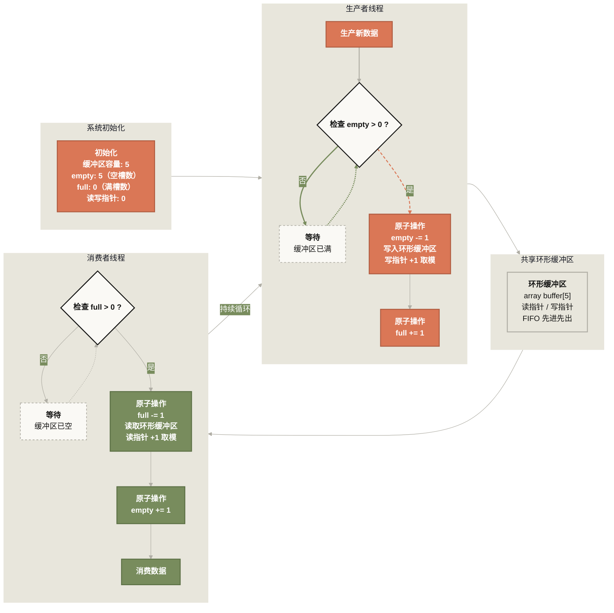

# 第 8 章 同步原语

## `8.1` 同步问题的背景

### `8.1.1` 多核场景

- `8.1.1.1` 多核技术的背景

    1. **单核性能瓶颈**：随着半导体工艺发展，CPU 主频提升遇到了物理和功耗的双重限制（如 "功耗墙""发热问题"），无法再通过单纯提高频率实现性能的线性增长
    2. **多核架构的兴起**：为突破性能瓶颈，CPU 厂商转向增加核心数（即多核处理器），通过并行处理提升整体算力，桌面、移动平台均已全面进入多核时代

- `8.1.1.2` 多核面临的挑战

    1. 正确性问题

        考虑这样一个多线程的计数器：

        ```c
        volatile int balance = 0;  // 共享变量
        
        void *mythread(void *arg) {
            int i;
            for (i = 0; i < 20000; i++) {
                balance++;  // 自增操作
            }
            printf("Balance is %d\n", balance);
            return NULL;
        }
        
        int main(int argc, char *argv[]) {
            pthread_t p1, p2, p3;
            pthread_create(&p1, NULL, mythread, (void *)"A");  // 创建3个线程
            pthread_create(&p2, NULL, mythread, (void *)"B");
            pthread_create(&p3, NULL, mythread, (void *)"C");
            pthread_join(p1, NULL);  // 等待线程执行完成
            pthread_join(p2, NULL);
            pthread_join(p3, NULL);
            printf("Final Balance is %d\n", balance);
        }
        ```

        问题分析：

        1. `balance++`实际分为三步执行
            - 读取：从内存中读取 `balance` 的值（如 10）
            - 修改：将值加 1（变为 11）
            - 写回：将新值写回内存
        2. **并发执行导致指令交错**：例如线程 A 读取 `balance=10` 后，线程 B 也读取了 `balance=10`，两者都加 1 后写回 11，最终 `balance` 只增加了 1，而非预期的 2
        3. **结果表现**：3 个线程各循环 20000 次，预期结果为 60000，但实际运行结果会小于 60000，且每次运行结果不同

    2. 性能可扩展性问题

        共享资源竞争、锁开销、缓存一致性协议开销等，会导致线程数增加时性能无法线性提升，甚至下降

### `8.1.2` 生产者消费者模型



- `8.1.2.1` 生产者消费者问题概述

    生产者消费者问题，也叫「有限缓冲区问题」，描述两类并发线程如何在共享的**有限容量缓冲区**中安全协作：

    - **生产者线程**：生产数据 / 产品，放入缓冲区；若缓冲区满则等待
    - **消费者线程**：从缓冲区取出数据 / 产品，进行消费；若缓冲区空则等待
    - **缓冲区**：大小为 `N` 的先进先出（FIFO）队列，是线程间的共享资源

- `8.1.2.2` 单生产者、单消费者情形

    1. 关键共享变量定义

        ```c
        volatile int empty_slot = 5;  // 空槽数，对应信号量empty，初值=缓冲区容量5
        volatile int filled_slot = 0; // 满槽数，对应信号量full，初值=0
        ```
        `volatile` 关键字：强制变量每次从内存读取，避免编译器优化导致的线程间数据不一致，是多线程场景的必要修饰

    2. 生产者线程逻辑

        ```c
        void producer(void) {
            int new_msg;
            while (TRUE) {
                new_msg = produce_new();  // 步骤1：生产产品
                while (empty_slot == 0);  // 步骤2：缓冲区满则等待
                empty_slot--;             // 申请到空槽，空槽数减1
                buffer_add(new_msg);      // 步骤3：将产品写入缓冲区
                filled_slot++;            // 满槽数加1，通知消费者有新数据
            }
        }
        ```
        核心逻辑：生产 → 等待空槽 → 写入缓冲区 → 通知消费者

    3. 消费者线程逻辑

        ```c
        void consumer(void) {
            int cur_msg;
            while (TRUE) {
                while (filled_slot == 0);  // 步骤1：缓冲区空则自旋等待（简化版P操作）
                filled_slot--;             // 申请到产品，满槽数减1
                cur_msg = buffer_remove(); // 步骤2：从缓冲区取出产品
                empty_slot++;              // 空槽数加1，通知生产者有空位
                consume_msg(cur_msg);      // 步骤3：消费产品
            }
        }
        ```
        核心逻辑：等待数据 → 取出产品 → 通知生产者 → 消费产品

    → 在「单生产者 + 单消费者」场景下，对 `empty_slot` 和 `filled_slot` 的修改不会出现竞态条件（仅一个线程修改变量），因此**无需额外互斥锁保护**

- `8.1.2.3` 多生产者、单消费者情形

    1. 多生产者带来的竞争情况

        1. 数据覆盖问题
            - **执行过程**：
                1. 生产者 1 读取 `buffer_write_cnt=2`，生产者 2 也同时读取 `buffer_write_cnt=2`
                2. 生产者 1 先将数据写入 `buffer[2]`
                3. 生产者 2 随后也将数据写入 `buffer[2]`，覆盖了生产者 1 写入的数据
            - **后果**：缓冲区中丢失了生产者 1 的消息，数据一致性被破坏
        2. 计数错误问题
            - **执行过程**：
                1. 生产者 1 读取 `buffer_write_cnt=2`，生产者 2 也读取 `buffer_write_cnt=2`
                2. 生产者 1 执行 `buffer_write_cnt++`，将值更新为 `3`
                3. 生产者 2 也执行 `buffer_write_cnt++`，但它基于之前读取的 `2` 计算，最终也将值更新为 `3`
            - **后果**：`buffer_write_cnt` 只增加了 1（应增加 2），导致后续写入位置错误，进一步加剧数据混乱

    2. 竞态条件 `Race Condition`

        也称为竞态条件、竞争冒险，指**多个线程 / 进程同时访问共享资源，且最终结果依赖于这些线程 / 进程的执行时序（指令执行的相对顺序）**，导致结果不可预测的现象

        - **核心特征**：程序的行为不再由代码逻辑唯一确定，而是取决于线程调度的随机性，属于典型的并发安全问题
        - **产生的三个必要条件**
            1. **共享资源**：多个线程需要访问同一共享数据
            2. **并发执行**：线程 / 进程在 CPU 上交替执行，指令被打断、交错执行
            3. **非原子操作**：对共享资源的操作不是不可分割的原子操作

### `8.1.3` 临界区问题

- `8.1.3.1` 临界区与临界区问题

    1. **临界区 `Critical Section`**：线程中访问共享资源的代码片段，多个线程不能同时执行这段代码，否则会引发竞争条件
    2. **临界区问题**：如何设计一套机制，让多个线程在并发执行时，能够**安全、有序地访问临界区**，避免竞争条件导致的数据错误

    ```c
    // 临界区问题的一般结构
    while (TRUE) {
        申请进入临界区;   // 进入区（Entry Section）
        临界区部分;      // 访问共享资源的代码
        标示退出临界区;   // 退出区（Exit Section）
        其它代码;        // 剩余区（Remainder Section）
    }
    ```

- `8.1.3.2` 解决临界区问题的一般方法

    | 条件                            | 定义                                                         |
    | ------------------------------- | ------------------------------------------------------------ |
    | **互斥访问 `Mutual Exclusion`** | 同一时刻，最多只有一个线程能进入临界区执行                   |
    | **空闲让进**                    | 当没有线程在临界区执行时，必须允许一个申请进入的线程立即进入临界区，避免资源空闲浪费 |
    | **有限等待**                    | 线程申请进入临界区后，必须在**有限时间内**获得许可，不能无限期等待（避免饥饿问题） |

    → 例如，在单核场景下，线程的调度切换依赖于硬件中断；在线程进入临界区前**关闭硬件中断**，禁止 CPU 响应中断，线程调度器就无法抢占 CPU，当前线程就能独占 CPU 执行临界区代码，直到线程退出临界区后再开启硬件中断，使系统恢复正常调度

## `8.2` 互斥锁

### `8.2.1` 皮特森算法

| 变量     | 含义                                                     |
| -------- | -------------------------------------------------------- |
| `flag[]` | 布尔数组，`flag[i]=TRUE` 表示线程 `i` **申请进入临界区** |
| `turn`   | 整数变量，取值为`0`或`1`，表示当前 "谦让" 给哪个线程     |

```c
// 皮特森算法伪代码示意
// 线程0
while (TRUE) {
    flag[0] = TRUE;    // 步骤1：声明我要进入临界区
    turn = 1;          // 步骤2：谦让，把进入机会让给线程1
    while (flag[1] == TRUE && turn == 1); // 步骤3：等待，直到对方不申请或轮到我
    // 临界区（Critical Section）
    flag[0] = FALSE;   // 步骤4：退出临界区，释放申请标记
    // 其他代码（剩余区）
}

// 线程1
while (TRUE) {
    flag[1] = TRUE;    // 步骤1：声明我要进入临界区
    turn = 0;          // 步骤2：谦让，把进入机会让给线程0
    while (flag[0] == TRUE && turn == 0); // 步骤3：等待，直到对方不申请或轮到我
    // 临界区（Critical Section）
    flag[1] = FALSE;   // 步骤4：退出临界区，释放申请标记
    // 其他代码（剩余区）
}
```

- `8.2.1.1` 解决临界区问题的原理

    1. `flag[]`：解决 "互斥" 的基础

        - 两个线程都通过 `flag[i]=TRUE` 声明 "我要进临界区"，让对方知道我的申请状态
        - 但如果只有 `flag[]`，会出现**死锁**：两个线程都设置了 `flag[i]=TRUE`，互相等待对方退出

    2. `turn`：解决 "死锁" 的关键

        - `turn` 变量强制实现 "谦让"：线程 0 设置 `turn=1`，线程 1 设置 `turn=0`，本质是把决定权交给对方
        - 当两个线程同时申请时，`turn` 最终只会是一个值（0 或 1），**只有一个线程能跳出 while 循环进入临界区**，避免了死锁和同时进入的问题 

    3. 为什么不会出现同时进入临界区的情况 ？

        1. 线程执行顺序中，`flag[i] = TRUE` 必须在 `turn` 赋值之前

        2. 若线程 0 先执行 `flag[0] = TRUE` 和 `turn = 1`，此时线程 1 执行 `flag[1] = TRUE` 和 `turn = 0`：

            - 线程 0 的 while 条件：`flag[1] = TRUE` 且 `turn = 1` → `turn `已被线程 1 改为 `0`，条件不成立，线程 0 进入临界区
            - 线程 1 的 while 条件：`flag[0] = TRUE` 且 `turn = 0` → 条件成立，线程 1 阻塞等待

        3. 反之亦然，`turn` 的二选一特性保证了同一时间只有一个线程能跳出循环

        4. 具体地说，假设两个线程同时进入临界区，那么两个线程都必须跳出 while 循环

            - 对于线程 0，需满足 `flag[1] = FALSE` 或 `turn ≠ 1`

            - 对于线程 1，需满足`flag[0] = FALSE` 或 `turn ≠ 0`

            - 两个线程都设置了 `flag[i] = TRUE`，因此只能依赖 `turn` 变量

            而 `turn` 只能取 0 或 1，任意时刻不可能同时满足 `turn ≠ 1`和 `turn ≠ 0`，因此矛盾，互斥成立

- `8.2.1.2` 皮特森算法的局限性

    1. 原始算法仅支持**两个线程**，扩展到多线程时需要修改逻辑

    2. 依赖**指令按序执行**，现代 CPU 的乱序执行、指令重排序会导致算法失效（需内存屏障配合）

        - 现代 CPU 为了性能，会对指令进行重排序（如将 `turn = 1` 提前到 `flag[0] = TRUE` 之前执行）

        - 若线程 0 的指令被重排序为：`turn = 1` → `flag[0] = TRUE`，线程 1 在 `turn = 1` 时读取 `flag[0]` 仍为 `FALSE`，会直接进入临界区，导致两个线程同时进入临界区，破坏互斥性

    3. 线程优先级反转、调度延迟可能影响公平性

### `8.2.2` 原子操作

- `8.2.2.1` 原子操作的概念

    **问题根源**：生产者 - 消费者模型中，对共享变量的读写操作（如 `buffer_write_cnt` 的自增）被打断，导致数据不一致例如生产者 1 读数据后被打断，生产者 2 修改了同一变量，最终两者的写入结果互相覆盖，导致计数错误

    - **原子操作**就是**不可被打断的一个或一系列操作**，执行过程中其他 CPU 核心 / 线程无法看到中间状态，要么全部执行成功，要么完全不执行（`all-or-nothing`），如同执行一条指令

- `8.2.2.2` 常见的原子操作

    1. 比较与置换 `Compare-And-Swap (CAS)`

        ```c
        int CAS(int *addr, int expected, int new_value) {
            int tmp = *addr;
            if(*addr == expected)
                *addr = new_value;
            return tmp;
        }
        ```

        > **CAS 的 ABA 问题**：
        >
        > - 场景：线程 A 读取变量值为`a`，准备 CAS 修改为 `b`；线程 B 将变量修改为 `c`，再改回 `a`；线程 A 执行 CAS 时，发现变量值仍为 `a`，误以为未被修改，导致逻辑错误
        > - 原因：CAS 只看**最终值是否一样**，不看**中间有没有变动**
        > - 解决方法：使用带版本号的 CAS（如 Java 的 `AtomicStampedReference`），每次修改同时更新版本号，避免 ABA 问题

    2. 拿取并累加 `Fetch-And-Add (FAA)`

        ```c
        int FAA(int *addr, int add_value) {
            int tmp = *addr;
            *addr = tmp + add_value;
            return tmp;
        }
        ```

    > 以上 C 代码仅表示逻辑，真正的原子操作需要**硬件支持**，由一条汇编指令完成

- `8.2.2.3` 硬件层面的原子操作实现
    1. Intel 锁总线 `Bus Lock` 实现
        - **原理**：CPU 执行原子操作时，通过 `LOCK` 信号锁定系统总线，独占对内存的访问权，此时其他 CPU 核心无法访问共享变量，直到操作完成
        - **流程示例**：
            1. CPU0 发起 CAS 操作，锁定总线，独占访问共享变量
            2. CPU1 同时发起 CAS 操作，但总线被锁，无法修改数据，只能等待
            3. CPU0 操作完成后释放总线，CPU1 才能继续执行
        - **缺点**：锁总线会阻塞所有 CPU 核心对总线的访问，性能开销较大，现代 Intel CPU 会结合缓存一致性协议优化，仅锁定缓存行而非整个总线
    2. ARM `Load-Linked/Store-Conditional (LL/SC)` 实现
        - **原理**：分为两步：
            1. `ldxr`（Load-Linked）：读取共享变量，并在本地 Monitor 中标记该地址被监视
            2. `stxr`（Store-Conditional）：尝试写入新值，若监视的地址未被其他 CPU 修改，则写入成功；否则写入失败，需要重试
        - **流程示例**：
            1. CPU0 执行 `ldxr` 读取变量，Monitor 标记地址
            2. CPU1 同时执行 `ldxr` 读取同一变量，Monitor 也标记该地址
            3. CPU0 执行 `stxr` 写入，若地址未被修改则成功；若 CPU1 先修改了地址，CPU0 的 `stxr` 会失败，需要重试
        - **优势**：无需锁定总线，仅在写入时检查地址是否被修改，性能开销更低，更适合多核场景

### `8.2.3` 互斥锁抽象

#### `8.2.3.0` 互斥锁概论

- `8.2.3.0.1` 互斥锁与临界区问题

    - 临界区的本质：当多个线程 / 进程同时访问**共享资源**（如共享变量、文件、设备）时，若操作不是原子的，就会出现数据竞争，导致结果错误

    → 希望能够**保证多个线程对临界区的访问是互斥的，同一时间只有一个线程能进入临界区，避免数据竞争**（由互斥锁来保证）

- `8.2.3.0.2` 互斥锁 `Mutex` 

    - 互斥锁（Mutex，全称 Mutual Exclusion）是一种同步原语，用于保护临界区，实现线程间的互斥访问

        它有两个核心操作：

        - 加锁 `lock()`：尝试获取锁，若锁已被占用，则阻塞或自旋等待
        - 解锁 `unlock()`：释放锁，允许其他等待的线程获取锁

    - **互斥锁的基本逻辑**

        ```c
        mutex_t mutex = MUTEX_INITIALIZER; // 初始化锁
        
        // 线程A
        lock(&mutex);       // 加锁：进入临界区前获取锁
        /* 临界区：访问共享资源的代码 */
        unlock(&mutex);     // 解锁：退出临界区后释放锁
        
        // 线程B
        lock(&mutex);       // 尝试获取锁，若被占用则等待
        /* 临界区：访问共享资源的代码 */
        unlock(&mutex);
        ```

#### `8.2.3.1` （普通）自旋锁

- `8.2.3.1.1` 自旋锁的概念

    **自旋锁是采用忙等待方式实现的互斥锁，用 CPU 空转换上下文切换开销**

    线程获取锁失败时不阻塞，而是循环检查锁状态，这就是所谓的自旋

- `8.2.3.1.2` （普通）自旋锁 `spin lock`

    ```c
    // 利用原子操作实现互斥锁
    // 初始化锁：0表示空闲，1表示被占用
    void lock_init(int *lock) {
        *lock = 0;
    }
    
    // 获取锁：循环CAS直到成功
    void lock(int *lock) {
        // atomic_CAS(lock, 期望旧值, 新值)：原子操作
        while(atomic_CAS(lock, 0, 1) != 0) 
            ; // 锁被占用时，循环自旋等待
    }
    
    // 释放锁：直接设置为空闲
    void unlock(int *lock) {
        *lock = 0;
    }
    ```

    - 要点：`CAS`操作保证 "读 - 修改 - 写" 的原子性，避免竞争条件

    | 优点                           | 缺点                                           |
    | ------------------------------ | ---------------------------------------------- |
    | 无上下文切换开销，响应快       | 等待时占用 CPU 资源（忙等待）                  |
    | 适用于临界区执行时间短的场景   | 批准进入临界区的过程很随意，不保证公平         |
    | 实现简单，无需操作系统调度支持 | 存在线程永远无法进入临界区、出现线程饥饿的可能 |

#### `8.2.3.2` 排号自旋锁

- `8.3.3.2.1` 排号自旋锁的优化

    对于普通自旋锁，多个线程同时抢锁时，没有任何公平性保证，新的、优先级高的线程可能反复抢到锁，而老的线程可能永远抢不到，导致**饥饿 `Starvation`**

    → 排号自旋锁 `Ticket Lock` 通过 `next` 变量原子分配唯一的 ticket 号，线程按 ticket 号顺序获得锁，**严格保证了线程的获取顺序和到达顺序一致**，同时也消除了线程饥饿问题

- `8.2.3.2.2` 排号自旋锁的核心实现

    ```c
    struct lock {
        volatile int owner;  // 当前持有锁的线程号（当前用餐的食客）
        volatile int next;   // 下一个可用的ticket号（下一张号票）
    };
    
    void lock_init(struct lock *lock) {
        lock->owner = 0;
        lock->next = 0;
    }
    
    void lock(struct lock *lock) {
        // 步骤1：原子操作领取ticket号
        volatile int my_ticket = atomic_FAA(&lock->next, 1);
        // 步骤2：自旋等待叫号
        while (lock->owner != my_ticket);
    }
    
    void unlock(struct lock *lock) {
        lock->owner++;
    }
    ```

    1. 初始化时，`owner`和`next`都为 0，相当于 "餐厅刚开门，还没人排队"
    
    2. `atomic_FAA(&lock->next, 1)`：**原子 Fetch-And-Add 操作**，它会原子地读取 `lock->next` 的当前值，然后将其加 1，并返回读取到的旧值
    
        这个过程不可分割，保证每个线程拿到的 ticket 号是唯一的
    
    3. `while`循环：线程自旋等待，直到`owner`等于自己的 ticket 号，才退出循环进入临界区
    
    4. 当前持有锁的线程执行完临界区后，将`owner`加 1，相当于 "叫下一个号"，下一个 ticket 号的线程会退出循环获得锁

## `8.3` 条件变量

- `8.3.1` 从自旋锁到条件变量

    - 自旋锁的执行过程中会有大量的 `while` 死循环，CPU 空转浪费资源

        → 结合线程状态，用**将线程切换为阻塞态**来替换原有的死循环，将 CPU 资源留给有需要的线程

    - 条件变量的核心思想：实现"**等待某个条件成立**"和"**通知条件已成立**"，进而与操作系统配合切换线程的状态，解决自旋锁中 CPU 空转的问题

    > 互斥锁解决"**能不能进**"的问题，条件变量解决"**什么时候进**"的问题，两者解决的不是同一个问题

- `8.3.2` 条件变量的简单实现

    1. 条件变量的核心接口

        1. `cond_wait(cond, mutex)`：**挂起**当前线程，等待条件满足
        2. `cond_signal(cond)`：**唤醒**一个正在等待该条件的线程

        一个处于挂起状态的线程是无法唤醒自己的，一**定有另外一个线程来负责调用 `cond_signal()`**（而非像锁一样在同一个线程中获取锁和解锁）

    2. 生产者 - 消费者问题的条件变量解法

        ```c
        /* =============================================================================
         * 一、条件变量的基本实现
        =============================================================================
         * 
         * 条件变量本质上是"线程等待队列 + 原子阻塞/唤醒机制"。
         * 它必须与互斥锁配合使用，不能单独使用。
         */
        struct cond {
            struct thread *wait_list;  // 等待该条件的线程队列（FIFO链表）
        };
        
        /**
         * @brief 条件变量等待（核心原语）
         * 
         * 【执行流程 - 三步原子操作】
         * 1. 将当前线程加入条件变量的等待队列 wait_list；
         * 2. 原子性地释放互斥锁 mutex，并将当前线程状态置为阻塞（BLOCKED）；
         *    → 这一步必须是"原子"的！若在释放锁之后、阻塞之前发生线程切换，
         *      其他线程可能在此期间执行 cond_signal，导致本次信号永久丢失（Lost Wake-up）。
         * 3. 当被 cond_signal / cond_broadcast 唤醒后，重新竞争并获取互斥锁 mutex，
         *    然后返回调用者。
         * 
         * 【为什么返回后需要重新加锁？】
         * 调用者通常会在 cond_wait 之后立即访问共享状态（如 empty_slot--），
         * 因此 cond_wait 返回时必须保证调用者再次持有锁，以维持互斥不变性。
         */
        void cond_wait(struct cond *cond, struct lock *mutex) {
            list_append(cond->wait_list, thread_self());  // ① 加入等待队列
            atomic_block_unlock(mutex);                   // ② 原子操作：挂起线程 + 释放锁
            lock(mutex);                                  // ③ 被唤醒后：重新获取互斥锁
        }
        
        /**
         * @brief 条件变量信号（唤醒单个线程）
         * 
         * 从等待队列中移除队首线程，并将其状态从阻塞（BLOCKED）改为就绪（READY）。
         * 若等待队列为空，则本次 signal 不产生任何效果（信号丢失，但无危害）。
         */
        void cond_signal(struct cond *cond) {
            if (!list_empty(cond->wait_list)) {
                wakeup(list_remove(cond->wait_list));  // 唤醒一个等待线程
            }
        }
        
        /**
         * @brief 条件变量广播（唤醒全部线程）
         * 
         * 一次性唤醒等待队列中的所有线程。适用于"状态发生全局变化"的场景。
         * 被唤醒的线程会重新竞争互斥锁，只有一个（或少数）能通过 while 条件检查，
         * 其余线程将再次 cond_wait。这也是"惊群效应"（Thundering Herd）的来源。
         */
        void cond_broadcast(struct cond *cond) {
            while (!list_empty(cond->wait_list)) {
                wakeup(list_remove(cond->wait_list));
            }
        }
        
        /* =============================================================================
         * 二、共享状态与同步原语定义
        =============================================================================
         */
        
        int empty_slot = 5;   // 当前空闲槽位数（初始时缓冲区全空，故为5）
        int filled_slot = 0;  // 当前已填充槽位数（初始为0）
        
        /* 
         * 条件变量：作为"事件通知"的抽象记号，本身不保存计数，只维护等待队列。
         * - empty_cond：标记"缓冲区有空位"这一条件成立；
         * - filled_cond：标记"缓冲区有数据"这一条件成立。
         */
        struct cond empty_cond, filled_cond;
        
        /*
         * 互斥锁：保护对应的共享计数器。
         * - empty_cnt_lock：保护 empty_slot 的读写（防止多个生产者同时修改空槽数）；
         * - filled_cnt_lock：保护 filled_slot 的读写（防止多个消费者同时修改满槽数）。
         */
        struct lock empty_cnt_lock, filled_cnt_lock;
        
        /* =============================================================================
         * 三、生产者线程
        =============================================================================
         */
        void producer(void) {
            int new_msg;
            
            while (TRUE) {                    // 无限循环：持续生产
                new_msg = produce_new();      // ① 在临界区外生产数据（耗时操作，避免持有锁）
                
                /* -------------------------------------------------------------
                 * 阶段一：申请空槽（P(empty_slot) 的等价逻辑）
                 * ------------------------------------------------------------- */
                lock(&empty_cnt_lock);        // 进入"空槽计数"临界区
                
                /*
                 * 【核心考点：为什么必须用 while，不能用 if？】
                 * 
                 * 原因 A - 虚假唤醒（Spurious Wakeup）：
                 * 操作系统或硬件可能在未收到 cond_signal 的情况下意外唤醒线程。
                 * 若用 if，线程被虚假唤醒后会直接执行 empty_slot--，而此时 empty_slot 可能仍为 0，
                 * 导致空槽数变为负数，引发缓冲区越界或逻辑错误。
                 * 
                 * 原因 B - 多生产者竞争（惊群效应 / Thundering Herd）：
                 * 若多个生产者同时被 cond_broadcast 唤醒，只有一个能抢到 empty_cnt_lock 并执行。
                 * 当它释放锁后，其他生产者获得锁，但此时 empty_slot 可能再次变为 0，
                 * 必须用 while 重新检查。
                 * 
                 * 结论：条件变量的标准使用范式是"锁 + while + wait"。
                 */
                while (empty_slot == 0) {     // ② 检查条件：没有空位？
                    /*
                     * ③ 条件不满足：原子性地释放 empty_cnt_lock，阻塞在 empty_cond 上。
                     * 当被消费者通过 cond_signal(&empty_cond) 唤醒后，
                     * 本函数内部会自动重新获取 empty_cnt_lock，然后返回。
                     */
                    cond_wait(&empty_cond, &empty_cnt_lock);
                }
                
                /*
                 * ④ 通过 while 检查后，保证 empty_slot > 0。
                 * 此时线程持有 empty_cnt_lock，可以安全地修改共享状态。
                 */
                empty_slot--;                 // 占用一个空槽
                
                unlock(&empty_cnt_lock);      // 退出"空槽计数"临界区
                
                /* -------------------------------------------------------------
                 * 阶段二：将数据放入缓冲区
                 * ------------------------------------------------------------- */
                buffer_add_safe(new_msg);     // ⑤ 写入缓冲区（假设此操作线程安全）
                
                /* -------------------------------------------------------------
                 * 阶段三：通知消费者"有数据了"（V(filled_slot) 的等价逻辑）
                 * ------------------------------------------------------------- */
                lock(&filled_cnt_lock);       // 进入"满槽计数"临界区
                
                filled_slot++;                // ⑥ 增加已填充槽位数
                
                /*
                 * ⑦ 唤醒一个（或多个）因"无数据可消费"而阻塞的消费者。
                 * 注意：cond_signal 不要求调用者知道是否有等待者；若无人等待，信号直接丢弃。
                 * 这里使用 cond_signal 而非 cond_broadcast，因为每次只生产了一个数据，
                 * 唤醒一个消费者即可，避免不必要的上下文切换。
                 */
                cond_signal(&filled_cond);
                
                unlock(&filled_cnt_lock);     // 退出"满槽计数"临界区
            }
        }
        
        /* =============================================================================
         * 四、消费者线程
        =============================================================================
         */
        void consumer(void) {
            int cur_msg;
            
            while (TRUE) {                    // 无限循环：持续消费
                
                /* -------------------------------------------------------------
                 * 阶段一：申请数据（P(filled_slot) 的等价逻辑）
                 * ------------------------------------------------------------- */
                lock(&filled_cnt_lock);       // 进入"满槽计数"临界区
                
                /*
                 * 同样必须使用 while 包裹 cond_wait：
                 * - 防止虚假唤醒导致在 filled_slot == 0 时执行 filled_slot--；
                 * - 防止多个消费者被同时唤醒后竞争，后获得锁的消费者面对空缓冲区。
                 */
                while (filled_slot == 0) {    // ② 检查条件：没有数据？
                    /*
                     * ③ 条件不满足：原子性地释放 filled_cnt_lock，阻塞在 filled_cond 上。
                     * 当被生产者通过 cond_signal(&filled_cond) 唤醒后，
                     * 自动重新获取 filled_cnt_lock。
                     */
                    cond_wait(&filled_cond, &filled_cnt_lock);
                }
                
                /*
                 * ④ 通过 while 检查后，保证 filled_slot > 0。
                 * 安全地消费一个数据名额。
                 */
                filled_slot--;                // 减少已填充槽位数
                
                unlock(&filled_cnt_lock);      // 退出"满槽计数"临界区
                
                /* -------------------------------------------------------------
                 * 阶段二：从缓冲区取出数据
                 * ------------------------------------------------------------- */
                cur_msg = buffer_remove_safe(); // ⑤ 读取缓冲区（假设线程安全）
                
                /* -------------------------------------------------------------
                 * 阶段三：通知生产者"有空位了"（V(empty_slot) 的等价逻辑）
                 * ------------------------------------------------------------- */
                lock(&empty_cnt_lock);         // 进入"空槽计数"临界区
                
                empty_slot++;                  // ⑥ 释放一个空槽
                
                /*
                 * ⑦ 唤醒一个因"无空位"而阻塞的生产者。
                 * 生产者被唤醒后，会在 cond_wait 返回处重新持有 empty_cnt_lock，
                 * 并通过 while 检查 empty_slot > 0，随后开始生产。
                 */
                cond_signal(&empty_cond);
                
                unlock(&empty_cnt_lock);       // 退出"空槽计数"临界区
                
                /* -------------------------------------------------------------
                 * 阶段四：消费数据（在锁外执行，减少临界区长度）
                 * ------------------------------------------------------------- */
                consume_msg(cur_msg);          // ⑧ 处理数据（耗时操作，不持有任何锁）
            }
        }
        
        /* =============================================================================
         * 五、关键机制图解与逻辑关系
        =============================================================================
         * 
         * 【线程状态转换 - 以消费者为例】
         * 
         *   运行态 ──lock(&filled_cnt_lock)──→ 临界区检查 filled_slot
         *      │
         *      ▼ filled_slot == 0
         *   cond_wait(&filled_cond, &filled_cnt_lock)
         *      │    ├─ ① list_append 到 filled_cond.wait_list
         *      │    ├─ ② atomic_block_unlock(&filled_cnt_lock) → 释放锁 + 阻塞
         *      │    ▼
         *   阻塞态（等待"有数据"事件）
         *      │
         *      │ 生产者执行 cond_signal(&filled_cond)
         *      ▼
         *   就绪态 ←────────────────────────── 被 wakeup()
         *      │
         *      ▼ 调度器调度
         *   运行态 ←─ cond_wait 内部重新 lock(&filled_cnt_lock) ─┘
         *      │
         *      ▼ filled_slot > 0（while 保证）
         *   filled_slot-- → unlock → 继续执行
         */
        ```

## `8.4` 信号量

### `8.4.0` 条件变量的局限性

- **"条件"与"变量"分离**：程序员心里想的条件是 `empty_slot != 0`，但代码中 `cond_empty` 的定义与这个条件声明是物理分离的
- **语义不透明**：新程序员很难从代码中直接看出 `empty_cond` 对应的是哪个条件
- **维护困难**：容易写错对应关系，导致逻辑错误

→ 条件变量只提供了"等待/唤醒"的机制，但**没有将"等待的条件"本身封装进原语中**；程序员需要自行维护额外的状态变量（如 `empty_slot`、`filled_slot`）和对应的锁，这增加了心智负担

### `8.4.1` 信号量与 PV 原语

- 信号量 `Semaphore` 是对条件变量的**简化设计**，其核心思想是：**根据剩余资源的数量决定线程执行或等待**

    |    操作    |       名称       | 逻辑含义                   | 代码示意                       |
    | :--------: | :--------------: | :------------------------- | :----------------------------- |
    | **P 操作** | Proberen（检验） | 申请资源，若资源不足则阻塞 | `wait(S)`: `while(S<=0); S--;` |
    | **V 操作** | Verhogen（自增） | 释放资源，唤醒等待线程     | `signal(S)`: `S++;`            |

- 生产者 - 消费者问题的信号量解法

    ```c
    // 定义信号量结构体
    struct sem {
        // value 为正：表示剩余可用资源数量
        // value 为负：其绝对值表示正在等待资源的线程数量
        int value;
    
        // wakeup：记录应当被唤醒的线程数量
        // 用于解决条件变量的“惊群效应"，确保signal唤醒的线程数与资源数匹配
        int wakeup;
    
        // sem_lock：保护信号量内部状态的互斥锁
        // 因为 value 和 wakeup 会被多个线程同时读写，必须用锁保护
        struct lock sem_lock;
    
        // sem_cond：条件变量，用于让等待资源的线程在此阻塞
        // 当资源不足时，线程挂起自己并等待别人来唤醒
        struct cond sem_cond;
    };
    
    // ============================================
    // wait 操作：申请资源（P操作 / Proberen）
    // 语义：我要用一个资源，如果没有了就排队等
    // ============================================
    void wait(struct sem *S) {
        // 先加锁，保护信号量的共享状态（value, wakeup）
        // 保证同一时刻只有一个线程修改信号量内部数据
        lock(&S->sem_lock);
    
        // 申请一个资源，资源数减1
        // 【关键】先减后判断！即使资源不够也先减，这样 value 为负时，
        // 其绝对值正好等于正在排队的线程数量
        S->value--;
    
        // 如果 value < 0，说明资源不足（减之前就已经不够了），当前线程需要等待
        if (S->value < 0) {
            do {
                // cond_wait 会自动释放 sem_lock 并让线程进入睡眠状态
                // 这样其他线程才有机会进入临界区去释放资源
                // 被唤醒后，cond_wait 会自动重新获取 sem_lock
                cond_wait(&S->sem_cond, &S->sem_lock);
                
                // 【初学者重点】为什么要用 do-while 而不是 if？
                // 1. 防止"虚假唤醒"：操作系统可能偶尔无故唤醒线程
                // 2. 防止"惊群效应"：如果有多个线程被唤醒，但只有一个资源，
                //    需要确保只有拿到"wakeup名额"的线程才能继续执行
            } while (S->wakeup == 0);  // 如果 wakeup == 0，说明还没轮到我，继续睡
    
            // 消耗一次唤醒信号，当前线程成功被唤醒并准备拿走资源
            // 这相当于从"待唤醒名额"中核销一个
            S->wakeup--;
        }
    
        // 解锁，释放对信号量的保护，让其他线程可以操作信号量
        unlock(&S->sem_lock);
    }
    
    // ============================================
    // signal 操作：释放资源（V操作 / Verhogen）
    // 语义：我归还一个资源，如果有线程在排队，叫醒一个
    // ============================================
    void signal(struct sem *S) {
        // 先加锁，保护信号量的共享状态
        lock(&S->sem_lock);
    
        // 释放一个资源，资源数加1
        S->value++;
    
        // 如果 value <= 0，说明有线程正在等待资源
        // 【理解技巧】：
        //   - 若 value 原来是 -2（2人排队），加1后变为 -1，仍 <= 0，说明还有人等，需要唤醒
        //   - 若 value 原来是 0（刚好用完，无人排队），加1后变为 1，> 0，无需唤醒
        //   - 若 value 原来是 1（还剩1个），加1后变为 2，> 0，无需唤醒
        if (S->value <= 0) {
            // 记录一次唤醒信号：告诉等待的线程"有一个名额可以醒来拿资源了"
            S->wakeup++;
            
            // 发送条件变量信号，唤醒一个正在 cond_wait 上睡觉的线程
            // 注意：cond_signal 只会唤醒一个线程（而不是全部），避免惊群
            cond_signal(&S->sem_cond);
        }
    
        // 解锁，释放对信号量的保护
        unlock(&S->sem_lock);
    }
    
    // empty_slot：表示缓冲区中"空槽位"的数量
    // 初值 = 缓冲区大小 n（一开始全是空的）
    sem_t empty_slot;
    
    // filled_slot：表示缓冲区中"已填充槽位"（产品）的数量
    // 初值 = 0（一开始没有产品）
    sem_t filled_slot;
    
    // 生产者进程：不断制造产品放入缓冲区
    void producer(void) {
        while(TRUE) {
            // 生产一个新产品（这一步在临界区外，提高并发度）
            new_msg = produce_new();
    
            // P(empty_slot)：申请一个空槽位
            // 如果缓冲区满了（empty_slot == 0），这里会阻塞，直到消费者取走产品
            wait(&empty_slot);
    
            // 【临界区】将产品放入缓冲区
            // 此时一定有空位，因为 wait 已经确保了这一点
            buffer_add_safe(new_msg);
    
            // V(filled_slot)：增加一个已填充位，通知消费者"有新产品了"
            signal(&filled_slot);
        }
    }
    
    // 消费者进程：不断从缓冲区取出产品消费
    void consumer(void) {
        while(TRUE) {
            // P(filled_slot)：申请一个产品
            // 如果缓冲区空了（filled_slot == 0），这里会阻塞，直到生产者放入产品
            wait(&filled_slot);
    
            // 【临界区】从缓冲区取出产品
            // 此时一定有产品，因为 wait 已经确保了这一点
            cur_msg = buffer_remove_safe();
    
            // V(empty_slot)：释放一个空位，通知生产者"有空地方了"
            signal(&empty_slot);
    
            // 消费产品（这一步在临界区外，提高并发度）
            consume_msg(cur_msg);
        }
    }
    ```

## `8.5` 读写锁

- `8.5.1` 读写锁

    1. 公告栏问题

        **场景描述**：想象校园里的公告栏（共享数据）：

        - **写者 `Writer`**：发布通知的人，需要更新公告栏内容
        - **读者 `Reader`**：查看通知的学生群体，需要读取公告栏内容
        - 特点
            1. 读者只读内容，多个读者之间是不互斥的（**操作类型的异质性**——读操作和写操作对数据一致性的威胁程度完全不同）
            2. 需要通过设计来避免

    2. 互斥锁的局限性

        - **互斥锁所有线程均互斥**：同一时刻只能有一个线程进入临界区
        - **对只读线程过于严厉**：即使多个线程只是读取（不修改）共享数据，也必须排队进入

        问题在于读者之间本可以安全并行，但互斥锁强制串行化，造成性能浪费

    3. 读写锁

        区分读者与写者，**允许多个读者同时进入临界区**，但是读者与写者之间互斥

        | 访问组合    | 是否允许并行 | 原因                               |
        | ----------- | ------------ | ---------------------------------- |
        | 读者 + 读者 | ✅ **允许**   | 只读操作不修改数据，互不干扰       |
        | 读者 + 写者 | ❌ **互斥**   | 防止读者读到写者修改中的不一致数据 |
        | 写者 + 写者 | ❌ **互斥**   | 防止两个写者同时修改导致数据混乱   |

        ```c
        struct rwlock lock;      // 声明读写锁
        char data[SIZE];         // 共享数据
        
        // ========== 读者线程 ==========
        void reader(void) {
            lock_reader(&lock);     // 获取读锁（共享）
            read_data(data);        // 读临界区：多个读者可同时执行
            unlock_reader(&lock);   // 释放读锁
        }
        
        // ========== 写者线程 ==========
        void writer(void) {
            lock_writer(&lock);     // 获取写锁（独占）
            update_data(data);      // 写临界区：独占执行
            unlock_writer(&lock);   // 释放写锁
        }
        ```

        - 读者加锁时，如果没有写者持有锁，可直接进入，并允许其他读者同时进入
        - 写者加锁时，必须等待所有读者和写者退出后才能独占临界区
        - 适用于**写者较少、读者较多**的场景（如配置文件读取、缓存查询等）

    4. **读写锁的偏向性**

        1. 偏向性的体现
            $$
            \boxed{
            \begin{array}c
            \boxed{\text{读者}}~~\boxed{\text{读者}}~~\boxed{\text{读者}}\\
            \downarrow ~~~~~~\downarrow ~~~~~~\downarrow\\
            \boxed{~~~~~~~\boxed{\text{读者}}\\~~~~~~~\text{临界区}~~~~~~~}\\
            \uparrow\\
            \boxed{写者}\\
            \text{下一个谁进入临界区？}
            \end{array}
            }\\\\
            \text{有读者在临界区} \rightarrow \text{有写者在临界区} \rightarrow \text{另一个读者能否进入临界区？}\\
            $$

            - 偏向写者的读写锁：后序读者必须等待写者进入并离开后才可进入，更公平
            - 偏向读者的读写锁：后序读者可以直接进入临界区，具有更好的并行性

        2. 读者优先 `Reader-Preference` 的读写锁

            只要有读者持有读锁，后续到达的读者都可以直接进入，写者必须等待**所有读者**（包括后续新来的读者）完成

            ```c
            /**
             * ============================================================
             * 读者优先型读写锁（Reader-Preference RWLock）实现
             * ============================================================
             * 
             * 【核心设计思想】
             *  1. 读者之间不互斥：允许多个读者同时进入临界区读数据
             *  2. 读者与写者互斥：只要有读者在读，写者就必须阻塞等待
             *  3. 写者与写者互斥：writer_lock 保证同一时间只有一个写者
             * 
             * 【实现策略】
             *  采用"读者计数器 + 双重互斥锁"方案：
             *  - reader_cnt：记录当前正在读操作的读者总数
             *  - reader_lock：保护 reader_cnt 的互斥锁（防止多个读者同时修改计数器导致竞态）
             *  - writer_lock：全局互斥锁，用于隔离"写者"与"所有读者"
             * 
             * 【关键机制】
             *  - 第一个读者负责"关门"：获取 writer_lock，阻止写者进入
             *  - 最后一个读者负责"开门"：释放 writer_lock，允许写者进入
             *  - 中间进出的读者只修改计数器，不触碰 writer_lock
             * 
             * ============================================================
             */
            
            // 读写锁结构体
            struct rwlock {
                int reader_cnt;          // 当前正在执行读操作的读者数量
                           // 当 reader_cnt > 0 时，表示"有读者在临界区内"
                           // 当 reader_cnt == 0 时，表示"没有读者，写者可以申请进入"
                
                struct lock reader_lock; // 保护 reader_cnt 的互斥锁
                           // 作用：确保多个读者同时对 reader_cnt 进行 +1 / -1 时是线程安全的
                           // 注意：reader_lock 只保护计数器，不保护临界区数据本身
                
                struct lock writer_lock; // 全局写锁 / 读写隔离锁
                           // 作用：
                           // 1. 写者进入前必须获取，保证写者独占临界区
                           // 2. 第一个读者进入时也会获取，从而阻止后续写者进入
                           // 3. 只要有任何一个读者持有该锁，所有写者都被阻塞在 lock_writer() 中
            };
            
            /************************** 读者加锁 **************************/
            void lock_reader(struct rwlock *lock) {
                // Step 1: 获取 reader_lock，独占访问 reader_cnt
                // 原因：reader_cnt 是共享变量，多个读者可能同时调用 lock_reader()
                // 如果不加保护，同时 +1 会导致计数丢失（Race Condition）
                lock(&lock->reader_lock);
            
                // Step 2: 读者计数 +1
                // 表示"又有一个读者准备进入临界区读数据"
                lock->reader_cnt++;
            
                // Step 3: 判断自己是否是"第一个读者"
                // 关键逻辑：只有第一个读者才需要去获取 writer_lock
                // 后续读者（reader_cnt >= 2）不需要重复获取，因为 writer_lock 已经被第一个读者持有了
                if (lock->reader_cnt == 1) {
                    // 【"关门"操作】
                    // 第一个读者抢占 writer_lock，相当于给临界区上了"读保护"
                    // 这把锁会一直持有，直到最后一个读者离开时才释放
                    // 效果：阻塞试图进入的写者，但不妨碍其他读者进入(因为它们只竞争 reader_lock)
                    lock(&lock->writer_lock);
                }
            
                // Step 4: 释放 reader_lock
                // 原因：计数器修改已完成，尽快释放，让其他读者也能进入
                // 此时 writer_lock 仍被当前读者（作为第一个读者的代表）持有
                // 所以虽然 reader_lock 释放了，但写者仍然进不来
                unlock(&lock->reader_lock);
                
                // 至此，读者可以安全地进入临界区执行读操作
                // 此时可能有多个读者同时持有 writer_lock 的"间接使用权"（通过 reader_cnt > 0）
            }
            
            /************************** 读者解锁 **************************/
            void unlock_reader(struct rwlock *lock) {
                // Step 1: 再次获取 reader_lock，独占访问 reader_cnt
                // 原因：即将修改共享计数器，必须串行化访问
                lock(&lock->reader_lock);
            
                // Step 2: 读者计数 -1
                // 表示"有一个读者读完了，准备退出临界区"
                lock->reader_cnt--;
            
                // Step 3: 判断自己是否是"最后一个读者"
                // 关键逻辑：只有最后一个读者才需要去释放 writer_lock
                // 如果 reader_cnt > 0，说明还有读者在读，不能释放 writer_lock（否则写者会闯入）
                if (lock->reader_cnt == 0) {
                    // 【"开门"操作】
                    // 最后一个读者释放 writer_lock，解除对写者的封锁
                    // 此时如果有写者在 lock_writer() 中阻塞等待，它将被唤醒并有机会获取锁
                    // 如果有多个写者在等待，只有一个能拿到 writer_lock（写者之间互斥）
                    unlock(&lock->writer_lock);
                }
            
                // Step 4: 释放 reader_lock
                // 允许其他读者/写者后续竞争并修改 reader_cnt
                unlock(&lock->reader_lock);
            }
            
            /************************** 写者加锁 **************************/
            void lock_writer(struct rwlock *lock) {
                // 写者直接尝试获取 writer_lock
                // 
                // 【可能遇到的情况】
                // 情况 A：当前没有读者，也没有其他写者 → 直接获取成功，进入临界区
                // 情况 B：当前有读者在读（reader_cnt > 0）→ 第一个读者已经持有了 writer_lock
                //         当前写者会被阻塞在 lock() 内部，直到最后一个读者调用 unlock_writer() 释放 writer_lock
                // 情况 C：当前有其他写者在写 → writer_lock 已被占用，当前写者同样被阻塞
                //
                // 效果：完美实现了"读写互斥"和"写写互斥"
                lock(&lock->writer_lock);
                
                // 至此，写者独占临界区，此时不可能有任何读者或其他写者在临界区内
            }
            
            /************************** 写者解锁 **************************/
            void unlock_writer(struct rwlock *lock) {
                // 写者操作完成后，释放 writer_lock
                // 
                // 【唤醒优先级问题】
                // 释放 writer_lock 后，等待队列中可能同时存在：
                // - 被阻塞的写者（在 lock_writer() 中等待）
                // - 被阻塞的读者（在 lock_reader() 的 reader_lock 中等待，或新来的读者）
                unlock(&lock->writer_lock);
            }
            ```

            - **为什么 reader\_lock 和 writer\_lock 都要用互斥锁？**

                `reader_lock` 只保护计数器；`writer_lock` 保护整个临界区

                前者让读者串行修改计数器，后者隔离读写两类角色

            - **为什么第一个读者要获取 writer\_lock，而不是每个读者都获取？**

                如果每个读者都获取/释放 `writer_lock`，那就退化成了普通互斥锁，失去了"读读并行"的意义

            - **如果写者先拿到 writer\_lock，读者还能进来吗？**

                不能

                读者在 `lock_reader()` 中只有当 `reader_cnt == 1` 时才会尝试获取 `writer_lock`，如果写者已持有，第一个读者会被阻塞在 `lock(&writer_lock)` 处，后续读者则被阻塞在 `lock(&reader_lock)` 处（因为第一个读者没释放 `reader_lock`）

        3. 写者优先 `Writer-Preference` 的读写锁

            一旦有写者在等待，会阻塞后续新到达的读者，确保现有读者完成后，写者能优先获得锁

            ```c
            /**
             * ============================================================
             * 写者优先型读写锁（Writer-Preference RWLock）实现
             * ============================================================
             * 
             * 【核心设计思想】
             *  1. 读者之间可并行：多个读者可同时进入临界区读数据
             *  2. 读者与写者互斥：写者进入时，必须等待所有读者退出
             *  3. 写者与写者互斥：同一时间只有一个写者能进入临界区
             *  4. 写者优先：一旦写者开始申请锁，后续新到达的读者必须阻塞，
             *     直到该写者完成写操作。避免写者长期饥饿。
             * 
             * 【实现策略】
             *  采用"全局互斥锁 + 条件变量 + 状态标记"方案：
             *  - lock：全局互斥锁，保护所有状态变量（reader_cnt, has_writer）
             *  - has_writer：布尔标志，表示"有写者正在等待或正在写"
             *             该标志一旦置位，就像一道闸门，挡住后续所有新读者
             *  - reader_cnt：当前正在读的读者数量
             *  - reader_cond：写者专用的等待条件，写者在此等待"所有读者退出"
             *  - writer_cond：读者和写者共用的等待条件，在此等待"写者离开"
             * 
             * 【关键机制：写者的"预约"机制】
             *  写者在 lock_writer() 中，一旦获取全局锁，立即将 has_writer = TRUE。
             *  这个动作发生在"等待现有读者退出"之前，相当于"先占坑、后排位"：
             *  - 对于已经在读的读者：写者 patiently 等待它们读完（reader_cnt 减到 0）
             *  - 对于后续新来的读者：看到 has_writer == TRUE，直接在 lock_reader() 中阻塞
             *  这就确保了"写者排队期间，新读者不能插队"，从而实现写者优先。
             * 
             * 【注意：本实现为"近似写者优先"】
             *  严格写者优先通常需要 FIFO 队列保证绝对公平。
             *  本实现通过 has_writer 标志实现了"新读者让路"，但在 unlock_writer()
             *  广播唤醒时，读者和写者的唤醒顺序仍取决于系统调度器。
             * ============================================================
             */
            
            // 偏向写者的读写锁结构体
            struct rwlock {
                volatile int reader_cnt;   // 当前正在执行读操作的读者数量
                                   // volatile 修饰：防止编译器优化导致多线程间不可见
                                   // 注意：实际原子性由全局锁 lock 保证，volatile 仅防优化重排
                
                volatile bool has_writer;  // 写者状态标志
                                   // TRUE  表示：有写者正在等待读者退出，或正在执行写操作
                                   // FALSE 表示：当前无写者，读者可以自由进入
                
                struct lock lock;          // 全局互斥锁
                                   // 作用：保护 reader_cnt 和 has_writer 的读写一致性
                                   // 所有对状态变量的访问必须先获取此锁
                
                struct cond reader_cond;   // 读者条件变量（供写者等待使用）
                                   // 写者在此等待，直到 reader_cnt 减为 0（所有读者退出）
                                   // 名称含义："与读者数量相关的条件"
                
                struct cond writer_cond;   // 写者条件变量（供读者和写者等待使用）
                                   // 读者在此等待 has_writer 变为 FALSE
                                   // 写者在此等待前一个写者离开（has_writer 变为 FALSE）
                                   // 名称含义："与写者存在性相关的条件"
            };
            
            /************************** 读者加锁 **************************/
            void lock_reader(struct rwlock *rwlock) {
                // Step 1: 获取全局锁，独占访问读写锁状态
                // 原因：reader_cnt 和 has_writer 是共享状态，必须串行化访问
                lock(&rwlock->lock);
            
                // Step 2: 检查是否有写者在等待或正在写
                // 【写者优先的核心闸门】
                // 只要 has_writer == TRUE，无论当前有没有读者在读，新读者都必须等待。
                // 这防止了"读者源源不断到来导致写者永远拿不到锁"的饥饿问题。
                while (rwlock->has_writer == TRUE) {
                    // 当前有写者在"排队"或"正在写"，读者不能进入。
                    // cond_wait 会自动原子性地：
                    //   (a) 释放 rwlock->lock（让其他线程能修改状态）
                    //   (b) 将当前线程挂起到 writer_cond 的等待队列
                    //   (c) 被唤醒后，自动重新获取 rwlock->lock，然后返回继续执行
                    // 
                    // 读者被唤醒的时机：当某个写者完成写操作，在 unlock_writer() 中
                    // 调用 cond_broadcast(&writer_cond) 时。
                    cond_wait(&rwlock->writer_cond, &rwlock->lock);
                }
            
                // Step 3: 没有写者阻碍，读者计数 +1，正式进入读状态
                // 此时 has_writer == FALSE，读者可以安全进入临界区
                rwlock->reader_cnt++;
            
                // Step 4: 释放全局锁
                // 尽快释放，允许其他读者或写者竞争状态
                // 注意：此时 reader_cnt > 0，如果后续有写者到达，会在 lock_writer() 中
                // 设置 has_writer = TRUE，然后阻塞在 reader_cond 上等待所有读者退出
                unlock(&rwlock->lock);
                
                // 至此，读者可以安全进入临界区执行读操作
            }
            
            /************************** 读者解锁 **************************/
            void unlock_reader(struct rwlock *rwlock) {
                // Step 1: 获取全局锁，准备修改读者计数
                lock(&rwlock->lock);
            
                // Step 2: 读者计数 -1，表示一个读者退出临界区
                rwlock->reader_cnt--;
            
                // Step 3: 判断是否是最后一个读者
                // 关键逻辑：只有最后一个读者退出时，才需要唤醒等待的写者
                if (rwlock->reader_cnt == 0) {
                    // 【"开门"操作】
                    // 发送信号唤醒一个（或所有）在 reader_cond 上等待的写者
                    // 被唤醒的写者会从 lock_writer() 中的 cond_wait 返回，
                    // 此时 reader_cnt == 0，while 循环条件不满足，写者可以进入临界区。
                    // 
                    // 使用 cond_signal（而非 broadcast）通常足够，因为同一时间
                    // 最多只有一个写者能突破 has_writer 检查并到达此处等待。
                    cond_signal(&rwlock->reader_cond);
                }
            
                // Step 4: 释放全局锁
                unlock(&rwlock->lock);
            }
            
            /************************** 写者加锁 **************************/
            void lock_writer(struct rwlock *rwlock) {
                // Step 1: 获取全局锁，开始写者加锁流程
                lock(&rwlock->lock);
            
                // Step 2: 写者之间互斥检查
                // 如果已经有另一个写者在等待或正在写，当前写者必须排队
                // 这保证了"写写互斥"：同一时间最多只有一个写者能持有锁
                while (rwlock->has_writer == TRUE) {
                    // 挂起到 writer_cond，等待前一个写者完成并 broadcast
                    cond_wait(&rwlock->writer_cond, &rwlock->lock);
                }
            
                // Step 3: 【预约机制：设置写者标志】
                // 这是实现"写者优先"最关键的一步。
                // 写者在还没有真正进入临界区之前，就先把 has_writer 设为 TRUE。
                // 效果：
                //   - 后续新到达的读者在 lock_reader() 中看到 has_writer == TRUE，
                //     会直接阻塞在 writer_cond 上，无法进入。
                //   - 这就避免了"读者不断涌入，写者永远等待"的饥饿现象。
                rwlock->has_writer = TRUE;
            
                // Step 4: 等待所有现有读者退出
                // 如果有读者正在读（reader_cnt > 0），写者必须等待。
                // 注意：此时 has_writer 已经是 TRUE，新读者被挡在外面，
                // 所以 reader_cnt 只会减少，不会增加。写者只需要等现有读者读完。
                while (rwlock->reader_cnt > 0) {
                    // 挂起到 reader_cond，等待最后一个读者调用 unlock_reader()
                    // 并发出 cond_signal(&reader_cond) 来唤醒自己。
                    cond_wait(&rwlock->reader_cond, &rwlock->lock);
                }
            
                // Step 5: 释放全局锁，进入临界区执行写操作
                // 此时：
                //   - has_writer == TRUE（阻止新读者和新写者）
                //   - reader_cnt == 0（没有读者在读）
                //   - 当前写者独占临界区
                unlock(&rwlock->lock);
            }
            
            /************************** 写者解锁 **************************/
            void unlock_writer(struct rwlock *rwlock) {
                // Step 1: 获取全局锁，准备修改状态
                lock(&rwlock->lock);
            
                // Step 2: 清除写者标记，表示"当前没有写者在临界区"
                rwlock->has_writer = FALSE;
            
                // Step 3: 广播唤醒所有等待在 writer_cond 上的线程
                // 【为什么用 broadcast 而不是 signal？】
                // 因为 writer_cond 的等待队列中可能同时存在：
                //   - 多个被 has_writer 挡住的读者（在 lock_reader() 中等待）
                //   - 多个排队等待的写者（在 lock_writer() 的 Step 2 中等待）
                // 
                // 使用 cond_broadcast 可以确保：
                //   - 所有等待的读者都被唤醒，它们会竞争全局锁，然后检查 has_writer == FALSE，
                //     从而可以进入并 reader_cnt++。
                //   - 所有等待的写者也被唤醒，它们会竞争全局锁，然后检查 has_writer == FALSE，
                //     最先拿到锁的那个写者会将 has_writer 重新设为 TRUE，其他写者再次阻塞。
                // 
                // 【潜在竞争】
                // broadcast 后，如果系统调度器先让某个读者获取了全局锁并 reader_cnt++，
                // 随后某个写者也获取了全局锁，它会看到 reader_cnt > 0 并再次阻塞在 reader_cond。
                // 这是正确且安全的行为，符合读写互斥原则。
                cond_broadcast(&rwlock->writer_cond);
            
                // Step 4: 释放全局锁
                // 此后，被唤醒的读者和写者将竞争全局锁，决定下一个进入临界区的角色。
                unlock(&rwlock->lock);
            }
            ```

            - **为什么 unlock\_writer() 用 broadcast 而不是 signal？**

                因为 `writer_cond` 上可能同时阻塞着**多个读者**和**多个写者**

                signal 只唤醒一个，可能导致其他读者/写者永远饥饿，broadcast 确保所有等待者都有机会竞争

            - **has\_writer 在 lock\_writer() 中为什么要在等待读者之前就设为 TRUE？**

                这是"预约"机制的核心

                如果等读者退出后再设 TRUE，那在这段时间内新读者会涌入，写者又要继续等；先设为 TRUE 可以**立即挡住后续读者**，保证写者优先

            - **reader\_cond 和 writer\_cond 分别给谁用？**

                `reader_cond`：专供**写者**等待"读者全部退出"使用

                `writer_cond`：供**读者**等待"无写者"使用，也供**写者**等待"前一个写者离开"使用
            
            | 维度                   | 读者优先               | 写者优先                                      |
            | ---------------------- | ---------------------- | --------------------------------------------- |
            | **核心标志**           | `reader_cnt` 计数器    | `has_writer` 布尔标志                         |
            | **写者饥饿风险**       | ❌ 高（读者可无限涌入） | ✅ 低（新读者被 has\_writer 挡住）             |
            | **读者饥饿风险**       | 无                     | ⚠️ 可能（写者连续到达时读者长期等待）          |
            | **同步原语**           | 两把互斥锁             | 一把互斥锁 + 两个条件变量                     |
            | **"预约"机制**         | 无                     | 有：写者先设 has\_writer=TRUE，再等待读者退出 |
            | **第一个读者的动作**   | 获取 writer\_lock      | 无特殊动作，直接 cnt++                        |
            | **最后一个读者的动作** | 释放 writer\_lock      | signal reader\_cond 唤醒写者                  |
            | **写者唤醒方式**       | 自动唤醒（锁释放）     | 依赖 cond\_broadcast 唤醒等待队列             |

- `8.5.2` RCU 锁 

    1. `Read-Copy-Update (RCU)` 锁的概念

        核心思想：**读者无锁直读，写者复制后发布**

        | 阶段       | 操作内容                                   | 关键特征                           |
        | ---------- | ------------------------------------------ | ---------------------------------- |
        | **Read**   | 读者直接**读取共享指针**指向的数据         | **无锁、无原子操作、不阻塞**       |
        | **Copy**   | 写者分配新内存，复制旧数据，在副本上修改   | 写者操作不影响正在读取旧数据的读者 |
        | **Update** | 通过原子操作发布**新指针**，延迟释放旧版本 | 依赖**宽限期**确保旧数据可安全回收 |

        - 关键操作：
            1. `rcu_dereference(p)`：通过指针来访问数据
            2. `rcu_assign_pointer(p, newp)`：靠指针赋值的原子性，保证读者看到的对象状态完整
            3. `synchronize_rcu()`：请求等待宽限期，保证调用 `rcu_assign_pointer` 切换指针**之前**已经进入 **RCU 读临界区**的所有旧读者，**必然已经全部退出读临界区**

    2. 宽限期 `Grace Period`

        宽限期是指**从写者发布新指针的那一刻起，到系统中所有 CPU 都至少经历过一次"静默状态 `Quiescent State`" 为止的这段时间**

        - **静默状态**：指某个 CPU 不在 RCU 读临界区内的状态，具体表现为：
        - 发生了进程上下文切换
          
        - 进入了空闲循环（idle）
          
        - 禁用了抢占后重新启用（即执行了 `rcu_read_unlock()`）
        
        > 一旦某个 CPU 进入过静默状态，它就不可能拥有对旧数据的引用
        
        → 宽限期本质上是一种**延迟回收 `Deferred Reclamation`** 机制，它通过等待而非主动追踪，确保没有任何读者还持有旧数据的引用时，才执行内存释放
        
        - 宽限期的工作逻辑
            1. 写者调用 `rcu_assign_pointer()` 发布新指针，随后调用 `synchronize_rcu()` 请求等待宽限期，此时写者阻塞
            2. 宽限期内，原有的旧读者，它们可以依靠缓存继续访问旧数据；新来的读者，可以直接访问到新数据
            3. 旧读者均执行完 `rcu_read_unlock()`，宽限期结束，`synchronize_rcu()` 返回
            4. 回收阶段，写者安全调用 `kfree(old)` 释放旧版本
        
    3. RCU 的读者
    
        ```c
        void reader(void) {
            rcu_read_lock();           // ① 进入RCU读临界区
            p = rcu_dereference(gp);   // ② 安全读取共享指针
            do_something(p->data);     // ③ 通过p访问对象
            rcu_read_unlock();         // 退出RCU读临界区
        }
        ```
    
        | 特征                        | 说明                                                         |
        | --------------------------- | ------------------------------------------------------------ |
        | **几乎零开销**              | 读端仅关/开抢占（`preempt_disable/enable`），无原子操作      |
        | **无饥饿**                  | 写者不会阻塞读者，读者永远不会被写者强制等待                 |
        | **强约束**                  | **读临界区内严禁睡眠/调度**，否则宽限期会无限延长            |
        | **必须用`rcu_dereference`** | 禁止直接读取 RCU 保护的指针，否则编译器/ CPU 重排会破坏写者的发布次序 |
    
    4. RCU 的写者：以替换链表节点为例
    
        ```c
        void replace_node(struct node *prev, struct node *old, int newv) {
            spin_lock(&list_lock);                    // ① 多写者互斥
            new = kmalloc(sizeof(*new), GFP_KERNEL);
            *new = *old;                              // ②③ 复制旧节点
            new->v = newv;                            // ④ 在副本上修改
            rcu_assign_pointer(prev->next, new);      // ⑤ 原子发布新指针
            spin_unlock(&list_lock);                  // ⑥ 释放写者互斥锁
            synchronize_rcu();                        // ⑦ 等待所有旧读者退出
            kfree(old);                               // ⑧ 安全释放旧版本
        }
        ```
    
        $$
        \begin{array}c
        \text{1.发布前}&\boxed{\text{prev}}&\rightarrow&\boxed{\text{old}(v=3)}&\rightarrow&\boxed{\text{next}}\\
        \text{2.复制并修改版本}&\boxed{\text{prev}}&\rightarrow&\boxed{\text{old}(v=3)}&\rightarrow&\boxed{\text{next}}\\
        &&&\downarrow\\
        &&&\bbox[2pt, border: 1.5px dashed black]{\text{new}(v=7)}\\
        \text{3.发布新指针后}&\boxed{prev}&\rightarrow&\boxed{\text{new}(v=7)}&\rightarrow&\boxed{\text{next}}\\&&&&&\uparrow\\
        \text{4.旧读者可顺着}&&&&&\uparrow\\
        \text{old}\rightarrow\text{next}&&&\bbox[2pt, border: 1.5px dashed black]{\text{old}(v=3)}&\rightarrow&\uparrow\\
        \text{继续完成访问}\\\\
        \text{5.宽限期结束后}&\boxed{prev}&\rightarrow&\boxed{\text{new}(v=7)}&\rightarrow&\boxed{\text{next}}
        \end{array}
        $$


## `8.6` 同步原语产生的问题

### `8.6.1` 死锁与银行家算法

- `8.6.1.1` 哲学家就餐问题与死锁

    1. 哲学家就餐问题

        5 位哲学家围坐圆桌，每人左右各放 1 支筷子，每位哲学家必须**同时持有左右两支筷子**才能进餐

        - 考虑这样的情况：若5位哲学家**同时**拿起左手边的筷子，此时每人持有1支筷子，又都在等待右手边的筷子——形成"你等我、我等他"的循环僵局

            若无外力干预，系统将永远僵持

    2. 死锁的概念

        **多个线程 / 进程**各自持有一部分资源，又互相请求对方手里的资源，**谁都不释放、谁都拿不到**，全部永久阻塞、谁也无法继续执行的僵持状态被称为死锁

        ```c
        // 典型的死锁场景
        void proc_A(void){
            lock(A);
            // T1 时刻
            lock(B);
            // 临界区
            unlock(B);
            unlock(A);
        }
        
        void proc_B(void){
            lock(B);
            // T1 时刻
            lock(A);
            // 临界区
            unlock(A);
            unlock(B);
        }
        ```

        > 在T1时刻，若`proc_A`获得锁A后被抢占，`proc_B`获得锁B，随后两者分别请求对方的锁但分别都已被占用，程序卡死形成死锁

        - 死锁产生的必要条件

            | 条件                           | 含义                                                   |
            | ------------------------------ | ------------------------------------------------------ |
            | **互斥条件**                   | 资源一次只能被一个进程独占使用                         |
            | **请求与保持**（持有并等待）   | 进程已持有资源，又请求新资源时被阻塞，但不释放已有资源 |
            | **不可剥夺条件**（资源非抢占） | 已分配的资源不能被系统强制收回，只能由持有者主动释放   |
            | **循环等待条件**               | 存在进程-资源的循环等待链                              |

            > 只有同时满足这四个条件，死锁现象才会发生
            >
            > 也就是说，只要破坏其中**任意一个**，死锁就不会发生

    3. 死锁现象的处理策略

        1. 死锁的检测与恢复（运行时）

            1. 死锁的检测与资源分配图

                - 资源分配图

                    - 将每一个线程和资源视作一个节点
                    - 将 "资源被线程占据（分配边）" 和 "线程正申请资源（请求边）" 的关系用边进行表示

                - **如果资源分配图中存在环路，且环路中每类资源的实例数均为 1，则系统一定死锁**

                    （若同类资源数大于1，则**有环只是死锁的必要条件，而非充分条件**——系统可能不死锁）

                    → 通过判断是否有环来判断是否可能存在死锁

            2. 死锁状态的恢复

                - **全部终止**：直接kill死锁环路中的所有进程（简单但代价大）
                - **逐个终止**：kill一个进程后重新检测，若仍有环则继续kill（代价较小但开销大）
                - **进程回滚**：将死锁进程全部回滚到之前的检查点状态（需要系统支持 checkpoint 机制）

        2. 预防死锁的产生（运行前）

            预防死锁的产生，核心是要打破死锁产生的 4 个必要条件的任意一个

            1. 避免互斥访问

                死锁依赖资源的互斥使用（同一时间仅一个进程能使用资源），若能让资源被共享访问，或通过代理消除直接竞争，就能破坏该条件

                - 缺点是多数的关键资源天然需要互斥访问，大部分程序不太容易修改为这种模式

                - `TCLocks` 透明代理锁

                    **透明代理 `Transparent Delegation`** ：等待锁的线程自动将临界区的上下文信息（寄存器和栈内容）编码并通知给持有锁的线程，持有锁的线程通过**轻量级上下文切换**代为执行被代理的临界区

                    - 线程调用 `lock()` 时，保存自身上下文，加入等待队列，第一个线程自动成为 `server`（代理）
                    - `server` 线程先执行自己的临界区，完成后通过轻量级上下文切换，执行队列中下一个线程的临界区，执行完成后通知该线程恢复运行
                    - 所有临界区都在锁内部由 `server` 串行完成，用户线程无感知，就像自己直接执行临界区一样，从根本上消除了多个进程同时竞争锁的互斥场景

            2. 不允许请求与保持（持有并等待）

                死锁中进程 "持有部分资源，同时请求其他资源" 是关键特征，若要求进程**一次性申请所有需要的资源**，或者在无法获取全部资源时释放已持有的资源，即可打破"请求与保持"的条件

                ```c
                // 使用非阻塞锁 trylock (调用后立即返回成功/失败，不会阻塞等待)
                while(true) {
                    if(trylock(A) == SUCCESS) {  // 尝试获取锁A
                        if(trylock(B) == SUCCESS) {  // 再尝试获取锁B
                            // 临界区代码（安全执行）
                            unlock(B);
                            unlock(A);
                            break;  // 执行完成，退出循环
                        } else {
                            unlock(A);  // 获取B失败，释放已获取的A，避免持有A等待B
                        }
                    }
                }
                ```

                - 潜在的活锁 `Livelock` 问题

                    多个进程反复尝试获取锁，都因对方持有资源而失败，陷入无限循环（如 proc A 和 proc B 反复尝试获取对方持有的锁）

                    可通过随机退避、设置重试次数等方式缓解

            3. 破坏 "不剥夺条件"，资源允许抢占

                允许系统从持有资源的进程中**强行剥夺资源**，分配给需要的进程，从而打破"不可剥夺"条件

                1. 当某个进程请求新的资源得不到满足时，它必须立即释放保持的所有资源，待以后需要时再重新申请

                    也就是说，即使某些资源尚未使用完，也需要主动释放，从而破坏了不可剥夺条件

                2. 当某个进程需要的资源被其他进程所占有的时候，可以由操作系统协助，将想要的资源强行从其他线程中剥夺，并将其回滚到未获取到资源之前的状态

                    这种方式一般需要考虑各进程的优先级，比如剥夺调度方式，将处理机资源强行剥夺给优先级更高的进程使用，而且只适用于易于保存和恢复的场景

            4. 打破循环等待，按照特定顺序获取资源

                对所有资源**统一编号**，规定所有进程必须按编号**递增的顺序**申请资源，从而打破循环等待条件

                 **任意时刻，获取最大资源号的线程可以继续执行，然后释放资源** ——由于按递增顺序申请后，资源的依赖关系变成单向的，不可能形成循环

        3. 避免死锁的发生（运行时）

            在资源分配前，通过动态检测判断是否会进入不安全状态，从而避免死锁发生

            - 关键在于进程申请资源时，系统并非直接分配，而是先进行 "预演"，找到特定的**不会发生死锁的资源获取序列**，再进行资源分配

            - 死锁避免的经典实现：银行家算法 `Banker‘s Algorithm`

                - **银行家** $\Leftrightarrow$ **操作系统**（资源分配决策者）
                - **客户/进程** $\Leftrightarrow$ **申请资源的进程**
                - **贷款资金** $\Leftrightarrow$ **系统资源**
                - **归还贷款** $\Leftrightarrow$ **进程释放资源**

                > **安全序列**：如果存在一个由系统中所有进程构成的**安全序列** \(P_1, P_2, …, P_n\)，使得对于每个进程 \(P_i\)，其尚需的资源量 $\le$ 系统当前剩余资源量与所有 \(P_j（j < i）\)已占有资源量之和，则系统处于安全状态；安全状态**一定不会**发生死锁
                >
                > **不安全序列**：不存在任何安全序列的状态；不安全状态**不一定**立即导致死锁，但一旦进入不安全状态，系统就有进入死锁的风险

                1. 核心数据结构

                    | 数据结构           | 维数  | 含义                                                         | 符号           |
                    | :----------------- | :---- | :----------------------------------------------------------- | :------------- |
                    | **可利用资源向量** | `1×m` | `Available[j] = k` 表示系统中第 j 类资源当前可分配的数目为 k | **Available**  |
                    | **最大需求矩阵**   | `n×m` | `Max[i][j] = k` 表示进程 i 对第 j 类资源的最大需求量为 k     | **Max**        |
                    | **分配矩阵**       | `n×m` | `Allocation[i][j] = k` 表示进程 i 当前已分配到第 j 类资源 k 个 | **Allocation** |
                    | **需求矩阵**       | `n×m` | `Need[i][j] = k` 表示进程 i 还需要第 j 类资源 k 个方可完成   | **Need**       |

                    其中，n 为系统中的进程数，m 为资源类型的种类数，四个数据结构之间存在关键约束关系：
                    $$
                    Need[i][j]=Max[i][j]−Allocation[i][j]
                    $$
                    
                2. 执行流程
                
                    1. **资源请求合法性检查**：
                
                        判断线程申请的资源数，是否超过其声明的最大资源需求，超出则直接拒绝
                
                        - 若 `Request_i[j] ≤ Need[i][j]`，则继续；否则视为**出错**，因为请求量已超过进程声明的最大需求
                        - 若 `Request_i[j] ≤ Available[j]`，则继续；否则进程**等待**，因为系统当前没有足够的可用资源
                
                    2. **试探性分配**：系统临时更新资源分配状态（可用资源减少、线程已分配资源增加、线程剩余需求减少）
                
                        - `Available[j] = Available[j] − Request_i[j]`
                        - `Allocation[i][j] = Allocation[i][j] + Request_i[j]`
                        - `Need[i][j] = Need[i][j] − Request_i[j]`
                
                    3. **安全状态检测**：模拟分配后，判断系统是否存在安全序列
                
                        - 存在安全序列：分配生效，线程获得资源
                        - 不存在安全序列：撤销试探分配，线程继续阻塞等待
                
                3. 安全性检查算法
                
                    - **步骤 1——初始化**：设置两个向量
                        - **Work**（工作向量）：长度为资源类型的种类数，初始值 `Work[i] = Available[i]`（系统可继续运行所需的各类资源数）
                        - **Finish**（完成标志）：长度为系统中的进程数，初始值 `Finish[i] = false`（表示进程尚未完成）
                    - **步骤 2——寻找可执行进程**：查找满足以下两个条件的进程 i
                        - `Finish[i] == false`
                        - `Need[i][j] ≤ Work[j]`（对所有资源类型 j）
                    - **步骤 3——模拟执行并释放资源**：若找到满足条件的进程 i
                        - `Work[j] = Work[j] + Allocation[i][j]`（进程释放所有已分配资源）
                        - `Finish[i] = true`
                        - 返回步骤 2 继续寻找
                    - **步骤 4——最终判定**：若所有进程的 `Finish[i] == true`，表示系统处于**安全状态**，找到的进程执行顺序即为**安全序列**；否则系统处于**不安全状态**

### `8.6.2` 活锁

- `8.6.2.1` 活锁的概念

    活锁 `Livelock` 是指，**进程或线程处于持续运行状态，状态不断发生变化，但整体上没有取得任何实质性进展**

    > 死锁是"静态冻结"——所有相关进程都被阻塞、停止运行
    >
    > 而活锁则是"动态徒劳"——进程们都在"忙碌"地执行操作，CPU一直在运转，但这些操作却无法推动任务向前完成

    | 对比维度         | 死锁 `Deadlock`            | 活锁 `Livelock`              |
    | :--------------- | :------------------------- | :--------------------------- |
    | **进程状态**     | 进程阻塞，进入等待状态     | 进程活跃运行，不断改变状态   |
    | **CPU使用**      | 不消耗CPU，进程睡眠        | 消耗CPU，持续执行重试操作    |
    | **资源占用**     | 每个进程持有一部分资源不放 | 进程会主动释放已占有的资源   |
    | **典型表现**     | 互相等待对方释放资源       | 互相谦让，释放资源给彼此     |
    | **能否自行恢复** | 不能，需要外力干预         | **可能**自行消除，但不保证   |
    | **解决原理**     | 破坏死锁四条件之一         | 打破对称性（如引入随机延时） |

- `8.6.2.1` "不允许持有并等待"会产生活锁

    - **"不允许持有并等待"** ：当一个线程尝试获取多个锁时，如果未能一次性获取所有需要的锁，就释放已经获取的锁，然后从头重试

        这一策略的目的是**避免死锁**——因为死锁的四个必要条件之一正是"请求与保持"（即进程在等待新资源时不释放已占有的资源）

    - **对称性重试机制**是活锁产生的根本原因

        当两个线程采用完全相同的策略——"先尝试获取锁A，再获取锁B，如果任一失败就释放所有锁并重试"——并且它们恰好以相同的节奏执行时，就会出现"你让我也让"的恶性循环

- 解决方案

    - **随机退避 `Random Backoff`** ：当线程发现无法获取全部所需锁时，不是立即重试，而是等待一个随机的、长度不同的时间后再重试

        由于随机等待时长不同的概率很高，两个线程从对称状态转为异步状态，从而打破活锁循环

    - **指数退避 `Exponential Backoff`** ，每次重试失败后等待时间呈指数增长，既能打破对称性，也能降低CPU开销

    - 一般来说，活锁大概率可自行消除

### `8.6.3` 优先级反转

- `8.6.3.1` 优先级反转现象

    **高优先级任务因等待被低优先级任务占有的临界资源而被阻塞，但介于两者之间的中优先级任务反而持续执行，导致系统调度顺序与优先级设定相悖的现象**，这就是优先级反转的现象

    - 在实时系统中，这会导致高优先级任务的响应时间不可预测，严重破坏实时性

    $$
    \begin{array}c
    &&&&\text{失败被阻塞}\\
    &&&&\downarrow\\
    \text{高优先级 P1}&\rightarrow&\rightarrow&\boxed{running}&lock(i)&\rightarrow&
    \rightarrow&\text{才能继续运行}
    
    \\\\
    \text{中优先级 P2}&\rightarrow&\boxed{running}&\rightarrow&\rightarrow&
    \boxed{running}&\rightarrow&
    
    \\\\
    \text{低优先级 P3}&lock(i)&\rightarrow&\rightarrow&\rightarrow&\rightarrow&
    unlock(i)
    
    \\
    &&&&&&\uparrow\\
    &&&&&&\text{P2 阻塞 P3}&\text{间接阻塞了 P1}
    \end{array}
    $$

    - 考虑上图中的情况，P1 是优先级最高的任务，但它不仅要等 P3 释放资源（合理），还要**等毫不相干的 P2 执行完毕**（不合理）

        问题的核心在于： P2 的优先级高于 P3，只有 P2 执行完了才能轮到 P3 释放资源；但是 P1 的优先级是最高的，此时被 P2 阻塞了

- `8.6.3.2` 优先级继承协议 `Priority Inheritance Protocol (PIP)`

    当高优先级任务 P1 请求被低优先级任务 P3 占有的资源时，操作系统**临时将 P3 的优先级提升至 P1 的级别**，使 P3 能够抢占 P2 而尽快完成临界区并释放资源；P3 释放资源后，优先级恢复至原级别
    $$
    \begin{array}c
    &&&&\text{失败被阻塞}&&\text{正确按优先级运行}\\
    &&&&\downarrow&&\downarrow\\
    \text{P1}&\rightarrow&\rightarrow&\boxed{running}&lock(i)&\rightarrow&
    \boxed{running}&\rightarrow
    
    \\\\
    \text{P2}&\rightarrow&\boxed{running}&\rightarrow&\rightarrow&
    \rightarrow&\rightarrow&\boxed{running}
    
    \\\\
    \text{P3}&lock(i)&\rightarrow&\rightarrow&\rightarrow&
    unlock(i)&\rightarrow&\rightarrow
    
    \\
    &&&&&\uparrow\\
    &&&&&\text{优先级继承}
    \end{array}
    $$

    - P3 继承了 P1 的高优先级，因此 P2 无法抢占 P3，P3 得以优先完成任务、离开临界区，程序正确地按照优先级进行运行