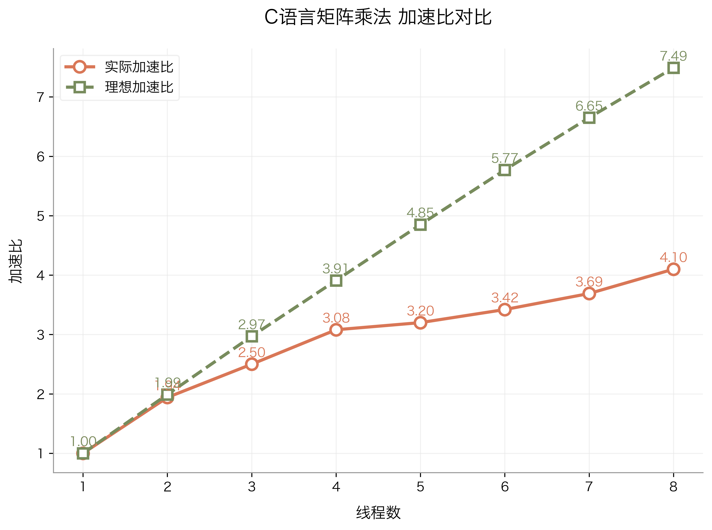

# 第 9 章 多核与多处理器

## `9.1` 多核性能问题

- `9.1.1` 多核的技术背景

    - 传统 CPU 性能提升依赖**频率提升**，但随着工艺发展，频率提升受限于功耗、散热和量子隧穿效应，单核性能增长停滞
    - 行业转向通过**增加 CPU 核心数**提升并行性能，桌面 / 移动平台全面进入多核时代

- `9.1.2` 操作系统在多核环境下挑战

    1. 正确性保证
        - 多核心对共享资源（如内存、文件、外设）的并发访问会引发数据竞争，导致程序错误
        - 操作系统提供**同步原语**（如互斥锁、信号量）供开发者使用，但同步操作本身会引入额外开销和死锁风险
    2. 性能保证
        - 可扩展性问题引发 “性能断崖”，核心数增加到一定程度后，性能不升反降
        - 系统软件设计需要充分利用多核多处理器的硬件特性

- `9.1.3` 多核下的性能理论与实际表现

    - 阿姆达尔定律 `Amdahl's Law`

        - **核心公式**：$S=\frac{1}{(1-p)+\frac{p}{s}}$
            - S：系统加速比
            - p：程序中可并行部分的占比
            - s：并行部分使用的核心数
        - **核心结论**：
            - 当核心数趋于无穷大时，加速比的上限为 $\frac{1}{1-p}$，即**串行部分决定了程序的理论最大加速比**
            - 可并行部分占比越高，理论加速比上限越大；完全串行的程序（p=0）无法通过多核提升性能

    - 理想性能 Vs. 实际性能

        - **理想性能**：性能随核心数增加线性增长，核心数翻倍，性能翻倍
        - **实际性能**：受同步开销、缓存一致性通信、串行部分占比影响，性能曲线在核心数超过一定阈值后趋于平缓甚至下降（性能断崖）

        

## `9.2` 缓存一致性

### `9.2.0` 高速缓存回顾

- `9.2.0.1` 多级缓存及其核心特性

    现代处理器采用**多级缓存** `Multi-level Cache` 来弥补 CPU 与主存之间的速度鸿沟，遵循**"越靠近CPU，越快、越贵、越小"**的设计规律，CPU 以缓存行为单位进行读取（常见为 64 字节）

    | 层级     | 位置          | 典型容量    | 访问延迟      | 特性                                         |
    | -------- | ------------- | ----------- | ------------- | -------------------------------------------- |
    | L1       | 核心内部      | 32-128KB    | 3-5时钟周期   | 每个核心私有，分指令缓存(L1I)与数据缓存(L1D) |
    | L2       | 核心内部/附近 | 256KB-1MB   | 10-17时钟周期 | 通常为每个核心私有或两两共享                 |
    | L3 (LLC) | 芯片级        | 数MB-数十MB | 35-50时钟周期 | 所有核心共享，最后一级缓存                   |

- `9.2.0.2` 读写操作策略

    - **读操作**：CPU 逐级向下查找（L1 → L2 → L3 → 内存），若在某级命中，直接返回；若均未命中，从内存读取并**逐层填充**至各级缓存
    - **写操作**：
        - **直写 `Write-through` **：同时更新缓存和内存，简单但速度慢
        - **写回 `Write-back`**：仅更新缓存，当缓存行被**替换/驱逐**时才写回内存（配合 MSI 等一致性协议时，需要额外机制保证多核间数据一致）

- `9.2.0.3` 多级缓存的架构演进

    1. 早期思路是将多核视为"单核"，**所有核心共享L1缓存**，这种设计面临两大致命问题：

        1. **瓶颈与竞争**：多个核心争抢同一L1缓存带宽，成为系统性能瓶颈
        2. **物理距离**：共享缓存需远离各核心以容纳更多端口，导致访问延迟增加、速度减慢

    2. 现代多核处理器采用**"私有+共享"混合层次结构**

        ```mermaid
        graph TD
            subgraph "多核处理器芯片"
                C0[逻辑核心 0] --> L1_0[L1 缓存 私有]
                C1[逻辑核心 1] --> L1_1[L1 缓存 私有]
                C2[逻辑核心 2] --> L1_2[L1 缓存 私有]
                C3[逻辑核心 3] --> L1_3[L1 缓存 私有]
                
                L1_0 --> L2_01[L2 缓存<br/>核心 0 - 1 共享]
                L1_1 --> L2_01
                L1_2 --> L2_23[L2 缓存<br/>核心 2 - 3 共享]
                L1_3 --> L2_23
                
                L2_01 --> L3[L3 缓存 / LLC<br/>所有核心共享]
                L2_23 --> L3
            end
            
            L3 --> BUS[系统总线/互连网络]
            BUS --> MEM[物理内存]
        ```

        - **L1 私有**：消除核心间对最频繁访问数据的竞争，降低延迟
        - **L2 半共享**：平衡私有性与共享性，减少片外访问
        - **L3 / LLC 全局共享**：作为多核间数据交换的缓冲池，同时承担缓存一致性管理职责

- `9.2.0.4` 缓存一致性的概念

    - 缓存一致性的根本目标是：**保证不同核心对同一地址（缓存行）的值达成共识**，即：

        当多个核心各自缓存了同一内存地址的副本时，若某一核心修改了本地副本，其他核心必须能感知到这一变化，避免读取到过期的"脏数据"

    - 两类硬件一致性协议

        | 协议类型                | 工作机制                                                     | 适用场景                              | 优缺点                                                       |
        | ----------------------- | ------------------------------------------------------------ | ------------------------------------- | ------------------------------------------------------------ |
        | **窥探式 `Snooping`**   | 所有核心通过总线广播缓存操作，各核心"监听"总线并据此调整自身缓存状态 | 核心数较少的 SMP 系统（如单芯片多核） | 实现简单、延迟低；但依赖广播，核心数增加时总线流量剧增，扩展性差 |
        | **目录式  `Directory`** | 维护一个全局目录记录每个缓存块的持有者及状态，请求者直接向目录查询并点对点通信 | 大规模 NUMA / 多插槽服务器系统        | 无需广播，可扩展性强；但增加目录查找开销，延迟稍高           |

### `9.2.1` 状态迁移与 MSI 协议

MSI 协议是最经典的**写回 `Write-back` + 写无效 `Write-invalidate`** 型窥探协议，被 MESI 、MOESI 等现代协议继承发展

- `9.2.1.1` `M` `S` `I` 三态定义

    | 状态  | 名称                  | 含义                                                         | 读写权限     |
    | ----- | --------------------- | ------------------------------------------------------------ | ------------ |
    | **M** | Modified<br/>独占修改 | 该缓存行仅本核心拥有，且已被修改（与内存不一致），相当于"脏"的独占副本 | 本地可读可写 |
    | **S** | Shared                | 该缓存行可能被多个核心同时持有，且各副本与内存一致（干净）   | 本地只读     |
    | **I** | Invalid               | 该缓存行无效，不包含有效数据                                 | 不可读不可写 |

- `9.2.1.2` 状态迁移规则

    状态转换由两类事件触发：**本地处理器访问** 和 **其他核心访问**（通过总线窥探感知）

    ```mermaid
    stateDiagram-v2
        [*] --> Invalid: 初始未缓存<br/>或缓存被驱逐
        
        Invalid --> Shared: 本地读<br/>其他持有者从 M→S
        Invalid --> Modified: 本地写<br/>使其他所有副本变 I
        
        Modified --> Modified: 本地读/写<br/>缓存命中，无总线事务
        Modified --> Shared: 其他核读<br/>自身变为 S
        Modified --> Invalid: 其他核写<br/>自身变为 I
        
        Shared --> Shared: 本地读<br/>缓存命中，无总线事务
        Shared --> Modified: 本地写<br/>使其他所有副本变 I
        Shared --> Invalid: 其他核写<br/>监听使无效
        
        
    ```

    1. Modified（独占修改）
        - **特征**：核心独占该缓存行，拥有系统中唯一有效的最新副本（内存中的数据已过时）
        - **本地操作**：读/写均命中缓存，**不产生任何总线事务**，性能最优
        - **其他核读**：该核心必须将数据写回总线/内存，状态从 M **降级为 S**（因为现在有了多个只读副本）
        - **其他核写**：该核心必须写回数据，状态从 M **变为 I**（失去所有权）
    2. Shared（共享）
        - **特征**：可能有多个核心同时持有该缓存行的只读副本，所有副本与内存一致
        - **本地读**：命中缓存，状态保持 S
        - **本地写**：必须升级为独占修改，核心向总线发送**升级 BusUpgr** 或**独占读 BusRdX** 信号，**强制使其他核心中该缓存行全部变为 I**，自身变为 M
        - **其他核写**：监听总线发现其他核心要写，本核心该缓存行变为I
    3. Invalid（失效）
        - **特征**：缓存行无效，不能用于读写
        - **本地读**：触发 Cache Miss，向总线发 BusRd 请求，若其他核心有 M 状态副本，该副本写回并变为 S；本核心获得数据后变为 S
        - **本地写**：触发 Cache Miss，向总线发 BusRdX 请求，获取数据后变为 M，同时使其他核心副本变为 I

### `9.2.2` 基于目录项的缓存一致性

目录式 `Directory-based` 协议通过**集中维护的目录**记录每个缓存行的状态，使用**点对点通信**的更新方式，从而具备良好的扩展性，是大规模多核系统和分布式共享内存系统 DSM 的主流方案

- `9.2.2.1` 全局目录项的结构

    | 字段                    | 含义       | 作用                                                         |
    | ----------------------- | ---------- | ------------------------------------------------------------ |
    | **脏位** `Dirty Bit`    | 是否被修改 | `1` 表示某个核心已修改该缓存行，内存中的数据已过时；`0` 表示内存数据最新 |
    | **向量位** `Bit Vector` | 共享者列表 | 每一位对应一个 CPU 核心，`1` 表示该核心持有此缓存行的有效副本 |

    > 目录项不存储实际数据，只存储 `bookkeeping` 信息 —— 即**谁拿着数据**、**数据是否干净**，实际数据仍存放在各核心的缓存或物理内存中

- `9.2.2.2` 本地目录项的结构

    | 字段     | 含义          | 作用                                                  |
    | -------- | ------------- | ----------------------------------------------------- |
    | **状态** | 使用 MSI 表示 | Modified（独占修改），Shared（共享），Invalid（失效） |
    | **内容** | 存放的数据    | 实际存放的数据内容                                    |

- `9.2.2.3` 状态转换规则详解

    | 当前状态 | 本地操作 | 下一状态 | 目录操作                    | 说明                                           |
    | -------- | -------- | -------- | --------------------------- | ---------------------------------------------- |
    | I        | 读 (LDR) | S 或 M   | 查询目录，定位数据          | 若其他核心有 M 态，由其转发；否则从内存读      |
    | I        | 写 (STR) | M        | 查询目录，使其他副本失效    | 获取数据后修改，目录脏位置 1，向量位置为本核心 |
    | S        | 读 (LDR) | S        | 无                          | 命中，直接读取                                 |
    | S        | 写 (STR) | M        | 向其他持 S 态核心发失效消息 | 目录脏位置 1，向量位仅保留本核心               |
    | M        | 读 (LDR) | M        | 无                          | 命中，直接读取                                 |
    | M        | 写 (STR) | M        | 无                          | 命中，直接写入                                 |

    | 当前状态 | 其他核心操作  | 下一状态 | 响应动作                                                     |
    | -------- | ------------- | -------- | ------------------------------------------------------------ |
    | M        | 其他核心读    | S        | 将最新数据**转发**给请求核心，并写回内存；目录脏位清 0，向量位更新 |
    | M        | 其他核心写    | I        | 将最新数据写回内存；目录脏位保持 1，向量位改为请求核心       |
    | S        | 其他核心读    | S        | 无动作（目录向量位添加该核心）                               |
    | S        | 其他核心写    | I        | 无动作（目录向量位改为请求核心，脏位置 1）                   |
    | I        | 其他核心读/写 | I        | 无动作                                                       |

## `9.3` 多核性能可扩展性

- `9.3.1` 缓存行乒乓 `Cache Line Bouncing` 效应

    **多核并发场景下**，多个 CPU 核心**持续高频修改同一缓存行内互不相关的变量**，导致该缓存行所有权在不同核心之间**反复来回切换、频繁失效、反复重加载**，如同乒乓球来回弹跳，产生海量缓存一致性同步开销，严重摧毁多核并发性能，该现象即为**缓存行乒乓效应**

> 问题本质：无数据依赖的多线程写操作，被**同一缓存行强行绑定**，由并行执行被迫变成串行争抢

- `9.3.2` 回退锁 `Backoff Lock`

    当获取锁失败时，不立即重试，而是**等待一段时间**，减少同时竞争的核心数量

    - 相同时间回退

        > 不可行！相同时间的等待可能导致**同时结束回退、同时开始下一轮竞争**，进而引发又一次的缓存行乒乓

    - 随机时间回退

        ```c
        void back_off(int time) {
            int random_time = rand() % time;  // 随机化
            for (volatile int i = 0; i < random_time; i++) {
                cpu_relax();
            }
        }
        ```

        > 通过过随机化等待时间，使各核心的回退时间错开，降低同时竞争的概率
        >
        > 但**最大回退时间固定**，无法适应竞争强度的变化 —— 低竞争时等待过长，高竞争时等待又可能过短

    - **指数退避 `Exponential Backoff`** 策略：

        ```c
        void back_off(int *time) {
            for (volatile int i = 0; i < *time; i++) {
                cpu_relax();
            }
            *time <<= 1;  // 指数增长
            if (*time > MAX_TIME) *time = MAX_TIME;
        }
        ```

        - 初始退避时间为 $t$ ，每次失败后，退避时间翻倍：$t,2t,4t,8t,…$  直至上限
        - 上限通常设为 1024 个单位或 64 次循环
        - **优点**：显著降低总线流量和缓存一致性开销
        - **缺点**：退避时间难以调优；过长导致延迟增大，过短则无法缓解竞争；且**不保证公平性**，可能出现饥饿

- `9.3.3` MCS 锁

    MCS 锁的核心在于，**让每个等待核心在独立的本地变量上自旋**，彻底消除对单一缓存行的竞争

    ```c
    /*
     * ----------------------------------------------------------------------------
     *  队列节点结构（MCS_node）
     * ----------------------------------------------------------------------------
     *  __attribute__((aligned(CACHELINE_SZ))) 是关键设计：
     *  - 现代 CPU 缓存行通常为 64 字节（x86/ARM 通用）
     *  - 该属性强制每个节点按缓存行边界对齐，确保不同核心的自旋变量
     *    （flag）独占一个缓存行，避免"伪共享"（False Sharing）
     *  - 若两个节点的 flag 落在同一缓存行，核心 A 修改 flag 会导致核心 B
     *    的缓存失效，即使 B 并未访问 A 的 flag，造成不必要的同步开销
     */
    struct MCS_node {
        /*
         * 本地自旋标志（volatile 防止编译器优化）：
         * - WAITING（非零）：当前节点正在等待锁，CPU 在该变量上自旋
         * - GRANTED（零）：前驱已传递锁，当前 CPU 可以进入临界区
         * 关键：每个等待者在自己的 flag 上自旋，而非全局锁变量上
         */
        volatile int flag;
    
        /*
         * 队列后继指针：
         * - 指向在队列中紧跟当前节点的下一个等待者
         * - 由后继节点在入队时设置（见 lock() 中的 tail->next = me）
         * - volatile 确保编译器不缓存该指针，保证多核可见性
         */
        volatile struct MCS_node *next;
    
    } __attribute__((aligned(CACHELINE_SZ)));  // 缓存行对齐：消除伪共享的核心手段
    
    
    /*
     * ----------------------------------------------------------------------------
     *  锁头结构（MCS_lock）
     * ----------------------------------------------------------------------------
     *  仅维护一个 tail 指针，指向队列的最后一个节点（即最后加入的竞争者）
     *  - tail == NULL：锁当前空闲，无等待队列
     *  - tail != NULL：锁被持有，且存在等待队列，tail 指向队尾节点
     */
    struct MCS_lock {
        struct MCS_node *tail;
    };
    
    
    /*
     * ============================================================================
     *  lock()：获取 MCS 锁
     * ----------------------------------------------------------------------------
     *  算法流程：
     *  1. 初始化本地节点（me）为等待状态，next 置空
     *  2. 原子交换（atomic_XCHG）：将 me 设为新的队尾，并获取旧队尾
     *  3. 若旧队尾存在（tail != NULL）：
     *     - 将旧队尾的 next 指向 me（链接到队列）
     *     - 在 me->flag 上自旋等待，直到前驱解锁时将其置为 GRANTED
     *  4. 若旧队尾为 NULL（锁空闲）：
     *     - 直接获得锁，无需等待
     *
     *  原子操作语义：
     *  - atomic_XCHG(&lock->tail, me) 是"读取-修改-写入"的原子操作，
     *    确保在并发入队时，多个 CPU 对 tail 的更新是串行的，避免竞态
     * ============================================================================
     */
    void lock(struct MCS_lock *lock, struct MCS_node *me)
    {
        /* Step 1: 初始化本地节点为"等待中"状态 */
        me->next = NULL;            // 当前尚无已知后继
        me->flag = WAITING;         // 标记自己正在等待锁
    
        /*
         * Step 2: 原子交换——无锁队列入队核心
         * ------------------------------------------------------------------------
         * 语义：将 lock->tail 原子地设置为 me（当前节点），并返回旧值
         * - 若返回 NULL：说明此前锁空闲，当前 CPU 是首个获取者，直接成功
         * - 若返回非 NULL：说明此前已有等待队列，返回值为前驱节点（旧队尾）
         * ------------------------------------------------------------------------
         * 为什么用 XCHG 而非 CAS？
         * - XCHG 在 x86 上是隐式 lock 前缀的原子操作，天然保证串行化
         * - 无需重试循环，一步完成"读取旧 tail + 写入新 tail"
         */
        struct MCS_node *tail = atomic_XCHG(&lock->tail, me);
    
        /*
         * Step 3: 判断是否存在前驱
         * ------------------------------------------------------------------------
         * 若 tail != NULL，说明队列非空，当前 CPU 必须排队等待
         * 此时需要完成两件事：
         *   (a) 链接到前驱：让前驱知道"我排在你后面"，以便前驱解锁时唤醒我
         *   (b) 本地自旋：在自己的 flag 上忙等，不触碰全局变量
         * ------------------------------------------------------------------------
         */
        if (tail) {
            /*
             * (a) 链接到前驱的 next 指针
             * --------------------------------------------------------------------
             * 将前驱节点（旧队尾）的 next 指向当前节点 me
             * 此后队列顺序为：... → tail → me
             * 注意：此写操作无需原子性，因为只有当前 CPU 会修改 tail 的 next
             * （tail 已不在队尾，不会有其他新来者竞争修改它的 next）
             */
            tail->next = me;
    
            /*
             * (b) 在本地 flag 上自旋——MCS 锁的核心优化点
             * --------------------------------------------------------------------
             * 传统自旋锁：所有 CPU 在全局锁变量上自旋，每次锁释放导致
             *             O(n) 次缓存失效（所有等待者缓存失效并重新读取）
             *
             * MCS 锁：每个 CPU 仅在自己的 me->flag 上自旋
             *         - 该变量位于本 CPU 独占的缓存行（由 aligned 保证）
             *         - 自旋期间不产生任何总线流量，CPU 功耗极低
             *         - 仅当 flag 被前驱修改为 GRANTED 时，触发一次缓存失效
             *         - 锁释放总流量从 O(n²) 降至 O(1)（每次释放仅唤醒一人）
             * --------------------------------------------------------------------
             */
            while (me->flag != GRANTED) {
                /* 忙等待；现代 CPU 可在此循环中插入 pause 指令降低功耗 */
            }
        }
    
        /*
         * Step 4: 若 tail == NULL（锁空闲）
         * ------------------------------------------------------------------------
         * 直接获得锁，无需自旋，这是 MCS 锁在无竞争场景下的快速路径
         */
    }
    
    
    /*
     * ============================================================================
     *  unlock()：释放 MCS 锁
     * ----------------------------------------------------------------------------
     *  算法流程：
     *  1. 检查当前节点 me 是否有已知后继（me->next != NULL）
     *    - 若有：直接将锁传递给后继（me->next->flag = GRANTED），返回
     *  2. 若 me->next == NULL（暂无已知后继）：
     *    - 尝试原子比较交换（atomic_CAS）：若 tail 仍指向 me，说明确实
     *      无新竞争者，将 tail 重置为 NULL，锁回归空闲状态
     *    - 若 CAS 失败：说明在检查 next 的瞬间，有新竞争者正在入队
     *      （已执行 atomic_XCHG 更新了 tail，但尚未设置 me->next）
     *      此时需忙等待新竞争者完成 next 链接，然后传递锁
     *
     *  竞态条件（Race Condition）说明：
     *  --------------------------------------------------------------------------
     *  场景：核心 A 正在 unlock，核心 B 正在 lock
     *
     *  时间线：
     *    T1: 核心 A 检查 me->next，发现为 NULL（核心 B 尚未链接）
     *    T2: 核心 B 执行 atomic_XCHG(&lock->tail, &nodeB)，返回 &nodeA
     *    T3: 核心 A 执行 atomic_CAS(&lock->tail, me, NULL)
     *        - 若 T2 已完成：tail 已被核心 B 更新为 &nodeB，CAS 失败
     *          核心 A 进入 while(!me->next) 等待，直到核心 B 完成 T3
     *        - 若 T2 尚未执行：tail 仍然是 me(nodeA)，核心 A 的 CAS 比对相等，锁被正常释放
     *          后续核心 B 再执行 T2 的 atomic_XCHG 时，会读取到的队尾指针为 NULL
     *          按照逻辑判定自身是第一个申请锁的线程，直接获取锁，不会进入自旋等待
     * ============================================================================
     */
    void unlock(struct MCS_lock *lock, struct MCS_node *me)
    {
        /*
         * Step 1: 检查是否有已知的直接后继
         * ------------------------------------------------------------------------
         * 若 me->next != NULL，说明队列中至少有一个等待者，且其节点已
         * 链接到当前节点的 next 指针，直接将锁传递给它即可
         */
        if (!me->next) {
            /*
             * Step 2: 暂无已知后继，尝试将锁恢复为空闲状态
             * --------------------------------------------------------------------
             * atomic_CAS（Compare-And-Swap）语义：
             * - 若 lock->tail == me（无新竞争者更新 tail），则将其改为 NULL，
             *   锁回归空闲，函数返回
             * - 若 lock->tail != me（有新竞争者已执行 XCHG 更新了 tail），
             *   则 CAS 失败，继续执行后续代码
             * --------------------------------------------------------------------
             * 为什么这里必须用原子操作？
             * - tail 是多核共享变量，非原子读写会导致数据竞争（Data Race）
             * - CAS 提供了"读取-比较-写入"的原子性，确保判断和修改不可分割
             */
            if (atomic_CAS(&lock->tail, me, NULL) == me) {
                return;  // 成功：无等待者，锁已空闲
            }
    
            /*
             * Step 3: CAS 失败，处理解锁与新竞争者入队之间的竞态窗口
             * --------------------------------------------------------------------
             * 执行到此处说明：
             * - 当前节点 me 的 next 仍为 NULL（检查时尚未链接）
             * - 但 tail 已被新竞争者更新（CAS 失败），说明新竞争者正在
             *   执行 lock() 中的 tail->next = me 操作
             *
             * 当前核心必须等待新竞争者完成 next 链接，否则无法知道"该唤醒谁"
             *
             * 自旋等待条件：!me->next
             * - 一旦新竞争者完成 nodeA->next = nodeB，me->next 变为非 NULL，
             *   当前核心即可退出循环，进入 Step 4 传递锁
             * --------------------------------------------------------------------
             * 注意：此自旋同样是在本地变量（me->next）上等待，不竞争全局缓存行，开销极低
             */
            while (!me->next) {
                /* 忙等待新竞争者完成入队链接 */
            }
        }
    
        /*
         * Step 4: 将锁传递给直接后继
         * ------------------------------------------------------------------------
         * 执行到此处有两种可能：
         *   (a) Step 1 中 me->next 已存在（有直接后继）
         *   (b) Step 3 中等待完成，me->next 已被新竞争者设置
         *
         * 操作：将后继节点的 flag 从 WAITING 改为 GRANTED
         * - 该写操作仅使后继 CPU 的本地缓存失效（因其 flag 位于独占缓存行）
         * - 后继 CPU 观察到 flag 变化，退出自旋，进入临界区
         * - 整个解锁过程仅产生 1 次缓存一致性事务（唤醒下一个），
         *   相比自旋锁的 O(n) 次失效，可扩展性提升显著
         * ------------------------------------------------------------------------
         */
        me->next->flag = GRANTED;
    }
    ```
    
    > - **`__attribute__((aligned(CACHELINE_SZ)))`** 是**最关键的设计**：确保每个 `MCS_node` 独占一个缓存行，避免不同核心的自旋变量落在同一缓存行导致的**伪共享 `False Sharing`**
    >
    > - **解锁的竞态条件处理**：若 `me->next` 为空，不能直接认为无等待者，因为新竞争者可能正在执行 `atomic_XCHG` 但尚未设置 `tail->next = me`
    >
    >     此时通过 `atomic_CAS` 检测：若 `tail` 仍为 `me`，说明确实无新来者；若 `tail` 已变，则需等待新来者完成 `next` 链接
    
    - 新竞争者加入队列（加锁流程）
    
        1. **本地初始化**：新核心先在本地栈上创建 `MCS_node`，设置 `flag=WAITING`，`next=NULL`
        2. **原子交换**：执行 `atomic_XCHG(&lock->tail, me)`，将自己设为队尾，获取旧队尾
        3. **链接前驱**：若旧队尾存在，将旧队尾的 `next` 指向自己
        4. **本地自旋**：在自己的 `flag` 上等待，直到前驱将其设为 `GRANTED`
    
    - 锁持有者的传递（解锁流程）
    
        当某一核心 0 释放锁时
    
        1. 核心 0 首先检查自己的 `next` 指针，将 `next->flag = GRANTED`
    2. 队列中的下一个核心 1 观察到 `flag` 变化，从自旋中退出，成为新持有者
    
    - Linux Kernel 中的可扩展锁：QSpinlock
    
        QSpinlock 是 Linux 内核采用的工业级方案，这是 MCS 锁与自旋锁的**混合设计**，分为快速路径和慢速路径两种实现
    
    - 快速路径 `Fast Path`
    
        ```c
            // 条件：locked=0, pending=0, tail=0（完全无竞争）
            if (atomic_cmpxchg(&lock->val, 0, 1) == 0) {
                return;  // 获取锁成功！
            }
        ```
    
        > 仅一条原子指令，与简单自旋锁相同的最优开销，适用于绝大多数无竞争场景
    
    - 慢速路径 `Slow Path`
    
            当快速路径失败（锁已被持有或存在队列）：
        
            1. 放弃直接抢锁
        2. 把当前线程加入 **FIFO 等待队列**
            3. 原地自旋等待前驱节点释放锁

- `9.3.4` 对程序员的启发

    1. 硬件层：对软件开发者透明

        现代多核处理器通过**缓存一致性协议**、**目录协议**、**写缓冲**和**高速互联总线**等硬件机制，自动维护多核间缓存数据的一致性，这意味着：

        - **软件开发者无需手动同步缓存**：硬件自动保证对同一内存地址的读写，在所有核心看来具有全局一致的顺序
        - **编程模型简化**：开发者可以像编写单线程程序一样编写多线程程序（至少在数据正确性层面），硬件负责处理复杂的缓存状态迁移

    2. 软件层：开发者必须关注的性能问题

        虽然硬件保证了**正确性**，但无法保证**性能**，系统软件开发者必须意识到：

        1. **多个核心对于同一缓存行的高频竞争将会面临严重的性能开销**
            - 即使变量在逻辑上是独立的，只要它们位于同一缓存行，就会触发缓存一致性协议
            - 每次写操作都会导致其他核心的缓存副本失效，引发 $O(n^2)$  级别的缓存流量
        2. **虚假共享 `False Sharing` 在多核情况下是致命的**

    3. 虚假共享问题

        - 程序在一个页表内经常**连续分配内存空间**，这意味着：

            - **数组元素连续存放**：`double num[8]` 中，8 个double（每个 8 字节）共 64 字节，**恰好填满一个缓存行**

                > 若核心 0 频繁写 `num[1]`，核心 1 频繁写 `num[7]`，虽然在写不同的元素，但是会产生严重的缓存行竞争

            - **连续变量连续存放**：`int a; int b; int c;` 中，3 个int（每个 4 字节）共 12字节，远小于 64 字节，**极有可能落在同一缓存行中**

                > 若核心 0 写 `a`，核心 1 写 `b`，即使两者逻辑独立，也会触发缓存一致性同步

        - 这会导致发生无谓的缓存一致性同步通讯，可能产生写覆盖的问题


## `9.4` 内存一致性铺垫

### `9.4.1` 死锁预防 （复习）

| 破坏必要条件       | 核心预防思想                                   | 具体实现方案                                     |
| ------------------ | ---------------------------------------------- | ------------------------------------------------ |
| 破坏**互斥条件**   | 取消资源独占访问，允许多进程共享使用           | 1. 设计可共享资源 2. 弱化独占权限                |
| 破坏**请求与保持** | 进程运行前申请全部所需资源，不边运行边申请     | 进程启动前**一次性申请所有资源**，不足则全不分配 |
| 破坏**不可剥夺**   | 进程申请新资源失败时，主动释放已占有的所有资源 | 申请资源失败 → 释放已有资源 → 重新统一申请       |
| 破坏**环路等待**   | 规定资源申请顺序，杜绝进程形成循环等待链       | 给所有资源全局编号，**严格按编号从小到大申请**   |

### `9.4.2` 乱序执行 （补课 + 超纲）

- `9.4.2.1` 指令的执行与 CPU 性能

    - 顺序执行与流水线执行

        - 流水线执行

            把**一条指令**的执行过程拆分成多个固定阶段，让**多条指令在同一时刻、不同阶段重叠运行**，用**时间分片**提升吞吐

            - 典型五级经典流水线：`取指 IF → 译码 ID → 执行 EX → 访存 MEM → 写回 WB`
            - 特点
                1. **指令严格按程序顺序流动**，先进先出；
                2. 目标：**缩短指令平均执行周期、提升整体吞吐**；
                3. 天然缺陷：一旦某一段阻塞（等待内存、数据未就绪），**整条流水线被卡住，后续所有指令跟着停滞**

        ```makefile
        LW R1, 0(R2)    # 从内存加载数据到R1，Cache Miss需要等待200个周期
        ADD R3, R4, R5  # 不依赖R1的加法运算
        SUB R6, R7, R8  # 不依赖R1的减法运算
        ```

        - 对于这个程序，在顺序执行处理器中：
            - 第 1 条指令阻塞 200 个周期
            - 第 2、3 条指令必须等待 200 个周期才能执行，但实际上可以并行执行
            - 总共浪费了 400 个周期的 CPU 资源

    - 乱序执行的基本概念

        **乱序执行** `Out of Order Execution (OoOE)` 是现代处理器用来提高 **指令级并行性 `ILP`** 的核心技术，它允许 CPU 在不改变程序最终结果的前提下，不严格按照源代码中指令的书写顺序来执行指令，而是根据指令的数据依赖关系和硬件资源的可用性动态调度执行顺序

        - **"按序发射，乱序执行，按序提交"**

            - **按序发射**：CPU 按程序顺序从内存获取指令并解码

            - **乱序执行**：无数据依赖的指令可以跳过被阻塞的指令提前执行

            - **按序提交**：最终结果必须按原始程序顺序更新到架构状态（寄存器 / 内存）

        - 在上述例子中，如果运行在乱序执行处理器中：

            - 第 1 条指令开始等待内存数据
            - 第 2、3 条指令立即执行（因为它们不依赖 R1）
            - 当 R1 的数据到达后，再执行依赖 R1 的后续指令
            - CPU 资源得到了充分利用

            > 乱序执行通常能带来 **30%-50% 的性能提升**，在内存密集型应用中甚至更高（如果没有乱序执行，CPU 大部分时间都在空转等待内存数据）

- `9.4.2.2` 数据依赖与冒险

    | 类型   | 缩写 | 定义                                 | 例子                                  | 是否是真实依赖？ |
    | ------ | ---- | ------------------------------------ | ------------------------------------- | ---------------- |
    | 写后读 | RAW  | 指令 B 读取指令 A 写入的寄存器       | `ADD R1, R2, R3`<br/>`SUB R4, R1, R5` | ✅ 是（真实依赖） |
    | 读后写 | WAR  | 指令 B 写入指令 A 读取的寄存器       | `ADD R1, R2, R3`<br/>`SUB R2, R4, R5` | ❌ 否（虚假依赖） |
    | 写后写 | WAW  | 指令 B 写入指令 A 写入的同一个寄存器 | `ADD R1, R2, R3`<br/>`SUB R1, R4, R5` | ❌ 否（虚假依赖） |

    - 对于 RAW 的情况，读取强制要求发生在写入之后，否则会导致读取到错误内容，存在真实的数据依赖

    - 对于 WAR 和 WAW 的情况，在寄存器较少的情况下，碰巧使用了同一个架构寄存器名时，就会产生虚假依赖

        对于现代 CPU，实际通过**寄存器重命名**技术消除了这些虚假依赖

- `9.4.2.3` 托马斯洛算法 `Tomasulo`

    | 机制                                 | 作用                                                         |
    | ------------------------------------ | ------------------------------------------------------------ |
    | **保留站 `Reservation Station`**     | 每个功能单元前设置缓冲，存储已发射但未执行的指令及其操作数状态 |
    | **寄存器重命名 `Register Renaming`** | 通过保留站隐式将逻辑寄存器映射到物理寄存器或标签，消除名字相关 |
    | **公共数据总线 `CDB`**               | 指令执行完毕后，将结果广播到所有等待该结果的保留站和寄存器   |

    - 算法核心思想：
        - 使用**保留站**来缓存等待操作数的指令
        - 通过**公共数据总线**来广播执行结果、通过**寄存器重命名**来消除虚假依赖
        - 支持**乱序执行**和**按序完成**
    - 算法三阶段
        1. **发射 `Issue`**：从指令队列取指令，若保留站有空闲则发射，并将寄存器换名到保留站
        2. **执行 `Execute`**：当操作数全部就绪（通过监听 CDB 获取），功能单元开始执行
        3. **写回 `Write-back`**：结果通过 CDB 广播，更新等待该结果的保留站，并标记本站空闲

    ```mermaid
    flowchart TD
        IQ[指令队列] -->|Issue| RS1[保留站<br/>ADD1]
        IQ -->|Issue| RS2[保留站<br/>ADD2]
        IQ -->|Issue| RS3[保留站<br/>MUL1]
        
        RS1 -->|操作数就绪| FU1[浮点加法器]
        RS2 -->|操作数就绪| FU1
        RS3 -->|操作数就绪| FU2[浮点乘法器]
        
        FU1 -->|结果| CDB[公共数据总线 CDB]
        FU2 -->|结果| CDB
        CDB -->|广播| RS1
        CDB -->|广播| RS2
        CDB -->|广播| RS3
        CDB -->|广播| RF[浮点寄存器组]
    ```

## `9.5` 内存一致性模型

- `9.5.1` 不一致现象

    - `LockOne` 算法

        作为皮特森算法的前身，`LockOne` 算法通过 `flag[]` 标记为来表示该线程申请进入临界区

        ```c
        // 全局共享变量
        boolean flag[2] = {FALSE, FALSE};
        
        // 线程0
        while (TRUE) {
            flag[0] = TRUE;
            while (flag[1] == TRUE);
            /* 临界区部分 */
            flag[0] = FALSE;
            /* 其它代码 */
        }
        
        // 线程1
        while (TRUE) {
            flag[1] = TRUE;
            while (flag[0] == TRUE);
            /* 临界区部分 */
            flag[1] = FALSE;
            /* 其它代码 */
        }
        ```

    - `LockOne` 算法在现实硬件下的互斥性违反

        现代处理器为了提高性能，会对**没有数据依赖**的指令进行**乱序执行**，在 `LockOne` 算法中：

        - 线程 0 的 `flag[0] = TRUE` 和 `while(flag[1] == TRUE)` 之间没有数据依赖
        - 线程 1 的 `flag[1] = TRUE` 和 `while(flag[0] == TRUE)` 之间没有数据依赖

        $\rightarrow$ 处理器可能将指令重排序为

        ```
        线程0：先执行while(flag[1]==TRUE) → 再执行flag[0]=TRUE
        线程1：先执行while(flag[0]==TRUE) → 再执行flag[1]=TRUE
        ```

        两个线程都先读取到对方的 `flag` 为 `FALSE`，然后都设置自己的 `flag` 为 `TRUE`，**同时进入临界区**，完全违反了互斥性

        $\rightarrow$ 需要一套规则，明确**多条针对不同内存地址的读 `Load`、写 `Store` 操作，在全局视角下允许 / 不允许（怎样）重排序、以什么顺序对外可见** —— 这就是内存一致性（内存模型）

- `9.5.2` 四种一致性模型

    1. 严格一致性模型 `Strict Consistency`

        - 核心定义

            - 对任意地址的读操作，都能读到该地址**最近一次写操作**的结果
            - 访存操作的顺序，与**全局时钟的真实时间顺序**完全一致
            - 单个核心内的读写操作，必须严格遵循**程序编写的顺序**执行

        - 关键特性

            这是理论上最强的一致性模型，完全符合程序员的直觉：写了变量之后，后续的读操作一定能看到最新的值

    2. 顺序一致性模型 `Sequential Consistency`

        - 核心定义
            - 不要求操作按真实的全局时钟时间顺序执行，但**所有核心看到的操作全局顺序必须一致**
            - 单个核心内的读写操作，必须严格遵循**程序顺序**执行（不能乱序）
            - 执行结果必须等价于某一个合法的全局顺序执行的结果
        - 关键特性
            - 比严格一致性弱：不要求和真实时间对齐，只要求 “所有核心看到的顺序一致”
            - 核心约束：**程序顺序保留**（同一核心的操作不能乱序）

    3. `Total Store Ordering (TSO)` 一致性模型 

        - 核心定义

            - 对不同地址的**读 - 读、读 - 写、写 - 写**顺序都有保证，不会被重排
            - 唯一允许被重排的是（同一线程中的）**写 - 读操作顺序**（同一核心中，写操作可能被延迟，后续的读操作先执行）
            - 现代主流 CPU（如 x86 架构）默认采用的一致性模型，是性能与一致性的折中方案

        - 关键特性

            - 为什么允许写 - 读重排？

                CPU 引入了存储序缓冲 `Memory Ordering Buffer` ，写操作会先写入缓冲，再批量提交到内存，以此提升写操作的吞吐量

            - 这种设计会导致：同一核心中，后续的读操作可能先于前面的写操作完成，从而出现 “写了却读不到” 的现象

    4. 弱序一致性模型 `Weak-ordering Consistency`

        - 核心定义：不保证任何对不同地址的读写操作顺序，除非使用显式同步指令

        | 对比维度     | TSO（x86）         | Weak Ordering（ARM） |
        | ------------ | ------------------ | -------------------- |
        | 硬件逻辑     | 复杂               | 简单                 |
        | 处理器复杂度 | 高                 | 低                   |
        | 功耗/成本    | 较高               | 较低                 |
        | 并行程序性能 | 天然保序，开销小   | 需手动屏障，开销大   |
        | 适用场景     | 高性能计算、服务器 | 移动设备、嵌入式     |

        > ARM 架构面向移动场景，需在**功耗、成本、散热**严格约束下运行，弱序模型允许硬件最大程度乱序执行，提升指令级并行度，降低流水线阻塞，从而实现高能效比

        - 在弱的内存模型中保证顺序 —— 内存屏障 `Memory Barrier`

            内存屏障是一种特殊指令，用于强制规定内存操作的执行顺序，确保屏障前的操作不会重排到屏障后，反之亦然

            ```c
            void proc(void){
                ...;
                barrier(); // 添加内存屏障，确保上面的内容一定在下面的内容之前执行
                ...;
            }
            ```

    | 模型 | 定义                                                     | 特点                     | 代表处理器   |
    | ---- | -------------------------------------------------------- | ------------------------ | ------------ |
    | 严格 | 所有核心看到的所有内存操作顺序完全一致，且操作立即生效   | 理论模型，现实中无法实现 | 无           |
    | 顺序 | 所有核心看到的所有内存操作顺序完全一致，但不一定立即生效 | 程序员理想模型，性能差   | 早期处理器   |
    | TSO  | 同一处理器的写操作按顺序执行，不同处理器的写操作可以乱序 | 性能较好，编程难度适中   | x86          |
    | 弱序 | 只有同步操作（锁、内存屏障）保证顺序性，普通读写任意乱序 | 性能最好，编程难度高     | ARM、PowerPC |

- `9.5.3` 系统软件开发者视角下的内存模型

    1. **内存模型不是透明的**：不同架构行为不同，跨平台代码必须考虑内存模型差异
    2. **不要直接使用屏障**：硬件内存屏障开销极大，正常情况下尽量通过高级同步原语间接使用
    3. **同步原语自带语义**：互斥锁、信号量的加锁/解锁操作内部已包含必要的内存屏障

## `9.6` 非一致内存访问

### `9.6.1` NUMA 系统架构

- `9.6.1.1` NUMA 架构基础

    **非一致性内存访问** `Non-Uniform Memory Access (NUMA)`  是一种多处理器系统的内存架构，核心特征是：处理器访问内存的速度取决于内存与处理器的物理距离

    - NUMA 将处理器和内存划分为多个节点 `Node`
        - 本地内存访问：CPU 直接连接，速度快，延迟低
        - 远程内存访问：需通过节点间互联总线进行访问，经过的节点（跳数）越多，**延迟越高、带宽越受限**
    
    - 架构目标：解决传统 SMP（对称多处理）架构中，单内存控制器成为性能瓶颈的问题
    
- `9.6.1.2` NUMA 环境中新的挑战 —— 跨节点缓存一致性开销

    当**锁的元数据位于一个节点**，而**临界区访问的共享数据位于其他节点**时，跨节点的缓存一致性协议会产生巨大开销

    - **本质问题**：锁无法感知临界区访问的数据位置，跨节点访问会反复触发缓存同步，严重影响可扩展性

### `9.6.2` NUMA 感知设计

在 NUMA 架构下，传统锁因频繁的**远程内存访问**导致性能急剧下降，因此需要设计"NUMA 感知"的同步机制 —— **Cohort Lock**，通过将锁的持有权限制在同一节点内，减少跨节点缓存一致性流量

- `9.6.2.1` 系统软件开发者视角下的 NUMA 架构

    - 操作系统对 NUMA 的支持
        - NUMA 硬件拓扑会暴露给操作系统，操作系统可以选择进一步暴露给应用软件
        - 软件可以通过专用接口（如 Linux 下的 `libnuma` 库）显式分配本地内存
        - 操作系统提供内存亲和性 `Memory Affinity` 机制，将进程绑定到特定 NUMA 节点运行
    - NUMA 性能优化原则
        - **调度时避免跨 NUMA 节点迁移**：线程迁移会导致原分配内存变为"远程内存"
        - **对无 NUMA 感知的应用，保证内存分配的本地性**：操作系统应尽可能将线程所需内存分配在其运行节点

- `9.6.2.2` NUMA 感知设计：队列同伙锁 `Cohort Lock`

    - 核心设计思想

        **在一段时间内将锁的访存限制在本地 NUMA 节点**，通过放松严格的 FIFO 调度顺序，让锁所有权在单个 NUMA 节点内停留更长时间，从而大幅减少缓存一致性流量和远程内存访问开销

    - 两级锁结构

        Cohort 锁采用**全局锁 + 本地锁**的两级层次结构：

        - **全局锁**：所有 NUMA 节点共享，用于控制节点间的锁竞争
        - **本地锁**：每个 NUMA 节点独立拥有，用于控制节点内的线程竞争

    ```mermaid
    sequenceDiagram
        participant T0 as 线程0-0(节点0)
        participant L0 as 节点0本地锁
        participant G as 全局锁
        participant T1 as 线程0-1(节点0)
        participant T2 as 线程1-0(节点1)
        participant L1 as 节点1本地锁
    
        T0->>L0: 1. 获取本地锁
        L0-->>T0: 本地锁获取成功
        T0->>G: 2. 获取全局锁
        G-->>T0: 全局锁获取成功
        T0->>T0: 3. 执行临界区
        T0->>T1: 4. 释放时传递给本地下一个等待者
        T1->>T1: 5. 执行临界区
        T1->>L0: 6. 节点0无等待者，释放本地锁
        L0-->>T1: 本地锁释放成功
        T1->>G: 7. 释放全局锁
        G-->>T2: 全局锁传递给节点1
        T2->>L1: 8. 获取节点1本地锁
        L1-->>T2: 本地锁获取成功
        T2->>T2: 9. 执行临界区
    ```

    | 步骤         | 操作                                                 | 目的                             |
    | ------------ | ---------------------------------------------------- | -------------------------------- |
    | ① 获取本地锁 | 线程首先竞争所在节点的**本地锁**                     | 将同一节点的线程组织成队列       |
    | ② 获取全局锁 | 本地锁队首线程竞争**全局锁**                         | 只有每个节点的"代表"能竞争全局锁 |
    | ③ 临界区执行 | 线程持有双锁（本地+全局）执行                        | 保证互斥                         |
    | ④ 释放传递   | 释放时，优先将全局锁传递给**本节点本地队列的下一位** | 全局锁在节点内部"传递"，不跨节点 |
    | ⑤ 全部释放   | 若本节点无等待者，则释放全局锁                       | 允许其他节点获取                 |
