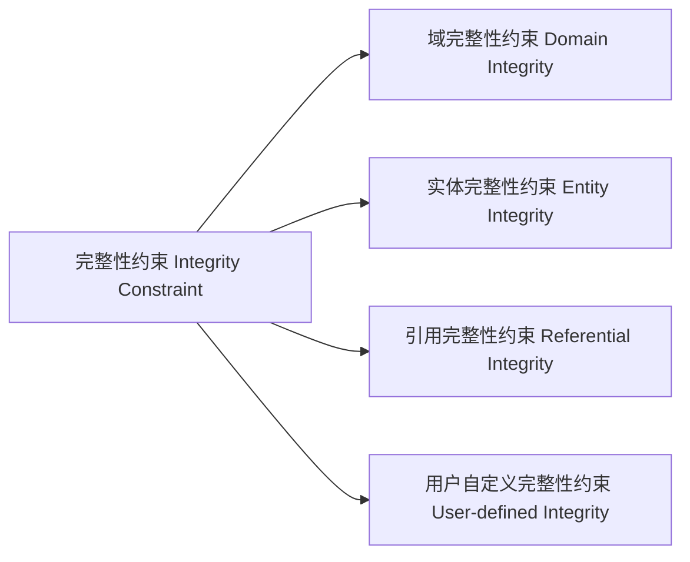

# 第 6 讲 中级 SQL

## `6.1` 视图

- `6.1.1` 基本概念

    视图 `View` 是**虚拟表**，它本身不存储真实数据：

    1. 视图的行、列数据来自定义视图时写的 `SELECT` 查询，**访问视图时动态从基表计算生成**
    2. 数据库里只保存视图的定义（查询语句），原始数据仍然存放在底层基本表
    3. 视图是数据库**外模式**，用来给不同用户展示他们关心的部分数据
    4. 安全作用：可以只给用户开放视图访问权限，不让用户直接访问底层基表，实现数据隔离

    > 基表是实实在在存数据的；视图是 “保存好的查询”，每次查视图，等价于执行一遍这个查询

- `6.1.2` 创建视图 `CREAT VIEW` 

    ```sql
    CREATE VIEW [owner.] view_name [(column_name [,...n])] AS select_statement 
    FROM table_name WHERE search_condition [WITH CHECK OPTION]
    ```

    - `view_name` ：视图名称，要符合数据库标识符命名规则（不能以数字开头、不能用关键字等）
    - `column_name` ：视图自定义列名，也可以直接在 `SELECT` 里用 `AS` 给字段起别名，二选一即可
    - `table_name` ：视图依赖的**基表**，可以是单表，也可以写多表连接 
    - `select_statement` ：核心，就是定义视图内容的查询语句，视图本质就是保存这条查询 
    - `WHERE search_condition` ：过滤条件，只有满足条件的数据，才会出现在视图里 
    - `WITH CHECK OPTION` ：所有通过这个视图执行 `INSERT` 、`UPDATE` 修改操作时，新数据必须满足视图定义的 `WHERE` 条件 search_condition （上面定义的），否则报错拒绝执行

    > 在创建视图时，应首先测试 `SELECT` 语句以确保能返回正确的结果

- `6.1.3` 视图的分类

    - 水平视图 `Horizontal View`

        只保留表中**部分行**（行子集），通过 `WHERE` 条件过滤行

        ```sql
        CREATE VIEW student_view1 AS SELECT * FROM student_Info WHERE MID=1 OR MID=2;
        
        -- 只看指定专业的学生
        ```

    - 投影视图 `Projection View`

        只保留表中**部分列**（列子集），只选取需要的字段

        ```sql
        CREATE VIEW student_view2 AS 
        SELECT SNo AS 学号, SName AS 姓名, hobby AS 兴趣爱好 FROM student_Info 
        WHERE sex=1 WITH CHECK OPTION;
        
        -- 只查男生的学号、姓名、兴趣爱好，隐藏其他字段
        ```

    - 联合视图 `Joined View`

        从**多张基表连接查询**得到视图，用来简化复杂多表联查，把多表查询封装成一个 “虚拟单表”

        ```sql
        CREATE VIEW student_view3 AS
        SELECT S.SName AS 姓名, C.CName AS 课程名, C.Period AS 学时, C.Credit AS 学分
        FROM Student_Info S, Course_Info C WHERE S.Major = '软件工程' AND S.Major = C.Major;
        
        -- 关联学生表、课程表，查看软件工程专业学生对应的课程信息
        ```

- `6.1.4` 查看视图结构

    - MySQL：`desc view_name;`
    - SQL Server：`sp_help view_name;`

- `6.1.5` 修改视图 `ALTER VIEW`

    ```sql
    ALTER VIEW view_name AS select_statement FROM table_name WHERE search_condition [WITH CHECK OPTION]
    ```

    - `view_name` ：为新创建的视图指定的名字，视图名称必须符合标识符规则。 b) 
    - `column_name` ：在视图中包含的列名,也可以在SELECT 语句中指定列名
    - `table_name` ：视图基表的名字
    - `select_statement` ：选择哪些列进⼊视图的SELECT语句
    - `WHERE search_condition` ：基表数据进⼊视图所应满⾜的条件
    - `WITH CHECK OPTION` ：迫使通过视图执⾏的所有数据修改语句必须符合视图定义 中设置的条件

    > 语法和 `CREATE VIEW` 几乎一样，保留视图名字，替换里面的查询语句

- `6.1.6` 删除视图 `DROP VIEW` 

    ```sql
    DROP VIEW view_name
    ```

    > 删除视图**不会影响底层基表和基表里面的数据**，仅仅删掉视图这个查询定义

- `6.1.7` 使用视图（查询视图）

    查询视图语法和查询普通表完全一致，数据库底层会把视图查询**自动翻译成等价的基表查询**

    示例：在 student_view1 视图里，查询 18~20 岁男生的姓名、年龄、爱好

    ```sql
    select SName, Year(Now())-Year(Birthday) as Age, Hobby from student_view1 
    where Sex=1 and Year(Now())-Year(Birthday) between 18 and 20;
    ```

- `6.1.8` 视图的更新 `INSERT` / `UPDATE` / `DELETE`

    视图更新的本质是将对视图的修改，转换为**对底层基表的修改**

    - 视图可以更新的前提

        - 视图不能是多表连接（不能包含 `JOIN` ）
        - 视图不能包含 `GROUP BY` 分组
        - 视图不能包含聚合函数（`SUM` 、`COUNT` 、`AVG` 等）
        - 视图不能包含 `DISTINCT` 去重
        - `WHERE` 子句不能包含表的嵌套引用

        - 对于带 `WITH CHECK OPTION` 的视图，插入 / 修改的数据必须满足视图 `WHERE` 条件，否则报错

    - 视图更新的语法和更新普通表完全一致

- `6.1.9` 普通视图与物化视图

    - 视图的优缺点分析

        | （普通）视图的优点                                           | （普通）视图的缺点                                           |
        | ------------------------------------------------------------ | ------------------------------------------------------------ |
        | **简化查询**：把复杂查询封装成视图，用户不用每次写很长的 SQL | **性能损耗**：视图没有缓存数据，每次查询都要执行底层 `SELECT`，复杂视图查询会变慢 |
        | **数据安全**：控制用户可见范围，只开放部分行 / 列，屏蔽敏感字段 | **更新限制**：很多视图（多表、分组、聚合视图）不支持更新     |
        | **逻辑独立**：用户看到的视图和底层表结构解耦，基表调整不影响上层视图使用 | **依赖关系**：如果底层基表被删除，视图直接失效               |

    - 物化视图 `Materialized View`

        物化视图是将查询的结果提前计算出来，**把结果集物理存储在磁盘上**的数据库对象，它本质上是一张真实存在的表，同时绑定了查询定义

        | 对比维度   | 普通视图                            | 物化视图                               |
        | ---------- | ----------------------------------- | -------------------------------------- |
        | 存储内容   | 仅存储查询定义 SQL，不存结果        | 同时存储 SQL 定义 + 预计算后的结果数据 |
        | 存储介质   | 定义存在数据字典，无结果数据        | 结果持久存储在磁盘                     |
        | 查询过程   | 每次访问视图，动态执行 SQL 查询基表 | 直接读取已经保存好的结果集             |
        | 查询性能   | 无加速效果，和直接写 SQL 开销一致   | 查询速度快，适合复杂统计查询           |
        | 数据时效性 | 永远和基表一致，实时最新            | 可能存在脏数据，依赖刷新机制           |
        | 维护成本   | 几乎无维护成本                      | 需要定时 / 按需刷新，维护复杂          |
        | 核心思想   | 逻辑封装、简化查询、权限控制        | **以空间换时间**，查询性能优化         |

        | 物化视图的优点                                               | 物化视图的缺点                                               |
        | ------------------------------------------------------------ | ------------------------------------------------------------ |
        | **提高查询性能**：提前完成 JOIN、分组聚合等昂贵计算，查询时直接读取预存结果，避免重复计算 | **一致性问题**：基表更新之后，物化视图里的数据不会自动同步，必须执行刷新 `REFRESH` 操作，否则读到旧数据； |
        | **减少对资源的依赖**：减少频繁扫描基表、磁盘 I/O             | **存储空间开销**：需要额外磁盘存放查询结果，大数据场景下占用空间大 |
        | **支持复杂查询**：非常适合多表连接、分组统计、报表类的复杂查询。 | **更新 / 刷新开销**：刷新操作会消耗 CPU、I/O；如果基表更新非常频繁，频繁刷新会拖累数据库整体性能 |

## `6.2` 完整性约束

为了维护数据库中数据与现实世界的一致性，关系数据库中的数据必须满足一定的限制，因此需要完整性约束




- `6.2.1` 域完整性约束 `Domain Integrity`

    域完整性约束规定，属性的值必须属于这个属性对应值域内合法的值，需要检查：

    - 数据类型：比如整型、字符型、日期型，值必须符合声明的数据类型
    - 是否允许为空 `NULL`：`NOT NULL` 就是域完整性约束

- `6.2.2` 实体完整性约束 `Entity Integrity`

    实体完整性约束是针对**主码（主键）的约束**，面向表中的一行（实体）：

    - 主码整体的值在整张表里唯一，不能重复
    - 主码包含的每一个属性，都不允许为空 `NULL`（复合主键尤其重要）

- `6.2.3` 引用完整性约束 `Referential Integrity`

    引用完整性约束，是**不同关系之间，或者同一个关系内部不同元组之间**的约束，核心规则是**不允许引用不存在的元组**

    - 核心概念

        如果 F 和关系 S 的主码 K 对应，那么有

        - F：外码 `foreign key`（外键）
        - S：**基本关系（基本表）** —— 被别人引用的表
        - R：**依赖关系（依赖表）** —— 持有外键、去引用别人的表

        > **基本表是被引用方，依赖表是引用方**

    - 外码的合法取值

        依赖表 R 的外码 F，只允许下面两种取值：

        1. **空值** `NULL`
        2. **等于基本表 S 中某一条记录的主码值**

        ❌ 不允许：写一个基本表主键里不存在的值

    - 特殊情况：自引用

        基本关系 S 和依赖关系 R **可以是同一张表**，例如员工表（员工编号，姓名，上级编号）：

        - 主键：员工编号
        - 上级编号是外码，引用本表的员工编号

        > 含义：一个员工的上级，也必须是表里存在的员工；上级编号也可以为空（代表这个员工没有上级）

- `6.2.4` 用户自定义完整性约束 `User-defined Integrity`

    前面三类是数据库自带的通用规则，这一类是用户根据业务需求自己定义的规则，一般用 `Check` 子句实现

    ```sql
    -- 1. 列级 check
    字段名 数据类型 [其他约束] CHECK(条件表达式)
    
    create table Student(
        Sno char(10) primary key,
        Scores float CHECK(Scores > 0)  -- 紧跟字段定义，列级约束
    );
    
    -- 2. 表级 check
    CREATE TABLE 表名 (
        字段1 类型,
        字段2 类型,
        ...
        [CONSTRAINT 约束名] CHECK(条件表达式)
    );
    
    create table Student_Info
    (
        SNo        varchar(10) not null,
        MID        int,
        SName      varchar(30),
        Sex        int,
        Birthday   datetime,
        Scores     float,
        Hobby      text,
        Remark     text,
        primary key (SNo),
        Check (Scores > 0)  -- 表级，全部字段写完之后写
    );
    
    -- 常见的 check 表达式
    -- 数值范围
    CHECK (age between 14 and 28)
    
    -- 枚举取值
    CHECK (sex IN (0,1))
    
    -- 逻辑与、或
    CHECK (credit > 0 AND credit <= 6)
    
    -- 字符串匹配（部分数据库支持）
    CHECK (email LIKE '%@%.%')
    ```

    | 约束类型                                  | 约束对象         | 典型实现             | 核心目标               |
    | ----------------------------------------- | ---------------- | -------------------- | ---------------------- |
    | 域完整性 `Domain Integrity`               | 单个属性（列）   | 数据类型、`NOT NULL` | 列的值属于合法值域     |
    | 实体完整性 `Entity Integrity`             | 元组（行、主键） | `PRIMARY KEY`        | 主键唯一、主键属性非空 |
    | 引用完整性 `Referential Integrity`        | 表之间关联       | `FOREIGN KEY`        | 不引用不存在的元组     |
    | 用户自定义完整性 `User-defined Integrity` | 业务规则         | `CHECK`              | 满足业务自定义条件     |

## `6.3` SQL 用户和授权

- `6.3.1` 用户、权限表与用户表

    - MySQL 用户分为**普通用户**和**root 用户**，二者权限完全不同清华大学出...

        - **root 用户**：超级管理员，拥有全部权限，包含创建用户、删除用户、修改普通用户密码等管理权限。
        - **普通用户**：仅拥有创建该用户时，管理员授予它的权限。

        > 用户管理 `User Management` ：对数据库账号、权限进行维护

    - 用户登录成功后，MySQL 需要根据实现存储好的权限信息对用户分配权限，存储这些账户权限信息的表称为权限表，核心的权限表包括：

        - `user`：全局权限表

            用户表 `User` （全局权限表）是 MySQL 权限体系中最重要的权限表，可以使用 `DESC user;` 查看表结构，一共 39/42 个字段，分为 4 大类：

            - **用户列**，用于登录时的身份校验，匹配客户端主机、用户名、密码是否合法

                | 字段名                | 字段类型  | 是否为主键 | 说明                                  |
                | --------------------- | --------- | ---------- | ------------------------------------- |
                | Host                  | char(255) | 是         | 主机名，限定允许登录的客户端地址 / IP |
                | User                  | char(32)  | 是         | 账户用户名                            |
                | authentication_string | text      | 否         | 存储加密后的用户密码                  |

                > `Host` 与 `User` 构成联合主键，MySQL 的完整账户格式为 `'用户名'@'主机地址'` ，同一用户名搭配不同主机地址属于相互独立的账户

            - **权限列**，决定用户的全局操作权限，描述在整个实例范围内对数据和数据库的操作能力

                - **普通权限**：面向数据与对象操作，例如查询、插入、修改、删除、建库、删库等

                    | 字段名        | 权限说明                         |
                    | ------------- | -------------------------------- |
                    | `Select_priv` | 通过 `SELECT` 语句查询数据的权限 |
                    | `Insert_priv` | 通过 `INSERT` 语句插入数据的权限 |
                    | `Update_priv` | 通过 `UPDATE` 语句修改数据的权限 |
                    | `Delete_priv` | 通过 `DELETE` 语句删除数据的权限 |
                    | `Create_priv` | 创建新数据库和数据表的权限       |
                    | `Drop_priv`   | 删除现有数据库和数据表的权限     |

                - **高级管理权限**：面向数据库运维管理，例如关闭服务、超级权限、加载用户等

                > 所有权限字段均以 `_priv` 结尾，取值为 `Y`（拥有权限）或 `N`（无权限）

            - **安全列**，主要用于登录安全校验、身份认证与账号状态管控

                | 字段名                         | 说明                                                         |
                | ------------------------------ | ------------------------------------------------------------ |
                | `ssl_type` / `ssl_cipher`      | SSL 加密连接相关配置，支持标准 SSL 安全加密传输              |
                | `x509_issuer` / `x509_subject` | X.509 数字证书身份认证字段，用于标识用户身份                 |
                | `plugin`                       | 密码验证插件，默认如 `mysql_native_password`，用于用户连接时的密码校验 |
                | `password_expired`             | 密码是否过期，`N` 为未过期，`Y` 为已过期                     |
                | `password_last_changed`        | 记录密码最近一次的修改时间                                   |
                | `password_lifetime`            | 设置密码的有效时长，单位为天                                 |
                | `account_locked`               | 账号是否锁定，`Y` 为锁定状态，`N` 为未锁定                   |

            - **资源控制列**，用于限制用户对数据库服务器的资源消耗，避免单个用户过度占用资源影响整体服务

                | 字段名                 | 说明                           |
                | ---------------------- | ------------------------------ |
                | `max_questions`        | 每小时允许执行的查询操作次数   |
                | `max_updates`          | 每小时允许执行的更新操作次数   |
                | `max_connections`      | 每小时允许建立的连接次数       |
                | `max_user_connections` | 该账户允许同时建立的并发连接数 |

                > 所有字段默认值为 0，表示无限制
                >
                > 若一小时内用户的操作或连接数超出限制，账户将被自动锁定，直到下一个小时周期才可恢复执行对应操作
                >
                > 这些字段的值可通过 `GRANT` 语句进行修改

        - `db`：数据库级别权限表

            `db` 表是数据库级别的权限表，存储**单个用户对某个具体数据库**的权限，权限作用范围小于 `user` 表的全局权限

            - 用户列：包含 `Host` 、`Db` 、`User` 三个字段，分别对应主机名、数据库名、用户名
            - 权限列：与 `user` 表权限列结构类似，同样包含 `Select_priv`、`Insert_priv` 等字段

            | 对比维度        | user 表                                   | db 表                                   |
            | --------------- | ----------------------------------------- | --------------------------------------- |
            | 核心定位        | MySQL 全局权限表，是整个权限体系的核心表  | 数据库级权限表，针对单库做权限控制      |
            | 权限作用范围    | 对整个 MySQL 实例内**所有数据库**全部生效 | 仅对**某一个指定的数据库**生效          |
            | 主键 / 用户标识 | Host、User（联合主键）                    | Host、Db、User（联合主键）              |
            | 权限粒度        | 全局级，粒度最粗                          | 数据库级，粒度细于 user 表              |
            | 校验优先级      | 权限校验第一顺位，优先检查                | user 表无对应权限时，才会向下校验 db 表 |
            | 典型场景        | 配置 root 超级管理员、全局运维权限        | 给业务用户分配单个业务库的操作权限      |

        - `tables_priv`：表级别权限表

            可对单张数据表设置权限，权限作用范围为指定数据库下的某一张表。

            支持的权限包括：`Select` 、`Insert` 、`Update` 、`Delete` 、`Create` 、`Drop` 、`Grant` 、`References` 、`Index` 、`Alter`

        - `columns_priv`：列（字段）级别权限表

            是粒度最细的权限层级，可对表中的单个数据列（字段）设置权限。

             支持的权限包括 `Select` 、`Insert` 、`Update` 、`References` ，同时包含 `Timestamp` 字段记录权限修改时间，`Grantor` 字段记录权限授予者

        - `procs_priv`：存储过程、函数权限表

        > 安装 MySQL 时，会自动生成系统库 `mysql` ，所有权限信息都保存在这个库的权限表中

- `6.3.2` 新建普通用户

    - 用 `CREAT USER` 新建普通用户

        `CREATE USER` 是 MySQL 专门用于创建账户的标准 SQL 语句，语法规范、风险最低

        ```sql
        CREATE USER <username> [IDENTIFIED BY 'password'] [, <username> [IDENTIFIED BY 'password'] ]...;
        ```

        - **账号** `username` ：由**用户名** `User` 和主机名 `Host` 共同构成，标准写法为 `'user'@'host_name'`

            > 主机名描述"该用户允许从哪台主机连接服务器"，即用户连接 MySQL 时所用主机的名字
            >
            > 只写用户名、不指定主机名时，主机名默认 `'%'` ，表示对所有主机开放连接

        - `IDENTIFIED BY` ：用于指定用户密码；新用户可以没有初始密码，不设密码时可省略整个子句。

        - 密码 `'password'` ：必须用单引号括起来

        示例：

        ```sql
        -- 省略主机名，默认主机为 %，即 'cjg'@'%'
        create user cjg identified by 'sysu';
        
        -- 完整指定主机，仅允许本地登录
        create user 'cjg1'@'localhost' identified by 'sysu';
        ```

        - **权限特性**：通过 `CREATE USER` 新建的用户，**默认没有任何数据库操作权限**（`mysql.user` 表中所有权限字段均为 `N`），仅能登录 MySQL 服务，无法查询、创建数据库或数据表

        > 授权体系的核心设计思想 —— **最小权限原则** `Principle of Least Privilege`：新账户默认零权限，必须由管理员显式授予，才能执行相应操作

    - 用 `INSERT` 新建普通用户

        通过直接向 `mysql.user` 系统权限表插入数据的方式创建用户，属于底层操作

        ```sql
        Insert into mysql.user(host, user, authentication_string, ssl_cipher, x509_issuer, x509_subject) Values( 'hostname' , 'username' ,PASSWORD( 'password' ), '', '', '' );
        ```

        - 必须手动为 `ssl_cipher` 、`x509_issuer` 、`x509_subject` 三个字段赋值（即使为空），否则插入语句会执行失败。
        - 插入完成后，必须执行 `FLUSH PRIVILEGES;` 刷新权限，新用户才能生效。
        - 该方式直接修改系统表，容错率低、风险高，**生产环境强烈不推荐使用**；且 MySQL 8.0 已移除 `PASSWORD()` 加密函数，该方式在高版本中基本不可用。

    - 用 `GRANT` 新建普通用户

        `GRANT` 语句的核心功能是授权，在 MySQL 5.x 版本中，支持在授权的同时自动创建不存在的用户

        ```sql
        GRANT priv_type ON database.table TO user [IDENTIFIED BY 'password'] [, user [IDENTIFIED BY 'password']]...;
        ```

        - `priv_type`：要授予的权限类型，如 `SELECT` 、`INSERT` 、`ALL` 等
        - `database.table`：权限作用范围，`*.*` 代表所有数据库下的所有表
        - `user` ：目标用户，5.x 版本中若用户不存在，会自动完成创建
        - `IDENTIFIED BY`：同步设置新用户的登录密码

        > MySQL 8.0 及以上版本不再支持 `GRANT` 隐式创建用户，必须先用 `CREATE USER` 创建用户，再用 `GRANT` 授权，否则会直接报错

- `6.3.3` 删除用户

    - 使用 `DROP USER` 删除普通用户

        `DROP USER` 是专门用于删除 MySQL 账户的标准 SQL 语句，执行后会自动清理该用户在所有权限表中的记录

        ```sql
        DROP USER user [, user]...;
        ```

        - `user` 为完整的账户标识，格式为 `'用户名'@'主机名'`，支持一次删除多个用户，多个用户之间用逗号分隔
        - 除删除 `mysql.user` 表中的账号记录外，`DROP USER` 还会自动清除该用户在 `db` 、`tables_priv` 、`columns_priv` 、`procs_priv` 等授权表中的授权记录，不会出现权限残留

    - 使用 `DELETE` 删除普通用户

        通过直接删除 `mysql.user` 系统表中记录的方式删除用户，属于底层操作

        ```sql
        DELETE FROM mysql.user WHERE host= 'hostname' AND user= 'username';
        ```

        - `mysql.user` 表的主键是联合主键，由 `Host` 和 `User` 两个字段共同组成，必须同时指定两个字段才能唯一确定一条用户记录
        - 执行 `DELETE` 语句后，必须执行 `FLUSH PRIVILEGES;` 刷新权限缓存，删除才会生效
        - 该方式仅删除 `user` 表记录，不会自动清理 `db` 、`tables_priv` 等其他权限表中的残留数据，**生产环境不推荐使用**

- `6.3.4` 分配权限

    - 权限管理

        权限管理 `privilege management` 的本质是**对登录到数据库的用户进行权限验证**（用户通过账号密码登录（身份验证）只是第一步，之后每执行一条语句，服务器都要验证其是否有权执行）

        - 权限管理由**数据库管理员** `Database Administrator (DBA)` 负责

        - MySQL 中权限分配是按照 `user` 表 $\rightarrow$ `db` 表 $\rightarrow$ `tables_priv` 表 $\rightarrow$ `columns_priv` 表的顺序进行的

            数据库系统中先判断 `user` 表中的值是否为 `Y`：若为 `Y`，就不需要检查后面的表直接放行；若为 `N`，则依次检查 `db` 表、`tables_priv` 表和 `columns_priv` 表

        - 授予权限 `GRANT` 

            授权 `Grant` 就是为指定用户赋予对应操作权限的过程，是数据库安全管控的核心手段，MySQL 中使用 `GRANT` 关键字实现权限授予（只有自身拥有 `GRANT OPTION` 权限的用户，才能执行 `GRANT` 语句给他人授权）

            ```sql
            GRANT priv_type [(column_list)] ON database.table TO user [IDENTIFIED BY [PASSWORD] 'password']
                [, user [IDENTIFIED BY [PASSWORD] 'password']] ...[WITH with_option [with_option] ...];
            ```

            - `priv_type` ：权限类型，指定要授予的具体操作权限

            - `column_list` ：列名列表，用于指定权限作用到表的哪些列，省略则作用于整张表

            - `database.table` ：权限作用的层级范围，支持 `*.*`（全局）、`库名.*`（库级）、`库名.表名`（表级）

            - `user` ：目标用户，格式为 `'username'@'hostname'`

            - `IDENTIFIED BY` ：可选项，用于同步设置用户密码

            - `WITH with_option` ：扩展选项，用于配置权限传递、资源限制等

            - 权限类型 `priv_type` 的常见取值

                - 库 / 表级常用权限

                    | 权限名称                           | 对应 user 表字段  | 权限说明                   |
                    | ---------------------------------- | ----------------- | -------------------------- |
                    | `SELECT`                           | `Select_priv`     | 查询数据的权限             |
                    | `INSERT`                           | `Insert_priv`     | 插入数据的权限             |
                    | `DELETE`                           | `Delete_priv`     | 删除数据的权限             |
                    | `UPDATE`                           | `Update_priv`     | 修改数据的权限             |
                    | `ALTER`                            | `Alter_priv`      | 修改表结构的权限           |
                    | `REFERENCES`                       | `References_priv` | 创建外键约束的权限         |
                    | `CREATE`                           | `Create_priv`     | 创建数据库和表的权限       |
                    | `INDEX`                            | `Index_priv`      | 创建和删除索引的权限       |
                    | `DROP`                             | `Drop_priv`       | 删除数据库、表、视图的权限 |
                    | `ALL` / `ALL PRIVILEGES` / `SUPER` | `Super_priv`      | 授予指定范围内的所有权限   |

                - 列级权限

                    列级权限是粒度最细的权限，仅 `SELECT` 、`INSERT` 、`UPDATE` 三种权限支持指定到列，使用时需要在权限后跟上列名列表

                    示例：给用户授予 student 表中 id、name 两列的查询权限

                    ```sql
                    GRANT SELECT(id, name) ON school.student TO 'user1'@'localhost';
                    ```

                - 用户管理类权限

                    除了数据操作类权限，还可授予管理类权限：

                    - `CREATE USER`：允许用户创建和删除新用户
                    - `SHOW DATABASES`：允许用户使用 `SHOW DATABASES` 语句查看所有数据库列表

            - `WITH` 扩展选项

                `WITH` 关键字后可跟多个扩展参数，共 5 个常用选项：

                1. `GRANT OPTION` ：权限传递选项，被授权的用户可以将自己拥有的权限再授予其他用户
                2. `MAX_QUERIES_PER_HOUR count` ：限制用户每小时最多执行 count 次查询
                3. `MAX_UPDATES_PER_HOUR count` ：限制用户每小时最多执行 count 次更新操作
                4. `MAX_CONNECTIONS_PER_HOUR count` ：限制用户每小时最多建立 count 次连接
                5. `MAX_USER_CONNECTIONS count` ：限制该用户同时可以建立的并发连接数

        - 收回权限 `REVOKE` 

            收回权限 `Revoke` 即取消用户已有的权限，是权限回收、保障安全的核心操作（只删权限，不删除账号）

            ```sql
            REVOKE priv_type [(column_list)] [, priv_type...]
            ON database.table FROM user [, user]...;
            ```

            `REVOKE` 与 `GRANT` 是镜像关系：`GRANT` $\leftrightarrow$ `REVOKE`、`TO` $\leftrightarrow$ `FROM`，`priv_type`、`ON` 子句的写法完全一致

            - 执行 `REVOKE` 的用户必须拥有 `GRANT OPTION` 权限，并且**拥有所要收回的那些权限本身**

        - 查看权限

            MySQL 提供两种方式查看用户权限：

            1. **查询系统表**：通过 `SELECT` 语句查询 `mysql.user` 等权限表，可查看用户的全局权限等基础信息

                ```sql
                SELECT * FROM mysql.user WHERE user='用户名';
                ```

            2. `SHOW GRANTS` **语句**：专门用于查看用户的权限信息，语法简洁，是最常用的方式

                ```sql
                SHOW GRANTS FOR 'username'@'hostname';
                ```