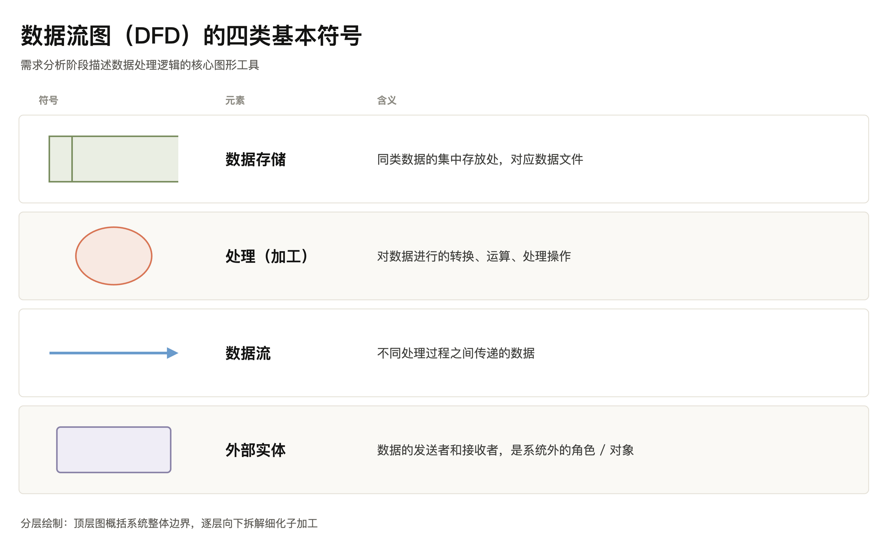
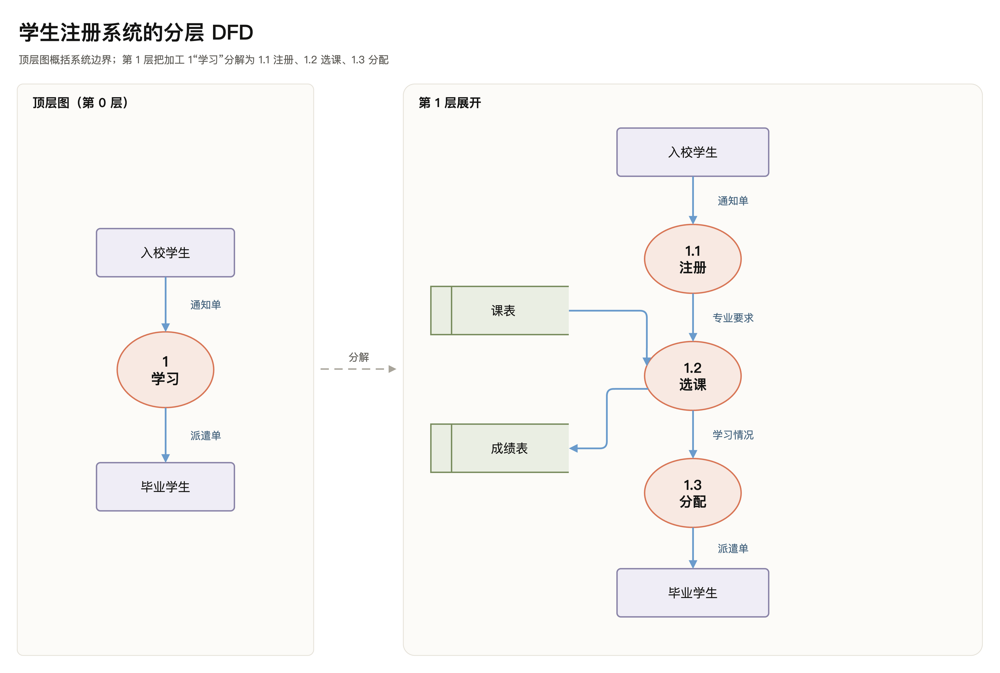

# 第 7 讲 ER 模式数据库设计

## `7.1` 数据库设计过程概览

- `7.1.1` 数据库设计

    数据库设计 `Database Design` 是指针对给定的应用环境，构造最优的数据模型，据此建立数据库及其应用系统，使之能够高效存储数据，满足各类用户的应用需求

    - **设计内容** `design content` 
        - **结构特性设计** `structural design` ，即数据库模式或数据结构的设计，回答“数据如何组织”
        - **行为特性设计** `behavioral design` ，即应用程序、事务处理的设计，回答“数据如何被使用”
    - **设计特点** `design characteristics` 
        1. **软件、硬件、干件（技术与管理界面的结合）**：数据库设计不仅是技术问题，还涉及人员组织与管理；
        2. **结构设计和行为设计的结合**：“结构”与“行为”两部分需求在设计各阶段同时进行、相互参照、相互补充，这是数据库设计与一般软件设计的本质区别
    - **设计目标 `design goals`**：满足要求与模拟精确程度；良好的数据库性能。

- `7.1.2` 数据库设计的六大阶段

    | 设计阶段         | 核心任务                                                     | 核心产出物                            |
    | ---------------- | ------------------------------------------------------------ | ------------------------------------- |
    | 需求分析         | 完整梳理数据需求与处理需求，与用户深度沟通，确定系统边界     | 需求说明书、数据流图 DFD、数据字典 DD |
    | 概念结构设计     | 选择数据模型，抽象实体、属性与联系，构建独立于具体数据库的概念模型 | 实体 - 联系图（E-R 图）               |
    | 逻辑结构设计     | 将概念模型转换为数据库支持的数据模型（如关系模式），并进行模式优化 | 关系模式、数据库逻辑结构              |
    | 数据库物理设计   | 设计数据的物理存储布局、存取路径、索引结构与存储选择         | 物理存储方案、索引设计方案            |
    | 数据库实施       | 建库建表、加载数据、编写应用、测试调试，实现数据库系统       | 可运行的数据库与应用系统              |
    | 数据库运行和维护 | 日常运维、性能优化、故障恢复、需求迭代                       | 持续稳定运行的数据库服务              |

## `7.2` 需求分析

- `7.2.1` 需求分析的任务与方法

    - 需求分析需要完整收集四类信息：
        1. **信息需求**：系统需要存储的数据内容、数据结构与数据关联
        2. **处理要求**：业务操作的流程、操作频率与处理逻辑
        3. **功能要求**：系统需要具备的业务功能
        4. **企业环境特征**：企业组织架构、业务规则、约束条件
    - 需求信息收集遵循四个步骤：
        1. 了解组织的机构设置
        2. 掌握主要业务活动与部门职能
        3. 梳理系统的各类外部要求
        4. 明确系统边界，区分系统内与系统外

    分析过程采用**自顶向下、逐层分解**的思路，核心工具为**数据流图** `Data Flow Diagram (DFD)` 和**数据字典** `Data Dictionary (DD)`

- `7.2.2` 数据流图 `DFD`

    数据流图用于直观描述业务流程中数据的流动、处理与存储关系，是需求分析阶段描述数据处理逻辑的核心图形工具

    - DFD 的四个基本符号

        | 符号形态             | 元素名称     | 含义说明                                    |
        | -------------------- | ------------ | ------------------------------------------- |
        | 双平行线（开口矩形） | 数据存储     | 同类数据的集中存放处，对应数据文件          |
        | 圆形 / 椭圆形        | 处理（加工） | 对数据进行的转换、运算、处理操作            |
        | 箭头                 | 数据流       | 不同处理过程之间传递的数据                  |
        | 矩形                 | 外部实体     | 数据的发送者和接收者，是系统外的角色 / 对象 |

        

        *图 7-1　数据流图（DFD）的四类基本符号*

    - DFD 采用分层绘制的方式，从顶层概括系统整体边界，逐层向下拆解细化子加工

        

        *图 7-2　学生注册系统的分层 DFD：顶层图与第 1 层展开*

- `7.2.3` 数据字典 `DD`

    数据字典是对**数据库中数据的描述信息**（元数据 `metadata` ）的集合，它本身不存数据，只存“关于数据的数据”

    - 在 DBMS 中的作用

        满足 DBMS 快速查询有关对象的要求，供 DBA 掌握整个系统运行的情况

    - 内容

        - 数据库系统所有对象及其属性的描述信息
        - 对象之间关系的描述信息
        - 登记所有对象属性的自然语言含义
        - 记录数据字典变化的历史

    - 与 DBMS 的关系

        - **结合式**（DBMS 与数据字典软件包融合在一起）
        - **独立式**（数据字典软件包不依附 DBMS 独立存在）

    - 访问接口

        - 与人的接口：通过 DBMS 提供的数据字典访问工具；
        - 与软件的接口：通过 DBMS 的应用程序接口 `Application Programming Interface (API)`

    - 数据字典的五类条目

        数据字典包含五类核心描述对象，每类都有标准的描述格式：

        1. **数据项** `Data Item` ：不可再分的最小数据单位
            - 描述格式：{数据项名，含义说明，别名，数据类型，长度，取值范围，与其他数据项的逻辑关系}
            - 示例：{订货单号，类型 CHAR，长度 8，取值范围 10000000-99999999}
        2. **数据结构** `Data Structure` ：由多个数据项 / 子数据结构组成的复合数据
            - 描述格式：{数据结构名，含义说明，组成：{数据项或数据结构}}
            - 示例：{采购细节，组成：零件号、零件名、数量}
        3. **数据流** `Data Flow` ：处理过程之间流动的数据
            - 描述格式：{数据流名，说明，数据流来源，数据流去向，组成：{数据结构}，平均流量，高峰期流量}
            - 示例：{采购计划，来源为确定采购计划加工，去向为编制订货单加工，组成为采购细节}
        4. **数据存储** `Data Store` ：数据的静态存储载体
            - 描述格式：{数据存储名，说明，编号，流入数据流，流出数据流，组成：{数据结构}，数据量，存取方式}
            - 示例：{产品库存，存取方式为随机存取}
        5. **处理过程** `Processing Process` ：对数据的加工处理逻辑
            - 描述格式：{处理过程名，说明，输入：{数据流}，输出：{数据流}，处理：{简要说明}}
            - 示例：{确定采购计划，输入库存与生产需求，输出采购计划，处理逻辑为根据库存缺口计算采购量}

## `7.3` 概念结构设计：实体 - 联系模型

- `7.3.1` 概念结构及其设计方法

    概念结构设计 `Conceptual Structure Design` 是指基于需求分析的成果，抽象出独立于具体数据库管理系统的概念数据模型，核心产出为**实体 - 联系图** `Entity-Relationship Diagram (E-R图)`

    - 概念结构的主要特点

        - 真实反映现实业务，完整满足用户的数据与处理需求
        - 语义直观易懂，方便技术人员与业务用户沟通对齐
        - 结构灵活可调，可适配业务需求的迭代与调整
        - 易于模型转换，可方便地映射为关系、层次等数据模型

    - 概念结构设计的四种方法

        - **自顶向下** `Top-Down` ：先定义全局概念结构框架，再逐步向下细化分解
        - **自底向上** `Bottom-Up` ：先设计各局部业务的概念结构，再逐步集成为全局结构
        - **逐步扩张** `Stepwise Expansion` ：先定义核心业务的概念结构，再向外逐步扩展补充
        - **混合策略** `Hybrid Strategy` ：结合自顶向下的框架规划与自底向上的细节设计

        - 自底向上方法的设计步骤

            自底向上是最常用的设计方法，分为两大阶段：

            1. **数据抽象与局部视图设计**

                - 选择局部业务场景作为设计单元，基于数据流图、数据字典等需求成果，逐一设计每个局部的分 E-R 图

                - 实体与属性的划分原则

                    - 属性是系统中最小的信息单元，自身**不再具备描述性质，不可再拆分子属性**
                    - 属性不能与其他实体产生关联联系

                    > 核心设计思想：能作为属性描述的对象，就不要定义为实体，以简化模型复杂度

            2. **视图集成**：将多个局部 E-R 图合并，消除冲突，最终形成全局基本 E-R 图

    - 常见设计陷阱

        不合理的 E-R 设计会引发两类核心问题：

        - **冗余** `Redundancy` ：设计中存在重复信息，会引发数据不一致、更新异常
        - **不完整性** `Incompleteness` ：设计存在业务遗漏，会导致部分业务功能无法实现、难以建模

- `7.3.2` 实体 - 联系模型

    - 实体与实体集

        - **实体** `Entity` ：现实世界中可相互区分的事物或对象，可以是具体的人、物品，也可以是抽象的事件、概念。
        - **实体集** `Entity Set` ：同一类型实体的集合，例如 “所有员工”“所有课程”。

    - 属性与主键

        **属性** `Attribute` 是实体集中每个实体都具备的描述性质，实体通过一组属性来表征，例如员工实体的工号、姓名、年龄

        > 属性是实体的最小描述单元，**主键属性可以唯一标识实体集中的每一个实体**

    - 联系与联系集

        - **联系** `Relationship`：多个实体之间的相互关联关系，例如 “教师指导学生” 就是一个联系

        - **联系集** `Relationship Set`：同类型联系的集合，是 n（n≥2）个实体集之间的数学关联， 数学定义为： \(\{(e_1, e_2, \dots, e_n) \mid e_1 \in E_1,\ e_2 \in E_2,\ \dots,\ e_n \in E_n\}\) 其中 \((e_1, e_2, \dots, e_n)\) 是一个具体的联系实例

        - 联系集的描述性属性：联系不仅可以关联实体，也可以拥有自己的**描述性属性**，用于记录联系本身的特征。

            示例：“教师指导学生” 的联系中，可以添加 “指导开始日期” 属性，记录指导关系的起始时间

        - 联系集的度 `Degree` ：指参与联系集的实体集的数量，大多数联系集就是二元联系集

    - 实体角色与递归联系

        - **实体角色** `Entity Role` ：实体在联系中所扮演的功能身份，普通联系中实体的角色是隐含、互异的，无需显式标注

        - **递归联系集** `Recursive Relationship Set` ：同一个实体集以不同的角色，多次参与同一个联系集，也叫自联系。 

            示例：课程实体集中的 “先修课” 联系（一门课程可以作为另一门课程的先修课，课程实体集同时以 “课程本身” 和 “作为某一课程的先修课程” 两个角色参与联系）

    - 数据抽象

        数据抽象 `Data Abstraction` 是从现实业务中提炼数据模型的核心方法

        - **聚集** `Aggregation`
            - 定义类型的组成成分，表达 “部分 - 整体” 的语义，即 `is part of`
            - 示例：“人体” 由头、身、手、足组成，各部分是人体的组成部分
        - **概括** `Generalization`（泛化 / 继承）
            - 定义类型之间的子集从属关系，表达 “是一种” 的语义，即 `is subset of`，对应面向对象中的继承概念
            - 示例：“人” 是父类，农民、工人、学生、干部是子类，子类继承父类的全部属性，同时可扩展自身特有属性

- `7.3.3` E-R 图的绘制

    - 基本图形符号

        | 图形            | 含义                             | 注意事项                   |
        | --------------- | -------------------------------- | -------------------------- |
        | 矩形            | 实体集                           | 矩形内列出属性             |
        | 椭圆            | 属性                             | 简单属性用单线             |
        | 下划线          | 主键 `Primary Key`               | 唯一标识成员               |
        | 双椭圆          | 多值属性 `Multivalued Attribute` | 如电话号码                 |
        | 虚线椭圆        | 派生属性 `Derived Attribute`     | 如年龄（可由出生日期算出） |
        | 菱形            | 联系集 `Relationship Set`        | 标明联系名                 |
        | 虚线矩形        | 联系的描述性属性                 | 依附在菱形上               |
        | 双矩形 / 双菱形 | 弱实体集 / 标识性联系            | 依赖强实体存在             |

    - 核心设计要点与原则

        1. 实体与属性的划分原则（核心判定标准）

            这是 E-R 图设计的基础原则，直接决定模型的合理性：

            - **原子性原则**：属性是最小信息单元，自身不能再拥有子属性，也不具备描述性质。
            - **无关联原则**：属性不能与其他实体产生联系，只能描述所属实体。
            - **最简原则**：能作为属性表达的对象，尽量不定义为实体，避免模型过度复杂。

        2. 联系设计要点

            - **语义准确**：联系名必须精准描述业务关联，避免歧义，优先使用动词 / 动宾短语命名。

            - **度的选择**：优先使用二元联系；三个及以上实体的强关联场景使用多元联系，禁止强行将三元联系拆分为多个二元联系，会丢失业务语义。
            - **递归联系**：同一实体集内部的关联必须标注角色，例如课程的 “先修课” 联系，需区分 “当前课程” 和 “先修课程” 两个角色。

            - **属性归属**：描述实体自身特征的归实体属性；描述实体间关联关系特征的归联系属性。例如 “学生姓名” 是实体属性，“选课成绩” 是选课联系的属性。

        3. 数据抽象规范

            - **聚集（部分 - 整体）**：整体作为主实体，部分根据场景判断是属性还是子实体

            - **概括（继承 / 泛化）**：父实体抽取公共属性，子实体扩展特有属性，子类继承父类全部属性

    - 常见优化要点

        1. 避免冗余陷阱

            - 不要重复定义属性、重复设置关联联系

            - 冗余会引发数据不一致、更新异常，集成阶段需主动消除冗余数据与冗余联系

        2. 避免不完整性陷阱

            - 不要遗漏核心业务实体、联系与关键属性

            - 完成绘制后需反向校验：所有业务场景是否都能通过该模型完整表达

        3. 常见典型错误

            - 误将属性定义为实体，导致模型臃肿、逻辑混乱

            - 联系的属性错误归属到实体上，语义表达错误

            - 实体未定义主键，无法唯一标识实体实例

            - 递归联系未标注角色，语义模糊不清

## `7.4` 复杂属性

- `7.4.1` 属性的分类与表示

    | 分类维度 | 类型                               | 含义                 | 示例                    |
    | -------- | ---------------------------------- | -------------------- | ----------------------- |
    | 可否再分 | 简单属性 `Simple Attribute`        | 不可再分             | 学号                    |
    |          | 复合属性 `Composite Attribute`     | 可再划分为其他属性   | 姓名 = 姓 + 名 + 中间名 |
    | 取值个数 | 单值属性 `Single-valued Attribute` | 每个实体只有一个值   | 学号                    |
    |          | 多值属性 `Multivalued Attribute`   | 每个实体可有多个值   | 电话号码                |
    | 是否可算 | 派生属性 `Derived Attribute`       | 可从其他属性计算得出 | 年龄（由出生日期算出）  |

    - **值域** `Domain`：每个属性的合法取值范围，用于限定属性的取值边界，保障数据合法性

        示例：考试成绩的值域为 0~100；性别的值域为 {男，女}

- `7.4.2` 复杂属性的 E-R 图符号规范

    | 属性类型     | E-R 图形符号                                 |
    | ------------ | -------------------------------------------- |
    | 普通单值属性 | 标准椭圆                                     |
    | 多值属性     | 双椭圆（双层椭圆边框）                       |
    | 派生属性     | 虚椭圆（虚线边框椭圆）                       |
    | 复合属性     | 主椭圆下分支连接多个子属性椭圆，形成树形结构 |

## `7.5` 映射基数与弱实体集

- `7.5.1` 映射基数

    **映射基数** `Mapping Cardinality` 表示一个实体集中的实体，可以通过联系集与另一个实体集相关联的实体数

    二元联系有四种基数类型：

    - **一对一** `One-to-One (1:1)` ：A 中一个实体至多关联 B 中一个，反之亦然
    - **一对多** `One-to-Many (1:n)` ：A 中一个实体可关联 B 中任意多个，B 中一个实体至多关联 A 中一个
    - **多对一** `Many-to-One (n:1)` ：与一对多方向相反
    - **多对多** `Many-to-Many (m:n)` ：双方均可关联任意多个。如学生 — 课程是 m:n（一名学生可以选修多门课程，一门课程可以被多名学生选修）
    - E-R 图中的表示：从联系集到实体集画箭头（$\rightarrow$）表示“一”，画线段（—）表示“多”

- `7.5.2` 参与约束

    参与约束描述实体集中的实体是否必须参与某个联系，也叫参与性约束

    - **全部参与（完全参与）**`Total Participation` ：实体集中每个实体至少参与联系集中的一个联系，E-R 图中用**双线**连接全部参与的实体集与联系集

        示例：学生必须属于某个班级，学生在 “属于” 联系中是全部参与

    - **部分参与** `Partial Participation`：某些实体可以不参与任何联系，E-R 图中用**单线**连接部分参与的实体集与联系集

        示例：不是所有教师都担任班主任，教师在 “担任班主任” 联系中是部分参与

- `7.5.3` 码 `Key` 

    **码**是实体集或联系集中，能够唯一区分每个实体 / 联系实例的一组属性

    - 核心作用：通过码的属性值，可以唯一标识一个实体实例或一条联系记录
    - 分类与包含关系：
        - 超码：能唯一标识实体的属性集合，**可能包含冗余属性**
        - 候选码：**最小的超码**，去掉任意一个属性后都无法完成唯一标识
        - 主码（主键）：从**候选码中选定的**、作为实体唯一标识的码

- `7.5.4` 弱实体集

    **弱实体集** `Weak Entity Set` 是指没有自身独立主码，必须依赖另一个强实体集才能存在的实体集，也叫从属实体集

    - **标识（所有者）实体集** `Identifying Entity Set` ：弱实体集所依赖的强实体集，“拥有”弱实体集
    - **识别联系** `Identifying Relationship` ：是从弱实体集指向标识实体集的**多对一**（或一对一）联系，且弱实体集必须**全部参与**，用**双菱形**表示
    - **判别符（部分键）**`Discriminator` / `Partial Key` ：弱实体集中用以区分的属性集，用**虚线下划线**标出

## `7.6` 从实体集中删除冗余属性

- `7.6.1` 冗余属性

    **冗余属性** `Redundant Attribute` 是指可以通过关联的实体、联系推导得出，在实体中重复存储的属性

    冗余属性会造成数据冗余、更新异常，是 E-R 图优化阶段的主要删除对象

- `7.6.2` 示例

    - 学生实体：学生 (ID, name, tot_cred, dept_name)
    - 部门实体：部门 (dept_name, building, budget)
    - 学生与部门通过 `stud_dept` 联系建立关联
    - 冗余判断：学生实体中的 `dept_name` 可以通过关联联系从部门实体中获取，属于重复存储的冗余信息，需要从学生实体中删除

## `7.7` 逻辑结构设计：将 E-R 图转换为关系模式

- `7.7.1` 逻辑结构设计

    **逻辑结构设计** `Logical Structure Design` 是数据库设计的第三阶段，核心任务是将概念结构设计产出的基本 E-R 图，转换为具体数据库管理系统支持的关系数据模型

    1. **概念结构转换为关系模型**：遵循统一转换规则，将 E-R 图的实体、联系、属性映射为关系模式
    2. **优化关系模型**：通过规范化、结构调整，消除数据冗余与插入、删除、更新异常
    3. **设计适配 DBMS 的子模式**：结合具体数据库软件的特性与限制，设计用户外模式与视图

- `7.7.2` E-R 图向关系模型的转换

    | E-R 成分                  | 转换方法                                                     | 关系模式的码           |
    | ------------------------- | ------------------------------------------------------------ | ---------------------- |
    | 一个实体型                | 转换为一个关系模式                                           | 实体的码               |
    | 1:1 联系                  | 独立成表，**或与任一端合并**                                 | 每个实体的码都是候选码 |
    | 1:n 联系                  | 独立成表，**或与 n 端合并** （或：减少关系个数、避免连接运算） | n 端实体的码           |
    | m:n 联系                  | **必须**独立成一个关系模式                                   | 两端实体码的组合       |
    | 多元联系（$\ge3$ 个实体） | 转换为一个关系模式                                           | 各实体码的组合         |
    | 相同码的关系模式          | 可合并（去掉同义属性）                                       | 不变                   |

- `7.7.3` 局部 E-R 图集成：冲突处理

    将多个业务场景的局部 E-R 图合并为初步 E-R 图的过程，核心是发现并解决三类冲突：

    - **属性冲突**：属性值类型、取值范围等不一致（如“日期”一处用字符、一处用日期型）
    - **命名冲突**：**同名异义**（不同对象同名）与**异名同义**（同一对象不同名）
    - **结构冲突**：
        - 同一对象在不同视图中抽象不同（一处是实体、一处是属性）
        - 同一实体在不同视图中属性组成不同
        - 相同实体间的联系在不同视图中类型不同（一处 1:n、一处 m:n）

- `7.7.4` 消除冗余，生成基本 E-R 图

    - 冗余的两类表现

        - **冗余数据**：可由其他基础数据推导得出的数据。

        - **冗余联系**：可由其他联系推导得出的联系。

    - 消除冗余的方法
        1. **分析法**：基于业务逻辑人工判断，直接删除多余的属性与联系。
        2. **规范化理论法**：
            - 梳理实体间的函数依赖关系
            - 求解函数依赖的最小依赖集，确定关系的基
            - 逐一考察每条函数依赖，判断是否冗余并剔除

    > 并非所有冗余都必须消除，部分场景下为了提升查询效率，会以空间换时间，刻意保留少量可控冗余，需在数据一致性与查询性能之间权衡

- `7.7.5` 转换的码原则（主键规则）

    - 实体转换规则：实体转换为关系模式时，**实体的属性就是关系的属性，实体的码就是关系的主码**。

    - 联系转换的码规则：联系转换为关系模式时，属性由「各参与实体的主码 + 联系自身的属性」组成，主码按联系类型区分

        | 联系类型                   | 关系主码规则                         |
        | -------------------------- | ------------------------------------ |
        | 1:1 联系                   | 两端实体的主码均可作为该关系的候选码 |
        | 1:n 联系                   | 关系的主码为 n 端实体的主码          |
        | m:n 联系                   | 关系的主码为两端实体主码的组合       |
        | 多元联系（三个及以上实体） | 关系的主码为所有参与实体主码的组合   |

    - 合并规则：**具有相同主码的关系模式可以合并**，以减少数据表数量，简化模型结构