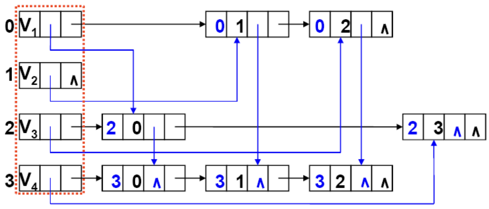
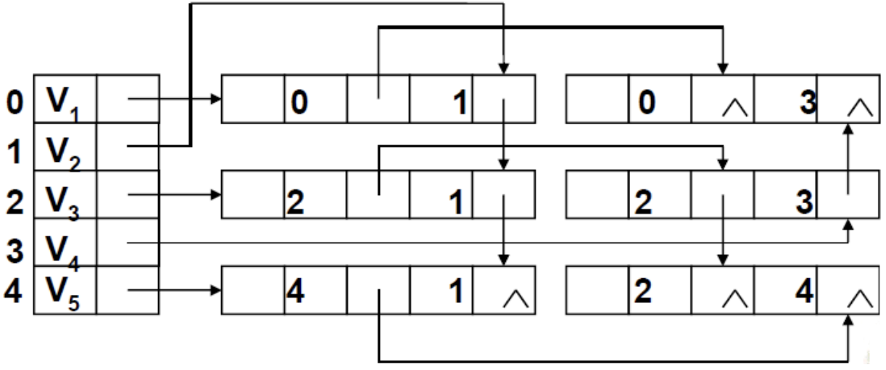

# 第 1 章 绪论
1. #### 数据结构的基本概念

    1. ##### 数据

        数据是指对客观事件进行记录并可以鉴别的符号，是对客观事物的性质、状态以及相互关系等进行记载的物理符号或这些物理符号的组合，它是可识别的、抽象的符号

        - 在计算机科学中，数据是指一切能输入到计算机中并能被计算机程序识别和处理的符号集合

        | 名词     | 解释                                                         |
        | -------- | ------------------------------------------------------------ |
        | 数据元素 | 数据的基本单位，在计算机程序中通常作为一个整体进行考虑和处理 |
        | 数据项   | 构成数据元素的最小单位                                       |
        | 数据对象 | 具有相同性质的数据元素的集合                                 |

        - 例如，上面这个表的每一行都是这个表的一个**数据元素**，包括 `名词` 和 `解释` 两个**数据项**，整个表就是一个**数据对象**

    2. ##### 逻辑结构

        数据元素之间是有内在联系的，与其本身的形式、内容无关，与数据的存储方式也无关，据此可抽象出数据的逻辑结构

        | 常见的逻辑结构   | 主要特征                                                     |
        | ---------------- | ------------------------------------------------------------ |
        | 集合结构         | 数据之间地位平等，除了“同属于一个集合”外没有其他关系         |
        | 线性结构         | 数据元素之间存在一对一的线性关系，存在唯一的前驱和后继       |
        | 树型结构         | 数据元素之间存在一对多的层次关系，存在唯一的前驱而允许有多个后继 |
        | 图状（网状）结构 | 数据元素之间存在多对多的任意关系，图中的任意两个元素之间都可能有关系 |

    3. ##### 物理结构

        数据元素及其内在的逻辑结构在计算机中的**存储结构**，便是这一数据结构的物理结构

        - 物理结构设计的要点是不仅要保存数据元素，还要保存数据之间的关系

        - 变量与数据

            变量是存放数据的“容器”，数据通过变量名与内存（地址）进行关联

            - 每一个变量都涉及：
                - 一个用于存放数据的空间
                -  空间的位置（地址）
                - 一个确定的类型
                - 存放的数据的值
            - 对变量进行操作和访问的方式：直接访问与间接访问

        - 两种物理结构的设计方式

            - 连续设计存储方式
                - 利用一系列连续的存储空间存放数据
                - 通过数据元素在存储单元中的相对位置来表示数据元素之间的逻辑关系
            - 链接设计存储方式
                - 利用多个离散的空间存放数据
                - 借助指示数据元素存储地址的指针来表示数据元素之间的逻辑关系

        - 物理结构与逻辑结构

            - 数据的逻辑结构属于用户视图，是面向问题的，反映了数据内部的构成方式
            - 数据的物理结构属于具体实现的视图，依赖于具体的计算机语言的，是面向计算机的
            - 数据的逻辑结构独立于计算机，一种数据的逻辑结构可以用多种存储结构来存储，有着不同的处理效率

2. #### 抽象数据类型及其表示方式

    - 数据结构

        数据结构与算法是研究计算机求解问题过程中**数据的逻辑结构、存储结构以及相关算法**的学科

        - 数据的逻辑结构：数据之间逻辑关系的描述

        - 数据的存储结构：数据元素在计算机中的存储及其逻辑关系的表现称为数据的存储结构或物理结构

        - 数据操作：对数据要进行的运算

            | 运算举例        | 功能                                   |
            | --------------- | -------------------------------------- |
            | 建立（Create）  | 建立一个数据结构                       |
            | 消除（Destroy） | 消除一个数据结构                       |
            | 删除（Delete）  | 从一个数据结构中删除一个数据元素       |
            | 插入（Insert）  | 把一个数据元素插入到一个数据结构中     |
            | 访问（Access）  | 对一个数据结构进行访问                 |
            | 修改（Modify）  | 对一个数据结构（中的数据元素）进行修改 |
            | 排序（Sort）    | 对一个数据结构进行排序                 |
            | 查找（Search）  | 在一个数据结构中查找                   |

        - 数据结构的形式定义：$Data-Struct=(D,S)$，其中 D 是数据元素的有限集，S 是 D 上关系的优先集合

    - 抽象数据类型 ADT $(Abstract~Data~Type)$

        - 抽象数据类型的形式化定义为：$ADT=(D,S,P)$，其中 D 是数据元素，S 是 D 上的关系集，P 是对 D 的基本操作集
        - 抽象数据类型着重关注数据的逻辑特性描述，与在计算机内部的表示与实现无关
        - ADT 通常以如下形式定义：

        ```
        ADT <抽象数据类型名称>
        {
        	数据对象：<数据对象的定义>(用伪代码或集合的形式描述)
        	数据关系：<数据关系的定义>(用伪代码或集合的形式描述)
        	数据关系：<基本操作名>(参数表)
        			初始条件：<初始条件描述>(描述操作执行之前数据结构和参数应满足的条件)
        			操作结果：<操作结果描述>(描述操作正常完成之后，数据结构的变化状况和应返回的结果)
        }
        ```

3. #### 算法

    - 算法是对特定问题求解方法(步骤)的一种描述，是指令的**有限序列**，其中每一条指令表示一个或多个操作
    - 算法的五个特性
        - 确定性：算法每种运算必须有确切定义，不能引起歧义
        - 可行性：算法中**有待实现的运算都是基本的运算**，可以通过已经实现的基本操作执行有限次来实现
        - 可输入：每个算法**有 0 个或多个输入**，这些输入是在算法开始之前给出的量，取自于特定的对象集合——定义域
        - 可输出：一个算法产生一个或多个输出，这些输出是同输入有某种特定关系的量
        - 有穷性：一个算法总是在执行了有穷步的运算之后终止
    - 计算过程与算法
        - 只满足确定性、能行性、可输入、可输出四个特性但不一定能终止的一组规则（如操作系统）
        - 算法是可终止的计算过程
    - 算法的描述方法

    | 描述方法     | 优点                           | 缺点                   |
    | ------------ | ------------------------------ | ---------------------- |
    | 自然语言     | 容易理解                       | 冗长、二义性           |
    | 流程图       | 处理流程直观                   | 缺少严密性、灵活性     |
    | 伪代码       | 表达能力强，抽象性强，容易理解 | 无法直接在计算机上运行 |
    | 程序设计语言 | 能由计算机执行                 | 抽象性差，对语言要求高 |

    - 评价算法的方法
        1. **正确性 (Correctness)**：算法应满足具体问题的需求
        2. **可读性 (Readability)**：算法应容易供人阅读和交流，可读性好的算法有助于对算法的理解和修改
        3. **健壮性 (Robustness)**：算法应具有容错处理，当输入非法或错误数据时，算法应能适当地作出反应或进行处理，而不会产生莫名其妙的输出结果
        4. **通用性 (Generality)**：算法应具有一般性，即算法的处理结果对于一般的数据集合都成立
        5. **效率与存储量的需求**：效率指的是算法执行的时间，存储量需求指算法执行过程中所需要的最大存储空间

4. ##### 算法分析

    在数据结构与算法中，**时间复杂度**衡量算法的执行效率，**空间复杂度**衡量算法的内存占用情况

    二者的核心是描述算法性能随**问题规模 n** 增长的**变化趋势**，而非具体的执行时间或占用字节数，通常使用**渐近符号**（最常用的是大 O 符号）来表示

    - 时间复杂度

        - 定义

            算法的**时间复杂度**，是指算法执行过程中所需的**基本操作次数**随问题规模 n 增长的变化规律
    
            - **基本操作**：指无法再分解的原子操作，例如一次赋值、一次比较、一次算术运算（\(+\)、\(\times\) 等）
            - **问题规模 n**：通常指输入数据的规模，例如数组的长度、字符串的字符数、图的顶点数等

            时间复杂度不关注具体的执行时间（因为执行时间受硬件、编程语言等影响），只关注**基本操作次数与 n 的增长关系**

        - 核心渐近符号
    
        | 符号             | 含义                                               | 适用场景                 |
        | ---------------- | -------------------------------------------------- | ------------------------ |
        | \(O(f(n))\)      | 算法执行次数**不超过** \(f(n)\) 的增长速度（上界） | 描述最坏情况，**最常用** |
        | \(\Omega(f(n))\) | 算法执行次数**不少于** \(f(n)\) 的增长速度（下界） | 描述最好情况             |
        | \(\Theta(f(n))\) | 算法执行次数**等于** \(f(n)\) 的增长速度（紧界）   | 上下界相同的理想情况     |

        - 计算方法（核心步骤）

            计算时间复杂度的关键是**统计基本操作的执行次数关于 n 的函数 \(T(n)\)，再简化为大 O 形式**，具体步骤如下：
    
            - **找出基本操作**：通常是循环体内部的操作（循环是影响执行次数的核心）
            - **统计执行次数**：计算基本操作的总执行次数，得到关于 n 的函数 \(T(n)\)
            - **简化为大 O 形式**：
                - 忽略**常数项**：例如 \(T(n)=2n+10\) → 忽略 10，得到 2n
                - 忽略**低阶项**：例如 \(T(n)=n^2+3n+5\) → 忽略 \(3n+5\)，得到 \(n^2\)
                - 忽略**常数系数**：例如 \(T(n)=2n^2\) → 忽略 2，得到 \(n^2\)
                - $O(f+g)=max(O(f),O(g));~O(f)\times O(g)=O(f\times g);~O(cf(n))=O(f(n))$
                - 最终结果：保留最高阶项，记为 \(O(\text{最高阶项})\)

        - 常见时间复杂度（按效率从高到低排序）
    
        | 复杂度类型 | 表达式         | 示例算法                       | 特点                        |
        | ---------- | -------------- | ------------------------------ | --------------------------- |
        | 常数阶     | \(O(1)\)       | 访问数组指定下标元素、两数交换 | 执行次数与 n 无关，固定次数 |
        | 对数阶     | \(O(\log n)\)  | 二分查找                       | 每次操作使问题规模减半      |
        | 线性阶     | \(O(n)\)       | 顺序查找、单层循环遍历数组     | 执行次数与 n 成正比         |
        | 线性对数阶 | \(O(n\log n)\) | 归并排序、快速排序（平均情况） | 分治思想的典型复杂度        |
        | 平方阶     | \(O(n^2)\)     | 冒泡排序、双层嵌套循环         | 执行次数与 \(n^2\) 成正比   |
        | 立方阶     | \(O(n^3)\)     | 三层嵌套循环                   | 执行次数与 \(n^3\) 成正比   |
        | 指数阶     | \(O(2^n)\)     | 斐波那契数列递归实现           | 效率极低，n 稍大就无法运行  |

        - 举例计算

            示例 1：常数阶 \(O(1)\)
    
            ```c++
            void get_first (int arr[]) {
                return arr[0];
            }
            ```
    
            - 基本操作：1 次取值，执行次数与数组长度 n 无关
            - 时间复杂度：\(O(1)\)

            示例 2：线性阶 \(O(n)\)
    
            ```c++
            bool find_target(int arr[], int size, int target) {
                for(int i = 0; i < size; i++){
                    if(arr[i]==target){
                        return true;
                    }
                }
                return false;
            }
            ```
    
            - 最坏情况：遍历整个数组，基本操作（比较）执行 n 次 → \(T(n)=n\)
            - 时间复杂度：\(O(n)\)

            示例 3：平方阶 \(O(n^2)\)
    
            ```c++
            void bubble_sort(int arr[], int size) {
                for(int i = 0; i < size; i++) {
                    int swapped = 0;
                    for(int j = 1; j < size - i; j++) {
                        if(arr[j] < arr[j-1]) {
                            int temp = arr[j];
                            arr[j] = arr[j-1];
                            arr[j-1] = temp;
                            swapped = 1;
                        }
                    }
                    if(!swapped) break;
                }
            }
            ```
    
            - 基本操作：内层循环的比较和交换，执行次数 \(T(n) = (n-1)+(n-2)+...+1 = \frac{n(n-1)}{2} = \frac{1}{2}n^2 - \frac{1}{2}n\)
            - 简化：忽略低阶项和常数系数，保留最高阶 \(n^2\)
            - 时间复杂度：\(O(n^2)\)

    - 空间复杂度

        - 定义

            算法的**空间复杂度**，是指算法执行过程中所需的**额外空间**随问题规模 n 增长的变化规律
    
            - **额外空间**：指算法执行时**除输入数据外**，临时开辟的存储空间，包括：
                - 临时变量、常量
                - 辅助数组、栈、队列等数据结构
                - 递归调用的**栈空间**（容易被忽略的重点）
            - **输入空间**：输入数据本身占用的空间，**不计入空间复杂度**（因为这是问题本身的必要开销，与算法无关）

            和时间复杂度一样，空间复杂度也用**大 O 符号**表示

        - 计算方法

            空间复杂度的计算逻辑与时间复杂度类似，核心是**统计额外空间的大小关于 n 的函数 \(S(n)\)，再简化为大 O 形式**：
    
            - **分析额外空间**：找出算法中开辟的所有临时空间（变量、辅助结构、递归栈）
            - **计算空间大小**：得到额外空间关于 n 的函数 \(S(n)\)
            - **简化为大 O 形式**：同样忽略常数项、低阶项和常数系数，保留最高阶项

        - 常见空间复杂度
    
            | 复杂度类型 | 表达式        | 示例场景                                                     |
            | ---------- | ------------- | ------------------------------------------------------------ |
            | 常数阶     | \(O(1)\)      | 冒泡排序（仅用几个临时变量）、两数交换                       |
            | 线性阶     | \(O(n)\)      | 归并排序（开辟大小为 n 的辅助数组）、创建长度为 n 的临时数组 |
            | 对数阶     | \(O(\log n)\) | 二分查找的递归实现（递归栈深度为 \(\log n\)）                |
            | 平方阶     | \(O(n^2)\)    | 创建大小为 \(n\times n\) 的二维辅助数组                      |

        - 举例计算

        示例 1：常数阶 \(O(1)\)
    
        ```c++
        void swap(int &a,int &b) {
            int temp = a; //开辟了一个临时变量
            a = b;
            b = temp;
        }
        ```
    
        - 额外空间：仅 1 个临时变量 `temp`，与 n 无关
        - 空间复杂度：\(O(1)\)

        示例 2：线性阶 \(O(n)\)
    
        ```c++
        int* copy_arr(int arr[],int size) {
            int* new_arr = new int[size]; //创建了一个大小的n的新数组
            for (int i = 0;i < size;i++) {
                new_arr[i] = arr[i];
            }
            return new_arr;
        }
        ```
    
        - 额外空间：辅助数组 `new_arr`，大小为 n
        - 空间复杂度：\(O(n)\)

        示例 3：递归的空间复杂度（对数阶 \(O(\log n)\)）
    
        ```c++
        int binary_search(int arr[], int low, int high, int target) {
            if (low > high) {
                return -1;
            }
            int mid = low + (high - low) / 2;
            if (target == arr[mid]) {
                return mid;
            }
            else if (target > arr[mid]) {
                return binary_search(arr, mid + 1, high, target);
            }
            else {
                return binary_search(arr,low,mid-1,target);
            }
        }
        ```
    
        - 额外空间：递归调用的**栈空间**（二分查找的递归深度为 \(\log_2 n\)（每次问题规模减半），栈空间大小等于递归深度）
        - 空间复杂度：\(O(\log n)\)

        三、核心总结

        - **核心区别**
    
            - 时间复杂度：看**基本操作的执行次数**与 n 的关系
            - 空间复杂度：看**额外开辟的存储空间**与 n 的关系

        - **计算技巧**
    
            - 时间：抓循环（尤其是嵌套循环），统计执行次数的最高阶项
            - 空间：抓辅助结构和递归栈，统计额外空间的最高阶项

        - **权衡思想**

            很多算法存在**“时间换空间”或“空间换时间”的权衡**，例如：
    
            - 哈希表查询是 \(O(1)\) 时间复杂度，但需要 \(O(n)\) 空间
            - 原地排序算法（如冒泡排序）空间复杂度是 \(O(1)\)，但时间复杂度是 \(O(n^2)\)

# 第 2 章 线性表
1. #### 线性表的定义

    1. 线性表的基本定义

        - 组成：由 \(n(n \geq 0)\) 个**同类型数据元素**构成的**有限序列**，非空表记为 \((a_1, a_2, ..., a_n)\)
        - 长度：数据元素的个数 n
        - 特殊情况：当 \(n=0\) 时，称为空表
        - 首尾结点：非空表中，\(a_1\) 是首结点，\(a_n\) 是尾结点

    2. 线性表的结构归属

        线性表是**典型的线性结构**，线性结构需满足：

        - 存在唯一的 “第一个” 数据元素
        - 存在唯一的 “最后一个” 数据元素
        - 除第一个元素外，每个元素有且仅有一个直接前驱
        - 除最后一个元素外，每个元素有且仅有一个直接后继

    3. 线性表的逻辑特征

        - 有限性：元素个数是有穷的
        - 相同性：所有元素的数据类型一致
        - 相继性：
            - 首元素 \(a_1\) 无前驱元素，尾元素 \(a_n\) 无后继元素
            - 对于 \(1 < i < n\) 的中间元素 \(a_i\)，直接前驱是 \(a_{i-1}\)，直接后继是 \(a_{i+1}\)

    4. 线性表的基本操作

        | 操作名称                | 功能描述                                                     |
        | ----------------------- | ------------------------------------------------------------ |
        | `InitList(&L)`          | 初始化线性表：构造一个空的线性表 L                           |
        | `DestroyList(&L)`       | 销毁线性表：释放线性表 L 占用的内存资源                      |
        | `ListEmpty(L)`          | 判断表空：若 L 为空表则返回 TRUE，否则返回 FALSE             |
        | `ListLength(L)`         | 求表长：返回线性表 L 中元素的个数                            |
        | `GetElem(L, i, &e)`     | 取元素：用 e 返回 L 中第 i 个位置的元素（i 需满足 1≤i≤ListLength (L)） |
        | `LocateElem(L, e)`      | 定位元素：返回 L 中第一个与 e 相等的元素的位置；若不存在则返回 0 |
        | `ListInsert(&L, i, e)`  | 插入元素：在 L 的第 i 个位置插入元素 e，表长加 1（i 需满足 1≤i≤ListLength (L)+1） |
        | `ListDelete(&L, i, &e)` | 删除元素：删除 L 的第 i 个位置的元素，用 e 返回其值，表长减 1（i 需满足 1≤i≤ListLength (L)） |

    5. 线性表的抽象数据类型

        ```plaintext
         ADT List {
            /* 1. 数据对象（Data Object） */
            设线性表的元素集合为 D，其中每个元素具有相同的特性（属于同一数据类型），即：
                D = { a_i | a_i ∈ ElemSet, i = 1, 2, ..., n, n ≥ 0 }
            说明：
            - ElemSet 是元素的抽象数据类型（可根据实际需求定义为int、char、结构体等）；
            - n 为线性表的长度，n = 0 时表示线性表为空表；
            - a_i 称为线性表的第 i 个元素（i 为元素的位序，从 1 开始计数）
        
            /* 2. 数据关系（Data Relation） */
            线性表中元素之间遵循**线性有序关系**，即：
                R = { <a_{i-1}, a_i> | a_{i-1}, a_i ∈ D, i = 2, 3, ..., n }
            说明：
            - <a_{i-1}, a_i> 表示 a_{i-1} 是 a_i 的**直接前驱**，a_i 是 a_{i-1} 的**直接后继**；
            - 第一个元素 a_1 没有前驱，最后一个元素 a_n 没有后继；
            - 除首、尾元素外，每个元素有且仅有一个直接前驱和一个直接后继
        
            /* 3. 基本操作（Basic Operations） */
            以下操作中，参数 L 表示线性表（部分操作需传引用以修改表本身），i 表示元素的位序，e 表示元素值（部分操作需传引用以返回元素值）
        
            /* 初始化线性表 */
            Operation InitList(&L)
                初始条件：无（线性表 L 尚未被创建）
                操作结果：构造一个空的线性表 L，释放原有内存（若有），表长置为 0
        
            /* 销毁线性表 */
            Operation DestroyList(&L)
                初始条件：线性表 L 已存在
                操作结果：释放线性表 L 占用的所有内存资源，线性表 L 不再存在
        
            /* 判断线性表是否为空 */
            Operation ListEmpty(L)
                初始条件：线性表 L 已存在
                操作结果：若 L 为空表，返回 TRUE（真）；否则返回 FALSE（假）
        
            /* 求线性表的长度 */
            Operation ListLength(L)
                初始条件：线性表 L 已存在
                操作结果：返回线性表 L 中元素的个数（即表长 n）
        
            /* 取线性表中第 i 个元素 */
            Operation GetElem(L, i, &e)
                初始条件：线性表 L 已存在，且 1 ≤ i ≤ ListLength(L)
                操作结果：将线性表 L 中第 i 个位置的元素值赋值给 e，e 作为输出参数返回
        
            /* 定位元素在线性表中的位置 */
            Operation LocateElem(L, e)
                初始条件：线性表 L 已存在，e 是与表中元素同类型的有效值
                操作结果：返回线性表 L 中**第一个**与 e 相等的元素的位序；若不存在这样的元素，返回 0
        
            /* 在线性表中插入元素 */
            Operation ListInsert(&L, i, e)
                初始条件：线性表 L 已存在，且 1 ≤ i ≤ ListLength(L) + 1（i 为插入位置）
                操作结果：在线性表 L 的第 i 个位置插入元素 e，原第 i 个及之后的元素依次后移，表长加 1
        
            /* 删除线性表中的元素 */
            Operation ListDelete(&L, i, &e)
                初始条件：线性表 L 已存在，且 1 ≤ i ≤ ListLength(L)（i 为删除位置）
                操作结果：删除线性表 L 中第 i 个位置的元素，将其值赋值给 e（e 作为输出参数返回），原第 i+1 个及之后的元素依次前移，表长减 1
        
        } ADT List;
        ```

2. #### 线性表的连续设计存储方式

    将线性表中的元素依次存放在连续的存储空间中，使==在逻辑上相邻的两个元素，在物理上也相邻==（利用数组结构实现），用这种存储方式存储的线性表又称顺序表

    - 连续存储结构是一种支持**随机访问存取**的结构，可以按元素的位置之间的关系进行访问，不依赖于前一个元素的位置

        → 其位置可以由公式直观的计算出来：$Loc(a_i)=Loc(a_1)+(i-1)*sizeof(a_1),1\le i\le n$

    - 基本操作的时间复杂度分析

        | 操作名称                                | 时间复杂度 |
        | --------------------------------------- | ---------- |
        | `InitList(&L)` 初始化顺序表             | \(O(1)\)   |
        | `DestroyList(&L)` 销毁顺序表            | \(O(1)\)   |
        | `ListEmpty(L)` 清空顺序表               | \(O(1)\)   |
        | `ListLength(L) `求顺序表长              | \(O(1)\)   |
        | `GetElem(L, i, &e)` 求 i 位元素         | \(O(1)\)   |
        | `LocateElem(L, e)` 定位 e 元素          | \(O(n)\)   |
        | `ListInsert(&L, i, e)` 插入 e 至 i 位置 | \(O(n)\)   |
        | `ListDelete(&L, i, &e)` 删除 i 位置元素 | \(O(n)\)   |

        - 连续存储设计的优点
            - **随机访问效率高**：支持 \(O(1)\) 时间复杂度的下标访问，适合频繁查询的场景
            - **缓存友好**：元素物理连续存储，CPU 缓存命中率高，实际运行速度优于理论复杂度
            - **实现简单**：基于数组，代码编写难度低，无需维护指针
            - **空间利用率（存储效率）高**：占用的空间完全用来存储数据，无须为表示节点间逻辑关系而增加额外存储空间
        - 连续存储设计的缺点
            - **插入删除效率低**：中间 / 头部操作需移动大量元素，数据量越大，效率越低
            - **空间利用不够灵活**：在定义表时必须规定表长，容易造成空间的浪费或空间不足
            - **扩容开销大**：动态扩容会产生内存复制开销，且扩容后会存在**内存浪费**（预留空间未使用）
            - **内存利用率低**：若元素大小不一或数量波动大，预留空间易造成内存碎片

3. #### 线性表的链接设计存储方式

    将线性表中的元素存放在不连续甚至是零散的存储空间中，**利用指针指示其逻辑上相邻的元素**，用这种存储方式存储的线性表又称链表

    - **存储特征**

        - 元素物理存储地址不连续，用指针来表示元素之间的逻辑关系
        - 常见类型：单链表（仅存后继指针）、双链表（存前驱 + 后继指针）、循环链表（首尾节点相连）
        - 无需预设容量，元素新增时直接申请内存，删除时释放内存
        - 节点的基本结构：$\boxed{Data}\boxed{Pointer}$ 
            - $\boxed{Data}$：数据域，用于存放表中的数据
            - $\boxed{Pointer}$：指针域，用于存放结点逻辑上相邻的元素的地址

    - 单链表

        指针域中只含有一个指针的链表结点称为单链表，这个指针统一指向每一个元素其后继（或前驱）元素的地址

        ```c++
        // 单链表模板类
        template <typename T>
        class SinglyLinkedList {
        private:
            // 嵌套节点结构体（链表的基本单元）
            struct Node {
                T data;       // 节点存储的数据
                Node* next;   // 指向下一个节点的指针
        
                // 节点构造函数（const引用版本，支持左值）
                Node(const T& val, Node* n = nullptr) : data(val), next(n) {}
        
                // 节点构造函数（右值引用版本，支持移动语义）
                Node(T&& val, Node* n = nullptr) : data(std::move(val)), next(n) {}
            };
        	
            //head->next 为链表的第一个结点，head中不存储数据故不参与结点计数
            Node* head_;   // 头指针（指向链表第一个节点）
            size_t size_;  // 链表节点数量
        
        public:
            // ========== 构造与析构 ==========
            // 默认构造函数
            SinglyLinkedList() : head_(nullptr), size_(0) {}
        
            // 析构函数：释放所有节点内存
            ~SinglyLinkedList() { clear(); }
        
            // 拷贝构造函数（深拷贝）
            SinglyLinkedList(const SinglyLinkedList& other) : head_(nullptr), size_(0) {
                // 遍历原链表，逐个尾插实现深拷贝
                Node* next = other.head_;
                while (next) {
                    push_back(next->data);
                    next = next->next;
                }
            }
        
            // 拷贝赋值运算符（copy and swap技巧，简洁且异常安全）
            SinglyLinkedList& operator=(SinglyLinkedList other) {
                swap(*this, other);
                return *this;
            }
        
            // 移动构造函数（转移资源，不拷贝）
            SinglyLinkedList(SinglyLinkedList&& other) : head_(other.head_), size_(other.size_) {
                // 源对象置空，避免析构时重复释放
                other.head_ = nullptr;
                other.size_ = 0;
            }
        
            // 移动赋值运算符（转移资源）
            SinglyLinkedList& operator=(SinglyLinkedList&& other) {
                if (this != &other) {
                    clear();  // 先释放当前对象资源
                    // 转移源对象的资源
                    head_ = other.head_;
                    size_ = other.size_;
                    // 源对象置空
                    other.head_ = nullptr;
                    other.size_ = 0;
                }
                return *this;
            }
        
            // ========== 友元函数：交换两个链表 ==========
            friend void swap(SinglyLinkedList& a, SinglyLinkedList& b) {
                using std::swap;
                swap(a.head_, b.head_);  // 交换头指针
                swap(a.size_, b.size_);  // 交换长度
            }
        
            // ========== 基础功能：判空、长度、清空 ==========
            // 判断链表是否为空
            bool empty() const { return size_ == 0; }
        
            // 获取链表长度
            size_t size() const { return size_; }
        
            // 清空链表（释放所有节点）
            void clear() {
                Node* next = head_;
                while (next) {
                    Node* next = next->next;  // 保存下一个节点
                    delete next;              // 释放当前节点
                    next = next;
                }
                head_ = nullptr;
                size_ = 0;
            }
        
            // ========== 插入操作：头插、尾插、指定索引插入 ==========
            // 头插（左值版本）
            void push_front(const T& val) {
                head_ = new Node(val, head_);  // 新节点的next指向原头节点
                size_++;
            }
        
            // 头插（右值版本，移动语义）
            void push_front(T&& val) {
                head_ = new Node(std::move(val), head_);
                size_++;
            }
        
            // 尾插（左值版本）
            void push_back(const T& val) {
                if (empty()) {
                    push_front(val);  // 空链表直接头插
                } else {
                    // 找到最后一个节点
                    Node* next = head_;
                    while (next->next) {
                        next = next->next;
                    }
                    next->next = new Node(val);  // 新节点挂到尾部
                    size_++;
                }
            }
        
            // 尾插（右值版本，移动语义）
            void push_back(T&& val) {
                if (empty()) {
                    push_front(std::move(val));
                } else {
                    Node* next = head_;
                    while (next->next) {
                        next = next->next;
                    }
                    next->next = new Node(std::move(val));
                    size_++;
                }
            }
        
            // 在指定索引后插入元素（索引从0开始，支持插入到尾部）
            bool insert(size_t index, const T& val) {
                if (index > size_) {  // 索引越界（最大合法索引为size_，即尾部）
                    return false;
                }
                if (index == 0) {
                    push_front(val);
                    return true;
                }
                // 找到索引index-1的前驱节点
                Node* prev = head_;
                for (size_t i = 0; i < index - 1; i++) {
                    prev = prev->next;
                }
                // 插入新节点（新节点的next指向前驱的next）
                prev->next = new Node(val, prev->next);
                size_++;
                return true;
            }
        
            // ========== 删除操作：头删、尾删、指定值删除 ==========
            // 头删（返回是否删除成功）
            bool pop_front() {
                if (empty()) {
                    return false;
                }
                Node* temp = head_;    // 保存原头节点
                head_ = head_->next;   // 头指针后移
                delete temp;           // 释放原头节点
                size_--;
                return true;
            }
        
            // 尾删（返回是否删除成功）
            bool pop_back() {
                if (empty()) {
                    return false;
                }
                if (size_ == 1) {  // 只有一个节点，直接头删
                    return pop_front();
                }
                // 找到倒数第二个节点
                Node* next = head_;
                while (next->next->next) {
                    next = next->next;
                }
                delete next->next;  // 释放最后一个节点
                next->next = nullptr;
                size_--;
                return true;
            }
        
            // 删除第一个匹配值的节点（返回是否删除成功）
            bool remove(const T& val) {
                if (empty()) {
                    return false;
                }
                // 头节点匹配，直接头删
                if (head_->data == val) {
                    return pop_front();
                }
                // 查找值匹配的节点的前驱
                Node* prev = head_;
                while (prev->next && prev->next->data != val) {
                    prev = prev->next;
                }
                // 未找到匹配节点
                if (!prev->next) {
                    return false;
                }
                // 删除匹配节点
                Node* temp = prev->next;
                prev->next = temp->next;
                delete temp;
                size_--;
                return true;
            }
        
            // ========== 查找与遍历 ==========
            // 查找元素：返回第一个匹配节点的指针（nullptr表示未找到）
            Node* find(const T& val) const noexcept {
                Node* next = head_;
                while (next) {
                    if (next->data == val) {
                        return next;
                    }
                    next = next->next;
                }
                return nullptr;
            }
        
            // 遍历链表：对每个元素执行func操作（支持任意可调用对象：lambda、函数指针、仿函数）
            template <typename Func>
            void traverse(Func func) const {
                Node* next = head_;
                while (next) {
                    func(next->data);
                    next = next->next;
                }
            }
        
            // ========== 重载输出运算符：方便打印链表 ==========
            friend std::ostream& operator<<(std::ostream& os, const SinglyLinkedList& list) {
                list.traverse([&os](const T& val) {
                    os << val << " -> ";
                });
                os << "nullptr";
                return os;
            }
        };
        ```

    - 双向链表

        双向链表中每个结点中设立两个指针：一个指向其直接前趋的指针域 prior， 一个指向其直接后继的指针域 next

        ```c++
        //考虑这样的一个节点定义
        struct Node{
            int val;
            Node* next;
            Node* prior;
        }
        ```

        - 双向链表的插入

        ```c++
        Node* next;//假如要在这个节点的后面插入
        Node* newNode = Node(val);//插入这个节点
        
        //核心原则：先右后左
        newNode->next = next->next;
        next->next->prior = next;
        next->next = newNode;
        newNode->prior = next;
        ```

        $$
        \begin{array}c
        1.~~\cdots \xleftrightarrow[prior]{next} &\boxed{\text{Cur}}&\xleftrightarrow[\text{prior}]{\text{next}}&\boxed{\text{Cur}\rightarrow\text{next}}&\xleftrightarrow[\text{prior}]{\text{next}}\cdots \\
        &&\boxed{\text{newNode}}\\\\
        2. ~~\cdots \xleftrightarrow[prior]{next} &\boxed{\text{Cur}}&\xleftrightarrow[\text{prior}]{\text{next}}&\boxed{\text{Cur}\rightarrow\text{next}}&\xleftrightarrow[\text{prior}]{\text{next}}\cdots \\
        &&\boxed{\text{newNode}}&\underline{next}\uparrow{}\\\\
        3. ~~\cdots \xleftrightarrow[prior]{next} &\boxed{\text{Cur}}&\xleftrightarrow[\text{prior}]{\text{next}}&\boxed{\text{Cur}\rightarrow\text{next}}&\xleftrightarrow[\text{prior}]{\text{next}}\cdots \\
        &&\boxed{\text{newNode}}&\underline{next}\uparrow{}\underline{prior}\downarrow \\\\
        4. ~~\cdots \xleftrightarrow[prior]{next} &\boxed{\text{Cur}}&\xleftarrow[\text{prior}]{\text{}}&\boxed{\text{Cur}\rightarrow\text{next}}&\xleftrightarrow[\text{prior}]{\text{next}}\cdots \\
        &\downarrow\underline{next} &\boxed{\text{newNode}}&\underline{next}\uparrow{}\underline{prior}\downarrow \\\\
        5. ~~\cdots \xleftrightarrow[prior]{next} &\boxed{\text{Cur}}&&\boxed{\text{Cur}\rightarrow\text{next}}&\xleftrightarrow[\text{prior}]{\text{next}}\cdots \\
        &\downarrow\underline{next}\uparrow\underline{prior} &\boxed{\text{newNode}}&\underline{next}\uparrow{}\underline{prior}\downarrow \\\\
        6. ~~\cdots \xleftrightarrow[prior]{next} &\boxed{\text{Cur}}&\xleftrightarrow[\text{prior}]{\text{next}}&\boxed{\text{newNode}}&\xleftrightarrow[\text{prior}]{\text{next}}&\boxed{\text{Cur}\rightarrow\text{next}}&\xleftrightarrow[\text{prior}]{\text{next}}\cdots \\
        \end{array}
        $$

        

        - 双向链表的删除

        ```c++
        Node* next;//需要删除的节点
        
        //特别地，双向链表的删除不需要引入额外的节点
        next->prior->next = next->next;
        next->next->prior = next->prior;
        delete p;
        ```

    - 循环链表

        循环链表的最后一个指针指向链表的**头结点**，使链表的指针域链接成一个环

        - 循环链表的判空

        ```c++
        //判断是否是空表
        bool empty() { return head->next == head; }   
        //循环链表的尾结点指向头结点，不会指向 nullptr！
        ```

        - 循环链表元素个数的统计

        ```c++
        size_t size(){
            size_t num = 0;
            Node* next = head;
            while(next->next != head){
                num++;
                next = next->next;
            }
            return num;
        }
        ```

    - 链表的优缺点分析

        - 优点
            - **插入删除灵活**：已知前驱节点时，操作仅需修改指针，时间复杂度 \(O(1)\)，适合频繁增删的场景
            - **动态内存分配**：无需预设容量，内存按需申请，无空间浪费，适合元素数量不确定的场景
            - **内存利用率高**：元素物理地址不连续，可充分利用零散内存空间
        - 缺点
            - **不支持随机访问**：无法通过下标直接定位元素，查询效率低
            - **空间利用率不高**：每个节点需存储指针域（单链表占 1 个指针，双链表占 2 个），数据量越大，指针开销越高
            - **缓存不友好**：元素物理地址分散，CPU 缓存命中率低，实际运行速度慢于理论复杂度
            - **实现复杂**：双链表、循环链表需维护更多指针关系，代码编写难度较高

    | 操作类型                   | 顺序表                               | 链表（单链表）                                               | 性能差异说明                                                 |
    | -------------------------- | ------------------------------------ | ------------------------------------------------------------ | ------------------------------------------------------------ |
    | **随机访问（按下标查找）** | \(O(1)\)                             | \(O(n)\)                                                     | 顺序表可通过公式 `地址 = 首地址 + 下标 × 元素大小` 直接定位；链表需从表头遍历到目标节点 |
    | **按值查找**               | \(O(n)\)                             | \(O(n)\)                                                     | 两者均需遍历元素逐一比对；若元素有序，顺序表可优化为二分查找 \(O(logn)\)，链表无此优化 |
    | **尾部插入 / 删除**        | \(O(1)\)（无扩容）\(O(n)\)（需扩容） | \(O(n)\)（单链表，需遍历到尾节点）\(O(1)\)（双链表 / 带尾指针的单链表） | 顺序表尾部操作无元素移动，仅需修改长度；单链表无尾指针时需遍历，双链表可直接定位尾节点 |
    | **中间 / 头部插入 / 删除** | \(O(n)\)                             | \(O(1)\)（已知目标节点前驱）\(O(n)\)（未知前驱，需遍历）     | 顺序表需移动插入 / 删除位置后的所有元素；链表只需修改指针指向，无需移动元素 |
    | **扩容 / 缩容**            | 存在开销（复制元素）                 | 无扩容开销                                                   | 顺序表扩容会申请新内存并复制数据，产生额外时间消耗；链表按需申请 / 释放内存 |

4. #### 链接存储设计的数组实现：静态链表

    - 利用数组实现链表的必要性

        - 突破环境限制：无动态内存 / 指针支持的场景

            动态链表的实现依赖**指针**和**动态内存分配（如 C/C++ 的 `malloc/free`、Java 的对象新建）**，但在很多场景下，这些特性是缺失的：

            1. **嵌入式 / 单片机系统**：这类系统内存资源极少，且多数嵌入式编译器不支持动态内存分配（或动态分配会引入稳定性风险），只能使用预先分配的静态内存
            2. **早期编程语言**：如 Basic、Fortran 早期版本、汇编语言等，没有指针概念，也不支持动态内存管理，静态链表是实现链式结构的唯一选择
            3. **受限的运行环境**：如某些内核态程序、实时操作系统（RTOS）的核心模块，为了安全性和稳定性，禁止使用动态内存

            静态链表通过静态数组预先分配内存，仅用数组下标（游标）实现节点链接，完美适配这类环境

        - 规避动态内存的固有缺陷

            动态链表的动态内存管理存在诸多问题，而静态链表能从根源上解决：

            1. **消除内存碎片**：频繁的`malloc/free`会导致内存中出现大量不连续的小内存块（内存碎片），即使总空闲内存足够，也无法分配大的连续空间
    
                静态链表使用预先分配的连续数组空间，所有节点都在该数组内，不存在内存碎片问题

            2. **降低内存管理开销**：动态内存的分配和释放需要操作系统遍历内存空闲链表，存在显著的时间开销；而静态链表的节点分配 / 释放仅需操作游标（修改空闲节点链表的指针），效率远高于动态分配

            3. **避免指针安全问题**：动态链表的指针容易出现**野指针**（指向已释放的内存）、**内存泄漏**（忘记释放内存）、**悬垂指针**等问题，而静态链表的游标是数组下标，范围被限制在数组内，不会出现越界外的非法访问（可通过下标检查进一步规避），安全性更高

        - 满足实时性与内存可预测性需求
    
            在 **实时系统（如工业控制、航空航天、自动驾驶）** 中，对操作的执行时间和内存使用有严格的确定性要求：
    
            - 动态内存分配的时间是不确定的（操作系统需要遍历空闲内存块），可能导致实时任务超时，引发严重后果
            - 静态链表的内存是**预先分配的固定大小空间**，节点的访问、插入、删除操作的时间复杂度均为 O (1)（仅修改游标），内存使用量完全可预测，符合实时系统的硬性要求

        - 保留链表的核心优势，克服普通数组的缺陷

            1. **链表的核心优势：插入 / 删除无需移动元素**

                普通静态数组的插入 / 删除操作需要移动大量元素（时间复杂度 O (n)），而静态链表和动态链表一样，仅需修改游标指向（时间复杂度 O (1)），在频繁增删的场景下效率显著提升

            2. **数组的优势：内存连续且易于管理**

                动态链表的节点在内存中是离散分布的，遍历需要频繁的指针跳转（缓存命中率低）；而静态链表的节点存储在连续数组中，缓存可以预加载相邻节点，提升遍历效率（局部性原理）；同时，静态数组的内存由程序员预先规划，便于内存资源的统一管理

        - 内存池化管理：高效复用空闲节点

            静态链表通常会维护一个**空闲节点链表**（游标指向空闲的数组位置），当需要新建节点时，从空闲链表中取出一个位置；当删除节点时，将其归还给空闲链表

            这种内存池化的管理方式，在**频繁创建和销毁节点**的场景下（如缓冲区管理、任务调度），比动态内存的分配 / 释放更高效
    
    - 静态链表基本功能的实现
    
    ```c++
    // 静态链表的最大容量（可根据需求调整）
    const int MAXSIZE = 100;
    // 元素类型
    typedef int ElemType;
    
    // 静态链表的节点结构
    struct Node {
        ElemType data;  // 数据域
        int next;        // 游标域：指向下一个节点的数组下标，0表示空
    };
    
    // 静态链表的数组存储（全局变量，方便函数访问）
    Node staticList[MAXSIZE];
    // staticList[0]相当于链表的头结点
    
    /**
     * @brief 初始化空闲链表：将所有节点链成空闲链表，0号为空闲链表头节点
     */
    void initFreeList() {
        for (int i = 0; i < MAXSIZE - 1; ++i) {
            staticList[i].next = i + 1;  // 每个节点的游标指向下一个节点
        }
        staticList[MAXSIZE - 1].next = 0;  // 最后一个节点的游标为0（空闲链表结束）
    }
    
    /**
     * @brief 申请空闲节点：从空闲链表头部取出一个节点，返回其下标
     * @return 空闲节点的下标（0表示无空闲节点）
     */
    int mallocNode() {
        int index = staticList[0].next;  // 空闲链表的第一个节点下标
        if (index != 0) {  // 存在空闲节点
            staticList[0].next = staticList[index].next;  // 空闲链表头后移
        }
        return index;
    }
    
    /**
     * @brief 释放节点：将指定下标节点回收到空闲链表
     * @param index 要释放的节点下标
     */
    void freeNode(int index) {
        // 检查下标合法性（0是空闲链表头，不允许释放；下标不能超出数组范围）
        if (index < 1 || index >= MAXSIZE) {
            return;
        }
        // 将节点插入到空闲链表头部
        staticList[index].next = staticList[0].next;
        staticList[0].next = index;
    }
    
    /**
     * @brief 初始化静态链表（创建带头节点的空链表）
     * @return 头节点的下标（0表示初始化失败）
     */
    int initStaticList() {
        int head = mallocNode();  // 申请头节点
        if (head == 0) {
            cout << "申请头节点失败，静态链表初始化失败！" << endl;
            return 0;
        }
        staticList[head].next = 0;  // 头节点的游标为0（空链表）
        return head;
    }
    
    /**
     * @brief 尾插法插入元素
     * @param head 链表头节点的下标
     * @param val 要插入的元素值
     * @return 插入成功返回true，失败返回false
     */
    bool insertTail(int head, ElemType val) {
        int newNode = mallocNode();
        if (newNode == 0) {
            cout << "无空闲节点，插入失败！" << endl;
            return false;
        }
        // 初始化新节点
        staticList[newNode].data = val;
        staticList[newNode].next = 0;  // 尾节点的游标为0
    
        // 找到链表的尾节点
        int p = head;
        while (staticList[p].next != 0) {
            p = staticList[p].next;
        }
        // 尾节点指向新节点
        staticList[p].next = newNode;
        return true;
    }
    
    /**
     * @brief 指定位置插入元素（位置从1开始计数）
     * @param head 链表头节点的下标
     * @param pos 要插入的位置
     * @param val 要插入的元素值
     * @return 插入成功返回true，失败返回false
     */
    bool insertPos(int head, int pos, ElemType val) {
        if (pos < 1) {
            cout << "插入位置不合法（位置需≥1），插入失败！" << endl;
            return false;
        }
        // 找到第pos-1个节点的下标（插入位置的前驱节点）
        int p = head;
        int count = 0;
        while (p != 0 && count < pos - 1) {
            p = staticList[p].next;
            count++;
        }
        // 位置超出链表长度
        if (p == 0) {
            cout << "插入位置超出链表长度，插入失败！" << endl;
            return false;
        }
        // 申请新节点
        int newNode = mallocNode();
        if (newNode == 0) {
            cout << "无空闲节点，插入失败！" << endl;
            return false;
        }
        // 插入新节点（前驱节点→新节点→原后继节点）
        staticList[newNode].data = val;
        staticList[newNode].next = staticList[p].next;
        staticList[p].next = newNode;
        return true;
    }
    
    /**
     * @brief 删除指定位置的元素（位置从1开始计数）
     * @param head 链表头节点的下标
     * @param pos 要删除的位置
     * @param val 存储被删除的元素值
     * @return 删除成功返回true，失败返回false
     */
    bool deletePos(int head, int pos, ElemType& val) {
        if (pos < 1) {
            cout << "删除位置不合法（位置需≥1），删除失败！" << endl;
            return false;
        }
        // 找到第pos-1个节点的下标（删除位置的前驱节点）
        int p = head;
        int count = 0;
        while (p != 0 && count < pos - 1) {
            p = staticList[p].next;
            count++;
        }
        // 位置超出链表长度或待删除节点不存在
        if (p == 0 || staticList[p].next == 0) {
            cout << "删除位置超出链表长度，删除失败！" << endl;
            return false;
        }
        // 待删除节点的下标
        int delNode = staticList[p].next;
        val = staticList[delNode].data;  // 保存被删除的元素值
        // 前驱节点指向待删除节点的后继节点
        staticList[p].next = staticList[delNode].next;
        // 释放待删除节点
        freeNode(delNode);
        return true;
    }
    
    /**
     * @brief 查找元素值对应的位置（位置从1开始计数）
     * @param head 链表头节点的下标
     * @param val 要查找的元素值
     * @return 找到返回位置，未找到返回0
     */
    int findElem(int head, ElemType val) {
        int p = staticList[head].next;  // 第一个有效节点的下标
        int pos = 1;
        while (p != 0) {
            if (staticList[p].data == val) {
                return pos;  // 找到元素，返回位置
            }
            p = staticList[p].next;
            pos++;
        }
        return 0;  // 未找到元素
    }
    
    /**
     * @brief 遍历并输出链表中的所有元素
     * @param head 链表头节点的下标
     */
    void traverseList(int head) {
        int p = staticList[head].next;  // 第一个有效节点的下标
        if (p == 0) {
            cout << "链表为空！" << endl;
            return;
        }
        cout << "链表元素：";
        while (p != 0) {
            cout << staticList[p].data << " ";
            p = staticList[p].next;
        }
        cout << endl;
    }
    
    /**
     * @brief 获取链表的长度（有效元素个数，不包括头节点）
     * @param head 链表头节点的下标
     * @return 链表长度
     */
    int getLength(int head) {
        int len = 0;
        int p = staticList[head].next;
        while (p != 0) {
            len++;
            p = staticList[p].next;
        }
        return len;
    }
    ```
    
5. #### 线性表的应用举例

# 第 3 章 栈和队列
1. #### 栈

    栈（Stack）是一种**线性数据结构**，其核心特征是**限定仅在表的一端（栈顶，Top）进行插入和删除操作**，另一端（栈底，Bottom）固定不可操作

    栈遵循 **后进先出（Last In First Out，LIFO）** 原则 —— 最后入栈的元素最先出栈，最先入栈的元素最后出栈

    | 操作名称              | 功能描述                                                     |
    | --------------------- | ------------------------------------------------------------ |
    | 初始化栈（InitStack） | 创建并初始化一个栈                                           |
    | 清空栈（Clear）       | 移除栈中所有元素，恢复为空栈状态                             |
    | 判断栈空（Empty）     | 检查栈中是否无元素，返回布尔值（空为 `true`，非空为 `false`） |
    | 入栈（Push）          | 将新元素添加到栈顶，栈顶指针更新                             |
    | 出栈（Pop）           | 移除栈顶元素，栈顶指针更新（可选返回被移除的元素）           |
    | 取栈顶元素（GetTop）  | 返回栈顶元素的值，但不删除该元素（栈结构不变）               |
    | 获取栈大小（Size）    | 返回栈中元素的个数                                           |

    - 卡特兰数 C~n~：一个输入序列经过栈后，可得到的所有输出序列的数目
        $$
        C_n=\frac{1}{n+1}C_{2n}^{n}
        $$

    - 栈的存储设计

        - 栈的顺序存储表示：采用一维数组存储栈

            - 栈底固定不变的；栈顶则随着进栈和退栈操作而变化，用一个整型变量 top (称为栈顶指针)来指示当前栈顶位置
            - 用 top = -1 表示栈空的初始状态，每次top指向栈顶在数组中的存储位置

            ```c++
            #define MAX_SIZE 1000
            
            template <typename T>
            class Stack{
            private:
                T stackArray[MAX_SIZE];
                int Top;
                
            public:
                Stack():Top(-1) {}
                
                void clear() {Top = -1;}
                
                bool empty() const {return Top == -1;}
                
                int size() const {return Top + 1;}
                
                void push(const T& val) {
                    if(Top == MAX_SIZE - 1) {
                        cerr << "Error: Stack full!" << endl;
                        return;
                    }
                    else {
                        Top++;
                        stackArray[Top] = val;
                        return;
                    }
                }
                
                void pop() {
                    if(Top == -1) {
                        cerr << "Error: Stack empty!" << endl;
                        return;
                    }
                    else {
                        Top--;
                        return;
                    }
                }
                
                T top() const {
                    return stackArray[Top];
                }
            };
            ```

        - 栈的链接存储表示

            - 栈的链式存储结构称为链栈，是运算受限的单链表，其插入和删除操作只能在表头位置上进行
            - 由于其插入和删除操作只能在表头位置上进行，因此链栈没有必要像单链表那样附加头结点，栈顶指针top就是链表的头指针

            ```c++
            template <typename T>
            class LinkedStack {
            private:
                typedef struct Node {
                    T data;
                    Node* next;
            
                    Node(const T& val, Node* n = nullptr) : data(val), next(n) {}
                }node;
            
                node* topNode;
                size_t Size;
            public:
                LinkedStack() : topNode(nullptr), Size(0) {}
                ~LinkedStack() {
            
                }
            
                bool empty() {
                    return topNode == nullptr;
                }
            
                size_t size() { return Size; }
            
                void push(const T& val) {
                    node* newNode = new node(val, topNode);
                    topNode = newNode;
                    Size++;
                }
            
                void pop() {
                    if(empty()) {
                        cerr << "Error: Stack empty!" << endl;
                        return;
                    }
                    node* temp = topNode;
                    topNode = topNode->next;
                    delete temp;
                    Size--;
                }
            
                T& top() const {
                    if(empty()) {
                        cerr << "Error: Stack empty!" << endl;
                        return 0;
                    }
                    return topNode->data;
                }
            
                void clear() {
                    while(!empty()) {
                        pop();
                    }
                }
            
                LinkedStack& operator=(const LinkedStack& other) {
                    if(this == &other) {
                        return *this;
                    }
            
                    clear();
                    LinkedStack<T> temp;
                    Node* curr = other.topNode;
                    while(curr != nullptr) {
                        temp.push(curr->data);
                        curr = curr->next;
                    }
                    while(!temp.empty()) {
                        push(temp.top());
                        temp.pop();
                    }
                    return *this;
                }
            };
            ```

        - 顺序栈和链栈的比较

            - 时间效率：顺序栈和链栈的 pop, push, top 等基本操作都是常数时间
            - 空间效率
                - 顺序栈的空间利用率高，但必须声明一个固定的长度，造成空间浪费
                - 链栈空间利用灵活，基本没有栈满的问题（只有当内存没有可用空间时才会出现栈满），但是每个元素都需要一个 指针域，从而产生了结构性开销

    - 栈的应用

        - 数制转换
        - 括号匹配问题
        - 表达式处理

    - 递归算法

        - 对于一个较为复杂的问题，把原问题分解成若干个相对简单且类同的子问题，这样原问题可递推得到解

        - 适宜于用递归算法求解的问题的充分必要条件是

            - 问题具有某种可借用的类同自身的子问题描述的性质
            - 某一有限步的子问题（也称作本原问题）有直接的解存在 

        - 当一个问题存在上述两个基本要素时，该问题的递归算法的设计方法是

            - 把对原问题的求解设计成包含有对子问题求解的形式
            - 设计递归出口

        - 递归定义的算法有两个部分： 

            - 递归基：直接定义最简单情况下的函数值
            - 递归步：通过较为简单情况下的函数值定义一般情况下的函数值

        - 递归算法可分为：

            - 单路递归（一个递归过程中只有一个递归入口）
            - 多路递归（一个递归过程中有多个入口） 
            - 间接递归（函数可通过其他函数间接调用自己） 
            - 迭代递归（每次递归调用都包含一次循环递归）

        - 递归式一种优雅的算法，但我们应该谨慎使用递归算法，因为它的简洁可能会掩盖它的低效率

        - 栈与递归

            - 核心概念铺垫

                程序运行时，操作系统会为每个进程分配一段连续的内存空间，其中**调用栈（Call Stack，也称运行时栈 / 执行栈）** 是一块遵循**后进先出（LIFO）** 规则的区域，核心作用是存储函数调用的上下文信息

                1. 栈帧（Stack Frame，也称活动记录）

                每个函数调用对应栈上的一个**独立连续内存块（栈帧）**，栈帧包含该函数执行所需的所有信息，典型组成如下（x86 架构，栈向低地址增长）：

                | 栈帧内容     | 作用                                                         |
                | ------------ | ------------------------------------------------------------ |
                | 返回地址     | 函数执行完毕后，跳转回主调函数的下一条指令地址               |
                | 主调函数 EBP | 保存上一个栈帧的基址（EBP 为基址指针，用于定位栈帧内数据）   |
                | 函数参数     | 主调函数传递给被调函数的参数（按从右到左顺序压栈）           |
                | 局部变量     | 被调函数的局部变量（栈帧分配后存储）                         |
                | 寄存器上下文 | 需保护的寄存器值（如 Ebx、Esi、Edi，避免覆盖主调函数的寄存器状态） |

                2. 关键寄存器（x86 架构）

                    - **ESP（栈指针）**：始终指向栈顶（当前栈帧的最顶端）

                    - **EBP（基址指针）**：始终指向当前栈帧的基址（固定位置，用于偏移访问参数 / 局部变量）

                    - **EAX**：约定用于传递函数返回值（x86 架构的调用约定）

            - 函数调用的栈处理完整流程

                以 C 语言简单函数调用为例（主调函数`main`调用被调函数`add`），拆解栈的变化过程：

                ```c
                #include <stdio.h>
                // 被调函数：计算两数之和
                int add(int a, int b) {
                    int c = a + b; // 局部变量c
                    return c;
                }
                // 主调函数
                int main() {
                    int x = 1, y = 2;
                    int z = add(x, y); // 调用add(1,2)
                    printf("%d\n", z);
                    return 0;
                }
                ```

                整个过程分为**5 个阶段**，每个阶段的栈状态和操作如下（假设初始时`main`函数已创建基础栈帧）：

                1. 主调函数（Caller）的调用准备

                    `main`函数执行到`add(x,y)`时，先完成调用前的栈准备：

                    1. **保存临时寄存器**：将`EAX`、`EDX`等「调用者保存寄存器（caller-save）」压栈（避免被调函数覆盖）
                    2. **传递参数**：按 x86 cdecl 约定，**从右到左** 将参数压栈：
            
                        - `push 2`（参数 b，y 的值）→ ESP 指向 0xffffd000（示例地址，仅为说明）
            
                        - `push 1`（参数 a，x 的值）→ ESP 指向 0xffffcffc
                    3. **压入返回地址**：执行`call add`指令（CPU 自动完成）：

                        - 将`main`中`add(x,y)`的下一条指令地址（如 0x8048450）压栈 → ESP 指向 0xffffcff8

                        - 跳转到`add`函数的入口地址（如 0x8048420）

                2. 被调函数（Callee）的栈帧初始化
            
                    `add`函数入口处，先建立独立栈帧：
            
                    1. **保存主调函数 EBP**：`push ebp` → 将`main`的 EBP 值（如 0xffffd020）压栈，ESP 指向 0xffffcff4
                    2. **建立当前栈帧基址**：`mov ebp, esp` → 将 ESP 的值赋给 EBP，此时 EBP 固定指向 0xffffcff4（当前栈帧基址）
                    3. **分配局部变量空间**：`sub esp, 4` → ESP 向低地址移动 4 字节（int 占 4 字节），分配局部变量`c`的空间，ESP 指向 0xffffcff0
                    4. **保存被调用者保存寄存器**：`push ebx`（若用到 Ebx 等「被调用者保存寄存器（callee-save）」，需压栈保护）→ ESP 指向 0xffffcfec
            
                    此时`add`函数的栈帧结构（从基址 EBP 向下，低地址）：
            
                | 地址（示例） | 内容                      | 说明                 |
                | ------------ | ------------------------- | -------------------- |
                | 0xffffcff4   | main 的 EBP（0xffffd020） | 上一栈帧基址         |
                | 0xffffcff8   | 返回地址（0x8048450）     | 回到 main 的指令地址 |
                | 0xffffcffc   | 参数 a（1）               | add 的第一个参数     |
                | 0xffffd000   | 参数 b（2）               | add 的第二个参数     |
                | 0xffffcff0   | 局部变量 c（未初始化）    | add 的局部变量       |
                
                3. 被调函数执行逻辑
            
                    `add`函数执行`c = a + b`：
            
                    1. 通过 EBP 偏移访问参数：`a=[ebp+8]`（EBP+4 是返回地址，EBP+8 是第一个参数），`b=[ebp+12]`
                    2. 计算 `1+2=3`，将结果存入局部变量`c`（`[ebp-4]=3`）
                
                4. 被调函数的返回准备
                
                    `add`函数执行`return c`，清理栈帧并返回：
                
                    1. **传递返回值**：`mov eax, [ebp - 4]` → 将`c=3`存入 EAX（约定返回值通过 EAX 传递）
                    2. **恢复寄存器**：`pop ebx`（若之前压栈了 Ebx，弹出恢复）→ ESP 指向 0xffffcff0
                    3. **销毁当前栈帧**：`mov esp, ebp` → 将 ESP 恢复到 EBP 的位置（释放局部变量空间），ESP 指向 0xffffcff4
                    4. **恢复主调函数 EBP**：`pop ebp` → 弹出栈中保存的`main`的 EBP（0xffffd020），EBP 回到`main`的栈帧基址，ESP 指向 0xffffcff8
                    5. **返回主调函数**：`ret`指令 → 弹出栈中的返回地址（0x8048450），CPU 跳转到该地址继续执行`main`函数
                
                5. 主调函数的栈清理
                
                    `main`函数回到返回地址后，完成收尾：
                
                    1. **清理参数栈空间**：`add esp, 8` → ESP 增加 8 字节（两个 int 参数，共 8 字节），释放参数占用的栈空间
                    2. **恢复临时寄存器**：弹出之前保存的 EAX/EDX 等寄存器
                    3. **接收返回值**：将 EAX 中的 3 赋值给`z`（`z = eax`）
                    4. 继续执行`printf`等后续逻辑
            
            - 递归函数的栈处理特性
            
                递归函数的本质是**函数自身调用**，其栈处理逻辑与普通函数一致，但有 3 个核心特性：
            
                1. 栈帧的嵌套性
            
                每次递归调用都会创建**独立的新栈帧**，栈帧按调用顺序嵌套，直到触发递归终止条件，以阶乘函数为例：
            
                ```c
                int fact(int n) {
                    if (n == 0) return 1; // 终止条件
                    return n * fact(n-1); // 递归调用
                }
                int main() {
                    int res = fact(3);
                    return 0;
                }
                ```
            
                调用 `fact(3)` 时，栈帧的创建与销毁过程：
            
                - 第 1 层：`fact(3)` → 压入参数`3`、返回地址，创建栈帧，调用`fact(2)`
                - 第 2 层：`fact(2)` → 压入参数`2`、返回地址，创建栈帧，调用`fact(1)`
                - 第 3 层：`fact(1)` → 压入参数`1`、返回地址，创建栈帧，调用`fact(0)`
                - 第 4 层：`fact(0)` → 触发终止条件，返回 1（存入 EAX），销毁`fact(0)`栈帧
                - 回溯：`fact(1)`计算`1*1=1`，销毁栈帧 → `fact(2)`计算`2*1=2`，销毁栈帧 → `fact(3)`计算`3*2=6`，销毁栈帧
                - 最终`main`接收返回值 6，完成执行
            
                2. 栈溢出的风险
            
                操作系统为进程分配的栈空间是有限的（Windows 默认 1MB，Linux 默认 8MB）：
            
                - 若递归无终止条件，或递归深度过大（如`fact(10000)`），栈会持续创建新栈帧，超出栈容量后触发**栈溢出（Stack Overflow）**，程序崩溃
                - 非递归场景（如多层函数嵌套调用、栈上分配超大数组）也会导致栈溢出，递归只是最常见的诱因

2. #### 队列

    队列(Queue)是运算受限的、遵循先进先出 (First In First Out ，简称FIFO)的线性表，只允许在表的一端进行插入，而在另一端进行删除

    - 我们称进行**插入的一端为队尾，而进行删除的一端为队首**

    | 操作名称         | 操作标识        | 核心功能                                              |
    | ---------------- | --------------- | ----------------------------------------------------- |
    | 初始化队列       | InitQueue(&Q)   | 创建并初始化一个空队列                                |
    | 清空队列         | ClearQueue(&Q)  | 移除队列中所有元素，恢复为空队列状态                  |
    | 判断队列是否为空 | QueueEmpty(Q)   | 检查队列是否无元素，返回布尔值（空→TRUE，非空→FALSE） |
    | 获取队头元素     | GetHead(Q, &e)  | 读取队头元素的值并存入变量 e，不删除队头元素          |
    | 出队（删除队头） | DeQueue(&Q, &e) | 删除队列的队头元素，将其值存入变量 e，更新队头指针    |
    | 入队（插入队尾） | EnQueue(&Q, e)  | 将元素 e 插入队列的队尾，成为新的队尾元素             |

    - 队列的存储设计

        - 队列的连续存储设计

        ```c++
        #define MAX_QUEUE_SIZE 1000
        // 顺序队列：利用一组连续的存储单元(一维数组)依次存放从队首到队尾的各个元素
        template <typename T>
        class Quene {
        private:
            T Queue_array[MAX_QUEUE_SIZE];
            int front;
            int rear;
            
        public:
            Quene():front(-1),rear(-1){}
            
            void Clear() {
                front = rear = -1;
            }
            
            bool empty() {
                return front==rear;
            }
            
            T& top() const {
                return Quene_array[front];
            }
            
            void pop() {
                if(empty()) {
                   cout << "Error: Queue empty!" << endl; 
                   return;
                }
                front++;
            }
            
            void push(const T& val) {
                if(rear < MAX_QUEUE_SIZE - 1) {
                    cout << "Error: Queue full!" << endl;
                    return;
                }
                rear++;
                Quene_array[rear]=val;
            }
        };
        ```

        - 顺序队列的局限：**假溢出现象**

            - 因为在入队和出队操作中，头、尾指针只增加不减小，致使被删除元素的空间永远无法重新利用
            - 因此，尽管队列中实际元素个数可能远远小于数组大小，但可能由于尾指针已经超出数组上界而不能做入队操作

            → 解决方案：循环队列

            - 当队首、队尾指针指向数组上界 (MAX_QUEUE_SIZE-1) 时，其加 1 操作的结果需要指向数组的下界 0

            | 对比维度     | 顺序队列                                                     | 循环队列                                                     |
            | ------------ | ------------------------------------------------------------ | ------------------------------------------------------------ |
            | 存储逻辑     | 数组线性存储，队头到队尾单向延伸                             | 数组逻辑上形成环形，指针可绕回数组首尾                       |
            | 指针含义     | front：队头元素位置；rear：队尾元素的下一个位置（单向递增）  | front/rear 含义同顺序队列，但通过取模实现循环                |
            | 判满条件     | rear == 队列容量（数组长度）                                 | 方式 1：(rear + 1) % 容量 == front (牺牲 1 个单元)<br>方式 2：维护 size 变量，size == 容量；<br>方式 3：增加标记位（入队 / 出队标记） |
            | 入队操作     | 检查 rear 是否到容量上限，不满则放入元素，rear++             | 检查是否满，不满则放入元素，rear = (rear + 1) % 容量         |
            | 出队操作     | 检查是否空，不空则取出 front 元素，front++                   | 检查是否空，不空则取出 front 元素，front = (front + 1) % 容量 |
            | 空间利用率   | 低，出队后 front 前的空间无法复用，易出现 “**假溢出**”（数组未满但 rear 到末尾） | 高，通过指针循环复用已出队的空间，彻底解决 “假溢出” 问题     |
            | 指针移动方式 | 单向递增，无法回退，front/rear 只会越来越大                  | 循环递增（取模运算），front/rear 可绕回数组起始位置          |
            | 溢出类型     | 假溢出（主要）+ 真溢出（数组完全占满）                       | 仅真溢出（队列实际存满，无假溢出）                           |

        ```c++
        #define MAX_QUEUE_SIZE 1000
        // 循环队列：
        template <typename T>
        class CirQueue {
        private:
            T Queue_array[MAX_QUEUE_SIZE];
            int front;
            int rear;
            int count;
            
        public:
            CirQueue():front(-1),rear(-1),count(0){}
            
            void Clear() {
                front = rear = 0;
                count = 0;
            }
            
            bool empty() const {
                return count == 0;
            }
            
            T& top() const {
                if(empty()) {
                    cout << "Error: Queue empty!" << endl;
                    return -1;
                }
                return Quene_array[front];
            }
            
            void pop() {
                if(empty()) {
                   cout << "Error: Queue empty!" << endl; 
                   return;
                }
                front = (front + 1) % MAX_QUEUE_SIZE;
                count--;
            }
            
            void push(const T& val) {
                if(count == MAX_QUEUE_SIZE) {
                    cout << "Error: Queue full!" << endl;
                    return;
                }
                rear++;
                Quene_array[rear] = val;
                count++;
            }
            
            int size() const {
                return count;
            }
        };
        ```

    - 队列的链接存储设计

        ```c++
        template <typename T>
        class LinkedQueue {
        private:
            typedef struct Node {
                T data;
                struct Node* next;
                
                Node(const T& val, struct Node* n = nullptr):data(val),next(n) {}
            }node;
            
            node* front;
            node* rear;
            size_t size;
            
        public:
            LinkedQueue():front(nullptr), rear(nullptr),size(0) {}
            ~LinkedQueue() {clear();}
            
            void clear() {
                node* cur = front;
                while(cur != nullptr) {
                    node* nextNode = cur->next;
                    delete cur;
                    cur = nextNode;
                }
                front = nullptr;
                rear = nullptr;
                size = 0;
            }
            
            bool empty() const {
                return size == 0;
            }
            
            size_t Size() const {
                return size;
            }
            
            T& top() const {
                if(empty()) {
                    cout << "Error: Queue empty!" << endl;
                    return -1;
                }
                return head->data;
            }
            
            void pop() {
                if(empty()) {
                   cout << "Error: Queue empty!" << endl; 
                   return;
                }
                node* temp = head;
                head = head->next;
                delete temp;
                size--;
            }
            
            void push(const T& val) {
                node* newNode = new node(val);
                
                if(empty()) {
                    front = newNode;
                    rear = newNode;
                }
                else {
                    rear->next = newNode;
                    rear = newNode;
                }
                size++;
            }
        };
        ```

    - 其它操作受限的线性表

        - 输入受限的双端队列：限定在一端进行输入，可以在两端进行输出和删除的队列

        - 输出受限的双端队列：限定在一端进行输出和删除，可以在两端进行输入的队列

        - 经典例题：若以 `1234` 作为输入序列：

            - 不能由输入受限的双端队列得到的输出序列有：`4213`，`4231` → `42` 组合的输出非法
            - 不能由输出受限的双端队列得到的输出序列有：`4132`，`4231` → `3` 夹在 `1,2` 中间的组合非法

        - **优先队列**

            优先队列是一种特殊的队列数据结构，其核心特性是**元素的出队顺序由自身优先级决定**（largest-in，first-out）—— 优先级最高的元素始终最先出队，优先级相同的元素则按插入顺序或预设规则处理

            | 数据结构 | 核心规则         | 出队 / 弹出依据      | 典型应用场景           |
            | -------- | ---------------- | -------------------- | ---------------------- |
            | 普通队列 | 先进先出（FIFO） | 插入顺序（先入先出） | 消息队列、任务排队     |
            | 栈       | 后进先出（LIFO） | 插入顺序（后入先出） | 函数调用栈、表达式求值 |
            | 优先队列 | 优先级主导       | 元素关联的优先级     | 任务调度、最短路径算法 |

            - priority_queue (C++模板类)：

            ```cpp
            template <class T, class Container = vector<T>, class Compare = less<T>>
            class priority_queue;
            ```

            | 参数        | 含义                                                         |
            | ----------- | ------------------------------------------------------------ |
            | `T`         | 队列中存储的元素类型（如 `int`、`string`、自定义结构体）     |
            | `Container` | 底层存储容器，必须满足随机访问迭代器、支持 `front()`/`push_back()`/`pop_back()` 等操作，默认 `vector<T>` |
            | `Compare`   | 比较规则（仿函数），默认 `less<T>`（最大堆），可替换为 `greater<T>`（最小堆）或自定义仿函数 |

            - 基本操作

            | `empty()`                 | 判断队列是否为空，返回 `bool`（O(1)）                        |
            | ------------------------- | ------------------------------------------------------------ |
            | `size()`                  | 返回队列中元素个数（O (1)）                                  |
            | `top()`                   | 返回队首元素（堆顶，优先级最高）的引用，**仅可读，不可修改**（O(1)） |
            | `push(const T& val)`      | 插入元素 `val`，自动调整堆序（O (logn)）                     |
            | `pop()`                   | 删除队首元素（堆顶），无返回值（O (logn)）                   |
            | `emplace(Args&&... args)` | 原地构造元素并插入，效率高于 `push`（C++11 及以上）          |

            - 自定义类型的优先队列

                当队列元素为自定义结构体 / 类时，需自定义**比较规则**（满足 C++ 严格弱序），有两种实现方式：

                1. 重载 `<` 运算符（适用于结构体 / 类内部定义）

                    ```c++
                    // 自定义任务结构体
                    struct Task {
                        int id;         // 任务ID
                        int priority;   // 优先级（数值越大优先级越高）
                        string name;    // 任务名称
                    
                        // 重载 < 运算符（核心：定义比较规则）
                        // 规则：priority 大的优先级高；priority 相同则 id 小的优先级高
                        bool operator<(const Task& other) const {
                            if (priority != other.priority) {
                                return priority < other.priority;  // 最大堆：当前对象优先级 < 其他对象 → 交换
                            } else {
                                return id > other.id;  // 优先级相同时，id 大的优先级低 → 交换
                            }
                        }
                    };
                    
                    priority_queue<Task> taskQueue;
                    ```

                2. 自定义仿函数（适用于无法修改结构体 / 类的场景）

                    ```c++
                    // 自定义任务结构体（不重载运算符）
                    struct Task {
                        int id;
                        int priority;
                        string name;
                    };
                    
                    // 自定义仿函数（比较规则）
                    struct TaskCompare {
                        // 规则与重载 < 相反：因为 priority_queue 的 Compare 是“判定是否需要交换”
                        bool operator()(const Task& t1, const Task& t2) const {
                            if (t1.priority != t2.priority) {
                                return t1.priority < t2.priority;  // 最大堆：t1 优先级 < t2 → 交换
                            } else {
                                return t1.id > t2.id;  // 同优先级：t1 ID 大 → 交换
                            }
                        }
                    };
                    
                    priority_queue<Task, vector<Task>, TaskCompare> taskQueue;
                    ```

                    > 关键注意：`priority_queue` 的比较规则 `Compare` 是 “**判定第一个参数是否应排在第二个参数之后**”（即返回 `true` 时，第一个参数会被调整到更低的优先级）

# 第 4 章 串
1. #### 串类型的定义

    串(字符串)是零个或多个字符组成的有限序列，记作 $S=$ "$a_1a_2a_3…a_n$" ，其中：

    - S是串名，a~i~ $(1\le i\le n)$ 是单个（可以是字母、数字或其它的）字符
    - 串可以是变量，也可以是常量

    | 概念       | 说明                                                         |
    | ---------- | ------------------------------------------------------------ |
    | 串值       | **双引号括起来的字符序列**就是串值                           |
    | 串长       | 串中所包含的字符个数                                         |
    | 空串       | 长度为零的串，不包含任何字符                                 |
    | 空格串     | 构成串的所有字符都是空格的串[^1]                             |
    | 子串       | 串中任意个**连续字符**组成的子序列称为该串的子串[^2]         |
    | 子串的序号 | 子串在主串中**首次出现**时，其首字符在主串中的序号（或位置）[^3] |
    | 主串       | 包含子串的串                                                 |
    | 串相等     | 两个串相等，当且仅当各位置字符一一对应相同（即串值相等）     |

    1. 注意空串和空白串的不同，例如 `“ ”` 和 `“”` 分别表示长度为 1 的空白串和长度为 0 的空串

    2. 空串是任意串的子串，任意串是其自身的子串

    3. 设 $A=$ "这是一个字符串"，$B=$ "是"，则 B 是 A 的子串，A 为主串；B 在 A 中出现了两次，其中首次出现所对应的主串位置是 3，因此称 B 在 A 中的序号为 3 

    - 串的基本操作:
        - 创建串 StringAssign(s, string_constant)
        - 判断串是否为空 StringEmpty(s)
        - 计算串长度 StrLength(s)
        - 串连接 Concat(s1, s2)
        - 求子串 SubString(s1, s2, start, len)
        - 子串的定位 Index(s1, s2)
        - 子串的插入和删除
    - 串的抽象数据类型定义

    ```
    ADT String {
        // 数据对象：字符的有限序列（n≥0，n=0时为空串）
        数据对象 D = { c_i | c_i ∈ 字符集, i = 1, 2, ..., n, n ≥ 0 }
        // 数据关系：字符间的线性顺序关系
        数据关系 R = { <c_i, c_{i+1}> | c_i, c_{i+1} ∈ D, i = 1, 2, ..., n-1 }
    
        // ========== 核心基础操作 ==========
        1. 赋值操作：StrAssign(&S, chars)
            // 功能：将字符序列chars赋值给串S（初始化串）
            // 输入：空串S，字符序列chars（如"abc"或空）
            // 输出：成功返回TRUE，失败返回FALSE
            伪代码：
                if chars 为空:
                    S.length = 0
                    S.ch = []  // 空字符数组
                    return TRUE
                else:
                    遍历 chars 的每个字符 c:
                        S.ch[遍历索引] = c
                    S.length = chars的字符个数
                    return TRUE
    
        2. 求长度操作：StrLength(S)
            // 功能：返回串S的有效字符个数
            // 输入：串S
            // 输出：S的长度（非负整数）
            伪代码：
                return S.length
    
        3. 判空操作：StrEmpty(S)
            // 功能：判断串S是否为空串
            // 输入：串S
            // 输出：空返回TRUE，非空返回FALSE
            伪代码：
                if S.length == 0:
                    return TRUE
                else:
                    return FALSE
    
        4. 取字符操作：StrGet(S, pos)
            // 功能：读取串S中第pos个位置的字符（pos从1开始）
            // 输入：串S，位置pos
            // 输出：合法位置返回对应字符，非法返回NULL
            伪代码：
                if pos < 1 or pos > S.length:
                    return NULL  // 位置越界
                else:
                    return S.ch[pos - 1]  // 数组索引从0开始，需偏移
    
        5. 改字符操作：StrSet(&S, pos, c)
            // 功能：将串S第pos个位置的字符修改为c
            // 输入：串S，位置pos，字符c
            // 输出：修改成功返回TRUE，失败返回FALSE
            伪代码：
                if pos < 1 or pos > S.length:
                    return FALSE
                else:
                    S.ch[pos - 1] = c
                    return TRUE
    
        6. 串比较操作：StrCompare(S, T)
            // 功能：按字符编码逐位比较S和T的大小
            // 输入：串S，串T
            // 输出：S=T返回0；S>T返回正整数；S<T返回负整数
            伪代码：
                minLen = min(S.length, T.length)
                for i from 0 to minLen - 1:
                    if S.ch[i] > T.ch[i]:
                        return 1
                    elif S.ch[i] < T.ch[i]:
                        return -1
                // 前minLen位相等，比较长度
                return S.length - T.length
    
        7. 清空操作：StrClear(&S)
            // 功能：将串S置为空串
            // 输入：串S
            // 输出：清空成功返回TRUE
            伪代码：
                S.length = 0
                S.ch = []
                return TRUE
    
        // ========== 常用扩展操作 ==========
        8. 串拼接操作：StrConcat(&T, S1, S2)
            // 功能：将S1和S2拼接为新串T（T = S1 + S2）
            // 输入：串S1，串S2
            // 输出：拼接成功返回TRUE，失败返回FALSE
            伪代码：
                // 初始化T为空串
                StrAssign(T, "")
                // 复制S1到T
                for i from 0 to S1.length - 1:
                    T.ch[i] = S1.ch[i]
                // 复制S2到T末尾
                for i from 0 to S2.length - 1:
                    T.ch[S1.length + i] = S2.ch[i]
                T.length = S1.length + S2.length
                return TRUE
    
        9. 截取子串操作：SubString(&Sub, S, pos, len)
            // 功能：从S的pos位置开始，截取长度为len的子串存入Sub
            // 输入：串S，起始位置pos，截取长度len
            // 输出：成功返回TRUE，失败返回FALSE
            伪代码：
                // 检查参数合法性
                if pos < 1 or pos > S.length or len < 0 or (pos + len - 1) > S.length:
                    return FALSE
                // 初始化子串
                StrAssign(Sub, "")
                for i from 0 to len - 1:
                    Sub.ch[i] = S.ch[pos - 1 + i]
                Sub.length = len
                return TRUE
    
        10. 模式匹配操作：StrIndex(S, T, pos)
            // 功能：从S的pos位置开始，查找子串T首次出现的起始位置
            // 输入：主串S，子串T，起始查找位置pos
            // 输出：找到返回起始位置，未找到/参数非法返回-1
            伪代码：
                if StrEmpty(T) or pos < 1 or pos > S.length:
                    return -1
                // 暴力匹配算法（基础版）
                i = pos - 1  // S的遍历指针（数组索引）
                j = 0        // T的遍历指针
                while i < S.length and j < T.length:
                    if S.ch[i] == T.ch[j]:
                        i = i + 1
                        j = j + 1
                    else:
                        i = i - j + 1  // 回溯S指针
                        j = 0          // 重置T指针
                if j == T.length:
                    return i - j + 1  // 转换为从1开始的位置
                else:
                    return -1
    
        11. 插入操作：StrInsert(&S, pos, T)
            // 功能：在S的pos位置插入串T（原pos及后续字符后移）
            // 输入：串S，插入位置pos，串T
            // 输出：插入成功返回TRUE，失败返回FALSE
            伪代码：
                if pos < 1 or pos > S.length + 1:  // 允许插在末尾（pos=length+1）
                    return FALSE
                // 扩容S的字符数组，预留T的长度空间
                S.ch = 扩容(S.ch, S.length + T.length)
                // 原pos后字符后移T.length位
                for i from S.length - 1 down to pos - 1:
                    S.ch[i + T.length] = S.ch[i]
                // 插入T到pos位置
                for i from 0 to T.length - 1:
                    S.ch[pos - 1 + i] = T.ch[i]
                S.length = S.length + T.length
                return TRUE
    
        12. 删除操作：StrDelete(&S, pos, len)
            // 功能：删除S中pos位置开始的len个字符
            // 输入：串S，起始位置pos，删除长度len
            // 输出：删除成功返回TRUE，失败返回FALSE
            伪代码：
                if pos < 1 or len < 0 or (pos + len - 1) > S.length:
                    return FALSE
                // 后续字符前移覆盖被删除部分
                for i from pos - 1 + len to S.length - 1:
                    S.ch[i - len] = S.ch[i]
                S.length = S.length - len
                // 释放多余空间（可选）
                S.ch = 缩容(S.ch, S.length)
                return TRUE
    
        13. 替换操作：StrReplace(&S, T, V)
            // 功能：将S中所有子串T替换为串V
            // 输入：串S，待替换子串T，替换串V
            // 输出：替换成功返回TRUE，无匹配返回FALSE
            伪代码：
                if StrEmpty(T):
                    return FALSE
                pos = 1  // 从S的第1位开始查找
                count = 0  // 记录替换次数
                while pos <= S.length - T.length + 1:
                    findPos = StrIndex(S, T, pos)
                    if findPos == -1:
                        break
                    // 删除原T子串
                    StrDelete(S, findPos, T.length)
                    // 插入V到原位置
                    StrInsert(S, findPos, V)
                    // 跳过已替换区域，继续查找
                    pos = findPos + V.length
                    count = count + 1
                return count > 0
    }
    ```

2. #### 串的存储表示与实现

    - ##### 串定长顺序存储表示

        - 串的顺序存储结构，是用一组连续的存储单元来存放串中的字符序列
        - 而定长顺序存储结构，是直接使用固定长度的字符数组来存储字符序列

        ```c++
        #define MAX_STRLEN 256
        
        typedef struct {
          	char str[MAX_STRLEN];
          	int length;
        }StringType;
        ```

        - 串的连接（合并）操作
        - 求子串操作

    - ##### 串的堆分配方式存储

        - 系统提供一个空间足够大且地址连续的存储空间（称为“堆”）供串使用，使用C语言的动态存储分配函数 malloc() 和 free() 来管理
        - 这样，虽然串仍然以一组地址连续的存储空间来存储字符串值， 但其所需的存储空间是在程序执行过程中动态分配，故是动态的， 变长的

        ```c++
        typedef struct {
          	char* str;
          	int length;
        }StringType;
        ```

    - ##### 串的链式存储表示

        - 考虑到串结构的特殊性，如果链表中的每个结点只存储一个字符会造成大量的空间浪费，因此在串上我们采用**块链结构**存储，即每个结点存储多个字符

        ```c++
        #define BOLCK_SIZE 4
        
        typedef struct BLStrType {
          	char data[BOLCK_SIZE];
          	struct BLStrType *next;
        }BNode;
        
        typedef struct {
          	BNode* head;
          	int strlen;
        }BlString
        ```

        - 在这种存储结构下，结点的分配总是完整的结点为单位， 因此，为使一个串能存放在整数个结点中，可以在串的末尾填上不属于串值的特殊字符，以表示串的终结
        - 在一个块内存储多个字符，使得元素的插入与删除变得复杂（涉及跨块的元素移动）

3. #### 串的模式匹配算法（子串定位运算）

    在串匹配中，一般将主串称为目标串，子串称之为模式串 

    - 设 $S=$ "$s_1s_2...s_n$" 为目标串，$P=$ "$t_1t_2...t_3$" 为模式串
    - 则 S 有 $n-m+1$ 个子串

    1. ##### 朴素的模式匹配算法

        - 核心思想：逐一比较，出现不同则回溯到开头重新比较
        - 具体步骤：
            - 定义主串 `S`（长度 `n`）、模式串 `T`（长度 `m`），初始化指针 `i = 0`（遍历主串）、`j = 0`（遍历模式串）
            - 循环对比（`i < n 且 j < m`）：
                - 若 `S[i] == T[j]`：`i` 和 `j` 同时加 1，继续匹配下一位
                - 若 `S[i] != T[j]`：`i` 回退为 `i-j+1`（回到本次匹配起始位置的下一位），`j` 重置为 0，重新匹配
            - 时间复杂度：$O(m\times n)$
            - 结果判断：
                - 若 `j == m`：模式串全部匹配，返回起始位置 `i-j`
                - 若循环结束仍未满足 `j==m`：返回 `-1`（无匹配）

        ```c++
        // 朴素模式匹配：返回模式串在主串首次匹配的起始索引，无匹配返回-1
        int naiveMatch(const string& S, const string& T) {
            int n = S.size();  // 主串长度
            int m = T.size();  // 模式串长度
            
            // 边界处理：模式串为空或主串更短
            if (m == 0) return 0;
            if (n < m) return -1;
            
            int i = 0;  // 主串指针
            int j = 0;  // 模式串指针
            while (i < n && j < m) {
                if (S[i] == T[j]) {
                    // 字符匹配，同时后移指针
                    i++;
                    j++;
                } else {
                    // 匹配失败，主串回退、模式串重置
                    i = i - j + 1;
                    j = 0;
                }
            }
            
            // 模式串遍历完毕，匹配成功
            return (j == m) ? (i - j) : -1;
        }
        ```

    2. ##### 无回溯匹配算法—— KMP 算法

        - 朴素的匹配算法中可能进行大量的回溯行为，考虑能否避免回溯行为——利用 next 数组避免回溯（预处理模式串）
            - 核心思想：失配时，已匹配的部分不是完全没用的，里面藏着 “重复信息”（**已匹配前缀的「最长相等真前后缀」**），利用这个信息可以让主串指针不回退，只调整模式串指针
                - “真前缀 / 真后缀” = 不包含字符串本身的前缀 / 后缀（比如 “ABAB” 的真前缀是 A、AB、ABA；真后缀是 B、AB、BAB）
                - “最长相等前后缀” = 真前缀和真后缀中，长度最长且内容相等的那一段
            - 构建方法：
                - 初始化：模式串 `T` 长度 `m`，`next` 数组长度 `m`，`next[0] = -1`；指针 `i=0`（前缀指针）、`j=-1`（后缀指针）
                - 循环构建（`i < m-1`）：
                    - 若 `j == -1 或 T[i] == T[j]`：`i++`、`j++`，`next[i] = j`
                    - 若 `T[i] != T[j]`：`j = next[j]`（回退到上一个可能的匹配位置）
            - 利用 next 数组，遇到不匹配的字符时，只需移动模式串中不匹配元素，时间复杂度$O(m\times n)$

        ```c++
        // 构建KMP的next数组
        void getNext(const string& T, vector<int>& next) {
            int m = T.size();
            next.resize(m);
            next[0] = -1;  // 约定next[0] = -1
            int i = 0, j = -1;
            
            while (i < m - 1) {
                if (j == -1 || T[i] == T[j]) {
                    i++;
                    j++;
                    next[i] = j;
                } else {
                    // 回退到上一个可能的匹配位置
                    j = next[j];
                }
            }
        }
        
        // KMP匹配：返回模式串在主串首次匹配的起始索引，无匹配返回-1
        int kmpMatch(const string& S, const string& T) {
            int n = S.size();
            int m = T.size();
            
            // 边界处理
            if (m == 0) return 0;
            if (n < m) return -1;
            
            vector<int> next;
            getNext(T, next);  // 预处理生成next数组
            
            int i = 0;  // 主串指针
            int j = 0;  // 模式串指针
            while (i < n && j < m) {
                // j=-1表示需从头匹配，或当前字符匹配成功
                if (j == -1 || S[i] == T[j]) {
                    i++;
                    j++;
                } else {
                    // 匹配失败，仅回退模式串指针
                    j = next[j];
                }
            }
            
            return (j == m) ? (i - j) : -1;
        }
        ```

    3. 考虑对 KMP 算法进一步的优化：`nextval 数组`

        对于串 `"aaaaba"`，易计算得其 `next` 数组为 [$-1, 0, 1, 2, 3, 0$]，但前四个元素相同，回退时可以直接回退到串的首元素

        - 因此，若 `T[j] == T[next[j]]`，则令 `nextsval[j] = nextval[next[j]]` 可跳过重复字符

        ```c++
        // 构建原始 next 数组
        void getNext(const string& T, vector<int>& next) {
            int m = T.size();
            next.resize(m);
            next[0] = -1;
            int i = 0, j = -1;
            while (i < m - 1) {
                if (j == -1 || T[i] == T[j]) {
                    i++;
                    j++;
                    next[i] = j;
                } else {
                    j = next[j];
                }
            }
        }
        
        // 基于原始 next 数组构建 nextval（核心优化逻辑）
        void getNextval(const string& T, const vector<int>& next, vector<int>& nextval) {
            int m = T.size();
            nextval.resize(m);
            nextval[0] = -1;
            
            for (int j = 1; j < m; j++) {
                int k = next[j];  // 原始回退位置
                if (T[j] == T[k]) {
                    // 当前字符与回退位置字符相同，继承nextval[k]（跳过无效回退）
                    nextval[j] = nextval[k];
                } else {
                    // 字符不同，保留原始回退位置
                    nextval[j] = k;
                }
            }
        }
        
        // KMP匹配（使用nextval数组）
        int kmpMatchOpt(const string& S, const string& T) {
            int n = S.size(), m = T.size();
            if (m == 0) return 0;
            if (n < m) return -1;
            
            vector<int> next, nextval;
            getNext(T, next);       // 先构建原始next
            getNextval(T, next, nextval);  // 再构建优化版nextval
            
            int i = 0, j = 0;
            while (i < n && j < m) {
                if (j == -1 || S[i] == T[j]) {
                    i++;
                    j++;
                } else {
                    j = nextval[j];  // 核心：用nextval回退，而非原始next
                }
            }
            return (j == m) ? (i - j) : -1;
        }
        ```

        | 字符串   | next 数组        | nextval 数组         |
        | -------- | ---------------- | -------------------- |
        | "aaaaba" | $[-1,0,1,2,3,0]$ | $[-1,-1,-1,-1,3,-1]$ |

# 第 5 章 数组和广义表
1. #### 数组与多维数组

    - ##### 数组是一组偶对（下标值，数据元素值）的集合，是由 $n\ (n>1)$ 个具有相同数据类型的数据元素 $a_1,a_2,…,a_n$ 组成的有序序列

        - 在数组中，对于每一组有意义的下标，都存在一个与其对应的值
        - 该序列必须存储在一块地址连续的存储单元中
        - 数组中的数据元素具有相同数据类型
        - **数组中的元素个数是固定的，下标是有界的**

    - ##### 数组的操作：根据下标进行读写

    - ##### 多维数组：

        ```
        ADT MultiDimensionalArray {
            数据属性:
                - dims: 整数（数组的维度数，n ≥ 1）
                - sizes: 整数数组（sizes[0..n-1]，存储各维度的大小，sizes[k] ≥ 1）
                - elements: 元素集合（元素类型为ElemType，通过n维下标唯一访问）
        
            操作:
                1. 创建多维数组
                函数 Create(n: 整数, size_list: 整数数组) -> MultiDimensionalArray
                    前置条件: n ≥ 1，且size_list中所有元素 ≥ 1（size_list长度为n）
                    功能: 构造一个n维数组，各维度大小为size_list[0]、size_list[1]、...、size_list[n-1]
                    后置条件: 返回一个初始化的多维数组，元素总数 = size_list[0] × size_list[1] × ... × size_list[n-1]
        
                2. 获取指定下标元素
                函数 Get(arr: MultiDimensionalArray, indices: 整数数组) -> ElemType
                    前置条件: 
                        - arr已创建（非空）
                        - indices长度 = arr.dims
                        - 对所有k（0 ≤ k < arr.dims），0 ≤ indices[k] < arr.sizes[k]（下标合法，从0开始）
                    功能: 返回arr中indices对应的元素值（如indices = [i,j]对应二维数组的第i行第j列）
                    后置条件: 返回值为arr在indices位置的当前元素
        
                3. 设置指定下标元素
                函数 Set(arr: MultiDimensionalArray, indices: 整数数组, value: ElemType) -> 无
                    前置条件: 同Get函数的前置条件
                    功能: 将arr中indices对应位置的元素值修改为value
                    后置条件: arr在indices位置的元素值更新为value，其他元素不变
        
                4. 获取数组维度数
                函数 GetDims(arr: MultiDimensionalArray) -> 整数
                    前置条件: arr已创建
                    功能: 返回arr的维度数（n）
                    后置条件: 返回值 = arr.dims
        
                5. 获取指定维度的大小
                函数 GetDimSize(arr: MultiDimensionalArray, dim: 整数) -> 整数
                    前置条件: 
                        - arr已创建
                        - 0 ≤ dim < arr.dims（维度索引合法）
                    功能: 返回arr第dim维的大小（如dim=0返回第一维大小）
                    后置条件: 返回值 = arr.sizes[dim]
        
                6. 判断数组是否为空
                函数 IsEmpty(arr: MultiDimensionalArray) -> 布尔值
                    前置条件: arr已创建
                    功能: 判断arr是否包含0个元素
                    后置条件: 
                        - 若元素总数 = 0（通常因某维度size为0），返回true
                        - 否则返回false（多维数组通常非空）
        
                7. 销毁数组
                函数 Destroy(arr: MultiDimensionalArray) -> 无
                    前置条件: arr已创建
                    功能: 释放arr占用的资源，销毁数组
                    后置条件: arr不再可用，无法执行其他操作
        }
        ```

    - ##### 数组的顺序表示与实现

        - 一般不对数组做插入删除操作，故采用顺序存储的方式来存储数组
        - 下面以二维数组为例，说明多维数组存放(映射)到内存一维结构时的**次序约定问题**
        - 两种顺序存储方式（直接转化为一维数组进行存储）
            - 行优先存储（ PASCAL、C 语言中采用）：将每个行向量从上至下依次首位相连
            - 列优先存储（ FORTRAN 语言采用）：将每个列向量从上至下依次首尾相连
            - 对于一个二维数组 A~m×n~，第 i 行第 j 列（$1-based$）的元素 a~ij~ 的位次（$0-based$）为
                - 行优先存储：$Index(a_{ij})=(i-1)\times n+j-1$
                - 列优先存储：$Index(a_{ij})=(j-1)\times m+i-1$
                - 考虑一般的二维数组（首元素为 A~bc~）的情况：
                    - 行优先存储：$Index(a_{ij})=(i-b)\times n+j-c$
                    - 列优先存储：$Index(a_{ij})=(j-c)\times m+i-b$
                - 拓展到三维数组 A~p×m×n~ 进行考虑：
                    - 行优先存储：$Index(a_{kij})=(k-1)\times m\times n+(i-1)\times n+(j-1)$
                    - 列优先存储：$Index(a_{kij})=(j-1)\times p\times m+(i-1)\times p+(k-1)$

    - ##### 矩阵的压缩存储

        - **对称矩阵**的压缩存储：
            - 对称矩阵的特点是其上三角矩阵和下三角矩阵是完全相同的，可择一存储 → 因此，对于一个 n 阶对称矩阵的 n^2^ 个元素，只需存储 $\frac{n\times (n+1)}{2}$ 个元素
            - 对于 n 阶对称矩阵 A~n×n~ 的第 i 行第 j 列（$1-based$）的元素 a~ij~（$0-based$，以存储下三角矩阵为例）：
                - 若 $i\ge j$，$Index(a_{ij})=\frac{i\times (i-1)}{2}+(j-1)$
                - 若 $i\le j$，$Index(a_{ij})=\frac{j\times (j-1)}{2}+(i-1)$（实际作为 a~ji~ 存储）

        ```c++
        // ====================== 对称矩阵压缩存储 ======================
        template <typename T>
        class SymmetricMatrix {
        private:
            int n;          // 矩阵维度(n×n)
            T* data;        // 压缩存储的一维数组
        
        public:
            // 构造函数：传入维度 + 原始二维矩阵（行优先存储）
            SymmetricMatrix(int size, const T* matrix) : n(size) {
                if (n <= 0) throw invalid_argument("矩阵维度必须为正！");
                int compressLen = n * (n + 1) / 2; // 压缩后长度
                data = new T[compressLen];
        
                // 遍历下三角（含对角线）存入一维数组
                int idx = 0;
                for (int i = 0; i < n; ++i) {
                    for (int j = 0; j <= i; ++j) {
                        data[idx++] = matrix[i * n + j];
                    }
                }
            }
        
            // 析构函数：释放动态内存
            ~SymmetricMatrix() {
                delete[] data;
                data = nullptr; // 避免野指针
            }
        
            // 禁止拷贝构造和赋值（浅拷贝风险）
            SymmetricMatrix(const SymmetricMatrix&) = delete;
            SymmetricMatrix& operator=(const SymmetricMatrix&) = delete;
        
            // 获取(i,j)位置元素（自动处理对称）
            T get(int i, int j) const {
                // 下标合法性检查
                if (i < 0 || i >= n || j < 0 || j >= n) {
                    throw out_of_range("下标越界！");
                }
                // 上三角转下三角
                if (i < j) swap(i, j);
                int idx = i * (i + 1) / 2 + j;
                return data[idx];
            }
        
            // 设置(i,j)位置元素（保证对称性）
            void set(int i, int j, T val) {
                if (i < 0 || i >= n || j < 0 || j >= n) {
                    throw out_of_range("下标越界！");
                }
                // 上三角转下三角，修改后自动对称
                if (i < j) swap(i, j);
                int idx = i * (i + 1) / 2 + j;
                data[idx] = val;
            }
        
            // 打印还原后的完整矩阵
            void print() const {
                for (int i = 0; i < n; ++i) {
                    for (int j = 0; j < n; ++j) {
                        cout << get(i, j) << "\t";
                    }
                    cout << endl;
                }
            }
        
            // 获取矩阵维度
            int getSize() const { return n; }
        };
        ```

        - **三角矩阵**的压缩存储

            - 三角矩阵的对角线上方/下方为常数，可以考虑只用一个空间存储这一个数
            - 对于一个 n 阶上三角矩阵的第 i 行第 j 列（$1-based$）的元素 a~ij~：

            $$
            Index(a_{ij})=
            \begin{cases}
            \frac{(i-1)\times [n+(n-i+2)]}{2}+j-i,&i\le j \\
            \frac{n\times (n+1)}{2},&i>j
            \end{cases}
            $$

            - 对于一个 n 阶下三角矩阵的第 i 行第 j 列（$1-based$）的元素 a~ij~：

        $$
        Index(a_{ij})=
        \begin{cases}
        \frac{(i-1)\times i}{2}+j-1,&i\ge j\\
        \frac{n\times (n+1)}{2},&i<j
        \end{cases}
        $$

        ```c++
        // ====================== 三角矩阵压缩存储 ======================
        // 三角矩阵类型枚举
        enum class TriMatrixType {
            LOWER,  // 下三角矩阵
            UPPER   // 上三角矩阵
        };
        
        // 三角矩阵压缩存储模板类（填充值存在数组最后一位）
        template <typename T>
        class TriMatrixCompression {
        private:
            int n;                  // 矩阵阶数
            TriMatrixType type;     // 三角矩阵类型
            std::unique_ptr<T[]> compressedArr;  // 压缩后的一维数组（最后一位是填充值）
            int compressedSize;     // 压缩数组大小 = n*(n+1)/2 + 1
        
            // 计算三角区域元素在压缩数组中的索引（内部辅助函数）
            int calcTriIndex(int i, int j) const {
                if (type == TriMatrixType::LOWER) {
                    if (i < j) {
                        return n * (n + 1) / 2;
                    }
                    return i * (i + 1) / 2 + j;
                } else {  // UPPER
                    if (i > j) {
                        return n * (n + 1) / 2;
                    }
                    return i * n - i * (i - 1) / 2 + (j - i);
                }
            }
        
            // 验证行列索引合法性
            bool validateIndex(int i, int j) const {
                if (i < 0 || i >= n || j < 0 || j >= n) {
                    return false;
                }
              	return true;
            }
        
            // 获取填充值（压缩数组最后一位）
            T getFillValue() const {
                return compressedArr[compressedSize - 1];
            }
        
        public:
            /**
             * @brief 构造函数：将二重指针表示的二阶矩阵压缩为一维数组（填充值存最后一位）
             * @param matrix 输入的二阶矩阵（二重指针）
             * @param order 矩阵阶数（n > 0）
             * @param triType 三角矩阵类型（LOWER/UPPER）
             * @param fillVal 非三角区域填充值（默认T类型的默认值，如int默认0）
             */
            TriMatrixCompression(T** matrix, int order, TriMatrixType triType, T fillVal = T{}) 
                : n(order), type(triType) {
                // 合法性校验
                if (n <= 0) {
                    throw std::invalid_argument("Matrix order must be positive (n > 0)");
                }
                if (matrix == nullptr) {
                    throw std::invalid_argument("Input matrix cannot be null");
                }
                for (int i = 0; i < n; ++i) {
                    if (matrix[i] == nullptr) {
                        throw std::invalid_argument("Matrix row " + std::to_string(i) + " is null");
                    }
                }
        
                // 计算压缩数组大小：三角区域元素数 + 1（填充值）
                compressedSize = n * (n + 1) / 2 + 1;
                // 分配压缩数组内存
                compressedArr = std::make_unique<T[]>(compressedSize);
        
                // 第一步：填充三角区域元素
                for (int i = 0; i < n; ++i) {
                    for (int j = 0; j < n; ++j) {
                        bool isTriArea = (type == TriMatrixType::LOWER) ? (i >= j) : (i <= j);
                        if (isTriArea) {
                            int idx = calcTriIndex(i, j);
                            compressedArr[idx] = matrix[i][j];
                        }
                    }
                }
        
                // 第二步：填充值存入压缩数组最后一位
                compressedArr[compressedSize - 1] = fillVal;
            }
        
            // 获取压缩后的一维数组指针（只读）
            const T* getCompressedArray() const {
                return compressedArr.get();
            }
        
            // 获取压缩数组大小（三角区域元素数 + 1）
            int getCompressedSize() const {
                return compressedSize;
            }
        
            // 获取三角区域元素数（不含填充值）
            int getTriAreaSize() const {
                return compressedSize - 1;
            }
        
            // 获取矩阵阶数
            int getOrder() const {
                return n;
            }
        
            /**
             * @brief 根据原矩阵的行列索引获取值（解压缩）
             * @param i 行索引（从0开始）
             * @param j 列索引（从0开始）
             * @return 原矩阵(i,j)位置的值
             */
            T getValue(int i, int j) const {
                validateIndex(i, j);
                bool isTriArea = (type == TriMatrixType::LOWER) ? (i >= j) : (i <= j);
                if (isTriArea) {
                    int idx = calcTriIndex(i, j);
                    return compressedArr[idx];
                } else {
                    // 非三角区域取压缩数组最后一位的填充值
                    return getFillValue();
                }
            }
        
            // 打印压缩后的一维数组（标注填充值）
            void printCompressedArray() const {
                int triSize = getTriAreaSize();
                std::cout << "Compressed array (" << compressedSize << " elements):\n";
                std::cout << "  Triangular area (" << triSize << " elements): ";
                for (int i = 0; i < triSize; ++i) {
                    std::cout << compressedArr[i] << " ";
                }
                std::cout << "\n  Fill value (last element): " << getFillValue() << std::endl;
            }
        
            // 打印还原后的原矩阵
            void printOriginalMatrix() const {
                std::cout << "Recovered " << (type == TriMatrixType::LOWER ? "lower" : "upper") 
                          << " triangular matrix (" << n << "x" << n << "):\n";
                for (int i = 0; i < n; ++i) {
                    for (int j = 0; j < n; ++j) {
                        std::cout << getValue(i, j) << "\t";
                    }
                    std::cout << std::endl;
                }
            }
        };
        ```

        - **稀疏矩阵**的压缩存储

            1. 三元组表示法

                - 矩阵中的每个元素都是由行序号和列序号唯一确定的，因此，我们可以用三项内容表示稀疏矩阵中的每个非零元素：

                ```c++
                typedef struct{
                  	int i,j;    //元素e的所在行数i和所在列数j
                  	Elemtype e; //元素e的值
                }Triple;
                ```

                - 三元组存储稀疏矩阵的转置

                    - 普通转置

                        转置实际上只需行列序号互换即可，实现中还需保证排序后的三元数组保持行优先存放，为避免排序，可采取按列扫描的方式，多次遍历原数组找到指定列的元素进行转置运算，这样转置的结果一定也是行优先存放的

                    ```c++
                    template <typename T>
                    struct Triple {
                        int row;
                        int col;
                        T value;
                        Triple(int r = 0, int c = 0, const T& v = T()) : row(r), col(c), value(v) {}
                    };
                    
                    // 模板类：稀疏矩阵（三元组存储）
                    template <typename T>
                    class SparseMatrix {
                    private:
                        vector<Triple<T>> data;
                        int rows;
                        int cols;
                        int nonZeros;
                    
                    public:
                        SparseMatrix(int r = 0, int c = 0) : rows(r), cols(c), nonZeros(0) {}
                    
                        // 添加非零元
                        void addTriple(int row, int col, const T& value) {
                            if (row < 0 || row >= rows || col < 0 || col >= cols) {
                                throw out_of_range("行/列号超出矩阵边界！");
                            }
                            if (value == T()) return;
                            data.emplace_back(row, col, value);
                            nonZeros++;
                        }
                    
                        // =============== 普通转置(时间复杂度O(cols*rows)) ===============
                        SparseMatrix<T> normalTranspose() const {
                            // 1. 初始化转置矩阵
                            SparseMatrix<T> transMat(cols, rows);
                            if (nonZeros == 0) return transMat;
                    
                            // 2. 外层：遍历原矩阵的每一列
                            int transIdx = 0;  // 转置矩阵的填充下标
                            for (int j = 0; j < cols; ++j) {
                                // 3. 内层：遍历原矩阵所有非零元，找列号=j的元素
                                for (const auto& triple : data) {
                                    if (triple.col == j) {
                                        // 转置：行↔列，值不变
                                        transMat.data.emplace_back(triple.col, triple.row, triple.value);
                                        transIdx++;
                                    }
                                }
                            }
                    
                            // 同步非零元个数
                            transMat.nonZeros = nonZeros;
                            return transMat;
                        }
                    };
                    ```
                    
                - 快速转置：
                
                    通过**预处理两个辅助数组**，直接计算每个非零元在转置矩阵中的位置，仅需**一次遍历**原非零元数组即可完成转置，时间复杂度优化为`O(cols + nonZeros)`（线性时间）
                
                    - 辅助数组定义
                        1. `num[col]`：原矩阵中第`col`列的非零元个数
                        2. `pos[col]`：原矩阵中第`col`列的第一个非零元，在转置矩阵中的起始位置（下标）
                
                    - 快速转置步骤
                
                        1. **初始化转置矩阵**：转置矩阵的行数 = 原矩阵列数，列数 = 原矩阵行数，非零元数与原矩阵相同
                
                        2. **统计列非零元数（num 数组）**：遍历原矩阵所有非零元，统计每一列的非零元个数
                
                        3. **计算起始位置（pos 数组）**：
                
                            - `pos[0] = 0`（原矩阵第 0 列的第一个非零元，放在转置矩阵的 0 号位置）
                
                            - `pos[col]=pos[col-1]+num[col-1]`（第`col`列的起始位置 = 前一列起始位置 + 前一列非零元数）
                
                        4. **填充转置矩阵**：遍历原矩阵每个非零元，根据`pos[原列号]`确定其在转置矩阵中的位置，放入后`pos[原列号]++`（同列下一个元素位置后移）
                
                ```c++
                struct Triple {
                    int row;
                    int col;
                    int value;
                };
                
                struct SparseMatrix {
                    Triple data[1000];
                    int rows;
                    int cols;
                    int nonZeros;
                };
                
                // =============== 快速转置(时间复杂度O(cols+rows)) ===============
                void fastTranspose(const SparseMatrix& mat, SparseMatrix& transMat) {
                    // 1. 初始化转置矩阵的基本信息
                    transMat.rows = mat.cols;
                    transMat.cols = mat.rows;
                    transMat.nonZeros = mat.nonZeros;
                
                    if (mat.nonZeros == 0) {  // 空矩阵直接返回
                        return;
                    }
                
                    // 2. 辅助数组：num（统计列非零元数）、pos（计算起始位置）
                    int num[1000] = {0};
                    int pos[1000] = {0};
                
                    // 步骤1：统计原矩阵每一列的非零元个数
                    for (int i = 0; i < mat.nonZeros; ++i) {
                        int col = mat.data[i].col;
                        num[col]++;
                    }
                
                    // 步骤2：计算每一列的第一个非零元在转置矩阵中的起始位置
                    pos[0] = 0;
                    for (int col = 1; col < mat.cols; ++col) {
                        pos[col] = pos[col - 1] + num[col - 1];
                    }
                
                    // 步骤3：填充转置矩阵
                    for (int i = 0; i < mat.nonZeros; ++i) {
                        int col = mat.data[i].col;          // 原元素的列号
                        int idx = pos[col];                 // 转置后的位置
                        // 转置：行↔列，值不变
                        transMat.data[idx].row = mat.data[i].col;
                        transMat.data[idx].col = mat.data[i].row;
                        transMat.data[idx].value = mat.data[i].value;
                        pos[col]++;  // 同列下一个元素的位置后移
                    }
                }
                ```
                
            2. 十字链表表示法
            
                - 三元组表示法无法直接通过行、列访问指定元素，且插入删除非零元素时效率极低
            
                - 十字链表是稀疏矩阵的**链式存储结构**，核心优势是：
            
                    - 每个非零元素结点同时属于 “行链表” 和 “列链表”，形成十字交叉，支持快速的行 / 列双向遍历
                    - 动态存储，插入 / 删除操作仅需修改指针，效率高
            
                - 十字链表的结点结构如下：
            
                    ```c++
                    typedef struct OLNode {
                        // 非零元素的行号、列号、值
                        int row, col;
                        int value;
                        // 行指针：指向同一行的下一个非零元素
                        struct OLNode *right;
                        // 列指针：指向同一列的下一个非零元素
                        struct OLNode *down;
                    } OLNode;
                    ```
            
                    - 稀疏矩阵中同一行的非 0 元素的由 right 指针域链接成一个行链表， 由 down 指针域链接成一个列链表
                    - 每个非零元素既是某个行链表中的一个结点，同时又是 某个列链表中的一个结点，所有的非零元素构成一个十字交叉的链表，称为十字链表
                    - 此外，还可用两个一维数组分别存储行链表的头指针和列 链表的头指针
            
                    ```c++
                    // 头结点数组（管理所有行/列的头结点）
                    typedef struct {
                        // 指向行/列头结点的指针数组
                        OLNode *head;
                        // 矩阵的行数、列数、非零元素数
                        int m, n, len;
                    } CrossList;
                    ```
    
2. #### 广义表

    - 从线性表到广义表

        我们把线性表定义为 n$(n\ge 0)$ 个元素 $(a_1 , a_2 ,…, a_n ) $ 的有穷序列，该序列中的所有元素具有相同的数据类型且只能是原子项（所谓原子项可以是一个数或一个结构，其在结构上不可再分）

        若放松对元素的这种限制，容许它们具有其自身结构，就产生了广义表的概念：

        - 广义表(又称为列表)，是由 n$(n\ge 0)$ 个**元素**组成的有穷序列$LS=(a_1 , a_2 ,…, a_n ) $，其中：
            - n 是广义表的 “长度”（直接包含的元素个数，不管元素是原子还是子表）
            - 若 aᵢ是广义表，则称它为 LS 的 “子表”；若 aᵢ是原子，则称它为 “原子元素”
            - 空表：`()`，长度为 0 的 广义表（没有任何元素）

    - 广义表的性质
        - **层次性**：元素可以嵌套，形成多层结构，比如 $((1, 2), (3, (4)), 5)$，层次结构是 “根表→子表 1 (1,2)、子表 2 (3, 子表 3 (4))、原子 5”，像一棵 “树”
        - **递归性**：广义表可以直接或间接包含自身（如$A = (a, A)$），这是它和树的核心区别（树不能循环引用）
        - **共享性**：多个广义表可以引用同一个子表（比如 B=(A, 6)，其中 A 是之前定义的表，A 被 B 共享，而非复制）

    - 描述广义表的核心指标

        | 名称 | 说明                                                         |
        | ---- | ------------------------------------------------------------ |
        | 长度 | 广义表**第一层**中包含的元素的数目                           |
        | 表头 | 非空广义表中的第一个元素                                     |
        | 表尾 | **除表头元素之外，其余元素构成的表**                         |
        | 深度 | 广义表中括号的重数（原子的深度为 0，空表的深度为 1，广义表的深度 = 所有元素深度的最大值 + 1） |

    - 广义表的存储结构

        ```c++
        typedef struct GLNode {
            int tag;          // 0=原子，1=子表
            union {
                char data;    // 原子值（字符型，可扩展为int/float）
                struct GLNode *hp; // 子表表头指针
            } val;
            struct GLNode *tp; // 表尾指针（指向下一个元素）
        } GLNode, *GList;
        ```

        - 广义表中只有两类结点：

            - 一类是表结点，用来表示广义表项，由标志域，表头指针域，表尾指针域组成
            - 另一类是原子结点，用来表示原子项，由标志域，原子值域组成

            - 只要广义表非空，都是由表头和表尾组成，即一个确定的表头和表尾就唯一确定一个广义表

        - 这样定义的广义表存储结构，有如下几个特点：

            - 若广义表为空，表头指针为空；否则，表头指针总是指向一个表结点，其中 hp 指向广义表的表头结点（或为原子结点，或为表结点），tp 指向广义表的表尾（表尾为空时，指针为空，否则必为表结点）
            - 这种结构求广义表的长度、深度、表头、表尾的操作十分方便
            - 表结点太多，容易造成空间浪费

# 第 6 章 树与二叉树
1. #### 树是一种典型的非线性结构
   
    -  所谓非线性结构是指，在该结构中至少存在一个数据元素，有两个或两个以上的直接前驱（或直接后继）元素
    - 相对应于线性结构，非线性结构的逻辑特征是**一个结点元素可能对应多个直接前驱和多个后继**
    - 树的定义：
        - 树(Tree)是n(n≧0)个结点的有限集合T，若n=0时称为空树，否则：
        - 有且只有一个特殊的称为树的根(Root)结点
        - 若n>1时，其余的结点被分为m个**互不相交的非空子集**T1, T2, T3…Tm，其中每个子集本身又是一棵树，称其为根的子树（Subtree）（没有空子树）
    - 树的表示形式
        - 倒悬树
        - 嵌套集合
        - 广义表形式
    - 树的相关概念
|名称|说明|
|---|---|
|叶结点|没有子树的结点|
|子女结点|一个结点的子树根结点都是这个结点的子女结点|
|双亲结点|一个结点是其子树根结点的双亲结点|
|兄弟结点|具有同一双亲结点的结点|
|结点的度|一个结点的字数个数就是它的度|
|树的度|树中结点度的最大值|
|路径和路径长度|如果树的结点序列 n1, n2, ...., nk 有如下关系：结点 n 是 ni+1 的双亲 $(1\le i<k)$ ，则把 n1, n2, ..., nk 称为一条由 n 至 nk 的路径，路径上经过的边的个数称为路径长度|
|祖先、子孙|在树中，如果有一条路径从结点 x 到结点 y，那么 x 就称为 y 的祖先，而 y 称为x的子孙|
|结点的层数|一个树的根结点的层数为 1；若某结点在第 k 层，则其孩子结点在第 k+1 层|
|树的深度|树中结点最大的层数，也称为树的高度|
|有序树|子树次序不能调换的树|
|无序树|子树次序可以调换的树|
|森林|互不相交的树的集合|
2. #### 树的基本操作
   
    - 求指定结点所在树的根结点
    - 求指定结点的双亲结点
    - 求指定结点的某一孩子结点
    - 求指定结点的最右边兄弟结点
    - 将一棵树插入到另一树的指定结点下作为它的子树
    - 删除指定结点的某一子树
    - 树的遍历
3. #### 树的存储结构设计
   
    - **双亲表示法**
        - 在存储树的各个结点时，存储结点本身的信息以及**结点的双亲结点**（的序号/地址），这种树的存储方法称为双亲表示法
        - 因为树中每个结点都有唯一的一个双亲结点（数量确定），因此可以采用连续设计的存储方式
        - 双亲表示法能够直接求出每个结点的双亲结点，但面对需要求某结点的孩子结点的操作时，需要遍历整个树
    - **孩子表示法**
        - 在存储树的各个结点时，存储结点本身的信息以及**结点的孩子结点**（的序号/地址），这种树的存储方法称为孩子表示法
        - 树中每个结点的孩子结点数量时不确定的，因此采取链接设计的存储方式更好
        - 孩子表示法能够直接求出每个孩子的双亲结点，但面对需要求某结点的双亲结点的操作是，需要遍历整个树
    - **孩子兄弟表示法**
        - 在存储树的各个结点时，存储结点本身的信息以及**结点的第一个孩子以及结点的下一个兄弟**（的序号/地址），这种树的存储方法成为孩子兄弟表示法
        - 对于孩子兄弟表示法的每个结点，可以这样定义一个结构体进行存储：
```c
Struct node 
{
    Struct node* firstChild;
    Elemtype item;
    Struct node* nextSibling;
}
```
4. #### 二叉树

   - 二叉树二叉树一个是n（n≥0）个结点的有限集合，该集合或者为空（称为空二叉树），或者是由一个根结点和两棵互不相交的、分别称为左子树和右子树的二叉树组成
       - 每个结点最多只有两棵子树，即**结点的度不大于2**，左右子树都可以是空二叉树
       - 子树有左右之别，**子树的次序(位置)不能颠倒**
       - 即使某结点**只有一棵子树，也有左右之分**
       - 二叉树中结点的度是指含有的非空子树的数目

   - 满二叉树
       - 高度为 k 且有 $2^k-1$ 个子结点的二叉树成为满二叉树
       
       - 满二叉树的所有叶子结点都在其最后一层，除此之外每个结点的左右子树都非空
       
       - 在相同高度的二叉树中，满二叉树的结点数、分支结点数和叶子结点数都是最多的
       
         ```mermaid
         graph TD
             A((A)) --> B((B))
             A --> C((C))
             
             B --> D((D))
             B --> E((E))
             C --> F((F))
             C --> G((G))
             
             D --> H((H))
             D --> I((I))
             E --> J((J))
             E --> K((K))
             F --> L((L))
             F --> M((M))
             G --> N((N))
             G --> O((O))
         ```
       
         

   - 完全二叉树
       - 满足下列性质的二叉树（假设树的高度为k）称为完全二叉树：
           - 所有叶子结点都出现在第k层或k-1层
           - 第 k-1 层的结点**若只有一个子树，则该子树为左子树**

   - 二叉树的性质
       - 若二叉树的层次从 1 开始, 则在二叉树的第 i 层最多有 $2^{i-1}$ 个结点
       - 高度为k的二叉树最多有 $2^k-1$ 个结点
       - **对任何一棵二叉树, 如果其叶结点个数为 $n_0$，度为2的非叶结点个数为 $n_2$ ，则有 $n_0＝n_2 + 1$**
       - 具有 n 个结点的完全二叉树的高度为 $[log_2 n]+1$
       - 如果将一棵有 n 个结点的**完全二叉树**自顶向下，同一层自左向右连续给结点编号1, 2, …, n-1, n，然后按此结点编号将树中各结点顺序地存放于一个一维数组中, 并简称编号为 i 的结点为结点 i ，则：
           - 若 i = 1，则 i 无双亲；若 i > 1,，则 i 的双亲为 [ i / 2 ]
           - 若 $2*i \le n$，则 i 的左子女为 $2*i$；否则，i无左子女，必定是叶结点（二叉树中$i > [n/2]$ 的结点必定是叶结点）；若 $2*i+1 <= n$，则 i 的右子女为$2*i+1$，否则，i无右子女
           - 若 i 为奇数，且 i 不为1，则其左兄弟为 i - 1，否则无左兄弟；若 i 为偶数，且小于 n，则其右兄弟为 i + 1，否则无右兄弟 
           - i 所在层次为 $log_2i+1$

   - 二叉树的存储结构设计
       - 连续设计存储

         - 类似于树的顺序存储，利用父亲数组进行表示
         - 将二叉树与完全二叉树上的结点相对照，存储在数组中

       - 链接设计存储

         - 利用二叉链表分别指向左孩子和右孩子结点

           ```c++
           typedef struct Node 
           {
               type data;          // 数据域
               struct Node* left;  // 左指针（左孩子或父结点）
               struct Node* right; // 右指针（右孩子或父结点）
           } Node;
           ```

         - 利用三叉链表分别指向左孩子、右孩子和双亲结点

       - 循环链方式的二叉树存储设计

         - 循环链的基本思想是：利用结点的指针字段把二叉树中的每 组父子结点链成一个有向环，以保证迅速地找到结点的父结点和左、右子结点

           ```c
           typedef struct Node 
           {
               type data;          // 数据域
               struct Node* child; // 左指针（左孩子或父结点）
               struct Node* right; // 右指针（右孩子或父结点）
             	int tag;            // 标识 (标志child指向的是左孩子还是右孩子)
           } Node;
           ```

         - 规定如下：
           - 若结点 p 是 T 的根结点，则在 T′ 中令 p->right = null 
           - 若结点 p 是 T 的结点，则在 T′ 中令 p->child = null 
           - 若结点 p 有且仅有一个子结点 q ，则在 T′ 中令 p->child = q ，q->right = p
           - 若结点 p 即有左子结点 q ，又有右子结点 r ，则在 T′ 中令 p->child = q ，q->right = r ， r->right = p
           - 若结点 p 有左子结点 q ，则在 T′ 中令 p->tag = 1 ，否则 p->tag = 0
         - 循环链方式存储二叉树的基本性质：
           - p 是二叉树的根结点，当且仅当 p->right = null
           - p 是二叉树的叶结点，当且仅当 p->child = null
           - p 在是二叉树有左子结点，当且仅当 p->tag = 1 ，进一步 p 的左子结点是 p->child
           - p 在是二叉树有右子结点，当且仅当 p->tag = 1，且 p->child->right ≠ p 或  p->tag =0，且 p->child ≠ null
             - 进一步，若 p->tag = 1 则 p 的右子结点是 p->child->right，否则是 p->child
           - p 有父结点，当且仅当 p->right ≠ null

   - 二叉树的遍历：使非线性结构线性化

       - 先序遍历：

         - 若二叉树为空，遍历结束

         - 否则 

           - 先访问根结点 (V)
           - 先序遍历根结点的左子树(L)
           - 先序遍历根结点的右子树 (R)

         - 非递归算法实现：

           ```c++
           void preorderIterative(TreeNode* root) 
           {
               if (root == nullptr) return;
               
               stack<TreeNode*> st;
               st.push(root);
               
               while (!st.empty()) 
               {
                   TreeNode* node = st.top();
                   st.pop();
                   cout << node->val << " ";  // 访问结点
                 
                   // 先右后左，保证左子树先被访问
                   if (node->right != nullptr) st.push(node->right);
                   if (node->left != nullptr) st.push(node->left);
               }
           }
           ```

       - 中序遍历：

         - 若二叉树为空，则空操作

         - 否则

           - 中序遍历根结点的左子树 (L) 
           - 访问根结点 (V)
           - 中序遍历根结点的右子树 (R)

         - 非递归算法实现：

           ```c++
           void inorderIterative(TreeNode* root) 
           {
               stack<TreeNode*> st;
               TreeNode* curr = root;
               
               while (curr != nullptr || !st.empty()) 
               {
                   // 一直向左走到尽头
                   while (curr != nullptr) 
                   {
                       st.push(curr);
                       curr = curr->left;
                   }
                   
                   curr = st.top();
                   st.pop();
                   cout << curr->val << " ";  // 访问结点
                   
                   curr = curr->right;  // 转向右子树
               }
           }
           ```

       - 后序遍历：

         - 若二叉树为空，则空操作

         - 否则

           - 后序遍历根结点的左子树(L)
           - 后序遍历根结点的右子树(R)
           - 访问根结点 (V)

         - 非递归算法实现：

           ```c++
           void postorderIterative(TreeNode* root) 
           {
               if (root == nullptr) return;
               
               stack<TreeNode*> st1, st2;
               st1.push(root);
               
               while (!st1.empty()) 
               {
                   TreeNode* node = st1.top();
                   st1.pop();
                   st2.push(node);
                   
                   if (node->left != nullptr) st1.push(node->left);
                   if (node->right != nullptr) st1.push(node->right);
               }
               
               // 从st2中输出结果
               while (!st2.empty()) 
               {
                   cout << st2.top()->val << " ";
                   st2.pop();
               }
           }
           ```

       -  层次遍历二叉树

         - 层次遍历二叉树，是从根结点开始遍历，按层次次序”**自上而下，从左至右**”访问树中的各结点

           ```c++
           void levelOrder(TreeNode* root) 
           {
               if (root == nullptr) return;
               
               queue<TreeNode*> q;
               q.push(root);
               
               while (!q.empty()) 
               {
                   TreeNode* node = q.front();
                   q.pop();
                   cout << node->val << " ";
                   
                   if (node->left != nullptr) q.push(node->left);
                   if (node->right != nullptr) q.push(node->right);
               }
           }
           ```

   - 二叉树遍历的应用

       - 二叉树的二叉链表的建立

         - 按满二叉树方式建立
   
             ```c++
             // 定义二叉树结点结构
             struct TreeNode 
             {
                 int val;
                 TreeNode* left;
                 TreeNode* right;
                 TreeNode(int x) : val(x), left(nullptr), right(nullptr) {}
             };
             
             TreeNode* buildFullBinaryTree(const string& input, int index) 
             {
                 if (index >= input.size()) 
                 { // 索引超出范围，返回空
                     return nullptr;
                 }
               
                 TreeNode* node = new TreeNode(input[index]); // 创建当前结点
                 // 递归创建左子结点（索引2*index + 1）和右子结点（索引2*index + 2）
                 node->left = buildFullBinaryTree(input, 2 * index + 1);
                 node->right = buildFullBinaryTree(input, 2 * index + 2);
                 return node;
             }
             ```
         - 按先序遍历方式建立
   
             ```c++
             struct TreeNode 
             {
                 int val;
                 TreeNode* left;
                 TreeNode* right;
                 TreeNode(int x) : val(x), left(nullptr), right(nullptr) {}
             };
             
             TreeNode* buildTree(const string& input, int& index)
             {
             		if(index>=input.size())
                 {
                   	return nullptr;
                 }
               
               	// 创建当前结点（根结点）
               	TreeNode* node = new TreeNode(input[index]);
               	index++;
               
               	//递归先后构建左右子树
               	node->left = buildTree(input, index);
               	node->right = buildTree(input, index);
               	
               	return node;
             }
             ```

       - 求二叉树的叶子数

         - 递归算法实现：
   
           ```c++
           int countLeavesRecursive(TreeNode* root) 
           {
               if (root == nullptr) return 0;
               if (root->left == nullptr && root->right == nullptr) return 1;
               return countLeavesRecursive(root->left) + countLeavesRecursive(root->right);
           }
           ```
   
         - 非递归算法实现：
   
           ```c++
           int countLeavesIterative(TreeNode* root) 
           {
               if (root == nullptr) return 0;
               
               int count = 0;
               queue<TreeNode*> q;
               q.push(root);
               
               while (!q.empty()) 
               {
                   TreeNode* node = q.front();
                   q.pop();
                   
                   if (node->left == nullptr && node->right == nullptr) 
                   {
                       count++;
                   }
                   
                   if (node->left != nullptr) q.push(node->left);
                   if (node->right != nullptr) q.push(node->right);
               }
               return count;
           }
           ```
   
       - 求二叉树的高度
   
         - 递归算法实现：
   
           ```c++
           int getHeightRecursive(TreeNode* root) 
           {
               if (root == nullptr) return 0;
               return max(getHeightRecursive(root->left), getHeightRecursive(root->right)) + 1;
           }
           ```
   
         - 非递归算法实现：
   
           ```c++
           int getHeightIterative(TreeNode* root) 
           {
               if (root == nullptr) return 0;
               
               int height = 0;
               queue<TreeNode*> q;
               q.push(root);
               
               while (!q.empty()) 
               {
                   int levelSize = q.size();
                   height++;
                   
                   for (int i = 0; i < levelSize; i++) 
                   {
                       TreeNode* node = q.front();
                       q.pop();
                       
                       if (node->left != nullptr) q.push(node->left);
                       if (node->right != nullptr) q.push(node->right);
                   }
               }
               return height;
           }
           ```
   
   - 线索二叉树
   
       - 线索二叉树的结点结构
   
         ```c++
         typedef struct TreeNode
         {
           	type data;
           	TreeNode* Lchild, Rchild;
           	int Ltag, Rtag;
         }
         ```
   
         - Ltag 和 Rtag 分别标识对应指针指向的是子女结点还是其直接前驱/后继
           - tag = 0 → child指向结点的子女结点
           - tag = 1 → child指向结点的直接 (L)前驱/(R)后继，称为线索
   
       - 二叉树的线索化：修改二叉链表中的空指针为线索
   
         ```c++
         // 线索二叉树结点结构
         typedef struct ThreadNode {
             type data;                 // 数据域
             struct ThreadNode* left;   // 左指针（孩子或前驱线索）
             struct ThreadNode* right;  // 右指针（孩子或后继线索）
             int ltag;                  // 左标志：0-左孩子，1-前驱线索
             int rtag;                  // 右标志：0-右孩子，1-后继线索
         } ThreadNode;
         
         ThreadNode* pre = nullptr;  // 全局变量，记录线索化过程中的前驱结点
         
         // 中序线索化递归函数
         void InThread(ThreadTree& T) 
         {
             if (T == nullptr) return;
             
             InThread(T->left);  // 线索化左子树
             
             // 处理当前结点的前驱线索
             if (T->left == nullptr) 
             {  // 左指针为空，设为前驱线索
                 T->left = pre;
                 T->ltag = 1;
             } 
           	else 
             {
                 T->ltag = 0;  // 左指针为孩子
             }
             
             // 处理前驱结点的后继线索
             if (pre != nullptr && pre->right == nullptr) 
             {  // 前驱右指针为空，设为当前结点的线索
                 pre->right = T;
                 pre->rtag = 1;
             } 
           	else if (pre != nullptr) 
             {
                 pre->rtag = 0;  // 前驱右指针为孩子
             }
             
             pre = T;  // 更新前驱为当前结点
             InThread(T->right);  // 线索化右子树
         }
         
         
         // 创建中序线索二叉树（封装函数，处理最后一个结点）
         void CreateInThread(ThreadTree& T) 
         {
             pre = nullptr;  // 初始化前驱
             if (T != nullptr) 
             {
                 InThread(T);
                 pre->right = nullptr;  // 最后一个结点无后继，右指针设为nullptr
                 pre->rtag = 1;         // 标记为线索
             }
         }
         ```
   
       - 线索二叉树的遍历与查找
   
         ```c++
         // 中序遍历线索二叉树（非递归，利用线索）
         void InOrderTraverse(ThreadTree T) 
         {
             ThreadNode* p = T;
             while (p != nullptr) 
             {
                 // 找到最左结点（中序遍历的第一个结点）
                 while (p->ltag == 0) 
                 {  // 左指针为孩子，继续向左
                     p = p->left;
                 }
                 cout << p->data << " ";  // 访问结点
                 
                 // 沿后继线索移动
                 while (p->rtag == 1 && p->right != nullptr) 
                 {
                     p = p->right;
                     cout << p->data << " ";
                 }
                 
                 // 右指针为孩子，移动到右子树
                 p = p->right;
             }
             cout << endl;
         }
         
         
         // 查找值为x的结点（考虑线索标志，避免访问线索）
         ThreadNode* FindNode(ThreadTree T, int x) 
         {
             if (T == nullptr) return nullptr;
             if (T->data == x) return T;  // 找到目标结点
             
             // 左子树存在（ltag=0），递归查找左子树
             if (T->ltag == 0) 
             {
                 ThreadNode* leftRes = FindNode(T->left, x);
                 if (leftRes != nullptr) return leftRes;
             }
             
             // 右子树存在（rtag=0），递归查找右子树
             if (T->rtag == 0) 
             {
                 return FindNode(T->right, x);
             }
             
             return nullptr;  // 未找到
         }
         
         
         // 查找结点p的前驱结点
         ThreadNode* FindPredecessor(ThreadNode* p) 
         {
             if (p == nullptr) return nullptr;
             
             if (p->ltag == 1) 
             {  // 左指针为前驱线索，直接返回
                 return p->left;
             } else 
             {  // 左指针为孩子，前驱是左子树的最右结点
                 ThreadNode* q = p->left;
                 while (q->rtag == 0) 
                 {  // 右指针为孩子，继续向右
                     q = q->right;
                 }
                 return q;
             }
         }
         
         
         // 查找结点p的后继结点
         ThreadNode* FindSuccessor(ThreadNode* p) 
         {
             if (p == nullptr) return nullptr;
             
             if (p->rtag == 1) 
             {  // 右指针为后继线索，直接返回
                 return p->right;
             } 
           	else 
           	{  // 右指针为孩子，后继是右子树的最左结点
                 ThreadNode* q = p->right;
                 while (q->ltag == 0) 
                 {  // 左指针为孩子，继续向左
                     q = q->left;
                 }
                 return q;
             }
         }
         ```


5. #### 树、森林与二叉树

   - 树转化为二叉树

     ```mermaid
     graph TD
         A((A)) --> B((B))
         A --> C((C))
         A --> D((D))
         B --> E((E))
         B --> F((F))
         D --> G((G))
         
         classDef root fill:#f9f,stroke:#333,stroke-width:2px
         class A root
         classDef node fill:#fff,stroke:#333,stroke-width:1px
         class B,C,D,E,F,G node
     ```

     - 加虚线：在树的每层按从“左至右”的顺序在兄弟结点之间加虚线相连

       ```mermaid
       graph TD
           A((A)) --> B((B))
           A --> C((C))
           A --> D((D))
           B --> E((E))
           B --> F((F))
           D --> G((G))
           B -.兄弟.-> C
           C -.兄弟.-> D
           E -.兄弟.-> F
           
           classDef root fill:#f9f,stroke:#333,stroke-width:2px
           class A root
           classDef node fill:#fff,stroke:#333,stroke-width:1px
           class B,C,D,E,F,G node
       ```

     - 去连线：除最左的第一个子结点外，父结点与所有其它子结点的连线都去掉

       ```mermaid
       graph TD
           A((A)) --> B((B))  
           B --> E((E))       
           D --> G((G))       
           
           A -. 已删除 .-> C((C))
           A -. 已删除 .-> D((D))
           B -. 已删除 .-> F((F))
           
           B -- 兄弟 --> C
           C -- 兄弟 --> D
           E -- 兄弟 --> F
           
           classDef root fill:#f9f,stroke:#333,stroke-width:2px
           class A root
           classDef node fill:#fff,stroke:#333,stroke-width:1px
           class B,C,D,E,F,G node
       ```

     - 旋转：将树顺时针旋转450，原有的实线左斜

     - 整型：将旋转后树中的所有虚线改为实线，并右斜

       ```mermaid
       graph TD
           A((A)) -->|左孩子| B((B))
           B -->|左孩子| E((E))
           E -->|右孩子| F((F))  
           B -->|右孩子| C((C)) 
           C -->|右孩子| D((D))  
           D -->|左孩子| G((G))  
           classDef root fill:#f9f,stroke:#333,stroke-width:2px
           class A root
           classDef node fill:#fff,stroke:#333,stroke-width:1px
           class B,C,D,E,F,G node
       ```

     - 这样得到的二叉树具有这样的特点：

       - 二叉树的根结点没有右子树，只有左子树
       - 左子结点仍然是原来树中相应结点的左子结点，而所有沿右链往下的右子结点均是原来树中该结点的兄弟结点

   - 二叉树还原为树

     ```mermaid
     graph TD
         A((A)) -- 左孩子 --> B((B))
         B -- 右孩子 --> C((C))
         C -- 右孩子 --> D((D))
         B -- 左孩子 --> E((E))
         E -- 右孩子 --> F((F))
         D -- 左孩子 --> G((G))
         
         classDef root fill:#f9f,stroke:#333,stroke-width:2px
         class A root
         classDef leftChild fill:#e6f7ff,stroke:#1890ff  
         classDef rightChild fill:#fff2e8,stroke:#fa8c16 
         class B,E,G leftChild
         class C,D,F rightChild
     ```

     - 加虚线：若某结点 i 是其父结点的左子树的根结点，则将该结点i的右子结点以及沿右子链不断地搜索所有的右子结点，将所有这些右子结点与 i 结点的父结点之间加虚线相连

       ```mermaid
       graph TD
           
           A((A)) -- 左（原第一个孩子） --> B((B))
           B -- 右（原兄弟） --> C((C))
           C -- 右（原兄弟） --> D((D))
           B -- 左（原第一个孩子） --> E((E))
           E -- 右（原兄弟） --> F((F))
           D -- 左（原第一个孩子） --> G((G))
           
           B -.-|兄弟| C
           C -.-|兄弟| D
           E -.-|兄弟| F
           
           classDef root fill:#f9f,stroke:#333,stroke-width:2px
           class A root
           class B,E,G leftChild
           class C,D,F rightChild
           classDef leftChild fill:#e6f7ff,stroke:#1890ff
           classDef rightChild fill:#fff2e8,stroke:#fa8c16
       ```

     - 去连线：去掉二叉树中所有父结点与其右子结点之间的连线

       ```mermaid
       graph TD
       
           B -.-|兄弟| C
           C -.-|兄弟| D
           E -.-|兄弟| F
       
           A -- 孩子 --> B  
           A -- 孩子 --> C  
           A -- 孩子 --> D  
           B -- 孩子 --> E  
           B -- 孩子 --> F  
           D -- 孩子 --> G  
           
           classDef root fill:#f9f,stroke:#333,stroke-width:2px
           class A root
           class B,C,D,E,F,G node
           classDef node fill:#fff,stroke:#333,stroke-width:1px
       ```

     - 规整化

       ```mermaid
       graph TD
           
           A((A)) --> B((B))  
           A --> C((C))      
           A --> D((D))      
           B --> E((E))      
           B --> F((F))      
           D --> G((G))      
           
           classDef root fill:#f9f,stroke:#333,stroke-width:2px
           class A root
           class B,C,D,E,F,G node
           classDef node fill:#fff,stroke:#333,stroke-width:1px
       
       ```

   - 森林与二叉树的相互转化

     - 树转化为二叉树时，其根结点必然没有右子树，可用于连接森林中树转换为二叉树后的根结点
     - 二叉树转为森林时，沿根结点右子链方向的所有右子结点都是原森林的根结点，分开可得数棵独立的二叉树，将其还原可得原始的森林

   - 树和森林的遍历

     - 先序遍历：先访问根结点，然后依次先序遍历完每棵子树
       - 树的先序遍历结果和将其转化为二叉树先序遍历的结果相同
       - 树的先序遍历可以借助对应二叉树的先序遍历算法实现
     - 后序遍历：先依次后序遍历完每个子树，然后访问根结点
       - **树的后序遍历结果**和将其转化为**二叉树中序遍历的结果相同**
       - 树的后序遍历可以借助对应二叉树的中序遍历算法实现

6. #### 哈夫曼树及其应用

   - 哈夫曼树

     | 基本概念                  | 含义                                                         |
     | ------------------------- | ------------------------------------------------------------ |
     | 结点路径                  | 从树中一个结点到另一个结点的之间的分支构成这两个结点之间的路径 |
     | 路径长度                  | 结点路径上的分支数目称为路径长度                             |
     | 权（值）                  | 各种开销、代价、频度等的抽象称呼，使结点之间的联系不再只是”有“”无“的关系 |
     | （结点的）带权路径长度    | 从该结点的到树的根结点之间的路径长度与结点的权(值)的乘积     |
     | $WPL$（树的带权路径长度） | 树中所有叶子结点的带权路径长度之和                           |
     | 哈夫曼树                  | 给定结点时WPL最小的二叉树称为哈夫曼树                        |

     - 哈夫曼树的特点
       - 树中没有仅有一个子树的结点
       - **m片叶子的哈夫曼树具有2m-1个结点**
       - 哈夫曼树的形态不唯一 
       - 权值较大的结点离根较近
       - 权值较小的结点离根较远

     - 哈夫曼树的构建
       - 将给定的 n 个权值 {w~1~ , w~2~ , ... , w~n~ } 作为 n 个根结点的权值，构造一个具有 n 棵二叉树的森林{T~1~ , T~2~ , ... , T~n~ }，其中每棵二叉树只有一个根结点
       - 在森林中**选取两棵根结点权值最小的二叉树作为左右子树构造一棵新二叉树**，新二叉树的根结点权值为这两棵树根的权值之和
       - 在森林中，将上面选择的这两棵根权值最小的二叉树**从森林中删除**，并将刚刚**新构造的二叉树加入到森林中**
       - 重复上面两步直到森林中只剩下一棵二叉树，即为哈夫曼树

       ```c++
       // 哈夫曼树结点结构
       struct HuffmanNode 
       {
           int weight;               // 结点权值
           HuffmanNode* left;        // 左孩子
           HuffmanNode* right;       // 右孩子
           // 构造函数：初始化权值，左右孩子为空
           HuffmanNode(int w) : weight(w), left(nullptr), right(nullptr) {}
       };
       
       // 优先队列的比较器（实现最小堆）
       struct CompareNode 
       {
           bool operator()(HuffmanNode* a, HuffmanNode* b) 
           {
               return a->weight > b->weight;  // 权值小的结点优先级高
           }
       };
       
       // 构建哈夫曼树
       HuffmanNode* buildHuffmanTree(const vector<int>& weights) 
       {
           // 若输入为空，返回空树
           if (weights.empty()) return nullptr;
       
           // 初始化优先队列（最小堆）
           priority_queue<HuffmanNode*, vector<HuffmanNode*>, CompareNode> pq;
           for (int w : weights) 
           {
               pq.push(new HuffmanNode(w));  // 所有权值作为叶子结点入队
           }
       
           // 合并结点，构建树
           while (pq.size() > 1) 
           {
               // 取出权值最小的两个结点
               HuffmanNode* left = pq.top();
               pq.pop();
               HuffmanNode* right = pq.top();
               pq.pop();
       
               // 创建新结点（父结点）
               HuffmanNode* parent = new HuffmanNode(left->weight + right->weight);
               parent->left = left;
               parent->right = right;
       
               // 新结点入队
               pq.push(parent);
           }
       
           // 剩余结点即为根结点
           return pq.top();
       }
       ```

   - 哈夫曼编码

     - 基本概念

       - 平均编码长度
         - 设每个对象（字符）C~i~ 出现的概率为 P~i~ ，其编码长度为 L~i~ ，则用 $\sum P_i*L
           _i$ 表示该组对象的平均编码长度

       - 前缀编码
         - 如果一个编码中的任意一个编码都不是其他任何编码的前缀，则称这种编码具有前缀性，简称前缀码
         - 前缀编码可以保证在解码时无歧义
         - **等长编码一定具有前缀性**，变长编码需要经过设计才具有前缀性
         - 使平均编码长度最小的前缀编码称为最优的前缀码

     - 哈夫曼编码问题：对于给定的字符集及其每个字符出现的频率，求该字符集的最优前缀码（即如何在尽可能短的编码下保持解码时无歧义）

     - 利用哈夫曼算法解决哈夫曼编码问题

       - 使字符集的每个元素都对应一棵只有一个结点的二叉树，该结点的权值为每一个字符出现的频率
       - 利用哈夫曼算法将这些结点构建为一个哈夫曼树
       - 从哈夫曼树的**根结点出发**，沿路径到每个叶子结点（字符），记录路径上的分支（**左分支记为0，右分支记为1**），路径序列即为该字符的编码

7. #### 二叉查找树（BST）

   - 二叉查找树的定义：二叉查找树（二叉排序树） 或者是一棵空树，或者是具有下列性质的二叉树： 
     - 每个结点都有一个作为查找依据的关键字(key)，所 有结点的关键字互不相同
     - 左子树(若非空)上所有结点的关键字都**小于**根结点的关键字
     - 右子树(若非空)上所有结点的关键字都**大于**根结点的关键字
     - 左子树和右子树也是二叉查找树

   - 结构特点
     - 任意一个结点的关键字，都大于(小于)其左(右)子树中任意结成的关键字，因此**各结点的关键字互不相同**
     - 按中序遍历二叉查找树所得的中序序列是一个递增的有序序列，因此**二叉查找树可以把无序序列变为有序序列**
     - 同一个数据集合,可按关键字表示成不同的二叉查找树，即**同一数据集合的二叉查找树不唯一，但中序序列相同**

   - 在二叉查找树 T 中查找关键字 k
     - 若 `T = NULL`，查找失败，否则：
       - 若 `k = T->datakey`，查找成功
       - 若 `k > T->datakey`，则递归地在 T 的右子树查找 k
       - 若 `k < T->datakey`，则递归地在 T 的左子树查找 k

     ```c++
     struct Node 
     {
         int val;         // 结点存储的值
         Node* left;      // 左子树指针
         Node* right;     // 右子树指针
         // 构造函数初始化结点
         Node(int x) : val(x), left(nullptr), right(nullptr) {}
     };
     
     bool searchRec(Node* node, int val) 
     {
         // 若当前结点为空，说明未找到
         if (node == nullptr) 
         {
             return false;
         }
         // 若找到目标值，返回true
         if (val == node->val) 
         {
             return true;
         }
         // 若目标值小于当前结点值，递归查找左子树
         if (val < node->val) 
         {
             return searchRec(node->left, val);
         }
         // 否则递归查找右子树
         else 
         {
             return searchRec(node->right, val);
         }
     }
     ```

   - 在二叉查找树 T 中插入关键字 k（插入时，**总是作为叶子结点插入**）

       - 若 `T = nullptr`，返回当前结点作为插入对象，否则：
           - 若 `k < T->value`，则递归地在 T 的左子树插入 k
           - 若 `k = T->value`，则无需插入（查找树中默认不允许重复值）
           - 若 `k > T->value`，则递归地在 T 的右子树插入 k

       - 从根结点开始，通过比较目标值与当前结点值，决定向左子树（值更小）或右子树（值更大）移动，直到找到空位置，创建新结点插入

       ```c++
       struct Node 
       {
           int val;         // 结点存储的值
           Node* left;      // 左子树指针
           Node* right;     // 右子树指针
           // 构造函数初始化结点
           Node(int x) : val(x), left(nullptr), right(nullptr) {}
       };
       
       Node* insertRec(Node* node, int val) 
       {
           // 若当前位置为空，创建新结点并返回
           if (node == nullptr) 
           {
               return new Node(val);
           }
           // 若插入值小于当前结点值，递归插入左子树
           if (val < node->val) 
           {
               node->left = insertRec(node->left, val);
           }
           // 若插入值大于当前结点值，递归插入右子树
           else if (val > node->val) 
           {
               node->right = insertRec(node->right, val);
           }
           // 若值相等（重复），不插入（BST默认不允许重复值）
           return node;  // 返回更新后的子树根结点
       }
       
       void insert(Node* root, int val)
       {
         	root = insertRec(root, val);
       }
       ```

   - 二叉查找树的构建

       - 可以认为是逐一插入元素，调用上述插入算法即可

   - 二叉查找树的删除

       - 若需要删除的结点是叶结点，直接删除即可
       - 若需要删除的结点只有一个子结点（左子结点或右子结点），则直接用这个子结点替换需要删除的结点的位置即可
       - 若需要删除的结点有两个子结点，可用**后继结点（右子树中最小的结点，即右子树中最左的结点）**替换需要删除的结点，再删除后继结点（后继结点最多只有一个子树，则可按照前两种情况处理）

       ```c++
       struct Node 
       {
           int val;         // 结点存储的值
           Node* left;      // 左子树指针
           Node* right;     // 右子树指针
           // 构造函数初始化结点
           Node(int x) : val(x), left(nullptr), right(nullptr) {}
       };
       
       // 辅助函数：查找以node为根的子树中值最小的结点（用于找后继结点）
       Node* findMin(Node* node) 
       {
           // 最左结点即为最小值结点
           while (node->left != nullptr) 
           {
               node = node->left;
           }
           return node;
       }
       
       // 递归删除函数：在以node为根的子树中删除值为val的结点，返回新根
       Node* deleteRec(Node* node, int val) 
       {
           if (node == nullptr) 
           {
               return nullptr;  // 未找到目标结点，直接返回
           }
       
           // 步骤1：查找目标结点
           if (val < node->val) 
           {
               // 目标值在左子树，递归删除左子树，并更新左指针
               node->left = deleteRec(node->left, val);
           } 
         	else if (val > node->val) 
           {
               // 目标值在右子树，递归删除右子树，并更新右指针
               node->right = deleteRec(node->right, val);
           } 
         	else 
         	{
               // 步骤2：找到目标结点（node即为要删除的结点），分三种情况处理
       
               // 情况1：无左子结点（可能是叶子结点，或只有右子结点）
               if (node->left == nullptr) 
               {
                   Node* temp = node->right;  // 用右子结点暂存
                   delete node;               // 释放当前结点
                   return temp;               // 返回右子结点作为新根
               }
               // 情况2：无右子结点（只有左子结点）
               else if (node->right == nullptr) 
               {
                   Node* temp = node->left;   // 用左子结点暂存
                   delete node;               // 释放当前结点
                   return temp;               // 返回左子结点作为新根
               }
       
               // 情况3：有两个子结点（需找后继结点）
               // 步骤3.1：找到右子树的最小值结点（后继结点）
               Node* temp = findMin(node->right);
               // 步骤3.2：用后继结点的值覆盖当前结点的值
               node->val = temp->val;
               // 步骤3.3：删除后继结点（后继结点最多有一个右子结点，递归处理）
               node->right = deleteRec(node->right, temp->val);
           }
       
           return node;  // 返回更新后的子树根结点
       }
       
       void remove(int val) 
       {
           root = deleteRec(root, val);  // 从根结点开始删除
       }
       ```

   - AVL 树 - 高度平衡的二叉查找树

       - 平衡二叉查找树的定义：

           - 平衡二叉树或者是空树，或者是满足下列性质的二叉树：
               - 左子树和右子树深度之差的绝对值不大于 1
               - 左子树和右子树也都是平衡二叉树

           - 平衡因子：二叉树上结点的**左子树的深度减去其右子树深度**称为该结点的平衡因子
               - 平衡二叉树上每个结点的平衡因子的绝对值不大于 1

       - 平衡查找树的插入与**失衡原因、平衡化旋转**

           - 平衡查找树的插入规则同查找树，但需要额外对失衡情况进行平衡化旋转

               - 需要指出，失衡的检查是**从插入结点位置向根结点进行回溯**，因此，下文中 `"失衡的结点"` 应为 `"离插入结点位置最近的失衡的结点"`

           - LL 型失衡

               - 在某结点的左孩子的左子树插入，使得该结点的平衡因子从 1 变成 2，出现了失衡
               - 平衡化旋转方法：以该结点的左孩子为轴，进行顺时针旋转（右旋转）

               ```mermaid
               graph TD
                   subgraph 旋转后
                       B2((B: 0)) --> C2((左子树 E))
                       B2 --> A2((A: 0))
                       A2 --> BL2((左子树 C))
                       A2 --> AR2((右子树 D))
                       
                   end
                   subgraph 旋转前
                       A((A: 2)) --> B((B: 1))
                       A --> AR((右子树 D))
                       B --> BL((左子树 E))
                       B --> C((右子树 C))
                       
                   end
               ```

           - LR 型失衡

               - 在某结点的左孩子的右子树插入，使得该结点的平衡因子从 1 变成 2，出现了失衡
               - 平衡化旋转方法：先以该结点的左孩子为轴，进行逆时针旋转（左旋转），再以该结点为轴，进行顺时针旋转（右旋转）

               ```mermaid
               graph TD
                   subgraph 最终结果
                       C3((C: 0)) --> B3((B: 0))
                       C3 --> A3((A: 0))
                       B3 --> BL3((左子树 E))
                       B3 --> CL3((右子树 F))
                       A3 --> CR3((左子树 G))
                       A3 --> AR3((右子树 D))
                   end
                   subgraph 第一次旋转后
                       A2((A: 2)) --> C2((C: 2))
                       A2 --> AR2((右子树 D))
                       C2 --> B2((B: 0))
                       C2 --> CR2((右子树 G))
                       B2 --> BL2((左子树 E))
                       B2 --> CL2((右子树 F))
                   end
                   subgraph 旋转前
                       A((A: 2)) --> B((B: -1))
                       A --> AR((右子树 D))
                       B --> BL((左子树 E))
                       B --> C((C: 1))
                       C --> CL((左子树 F))
                       C --> CR((右子树 G))
                   end
               ```

           - RL 型失衡

               - 在某结点的右孩子的左子树插入，使得该结点的平衡因子从 -1 变成 -2，出现了失衡
               - 平衡化旋转方法：先以该结点的右孩子为轴，进行顺时针旋转（右旋转），再以该结点为轴，进行逆时针旋转（左旋转）

               ```mermaid
               graph TD
                   subgraph 最终结果
                       C3((C: 0)) --> A3((A: 1))
                       C3 --> B3((B: 0))
                       A3 --> AL3((左子树 D))
                       A3 --> CL3((右子树 F))
                       B3 --> CR3((左子树 G))
                       B3 --> BR3((右子树 E))
                   end
                   subgraph 第一次旋转后
                       A2((A: -2)) --> AL2((左子树 D))
                       A2 --> C2((C: -2))
                       C2 --> CL2((左子树 F))
                       C2 --> B2((B: 0))
                       B2 --> CR2((左子树 G))
                       B2 --> BR2((右子树 E))
                   end
                   subgraph 旋转前
                       A((A: -2)) --> AL((左子树 D))
                       A --> B((B: 1))
                       B --> C((C: -1))
                       B --> BR((右子树 E))
                       C --> CL((左子树 F))
                       C --> CR((右子树 G))
                   end
               ```

           - RR 型失衡

               - 在某结点的右孩子的右子树插入，使得该结点的平衡因子从 -1 变成 -2，出现了失衡
               - 平衡化旋转方法：以该结点的右孩子为轴，进行逆时针旋转（左旋转）

               ```mermaid
               graph TD
                   subgraph 旋转后
                       B2((B: 0)) --> A2((A: 0))
                       B2 --> C2((C: 0))
                       A2 --> AL2((左子树 D))
                       A2 --> BL2((右子树 E))
                   end
                   subgraph 旋转前
                       A((A: -2)) --> AL((左子树 D))
                       A --> B((B: -1))
                       B --> BL((左子树 E))
                       B --> C((C: 0))
                   end
               ```

           - 算法设计

        ```c++
        // AVL树结点结构
        struct AVLNode 
        {
            int key;         // 结点键值
            AVLNode* left;   // 左孩子
            AVLNode* right;  // 右孩子
            int height;      // 结点高度（以该结点为根的子树高度）
        
            // 构造函数
            AVLNode(int k) : key(k), left(nullptr), right(nullptr), height(1) {}
        };
        
        // 辅助函数：获取结点高度（空结点高度为0）
        int getHeight(AVLNode* node) 
        {
            return (node == nullptr) ? 0 : node->height;
        }
        
        // 辅助函数：更新结点高度（当前高度 = 左右子树最大高度 + 1）
        void updateHeight(AVLNode* node) 
        {
            if (node != nullptr) 
            {
                node->height = 1 + max(getHeight(node->left), getHeight(node->right));
            }
        }
        
        // 辅助函数：计算平衡因子（左子树高度 - 右子树高度）
        int getBalance(AVLNode* node) 
        {
            return (node == nullptr) ? 0 : getHeight(node->left) - getHeight(node->right);
        }
        
        // 左旋操作（处理RR失衡）
        AVLNode* leftRotate(AVLNode* y) 
        {
            AVLNode* x = y->right;   // x是y的右孩子
            AVLNode* T2 = x->left;   // T2是x的左子树
        
            // 执行旋转：x成为新根，y成为x的左孩子，T2成为y的右孩子
            x->left = y;
            y->right = T2;
        
            // 更新旋转后结点的高度
            updateHeight(y);
            updateHeight(x);
        
            // 返回新的根结点x
            return x;
        }
        
        // 右旋操作（处理LL失衡）
        AVLNode* rightRotate(AVLNode* x) 
        {
            AVLNode* y = x->left;    // y是x的左孩子
            AVLNode* T2 = y->right;  // T2是y的右子树
        
            // 执行旋转：y成为新根，x成为y的右孩子，T2成为x的左孩子
            y->right = x;
            x->left = T2;
        
            // 更新旋转后结点的高度
            updateHeight(x);
            updateHeight(y);
        
            // 返回新的根结点y
            return y;
        }
        
        // 插入结点并平衡AVL树（递归实现）
        AVLNode* insert(AVLNode* node, int key) 
        {
            // 步骤1：按二叉查找树规则插入新结点
            if (node == nullptr) 
            {
                return new AVLNode(key); // 插入新结点（叶子结点，高度为1）
            }
        
            // 递归插入左/右子树
            if (key < node->key) 
            {
                node->left = insert(node->left, key);
            } 
                else if (key > node->key) 
            {
                node->right = insert(node->right, key);
            } 
                else 
            {
                // 不允许插入重复键值（AVL树通常不支持重复键，如需支持需特殊处理）
                return node;
            }
        
            // 步骤2：更新当前结点的高度
            updateHeight(node);
        
            // 步骤3：计算平衡因子，检查是否失衡
            int balance = getBalance(node);
        
            // 步骤4：若失衡，根据情况旋转调整
        
            // 情况1：LL失衡（左左，平衡因子>1且新结点插入左子树的左子树）
            if (balance > 1 && key < node->left->key) 
            {
                return rightRotate(node);
            }
        
            // 情况2：RR失衡（右右，平衡因子<-1且新结点插入右子树的右子树）
            if (balance < -1 && key > node->right->key) 
            {
                return leftRotate(node);
            }
        
            // 情况3：LR失衡（左右，平衡因子>1且新结点插入左子树的右子树）
            if (balance > 1 && key > node->left->key) 
            {
                node->left = leftRotate(node->left); // 先左旋左子树，转为LL
                return rightRotate(node);            // 再右旋当前结点
            }
        
            // 情况4：RL失衡（右左，平衡因子<-1且新结点插入右子树的左子树）
            if (balance < -1 && key < node->right->key) 
            {
                node->right = rightRotate(node->right); // 先右旋右子树，转为RR
                return leftRotate(node);                // 再左旋当前结点
            }
        
            // 若未失衡，直接返回当前结点
            return node;
        }
        ```

    - 动态查找结构 $B-$ 树：多路平衡二叉树

        - m 阶 $B-$ 树的定义：一棵 m 阶 $B-$ 树是一棵 m 路查找树，它或者是空树，或者是满足下列性质的树：

            - 树中每个结点**至多有 m 棵子树（m-1 个关键字）**
            - **根结点至少有 2 棵子树**
            - 除根结点以外的所有非终端结点至少有 $[m/2]$ 棵子树
            - 所有非终端结点中包含下列信息数据 $(n,A_0,K_1,A_1,K_2,A_2,…,K_n,A_n)$，其中：
                - $K_i (i=1,…,n)$为关键字，且$Ki < Ki+1$
                - $A_i (i=0,…,n)$为指向子树根结点的指针
                - n 为关键字的个数

            - **所有的叶子结点都位于同一层**

        - B- 树的查找

            - **从根结点开始**，将目标值与当前结点的关键字依次比较
            - **若找到匹配的关键字**，则查找成功，返回该结点及位置
            - **若未找到**，根据比较结果确定目标值应属于的子树（即找到第一个比目标值大的关键字，其左侧的子树指针即为下一层的查找入口）
            - **重复步骤 1~3**，直到进入叶子结点仍未找到，则查找失败

            ```c++
            const int M = 3; // 3阶B-树（示例）
            
            // B-树结点结构
            struct BTreeNode 
            {
                bool is_leaf;                  // 是否为叶子结点
                int key_count;                 // 当前关键字数量
                vector<int> keys;              // 关键字数组（升序）
                vector<BTreeNode*> children;   // 子树指针数组（长度 = key_count + 1）
            
                // 构造函数：初始化叶子结点/内部结点
                BTreeNode(bool leaf) : is_leaf(leaf), key_count(0) 
                {
                    keys.reserve(M - 1);       // 最多M-1个关键字
                    children.reserve(M);       // 最多M个子树指针
                }
            };
            
            // 在B-树中查找关键字key，返回是否找到（若找到，可通过参数记录位置）
            bool search(BTreeNode* root, int key) 
            {
                if (root == nullptr) 
                {
                    return false; // 树为空，查找失败
                }
            
                // 步骤1：在当前结点中查找key的位置
                int i = 0;
                // 找到第一个大于key的关键字索引i（循环结束后，i为插入位置）
                while (i < root->key_count && root->keys[i] < key) 
                {
                    i++;
                }
            
                // 步骤2：若找到匹配的关键字，返回成功
                if (i < root->key_count && root->keys[i] == key) 
                {
                    return true;
                }
            
                // 步骤3：若为叶子结点且未找到，返回失败
                if (root->is_leaf) 
                {
                    return false;
                }
            
                // 步骤4：否则进入对应的子树继续查找
                return search(root->children[i], key);
            }
            ```

        - $B-$ 树的插入

            - 新元素只能插入到**叶子结点**（内部结点不直接插入，仅通过分裂接收子结点上移的关键字）
            - 若插入后叶子结点关键字数量达到`m`（超过 `m-1`），则需**分裂结点**：将结点分为左右两个子结点，中间的关键字上移至父结点
            - 若父结点因接收上移关键字而溢出，需重复分裂过程，直至根结点

            ```c++
            const int M = 3; // 3阶B-树（示例）
            
            // B-树结点结构
            struct BTreeNode 
            {
                bool is_leaf;                  // 是否为叶子结点
                int key_count;                 // 当前关键字数量
                vector<int> keys;              // 关键字数组（升序）
                vector<BTreeNode*> children;   // 子树指针数组（长度 = key_count + 1）
            
                BTreeNode(bool leaf) : is_leaf(leaf), key_count(0) 
                {
                    keys.reserve(M - 1);       // 最多存储M-1个关键字
                    children.reserve(M);       // 最多M个子树指针
                }
            };
            
            // 分裂子结点：将满的子结点（child）分裂为两个结点
            void splitChild(BTreeNode* parent, int child_idx) 
            {
                BTreeNode* child = parent->children[child_idx];  // 待分裂的子结点（已满，含M-1个关键字）
                BTreeNode* new_node = new BTreeNode(child->is_leaf);  // 分裂出的新结点（与child同类型：叶子/内部）
                new_node->key_count = (M - 1) / 2;  // 新结点保留后半部分关键字（3阶时为1个）
            
                // 步骤1：将child的后半部分关键字复制到new_node
                for (int i = 0; i < new_node->key_count; ++i) 
                {
                    new_node->keys.push_back(child->keys[i + (M - 1) / 2 + 1]);
                }
            
                // 步骤2：若child不是叶子结点，复制其后半部分子树指针到new_node
                if (!child->is_leaf) 
                {
                    for (int i = 0; i < new_node->key_count + 1; ++i) 
                    {  // 子树指针比关键字多1
                        new_node->children.push_back(child->children[i + (M - 1) / 2 + 1]);
                    }
                }
            
                // 步骤3：更新child的关键字数量（保留前半部分）
                child->key_count = (M - 1) / 2;  // 3阶时为1个
            
                // 步骤4：在parent中插入new_node的指针（位置在child之后）
                parent->children.insert(parent->children.begin() + child_idx + 1, new_node);
            
                // 步骤5：将child的中间关键字上移到parent
                int mid_key = child->keys[(M - 1) / 2];  // 3阶时取索引1的关键字
                parent->keys.insert(parent->keys.begin() + child_idx, mid_key);
                parent->key_count++;  // parent关键字数量+1
            }
            
            
            // 向非满结点（关键字数量 < M-1）插入关键字
            void insertNonFull(BTreeNode* node, int key) 
            {
                int i = node->key_count - 1;  // 从最后一个关键字开始比较
            
                // 步骤1：若为叶子结点，直接插入并保持有序
                if (node->is_leaf) 
                {
                    // 找到插入位置（移动关键字为新key腾位置）
                    node->keys.push_back(0);  // 临时占位
                    while (i >= 0 && key < node->keys[i]) 
                    {
                        node->keys[i + 1] = node->keys[i];
                        i--;
                    }
                    node->keys[i + 1] = key;
                    node->key_count++;
                }
                // 步骤2：若为内部结点，先找到子树位置，递归插入
                else 
                {
                    // 找到子树索引i（key应插入node->children[i+1]）
                    while (i >= 0 && key < node->keys[i]) 
                    {
                        i--;
                    }
                    int child_idx = i + 1;
            
                    // 检查子结点是否已满，若满则先分裂
                    if (node->children[child_idx]->key_count == M - 1) 
                    {
                        splitChild(node, child_idx);
                        // 分裂后，父结点可能新增关键字，需重新判断子树位置
                        if (key > node->keys[child_idx]) 
                        {
                            child_idx++;
                        }
                    }
            
                    // 向分裂后的子结点插入key
                    insertNonFull(node->children[child_idx], key);
                }
            }
            ```

        - B- 树的删除

            - **定位目标关键字**：找到待删除关键字所在的结点（叶子结点或内部结点）
            - **处理内部结点删除**：若删除的是内部结点的关键字，需用其**前驱**（左子树中最大的关键字）或**后继**（右子树中最小的关键字）替换，将问题转化为删除叶子结点的关键字（因前驱 / 后继一定在叶子结点中）
            - **删除叶子结点关键字**：直接移除目标关键字，检查是否下溢（关键字数量 < 最小值）
            - **处理下溢**：
                - **旋转借关键字**：若相邻兄弟结点有多余关键字（数量 > 最小值），从兄弟结点借一个关键字到当前结点，同时调整父结点的对应关键字，避免下溢
                - **合并结点**：若兄弟结点也无多余关键字，将当前结点与兄弟结点合并，父结点的一个关键字下移到合并后的结点，若父结点因此下溢，需递归处理

            ```c++
            const int M = 3; // 3阶B-树（示例）
            const int MIN_KEYS = (M / 2); // 非根结点最小关键字数（3阶为1）
            
            struct BTreeNode 
            {
                bool is_leaf;
                int key_count;
                vector<int> keys;
                vector<BTreeNode*> children;
            
                BTreeNode(bool leaf) : is_leaf(leaf), key_count(0) 
                {
                    keys.reserve(M - 1);
                    children.reserve(M);
                }
            };
            
            // 判断结点是否下溢（非根结点关键字数 < 最小值）
            bool isUnderflow(BTreeNode* node, bool is_root) 
            {
                return !is_root && (node->key_count < MIN_KEYS);
            }
            
            // 找到结点中关键字key的索引（-1表示未找到）
            int findKeyIndex(BTreeNode* node, int key) 
            {
                int i = 0;
                while (i < node->key_count && node->keys[i] < key) i++;
                return (i < node->key_count && node->keys[i] == key) ? i : -1;
            }
            
            // 获取前驱关键字（左子树中最大的关键字，一定在叶子结点）
            int getPredecessor(BTreeNode* node, int idx) 
            {
                BTreeNode* curr = node->children[idx];
                while (!curr->is_leaf) curr = curr->children[curr->key_count]; // 一直向右走
                return curr->keys[curr->key_count - 1];
            }
            
            // 获取后继关键字（右子树中最小的关键字，一定在叶子结点）
            int getSuccessor(BTreeNode* node, int idx) 
            {
                BTreeNode* curr = node->children[idx + 1];
                while (!curr->is_leaf) curr = curr->children[0]; // 一直向左走
                return curr->keys[0];
            }
            
            // 从左兄弟借关键字（当前结点是parent的child_idx子结点）
            void borrowFromLeft(BTreeNode* parent, int child_idx) 
            {
                BTreeNode* child = parent->children[child_idx];
                BTreeNode* left_sibling = parent->children[child_idx - 1];
            
                // 步骤1：父结点的关键字下移到child的首部
                child->keys.insert(child->keys.begin(), parent->keys[child_idx - 1]);
                child->key_count++;
            
                // 步骤2：左兄弟的最后一个关键字上移到父结点
                parent->keys[child_idx - 1] = left_sibling->keys.back();
                left_sibling->keys.pop_back();
                left_sibling->key_count--;
            
                // 步骤3：若左兄弟不是叶子，其最后一个子树指针移到child的首部
                if (!left_sibling->is_leaf) 
                {
                    child->children.insert(child->children.begin(), left_sibling->children.back());
                    left_sibling->children.pop_back();
                }
            }
            
            // 从右兄弟借关键字（当前结点是parent的child_idx子结点）
            void borrowFromRight(BTreeNode* parent, int child_idx) 
            {
                BTreeNode* child = parent->children[child_idx];
                BTreeNode* right_sibling = parent->children[child_idx + 1];
            
                // 步骤1：父结点的关键字下移到child的尾部
                child->keys.push_back(parent->keys[child_idx]);
                child->key_count++;
            
                // 步骤2：右兄弟的第一个关键字上移到父结点
                parent->keys[child_idx] = right_sibling->keys[0];
                right_sibling->keys.erase(right_sibling->keys.begin());
                right_sibling->key_count--;
            
                // 步骤3：若右兄弟不是叶子，其第一个子树指针移到child的尾部
                if (!right_sibling->is_leaf) 
                {
                    child->children.push_back(right_sibling->children[0]);
                    right_sibling->children.erase(right_sibling->children.begin());
                }
            }
            
            // 合并child_idx和child_idx+1子结点（父结点的关键字下移）
            void mergeNodes(BTreeNode* parent, int child_idx) 
            {
                BTreeNode* child = parent->children[child_idx];
                BTreeNode* right_sibling = parent->children[child_idx + 1];
            
                // 步骤1：父结点的关键字下移到child的尾部
                child->keys.push_back(parent->keys[child_idx]);
                child->key_count++;
            
                // 步骤2：将右兄弟的所有关键字和子树指针合并到child
                for (int i = 0; i < right_sibling->key_count; ++i) 
                {
                    child->keys.push_back(right_sibling->keys[i]);
                    child->key_count++;
                }
                if (!right_sibling->is_leaf) 
                {
                    for (int i = 0; i < right_sibling->children.size(); ++i) 
                    {
                        child->children.push_back(right_sibling->children[i]);
                    }
                }
            
                // 步骤3：删除父结点中下移的关键字和右兄弟指针
                parent->keys.erase(parent->keys.begin() + child_idx);
                parent->children.erase(parent->children.begin() + child_idx + 1);
                parent->key_count--;
            
                delete right_sibling; // 释放右兄弟结点
            }
            
            // 处理下溢结点（递归向上调整）
            void fixUnderflow(BTreeNode*& root, BTreeNode* node, BTreeNode* parent, int child_idx) 
            {
                bool is_root = (node == root);
                if (!isUnderflow(node, is_root)) return; // 未下溢，无需处理
            
                // 情况1：是根结点且下溢（关键字数为0）
                if (is_root) {
                    if (node->key_count == 0) 
                    {
                        BTreeNode* old_root = root;
                        root = (node->children.empty()) ? nullptr : node->children[0];
                        delete old_root; // 根结点变为唯一子结点
                    }
                    return;
                }
            
                // 情况2：左兄弟存在且有多余关键字（可借）
                if (child_idx > 0 && parent->children[child_idx - 1]->key_count > MIN_KEYS) 
                {
                    borrowFromLeft(parent, child_idx);
                }
                // 情况3：右兄弟存在且有多余关键字（可借）
                else if (child_idx < parent->key_count && parent->children[child_idx + 1]->key_count > MIN_KEYS) 
                {
                    borrowFromRight(parent, child_idx);
                }
                // 情况4：兄弟结点均无多余，合并（优先与左兄弟合并，无则与右兄弟）
                else {
                    if (child_idx > 0) 
                    {
                        mergeNodes(parent, child_idx - 1); // 与左兄弟合并
                        fixUnderflow(root, parent, nullptr, -1); // 检查父结点是否下溢
                    } 
                    else 
                    {
                        mergeNodes(parent, child_idx); // 与右兄弟合并
                        fixUnderflow(root, parent, nullptr, -1);
                    }
                }
            }
            
            // 从结点中删除关键字key（递归）
            void deleteKey(BTreeNode*& root, BTreeNode* node, int key) 
            {
                int idx = findKeyIndex(node, key);
            
                // 情况1：key在当前结点中（找到目标）
                if (idx != -1) 
                {
                    // 子情况1.1：当前结点是叶子结点，直接删除
                    if (node->is_leaf) 
                    {
                        node->keys.erase(node->keys.begin() + idx);
                        node->key_count--;
                        // 检查下溢（根结点单独处理）
                        fixUnderflow(root, node, nullptr, -1);
                        return;
                    }
                    // 子情况1.2：当前结点是内部结点，用前驱或后继替换
                    else 
                    {
                        // 选前驱（左子树最大）替换
                        int pred = getPredecessor(node, idx);
                        node->keys[idx] = pred;
                        // 递归删除前驱（前驱在叶子结点）
                        deleteKey(root, node->children[idx], pred);
                    }
                }
                // 情况2：key不在当前结点中，需进入子树查找
                else 
                {
                    if (node->is_leaf) 
                    {
                        cout << "关键字" << key << "不存在" << endl;
                        return;
                    }
            
                    // 确定key可能在的子树索引
                    bool is_last_child = (idx == node->key_count);
                    BTreeNode* child = node->children[idx];
            
                    // 递归删除子树中的key
                    deleteKey(root, child, key);
            
                    // 删除后检查子树是否下溢，若下溢则修复
                    fixUnderflow(root, child, node, idx);
                }
            }
            
            // 对外接口：从B-树中删除key
            void remove(BTreeNode*& root, int key) 
            {
                if (root == nullptr) 
                {
                    cout << "树为空" << endl;
                    return;
                }
                deleteKey(root, root, key);
            }
            ```

    - B+ 树

        - B+ 树的阶数 `m` 定义为 “每个结点最多含 `m` 个子树指针”，结构规则如下：

            - **非叶子结点（索引结点）**：

                - 包含 `k` 个关键字（`⌈m/2⌉ ≤ k ≤ m-1`），仅作为索引，不存储实际数据

                - 关键字按升序排列，对应`k+1`个子树指针（`P0, P1, ..., Pk`），满足：`P0`指向的子树所有关键字≤`keys[0]`，`Pi`指向的子树所有关键字∈`(keys[i-1], keys[i]]`（`1≤i<k`），`Pk`指向的子树所有关键字 > `keys[k-1]`

            - **叶子结点（数据结点）**：

                - 包含`k`个关键字（`⌈m/2⌉ ≤ k ≤ m-1`），每个关键字关联实际数据（或数据地址）
                - 所有叶子结点在同一层，且通过**双向链表**连接（按关键字升序），便于范围查询

            - **根结点**：若为非叶子结点，至少含 1 个关键字；若为叶子结点（树高为 1），可含 1 至 `m-1` 个关键字

        - $B+$ 树与 $B-$ 树的关键区别

            | 特性           | $B-$ 树                            | $B+$ 树                                    |
            | -------------- | ---------------------------------- | ------------------------------------------ |
            | 数据存储位置   | 非叶子结点和叶子结点均可能存储数据 | 仅叶子结点存储数据，非叶子结点仅作索引     |
            | 叶子结点关系   | 独立，无直接关联                   | 通过双向链表连接，形成有序序列             |
            | 关键字冗余度   | 每个关键字仅出现一次               | 非叶子结点的关键字是叶子结点的副本（冗余） |
            | 范围查询效率   | 需回溯父结点，效率低               | 直接遍历叶子结点链表，效率极高             |
            | 查询性能稳定性 | 不同关键字查询路径长度可能不同     | 所有查询均需到叶子结点，路径长度相同       |

        - B + 树的核心优势

            - **范围查询高效**：叶子结点的双向链表可直接按顺序遍历，无需像 B - 树那样回溯父结点

                例如，查询 “`10 ≤ key ≤ 50`” 时，只需找到第一个≥10 的叶子结点，然后沿链表遍历至≤50 的结点，时间复杂度`O(k)`（`k`为结果数量）

            - **查询性能稳定**：所有数据均在叶子结点，任意关键字的查询都需从根结点走到叶子结点，路径长度固定（等于树高），避免 B - 树中 “浅层结点数据查询快、深层结点慢” 的差异

            - **更适合磁盘存储**：

                - 非叶子结点仅存索引（关键字 + 指针），不含数据，相同磁盘页（如 4KB）可存储更多关键字，减少磁盘 I/O 次数

                - 叶子结点的链表结构与磁盘 “顺序读” 特性匹配（连续的叶子结点可批量加载）
            
            - **便于扩展**：新增数据时，仅需在叶子结点插入并调整链表指针，非叶子结点的索引通过分裂维护，逻辑清晰

# 第 7 章 图
1. #### 图的定义与术语

    - **图的定义**

        **图** 是由两个集合构成的一个二元组，通常记为 `G = (V, E)`

        - **V (Vertex Set)**：一个**有限非空**的顶点集合，其中的元素称为**顶点**或**结点**，顶点的个数称为图的**阶**
        - **E (Edge Set)**：一个由顶点对组成的边集合，其中的元素称为**边**或**弧**

        每条边 `(u, v)` 表示顶点 `u` 和顶点 `v` 之间存在的一种关系

        **核心理解**：图的核心在于**描述“多对多”的关系**，与线性结构（前驱后继是1对1）和树形结构（父结点子结点是1对多）不同，图中任意两个顶点之间都可能存在关系

    - **图的核心概念与分类**

        - **无向图与有向图**

            - **无向图**：
                - **定义**：边没有方向性，边 `(u, v)` 和 `(v, u)` 表示的是同一条边
                - **表示关系**：对称的、双向的关系

            - **有向图**：
                - **定义**：弧有方向性，弧 `<u, v>`（或 `u→v`）表示从顶点 `u` 指向顶点 `v` 的边，`<u, v>` 和 `<v, u>` 是两条不同的弧
                - **表示关系**：非对称的、单向的关系

        - **权值与无权图**

            - **无权图**：
                - **定义**：边只表示顶点间“是否存在”连接关系，不包含其他量化信息
                - **表示关系**：纯粹的关系存在与否

            - **带权图 / 网络**：
                - **定义**：图中的每条边都被赋予一个数值，这个数值称为**权值**或**成本**
                - **表示关系**：关系具有某种度量，例如：地图中城市之间的距离或通行成本；网络中的带宽

            - **简单图与多重图**
                - **简单图**：
                    - **定义**：满足以下两个条件的图：
                        1. **无自环**：不存在从某顶点出发又指向自身的边
                        2. **无平行边/重边**：任意两个顶点之间至多只有一条边
                    - 我们通常讨论的是简单图

                - **多重图**：
                    - **定义**：允许两个顶点之间存在多条平行的边的图
                    - 例如，航班图中，两个城市之间可以有多个不同航班号的直飞航班

    - **图的基本术语**

        - **顶点与边的关系**

            - 在**无向图**中，如果边 `(u, v)` 属于 `E`，则称顶点 `u` 和 `v` 是**相邻的**，它们互为**邻接点**，边 `(u, v)` **依附于**顶点 `u` 和 `v` 
            - 在**有向图**中，如果弧 `<u, v>` 属于 `E`，则称 `u` **邻接到** `v`、 `v` **邻接自** `u`，边 `(u, v)` 与顶点 `u` 和 `v` **相关联**

        - **顶点的度**

            顶点的度是描述一个顶点与其他顶点连接数量的重要指标

            - **无向图中顶点的度**：
                - **定义**：与顶点 `v` 相关联的边的数目，记为 `TD(v)`
                - **理解**：度就是该顶点拥有“邻居”的数量
            - **有向图中顶点的度**：
                - **入度**：以顶点 `v` 为**终点**的弧的数目，记为 `ID(v)`，即“有多少条弧指向我”
                - **出度**：以顶点 `v` 为**起点**的弧的数目，记为 `OD(v)`，即“我指向多少条弧”
                - **总度**：`TD(v) = ID(v) + OD(v)`
            - **握手定理**（一个非常重要的性质）：
                - 在一个无向图中，所有顶点的度数之和等于边数的两倍
                - $\sum TD(v) = 2|E|$
                - **推论**：无向图中，度为奇数的顶点必定有偶数个

    - **路径、回路与连通性**

        - **路径**：

            - 在**无向图** \( G=(V,E) \) 中，若存在顶点序列 \( v_p, v_{i1}, v_{i2}, \dots, v_{im}, v_q \)，使得 \( (v_p, v_{i1}), (v_{i1}, v_{i2}), \dots, (v_{im}, v_q) \in E(G) \)，则称顶点 $v_p$ 到 $v_q$ 有一条**路径**

            - 在**有向图** \( G=(V,E) \) 中，若存在一个顶点序列 \( v_p,\ v_{i1},\ v_{i2},\ \dots,\ v_{im},\ v_q \)，使得有向边 \( <v_p, v_{i1}>, <v_{i1}, v_{i2}>, \dots, <v_{im}, v_q> \in E(G) \)，则称有顶点 $v_p$ 到 $v_q$ 有一条**有向路径**
            - **路径长度**：路径上边的数目（对于带权图，是路径上所有边的权值之和）
            - **简单路径**：路径序列中，顶点不重复出现的路径

        - **回路 / 环**：

            - **定义**：起点和终点相同的路径（即 $v_p = v_q$）
            - **简单回路**：除了起点和终点相同外，其余顶点均不重复的回路

        - **连通性**：

            - 极大连通子图（Maximal Connected Subgraph）

                - 定义

                    设原图 \(G = (V, E)\)，子图 \(G' = (V', E')\) 满足以下 3 个条件，则为 G 的极大连通子图（无向图中也称 “连通分量”）：

                    - 连通性：\(G'\) 是连通图
                    - 顶点集极大性：不存在 \(V'' \subseteq V\) 使 \(G[V'']\)（\(V''\) 的导出子图）连通，即无法添加原图其他顶点仍保持连通
                    - 边集完整性：\(E'\) 是 E 中所有两端顶点均在 \(V'\) 中的边（即导出子图的边集），不遗漏任何关联边

                - 核心特征

                    - 顶点集唯一：每个极大连通子图的 \(V'\) 是原图中 “不可再扩展” 的连通顶点集合

                    - 边数不固定：为该顶点集 \(V'\) 在原图中所有关联边的数量（可能大于 \(|V'| - 1\)）

                    - 数量特征：连通图的极大连通子图只有 1 个（即自身）；非连通图有多个（等于连通分量数）

            - **无向图的连通**：

                - 如果顶点 `u` 到 `v` 之间存在一条路径，则称 `u` 和 `v` 是**连通的**
                - **连通图**：图中任意两个顶点都是连通的
                - **连通分量**：无向图中的**极大连通子图**，一个非连通图由多个连通分量构成

            - **有向图的连通**：

                - **强连通**：如果顶点 `u` 到 `v` 之间存在一条**双向**的路径（即 `u -> v` 且 `v -> u`），则称 `u` 和 `v` 是**强连通的**
                - **强连通图**：图中任意两个顶点都是强连通的
                - **强连通分量**：有向图中的**极大强连通子图**

    - **其他常见术语**

        - **子图**：假设有两个图 `G = (V, E)` 和 `G' = (V‘, E’)`，如果 `V'` 是 `V` 的子集，且 `E’` 是 `E` 的子集，则称 `G’` 是 `G` 的子图

        - 零图：一条边也没有的图 → 平凡图：一阶零图，即只有一个点的图

        - **完全图**：任意两个顶点之间都存在一条边的图

            - 无向完全图有 `n(n-1)/2` 条边
            - 有向完全图有 `n(n-1)` 条边

        - **稀疏图与稠密图**：边数很少的图称为稀疏图，边数接近于完全图的称为稠密图（这是一个模糊概念，没有绝对界限）

        - **生成树**：一个**连通无向图**的生成树是它的一个极小连通子图，它包含图中全部 `n` 个顶点，但只有足以构成一棵树的 `n-1` 条边

            特别地，**生成树不是唯一的**

2. #### 图的存储结构

    - ##### 邻接矩阵表示法（多用于稠密图的存储）

        ```c++
        const int MAX_VERTEX = 100;    // 最大顶点数（按需调整）
        const int INF = INT_MAX / 2;   // 无穷大（避免溢出）
        
        /**
         * @brief 邻接矩阵（数组表示法）模板类
         * @tparam T 顶点数据类型
         * @tparam W 边权值类型（默认int）
         */
        template <typename T, typename W = int>
        class AdjacencyMatrix {
        private:
            T vertices[MAX_VERTEX];           // 顶点数组
            W matrix[MAX_VERTEX][MAX_VERTEX]; // 邻接矩阵
            int vertexCount;                  // 当前顶点数
            int edgeCount;                    // 当前边数
        
        public:
            // 构造函数
            AdjacencyMatrix() : vertexCount(0), edgeCount(0) {
                // 初始化矩阵为无穷大（无边）
                for (int i = 0; i < MAX_VERTEX; ++i) {
                    for (int j = 0; j < MAX_VERTEX; ++j) {
                        matrix[i][j] = (i == j) ? 0 : INF; // 自环为0
                    }
                }
            }
        
            /**
             * @brief 添加顶点
             * @param data 顶点数据
             * @return 成功返回顶点索引，失败返回-1
             */
            int addVertex(const T& data) {
                if (vertexCount >= MAX_VERTEX) {
                    cerr << "顶点数超出最大值！" << endl;
                    return -1;
                }
                vertices[vertexCount] = data;
                return vertexCount++;
            }
        
            /**
             * @brief 添加有向边
             * @param v1 起点索引
             * @param v2 终点索引
             * @param weight 边权（默认1）
             * @return 成功返回true，失败返回false
             */
            bool addEdge(int v1, int v2, W weight = 1) {
                // 检查顶点索引合法性
                if (v1 < 0 || v1 >= vertexCount || v2 < 0 || v2 >= vertexCount) {
                    cerr << "顶点索引非法！" << endl;
                    return false;
                }
                // 若边已存在，更新权值
                if (matrix[v1][v2] != INF) {
                    cerr << "边(" << v1 << "," << v2 << ")已存在，更新权值！" << endl;
                }
                matrix[v1][v2] = weight;
                edgeCount++;
                return true;
            }
        
            /**
             * @brief 添加无向边（双向边）
             */
            bool addUndirectedEdge(int v1, int v2, W weight = 1) {
                bool res1 = addEdge(v1, v2, weight);
                bool res2 = addEdge(v2, v1, weight);
                edgeCount--; // 避免重复计数
                return res1 && res2;
            }
        
            /**
             * @brief 打印邻接矩阵
             */
            void printMatrix() const {
                cout << "===== 邻接矩阵 =====" << endl;
                // 打印顶点表头
                cout << "   ";
                for (int i = 0; i < vertexCount; ++i) {
                    cout << vertices[i] << " ";
                }
                cout << endl;
        
                // 打印矩阵内容
                for (int i = 0; i < vertexCount; ++i) {
                    cout << vertices[i] << "  ";
                    for (int j = 0; j < vertexCount; ++j) {
                        if (matrix[i][j] == INF) {
                            cout << "∞ ";
                        } else {
                            cout << matrix[i][j] << " ";
                        }
                    }
                    cout << endl;
                }
            }
        
            // 获取顶点数
            int getVertexCount() const { return vertexCount; }
            // 获取边数
            int getEdgeCount() const { return edgeCount; }
        };
        ```

        - 邻接矩阵中：
            - 对于无向图，邻接矩阵一定是对称矩阵，顶点 i 的度 = 第 i 行（列）邻接矩阵非零元素个数
            - 对于有向图，邻接矩阵不一定是对称的，顶点 i 的入度 = 第 i 列非零元素个数，i 的出度 = 第 i 行非零元素个数

    - ##### 邻接（链）表（多用于稀疏图的存储）

        ```c++
        const int MAX_VERTEX = 100;    // 最大顶点数（按需调整）
        const int INF = INT_MAX / 2;   // 无穷大（避免溢出）
        
        /**
         * @brief 邻接表边结点结构体
         * @tparam W 边权值类型
         */
        template <typename W>
        struct AdjListEdgeNode {
            int adjVertex;               // 邻接顶点索引
            W weight;                    // 边权
            struct AdjListEdgeNode<W>* next;    // 下一个边结点
        
            // 构造函数
            AdjListEdgeNode(int v, W w) : adjVertex(v), weight(w), next(nullptr) {}
        };
        
        /**
         * @brief 邻接表顶点结构体
         * @tparam T 顶点数据类型
         * @tparam W 边权值类型
         */
        template <typename T, typename W>
        struct AdjListVertexNode {
            T data;                        // 顶点数据
            struct AdjListEdgeNode<W>* firstEdge; // 指向第一条边结点
        
            // 构造函数
            AdjListVertexNode(const T& d) : data(d), firstEdge(nullptr) {}
        };
        
        /**
         * @brief 邻接表模板类
         * @tparam T 顶点数据类型
         * @tparam W 边权值类型（默认int）
         */
        template <typename T, typename W = int>
        class AdjacencyList {
        private:
            AdjListVertexNode<T, W>* vertices[MAX_VERTEX]; // 顶点数组
            int vertexCount;              // 当前顶点数
            int edgeCount;                // 当前边数
        
        public:
            // 构造函数
            AdjacencyList() : vertexCount(0), edgeCount(0) {
                // 初始化顶点数组为nullptr
                for (int i = 0; i < MAX_VERTEX; ++i) {
                    vertices[i] = nullptr;
                }
            }
        
            // 析构函数（释放内存）
            ~AdjacencyList() {
                for (int i = 0; i < vertexCount; ++i) {
                    // 释放边链表
                    AdjListEdgeNode<W>* edgeNode = vertices[i]->firstEdge;
                    while (edgeNode != nullptr) {
                        AdjListEdgeNode<W>* temp = edgeNode;
                        edgeNode = edgeNode->next;
                        delete temp;
                    }
                    // 释放顶点结点
                    delete vertices[i];
                }
            }
        
            /**
             * @brief 添加顶点
             * @param data 顶点数据
             * @return 成功返回顶点索引，失败返回-1
             */
            int addVertex(const T& data) {
                if (vertexCount >= MAX_VERTEX) {
                    cerr << "顶点数超出最大值！" << endl;
                    return -1;
                }
                vertices[vertexCount] = new AdjListVertexNode<T, W>(data);
                return vertexCount++;
            }
        
            /**
             * @brief 添加有向边
             * @param v1 起点索引
             * @param v2 终点索引
             * @param weight 边权（默认1）
             * @return 成功返回true，失败返回false
             */
            bool addEdge(int v1, int v2, W weight = 1) {
                if (v1 < 0 || v1 >= vertexCount || v2 < 0 || v2 >= vertexCount) {
                    cerr << "顶点索引非法！" << endl;
                    return false;
                }
        
                // 创建新边结点（头插法，效率更高）
                AdjListEdgeNode<W>* newEdge = new AdjListEdgeNode<W>(v2, weight);
                newEdge->next = vertices[v1]->firstEdge;
                vertices[v1]->firstEdge = newEdge;
        
                edgeCount++;
                return true;
            }
        
            /**
             * @brief 添加无向边
             */
            bool addUndirectedEdge(int v1, int v2, W weight = 1) {
                bool res1 = addEdge(v1, v2, weight);
                bool res2 = addEdge(v2, v1, weight);
                edgeCount--; // 避免重复计数
                return res1 && res2;
            }
        
            /**
             * @brief 打印邻接表
             */
            void printList() const {
                cout << "===== 邻接表 =====" << endl;
                for (int i = 0; i < vertexCount; ++i) {
                    cout << "顶点 " << vertices[i]->data << " -> ";
                    AdjListEdgeNode<W>* edgeNode = vertices[i]->firstEdge;
                    while (edgeNode != nullptr) {
                        cout << "(" << vertices[edgeNode->adjVertex]->data << ", " 
                             << edgeNode->weight << ") ";
                        edgeNode = edgeNode->next;
                    }
                    cout << endl;
                }
            }
        
            // 获取顶点数
            int getVertexCount() const { return vertexCount; }
            // 获取边数
            int getEdgeCount() const { return edgeCount; }
        };
        ```

        - 在邻接表中：
            - 对于无向图，顶点 i 的度 = 单链表中链接的结点的个数
            - 对于有向图，顶点 i 的出度 = 单链表中链接的结点的个数，i 的入度 = 邻接点为 i 的弧个数（需要遍历全表）
        - 相比于邻接矩阵：
            - 邻接表的空间利用效率高 $(O(n+e)<O(n^2))$，容易寻找顶点的邻接点
            - 但判断两顶点间是否有边或弧需搜索两结点对应的链表需遍历全表，没有邻接矩阵方便
            - 对于任一确定的图，**邻接矩阵唯一**（行列号与顶点编号一致），但**邻接表不唯一**（链接次序与顶点编号无关）

    - ##### 有向图的十字链表表示（便于有向图的遍历 / 修改）

        解决有向图邻接表 / 逆邻接表需维护两个表的问题，每个边结点同时属于：

        - 出边链表（以 tailvex 为起点）：通过 tlink 链接
        - 入边链表（以 headvex 为终点）：通过 hlink 链接

        顶点结点包含 firstin（入边表头）、firstout（出边表头）

        

        ```c++
        const int MAX_VERTEX = 100;    // 最大顶点数（按需调整）
        const int INF = INT_MAX / 2;   // 无穷大（避免溢出）
        
        /**
         * @brief 十字链表边结点结构体
         * @tparam W 边权值类型
         */
        template <typename W>
        struct OrthogonalEdgeNode {
            int tailvex;  // 尾顶点索引（出边起点）
            int headvex;  // 头顶点索引（入边终点）
            W weight;     // 边权
            struct OrthogonalEdgeNode<W>* hlink; // 入边链表下一个结点（同headvex）
            struct OrthogonalEdgeNode<W>* tlink; // 出边链表下一个结点（同tailvex）
        
            // 构造函数
            OrthogonalEdgeNode(int t, int h, W w = 1) 
                : tailvex(t), headvex(h), weight(w), hlink(nullptr), tlink(nullptr) {}
        };
        
        /**
         * @brief 十字链表顶点结点结构体
         * @tparam T 顶点数据类型
         */
        template <typename T>
        struct OrthogonalVertexNode {
            T data;                      // 顶点数据
            struct OrthogonalEdgeNode<int>* firstin;  // 入边表头结点
            struct OrthogonalEdgeNode<int>* firstout; // 出边表头结点
        
            // 构造函数
            OrthogonalVertexNode(const T& d) : data(d), firstin(nullptr), firstout(nullptr) {}
        };
        
        /**
         * @brief 十字链表模板类（有向图）
         * @tparam T 顶点数据类型
         * @tparam W 边权值类型（默认int）
         */
        template <typename T, typename W = int>
        class OrthogonalList {
        private:
            OrthogonalVertexNode<T>* vertices[MAX_VERTEX]; // 顶点数组
            int vertexCount;              // 当前顶点数
            int edgeCount;                // 当前边数
        
        public:
            // 构造函数
            OrthogonalList() : vertexCount(0), edgeCount(0) {
                for (int i = 0; i < MAX_VERTEX; ++i) {
                    vertices[i] = nullptr;
                }
            }
        
            // 析构函数
            ~OrthogonalList() {
                // 存储所有边结点（避免重复释放）
                vector<OrthogonalEdgeNode<W>*> edgeNodes;
                for (int i = 0; i < vertexCount; ++i) {
                    // 收集出边结点
                    OrthogonalEdgeNode<W>* outEdge = vertices[i]->firstout;
                    while (outEdge != nullptr) {
                        edgeNodes.push_back(outEdge);
                        outEdge = outEdge->tlink;
                    }
                    // 释放顶点结点
                    delete vertices[i];
                }
                // 释放边结点
                for (auto node : edgeNodes) {
                    delete node;
                }
            }
        
            /**
             * @brief 添加顶点
             */
            int addVertex(const T& data) {
                if (vertexCount >= MAX_VERTEX) {
                    cerr << "顶点数超出最大值！" << endl;
                    return -1;
                }
                vertices[vertexCount] = new OrthogonalVertexNode<T>(data);
                return vertexCount++;
            }
        
            /**
             * @brief 添加有向边
             */
            bool addEdge(int tail, int head, W weight = 1) {
                if (tail < 0 || tail >= vertexCount || head < 0 || head >= vertexCount) {
                    cerr << "顶点索引非法！" << endl;
                    return false;
                }
        
                // 创建新边结点
                OrthogonalEdgeNode<W>* newEdge = new OrthogonalEdgeNode<W>(tail, head, weight);
        
                // 插入到tail的出边链表（头插法）
                newEdge->tlink = vertices[tail]->firstout;
                vertices[tail]->firstout = newEdge;
        
                // 插入到head的入边链表（头插法）
                newEdge->hlink = vertices[head]->firstin;
                vertices[head]->firstin = newEdge;
        
                edgeCount++;
                return true;
            }
        
            /**
             * @brief 打印十字链表
             */
            void printOrthogonalList() const {
                cout << "===== 十字链表（有向图） =====" << endl;
                for (int i = 0; i < vertexCount; ++i) {
                    cout << "顶点 " << vertices[i]->data << ":" << endl;
                    
                    // 打印出边
                    cout << "  出边 -> ";
                    OrthogonalEdgeNode<W>* outEdge = vertices[i]->firstout;
                    while (outEdge != nullptr) {
                        cout << "(" << vertices[outEdge->headvex]->data << ", " 
                             << outEdge->weight << ") ";
                        outEdge = outEdge->tlink;
                    }
                    cout << endl;
        
                    // 打印入边
                    cout << "  入边 -> ";
                    OrthogonalEdgeNode<W>* inEdge = vertices[i]->firstin;
                    while (inEdge != nullptr) {
                        cout << "(" << vertices[inEdge->tailvex]->data << ", " 
                             << inEdge->weight << ") ";
                        inEdge = inEdge->hlink;
                    }
                    cout << endl;
                }
            }
        
            // 获取顶点数/边数
            int getVertexCount() const { return vertexCount; }
            int getEdgeCount() const { return edgeCount; }
        };
        ```

    - ##### 邻接多重表（无向图的边操作（如删除边）更高效）

        解决无向图邻接表中同一条边存储两次的问题，每条边仅一个结点，包含：

        - ivex/jvex：边的两个顶点索引
        - ilink/jlink：分别指向与 ivex/jvex 关联的下一条边
        - mark：访问标记（用于遍历）

        顶点结点包含 firstedge：指向第一条关联的边

        

        ```c++
        const int MAX_VERTEX = 100;    // 最大顶点数（按需调整）
        const int INF = INT_MAX / 2;   // 无穷大（避免溢出）
        
        /**
         * @brief 邻接多重表边结点结构体
         * @tparam W 边权值类型
         */
        template <typename W>
        struct AdjMultiEdgeNode {
            bool mark;       // 访问标记（false=未访问，true=已访问）
            int ivex;        // 第一个顶点索引
            int jvex;        // 第二个顶点索引
            W weight;        // 边权
            AdjMultiEdgeNode<W>* ilink; // 指向与ivex关联的下一条边
            AdjMultiEdgeNode<W>* jlink; // 指向与jvex关联的下一条边
        
            // 构造函数
            AdjMultiEdgeNode(int i, int j, W w) 
                : mark(false), ivex(i), jvex(j), weight(w), ilink(nullptr), jlink(nullptr) {}
        };
        
        /**
         * @brief 邻接多重表顶点结点结构体
         * @tparam T 顶点数据类型
         */
        template <typename T>
        struct AdjMultiVertexNode {
            T data;                          // 顶点数据
            AdjMultiEdgeNode<int>* firstedge; // 指向第一条关联的边
        
            // 构造函数
            AdjMultiVertexNode(const T& d) : data(d), firstedge(nullptr) {}
        };
        
        /**
         * @brief 邻接多重表模板类（无向图）
         * @tparam T 顶点数据类型
         * @tparam W 边权值类型（默认int）
         */
        template <typename T, typename W = int>
        class AdjacencyMultiList {
        private:
            AdjMultiVertexNode<T>* vertices[MAX_VERTEX]; // 顶点数组
            int vertexCount;              // 当前顶点数
            int edgeCount;                // 当前边数
        
        public:
            // 构造函数
            AdjacencyMultiList() : vertexCount(0), edgeCount(0) {
                for (int i = 0; i < MAX_VERTEX; ++i) {
                    vertices[i] = nullptr;
                }
            }
        
            // 析构函数
            ~AdjacencyMultiList() {
                // 收集所有边结点（避免重复释放）
                vector<AdjMultiEdgeNode<W>*> edgeNodes;
                for (int i = 0; i < vertexCount; ++i) {
                    AdjMultiEdgeNode<W>* edge = vertices[i]->firstedge;
                    while (edge != nullptr) {
                        // 标记已收集的结点（避免重复）
                        if (!edge->mark) {
                            edgeNodes.push_back(edge);
                            edge->mark = true;
                        }
                        // 切换到下一条边（根据当前顶点是ivex还是jvex）
                        edge = (edge->ivex == i) ? edge->ilink : edge->jlink;
                    }
                    // 释放顶点结点
                    delete vertices[i];
                }
                // 释放边结点
                for (auto node : edgeNodes) {
                    delete node;
                }
            }
        
            /**
             * @brief 添加顶点
             */
            int addVertex(const T& data) {
                if (vertexCount >= MAX_VERTEX) {
                    cerr << "顶点数超出最大值！" << endl;
                    return -1;
                }
                vertices[vertexCount] = new AdjMultiVertexNode<T>(data);
                return vertexCount++;
            }
        
            /**
             * @brief 添加无向边
             */
            bool addEdge(int v1, int v2, W weight = 1) {
                if (v1 < 0 || v1 >= vertexCount || v2 < 0 || v2 >= vertexCount || v1 == v2) {
                    cerr << "顶点索引非法或自环！" << endl;
                    return false;
                }
        
                // 创建新边结点
                AdjMultiEdgeNode<W>* newEdge = new AdjMultiEdgeNode<W>(v1, v2, weight);
        
                // 插入到v1的边链表（头插法）
                newEdge->ilink = vertices[v1]->firstedge;
                vertices[v1]->firstedge = newEdge;
        
                // 插入到v2的边链表（头插法）
                newEdge->jlink = vertices[v2]->firstedge;
                vertices[v2]->firstedge = newEdge;
        
                edgeCount++;
                return true;
            }
        
            /**
             * @brief 打印邻接多重表
             */
            void printMultiList() const {
                cout << "===== 邻接多重表（无向图） =====" << endl;
                // 临时标记边是否已打印（避免重复）
                vector<bool> printedEdge(edgeCount, false);
                int edgeIdx = 0;
        
                for (int i = 0; i < vertexCount; ++i) {
                    cout << "顶点 " << vertices[i]->data << " -> ";
                    AdjMultiEdgeNode<W>* edge = vertices[i]->firstedge;
                    while (edge != nullptr) {
                        // 确保每条边只打印一次
                        if (!printedEdge[edgeIdx]) {
                            int otherV = (edge->ivex == i) ? edge->jvex : edge->ivex;
                            cout << "(" << vertices[otherV]->data << ", " 
                                 << edge->weight << ") ";
                            printedEdge[edgeIdx] = true;
                        }
                        edgeIdx++;
                        // 切换到下一条边
                        edge = (edge->ivex == i) ? edge->ilink : edge->jlink;
                    }
                    edgeIdx = 0; // 重置索引
                    cout << endl;
                }
            }
        
            // 获取顶点数/边数
            int getVertexCount() const { return vertexCount; }
            int getEdgeCount() const { return edgeCount; }
        };
        ```

3. #### 图的遍历

    从图中某一顶点出发访遍图中其余顶点，且使每个顶点仅被访 问一次，就叫做图的遍历 (Traversing Graph)

    - 图的遍历需要解决的关键问题

        - 在图结构中，任何两个顶点之间都可能存在边，顶点是没有确定的先后次序的，所以，顶点的编号不唯一

        - 在图中，如何选取遍历的起始顶点？
            - 解决办法：从编号小的顶点开始

        - 从某个起点始可能到达不了所有其它顶点，怎么办？
            - 解决办法：多次调用从某顶点出发遍历图的算法
        - 图中可能存在回路，且图的任一顶点都可能与其它顶点 “相通”，在访问完某个顶点之后可能会沿着某些边又回到了曾访问过的顶点，如何避免某些顶点可能会被重复访问？
            - 解决办法：附设访问标志数组 `visited[n]`
        - 在图中，一个顶点可以和其它多个顶点相连，当这样的顶点访问过后，如何选取下一个要访问的顶点？

    - ##### 深度优先搜索 DFS（Deep-First Search）

        - **方式 1：递归实现（最直观）**

            ① 访问当前起始顶点，将其标记为 “已访问”

            ② 遍历当前顶点的所有邻接顶点：

            - 若某个邻接顶点未被访问，则以该邻接顶点为 “新的当前顶点”，递归执行步骤①-②
            - 若当前顶点的所有邻接顶点都已访问，则回溯到上一层递归的顶点（即当前顶点的父顶点），继续检查父顶点的其他邻接顶点

        - **方式 2：非递归实现（栈模拟递归）**

            ① 将起始顶点压入栈中，并标记为 “已访问”

            ② 循环处理栈，直到栈为空：

            - 弹出栈顶顶点，完成 “访问” 操作（也可在压栈时访问）
            - 遍历该顶点的所有邻接顶点，若邻接顶点未被访问，将其压入栈并标记为 “已访问”

        ```c++
        template<typename T, typename W = int>
        class Graph {
        private:
            vector<T> vertices;       // 顶点值集合
            vector<vector<W>> matrix; // 邻接矩阵：matrix[i][j]=-1 表示i和j无边
            int edgeCount;            // 边的数量
            const W NO_EDGE;     // 无边的标记（避免魔法数字）
        
            // 递归版DFS核心逻辑（私有：仅内部调用）
            void dfsRecursive(int curIdx, vector<bool>& visited) {
                if (curIdx < 0 || curIdx >= vertices.size()) {
                    throw out_of_range("顶点索引越界");
                }
                // 标记当前顶点为已访问并输出
                visited[curIdx] = true;
                cout << vertices.at(curIdx) << " ";
        
                // 遍历当前顶点的所有邻接顶点（j是邻接顶点索引）
                for (int j = 0; j < matrix[curIdx].size(); ++j) {
                    // 存在边 且 邻接顶点未访问
                    if (matrix[curIdx][j] != NO_EDGE && !visited[j]) {
                        dfsRecursive(j, visited); // 递归访问邻接顶点
                    }
                }
            }
        
        public:
            // 构造函数：初始化顶点数
            Graph(int vertexNum, W noedge = -1) : edgeCount(0), NO_EDGE(noedge) {
                if (vertexNum < 0) {
                    throw invalid_argument("顶点数不能为负数");
                }
                vertices.resize(vertexNum);
                matrix.resize(vertexNum, vector<W>(vertexNum, NO_EDGE));
            }
        
            // 设置顶点值
            void setVertex(int idx, const T& value) {
                if (idx < 0 || idx >= vertices.size()) {
                    throw out_of_range("顶点索引越界");
                }
                vertices[idx] = value;
            }
        
            // 添加边（无向图：双向边；有向图可只加matrix[i][j]）
            void addEdge(int from, int to, W weight = 1) {
                if (from < 0 || from >= vertices.size() || to < 0 || to >= vertices.size()) {
                    throw out_of_range("顶点索引越界");
                }
                if (matrix[from][to] == NO_EDGE) { // 避免重复计数
                    edgeCount++;
                }
                matrix[from][to] = weight;
                matrix[to][from] = weight; // 无向图：双向边（有向图删除此行）
            }
        
            // 递归版DFS（对外接口：处理非连通图）
            void dfsRec() {
                vector<bool> visited(vertices.size(), false); // 每次调用重置访问状态
                cout << "递归版DFS遍历结果：";
                // 遍历所有顶点，处理非连通图
                for (int i = 0; i < vertices.size(); ++i) {
                    if (!visited[i]) {
                        dfsRecursive(i, visited);
                    }
                }
                cout << endl;
            }
        
            // 非递归版DFS（基于栈实现）
            void dfsNonRec() {
                vector<bool> visited(vertices.size(), false); // 独立的访问状态，避免类成员污染
                stack<int> stk;
                cout << "非递归版DFS遍历结果：";
        
                // 处理非连通图（遍历所有未访问顶点）
                for (int start = 0; start < vertices.size(); ++start) {
                    if (visited[start]) continue;
        
                    // 初始顶点入栈
                    stk.push(start);
                    while (!stk.empty()) {
                        int curIdx = stk.top();
                        stk.pop();
        
                        // 若未访问，标记并输出（避免栈中重复结点重复处理）
                        if (!visited[curIdx]) {
                            visited[curIdx] = true;
                            cout << vertices.at(curIdx) << " ";
        
                            // 逆序入栈邻接顶点（保证遍历顺序与递归版一致）
                            // 栈是后进先出，逆序入栈可让邻接顶点按正序处理
                            for (int j = matrix[curIdx].size() - 1; j >= 0; --j) {
                                if (matrix[curIdx][j] != NO_EDGE && !visited[j]) {
                                    stk.push(j);
                                }
                            }
                        }
                    }
                }
                cout << endl;
            }
        
            // 获取顶点数
            int getVertexCount() const {
                return vertices.size();
            }
        
            // 获取边数
            int getEdgeCount() const {
                return edgeCount;
            }
        };
        ```

    - ##### 广度优先搜索 BFS （Breadth-First Search）

        - 核心思想

            “先广后深”—— 从起始顶点出发，像 “水波扩散” 一样逐层遍历：先访问起始顶点（第 0 层），再依次访问起始顶点的所有未访问邻接顶点（第 1 层），接着访问第 1 层所有顶点的未访问邻接顶点（第 2 层），以此类推，直到所有顶点都被访问

        - 实现思路（分步骤）

            1. **准备工作**：

                - 同样定义 “访问标记” 结构，初始全为 “未访问”
                - 确定起始顶点
                - 准备一个队列（核心数据结构，利用 “先进先出” 特性保证逐层遍历）

            2. **核心遍历操作**：

                ① 访问起始顶点，标记为 “已访问”，并将其入队

                ② 循环处理队列，直到队列为空：

                - 出队队首顶点（当前层的顶点）
                - 遍历该顶点的所有邻接顶点：
                    - 若邻接顶点未被访问，则访问该顶点、标记为 “已访问”，并将其入队（入队即表示该顶点进入下一层）
                - 当当前层所有顶点都出队并处理完邻接顶点后，队列中剩余的顶点即为下一层的全部顶点，继续循环

            3. **处理非连通图**：

                与 DFS 逻辑一致：若遍历完起始顶点的连通分量后仍有未访问顶点，选择未访问顶点作为新起始点，重复上述队列遍历过程，直到所有顶点被访问

        ```c++
        template<typename T, typename W = int>
        class Graph {
        private:
            vector<T> vertices;       // 顶点值集合
            vector<vector<W>> matrix; // 邻接矩阵：matrix[i][j]=NO_EDGE 表示i和j无边
            int edgeCount;            // 边的数量
            const W NO_EDGE;          // 无边标记（改为模板适配的初始化方式）
        
        public:
            // 构造函数：初始化顶点数 + 无边标记（默认-1，支持自定义）
            Graph(int vertexNum, W noEdge = -1) : edgeCount(0), NO_EDGE(noEdge) {
                if (vertexNum < 0) {
                    throw invalid_argument("顶点数不能为负数");
                }
                vertices.resize(vertexNum);
                matrix.resize(vertexNum, vector<W>(vertexNum, NO_EDGE));
            }
        
            // 设置顶点值
            void setVertex(int idx, const T& value) {
                if (idx < 0 || idx >= vertices.size()) {
                    throw out_of_range("顶点索引越界：" + to_string(idx));
                }
                vertices[idx] = value;
            }
        
            // 添加边（无向图：双向边；有向图可删除matrix[to][from]行）
            void addEdge(int from, int to, W weight = 1) {
                if (from < 0 || from >= vertices.size() || to < 0 || to >= vertices.size()) {
                    throw out_of_range("边顶点索引越界：from=" + to_string(from) + ", to=" + to_string(to));
                }
                // 避免重复加边（无向图一条边只计数一次）
                if (matrix[from][to] == NO_EDGE) {
                    edgeCount++;
                }
                matrix[from][to] = weight;
                matrix[to][from] = weight; // 无向图：双向边（有向图删除此行）
            }
        
            // 获取顶点数
            int getVertexCount() const {
                return vertices.size();
            }
        
            // 获取边数
            int getEdgeCount() const {
                return edgeCount;
            }
        
            /**
             * @brief 广度优先搜索（BFS）：遍历所有连通分量，输出顶点实际值
             * 核心逻辑：遍历邻接矩阵的列索引，判断是否有边 → 找到邻接顶点索引
             */
            void BFS() {
                int vertexNum = getVertexCount();
                vector<bool> visited(vertexNum, false); // 访问标记
                queue<int> q;                           // BFS核心队列（存储顶点索引）
        
                // 处理非连通图：遍历所有未访问顶点作为起始点
                for (int i = 0; i < vertexNum; ++i) {
                    if (!visited[i]) {
                        q.push(i);
                        visited[i] = true; // 入队时标记，避免重复入队
        
                        // 逐层遍历当前连通分量
                        while (!q.empty()) {
                            int curIdx = q.front(); // 当前顶点索引
                            q.pop();
        
                            // 输出顶点实际值（而非索引，符合类设计）
                            cout << "顶点值：" << vertices[curIdx] << "（索引：" << curIdx << "） ";
        
                            // 遍历curIdx的所有邻接顶点（核心修正：遍历列索引j）
                            for (int j = 0; j < vertexNum; ++j) {
                                // 条件：1. curIdx到j有边  2. j未被访问
                                if (matrix[curIdx][j] != NO_EDGE && !visited[j]) {
                                    visited[j] = true;
                                    q.push(j); // 邻接顶点入队（下一层）
                                }
                            }
                        }
                    }
                }
                cout << endl; // 遍历结束换行
            }
        };
        ```

4. #### 图的连通性问题

    - ##### 无向图厄连通分量和生成树

        - 无向图的连通分量与生成树

            - 对于连通图，从图中任一顶点开始遍历可访问图中所有结点，得到其极小连通子图，即**图的生成树**
                - 由深度优先搜索得到的生成树，称为深度优先搜索生成树 

                - 由广度优先搜索得到的生成树，称为广度优先搜索生成树

            - 对于非连通图，需要从多个顶点开始遍历才可访问图中所有结点，得到各连通分量的生成树，即**图的生成森林**

        - 有向图的强连通分量

            - 强连通分量（SCC）的定义

                在有向图 \( G=(V,E) \) 中，若顶点子集 \(C \subseteq V\) 满足：

                ​	**对于任意两个顶点 $u, v \in C$，都存在从 u 到 v 的路径，且存在从 v 到 u 的路径（即两点互相可达）**

                则称 C 是 G 的一个**强连通分量（Strongly Connected Component，SCC）**

                *特别地，单个孤立的顶点也被视为一个强连通分量（因为自身到自身的路径是平凡的）*

            - 给定有向图 \( G=(V,E) \)，顶点集大小为 n，算法分为**四个核心步骤**：

                1. 初始化与原图形的 DFS 后序记录

                    1. 初始化：标记所有顶点为**未访问**状态；创建一个空栈 S，用于存储原图形 DFS 的后序顶点（栈顶是最后完成的顶点）
                    2. 遍历原图形的每个顶点 u：

                    - 若 u 未被访问，则从 u 出发执行 DFS：
                        - 标记 u 为已访问
                        - 递归遍历 u 的所有邻接顶点 v（边 \(u \to v\)），若 v 未被访问则继续 DFS
                        - 当 u 的所有邻接顶点都遍历完毕后，将 u 压入栈 S（后序入栈）

                2. 构造转置图 \(G^T=(V,E^T)\)

                    转置图的顶点集与原图形相同，边集 \(E^T\) 是原边集 E 的反向：即对于原图形中的每条边 \(u \to v\)，转置图中添加边 \(v \to u\)

                3. 转置图的 DFS 遍历（按栈的弹出顺序）

                    1. 重置所有顶点的访问状态为**未访问**

                    2. 循环处理栈 S 中的顶点，直到栈为空：

                        - 弹出栈顶顶点 u
                        - 若 u 未被访问，则从 u 出发对转置图 \(G^T\) 执行 DFS：
                            - 标记 u 为已访问，并将其加入当前强连通分量的顶点列表
                            - 递归遍历 u 在转置图中的所有邻接顶点 v（边 \(u \to v\)，对应原图形的 \(v \to u\)），若 v 未被访问则继续 DFS

                        - 此时，当前 DFS 访问到的所有顶点构成一个强连通分量，记录该分量

                4. 输出结果

                    所有记录的强连通分量即为原图形的全部强连通分量

            ```c++
            // Kosaraju算法类
            class KosarajuSCC {
            private:
                vector<vector<int>> graph;       // 原图形的邻接表（u -> v）
                vector<vector<int>> revGraph;    // 转置图的邻接表（v -> u）
                vector<bool> visited;            // 顶点的访问标记
                stack<int> postOrderStack;       // 存储原图形DFS的后序顶点
                vector<vector<int>> sccResult;   // 存储所有强连通分量
            
                // 原图形的DFS：记录后序顶点到栈中
                void dfsOriginal(int u) {
                    visited[u] = true;  // 标记为已访问
                    // 遍历u的所有邻接顶点
                    for (int v : graph[u]) {
                        if (!visited[v]) {
                            dfsOriginal(v);  // 递归访问未访问的顶点
                        }
                    }
                    // 后序入栈：所有邻接顶点遍历完后，将u压入栈
                    postOrderStack.push(u);
                }
            
                // 转置图的DFS：收集当前强连通分量的顶点
                void dfsTranspose(int u, vector<int>& currentScc) {
                    visited[u] = true;  // 标记为已访问
                    currentScc.push_back(u);  // 加入当前分量
                    // 遍历u在转置图中的所有邻接顶点
                    for (int v : revGraph[u]) {
                        if (!visited[v]) {
                            dfsTranspose(v, currentScc);  // 递归访问未访问的顶点
                        }
                    }
                }
            
            public:
                // 构造函数：初始化图的大小（顶点编号从0开始）
                KosarajuSCC(int n) {
                    graph.resize(n);
                    revGraph.resize(n);
                    visited.assign(n, false);
                }
            
                // 添加边：u -> v（原图形），同时构造转置图v -> u
                void addEdge(int u, int v) {
                    graph[u].push_back(v);
                    revGraph[v].push_back(u);
                }
            
                // 求解所有强连通分量
                vector<vector<int>> findSCCs() {
                    int n = graph.size();
                    // 第一步：遍历原图形，记录后序栈
                    for (int u = 0; u < n; ++u) {
                        if (!visited[u]) {
                            dfsOriginal(u);
                        }
                    }
            
                    // 重置访问标记，为转置图的DFS做准备
                    visited.assign(n, false);
            
                    // 第二步：按栈的弹出顺序遍历转置图，收集SCC
                    while (!postOrderStack.empty()) {
                        int u = postOrderStack.top();
                        postOrderStack.pop();  // 弹出栈顶顶点
                        if (!visited[u]) {
                            vector<int> currentScc;  // 存储当前强连通分量
                            dfsTranspose(u, currentScc);
                            sccResult.push_back(currentScc);  // 加入结果集
                        }
                    }
            
                    return sccResult;
                }
            };
            ```

    - ##### 最小生成树

        - 生成树的代价

            - 对于带权值的无向连通图 $ G=(V,E,W) $，G 的生成树上**各边的权值（也称为边长）之和**称为生成树的代价
            - 在图 G 的所有生成树中，代价最小的生成树称为最小生成树

        - 算法一：Prim（普里姆）算法

            Prim 是一种**贪心算法**，核心逻辑是 “从一个起点开始，逐步**将权值最小的边连接的未访问顶点加入 MST**，直到所有顶点都加入”

            - 实现步骤

                1. 初始化阶段（奠定算法基础，避免后续逻辑漏洞）

                    - 确定顶点总数 n，假设顶点编号为 0~n-1，选择任意顶点作为起始顶点（如顶点 0）

                    - 定义 3 个核心数组（长度均为 n）：
                        - `isSelected[]`：标记顶点是否已纳入 “已选集合”，初始时仅起始顶点设为`true`，其余为`false`
                        - `lowCost[]`：记录未选顶点到 “已选集合” 的**最小跨边权重**，初始时为起始顶点到各顶点的直接边权重（无直接边则设为无穷大∞）
                        - `parent[]`：记录未选顶点通过哪条边（即连接的已选顶点）纳入生成树，初始时起始顶点的 parent 设为 - 1（无父结点），其余设为起始顶点（若有直接边）或 - 1（无直接边）

                2. 迭代选边阶段（核心步骤，共执行 n-1 次）

                    生成树需 n-1 条边，因此该阶段循环 n-1 次，每次循环完成 1 条边的选择和 1 个顶点的纳入：

                    - 第一步：查找 “未选顶点中，lowCost 值最小” 的顶点 u（这是当前权重最小的跨边对应的未选顶点）
                        - 若所有未选顶点的 lowCost 均为 ∞，说明图不连通，算法终止（无法生成完整生成树）
                    - 第二步：将顶点 u 标记为`isSelected[u]=true`，将对应的跨边（parent [u], u）加入生成树的边集合
                    - 第三步：更新所有未选顶点的 lowCost 和 parent：
                        - 遍历所有未选顶点 v（`isSelected[v]=false`）
                        - 若图中边（u, v）的权重 < 当前`lowCost[v]`，说明顶点 u 纳入后，v 到已选集合的最小跨边变为（u, v）
                        - 此时更新`lowCost[v] = 边（u, v）的权重`，同时更新`parent[v] = u`（记录 v 的接入顶点）

                3. 终止与结果输出阶段

                    - 当迭代次数达到 n-1 次时，算法终止，此时生成树的边集合已包含 n-1 条边，且总权重最小

                    - 若需输出生成树的具体边和总权重，可通过 parent 数组回溯：遍历顶点 1~n-1，每个顶点 v 对应的边为（parent [v], v），累加所有边的权重即为总权重

            - 关键实现细节与严谨性保障

                1. 避免环的产生：通过`isSelected[]`严格区分已选和未选集合，仅选择 “跨边”，确保不会选到两端都在已选集合的边（即环边）
                2. 最小权重的准确性：每次迭代仅更新未选顶点的 lowCost，且始终选择当前最小的 lowCost 对应的边，保证每一步选择都是局部最优，最终达成全局最优（贪心算法的核心逻辑）
                3. 非连通图的处理：迭代中若发现无可用跨边（lowCost 均为 ∞），需及时终止，避免无效循环，同时提示图不连通

                ```c++
                const int MAX_VERTEX = 100;  
                const int INF = INT_MAX / 2; // 表示无穷大（两点无直接边），除以2避免加法溢出
                
                // ===================== Prim算法核心函数 =====================
                int Prim(int graph[MAX_VERTEX][MAX_VERTEX], int n) {
                    // 1. 初始化核心数组
                    int adjvex[MAX_VERTEX];  // adjvex[v]：顶点v在生成树中的前驱顶点
                    int lowcost[MAX_VERTEX]; // lowcost[v]：顶点v到生成树的最小权值（0表示已加入生成树）
                    int total_weight = 0;    // 最小生成树的总权值
                
                    // 2. 初始化为以顶点0为起始点的状态
                    for (int i = 0; i < n; ++i) {
                        lowcost[i] = graph[0][i]; // 初始时，所有顶点到生成树（仅含0）的权值为0到i的直接边权
                        adjvex[i] = 0;            // 初始时，所有顶点的前驱都是起始点0
                    }
                    adjvex[0] = -1; // 起始点0无前置顶点，标记为-1
                    lowcost[0] = 0; // 起始点0加入生成树，权值置0
                
                    // 3. 循环n-1次（生成树有n个顶点，需选n-1条边）
                    for (int i = 1; i < n; ++i) {
                        // 3.1 找到当前lowcost中最小的、未加入生成树的顶点u
                        int min_weight = INF; // 临时存储最小权值
                        int u = -1;           // 临时存储选中的顶点编号
                        for (int v = 0; v < n; ++v) {
                            // 条件：顶点v未加入生成树（lowcost[v]≠0）且权值更小
                            if (lowcost[v] != 0 && lowcost[v] < min_weight) {
                                min_weight = lowcost[v];
                                u = v;
                            }
                        }
                
                        // 异常处理：图不连通（理论上Prim处理连通图，此处做容错）
                        if (u == -1) {
                            cout << "图不连通，无法生成最小生成树！" << endl;
                            return -1;
                        }
                
                        // 3.2 输出当前选中的边（前驱顶点adjvex[u] -> 选中顶点u）及权值
                        cout << "选中边：(" << adjvex[u] << " -> " << u << ")，权值：" << min_weight << endl;
                        total_weight += min_weight; // 累加总权值
                
                        // 3.3 将顶点u加入生成树（lowcost置0）
                        lowcost[u] = 0;
                
                        // 3.4 更新lowcost和adjvex数组：因u加入，重新计算其他顶点到生成树的最小权值
                        for (int v = 0; v < n; ++v) {
                            // 条件：顶点v未加入生成树，且u到v的直接边权 < 当前v到生成树的最小权值
                            if (lowcost[v] != 0 && graph[u][v] < lowcost[v]) {
                                lowcost[v] = graph[u][v]; // 更新最小权值
                                adjvex[v] = u;            // 更新前驱顶点为u
                            }
                        }
                    }
                
                    return total_weight;
                }
                ```

            - 算法二：Kruskal（克鲁斯卡尔）算法

                Kruskal 是一种贪心算法，核心逻辑是 “按边权从小到大选边，避开会形成环的边，直到选够 n-1 条边”（n 是顶点数）

                - 核心工具：并查集（Union-Find）

                    Kruskal 算法的关键是 “判断选边是否形成环”，这一功能完全依赖**并查集**数据结构，其核心作用是：

                    - 快速查询两个顶点是否属于同一个连通分量（判断加边是否成环）
                    - 快速将两个不同的连通分量合并（选边后连接两个顶点所在的集合）

                    并查集的两个核心操作（需优化以提升效率）：

                    1. **查找（Find）**：找到顶点所在连通分量的 “根结点”（代表该连通分量）
                        - 优化：路径压缩（查询时将顶点到根结点的路径上所有顶点，直接挂载到根结点下，减少后续查询耗时）
                    2. **合并（Union）**：将两个不同根结点的连通分量合并为一个
                        - 优化：按秩合并（“秩” 可理解为连通分量的高度，将秩小的连通分量挂载到秩大的根结点下，避免连通分量高度过高，保证查找效率）

                - 实现步骤

                    1. 初始化阶段（奠定选边基础）

                        - 确定顶点总数 n 和边总数 m，提取图中所有边，每条边存储为三元组（权重 w，顶点 u，顶点 v）（u 和 v 为边的两个端点，无先后顺序）

                        - 对所有边按权重 w**从小到大排序**（排序算法可选快排、归并排序等，时间复杂度影响整体算法效率）

                        - 初始化并查集：为每个顶点分配独立的连通分量，即每个顶点的根结点是自身，秩初始化为 1（或 0）

                        - 初始化生成树相关变量：
                            - 生成树的边集合`result`（用于存储最终选中的边）
                            - 已选中的边数`count`（初始为 0，目标是达到 n-1）
                            - 生成树的总权重`totalWeight`（初始为 0，可选，用于输出结果）

                    2. 迭代选边阶段（核心步骤，按排序后的边依次处理）

                        遍历排序后的所有边（从权重最小到最大），直到`count == n-1`（生成树完成）或遍历完所有边（图不连通）：

                        - 第一步：取出当前权重最小的边（w，u，v）
                        - 第二步：用并查集的`Find`操作，分别找到 u 的根结点`rootU`和 v 的根结点`rootV`
                        - 第三步：判断是否选边：
                            - 若`rootU != rootV`（u 和 v 属于不同连通分量，加边不会形成环）：
                                - 将该边（w，u，v）加入`result`集合
                                - 累加`totalWeight += w`
                                - 用并查集的`Union`操作（按秩合并），将`rootU`和`rootV`所在的连通分量合并
                                - `count += 1`，若`count == n-1`，直接终止遍历（生成树已完成，无需继续处理后续边）
                            - 若`rootU == rootV`（u 和 v 已连通，加边会形成环）：直接跳过该边，处理下一条边

                    3. 终止与结果判断阶段

                        - 若`count == n-1`：算法成功，`result`集合即为最小生成树的边，`totalWeight`为总权重

                        - 若遍历完所有边后`count < n-1`：说明图是**非连通图**，无法生成包含所有顶点的生成树，此时`result`集合是 “最小生成森林”（各连通分量的最小生成树集合）

                - 关键实现细节与严谨性保障

                    - 无环性保障：通过并查集的`Find`操作，确保每次选中的边都连接两个不同的连通分量，绝对不会形成环
                    - 最小权重保障：边按从小到大排序，每次优先选权重最小的有效边，符合贪心算法的 “局部最优→全局最优” 逻辑
                    - 效率保障：并查集的 “路径压缩” 和 “按秩合并” 优化后，`Find`和`Union`操作的时间复杂度接近 O (1)，避免算法因图的顶点 / 边数多而耗时过长
                    - 边界处理：遍历完所有边仍未收集到 n-1 条边时，明确提示图非连通，避免误将 “生成森林” 当作 “生成树”

                ```c++
                // 边的结构体：起点u，终点v，权值w（无向边，u和v顺序无关）
                struct Edge {
                    int u, v, w;
                    // 排序用：按权值从小到大
                    bool operator<(const Edge& other) const {
                        return w < other.w;
                    }
                };
                
                // 并查集类（封装find和union操作）
                class DSU {
                private:
                    vector<int> parent;  // parent[i]：顶点i的父结点
                    vector<int> rank;    // rank[i]：顶点i所在树的秩（高度）
                public:
                    // 初始化：n个顶点，每个自成集合
                    DSU(int n) {
                        parent.resize(n);
                        rank.resize(n, 0);
                        for (int i = 0; i < n; i++) {
                            parent[i] = i;  // 父结点指向自己（根结点）
                        }
                    }
                
                    // 查找根结点（带路径压缩）
                    int find(int x) {
                        if (parent[x] != x) {  // 如果x不是根结点
                            parent[x] = find(parent[x]);  // 递归找根，并把x直接挂在根上（路径压缩）
                        }
                        return parent[x];
                    }
                
                    // 合并两个集合（按秩合并）
                    bool unite(int x, int y) {
                        int rootX = find(x);
                        int rootY = find(y);
                        if (rootX == rootY) {
                            return false;  // 同一集合，合并失败（有环）
                        }
                        // 把秩小的树挂在秩大的树根上
                        if (rank[rootX] < rank[rootY]) {
                            parent[rootX] = rootY;
                        } else {
                            parent[rootY] = rootX;
                            if (rank[rootX] == rank[rootY]) {
                                rank[rootX]++;  // 秩相等时，合并后根的秩+1
                            }
                        }
                        return true;  // 合并成功
                    }
                };
                
                // Kruskal算法：返回MST的总权值，边集数组edges，顶点数n
                int kruskal(vector<Edge>& edges, int n) {
                    sort(edges.begin(), edges.end());  // 1. 按边权排序
                    DSU dsu(n);                        // 2. 初始化并查集
                    int mstWeight = 0;                 // MST总权值
                    int edgeCount = 0;                 // 已选边数
                
                    // 3. 遍历所有边
                    for (auto& e : edges) {
                        int u = e.u, v = e.v, w = e.w;
                        if (dsu.unite(u, v)) {  // 若合并成功（无环）
                            mstWeight += w;
                            edgeCount++;
                            if (edgeCount == n - 1) {  // 选够n-1条边，退出
                                break;
                            }
                        }
                    }
                
                    // 若边数不足n-1（图不连通），返回-1（本题假设图连通）
                    return edgeCount == n - 1 ? mstWeight : -1;
                }
                ```

5. #### 有向无环图及其应用

    - ##### 拓扑排序

        拓扑排序（Topological Sort）是**针对有向无环图（DAG, Directed Acyclic Graph）** 的一种线性排序算法，对图中所有顶点进行线性排列，使得对于每一条有向边 `u → v`，顶点 `u` 都出现在顶点 `v` 的前面

        - 实现步骤

            1. **图的初始化与预处理**

                - 采用**邻接表**存储有向图的结构（便于遍历结点的所有邻接结点）

                - 维护一个**入度数组**（`in_degree`），其中`in_degree[u]`表示结点`u`的入度（即指向`u`的有向边的数量）

            2. **初始化队列**

                创建一个队列（或栈，仅影响拓扑序的顺序，不影响正确性），将所有**入度为 0 **的结点入队（这些结点没有前驱，可作为拓扑序的起始结点）

            3. **迭代处理队列中的结点**

                重复以下操作直到队列为空：

                1. 从队列中取出一个结点`u`，将其加入拓扑排序结果列表

                2. 遍历结点`u`的所有邻接结点`v`（即存在有向边`u→v`）：

                    - 将`v`的入度减 1（相当于删除边`u→v`，因为`u`已被处理）

                    - 若`v`的入度变为 0，说明`v`的所有前驱都已被处理，将`v`入队

            4. **合法性检查**

                若拓扑排序结果列表的长度等于图的结点总数，说明结果为拓扑序；否则，图中存在环，无拓扑排序

        ```c++
        class Graph {
        private:
            int vertex_num;          // 顶点数量
            vector<vector<int>> adj; // 邻接表：adj[u] 存储u的所有邻接顶点v
        
        public:
            // 构造函数：初始化顶点数和邻接表
            Graph(int n) : vertex_num(n), adj(n) {}
        
            // 添加有向边 u -> v
            void addEdge(int u, int v) {
                adj[u].push_back(v);
            }
        
            // 获取邻接表（供外部算法调用）
            vector<vector<int>> getAdj() const {
                return adj;
            }
        
            // 获取顶点数
            int getVertexNum() const {
                return vertex_num;
            }
        };
        
        // ===================== Kahn算法实现拓扑排序(O(n+e)) =====================
        // 返回值：pair<是否存在拓扑排序, 拓扑序列>
        pair<bool, vector<int>> kahnTopoSort(const Graph& graph) {
            int n = graph.getVertexNum();
            vector<vector<int>> adj = graph.getAdj();
            vector<int> in_degree(n, 0); // 入度数组
            queue<int> q;                // 存储入度为0的顶点
            vector<int> topo_seq;        // 拓扑序列
        
            // 步骤1：计算所有顶点的入度
            for (int u = 0; u < n; ++u) {
                for (int v : adj[u]) {
                    in_degree[v]++;
                }
            }
        
            // 步骤2：入度为0的顶点入队
            for (int u = 0; u < n; ++u) {
                if (in_degree[u] == 0) {
                    q.push(u);
                }
            }
        
            // 步骤3-5：处理队列中的顶点
            while (!q.empty()) {
                int u = q.front();
                q.pop();
                topo_seq.push_back(u); // 加入拓扑序列
        
                // 遍历u的邻接顶点，减少入度
                for (int v : adj[u]) {
                    in_degree[v]--;
                    if (in_degree[v] == 0) { // 入度为0则入队
                        q.push(v);
                    }
                }
            }
        
            // 步骤6：检查是否存在环（拓扑序列长度 != 顶点数）
            bool has_valid_topo = (topo_seq.size() == n);
            return {has_valid_topo, topo_seq};
        }
        ```

    - #### 关键路径

        - `AOV网`与`AOE网`

            - 事件与活动

                - 活动发生在一段时间上，具有一定的持续时间，某一活动的发生要求其前置活动全部完成
                - 事件发生在某一个时间点上，可视为活动中的具有特殊含义结点（例如活动的开始，活动的结束等等）
                - 为了方便理解，我们进行如下定义：

                | 活动相关时间 | 含义                                                         |
                | ------------ | ------------------------------------------------------------ |
                | 最早开始时间 | **其前置活动全部完成，即刻开始该活动**，此时为最早开始时间   |
                | 最早结束时间 | 该活动在最早开始时间时开始，结束时即为最早结束时间<br>即：最早结束时间 = 最早开始时间 + 活动持续时间 |
                | 最晚结束时间 | 在不影响总工期的情况下允许的活动的最晚结束时间<br>即至少保证**其后续持续时间最长的（系列）活动能够按时完成**的时间 |
                | 最晚开始时间 | 在不影响总工期的情况下，允许的活动的最晚开始时间<br>即：最晚开始时间 = 最晚结束时间 - 活动持续时间 |

            - `AOV网`：$Activity\ On\ Vertex\ Network$，以顶点表示活动的网，其边表示活动之间的优先关系

            - `AOE网`：$Activity\ On\ Edge\ Network$，以边表示活动、以顶点表示事件的网

                - 我们称在 `AOE网` 中**没有入度的顶点为始点（源点）**，**没有出度的顶点为终点（汇点）**
                - 为表述简便，本文约定：若某活动“自某事件开始”，则其对应弧的起点为该事件顶点；若“在某事件结束”，则其对应弧的终点为该事件顶点

        - **用 `AOE网` 管理工程**

            1. 用 `AOE网` 描述工程

            2. 预估工程周期：

                工程周期应当预估为**终点活动的最早结束时间**（确保所有活动至少刚刚好结束），根据每个活动的时间正着预估

                - 如何求解？→ 利用拓扑排序逐一求解每个活动最早开始时间和最早结束时间
                    - 对于每一个活动，它如果要开始**至少要求其所有前置活动都完成**，即一个活动至少开始于它的所有前置活动刚好全部完成时
                    - $活动A的最早开始时间=Max\{活动A前驱1的最早结束时间，活动A前驱2的最早结束时间\cdots\}$

            3. 设立 `DDL`

                在不影响工期的情况下，每个活动都应当设有最晚结束时间，根据工期从终点开始倒推

                - 如何求解？→ 利用逆拓扑排序求解每个活动的最晚开始时间和最晚结束时间
                    - 一个活动最晚的结束时间应当保证，**其所有后续活动在其结束时即刻开始也不影响工期**，即一个活动至多结束在它的所有后续活动必须开始时
                    - $活动A的最晚结束时间=Min\{活动A后继1的最晚开始时间,活动A后继2的最晚开始时间\cdots\}$

            4. 关键活动的确定

                工程中的哪些事件比较重要？→ 如果**一个活动的最早开始时间和最晚开始时间一致**（最早结束时间和最晚结束时间一致），说明这个活动必须准时完成，不能有任何的拖延，我们称这样的活动为**关键活动**

                **将关键活动按拓扑顺序连接**，形成从源点到汇点的路径，即为关键路径（可能有多条）
                
                ==关键路径通常是用时最长的那条路径==，若存在多条路径用时相同且均为最长，它们均为关键路径
    
        ```c++
        // 邻接表结点结构
        struct Edge {
            int dest;      // 目标顶点
            int weight;    // 活动持续时间
            Edge* next;    // 下一条边
            
            Edge(int d, int w) : dest(d), weight(w), next(nullptr) {}
        };
        
        // 图类
        class Graph {
        private:
            int V;                    // 顶点数
            vector<Edge*> adj;        // 邻接表
            vector<int> inDegree;     // 入度数组
            
        public:
            Graph(int vertices) : V(vertices) {
                adj.resize(V, nullptr);
                inDegree.resize(V, 0);
            }
            
            ~Graph() {
                for (int i = 0; i < V; i++) {
                    Edge* curr = adj[i];
                    while (curr) {
                        Edge* temp = curr;
                        curr = curr->next;
                        delete temp;
                    }
                }
            }
            
            // 添加有向边
            void addEdge(int src, int dest, int weight) {
                Edge* newEdge = new Edge(dest, weight);
                newEdge->next = adj[src];
                adj[src] = newEdge;
                inDegree[dest]++;
            }
            
            // 拓扑排序（返回拓扑序列）
            vector<int> topologicalSort() {
                vector<int> topoOrder;
                vector<int> indegree = inDegree;
                queue<int> q;   //队列和栈皆可
                
                // 将所有入度为0的顶点加入队列
                for (int i = 0; i < V; i++) {
                    if (indegree[i] == 0) {
                        q.push(i);
                    }
                }
                
                // 拓扑排序过程
                while (!q.empty()) {
                    int u = q.front();
                    q.pop();
                    topoOrder.push_back(u);
                    
                    // 处理u的所有邻接顶点
                    Edge* curr = adj[u];
                    while (curr) {
                        int v = curr->dest;
                        indegree[v]--;
                        if (indegree[v] == 0) {
                            q.push(v);
                        }
                        curr = curr->next;
                    }
                }
                
                // 检查是否有环
                if (topoOrder.size() != V) {
                    cout << "图中存在环，无法计算关键路径！" << endl;
                    return vector<int>();
                }
                
                return topoOrder;
            }
            
            // 计算关键路径
            vector<pair<int, int>> findCriticalPath() {
                // 1. 拓扑排序
                vector<int> topoOrder = topologicalSort();
                if (topoOrder.empty()) {
                    return vector<pair<int, int>>();
                }
                
                // 2. 计算最早发生时间(ve)
                vector<int> ve(V, 0);
                for (int u : topoOrder) {
                    Edge* curr = adj[u];
                    while (curr) {
                        int v = curr->dest;
                        int weight = curr->weight;
                        if (ve[v] < ve[u] + weight) {
                            ve[v] = ve[u] + weight;
                        }
                        curr = curr->next;
                    }
                }
                
                // 3. 计算最迟发生时间(vl)
                vector<int> vl(V, INT_MAX);
                
                // 找到汇点（出度为0的顶点）
                int sink = -1;
                for (int i = 0; i < V; i++) {
                    if (adj[i] == nullptr) {
                        sink = i;
                        break;
                    }
                }
                
                // 如果没有明显汇点，使用ve最大的顶点作为汇点
                if (sink == -1) {
                    sink = topoOrder.back();
                }
                
                vl[sink] = ve[sink];
                
                // 逆拓扑顺序计算vl
                for (int i = topoOrder.size() - 1; i >= 0; i--) {
                    int u = topoOrder[i];
                    Edge* curr = adj[u];
                    while (curr) {
                        int v = curr->dest;
                        int weight = curr->weight;
                        if (vl[u] > vl[v] - weight) {
                            vl[u] = vl[v] - weight;
                        }
                        curr = curr->next;
                    }
                }
                
                // 4. 计算关键活动
                vector<pair<int, int>> criticalPath;
                
                cout << "\n事件时间参数表：" << endl;
                cout << "顶点\t最早时间(ve)\t最迟时间(vl)" << endl;
                for (int i = 0; i < V; i++) {
                    cout << i << "\t" << ve[i] << "\t\t" << vl[i] << endl;
                }
                
                cout << "\n活动时间参数表：" << endl;
                cout << "活动(边)\t最早开始(e)\t最晚开始(l)\t关键活动" << endl;
                
                // 遍历所有边
                for (int u = 0; u < V; u++) {
                    Edge* curr = adj[u];
                    while (curr) {
                        int v = curr->dest;
                        int weight = curr->weight;
                        
                        // 计算活动的最早开始时间和最晚开始时间
                        int e = ve[u];                    // 最早开始时间
                        int l = vl[v] - weight;           // 最晚开始时间
                        
                        bool isCritical = (e == l);
                        
                        cout << u << "->" << v << "\t\t" << e << "\t\t" << l << "\t\t";
                        cout << (isCritical ? "是" : "否") << endl;
                        
                        // 如果是关键活动，加入关键路径
                        if (isCritical) {
                            criticalPath.push_back({u, v});
                        }
                        
                        curr = curr->next;
                    }
                }
                
                // 5. 输出关键路径
                if (!criticalPath.empty()) {
                    cout << "\n关键路径（活动序列）：" << endl;
                    
                    // 找到起点（ve=0的顶点）
                    int start = -1;
                    for (int i = 0; i < V; i++) {
                        if (ve[i] == 0) {
                            start = i;
                            break;
                        }
                    }
                    
                    if (start != -1) {
                        cout << "起点: " << start;
                        int current = start;
                        
                        // 重建关键路径
                        while (true) {
                            bool found = false;
                            for (auto& edge : criticalPath) {
                                if (edge.first == current) {
                                    cout << " -> " << edge.second;
                                    current = edge.second;
                                    found = true;
                                    break;
                                }
                            }
                            if (!found) break;
                        }
                        cout << endl;
                    }
                    
                    cout << "项目最短完成时间: " << ve[sink] << endl;
                }
                
                return criticalPath;
            }
        };
        ```

        - 统一概念的表述
    
            | 常用的概念         | 上述的概念                                 |
            | ------------------ | ------------------------------------------ |
            | 事件的最早发生时间 | 从该事件开始的所有活动的最早发生时间       |
            | 事件的最迟发生时间 | 从该事件开始的所有活动最晚发生时间的最小值 |

        

    - #### 最短路径

        - Djistra 算法

            迪杰斯特拉算法是解决**非负权边单源最短路径**问题的经典贪心算法，其核心是 **「贪心选择 + 松弛操作」**，依托**边权非负**的前提，逐步扩大 “已确定最短路径的顶点集”，最终得到起点到所有顶点的最短路径

            - 核心思想

                - 贪心选择

                    定义两个集合：
    
                    - S：已确定最短路径的顶点集（初始时仅包含起点）
                    - \(V-S\)：未确定最短路径的顶点集

                    算法的贪心选择策略为：**在 \(V-S\) 中选择距离起点最近的顶点 u，将 u 加入 S**，由于边权非负，一旦 u 被加入 S，其最短路径就被**永久确定**（后续不可能出现更短的路径，因为任何新路径都需经过 \(V-S\) 中的顶点，边权非负会导致总距离更大）

                - 松弛操作（Relaxation）

                    松弛操作是优化路径的核心手段，本质是**尝试用 “经过顶点 u 的路径” 更新其邻接顶点 v 的最短距离**

                    对于边 \(u \to v\)（权值为 w），若：\(dist[v] > dist[u] + w\)，则更新 \(dist[v] = dist[u] + w\)（即 “松弛” 了从起点到 v 的路径约束）

            - 详细实现步骤

                - **初始化阶段**
    
                    - 定义距离数组 \(dist[]\)：\(dist[s] = 0\)（起点到自身的距离为 0），其余 \(dist[v] = \infty\)（初始时未知距离）
                    - 定义布尔数组 \(visited[]\)：所有元素初始为 false，表示顶点是否已确定最短路径

                - **迭代处理阶段**

                    执行**n 次循环**（或 n-1 次，因为起点首次被选中后，剩余 n-1 个顶点需处理）：
    
                    - **选最小距离顶点**：在所有 \(visited[u] = false\) 的顶点中，找到 \(dist[u]\) 最小的顶点 u（记为 “当前顶点”）
                    - **标记已确定**：将 \(visited[u]\) 设为 true，表示 u 的最短路径已确定，后续不再处理
                    - **松弛操作**：对 u 的所有邻接顶点 v（即存在边 \(u \to v\)），若 \(dist[v] > dist[u] + w(u, v)\)，则更新 \(dist[v] = dist[u] + w(u, v)\)（松弛的本质是尝试用 “经过 u 的路径” 优化到 v 的距离）
    
            ```c++
            const int INF = INT_MAX / 2;//不存在路径，初始化为最大长度
            
            int n;                    //顶点数量
            vector<vector<int>> graph;//图的邻接矩阵
            
            void Djistra(int s, vector<int> &dist){ 
                //从s出发至各点的极短路径，依次用dist存储
                vector<bool> visited(n,false);
                dist.assign(n,INF);
                dist[s]=0;
                
                // 迭代n次，处理所有顶点
                for (int i = 0; i < n; ++i) {
                    // 步骤1：找到未访问的dist最小的顶点u
                    int u = -1;
                    int min_dist = INF;
                    for (int j = 0; j < n; ++j) {
                        if (!visited[j] && dist[j] < min_dist) {
                            min_dist = dist[j];
                            u = j;
                        }
                    }
            
                    // 所有顶点都不可达，提前退出
                    if (u == -1) break;
            
                    // 步骤2：标记u为已访问
                    visited[u] = true;
            
                    // 步骤3：松弛u的所有邻接顶点v
                    for (int v = 0; v < n; ++v) {
                        // 若u到v有边，且经过u到v的路径更短，则更新
                        if (!visited[v] && graph[u][v] != INF && dist[v] > dist[u] + graph[u][v]) {
                            dist[v] = dist[u] + graph[u][v];
                        }
                    }
                }
            }
            ```

        - Floyd 算法

            - 核心思想

                通过 “逐步允许更多顶点作为中间结点”，松弛任意两点 i 和 j 的路径长度
    
                - 定义状态 $d [k][i][j]$：表示 “仅允许使用顶点 0~k 作为中间结点时，顶点 i 到顶点 j 的最短路径长度”
                - 状态转移逻辑：对于每个中间顶点 k，任意两点 i、j 的最短路径只有两种可能 —— 要么不经过 k，保持之前的最短路径 $d [k-1][i][j]$；要么经过 k，路径为 i→...→k→...→j，长度为 $d [k-1][i][k] + d [k-1][k][j]$取两者中的较小值作为新的最短路径，即 $d [k][i][j] = min (d [k-1][i][j], d [k-1][i][k] + d [k-1][k][j])$
                - 空间优化：由于 $d [k][i][j]$ 仅依赖 $d [k-1][...]$，可省略 k 维度，直接用二维矩阵 d 迭代更新（覆盖原数据），最终 $d [i][j]$ 即为 i 到 j 的最短路径长度

            - 详细实现步骤

                1. 初始化邻接矩阵（奠定计算基础）

                    - 自身到自身：对于所有顶点 i，$d [i][i] = 0$（顶点到自身无路径，长度为 0）

                    - 直接相连的边：若顶点 i 和 j 之间有直接边（边权为 w），则 $d [i][j] = w$；无向图需额外设置 $d [j][i] = w$（因为边是双向的）

                    - 无直接边：若 i 和 j 之间无直接边，设置 $d [i][j] = ∞$（无穷大，代表初始时无路径，通常取一个远大于所有边权之和的数值，避免溢出）

                    - （可选）初始化前驱矩阵 pre：$pre [i][j] = i$（表示 i 到 j 的最短路径中，j 的前一个顶点是 i），用于后续还原具体路径

                2. 迭代更新最短路径（核心执行过程）

                    遍历所有可能的中间顶点 k（从 0 到 n-1），对每一对顶点 (i, j) 执行松弛操作：
    
                    1. 固定中间顶点 k（表示当前允许使用顶点 k 作为中间结点）
                    2. 遍历所有起点$ i\ (0\sim n-1)$和终点 $j\ (0\sim n-1)$
                    3. 执行更新：若 $d [i][k] + d [k][j] < d [i][j]$，则将 $d [i][j]$ 更新为 $d [i][k] + d [k][j]$；同时更新前驱矩阵 $pre [i][j] = pre [k][j]$（记录路径经过 k）
                    4. 重复步骤 1~3，直到所有中间顶点 k 遍历完毕

                3. 结果解读与路径还原（算法输出）

                    - 最短路径长度：迭代结束后，$d [i][j]$的值即为顶点 i 到顶点 j 的最短路径长度；若 $d [i][j]$仍为 ∞，说明 i 和 j 之间不存在可达路径
    
                    - 具体路径还原（基于前驱矩阵 pre）：
                        1. 若要查找 i 到 j 的路径，从 j 出发，通过 $pre [i][j] $找到前一个顶点 $k_1 = pre [i][j]$
                        2. 再查找 $pre [i][k_1] $ 得到 k~2~，依次递归，直到找到起点 i
                        3. 将找到的顶点反向排列（i→k~2~→k~1~→j），即为 i 到 j 的最短路径

                    - 负权回路检测：若迭代后存在 $d [i][i] < 0$（顶点 i 到自身的最短路径长度为负），说明图中存在包含 i 的负权回路

            - 关键实现细节与严谨性保障
    
                1. 无穷大的取值：必须大于图中所有边权之和（例如，若所有边权绝对值不超过 M，n 个顶点的图最大路径长度为 $n\times M$，则无穷大可取 $n\times M + 1$），避免 “两条有限路径之和” 被误判为 “无穷大”
                2. 无向图的处理：邻接矩阵需满足 $d [i][j] = d [j][i]$，初始化和更新时需保持对称性
                3. 时间与空间复杂度：时间复杂度为 O (n³)（n 为顶点数），空间复杂度为 O (n²)（邻接矩阵和前驱矩阵），适合顶点数较少的图（n≤1000 时效率可接受）
                4. 路径唯一性：若存在多条长度相同的最短路径，算法仅记录其中一条（由前驱矩阵的更新逻辑决定）
    
            ```c++
            // 常量定义
            const int INF = INT_MAX / 2;  // 无穷大（需大于图中所有边权之和）
            
            // 全局变量（也可封装为类，此处为简化使用全局）
            int n;                  // 顶点数量
            vector<vector<int>> d;  // 邻接矩阵：d[i][j]表示i到j的最短路径长度
            vector<vector<int>> pre;// 前驱矩阵：pre[i][j]表示i到j的路径中j的前驱顶点
            
            // Floyd核心算法：更新所有顶点对的最短路径
            void floyd() {
                for (int k = 0; k < n; ++k) {  // 中间顶点k
                    for (int i = 0; i < n; ++i) {  // 起点i
                        if(d[i][k] != INF){
                            for (int j = 0; j < n; ++j) {  // 终点j
                            	// 松弛操作：需保证d[i][k]和d[k][j]不是无穷大（避免溢出）
                            	if (d[k][j] != INF && d[i][k] + d[k][j] < d[i][j]) {
                                	d[i][j] = d[i][k] + d[k][j];
                                	pre[i][j] = pre[k][j];  // 更新前驱
                            	}
                        	}
                        }
                    }
                }
            }
            
            // 路径还原：返回从i到j的最短路径顶点列表（空列表表示不可达或存在负权回路）
            vector<int> get_path(int i, int j) {
                vector<int> path;
                stack<int> stk;
                if (d[i][j] == INF) {
                    return path;  // 不可达
                }
            
                int current = j;
                // 从终点回溯到起点
                while (current != i) {
                    stk.push(current);
                    current = pre[i][current];
                    // 防止负权回路导致死循环（路径长度超过顶点数则判定为存在回路）
                    if (stk.size() > n) {
                        return {};
                    }
                }
                stk.push(i);
            
                // 栈转列表，得到正向路径
                while (!stk.empty()) {
                    path.push_back(stk.top());
                    stk.pop();
                }
                return path;
            }
            ```

# 第 9 章 查找
1. #### 查找的基本概念

    | 概念                    | 含义                                                         |
    | ----------------------- | ------------------------------------------------------------ |
    | 查找表 (Searchig Table) | 相同类型的数据元素(对象)组成的集合，每个元素通常由若干数据项构成 |
    | 关键字 (Key)            | 数据元素中某个(或几个)数据项的值，它可以标识一个数据元素<br>若关键字能唯一标识一个数据元素，则关键字称为主关键字<br>将能标识若干个数据元素的关键字称为次关键字 |
    | 查找 (Searching)        | 根据给定的关键字，在查找表中确定一个关键字等于给定值的记录或数据元素<br>查找表中存在满足条件的记录：查找成功，返回所查到的记录信息或记录在查找表中的位置<br>查找表中不存在满足条件的记录：查找失败 |

    - 查找的两种基本形式

        - 静态查找 (Static Search)：在查找时只对数据元素进行查询或检索，查找表称为静态查找表
        - 动态查找 (Dynamic Search)：在实施查找的同时，插入查找表中不存在的记录，或从查找表中删除已存在的某个记录，查找表称为动态查找表
        - 两种方式不是互斥的，差异只取决于是否动态增删元素

    - 查找方法评价指标：**平均检索长度** ASL

        类似于计算查找次数的期望值，$ASL=\sum_{i=1}^{n}P_iC_i$

        - $P_i$ 为查找第 i 个元素的概率，$C_i$ 为找到第 i 个元素所需的关键字与给定值的比较次数

        - 例如，假设线性表为 $(a, b, c)$，检索 $a,b,c$ 的概率分别为 $0.4,0.1,0.5$

            $ASL=0.4×1+0.1×2+0.5×3 = 2.1$，即平均需要 2.1 次给定值与表中关键字值的比较才能找到待查元素

    - 根据存储结构的不同，查找方法可分为三大类

    | 存储结构           | 说明                                                         |
    | ------------------ | ------------------------------------------------------------ |
    | 顺序表和链表的查找 | 将给定的K值与查找表中记录的关键字逐个进行比较， 找到要查找的记录 |
    | 哈希表的查找       | 根据给定的K值直接访问查找表， 从而找到要查找的记录           |
    | 索引查找表的查找   | 首先根据索引确定待查找记录所在的块 ，然后再从块中找到要查找的记录 |

2. #### 静态查找表（线性表）

    1. ##### 顺序查找（顺序表）

        从表的一端开始**逐个将记录的关键字和给定 K 值进行比较**，若某个记录的关键字和给定K值相等，查找成功；否则，若扫描完整个表，仍然没有找到相应的记录，则查找失败 

        → 对于顺序表而言，就是按值查找

        - 顺序查找的算法分析

            假设线性表长度为 n，且查找每个关键字的是等概率的 $P_i=\frac{1}{n}$

            - 查找成功的情况：查找次数 $=\sum_{i=1}^{n}P_i\times(i+1)=\frac{1}{n}\times \frac{n(n+1)}{2}=\frac{n+1}{2}$
            - 查找失败的情况：查找次数 $=n$

            → 不妨设查找成功的概率为 p，则 $ASL=p\times \frac{n+1}{2}+(1-p)\times n$，$\frac{n+1}{2}<ASL<(n+1)$

        - 顺序查找的优势在插入元素可直接加在表尾 $(\text{时间复杂度}O(1))$，但检索时间太长 $(\text{时间复杂度}O(n))$ 

    2. ##### 折半查找（有序表）

        折半查找又称为二分查找，在查找过程中先确定待查找记录在表中的范围，然后逐步缩小范围（每次将待查记录所在区间缩小一半），直到找到或找不到记录为止

        - 折半查找一定要求**查找表中的所有记录是按关键字有序**（升序或降序）

        - 折半查找的基本思想

            用 low, high 和 mid 表示待查找区间的下界、上界和中间位置指针，初值为 $\text{low}=0,\text{high}=n-1$ 

            1. 取中间位置，令 ${mid=(low+high)}\div2$

            2. 若 $low\le high$，比较中间位置记录的关键字与给定的 K 值

                - 相等：查找成功

                - 大于：待查记录在区间的前半段，修改上界指针：$high=mid-1$，转 1.

                - 小于：待查记录在区间的后半段，修改下界指针：$low=mid+1$，转 1.

            3. 若 $low\ge high$，查找失败

            ```c++
            int binary_search(int arr[], int low, int high, int target) {
                if (low > high) {
                    return -1;
                }
                int mid = low + (high - low) / 2;
                if (target == arr[mid]) {
                    return mid;
                }
                else if (target > arr[mid]) {
                    return binary_search(arr, mid + 1, high, target);
                }
                else {
                    return binary_search(arr, low, mid - 1, target);
                }
            }
            ```

        - 折半查找算法分析

            查找时每经过一次比较，查找范围就缩小一半，该过程可用一棵二叉树表示（判定树）

            - 根结点就是每一次进行比较的中间位置的记录
            - 排在中间位置前面的作为左子树的结点
            - 排在中间位置后面的作为右子树的结点

            →  将二叉判定树的第 $[log_2𝑛] + 1$ 层上的节点补齐就成为一棵满二叉树，深度不变，有：

            $ASL=\sum_{i=1}^{n}P_i\times C_i=\frac{n+1}{n}\times log_2(n+1)-1\approx log_2(n+1)-1$

    3. ##### 分块查找（索引顺序表）

        分块查找 (Blocking Search) 又称索引顺序查找，是前面两种查找方法的综合，在查找时先确定待查记录所在块，再在块内查找(顺序查找)

        - 查找表的组织

            1. 将查找表分为不同块，要求第 $i+1$ 块的所有记录关键字均大于（或小于）第 $i$ 块记录关键字（块间有序），不对块内元素的顺序有要求（块内无序）

            2. 在查找表的基础上附加一个索引表，索引表是按关键字有序的，索引表中记录的构成是
                $$
                \boxed{最大关键字}\\
                \boxed{起始指针}
                $$

            ```c++
            // 索引项结构体：存储每个块的信息
            struct IndexItem {
                int max_key;  // 块的最大关键字
                int start;    // 块的起始下标
                int length;   // 块的长度
            };
            
            /**
             * 构建索引表
             * @param arr 原数组
             * @param arr_len 原数组长度
             * @param index 索引表（输出参数）
             * @param block_num 块的数量
             */
            void createIndex(int arr[], int arr_len, IndexItem index[], int block_num) {
                int block_size = arr_len / block_num;  // 每块的基础大小（最后一块可能更大）
                int remainder = arr_len % block_num;   // 最后一块的额外元素数
                int current = 0;  // 当前处理的数组下标
            
                for (int i = 0; i < block_num; i++) {
                    // 1. 设置块的起始下标
                    index[i].start = current;
            
                    // 2. 设置块的长度（最后一块包含剩余元素）
                    if (i == block_num - 1) {
                        index[i].length = block_size + remainder;
                    } else {
                        index[i].length = block_size;
                    }
            
                    // 3. 找到块的最大关键字
                    int max_key = arr[current];
                    for (int j = current; j < current + index[i].length; j++) {
                        if (arr[j] > max_key) {
                            max_key = arr[j];
                        }
                    }
                    index[i].max_key = max_key;
            
                    // 移动到下一个块的起始位置
                    current += index[i].length;
                }
            }
            
            /**
             * 索引表的顺序查找：找到关键字所属的块下标
             * @param index 索引表
             * @param block_num 块的数量
             * @param key 待查找关键字
             * @return 块下标（未找到返回-1）
             */
            int searchIndexSeq(IndexItem index[], int block_num, int key) {
                for (int i = 0; i < block_num; i++) {
                    if (key <= index[i].max_key) {
                        return i;  // 找到所属块
                    }
                }
                return -1;  // 关键字大于所有块的最大关键字
            }
            
            /**
             * 索引表的二分查找：找到关键字所属的块下标（效率更高）
             * @param index 索引表
             * @param block_num 块的数量
             * @param key 待查找关键字
             * @return 块下标（未找到返回-1）
             */
            int searchIndexBinary(IndexItem index[], int block_num, int key) {
                int left = 0, right = block_num - 1;
                while (left <= right) {
                    int mid = (left + right) / 2;
                    if (key <= index[mid].max_key) {
                        right = mid - 1;  // 关键字可能在左半部分（含mid块）
                    } else {
                        left = mid + 1;   // 关键字在右半部分
                    }
                }
                // 循环结束后，left是所属块的下标（若存在）
                return (left < block_num) ? left : -1;
            }
            
            /**
             * 块内顺序查找
             * @param arr 原数组
             * @param index 索引表
             * @param block_idx 块下标
             * @param key 待查找关键字
             * @return 元素在原数组中的下标（未找到返回-1）
             */
            int searchBlock(int arr[], IndexItem index[], int block_idx, int key) {
                int start = index[block_idx].start;
                int end = start + index[block_idx].length;
                for (int i = start; i < end; i++) {
                    if (arr[i] == key) {
                        return i;  // 找到元素
                    }
                }
                return -1;  // 块内未找到
            }
            
            /**
             * 分块查找主函数
             * @param arr 原数组
             * @param arr_len 原数组长度
             * @param index 索引表
             * @param block_num 块的数量
             * @param key 待查找关键字
             * @param use_binary 是否使用二分查找索引表（默认true）
             * @return 元素下标（未找到返回-1）
             */
            int blockSearch(int arr[], int arr_len, IndexItem index[], int block_num, int key, bool use_binary = true) {
                // 第一步：查找所属块
                int block_idx = use_binary ? 
                    searchIndexBinary(index, block_num, key) : 
                    searchIndexSeq(index, block_num, key);
                
                if (block_idx == -1) {
                    return -1;  // 无所属块，查找失败
                }
            
                // 第二步：块内查找
                return searchBlock(arr, index, block_idx, key);
            }
            ```

        - 分块查找算法分析

            假设在索引表中用顺序查找，在块内也用顺序查找

            - 设表长为 n 个记录，均分为 b 块，每块记录数为s，则 $b=⌈n/s⌉$
            - 设关键字的查找概率相等，每块的查找概率为 $1/b$，块中记录的查找概率为 $1/s$

            → $ASL=\frac{b+s}{2}+1=\frac{n+s^2}{2s}+1$，当 $s=\sqrt{n}$ 时，$ASL_{min}=\sqrt{n}+1\approx\sqrt{n}$

        - 优缺点

            - 优点：
                - 插入、删除相对较易
                - 没有大量记录移动
            - 缺点：
                - 增加一个辅助数组的存储空间
                - 初始线性表分块排序
                - 当大量插入/删除时，或结点分布不均匀时，速度下降
                - 速度不够快

    |          | 顺序查找              | 折半查找     | 分块查找              |
    | -------- | --------------------- | ------------ | --------------------- |
    | **ASL**  | 最大                  | 最小         | 两者之间              |
    | 表结构   | 有序表、无序表        | 有序表       | 分块有序表            |
    | 存储结构 | 顺序存储结构/线性链表 | 顺序存储结构 | 顺序存储结构/线性链表 |

3. #### 动态查找表（树表）

    当查找表以线性表的形式组织时，若对查找表进行插入、删除或排序操作，就必须移动大量的记录， 当记录数很多时，**这种移动的代价很大**

    因此，如果在查找的同时需要大量的插入删除，可以**利用树的形式组织查找表**，可以对查找表进行动态高效的查找

    1. ##### 二叉排序树

        - 二叉排序树或者是空树，或者是满足下列性质的二叉树

            - 若左子树不为空，则左子树上所有结点的值（关键字）都小于根结点的值
            - 若右子树不为空，则右子树上所有结点的值（关键字）都大于根结点的值
            - 左、右子树都分别是二叉排序树

            → 若按中序遍历一棵二叉排序树，所得到的结点序列是一个递增序列

        - 二叉查找树的查找算法设计

            - 若给定 K 值与当前结点值相等，查找成功
            - 若给定的 K 值小于当前结点值，继续在该结点的左子树上进行查找
            - 若给定的 K 值大于当前结点值，继续在该结点的右子树上进行查找

            ```c++
            struct BST_Node{
                int val;
                BST_Node* left;
                BST_Node* right;
            }
            
            //递归算法设计
            BST_Node* BST_Search_Recursive(BST_Node* node, int target) {
                if(node == nullptr) {
                    return nullptr;
                }else{
                    if(node->val == target){
                        return node;
                    } else if(node->val > target) {
                        return BST_Search_Recursive(node->left, target);
                    } else {
                        return BST_Search_Recursive(node->right, target);
                    }
                }
            }
            
            //非递归算法设计
            BST_Node* BST_Search_Non_recursive(BST_Node* node, int target) {
                BST_Node* cur = node;
                while(cur && cur->val != target) {
                    if(cur->val > target) {
                        cur = cur->left;
                    } else {
                        cur = cur->right;
                    }
                }
                return cur;
            }
            ```

        - 二叉查找树的插入与删除：见上文

    2. ##### 平衡二叉树

        - 平衡二叉树或者是空树，或者是满足下列性质的二叉树

            - 左右子树高度差的绝对值小于 1
            - 左子树和右子树也都是平衡二叉树

        - 平衡二叉树是在二叉查找树的基础上，针对插入时的每一次“失衡”情形进行**平衡化旋转**得到的

            - 平衡因子

                - 二叉树上节点的==左子树的深度减去其右子树深度==称为该节点的平衡因子
                - 只要有一个节点的平衡因子的绝对值大于 1，该二叉树发生失衡，需要进行平衡化旋转

            - 失衡情况

                | 失衡情况    | 原因描述                         | 判断标准                               |
                | ----------- | -------------------------------- | -------------------------------------- |
                | `LL 型失衡` | 在左子树的左孩子上插入导致的失衡 | 平衡因子 > 1 && `key < cur->left->key` |
                | `LR 型失衡` | 在左子树的右孩子上插入导致的失衡 | 平衡因子 > 1 && `key > cur->left->key` |
                | `RL 型失衡` | 在右子树的左孩子上插入导致的失衡 | 平衡因子 < 1 && `key < cur->left->key` |
                | `RR 型失衡` | 在右子树的右孩子上插入导致的失衡 | 平衡因子 < 1 && `key > cur->left->key` |

            - 平衡化旋转

                ```c++
                // 右旋（顺时针旋转，修复左子树过高）
                AVLNode* rightRotate(AVLNode* node) {
                    AVLNode* nodeleft = node->left;
                    AVLNode* leftright = nodeleft->right;
                    
                    // 旋转核心操作
                    nodeleft->right = node;
                    node->left = leftright;
                    
                    /*实际还需要更新高度
                    updateHeight(node);    // 先更新原根（现在是子节点）的高度
                    updateHeight(nodeleft); // 再更新新根的高度
                    */
                    return nodeleft; // 返回新的子树根节点
                }
                
                // 左旋（逆时针旋转，修复右子树过高）
                AVLNode* leftRotate(AVLNode* node) {
                    AVLNode* noderight = node->right;
                    AVLNode* rightleft = noderight->left;
                    
                    // 旋转核心操作
                    noderight->left = node;
                    node->right = rightleft;
                    
                    /*实际还需要更新高度
                    updateHeight(node);
                    updateHeight(noderight);
                    */
                    return noderight; // 返回新的子树根节点
                }
                
                void updateHeight(AVLNode* node) {
                    if(node == NULL) return;
                    int leftHeight = (node->left == nullptr) ? -1 : node->left->height;
                    int rightHeight = (node->right == nullptr) ? -1 : node->right->height;
                    node->height = 1 + (leftHeight > rightHeight) ? leftHeight : rightHeight;
                }
                ```

    3. ##### $B-$ 树和 $B+$ 树

        - 见上文内容

4. #### 散列表的查找（哈希表）

    1. ##### 散列表的基本概念

        散列表（又称哈希表）是一种**基于 “键（Key）- 值（Value）” 映射关系**的数据结构，其核心目标是通过一个特殊的函数（散列函数）将 “键” 直接映射到存储 “值” 的内存地址，从而实现**平均 O (1) 时间复杂度的查找、插入和删除操作**，是解决 “快速查找” 问题的高效方案

        - 传统查找结构的局限性：

            - **顺序查找**（如数组、链表）：查找时需逐个遍历，时间复杂度 O (n)，数据量越大越慢
            - **二分查找**（如有序数组、平衡二叉树）：依赖 “有序” 特性，查找时间复杂度 O (logn)，但插入 / 删除时需维护有序性，效率受影响

            散列表的出现，正是为了突破 “遍历” 或 “有序依赖” 的限制 —— 通过 **“键→地址” 的直接映射**，跳过中间比较步骤，直接定位数据位置，实现 “一步到位” 的查找

        - 哈希函数

            - 哈希函数（散列函数）的作用是接收一个 “键（Key）”，经过计算后输出一个**在  [0, $size-1$]  范围内的整数**（即散列表数组的索引），这个索引就是 “值（Value）” 的存储位置

                - 散列函数的数学定义

                    若用 `H()` 表示散列函数，`Key` 表示输入的键， `size` 表示散列表数组长度，则： \(H(Key) = \text{计算规则}(Key) \mod size\) （`mod`表示取余运算，确保结果在数组索引范围内）

                - 散列函数核心要求

                    - **确定性**：同一键 `Key` 输入，必须得到同一索引 `H(Key)`（若输入相同但输出不同，会导致找不到数据）
                    - **高效性**：计算 `H(Key)` 的过程必须 “快”，时间复杂度接近 O (1)（若计算耗时，会抵消散列表的查找优势）
                    - **均匀性**：将不同的 `Key` 尽可能均匀地映射到散列表的各个桶中（避免大量 `Key` 集中映射到同一个桶，导致 “冲突”）

        - 冲突与同义词

            - 冲突（Collision）

                对于两个不同的关键字 \(k_i\)、\(k_j\)，若 \(k_i \neq k_j\)，但经过散列函数计算后得到相同的映射结果（即 \(H(k_i) = H(k_j)\)），这种现象称为**冲突**

            - 同义词（Synonym）

                具有相同散列函数值的两个不同关键字，称为该散列函数的**同义词**（例如 \(k_i\) 和 \(k_j\) 是 H 的同义词）

            - 冲突的必然性

                散列函数本质是一种**压缩映像**：它将 “关键字的全域（可能是无限或极大的集合）” 映射到 “散列表的有限地址空间”

                由于关键字数量远多于散列表的地址数，根据 “鸽巢原理”，冲突**无法完全避免**，只能通过合理设计尽量减少

        - 负载因子 $\alpha$

            哈希表的**负载因子（Load Factor）** 是衡量哈希表 “拥挤程度” 的核心指标，直接影响哈希冲突的概率和查询 / 插入效率

            - $\alpha = n\div m$，n 为当前哈希表中实际存放的键值对数量，m 为散列表数组长度
            - 负载因子本质是 “平均每个桶存放的元素个数”
                - 当 `α = 0` 时：哈希表为空，无元素
                - 当 `α = 0.5` 时：平均每 2 个桶存放 1 个元素，哈希表较空闲
                - 当 `α = 1` 时：平均每个桶都存放 1 个元素（若用链表法解决冲突，此时链表平均长度为 1）
                - 当 `α > 1` 时：平均每个桶存放超过 1 个元素（链表 / 红黑树会明显变长）
            - 负载因子的意义
                - 代表**哈希冲突概率**：
                    - 负载因子越小，桶的空闲率越高，不同元素哈希到同一个桶的概率越低，冲突越少
                    - 负载因子越大，桶越拥挤，冲突越多，解决冲突的链表 / 红黑树会越长，导致查询、插入、删除的时间复杂度从理想的 `O(1)` 退化到 `O(n)`（链表）或 `O(log n)`（红黑树）
                - **空间与时间的权衡**：
                    - 负载因子过小（如 `α = 0.1`）：哈希表空闲桶过多，空间利用率极低（浪费内存）
                    - 负载因子过大（如 `α = 0.9`）：空间利用率高，但冲突频繁，操作效率大幅下降

        - 散列表的设计三要素

            1. 确定散列表的空间范围

                即定义散列表的地址空间（通常对应存储数组的长度），这直接决定了散列函数的值域（散列函数的输出必须是该地址空间内的合法索引）

            2. 构造合适的散列函数

                散列函数需满足两个基本要求：

                1. **合法性**：对所有可能的关键字，计算结果必须落在散列表的地址空间范围内
                2. **低冲突性**：尽量让不同关键字的散列值均匀分布，降低冲突概率

            3. 选择冲突处理方法

                由于冲突不可避免，必须预先确定冲突发生时的解决策略（如开放定址法、链地址法等），以保证散列表的插入、查找、删除操作能正常执行

    2. ##### 散列（哈希）函数的构造方法

        - 构造散列函数的核心要求

            - **定义域与值域匹配**：散列函数的定义域必须覆盖所有需要存储的关键字；当散列表包含m个地址时，其值域必须限定在0到\(m-1\)之间（确保映射结果是合法的散列表索引）
            - **地址均匀分布**：散列函数计算得到的地址应均匀分布在整个地址空间中，即若\(\text{key}\)是从关键字集合中随机抽取的一个关键字，散列函数应以相等的概率输出0到\(m-1\)中的任意值（以此降低冲突发生的概率）
            - **计算简单高效**：散列函数的计算逻辑需简洁，能在较短时间内得到结果（避免因计算耗时抵消散列表的高效查找优势）

        - ##### 直接地址法

            直接定址法是最直观的构造方法，直接利用关键字本身或其线性变换作为哈希索引，本质是 “关键字与索引的一一对应（或线性关联）”

            - 哈希函数为关键字的**线性函数**，形式如下：\(H(key) = key\) 或 \(H(key) = a \times key + b\)
                - `a`、`b`为常数（通常 $a=1,b=0$，即直接用`key`作为索引）
                - 索引 `H(key)` 直接对应哈希表的位置，无需额外处理
            - 这类散列函数是一对一的映射，不会产生冲突；但是，它要求散列地址空间的大小与关键字值集合的大小相同
            - 适用场景：**事先知道关键字的值**，关键字取值集合不是很大且连续性较好

            | 优点                                                         | 缺点                                                         |
            | :----------------------------------------------------------- | ------------------------------------------------------------ |
            | 1. 计算极快，仅线性运算<br/>2. **无冲突**：关键字唯一时，索引绝对唯一 | 1. 仅适用于**关键字分布连续**的场景<br/>2. 无法处理关键字范围远大于哈希表大小的情况 |

        - ##### 数字分析法

            若关键字是**数字型**（如身份证号、手机号），且已知大量关键字的分布规律，可通过 “提取关键字中分布最均匀的几位” 作为索引 —— 这就是数字分析法的核心

            - 关键字的不同位（如个位、十位、百位）可能存在 “重复率差异”：有的位（如身份证号的 “地区码”）重复率高（同一地区的人相同），有的位（如 “出生日期的日”“顺序码”）重复率低（分布均匀）
                通过分析大量关键字，筛选出 **“重复率最低的几位”**，直接作为哈希索引（或组合后作为索引）
            - 适用情况：关键字位数比散列地址位数大，且**可能出现的关键字事先知道**的情况

            | 优点                                                         | 缺点                                                         |
            | ------------------------------------------------------------ | ------------------------------------------------------------ |
            | 1. 针对性强，能充分利用关键字的分布特性，冲突率低<br/>2. 计算简单，仅提取位数，无需复杂运算 | 1. 依赖关键字分布已知<br/>2. 若关键字更新（如新增不同地区的身份证号），原 “均匀位” 可能失效，需重新分析 |

        - ##### 平方取中法

            若关键字位数较少且分布无规律，直接取某几位可能导致冲突（如关键字 123、323，取后两位都是 23）

            平方取中法通过 **“关键字平方后取中间几位”**，让索引与关键字的**每一位都相关**，从而提升分布均匀性

            - 适用情况：事先**不知道关键字的分布情况**且关键字的位数不是很大

            | 优点                                                         | 缺点                                                         |
            | ------------------------------------------------------------ | ------------------------------------------------------------ |
            | 1. 索引与关键字所有位相关，分布更均匀，冲突率低<br/>2. 不依赖关键字的初始分布，无需提前分析 | 1. 需计算平方，比直接定址法、数字分析法稍复杂<br/>2. 若关键字位数过少，效果有限 |

        - ##### 折叠法

            若关键字是**长数字或长字符串**（如 10 位以上的编号），直接处理难度大，折叠法通过 “将长关键字拆分成短段，再合并（相加）”，将长输入压缩为短索引

            - 将关键字按 “哈希表索引所需长度” 拆分成若干段（最后一段可短于其他段），然后通过 “移位折叠” 或 “边界折叠” 两种方式合并段，合并后的结果作为索引（超出表大小时取模）

                两种折叠方式的区别：

                - **移位折叠**：所有段按相同方向对齐（如右对齐），直接相加
                - **边界折叠**：像 “折纸” 一样，偶数段反向（正负交替）后相加，减少重复（冲突率更低）

            - 示例：假设关键字为 `123456789`（9 位），哈希表索引长度 `k=3`：

                - 移位折叠
                    1. 拆分：$123,456,789$（每段 3 位）
                    2. 相加：$123 + 456 + 789 = 1368$
                    3. 取模：$1368\mod 1000 = 368$ → 索引 368

                - 边界折叠
                    1. 拆分：$123,456,789$（每段 3 位）
                    2. 反向偶数段：456 → 654
                    3. 相加：$123 + 654 + 789 = 1566$ → 索引 566

            - 适用情况：关键字位数很多，**事先不知道关键字的分布**

            | 优点                                                         | 缺点                                                         |
            | ------------------------------------------------------------ | ------------------------------------------------------------ |
            | 1. 灵活处理**长关键字**：无论长度多少，均可拆分<br/>2. 边界折叠能进一步降低冲突率 | 1. 拆分长度需与索引长度匹配（拆分不当会影响均匀性）<br/>2. 需多次加法运算，效率略低于直接定址法 |

        - ##### 除留余数法（最通用、最常用的构造方法）

            除留余数法的核心是 “用关键字除以一个精心选择的数`p`，取余数作为索引”，兼具简单性和均匀性

            - 哈希函数形式：\(H(key) = key \mod p\)

                其中 `p` 是**关键参数**，需满足两个条件：

                1. $p \le$ 哈希表大小 $m$（确保索引不超出范围，多余地址用于处理冲突）
                2. `p` 是**质数**（或与`m`互质的数）—— 这是减少冲突的核心！
                    - 若 `p` 是合数（如 $p=4$），则关键字 `4、8、12` mod 4 均为  0，冲突率极高
                    - 若 `p` 是质数（如 $p=7$），关键字的余数分布更均匀，冲突率低

                → 通常选择一个**不能被小于 20 的质数整除的、尽量接近 m 的整数**

            - 适用场景：关键字分布随机或未知的场景（如用户输入的任意整数、字符串）

            | 优点                                                         | 缺点                                                         |
            | ------------------------------------------------------------ | ------------------------------------------------------------ |
            | 1. 计算简单：仅取余运算，计算机硬件支持，速度快<br/>2. 适用范围极广：数字、字符串（转换为 ASCII 码）均可<br/>3. 只要 `p` 选择合理，冲突率低 | 1. `p`的选择至关重要（选合数会导致严重冲突）<br/>2. 无法完全避免冲突（需配合冲突解决策略） |

        - ##### 随机数法

            若关键字长度不固定（如长短不一的字符串），且其他方法难以适用，可通过 “随机函数” 生成索引 —— 但需保证 “同一关键字生成同一随机数”（即固定种子，方便复现）

            - 以关键字 `key` 为 “随机种子”，调用伪随机函数生成一个随机数 `R` ，再对哈希表大小 `m` 取模，得到索引：\(H(key) = \text{random}(key) \mod m\)
            - 适用情况：当散列表中关键字长度不等时，该方法比较合适

            | 优点                                                         | 缺点                                                         |
            | ------------------------------------------------------------ | ------------------------------------------------------------ |
            | 1. 索引分布均匀（随机数特性）<br/>2. 适用于**关键字长度不固定**的场景（如任意字符串） | 1. 随机函数生成有一定开销（效率低于除留余数法）<br/>2. 需确保 “种子 - 随机数” 的确定性（种子相同，每次生成的随机数也相同） |

    3. ##### 处理冲突的方法

        1. ##### 开放地址法

            **如果关键字 key 的散列地址 \(H(key)\) 被占用，则按照某种规则在散列表的基本区间内寻找下一个空闲地址**，直到找到为止——

            这个寻找过程称为**探测**：\(H_i(key) = (H(key) + d_i) \mod m \quad (i=1,2,...,k; k \le m-1)\)

            其中，\(d_i\) 是第 i 次探测的增量值，不同的 \(d_i\) 对应不同的探测方法；\(H_i(key)\) 是第 i 次探测得到的新地址

            1. 线性探测法

                探测的增量值 \(d_i\) 是一个固定的步长，通常取 \(d_i = 1\)，也就是冲突后**依次向后逐个探测**空闲位置

                示例：散列表长度为 5，$H(key)=key \mod 5$，$key[~]=\{5,10,15,12\}$
                $$
                \boxed{
                \begin{array}c
                0.&\boxed{(0)}&\boxed{(1)}&\boxed{(2)}&\boxed{(3)}&\boxed{(4)}\\
                1.&\uparrow5&\checkmark\\
                &\boxed{5}&\boxed{(1)}&\boxed{(2)}&\boxed{(3)}&\boxed{(4)}\\
                2.&\uparrow10&\times\\
                &\rightarrow&\uparrow10&\checkmark\\
                &\boxed{5}&\boxed{10}&\boxed{(2)}&\boxed{(3)}&\boxed{(4)}\\
                3.&\uparrow15&\times\\
                &\rightarrow&\uparrow15&\times\\
                &&\rightarrow&\uparrow15&\checkmark\\
                &\boxed{5}&\boxed{10}&\boxed{15}&\boxed{(3)}&\boxed{(4)}\\
                4.&&&\uparrow12&\times\\
                &&&\rightarrow&\uparrow12&\checkmark\\
                &\boxed{5}&\boxed{10}&\boxed{15}&\boxed{12}&\boxed{(4)}\\
                \end{array}
                }
                $$

                ```c++
                const int size = 5;//哈希表的长度
                int hash(int key) { return key % size; }
                
                //利用线性探测法处理冲突的插入
                bool insert(int array[],int key) {
                    int pos = hash(key);
                    int start = pos;
                    do {
                        if(array[pos] == key) return true;
                        else if(array[pos] == -1) {
                            array[pos] = key;
                            return true;
                        }
                        else pos = (pos + 1) % size;
                    } while(pos != start);
                    return false;
                }
                ```

                | 优点                                                         | 缺点                                                         |
                | ------------------------------------------------------------ | ------------------------------------------------------------ |
                | 1. 实现逻辑极其简单，不需要额外的存储空间<br/>2. 查找时的逻辑和插入时一致，容易理解和编码 | 1. 存在**堆积（聚集）现象**：当一组关键字集中在某一区域时，会导致探测链越来越长，不仅影响新元素的插入效率，还会严重降低查找效率<br/>2. 删除操作复杂：不能直接删除元素,否则会打断探测链，导致后续查找失败（需要设置**墓碑标记**表示该位置曾经有元素，现在空闲） |

            2. 二次探测法

                探测的增量值 \(d_i\) 是平方数，即 \(d_i = \pm i^2\)（\(i=1,2,3,...\)），也就是冲突后**先向后探测平方步长，再向前探测平方步长**，避免线性探测的连续堆积

                示例：散列表长度为 5，$H(key)=key \mod 5$，$key[~]=\{5,10,15,12\}$
                $$
                \boxed{
                \begin{array}c
                0.&\boxed{(0)}&\boxed{(1)}&\boxed{(2)}&\boxed{(3)}&\boxed{(4)}\\
                1.&\uparrow5&\checkmark\\
                &\boxed{5}&\boxed{(1)}&\boxed{(2)}&\boxed{(3)}&\boxed{(4)}\\
                2.&\uparrow10&\times\\
                &\rightarrow&\uparrow10&\checkmark\\
                &\boxed{5}&\boxed{10}&\boxed{(2)}&\boxed{(3)}&\boxed{(4)}\\
                3.&\uparrow15&\times\\
                &\rightarrow&\uparrow15&\times\\
                &&&&\mathbf{\rightarrow}&\boxed{\textcolor{red}{\uparrow\mathbf{15}}}&\mathbf{\checkmark}\\
                &\boxed{5}&\boxed{10}&\boxed{(2)}&\boxed{(3)}&\boxed{15}\\
                4.&&&\uparrow12&\checkmark\\
                &\boxed{5}&\boxed{10}&\boxed{12}&\boxed{(3)}&\boxed{15}\\
                \end{array}
                }
                $$

                ```c++
                const int size = 5;
                int hash(int key){ return key % size; }
                
                //利用二次探测法处理冲突的插入
                bool insert(int array[], int key) {
                    int pos = hash(key), cur_pos;
                    int num = 0, sym = 1;
                    do {
                        cur_pos = (pos + sym * num * num) % size //求得当前位置
                        if(array[cur_pos] == key) return true;//当前key值已在表中，默认为插入成功
                        else if(array[cur_pos == -1) {//找到位置，准备插入
                            array[cur_pos] = key;
                    		return true;
                        };
                        else { num++; sym = sym * (-1); }
                    } while(pos != cur_pos);//如果绕了一圈了
                    return false;
                }
                ```

                | 优点                                                         | 缺点                                                         |
                | ------------------------------------------------------------ | ------------------------------------------------------------ |
                | 有效缓解了线性探测的**堆积现象**，探测范围更分散，不会形成连续的长探测链 | 1. 探测范围有限：对于长度为 m 的散列表，二次探测能覆盖的地址数量远小于 m，可能存在**某些空闲地址无法被探测到**的情况<br/>2. 删除操作同样需要墓碑标记，逻辑比线性探测更复杂 |

            3. 伪随机探测法

                探测的增量值 $d_i$ 是一个伪随机数，利用伪随机函数生成

        2. ##### 再散列法

            准备**多个不同的散列函数**，当第一个散列函数 \(H_1(key)\) 产生冲突时，使用第二个散列函数 \(H_2(key)\) 计算地址，若仍冲突则使用 \(H_3(key)\)，以此类推，直到找到空闲地址

            | 优点                           | 缺点                                                         |
            | ------------------------------ | ------------------------------------------------------------ |
            | 完全避免堆积现象，地址分布均匀 | 增加了散列函数的设计和计算开销，且需要准备多个独立的散列函数 |

        3. ##### 链地址法==（最常用）==

            **将散列地址相同的所有关键字，存储在同一个单向链表中；散列表的每个单元只存储对应链表的头指针**

            ```c++
            static const int TABLE_SIZE = 100;
            
            // 哈希表的默认容量，封装到类内作为静态常量，提升封装性
            template <typename T>
            class HashTable{
            private:
                // 哈希表节点结构体：存储数据和下一个节点的指针（单链表）
                struct Node{
                    T val;        // 节点存储的数值
                    Node* next;   // 指向下一个节点的指针
            
                    /**
                     * @brief 节点构造函数
                     * @param val 要存储的数值
                     * @param next 下一个节点的指针，默认空指针
                     */
                    Node(const T& val, Node* next = nullptr) : val(val), next(next) {}
                };
            
                Node* hashTable[TABLE_SIZE];  // 哈希表主体：数组元素为链表头指针
            
                /**
                 * @brief 向指定链表尾部插入新节点（尾插法）
                 * @param curNode 链表的头指针（引用传递，支持修改原头指针）
                 * @param val 要插入的数值
                 * @note 修复原空指针解引用问题：当链表为空时直接修改头指针
                 */
                void nodeInsert(int pos, const T& val){
                    // 创建新节点
                    Node* newNode = new Node(val);
                    Node* curNode = hashTable[pos];
                    
                    // 链表为空：直接让头指针指向新节点
                    if (curNode == nullptr) {
                        curNode = newNode;
                        return;
                    }
            
                    // 链表非空：找到尾节点，将新节点插入尾部
                    Node* temp = curNode;
                    while (temp->next != nullptr) {
                        temp = temp->next;
                    }
                    temp->next = newNode;
                }
            
                /**
                 * @brief 递归/迭代释放单个链表的所有节点内存
                 * @param head 链表头指针（引用传递，释放后置空）
                 */
                void clear(Node*& head){
                    Node* curNode = head;
                    while (curNode != nullptr) {
                        head = head->next;  // 先保存下一个节点的指针
                        delete curNode;     // 释放当前节点
                        curNode = head;     // 移动到下一个节点
                    }
                    head = nullptr;  // 释放后将头指针置空，避免野指针
                }
            
                /**
                 * @brief 哈希函数：将键值映射到哈希表的索引（默认取模实现）
                 * @param key 要哈希的键值
                 * @return 哈希表的索引（范围：0 ~ TABLE_SIZE-1）
                 * @note 可根据T类型自定义特化，例如字符串类型需重写哈希逻辑
                 */
                int hash(const T& key) {
                    // 对整数类型取模（若T不是整数，需用户自定义特化此函数）
                    return static_cast<int>(key) % TABLE_SIZE;
                }
            
            public:
                /**
                 * @brief 构造函数：初始化哈希表所有链表头指针为空
                 */
                HashTable() {
                    // 遍历数组，将所有链表头指针初始化为空
                    for (int i = 0; i < TABLE_SIZE; ++i) {
                        hashTable[i] = nullptr;
                    }
                }
            
                /**
                 * @brief 析构函数：释放哈希表所有节点的内存
                 */
                ~HashTable() {
                    // 遍历哈希表，释放每个链表的内存
                    for (int i = 0; i < TABLE_SIZE; ++i) {
                        clear(hashTable[i]);
                    }
                }
            
                /**
                 * @brief 禁用拷贝构造函数（避免浅拷贝导致双重释放）
                 */
                HashTable(const HashTable&) = delete;
            
                /**
                 * @brief 禁用赋值运算符（避免浅拷贝导致内存问题）
                 */
                HashTable& operator=(const HashTable&) = delete;
            
                /**
                 * @brief 向哈希表插入元素
                 * @param val 要插入的数值
                 * @return 插入成功返回true（当前实现允许重复元素）
                 */
                bool insert(const T& val) {
                    // 1. 计算元素的哈希索引
                    int pos = hash(val);
                    // 2. 插入到对应链表的尾部
                    nodeInsert(pos, val);
                    return true;
                }
            };
            ```

            | 优点                                                         | 缺点                                                         |
            | ------------------------------------------------------------ | ------------------------------------------------------------ |
            | 1. **无堆积现象**：每个链表的长度只和散列到该地址的关键字数量有关，不会影响其他地址的操作效率<br/>2. **删除操作简单**：直接删除链表中的对应节点即可，不需要设置墓碑标记<br/>3. **对散列表长度要求低**：不需要为了减少冲突而设置过长的散列表，空间利用率更高 | 1. 需要**额外的指针空间**存储链表节点，当关键字数量较少时，空间开销略高于开放定址法<br/>2. 遍历链表时会产生一定的**缓存不命中**（链表节点的内存地址不连续），在高性能场景下需要优化 |

        4. ##### 建立公共溢出区

            在基本散列表之外，另外设立一个溢出表保存与基本表中记录冲突的所有记录，相当于额外使用一个顺序表 `overtable[]` 存储所有的溢出记录

            | 优点                             | 缺点                                                         |
            | -------------------------------- | ------------------------------------------------------------ |
            | 实现简单，适合冲突数量较少的场景 | 若冲突数量较多，溢出表会变成一个长线性表，导致查找效率急剧下降 |

        | 方法       | 优点                         | 缺点                         | 适用场景                             |
        | ---------- | ---------------------------- | ---------------------------- | ------------------------------------ |
        | 线性探测法 | 实现最简单，无额外空间开销   | 堆积严重，删除复杂           | 小规模数据、对效率要求不高的场景     |
        | 二次探测法 | 缓解堆积，实现较简单         | 探测范围有限，删除复杂       | 中等规模数据，散列表长度为素数的场景 |
        | 重散列法   | 无堆积，效率最高             | 实现复杂，需设计多个散列函数 | 大规模数据、对查找效率要求高的场景   |
        | 链地址法   | 无堆积，删除简单，负载因子高 | 需额外指针空间               | 绝大多数实际开发场景                 |
        | 公共溢出区 | 实现简单                     | 冲突多时效率低               | 冲突概率极低的场景                   |

    4. #### 散列表的查找分析

        散列表的核心是通过哈希函数建立 “关键字 - 存储地址” 的直接映射，但**哈希冲突**的存在，使得查找过程仍需通过 “给定值与关键字的比较” 完成

        因此，散列表的查找效率仍需用**平均查找长度（ASL，Average Search Length）** 衡量

        - 线性探测法

            线性探测法通过 “顺序向后探测空闲桶” 解决冲突，其 ASL 公式为：

            - 成功查找的 ASL： \(S_{\text{nl成功}} \approx \frac{1}{2} \times \left( 1 + \frac{1}{1-\alpha} \right)\)
            - 失败查找的 ASL： \(S_{\text{nl失败}} \approx \frac{1}{2} \times \left( 1 + \frac{1}{(1-\alpha)^2} \right)\) 

            *说明*：线性探测易出现 “堆积” 现象，因此负载因子\(\alpha\)越大，ASL 增长越快

        - 二次探测、伪随机探测、再哈希法

            这类方法通过 “非线性 / 随机 / 新哈希函数” 分散冲突，其 ASL 公式为：

            - 成功查找的 ASL： \(S_{\text{nl成功}} \approx -\frac{1}{\alpha} \times \ln(1-\alpha)\)
            - 失败查找的 ASL： \(S_{\text{nl失败}} \approx \frac{1}{1-\alpha}\)

             *说明*：这类方法的冲突分散效果优于线性探测，ASL 增长更平缓

        - 链地址法

            链地址法通过 “链表存储同桶冲突元素” 解决冲突，其 ASL 公式为：

            - 成功查找的 ASL： \(S_{\text{nl成功}} \approx 1 + \frac{\alpha}{2}\)
            - 失败查找的 ASL： \(S_{\text{nl失败}} \approx \alpha + e^{-\alpha}\) 

            *说明*：链地址法的 ASL 与负载因子\(\alpha\)呈线性关系，冲突对效率的影响相对可控

        - 以上都是估计的结果，实际情况中还需根据实际情况具体计算

# 第 10 章 内部排序
1. #### 概述

    将任一文件中的记录通过某种方法整理成为**按（记录）关键字有序排列**的处理过程称为排序

    | 概念类别         | 详细说明                                                     |
    | ---------------- | ------------------------------------------------------------ |
    | 数据表           | 待排序数据对象的有限集合                                     |
    | 关键字           | 通常数据对象有多个属性域，其中有某个属性域可用来区分对象、作为排序依据，称为关键字 |
    | 排序算法的稳定性 | 若两个对象的**排序关键字**相等，且排序前后二者的相对位置不发生改变，则称该排序算法是稳定的 |
    | 排序的时间开销   | 主要考虑算法执行中的数据比较次数和数据移动次数，按平均次数进行估计 |
    | 内部排序         | 在排序期间，数据对象全部存放在内存中的排序                   |
    | 外部排序         | 在排序期间，由于全部对象个数太多，不能同时存放在内存中，必须根据排序过程的要求，将数据对象不断在内、外存之 |

    - 衡量排序方法的标准：
        - 排序是所需要的平均比较次数、移动次数 → 排序的时间效率
        - 排序是所需要的平均辅助存储空间 → 排序的空间效率
        - 排序的稳定性 → 排序的稳定性

2. #### 插入排序

    1. ##### 直接插入排序

        - 基本方法：每一步将一个待排序的对象，按照其关键字的大小，插入到**前面已经排好序的一组对象的适当位置上（完成一趟排序）**，直到对象全部插入为止
        - 直接插入排序的时间复杂度为 $O(n^2)$，是一种稳定的排序方法

        ```c++
        //直接插入排序
        void insertionSort(int arr[], int size){
            // 已排序区初始为第一个元素（索引0），从索引1开始遍历未排序区
            for (int i = 1; i < size; ++i) {
                // 待插入的元素（未排序区的第一个元素）
                int key = arr[i];
                // j指向已排序区的最后一个元素，用于从后往前比较
                int j = i - 1;
        
                // 核心逻辑：从后往前遍历已排序区，找到key的插入位置
                // 条件：j >= 0（不越界）且 已排序元素 > key（需要后移）
                while (j >= 0 && arr[j] > key) {
                    // 将arr[j]向后移动一位，为key腾出位置
                    arr[j + 1] = arr[j];
                    // j向前移动，继续对比前一个元素
                    --j;
                }
                // 找到插入位置（j+1），将key插入
                arr[j + 1] = key;
            }
        }
        ```

    2. ##### 其他插入排序

        1. 折半插入排序：将直接插入中顺序查找法替换为折半查找法

            ```c++
            void insertionSortBinary(int arr[], int n) {
                for (int i = 1; i < n; i++) {
                    int key = arr[i];
                    
                    // 使用二分查找找到插入位置
                    int left = 0, right = i - 1;
                    while (left <= right) {
                        int mid = left + (right - left) / 2;
                        if (arr[mid] > key) {
                            right = mid - 1;
                        } else {
                            left = mid + 1;
                        }
                    }
                    
                    // 移动元素
                    for (int j = i - 1; j >= left; j--) {
                        arr[j + 1] = arr[j];
                    }
                    
                    // 插入元素
                    arr[left] = key;
                }
            }
            ```

        2. 2$-$路插入排序：需要 n 个记录的辅助空间，**减少排序过程中移动记录的次数**

            ```c++
            // 2-路插入排序函数
            void twoWayInsertionSort(int arr[], int size) {
                // 1. 初始化辅助数组，用INT_MAX填充（标记未使用位置）
                vector<int> tmp(size, INT_MAX);
                // 2. 取原数组第一个元素作为枢轴，放入辅助数组初始位置
                tmp[0] = arr[0];
                // 3. 初始化low和high指针：指向辅助数组最小/最大元素位置
                int low = 0, high = 0;
            
                // 4. 遍历原数组剩余元素（从第二个开始）
                for (int i = 1; i < size; ++i) {
                    int key = arr[i];  // 当前待插入元素
            
                    // 情况1：key小于枢轴 → 插入到low左侧（前半段，循环区间）
                    if (key < tmp[0]) {
                        // low左移（循环处理：low=0时，左移到n-1）
                        low = (low - 1 + n) % n;
                        // 找到插入位置：从low开始往后对比，后移较大元素
                        int j = low;
                        while (tmp[(j + 1) % n] < key) {
                            tmp[j] = tmp[(j + 1) % n];//只可能移动比枢轴小的元素
                            j = (j + 1) % n;
                        }
                        tmp[j] = key;
                    }
                    // 情况2：key大于等于枢轴 → 插入到high右侧（后半段）
                    else {
                        // high右移
                        high = (high + 1) % n;
                        // 找到插入位置：从high开始往前对比，后移较大元素
                        int j = high;
                        while (j > 0 && tmp[(j - 1) % n] > key) {
                            tmp[j] = tmp[(j - 1) % n];//只可能移动比枢轴大的元素
                            j = (j - 1) % n;
                        }
                        tmp[j] = key;
                    }
                }
            
                // 5. 将辅助数组的有效元素复制回原数组
                int idx = 0;  // 原数组的索引
                // 从low开始，按循环顺序遍历辅助数组的有效元素
                for (int i = low; idx < n; i = (i + 1) % n) {
                    if (tmp[i] != INT_MAX) {
                        arr[idx++] = tmp[i];
                    }
                }
            }
            ```

        3. 表插入排序：采用链表代替顺序表存储数据，避免在插入过程中数据的移动

            ```c++
            struct Node {
                int val;
                Node* next;
                
                Node(int num):val(num),next(nullptr) {}
            };
            
            void insert(Node* head, int num) {
                // 定义当前遍历节点，初始指向哑节点（从链表头部开始找插入位置）
                Node* curNode = head;
            
                while (curNode->next && curNode->next->val < num) {
                    curNode = curNode->next; // 向后遍历，寻找插入位置的前驱节点
                }
            
                Node* newNode = new Node(num);
                newNode->next = curNode->next;
                curNode->next = newNode;
            }
            
            void listInsertionSort(int arr[], int size) {
                // 创建哑节点（哨兵节点）：值为0无实际意义，仅用于简化插入逻辑（无需处理头节点为空的情况）
                Node* head = new Node(0);
            
                // 遍历数组，将每个元素逐个插入到有序链表中
                for (int i = 0; i < size; i++) {
                    insert(head, arr[i]); // 插入当前数组元素到链表的正确位置
                }
            
                // 重新遍历链表，将排序后的数值写回原数组
                Node* curNode = head; // 从哑节点开始遍历
                for (int i = 0; i < size; i++) {
                    curNode = curNode->next;       // 移动到下一个有效节点（跳过哑节点）
                    arr[i] = curNode->val;         // 将链表节点的值赋值给数组，完成排序
                }
                
                // 释放链表内存
                while (head) {
                    curNode = head;
                    head = head->next;
                    delete curNode;
                }
            }
            ```

    3. ##### 希尔排序

        希尔排序（Shell Sort）是**插入排序的改进版本**，也叫 “缩小增量排序”

        - 基本思想：先向整个待排对象序列**按照一定步长分隔成为若干个子序列**，分别进行直接插入排序，再缩小步长，重复以上划分子序列和分别排序的工作，直到步长为 1
        - **步长（gap）**：分组的间隔，比如步长为 5 时，数组中索引为`0/5/10...`、`1/6/11...`、`2/7/12...`的元素分别组成一个子序列，通常取 $gap=size\div2~(gap=gap\div2)$ 或 $gap=(3^k-1)\div2~(gap=gap\div3)$ 

        ```c++
        void shellSort(int arr[], int size) {
            // 1. 初始化步长gap为数组长度的一半，之后逐步减半
            for (int gap = size / 2; gap > 0; gap /= 2) {
                /* 另一种步长的递推计算方式：
                int gap = 1;
                while (gap < n / 3) { // 保证gap = (3^k -1)/2 < n
                    gap = gap * 3 + 1; // 等价于递推计算(3^k -1)/2，比如k=1→1, k=2→4, k=3→13...
                }
                */
                
                // 2. 对每个子序列进行插入排序（从gap开始遍历每个元素，每个序列第一个元素 0~gap-1不参与）
                for (int i = gap; i < n; i++) {
                    int temp = arr[i]; // 保存当前要插入的元素
                    int j; // 用于向前遍历同组的元素
                    
                    // 3. 在每一个序列内部插入排序：向前找合适的位置，比temp大的元素向后移gap位
                    // j >= gap 避免越界，arr[j - gap] > temp 说明需要后移
                    for (j = i; j >= gap && arr[j - gap] > temp; j -= gap) {
                        arr[j] = arr[j - gap]; // 元素后移gap位
                    }
                    // 4. 将temp放到正确位置
                    arr[j] = temp;
                }
            }
        }
        ```

3. #### 交换排序

    1. ##### 冒泡排序

        - 基本思想：每一轮遍历数组时，都会通过相邻元素的比较和交换，把当前未排序部分的**最大元素（或最小元素）逐步 “推” 到末尾**，直到所有元素都排好序
        - 时间复杂度 $O(n^2)$

        ```c++
        void bubbleSort(int arr[], int size) {
            bool label = true;
            for (int i = 0; i < size; i++) {
                label = true;
                for (int j = 1;j < size - i;j++) {
                    if (arr[j] < arr[j-1]){
                        swap(arr[j], arr[j-1]);
                        label = false; // label用于标记是否发生排序
                    }
                }
                if(label) return;
            }
        }
        ```

    2. ##### 快速排序

        - 基本思想

            1. **选基准（Pivot）**：从待排序数组中选一个元素作为「基准值」（常见选择：数组最后一个元素、第一个元素、中间元素或随机元素）
            2. **分区（Partition）**：重新排列数组，使得所有**小于基准值**的元素移到基准左边，所有**大于基准值**的元素移到基准右边，基准最终落在排序后的正确位置
            3. **递归排序**：对基准左边和右边的两个子数组，重复执行「选基准 + 分区」步骤，直到子数组长度为 1（天然有序）

        - 快速排序算法的时间复杂度为 $O(n\log_2n)$，空间复杂度为 $O(\log_2 n)$，是一种**不稳定的排序算法**；对于 n 较大的平均情况而言，快速排序是 “快速” 的，但是当 n 很小时，这种排序方法往往比其它简单排序方法还要慢

        - 快速排序算法的退化：当**每次选择到的基准值都是数组的极值**时，快速排序的排序速度退化到简单排序的水平，比直接插入排序还慢，占用附加存储（即递归调用的栈）将达到$O(n)$

            → 一个 “优秀” 的基准对象应当使得每次划分所得的两个子序列 中的对象个数尽可能地接近，避免快速排序的退化（但实际上无法定义一个算法保证每次都选择优秀的基准对象） 

        ```c++
        // 课件给出的快速排序实现
        int Partition(SqList &L, int low, int high)
        { 
            // 步骤1：选基准（取区间首元素），存到r[0]（哨兵）
            L.r[0] = L.r[low]; 
            int pivotkey = L.r[low].key; // 基准元素的关键字
            
            // 步骤2：双向扫描交换，直到low=high
            while (low < high)
            { 
                // 从右往左找：找到第一个关键字 < 基准的元素
                while (low < high && L.r[high].key >= pivotkey) --high;
                L.r[low] = L.r[high]; // 把小元素放到左半部分
                
                // 从左往右找：找到第一个关键字 > 基准的元素
                while (low < high && L.r[low].key <= pivotkey) ++low;
                L.r[high] = L.r[low]; // 把大元素放到右半部分
            }
            
            // 步骤3：将基准元素放到最终位置（low=high的位置）
            L.r[low] = L.r[0]; 
            return low; // 返回基准的最终位置
        }
        
        void QSort(SqList &L, int low, int high){
            if (low < high){ // 区间内至少有2个元素才需要排序
                // 1. 划分：将[low, high]分为两部分，得到基准元素的最终位置pivotloc
                int pivotloc = Partition(L, low, high);
                
                // 2. 递归排序左半部分：[low, pivotloc-1]
                QSort(L, low, pivotloc-1);
                
                // 3. 递归排序右半部分：[pivotloc+1, high]
                QSort(L, pivotloc+1, high);
            }
        }
        
        void QuickSort(SqList &L){
            QSort(L, 1, L.length); // 排序范围：low=1（首元素），high=L.length（尾元素）
        }
        ```

        ```c++
        // 另一种快速排序的实现
        // 分区函数：返回基准值的最终索引
        // 参数：待排序数组、子数组左边界low、子数组右边界high
        int partition(vector<int>& arr, int low, int high) {
            // 选择最后一个元素作为基准值
            int pivot = arr[high];
            // i：小于基准值区域的「右边界」（初始在low-1，即小于区域为空）
            int i = low - 1;
        
            // 遍历从low到high-1的所有元素
            for (int j = low; j < high; ++j) {
                // 如果当前元素小于等于基准值，归入小于区域
                if (arr[j] <= pivot) {
                    i++; // 小于区域右扩
                    swap(arr[i], arr[j]); // 交换当前元素到小于区域的末尾
                }
            }
        
            // 将基准值(arr[high])放到「小于区域」和「大于区域」的中间（arr[i+1]）
            swap(arr[i + 1], arr[high]);
            // 返回基准值的最终索引
            return i + 1;
        }
        
        // 快速排序递归函数
        void quickSort(vector<int>& arr, int low, int high) {
            // 递归终止条件：子数组长度≤1（无需排序）
            if (low >= high) {
                return;
            }
        
            // 1. 分区：得到基准值的索引
            int pivotIndex = partition(arr, low, high);
        
            // 2. 递归排序左子数组（基准左边）
            quickSort(arr, low, pivotIndex - 1);
            // 3. 递归排序右子数组（基准右边）
            quickSort(arr, pivotIndex + 1, high);
        }
        
        void quickSort(vector<int>& arr) {
            if (arr.empty()) return;
            quickSort(arr, 0, arr.size() - 1);
        }
        ```

4. #### 选择排序

    1. ##### 简单选择排序

        - 基本思想：将数组分为「已排序区间」（初始为空）和「未排序区间」（初始为整个数组），每一轮从**未排序区间**中找到最小（或最大）元素，将其与未排序区间的第一个元素交换位置，直到未排序区间为空，数组就完成了排序
        - 简单选择排序的时间复杂度为$O(n^2)$，是一种**不稳定的排序方法**

        ```c++
        // 简单选择排序函数
        void selectionSort(std::vector<int>& arr) {
            int n = arr.size();
            // 外层循环：控制未排序区间的起始位置i
            for (int i = 0; i < n - 1; ++i) {
                // 初始化最小元素的索引为当前未排序区间的第一个元素
                int min_idx = i;
                // 内层循环：遍历未排序区间，找到最小元素的索引
                for (int j = i + 1; j < n; ++j) {
                    if (arr[j] < arr[min_idx]) {
                        min_idx = j;  // 更新最小元素的索引
                    }
                }
                // 交换：将最小元素放到未排序区间的第一个位置
                if (min_idx != i) {  // 优化：如果最小元素已经在i位置，无需交换
                    std::swap(arr[i], arr[min_idx]);
                }
            }
        }
        ```

    2. ##### 树形选择排序

        树形选择排序通过「完全二叉树（满二叉树）」的结构优化了简单选择排序中 “重复比较” 的问题，也被称为**锦标赛排序**（类比体育比赛的淘汰赛机制）

        - 基本思想
            - 构建 “锦标赛树”：叶子节点放待排序元素，非叶子节点通过两两比较得到（取较小值），根节点就是全局最小值
            - 提取最小值：将根节点（最小值）存入结果数组
            - 重构树：把最小值对应的叶子节点标记为 “无穷大”（表示已选），从该叶子向上更新路径上的所有父节点
            - 重复提取 + 重构，直到所有元素排序完成
        - 树形选择排序的时间复杂度为 $O(n\log_2n)$，空间复杂度为$O(n)$，是一种**稳定的排序算法**

        ```c++
        // 找到大于等于n的最小2的幂次（比如n=5返回8，n=8返回8）
        int findMinPowerOfTwo(int n) {
            if (n <= 0) return 1;
            // 如果n本身是2的幂，直接返回n
            if ((n & (n - 1)) == 0) return n;
            // 否则找下一个2的幂
            int m = 1;
            while (m < n) {
                m <<= 1;  // 等价于m *= 2，位运算更高效
            }
            return m;
        }
        
        // 构建锦标赛树（满二叉树）
        void buildTournamentTree(vector<int>& tree, int n, int m) {
            // 非叶子节点的起始索引：m-1（因为叶子节点从m开始，总节点数2m-1）
            int start = m - 1;
            // 从最后一个非叶子节点向前遍历，构建父节点
            for (int i = start; i >= 1; --i) {
                tree[i] = min(tree[2 * i], tree[2 * i + 1]);
            }
        }
        
        // 提取当前最小值，并重构树
        int extractMin(vector<int>& tree, int m) {
            int minVal = tree[1];  // 根节点是最小值
            // 找到最小值对应的叶子节点
            int idx = 1;
            while (2 * idx < tree.size()) {  // 还没到叶子节点
                if (tree[2 * idx] == minVal) {
                    idx = 2 * idx;
                } else {
                    idx = 2 * idx + 1;
                }
            }
            // 将该叶子节点标记为无穷大（表示已选）
            tree[idx] = INT_MAX;
            // 从该叶子节点向上更新父节点
            idx /= 2;  // 回到父节点
            while (idx >= 1) {
                tree[idx] = min(tree[2 * idx], tree[2 * idx + 1]);
                idx /= 2;
            }
            return minVal;
        }
        
        // 树形选择排序主函数
        vector<int> treeSelectionSort(vector<int>& arr) {
            int n = arr.size();
            if (n <= 1) return arr;  // 边界条件：空数组或单元素直接返回
            
            // 步骤1：确定满二叉树的叶子节点数m
            int m = findMinPowerOfTwo(n);
            // 步骤2：初始化树数组（索引从1开始，总节点数2m-1）
            vector<int> tree(2 * m, INT_MAX);  // 初始全为INT_MAX
            // 填充前n个叶子节点（叶子节点从m开始）
            for (int i = 0; i < n; ++i) {
                tree[m + i] = arr[i];
            }
            
            // 步骤3：构建锦标赛树
            buildTournamentTree(tree, n, m);
            
            // 步骤4：循环提取最小值，完成排序
            vector<int> result(n);
            for (int i = 0; i < n; ++i) {
                result[i] = extractMin(tree, m);
            }
            
            return result;
        }
        ```

    3. ##### 堆排序

        - **堆**
            - 堆是一种**完全二叉树**（除最后一层外，每一层都被填满，最后一层从左到右填充），分为两种类型：
                - **大顶堆**：每个父节点的值 ≥ 其所有子节点的值（堆顶是整个堆的最大值）
                - **小顶堆**：每个父节点的值 ≤ 其所有子节点的值（堆顶是整个堆的最小值）
            - 堆可以用**数组**直接表示（无需额外的树结构），假设数组索引从`0`开始，对于索引为`i`的节点：
                - 左孩子索引：$2i + 1$
                - 右孩子索引：$2\times i + 2$
                - 父节点索引：$(i - 1)\div2$（整数除法）
        - 堆排序的基本思想
            - 将无序数组**构建成大顶堆**
            - 将堆顶（最大值）与数组最后一个元素交换，此时最大值 “归位”
            - 对剩余的`n-1`个元素**重新调整为大顶堆**（排除已归位的最大值）
            - 重复步骤 2-3，直到整个数组有序
        - 堆排序的时间复杂度为 $O(n\log_2n)$，是一种**不稳定的排序**

        ```c++
        /**
         * 调整以i为根的子树为大顶堆
         * @param arr 待调整的数组
         * @param n   堆的总大小（有效元素个数）
         * @param i   要调整的根节点索引
         */
        void heapify(std::vector<int>& arr, int n, int i) {
            int largest = i;          // 初始化最大值为根节点
            int left = 2 * i + 1;     // 左孩子索引
            int right = 2 * i + 2;    // 右孩子索引
        
            // 如果左孩子比根节点大，更新最大值索引
            if (left < n && arr[left] > arr[largest]) {
                largest = left;
            }
        
            // 如果右孩子比当前最大值大，更新最大值索引
            if (right < n && arr[right] > arr[largest]) {
                largest = right;
            }
        
            // 如果最大值不是根节点，需要交换并递归调整受影响的子树
            if (largest != i) {
                swap(arr[i], arr[largest]);
                // 递归调整交换后的子树（因为交换可能破坏子树的堆结构）
                heapify(arr, n, largest);
            }
        }
        
        /**
         * 堆排序主函数（升序排序）
         * @param arr 待排序的数组
         */
        void heapSort(std::vector<int>& arr) {
            int n = arr.size();
        
            // 第一步：构建大顶堆（从最后一个非叶子节点开始倒序调整）
            // 最后一个非叶子节点的索引：n/2（因为叶子节点无需调整）
            for (int i = n / 2 ; i >= 0; --i) {
                heapify(arr, n, i);
            }
        
            // 第二步：循环提取堆顶元素（最大值）并重新调整堆
            for (int i = n - 1; i > 0; --i) {
                // 将堆顶（最大值）与当前堆的最后一个元素交换，最大值归位
                swap(arr[0], arr[i]);
                // 对剩余的i个元素重新调整为大顶堆（排除已归位的元素）
                heapify(arr, i, 0);
            }
        }
        ```

5. #### 归并排序

    - 基本思想
        - **分（Divide）**：把待排序的数组从中间拆分成左右两个子数组，然后递归地对这两个子数组重复 “拆分” 操作，直到每个子数组只包含**1 个元素**（单个元素天然是有序的）
        - **治（Conquer）**：递归处理每个子数组的排序（本质是拆分到最小单元后，开始反向合并）
        - **合（Combine）**：把两个已经有序的子数组合并成一个新的有序数组，这是归并排序的**核心步骤**
    - 归并排序的时间复杂度是 $O(n\log_2n)$，空间复杂度为 $O(n)$，是一个**稳定的排序算法**

    ```c++
    /**
     * 合并两个有序子数组
     * @param arr 原始数组
     * @param left 左子数组的起始索引
     * @param mid 拆分的中间索引（左子数组结束于mid，右子数组起始于mid+1）
     * @param right 右子数组的结束索引
     */
    void merge(vector<int>& arr, int left, int mid, int right) {
        // 步骤1：创建临时数组，存储合并后的结果
        // 左子数组范围：[left, mid]，右子数组范围：[mid+1, right]
        vector<int> temp(right - left + 1);
        // i：左子数组的指针，j：右子数组的指针，k：临时数组的指针
        int i = left, j = mid + 1, k = 0;
    
        // 步骤2：两两比较左右子数组的元素，把较小的放入临时数组
        while (i <= mid && j <= right) {
            // 这里用<=保证排序的稳定性（相等元素保留原顺序）
            if (arr[i] <= arr[j]) {
                temp[k++] = arr[i++];
            } else {
                temp[k++] = arr[j++];
            }
        }
    
        // 步骤3：把左子数组剩余的元素全部拷贝到临时数组
        while (i <= mid) {
            temp[k++] = arr[i++];
        }
    
        // 步骤4：把右子数组剩余的元素全部拷贝到临时数组
        while (j <= right) {
            temp[k++] = arr[j++];
        }
    
        // 步骤5：把临时数组的有序结果拷贝回原数组的对应位置
        copy(temp.begin(), temp.end(), arr.begin() + left);
    }
    
    /**
     * 归并排序的递归函数（拆分+调用合并）
     * @param arr 待排序的数组
     * @param left 当前处理区间的起始索引
     * @param right 当前处理区间的结束索引
     */
    void mergeSort(vector<int>& arr, int left, int right) {
        // 递归终止条件：区间只有1个元素（left >= right）
        if (left >= right) {
            return;
        }
    
        // 步骤1：找到中间位置（避免溢出，等价于(left + right)/2）
        int mid = left + (right - left) / 2;
    
        // 步骤2：递归拆分左子数组 [left, mid]
        mergeSort(arr, left, mid);
        // 步骤3：递归拆分右子数组 [mid+1, right]
        mergeSort(arr, mid + 1, right);
    
        // 步骤4：合并两个有序的子数组
        merge(arr, left, mid, right);
    }
    
    // 封装递归函数，方便调用（用户只需传入数组，无需关心索引）
    void mergeSort(vector<int>& arr) {
        if (arr.empty() || arr.size() == 1) {
            return;
        }
        mergeSort(arr, 0, arr.size() - 1);
    }
    ```

6. #### 基数排序

    基数排序（Radix Sort）是一种**非比较型整数排序算法**，它不通过比较元素大小来排序，而是基于数字的**位**（个位、十位、百位等）进行分组和排序

    1. 核心思想

        基数排序通过 **“分配” 与 “收集”** 两个步骤，将 “单关键字” 拆解为 “多关键字（各位）” 进行排序

        - 设有 n 个记录 \(\{R_1, R_2, \dots, R_n\}\)，每个记录 \(R_i\) 的关键字由 d 个数据项（位）组成，每一位有 r 种可能取值，则 \(R_i\) 的关键字可表示为： \(\text{Key}_{R_i} = \{K_i^1, K_i^2, \dots, K_i^d\} \quad (d>1)\) （\(K_i^1\) 为最高位，\(K_i^d\) 为最低位）

        1. **分配** 

            按关键字的**当前位**（从最低位 \(K^d\) 开始），将所有记录分配到 r 个链表（桶）中，使每个链表内记录的当前位的取值完全相同

        2. **收集** 

            按 r 的取值范围（如 \(0 \sim 9\)），依次读取 r 个链表中的记录，重新组成一个有序序列

        3. 从关键字的**最低位 \(K^d\)** 开始，依次对 \(K^{d-1}, K^{d-2}, \dots, K^1\)（直到最高位）执行 “分配→收集” 操作，共进行 d 趟操作后，最终得到全局有序的记录序列

    2. 基数排序的时间复杂度为 \(O(d*(n+k))\)（$d$ 是数字的最大位数，$n$ 是元素个数，$k$ 是基数，十进制 \(k=10\)），空间复杂度为\(O(n+k)\)（需要额外的桶 / 数组存储临时数据），是一个**稳定的排序算法**

        ```c++
        // 辅助函数：获取数字num的第d位（d=0是个位，d=1是十位，以此类推）
        int getDigit(int num, int d) {
            int divisor = 1;
            for (int i = 0; i < d; ++i) {
                divisor *= 10;
            }
            return (num / divisor) % 10;
        }
        
        // 基数排序主函数（LSD版，处理非负整数）
        void radixSort(vector<int>& arr) {
            if (arr.empty() || arr.size() == 1) return; // 空数组或单元素直接返回
        
            // 步骤1：找到数组中的最大值，确定最大位数（在头文件algorithm中）
            int max_num = *max_element(arr.begin(), arr.end());
            int max_digits = 0;
            while (max_num > 0) {
                max_num /= 10;
                max_digits++;
            }
        
            int n = arr.size();
            std::vector<int> temp(n); // 临时数组，存储每一轮排序的结果
            int radix = 10; // 十进制，基数为10
        
            // 步骤2：逐位处理（从个位到最高位）
            for (int d = 0; d < max_digits; ++d) {
                vector<int> count(radix, 0); // 计数数组，统计0-9的出现次数
        
                // 第一步：统计当前位每个数字的出现次数
                for (int num : arr) {
                    int digit = getDigit(num, d);
                    count[digit]++;
                }
        
                // 第二步：计算前缀和，确定每个数字在temp中的结束位置（数组下标）
                // 例如count=[2,3,1] → 前缀和后count=[2,5,6]，表示数字0占0-1位，1占2-4位，2占5-5位
                for (int i = 1; i < radix; ++i) {
                    count[i] += count[i-1];
                }
        
                // 第三步：逆序遍历原数组，放入临时数组（保证稳定性）
                for (int i = n - 1; i >= 0; --i) {
                    int digit = getDigit(arr[i], d);
                    temp[--count[digit]] = arr[i]; // count[digit]先减1，再赋值（指向当前数字的起始位置）
                }
        
                // 第四步：将临时数组复制回原数组
                arr = temp;
            }
        }
        ```

    3. ##### 多关键字的排序

        基数排序的核心是**按 “位”（关键字）逐次排序**，而多关键字排序（比如对`(班级, 学号, 分数)`、`(年份, 月份, 日期)`这类多维度数据排序）本质是把每个维度当作一个 “关键字位”，通过基数排序的思路逐位处理

    4. ##### 链式基数排序

        基数排序分为**高位优先（MSD）** 和**低位优先（LSD）** 两种，链式基数排序通常采用**低位优先**，核心是利用**链表**替代数组来实现 “分配 - 收集” 过程，避免数组版基数排序中大量的元素移动，效率更高 

7. #### 各种内部排序方法的比较

    各种内部排序按所采用的基本思想 (策略) 可分为：**插入排序**、**交换排序**、**选择排序**、**归并排序**和**基数排序**，它们的基本策略分别是：

    1. **插入排序**：依次将无序序列中的一个记录，按关键字值的大小插入到已排好序一个子序列的适当位置，直到所有的记录都插入为止
        具体方法：直接插入、表插入、2 - 路插入、shell 排序
    2. **交换排序**：对于待排序记录序列中的记录，两两比较记录的关键字，并对反序的两个记录进行交换，直到整个序列中没有反序的记录偶对为止
        具体方法：冒泡排序、快速排序
    3. **选择排序**：不断地从待排序的记录序列中选取关键字最小的记录，放在已排好序的序列的最后，直到所有记录都被选取为止
        具体方法：简单选择排序、堆排序
    4. **归并排序**：利用 “归并” 技术不断地对待排序记录序列中的有序子序列进行合并，直到合并为一个有序序列为止
    5. **基数排序**：按待排序记录的关键字的组成成分 (“位”) 从低到高 (或从高到低) 进行，每次是按记录关键字某一 “位” 的值将所有记录分配到相应的桶中，再按桶的编号依次将记录进行收集，最后得到一个有序序列

    | 方法     | 平均时间         | 最坏所需时间     | 附加空间        | 稳定性   |
    | -------- | ---------------- | ---------------- | --------------- | -------- |
    | 直接插入 | \(O(n^2)\)       | \(O(n^2)\)       | \(O(1)\)        | 稳定的   |
    | 希尔排序 | \(O(n^{1.3})\)   |                  | \(O(1)\)        | 不稳定的 |
    | 直接选择 | \(O(n^2)\)       | \(O(n^2)\)       | \(O(1)\)        | 不稳定的 |
    | 堆排序   | \(O(n\log_2 n)\) | \(O(n\log_2 n)\) | \(O(1)\)        | 不稳定的 |
    | 冒泡排序 | \(O(n^2)\)       | \(O(n^2)\)       | \(O(1)\)        | 稳定的   |
    | 快速排序 | \(O(n\log_2 n)\) | \(O(n^2)\)       | \(O(\log_2 n)\) | 不稳定的 |
    | 归并排序 | \(O(n\log_2 n)\) | \(O(n\log_2 n)\) | \(O(n)\)        | 稳定的   |
    | 基数排序 | \(O(d(n+r))\)    | \(O(d(n+r))\)    | \(O(n+r)\)      | 稳定的   |

    - 我们讨论的排序方法是在顺序存储结构上实现的，当记录数很多、时间耗费很大时，可以采用静态链表作为存储结构

        但有些排序方法，若采用静态链表作存储结构，则无法实现表排序：

        1. 依赖 “随机访问物理位置” 的排序方法：**快速排序、堆排序**
        2. 依赖 “动态调整物理存储密度” 的排序方法：**希尔排序**

    - 选取排序方法的主要考虑因素

        - 待排序的记录数目 n
        - 每个记录的大小
        - 关键字的结构及其初始状态
        - 是否要求排序的稳定性
        - 语言工具的特性
        - 存储结构的初始条件和要求
        - 时间复杂度、空间复杂度和开发工作的复杂程度的平衡点等

8. #### 外部排序

    外部排序的实现，主要是依靠数据的内、外存交换和 “内部归并”

    - 外部排序基本上包括相对独立的两个阶段：初始归并段的形成；多路归并
    - 外部排序主要研究的技术问题是：
        - 如何进行多路归并以减少文件的归并遍数；
        - 如何运用内存的缓冲区使 I/O 和 CPU 尽可能并行工作；
        - 根据外存的特点选择较好的产生初始归并段的方法
