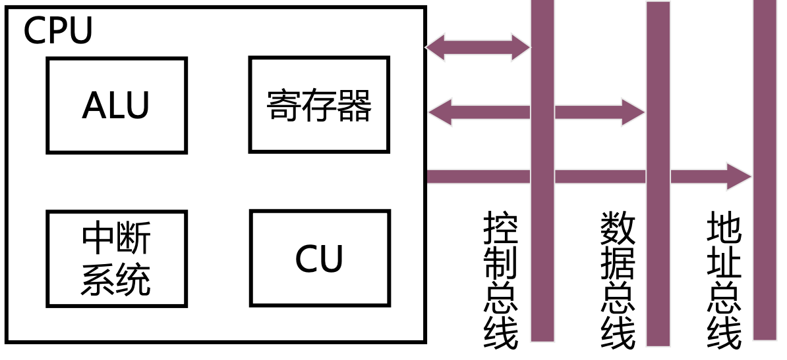
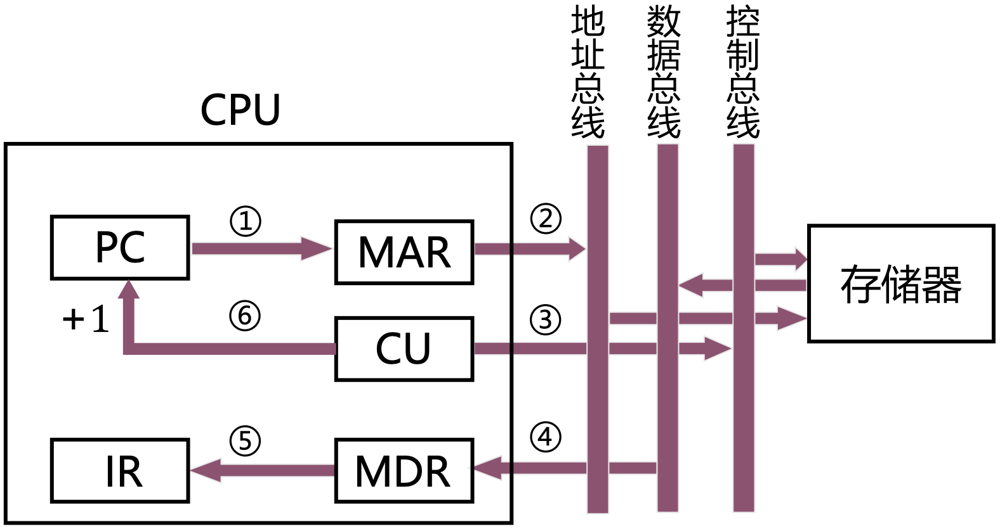
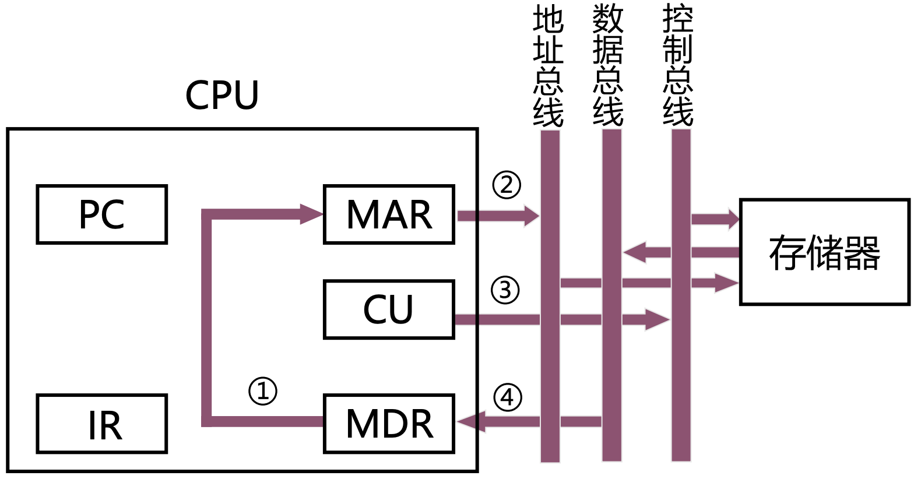

# 第 6 章 中央处理器 `CPU`
1. #### CPU 的结构

    | 功能     | 描述                             | 功能对应的部件                                    |
    | -------- | -------------------------------- | ------------------------------------------------- |
    | 指令控制 | 控制指令的顺序执行（控制取指令） | PC（存放指令地址）<br/>IR（存放当前欲执行的指令） |
    | 操作控制 | 产生完成每条指令所需的控制命令   | CU（分析指令、执行指令）                          |
    | 时间控制 | 对各种操作加以时间上的控制       | CU                                                |
    | 数据加工 | 对数据进行算术运算和逻辑运算     | ALU、寄存器                                       |
    | 处理中断 | 处理异常情况和特殊请求           | 中断系统                                          |

    

2. #### 指令周期

    **取出并执行一条指令**（即完成一条指令）所需的全部时间称为一个指令的指令周期

    - 一个指令的指令周期通常分为取指周期和执行周期

        - 在取指周期内，计算机进行**取指、分析（操作码、寻址方式）**的操作
        - 在执行周期内，计算机进行**执行指令**（包括取操作数、执行、结果的写回等）的操作
        - 对于含有间接寻址的指令，计算机额外需要在**间址周期**内取得操作数的有效地址
        - 对于含有中断请求的指令，计算机额外需要在**中断周期**内响应中断请求（包括保护程序断点、寻找中断服务程序的入口地址、关中断等）

    - 每条指令的指令周期并不相同

        | 指令距离              | 指令周期说明                                                 |
        | --------------------- | ------------------------------------------------------------ |
        | 空指令 NOP            | 表示计算机不做任何操作，因此**只包括取指周期**，不包括执行周期 |
        | 加法指令<br/> ADD mem | 表示将 ACC 中的数与存储单元 mem 中的数相加，结果保存在 ACC 中，<br/>取指周期和执行周期时间长度相同 |
        | 乘法指令<br/> MUL mem | 表示将 ACC 中的数与存储单元 mem 中的数相乘，结果保存在 ACC 中，<br/>取指周期和执行周期时间长度不同 |

    ```mermaid
    flowchart
    	subgraph 取指周期
        A[周期开始] --> B{有间址吗？}
        B -->|是| C[间址周期]
        C --> D[执行周期]
        B -->|否| D
        D --> E{有中断吗？}
        E -->|是| F[中断周期]
        F --> G[周期结束]
        E -->|否| G
        G -->|进入下一周期| A
        end
    ```

    - 指令周期的数据流

        - 取指周期的数据流

            1. **传送指令地址**

                1. **内部操作**：控制单元发出控制信号，将**程序计数器**中存储的“下一条指令地址”加载到**存储器地址寄存器 MAR **中
                2. **地址总线操作**：MAR中的地址被放到**地址总线**上，地址总线上的所有位（比如32根或64根线）同时被驱动，形成一个完整的二进制地址，指向内存中确切的某个存储单元
                3. **控制总线操作**：同时，控制单元通过**控制总线**向内存发送 **“读”信号**（例如，将“读使能”线置为有效电平），并可能发送“存储器请求”信号，告诉内存：“请准备好，我要从你这里读东西了”

            2. **从内存读取指令**

                1. **内存响应**：内存芯片接收到地址总线上的地址和控制总线上的“读”命令后，启动内部电路
                2. **内存查找**：内存的地址译码器根据收到的地址，定位到对应的存储单元（比如一组特定的电容和晶体管）
                3. **数据输出**：内存将该存储单元内保存的**指令代码（机器码）** 读出，并放置到**数据总线**上，此时数据总线由内存驱动

            3. **接收指令并暂存**

                1. **数据总线捕获**：CPU 一直在监控着数据总线，当它检测到数据总线上有来自内存的有效数据（通常需要等待一个或多个时钟周期以确保数据稳定）时，控制单元会发出控制信号
                2. **内部锁存**：CPU 将数据总线上的指令代码读入**存储器数据寄存器 MDR **中暂存，至此，指令已从内存传入了 CPU

            4. **指令送入 IR 并更新 PC**

                1. **内部传输**：控制单元发出信号，将 **MDR 中暂存的指令代码**传送到**指令寄存器 IR **中，IR 将牢牢“记住”这条指令，直到它被完全执行完毕

                2. **为下次取指做准备**：在取指周期结束前，**程序计数器**必须更新，以指向下一条指令的地址

                    对于顺序执行，这通常意味着 **`PC = PC + 指令长度`** 
                
                    在简单设计中，这个“加 n ”的操作（$n=1, 2, 4$ 等）会由控制单元触发，在一个专门的加法器或 ALU 通路中完成，并将结果写回 PC

            

        - 间址周期的数据流

            1. **译码与地址准备**
        
                1. **指令译码**：控制单元对**指令寄存器**中的指令进行译码，译码器发现操作码（如`LOAD`）和寻址方式字段表明这是**间接寻址**
                2. **提取形式地址**：控制单元发出控制信号，从 **IR 的地址码字段**中提取出“形式地址”（即地址A），这个地址A就是指向存放“有效地址”的那个内存单元的指针
                3. **地址送入 MAR**：控制单元将提取出的地址A加载到**存储器地址寄存器**中，MAR 现在保存的是“存放有效地址的那个内存单元”的地址

            2. **发起内存读请求（读地址）**
        
                1. **地址总线输出**：MAR中的地址A被放到**地址总线**上
                2. **控制总线发出读命令**：同时，控制单元通过**控制总线**向内存发送**“读”信号**，命令内存读取地址A处的内容

            3. **从内存读取有效地址**
        
                1. **内存响应**：内存接收到地址A和读命令后，定位到对应单元，将该单元内存储的内容（这才是真正的“有效地址”，我们记为EA）读出
                2. **数据总线传输**：内存将有效地址EA放置到**数据总线**上

            4. **CPU接收并处理有效地址**

                1. **数据锁存**：CPU将数据总线上的有效地址EA读入**存储器数据寄存器**中暂存

                2. **关键操作：更新指令中的地址字段**：

                    - **方案 A（常见于早期/简单设计）**：控制单元发出信号，将**MDR中存放的有效地址EA直接传回IR的地址码字段**，覆盖原来的“形式地址” A

                        这样，IR中的指令就被“修正”了，其地址字段现在直接就是操作数的有效地址EA，为接下来的执行周期做好了准备

                    - **方案 B（现代或流水线设计）**：有效地址EA可能被送入一个**专用的地址寄存器**或**内部暂存器**中保存，供紧随其后的执行周期（如LOAD/STORE周期）直接使用，而不一定会写回IR

                        IR可能保持不变，控制逻辑记住这个地址

            

        - 中断周期的数据流

            1. **中断请求与响应**
        
                1. **中断发生**：某个外部设备（如键盘、硬盘）完成了任务，通过一根**控制总线**上的专用线路（如`INTR`）向 CPU 发出**中断请求信号**
                2. **CPU 检查与裁决**：在当前指令周期的末尾，CPU 的控制单元会检查：
                    - 中断请求触发器是否有效
                    - 中断允许触发器是否打开（即中断是否未被屏蔽）
                    - 是否有更高优先级的中断正在处理
                    - 如果所有条件满足，CPU 决定**响应**此中断

            2. **保存当前程序现场（核心步骤）**

                这是中断周期数据流的核心，目的是为了让被中断的程序在未来能毫发无损地恢复执行，**这个过程通常由硬件自动完成**
        
                1. **发出中断响应**：CPU 通过**控制总线**向发出请求的设备回送一个**中断响应信号**，告知对方“我受理了”，同时 CPU 内部关闭中断允许（防止在处理过程中被新的同级中断打断）
                2. **硬件保存断点**：
                    - **地址准备**：控制单元将**堆栈指针**的内容（当前栈顶地址）送入**存储器地址寄存器**
                    - **数据准备**：控制单元将**程序计数器**的内容（即**下一条将要执行的指令地址**，称为“断点”）送入**存储器数据寄存器**
                    - **执行保存**：CPU 通过**地址总线**送出 MAR 中的栈顶地址，通过**控制总线**发出**“写”信号**，通过**数据总线**将 MDR 中的 PC 值（断点）写入内存堆栈的栈顶位置
                3. **更新堆栈指针**：写入完成后，**堆栈指针**自动递减（或递增，取决于堆栈生长方向），指向新的栈顶，为保存下一个数据腾出空间
                4. **硬件保存程序状态**：
                    - 重复类似步骤4的过程：将 **PSW 寄存器**的内容送入 MDR ，用 SP 更新 MAR，然后将 PSW 的内容通过总线系统压入堆栈（保存在断点地址的旁边）

                至此，被中断程序的**关键现场（PC 和 PSW）** 已安全保存在系统堆栈中

            3. **获取中断服务程序入口地址**
        
                1. **获取中断向量**：提出请求的外部设备在收到 CPU 的中断响应后，通常会通过**数据总线**向 CPU 发送一个**中断类型码**（或称中断向量号），CPU 将此码存入内部暂存器
                2. **计算向量表地址**：控制单元根据这个类型码，通过一个固定的计算规则（例如，`类型码 × 4 + 向量表基址`），生成一个内存地址，这个地址指向**中断向量表**中的一个特定表项
                3. **读取入口地址**：
                    - 将计算出的向量表地址送入 **MAR**
                    - 通过**地址总线**送出该地址，通过**控制总线**发出**“读”信号**
                    - 内存将对应表项中存储的**中断服务程序的入口地址**放到**数据总线**上
                    - CPU通过 **MDR** 接收这个入口地址

            4. **跳转至中断服务程序**

                1. **加载 PC，开始新执行**：控制单元将刚刚读出的**入口地址**直接加载到**程序计数器**中

                2. **下个周期开始**：当中断周期结束，下一个 CPU 周期开始时，取指部件将依据PC中的新地址（即中断服务程序的第一条指令地址）去取指
        
                    至此，CPU 的控制权已完全移交给了中断服务程序

3. #### 中断系统

    - ##### 各种各样的中断源（需要中断的场景）

        - 人为设置的中断（如转管指令）
        - 程序性事故（如溢出、操作码不能识别、除法非法）
        - 硬件故障（如通风不良、磁盘损坏）
        - I/O 设备（如进行输入输出）
        - 外部事件（如用键盘中断现行程序）

    - ##### 中断请求标记：

        中断源如何向 CPU 提出中断请求？→ 中断请求标记触发器（中断请求触发器）**INTR**

        - 一个中断源对应一个中断请求标记触发器，多个 INTR 组成中断请求标记寄存器
        - 实现方式：INTR 分散在各个中断源的接口电路中或多个 INTR 集中在 CPU 的中断系统内

    - ##### 中断判优逻辑

        当各中断源同时提出中断请求时，系统需要优先响应对计算机工作影响最大、最重要的中断请求

        - 中断判优就是按中断请求的优先顺序响应中断请求

        - 中断判优逻辑：硬件实现（排队器）

            1. 硬件排队器的部署方式

                - 分散式：集成在各个中断源的接口电路中

                - 集中式：集成在 CPU 内部

            2. 硬件排队器的工作原理（以 4 个中断源为例）

                - 中断源优先级：`INTR₁ > INTR₂ > INTR₃ > INTR₄`（降序排列）
                    - 输入输出逻辑：
                        - 当某中断源请求中断时，其输入`INTR`为 1
                        - 输出`INTP`是否为 1，取决于该中断是否是**当前最高优先级的请求**

                - 电路逻辑（结合图示）：
                    - `INTR₁`的排队器仅需 “或门”：只要 `INTR₁=1`，直接输出 `INTP₁=1`（最高优先级）
                    - `INTR₂`的排队器需 “与门”：需同时满足 `INTR₂=1` 且 `INTP₁=0`（即`INTR₁`无请求），才输出`INTP₂=1`
                    - `INTR₃`同理：需 `INTR₃=1` 且 `INTP₁=0`、`INTP₂=0`，才输出 `INTP₃=1`
                    - `INTR₄`同理：需`INTR₄=1`且`INTP₁~INTP₃均为0`，才输出`INTP₄=1`

        - 中断判优逻辑：软件实现（程序查询）

            程序按**优先级从高到低**依次查询中断请求：

            ```mermaid
            graph LR
                start[开始] --> judgeA{是否A请求?}
                judgeA -->|是| A[转A的服务程序入口地址]
                judgeA -->|否| judgeB{是否B请求?}
                judgeB -->|是| B[转B的服务程序入口地址]
                judgeB -->|否| judgeC{是否C请求?}
                judgeC -->|是| C[转C的服务程序入口地址]
                judgeC -->|否| follow[...（后续逻辑）]
            ```

            | 对比维度 | 硬件排队器                 | 软件查询                   |
            | -------- | -------------------------- | -------------------------- |
            | 效率     | 速度快（硬件电路并行处理） | 速度慢（程序串行查询）     |
            | 灵活性   | 优先级固定（需改电路）     | 优先级易改（修改查询顺序） |
            | 资源占用 | 占用硬件资源               | 占用 CPU 运行时间          |

    - #### 中断服务程序

        中断服务程序（Interrupt Service Routine，ISR）是 **CPU 响应中断请求后自动执行的专用程序**，其核心作用是处理引发中断的事件，保障系统的实时性和高效性

        - ##### 中断服务程序的基本功能

            - **保护现场**

                中断是随机触发的，CPU 响应中断时，主程序正处于某一执行状态（如寄存器中存放着运算中间值、程序计数器 PC 指向主程序下一条指令地址）

                为了保证中断处理完成后，主程序能**从断点处继续正常执行**，ISR 首先要将当前 CPU 的关键状态信息（如通用寄存器、状态寄存器、PC 值等）保存到堆栈中，这个过程就是保护现场

            - **处理中断事件**

                这是 ISR 的**核心任务**，需要根据中断源的类型执行对应的操作，不同中断源的处理逻辑完全不同，例如：

                - 外部 IO 中断（如按键按下）：检测按键状态，执行按键对应的功能（如点亮 LED、切换模式）
                - 定时器中断：完成定时任务（如更新系统时钟、触发数据采样）
                - 串口中断：接收或发送串口数据，完成数据缓冲或解析
                - 异常中断（如除零错误）：进行错误处理（如记录错误日志、复位系统）

            - **清除中断标志位**

                多数外设触发中断后，会在内部寄存器中置位**中断标志位**，以此通知 CPU 有中断请求，如果不清除该标志位，CPU 会误认为中断请求未处理，中断返回后会**反复触发同一段 ISR**，导致程序卡死

                清除方式分为两种：一是软件手动清除（通过向标志位寄存器写入特定值）；二是硬件自动清除（部分外设完成数据传输后自动清零）

            - **恢复现场**

                中断事件处理完毕后，需要将之前保存在堆栈中的 CPU 状态信息（寄存器、PC 值等）**恢复到 CPU 中**，这个过程和保护现场是互逆的

                只有完成现场恢复，主程序才能在中断返回后，无缝接续断点处的执行流程

            - **中断返回**

                执行**中断返回指令**（如 51 单片机的`RETI`、ARM 架构的`BX LR`），该指令会让 CPU 退出 ISR，回到主程序的断点处继续执行

                中断返回指令还会自动处理中断嵌套的相关逻辑（如恢复优先级状态）

        - ##### 查找中断源对应的中断服务程序的方法

            - **硬件向量法**

                硬件向量法是借助硬件电路快速定位中断服务程序入口地址的方法，核心是 “硬件生成向量地址→通过向量地址找入口地址”

                1. 基本原理与特点

                    - **原理**：利用硬件电路生成 “向量地址”，再通过该向量地址找到中断服务程序的入口地址

                    - **特点**：速度快（由硬件直接处理地址，无需软件遍历）

                2. 向量地址形成部件

                    - **作用**：生成对应中断请求的向量地址

                    - **输入**：排队器的输出（排队器会筛选出当前优先级最高的中断请求，仅让该请求对应的输出为 1，其余中断请求的输出为 0）

                    - **输出**：与当前最高优先级中断请求对应的 “向量地址”

                    3. 具体实现方式

                        通过 “向量地址” 对应主存单元的内容，定位入口地址，有两种存储形式：

                        1. **存储无条件转移指令（JMP）**：在向量地址对应的主存单元中存放 “JMP+入口地址” 的指令
                        2. **直接存储入口地址**：在向量地址对应的主存单元中，直接存放中断服务程序的入口地址

                - **软件查询法**

                    软件查询法是通过执行 “中断识别程序”，依次检查中断源的请求状态，从而找到入口地址的方法

                    1. 基本原理

                        不依赖硬件生成地址，而是运行一段 “中断识别程序”，逐个查询中断源是否提出了请求，找到有请求的中断源后，跳转到其对应的服务程序入口地址

                    2. 核心要素

                        - **中断源**：通常有多个（例：8 个中断源，按 1、2、…、8 的降序排列优先级）

                        - **SKP 指令**：功能是 “跳过下一条指令”（用于无请求的中断源，继续查询下一个）

                        - **D（完成触发器）**：表示中断源的请求状态 ——D=1 代表对应中断源提出了中断请求；D=0 代表无请求

                    3. 中断识别程序的执行逻辑

                        中断识别程序的入口地址为 M，执行流程如下：

                        1. 从地址 M 开始，先检查 1# 中断源的 D1：
                            1. 若 $D1=0$（无请求）：执行 SKP 指令，跳过下一条`JMP 1#SR`，继续查询 2#
                            2. 若 $D1=1$（有请求）：不跳过，执行`JMP 1#SR`，跳转到 1# 中断服务程序
                        2. 按同样逻辑，依次检查 2# 到 8# 中断源的 $D2$ ~ $D8$，直到找到 $D=1$ 的中断源，跳转到其对应的服务程序（如 `JMP 2#SR` 对应 2# 服务程序）

                        ```mermaid
                        flowchart TD
                            B[当前指令周期结束<br>检测到中断请求]
                            B -- 是 --> C[进入中断识别程序（入口地址M）]
                            C --> D[检查1#中断源D触发器状态]
                            D --> E{1# D == 1?}
                            E -- 是 --> F[执行JMP 1#SR，跳转到<br>1#中断服务程序]
                            E -- 否 --> G[执行SKP DZ 1#，跳过当前分支]
                            G --> H[检查2#中断源D触发器状态]
                            H --> I{2# D == 1?}
                            I -- 是 --> J[执行JMP 2#SR，跳转到<br>2#中断服务程序]
                            I -- 否 --> K[执行SKP DZ 2#，跳过当前分支]
                            K --> L[...（依次检查3#-7#中断源）]
                            L --> M[检查8#中断源D触发器状态]
                            M --> N{8# D == 1?}
                            N -- 是 --> O[执行JMP 8#SR，跳转到<br>8#中断服务程序]
                            N -- 否 --> P[无有效中断请求，返回主程序]
                            F --> Q[执行中断服务程序]
                            J --> Q
                            O --> Q
                            Q --> R[中断处理完成，返回主程序]
                            R --> S[结束]
                            P --> S
                        ```

                        

                    4. 特点

                        更灵活：可通过调整 “中断识别程序” 里的查询顺序，改变中断请求的优先级（例：把 3# 的查询顺序提前，即可提高 3# 的优先级）

                | 对比维度       | 硬件向量法                                     | 软件查询法                                                   |
                | -------------- | ---------------------------------------------- | ------------------------------------------------------------ |
                | 核心原理       | 借助硬件生成向量地址，通过向量地址定位入口地址 | 执行中断识别程序，逐个查询中断源的 D 状态（D = 1 则跳转入口） |
                | 速度           | 快（硬件直接处理，无遍历过程）                 | 慢（需查询所有中断源，查询越多速度越慢）                     |
                | 灵活性         | 较低（功能由硬件电路决定）                     | 较高（可通过修改程序调整逻辑）                               |
                | 硬件依赖       | 依赖向量地址形成部件、排队器等                 | 仅依赖中断源的完成触发器（D）                                |
                | 优先级调整方式 | 需修改硬件电路（如排队器逻辑）                 | 直接调整中断识别程序的查询顺序即可                           |
                | 适用场景       | 对响应速度要求高、中断源数量较少的场景         | 中断源数量较多、需要灵活调整优先级的场景                     |

    - #### 中断响应

        当系统的**允许中断触发器（EINT）状态为 1**（即系统处于 “允许中断” 的状态），CPU 要响应中断请求

        - 响应中断的时间

            中断响应的时机与后续流程如下：

            1. **响应时机**：一般在**当前指令的执行周期结束后**（避免打断正在执行的指令）
            2. **查询动作触发**：在当前指令执行周期结束时，CPU 主动发出**中断查询信号**，检测是否存在未处理的中断请求
            3. **查询后的分支处理**：
                - 若检测到中断请求，CPU 进入**中断周期**，开始处理中断
                - 若未检测到中断请求，CPU 进入**下一条指令的取指周期**，继续执行程序

        - CPU 查询中断请求的机制

            当有中断请求产生时，CPU 通过以下流程识别中断源：

            1. **中断请求触发**：某中断源有请求时，该中断源对应的**中断请求触发器**的数据端（D）输入为 1
            2. **同步发送查询信号**：CPU 将 “中断查询信号” 同步发送到所有中断源的中断请求触发器
            3. **触发器输出有效信号**：在 CPU 查询信号的驱动下，存在请求的中断源对应的触发器，其输出端（Q）会置为 1
            4. **信号传递至排队器**：各触发器的输出（Q）会被传递到**排队器**，为后续中断优先级判定、中断服务做准备

    - #### 中断隐指令

        中断隐指令是 **CPU 响应中断、进入中断周期后，由硬件自动完成的操作序列**（它不属于程序员可调用的 “指令系统”，是硬件层面的 “隐含操作”）

        - 中断隐指令的核心操作

            1. 保护程序断点

                “程序断点” 是**原程序下一条要执行的指令地址**，若不保存，中断处理完成后，CPU 会找不到原程序的继续执行位置

                - 操作内容

                    保存当前**程序计数器 PC**的内容（即 “程序断点”），保存方式有两种：

                    - 存到存储器**特定固定地址**（如部分架构的 “0 号地址”）
                    - 存入**堆栈**（栈区）

                - 两种保存方式的区别

                    - 固定地址：实现简单，适合 “单中断” 场景，但多中断时容易覆盖断点

                    - 堆栈：按 “先进后出” 顺序保存，支持多中断嵌套，更灵活（主流架构常用）

                > 中断隐指令只负责保护程序断点（原程序下一条要执行的指令地址），CPU 内各寄存器的内容由中断服务程序负责保护

            2. 寻找中断服务程序的入口地址

                中断服务程序是 “处理中断事件的专用程序”，需找到其入口地址才能执行，常用两种方法：

                - 硬件向量法

                    - 操作流程：
                        1. 硬件自动获取 “中断向量地址”
                        2. 将向量地址送入 PC
                        3. 由向量地址对应的存储单元中，取出 “转移指令”，跳转到中断服务程序

                    - 特点：速度快（硬件直接定位），但需要额外的向量电路，硬件稍复杂

                - 软件查询法

                    - 操作流程：
                        1. 将 “中断识别程序” 的入口地址 M 送入 PC
                        2. 执行中断识别程序，逐个查询中断源，找到对应服务程序的入口地址

                    - 特点：硬件电路简单，但查询耗时（中断源越多，速度越慢），适合中断源较少的场景

            3. 关中断

                防止在处理当前中断的过程中，新的中断请求 “打断” 当前操作，避免程序执行混乱，（后续可在中断服务程序中，根据需要重新 “开中断”）

                - 操作内容：将 “允许中断触发器（EINT）” 置为 0（触发器是硬件电路，置 0 表示禁止中断）

