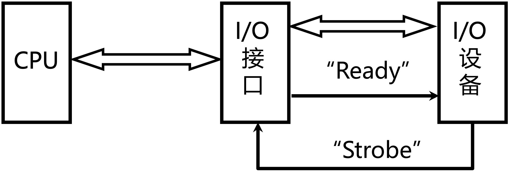
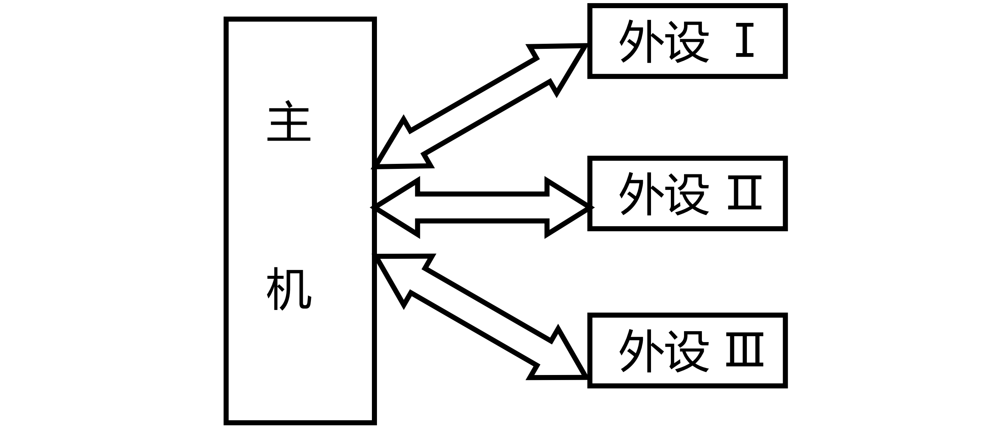
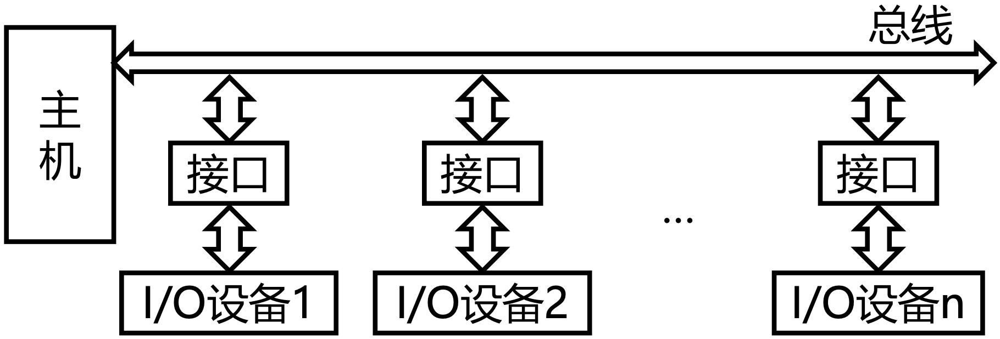

# 第 8 章 I/O 设备
1. #### 输入输出系统的组成

    - ##### I/O 硬件

        I/O 硬件是 I/O 系统的物理执行部分，负责承载数据的物理传输，核心是 “接口模块 + I/O 设备” 的组合

    - ##### I/O 软件

        I/O 软件是 I/O 系统的逻辑控制部分，负责调度硬件、协调主机与外设的工作流程，核心功能包括：

        - 数据传输控制
            - 将用户通过外设输入的程序 / 数据（如键盘输入的文本）传输至主机内存
            - 将主机运算得到的结果（如程序运行的输出）传输至外设（如显示到屏幕、打印到纸张）
        - 系统协调管理
            - 实现 I/O 系统与主机的工作协同（例如主机运算速度远快于打印机，软件需通过 “缓冲” 机制暂存数据，避免主机等待）
            - 对于带有接口的 I/O 系统，I/O 软件通过 **I/O 指令**向硬件发送控制命令，驱动硬件执行具体操作

    - ##### I/O 指令

        I/O 指令是 CPU 指令系统的专用子指令，由 CPU 译码后执行，是 “软件控制硬件” 的直接指令载体，用来控制输入输出操作

        - 一般格式： \(\boxed{操作码}\boxed{命令码}\boxed{设备码}\)

        - 各部分说明：
            - 操作码：I/O 指令与其他 CPU 指令（如访存指令、运算指令）的 “身份判别标志”——CPU 通过操作码识别该指令是用于控制 I/O 设备，而非操作内存或进行算术运算
            - 命令码：对 I/O 设备的**具体操作要求**，常见类型包括：
                - 输入操作：将数据从 I/O 设备传输至主机（如 “读取键盘当前输入的字符”）
                - 输出操作：将数据从主机传输至 I/O 设备（如 “将内存中的文本发送到显示器显示”）
                - 状态查询：查询 I/O 设备的当前工作状态（如 “询问打印机是否处于‘空闲可接收数据’状态”）
                - 其他操作：如设备复位、模式配置等
            - 设备码：I/O 设备的**唯一地址标识**（类似设备的 “身份证号”）—— 计算机系统中存在多个 I/O 设备时，CPU 通过设备码选择具体要控制的设备（如 “选择编号为 001 的键盘” 而非 “编号为 002 的打印机”）

2. #### I/O 设备与主机的联系方式

    1. ##### I/O 设备编址方式

        I/O 设备编址是为主机与 I/O 设备的通信分配 “地址标识”，使主机能唯一识别目标设备，主要分为两种方式：

        - **统一编址**
            - 定义：将 I/O 设备的端口 / 寄存器地址，纳入计算机的存储器地址空间，作为存储器地址的一部分
            - 实现方式：主机将 I/O 设备的端口视为 “特殊的内存单元”，通过**取数、存数等访存指令**访问 I/O 设备（无需专门的 I/O 指令）
            - 特点：无需额外设计 I/O 指令系统，但会占用部分存储器地址空间，使可分配给内存的地址范围缩小
            - 典型场景：部分单片机系统（如 51 单片机）的 I/O 端口采用统一编址
        - **不统一编址**
            - 定义：为 I/O 设备分配独立的地址空间，该空间与存储器地址空间完全分离（二者地址可重复，但不会冲突）
            - 实现方式：主机需通过**专门的 I/O 指令**访问 I/O 设备，指令中的设备码对应 I/O 独立地址空间内的标识
            - 特点：存储器地址空间不受 I/O 设备占用影响，但需额外设计 I/O 指令系统，指令集复杂度略有提升
            - 典型场景：x86 架构的计算机（如 PC）采用不统一编址

    2. ##### 设备寻址

        设备寻址是主机根据 I/O 设备的地址标识，定位并选中目标设备的过程，其核心是**设备选择电路**的工作：

        - 硬件基础：每个 I/O 设备均配备独立的设备选择电路，且预存了自身的固有地址

        - 工作原理：
            - CPU 执行 I/O 指令时，会向外发送指令中的 “设备码”
            - 所有 I/O 设备的选择电路都会接收该设备码，并将其与自身预存的固有地址进行比较
            - 若二者一致，该设备即被 “选中”，并开始响应主机的操作（如数据传输、状态反馈）

    3. ##### I/O 设备与主机的联系方式

        联络方式是 I/O 设备与主机之间**同步工作状态、协调数据传输**的机制，用于解决二者工作速度不匹配的问题，确保数据传输的准确性

        1. 立即响应

        - 定义：I/O 设备收到主机的 I/O 指令后，无需额外等待，直接执行操作并反馈结果的交互方式
        - 适用场景：操作逻辑简单、响应时间极短的 I/O 设备（如主机控制指示灯的亮 / 灭 —— 主机发送指令后，指示灯可立即完成状态切换）
        - 特点：无需额外状态同步信号，交互流程简洁，但仅适用于与主机速度匹配的简单设备

        2. 异步工作

        - 定义：当 I/O 设备与主机工作速度差异较大时，二者各自独立运行，仅通过**联络信号**同步状态、触发数据交换的方式

        - 核心逻辑：主机与 I/O 设备不固定等待对方，仅在自身准备好后发送信号，对方收到信号后再进行交互

        - 具体流程：

            （1）I/O 设备接收数据时

            - 主机将数据发送至 I/O 接口，接口向 I/O 设备发送 “Ready（就绪）” 信号，告知 “数据已准备好”
            - I/O 设备从接口取出数据后，向接口发送 “Strobe（选通）” 信号，告知 “数据已接收，可准备下一组数据”

            （2）I/O 设备发送数据时

            - I/O 设备将数据发送至 I/O 接口，同时向接口发送 “Strobe” 信号，告知 “数据已送达接口”
            - CPU 从接口取走数据后，接口向 I/O 设备发送 “Ready” 信号，告知 “数据已被取走，可发送下一组数据”

            

    4. ##### I/O 设备与主机的连接方式

        连接方式是 I/O 设备与主机之间的物理通信链路架构，决定了设备的扩展性、移植性等核心特性

        1. 辐射式连接（分散连接）

            

        - 结构：每台 I/O 设备单独配备一套控制线路与信号线，直接与主机的专属接口连接（即 “一台设备对应一条专用链路”）
        - 特点：
            - 优势：单设备通信时链路独立，信号干扰较少
            - 劣势：新增设备需额外部署线路，硬件成本高；设备增删操作复杂，扩展性差；设备与主机接口绑定，可移植性低
        - 适用场景：早期小型计算机系统（设备数量少、对扩展性要求低的场景）

        2. 总线连接

            

        - 结构：主机与所有 I/O 设备通过**一组共享的总线线路**连接，I/O 设备需通过标准接口接入总线（即 “所有设备共享一条公共通信干线”）
        - 核心概念：总线是计算机系统中共享的通信干线，可同时传输数据、地址、控制信号（如 PC 中的 PCI 总线、通用的 USB 总线）
        - 特点：
            - 优势：所有设备共享总线，硬件成本低；通过标准接口即可灵活增删设备，扩展性强；设备遵循总线规范，可移植性高
            - 劣势：总线为共享资源，多设备同时通信时需通过 “总线仲裁” 机制避免冲突
        - 适用场景：现代计算机系统（PC、服务器等设备数量多、对扩展性要求高的场景）

3. #### I/O 设备与主机信息传送的控制方式

    - ##### 程序查询方式：

        ```mermaid
        sequenceDiagram
            participant CPU
            participant IO as I/O设备
            participant MEM as 主存
        
            %% 第一步：CPU执行程序，发起查询
            CPU->>CPU: 执行现行程序
            CPU->>IO: 查询设备状态（“你准备好了吗？”）
        
            %% 第二步：设备未就绪，CPU循环查询
            loop 设备未就绪（循环查询）
                IO->>CPU: 返回“未就绪”状态
                CPU->>CPU: 继续执行查询程序（空等）
            end
        
            %% 第三步：设备就绪，传输数据
            IO->>CPU: 返回“已就绪”状态
            CPU->>IO: 写入数据（输出）
            IO->>CPU: 读取数据（输入）
            CPU->>MEM: 将数据存入主存（输入）
        
            %% 第四步：CPU恢复正常程序
            CPU->>CPU: 继续执行原来的程序
        ```

        - 等待 I/O 设备准备数据时，CPU 一直处于踏步等待状态，使 CPU 的效率降低

    - ##### 程序中断方式

        ```mermaid
        sequenceDiagram
            participant CPU
            participant IO as I/O设备
            participant MEM as 主存
        
            %% 第一步：CPU正常执行程序，设备准备数据
            CPU->>CPU: 执行现行程序
            IO->>IO: 准备要传输的数据
        
            %% 第二步：设备发中断请求
            IO->>CPU: 发送中断请求（“我准备好了，快来取数据！”）
        
            %% 第三步：CPU响应中断，处理数据传输
            note over CPU,IO: CPU完成当前指令后
            CPU->>CPU: 暂停原程序，保存断点（记录执行位置）
            CPU->>IO: 写入数据（输出）
            IO->>CPU: 读取数据（输入）
            CPU->>MEM: 将数据存入主存（输入）
        
            %% 第四步：CPU恢复原程序
            CPU->>CPU: 恢复断点，继续执行原来的程序
        ```

        - 发出启动设备的指令以后，CPU 继续执行原来的程序
        - 当外部设备准备好以后，向 CPU 提出一个中断请求，让 CPU 停止对当前程序的执行， 转而和 I/O 设备进行数据交换
            - 在 I/O 设备进行准备时，CPU 不必时刻查询 I/O 设备的准备情况，没有踏步等待现象
            - 但 I/O 设备与主存的信息交换仍然需要 CPU 的参与

    - ##### DMA（直接存储器访问）方式

        ```mermaid
        sequenceDiagram
            participant CPU
            participant IO as I/O设备
            participant MEM as 主存
        
            %% 第一步：CPU正常运行+启动I/O
            CPU->>CPU: 执行现行程序
            CPU->>IO: 启动I/O设备（告诉设备“准备传数据”）
            CPU->>CPU: 执行现行程序
        
            %% 第二步：I/O设备准备数据
            IO->>IO: 准备要传输的数据
        
            %% 第三步：DMA请求+数据传送
            note over CPU,IO: CPU当前存取周期结束
            IO->>CPU: 发送DMA请求（“我要传数据啦”）
            note over IO,MEM: “窃取”1个或多个存取周期
            IO->>MEM: 直接向主存传送数据
        
            %% 第四步：CPU恢复运行
            CPU->>CPU: 继续执行原来的程序
        ```

        - 主存和 I/O 之间有一条直接的数据通道 DMA，可直接进行数据交换，不中断现行程序，不需 CPU 参与

        -  **周期挪用（周期窃取）机制**

            DMA 通过 “周期挪用” 方式占用主存总线，是其实现高速传输的关键机制

            - **总线优先级**：若 DMA 与 CPU 同时请求访问主存，DMA 优先占用总线（因 I/O 设备通常对传输实时性要求较高）
            - **挪用时长**：窃取的时间为**一个主存存取周期**，称为 “窃取 / 挪用周期”
            - **CPU 的并行操作**：窃取周期内，CPU 无法通过总线访问主存，但可执行内部操作（如寄存器间运算、逻辑操作等）

        - **并行性增强手段**：通过**指令预取技术**（CPU 在空闲时提前读取后续指令并暂存），可进一步提升 CPU 与 I/O 在窃取周期内的并行工作效率

    - ##### 三种方式的 CPU 工作效率比较

        | 对比维度              | 程序查询方式                 | 程序中断方式                                       | DMA 方式                                             |
        | --------------------- | ---------------------------- | -------------------------------------------------- | ---------------------------------------------------- |
        | CPU 与 I/O 工作模式   | 串行工作                     | 部分并行工作                                       | 高度并行（ I/O 与主存直接连接）                      |
        | I/O 准备阶段 CPU 状态 | 持续查询等待，无法执行原程序 | 执行自身原程序，无需等待                           | 执行自身原程序                                       |
        | I/O 启动后 CPU 状态   | CPU 参与 I/O 数据的传输      | CPU 响应中断，暂停当前程序的执行，处理中断服务程序 | CPU 进入窃取周期，可继续执行当前程序不访问主存的操作 |
        | 数据传送控制主体      | CPU                          | CPU（通过中断服务程序）                            | DMA 控制器 / DMA 接口                                |
        | CPU 工作效率          | 最低                         | 中等（高于程序查询）                               | 最高                                                 |
        | 核心特点              | 流程简单但 CPU 资源浪费严重  | 兼顾 CPU 执行与 I/O 处理，需响应中断请求           | 不占用 CPU 控制数据交换，适合高速大量数据            |

        - 从程序查询方式到 DMA 方式，CPU 越来越从 I/O 设备与主机信息传送的工作中解放出来，I/O 系统的自治能力增强，CPU 的工作效率提高

4. #### I/O 设备

    除主机（CPU、主存）外的大部分硬件设备都是 I/O 设备，又称为外部设备/外围设备/外设

    - 外设通过 I/O 接口与主机连接，其（外设）中的设备控制器控制设备的具体动作

    ```mermaid
    graph LR
        A[主机]
        B[I/O接口]
        subgraph 外部设备
            C[设备控制器]
            D[机、电、磁、光部件]
        end
        
        style 外部设备 stroke-dasharray: 5,5, stroke-width:2px
        A <--> B  
        B <--> C  
        C --> D   
    ```

    - 分类
        - **人机交互设备**：实现用户与计算机之间的信息交流，分为输入、输出两类设备
            - 输入设备：将人可识别的信息转换为计算机可识别的信息，例如**键盘、鼠标**
            - 输出设备：将计算机的处理结果转换为人可识别的信息，例如**打印机、显示器**
        - **计算机信息存储设备**：用于长期存储计算机数据与信息
            - 辅助存储器：可持久保存大量数据，例如**磁盘、光盘、磁带**
        - **机 — 机通信设备**：实现计算机与其他设备 / 系统的互联通信
            - 核心作用：是计算机接入网络的基础，例如**网卡**

