# 第 1 章 计算机的基本组成
1. ####  冯·诺依曼计算机

    - 冯诺依曼架构的五大核心部件

        1. **运算器**：核心功能是进行算术运算（如加减乘除）和逻辑运算（如与、或、非），是计算机的 “计算中心”
        2. **控制器**：负责协调和控制计算机各部件的工作，按指令顺序指挥运算、存储、输入输出等操作，是计算机的 “指挥中心”
        3. **存储器**：用于存储程序（指令序列）和数据，包括主存储器（内存）和辅助存储器（硬盘、U 盘等），是计算机的 “存储仓库”
        4. **输入设备**：将外部信息（如键盘输入、鼠标操作、文件数据）传入计算机，比如键盘、鼠标、扫描仪等
        5. **输出设备**：将计算机处理后的结果反馈给用户，比如显示器、打印机、音箱等

    - 冯诺依曼架构的核心特点

        1. **存储程序原理**：**程序和数据以二进制形式同等存储在存储器中**，计算机无需区分 “指令” 和 “数据” 的物理存储形式

            存储程序是冯·诺依曼计算机的核心特征，具有存储程序特征的计算机统称为冯·诺依曼计算机

        2. **程序控制原理**：计算机按存储的指令序列顺序执行操作，控制器通过读取指令、解析指令、执行指令的循环完成任务

        3. **指令串行执行**：指令按顺序逐条执行，同一时间仅处理一条指令（早期架构特点，后续并行计算是对其的扩展）

        4. **二进制编码**：所有指令和数据都采用二进制表示，适配计算机硬件的电子开关特性（高电平为 1，低电平为 0）

        5. **五大部件协同工作**：各部件通过总线（地址总线、数据总线、控制总线）连接，形成统一的整体，按控制器的指令协同完成任务

        6. **以运算器为中心**：输入输出设备与存储器间的数据传送是通过运算器完成的

2. #### 计算机的硬件框图

    - 以运算器为核心的计算机硬件框图

    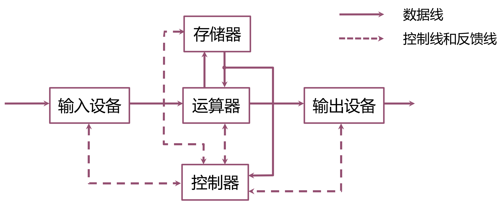

    | 部件名称 | 功能                                           |
    | -------- | ---------------------------------------------- |
    | 输入设备 | 将人类熟悉的信息形式转换成机器能识别的信息形式 |
    | 运算器   | 算术运算、逻辑运算                             |
    | 存储器   | 存放数据和程序                                 |
    | 控制器   | 控制、指挥程序和数据的输入、运行，处理运算结果 |
    | 输出设备 | 将机器运算结果转换成人们熟悉的信息形式         |

    - 以存储器为中心的计算机硬件框图

    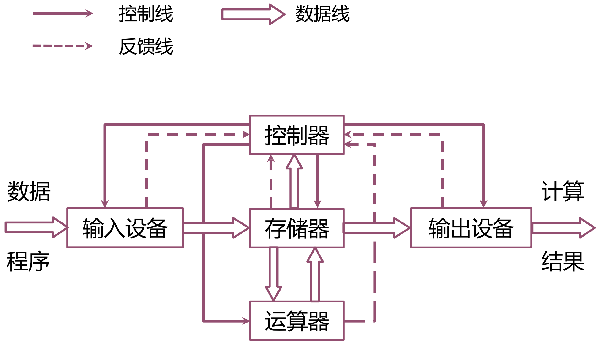

    - 现代计算机硬件框图

    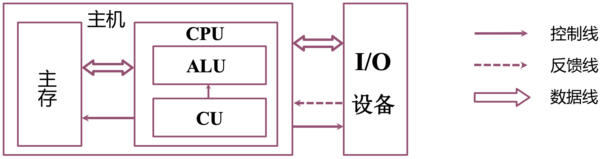

    其中：

    - `ALU` 即运算器，`CU` 即控制器，共同构成了现代计算器中的 `CPU`
    - 存储器分为主存和辅存，其中主存储器直接与 `CPU` 相连，主存与 `CPU` 构成了计算机的主机
    - 输入设备、输出设备、辅存共同构成了 `I/O设备`

3. #### 计算机的工作步骤

    以计算 $ax^2+bx+c$ 为例

    - 假设采用累加器型的机器，参与运算的两个操作数分别位于累加器和主存中，包含了如下六条指令:

        | 指令     | 操作码   |
        | -------- | -------- |
        | 取数指令 | $000001$ |
        | 存数指令 | $000010$ |
        | 加法指令 | $000011$ |
        | 乘法指令 | $000100$ |
        | 打印指令 | $000101$ |
        | 停机指令 | $000110$ |

    - 假设 \(a, b, c, x\) 这些操作数已经保存到了存储器当中，可列出程序清单如下：

        | 指令和数据存于<br>主存单元的地址 | 指令（操作码） | 指令（地址码） | 注释                                |
        | -------------------------------- | -------------- | -------------- | ----------------------------------- |
        | 0                                | 000001         | 0000001000     | 取数 x 至 ACC                       |
        | 1                                | 000100         | 0000001001     | 乘 a 得 $ax$，存于 ACC 中           |
        | 2                                | 000011         | 0000001010     | 加 b 得 $ax+b$， 存于 ACC 中        |
        | 3                                | 000100         | 0000001000     | 乘 x 得 $(ax+b) x$，存于 ACC 中     |
        | 4                                | 000011         | 0000001011     | 加 c 得 \(ax^2 + bx + c\)，存于 ACC |
        | 5                                | 000010         | 0000001100     | 将 \(ax^2 + bx + c\)， 存于主存单元 |
        | 6                                | 000101         | 0000001100     | 打印                                |
        | 7                                | 000110         |                | 停机                                |
        | 8                                | x              |                | 原始数据 x                          |
        | 9                                | a              |                | 原始数据 a                          |
        | 10                               | b              |                | 原始数据 b                          |
        | 11                               | c              |                | 原始数据 c                          |
        | 12                               |                |                | 存放结果                            |

    - 方法一：直接计算

        - 取x至运算器中的累加器中（取数指令）
        - 乘以 $x$，结果 \(x^2\) 保存在运算器中的累加器中（乘法指令）
        - 乘以 $a$，结果 \(ax^2\) 保存在运算器中的累加器中（乘法指令）
        - 存 \(ax^2\) 至存储器中（存数指令）
        - 取 $b$ 至运算器中的累加器中（取数指令）
        - 乘以 $x$，结果 $bx$ 保存在运算器中的累加器中（乘法指令）
        - 加 \(ax^2\)，结果 \(ax^2 + bx\) 保存在运算器中的累加器中（加法指令）
        - 加 $c$，结果 \(ax^2 + bx + c\) 保存在运算器中的累加器中（加法指令）

    - 方法二：不直接计算，先对算式进行化简：\(ax^2 + bx + c = (ax + b)x + c\)

        - 取 $x$ 至运算器中的累加器中（取数指令）
        - 乘以 $a$，结果 $ax$ 保存在运算器中的累加器中（乘法指令）
        - 加 $b$，结果 \(ax + b\) 保存在运算器中的累加器中（加法指令）
        - 乘以 $x$，结果 \((ax + b)x\) 保存在运算器中的累加器中（乘法指令）
        - 加 $c$，结果 \((ax + b)x + c\) 保存在运算器中的累加器中（加法指令）

    - 方法二指令的条数较少，执行速度较快，所需存储空间较小

4. #### 计算机部件的基本构成

    - ##### 存储器的基本构成

        $$
        \boxed{
        \begin{array}c
        \text{主存储器}\\
        \boxed{~~存储体~~}\\
        \boxed{\text{MAR}}\ \boxed{\text{MDR}}\\
        \end{array}
        }
        $$

        | 基本概念   | 含义                                         |
        | ---------- | -------------------------------------------- |
        | 存储单元   | 存放一串二进制代码（指令 / 数据）的基本单元  |
        | 存储字     | 存储单元中二进制代码的组合                   |
        | 存储字长   | 存储单元中二进制代码的位数                   |
        | 按地址寻访 | 每个存储单元赋予一个地址号，通过地址访问单元 |

        - 存储器地址寄存器 MAR
            - 保存欲访问的存储单元的地址，位数反映存储单元的个数
            - MAR 要能够保存所有存储单元的地址，因此有：**$\text{存储单元个数}=2^{\text{MAR~的位数}}$**
        - 存储器数据寄存器 MDR
            - 保存来自或要送往存储体的数据，位数反映存储字长
            - $\text{MDR}~的位数=存储字长$

    - ##### 运算器的基本构成

        $$
        \boxed{
        \begin{array}l
        \boxed{\text{ACC}}\longleftrightarrow\boxed{\text{MQ}}\\
        ~~\downarrow \uparrow\\
        \boxed{\text{ALU}}\\
        ~~~\uparrow\\
        ~~~\boxed{\text{X}}\\
        ~~~~~~~~~\text{运 算 器}
        \end{array}
        }
        $$

        - 算数逻辑单元 ALU
            - 计算机中执行各种算术和逻辑运算操作的部件，是运算器实现运算功能的核心
            - 基本操作包括加、减、乘、除四则运算，与、或、非、异或等逻辑操作，以及移位、比较和传送等操作
            - ALU 是组合逻辑电路，负责加、减、乘、除四则运算，与、或、非、异或等逻辑操作，以及移位、比较和传送等操作

        - 不同寄存器在四则运算的分工

        | 运算 | 累加器 ACC      | 乘商寄存器 MQ     | 操作数寄存器 X |
        | ---- | --------------- | ----------------- | -------------- |
        | 加法 | 被加数<br/>和   |                   | 加数           |
        | 减法 | 被减数<br/>差   |                   | 减数           |
        | 乘法 | <br/>乘积高位   | 乘数<br/>乘积低位 | 被乘数         |
        | 除法 | 被除数<br/>余数 | <br/>商           | 除数           |

        $$
        \boxed{
        \begin{array}c
        \text{指 令}&\boxed{~~~~~加~~~~~}&&\boxed{~~M~~}\\
        \text{初 态}&\text{ACC}&&\text{被加数}\\
        &\text{[M]}&\rightarrow&\text{X}\\
        &\text{ACC}+\text{X}&\rightarrow&\text{ACC}
        \end{array}
        }
        $$

        <center>↑ 加法操作过程<center/>

        $$
        \boxed{
        \begin{array}c
        \text{指 令}&\boxed{~~~~~减~~~~~}&&\boxed{~~M~~}\\
        \text{初 态}&\text{ACC}&&\text{被减数}\\
        &\text{[M]}&\rightarrow&\text{X}\\
        &\text{ACC}-\text{X}&\rightarrow&\text{ACC}
        \end{array}
        }
        $$

        <center>↑ 减法操作过程<center/>

        $$
        \boxed{
        \begin{array}c
        \text{指 令}&\boxed{~~~~~乘~~~~~}&&\boxed{~~M~~}\\
        \text{初 态}&\text{ACC}&&\text{被乘数}\\
        &\text{[M]}&\rightarrow&\text{MQ}\\
        &\text{[ACC]}&\rightarrow&\text{X}\\
        &0&\rightarrow&\text{ACC}\\
        &\text{[X]}\times\text{[MQ]}&\rightarrow&\text{ACC/MQ}
        \end{array}
        }
        $$

        <center>↑ 乘法操作过程<center/>

        $$
        \boxed{
        \begin{array}c
        \text{指 令}&\boxed{~~~~~除~~~~~}&&\boxed{~~M~~}\\
        \text{初 态}&\text{ACC}&&\text{被除数}\\
        &\text{M}&\rightarrow&\text{X}\\
        &\text{[ACC]}\div\text{[M]}&\rightarrow&\text{MQ}\\
        \end{array}
        }
        $$

        <center>↑ 除法操作过程<center/>

    - ##### 控制器的基本构成

        $$
        \boxed{
        \begin{array}c
        \boxed{\text{控制单元 CU}}\\
        \boxed{\text{指令寄存器 IR}}~\boxed{\text{程序计数器 PC}}\\
        \text{控 制 器}
        \end{array}
        }
        $$

        - CPU 的核心功能：完成一条指令、保证指令的按序进行

            | 步骤     | 负责的部件    | 具体功能                                                     |
            | -------- | ------------- | ------------------------------------------------------------ |
            | 取指令   | 程序计数器 PC | PC 存放当前欲执行指令的地址，具有计数功能：$(\text{PC})+ 1\rightarrow \text{PC}$ |
            | 分析指令 | 指令寄存器 IR | IR 存放当前欲执行的指令                                      |
            | 执行指令 | 控制单元 CU   | CU 发出控制信号，控制执行部件去按序执行指令要求的各种操作    |

    - ##### 主机完成一条指令的过程

        1. 取指阶段（Fetch）：从内存拿指令

            - CPU 的程序计数器（PC）存储当前要执行指令的内存地址

            - 控制器通过地址总线，将 PC 中的地址发送给内存

            - 内存根据地址找到对应指令，通过数据总线将指令传输到 CPU 的指令寄存器（IR）

            - PC 自动累加（按指令长度递增，如 32 位指令则 $\text{PC}+4$），指向下一步要执行的指令地址

        2. 译码阶段（Decode）：解读指令含义

            - 指令寄存器（IR）将存储的指令传给指令译码器（ID）

            - 译码器分析指令的 “操作码”，确定要执行的操作（如加法、MOV 传送）

            - 同时解析 “操作数地址”，明确操作数的来源（如内存地址、寄存器编号）

            - 控制器根据译码结果，向 CPU 内部部件（如运算器、寄存器）发送控制信号，准备后续操作

        3. 执行阶段（Execute）：完成运算或操作

            - 若操作数在内存中，CPU 会先通过地址总线获取操作数，存入通用寄存器（如 AX、BX）

            - 运算器（ALU）根据控制器的信号，对寄存器中的操作数执行指定运算（如加减乘除、逻辑与或非）

            - 若为非运算操作（如 MOV 数据传送、跳转），则直接由控制器协调寄存器或内存完成数据转移

        4. 访存阶段（Memory Access）：按需读写内存（可选）

            - 仅当指令需要与内存交互时触发（如 “将运算结果存入内存”“从内存读取新数据”）

            - 若需写内存：CPU 将运算结果通过数据总线传输到指定内存地址，完成存储

            - 若需读内存：再次通过地址总线获取数据，存入寄存器供后续使用

            - 简单指令（如寄存器之间的传送）可跳过此阶段

        5. 写回阶段（Write Back）：保存结果

            - 将执行阶段或访存阶段的最终结果，写回指定的寄存器或内存

            - 优先写回寄存器（速度更快），若后续需长期存储则写入内存

            - 至此，一条指令的执行完成，CPU 准备进入下一条指令的 “取指” 阶段，循环往复

        - 示例 1：取数指令：

        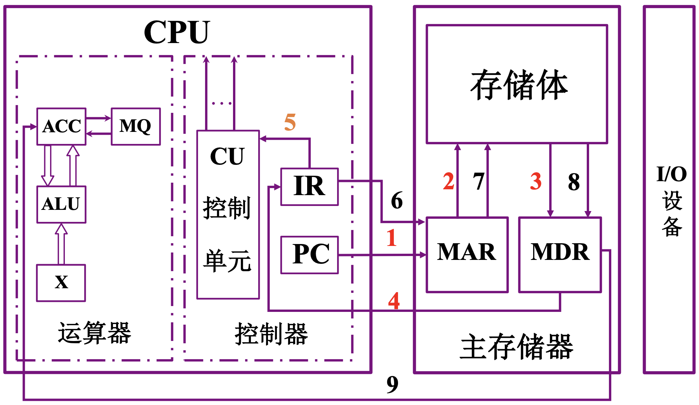

        - 示例 2：存数指令

        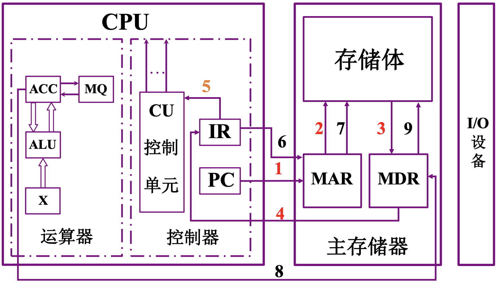

5. #### 计算机硬件的主要技术指标

    - ##### 机器字长

        CPU一次能处理数据的位数，通常与CPU中的寄存器位数相等

    - ##### 运算速度

        1. 基础时间单位

            - **时钟周期 T**：控制计算机操作的**最小时间单位**（是 CPU 时钟信号的一个 “节拍”，决定了操作的最小时间粒度）

            - **主频 f**：CPU 的时钟频率，是时钟周期的倒数
                - 公式：\(f = \frac{1}{T}\)
                - 示例：若主频为 3GHz，则时钟周期\(T \approx 0.33\) 纳秒

        2. 指令执行的核心指标

            - **CPI**：执行**每条指令所需的平均时钟周期数**
                - 说明：不同指令的 CPI 不同（比如简单的加法指令 CPI 可能为 1，复杂的乘法指令 CPI 可能为 3）

            - **IPC**：每个时钟周期平均能执行的指令条数，是 CPI 的倒数
                - 公式：\(\text{IPC} = \frac{1}{\text{CPI}}\)

        3. 指令执行速度（MIPS）

            - **定义**：每秒能执行的**百万条指令数**（全称：Million Instructions Per Second）

            - **计算公式**：\(\text{MIPS} = \text{IPC} \times f = \frac{f}{\text{CPI}}\)

            - **计算前提**：需通过 **吉普森法（加权平均法）** 计算 CPI 的平均值 —— 即根据程序中不同指令的占比，乘以对应指令的 CPI，求和得到 “平均 CPI”，再代入公式

        4. 浮点运算速度（FLOPS）

            - **定义**：每秒能完成的**浮点运算次数**（全称：Floating-point Operations Per Second）

            - **适用场景**：常用于衡量科学计算、高性能程序的运算能力（比如超级计算机的性能常用该指标，单位扩展为 GFLOPS、TFLOPS 等）

    - 存储容量

        - 主存容量

            - 容量表示法一：存储单元个数 $\times$ 存储字长，其中存储单元个数可用 $1K=2^{10}$ 简写

                如：$64K\times 32$位 → 有 $2^6\times 2^{10}=2^{16}$ 个存储单元，每个存储单元的存储字长为 32 位

            - 容量表示法二：字节数，其中 $1B(\text{字节})=1b(\text{位})$

        - 辅存容量：利用字节数直接表示，$1GB=2^{10}MB=2^{20}KB=2^{30}B$

# 第 2 章 基础知识预备
1. #### 进制转换

2. #### 数据表示

    1. ##### 无符号数

        没有正负号的数，在计算机内部用二进制存储

        - 无符号数的二进制表示直接存储于计算机中，不涉及类似于有符号数的`表示法`的讨论

        - 无符号数的表示范围只与位数有关

    2. ##### 有符号数

        有正负号的数，在计算机内部不仅需要存储数的大小，还需要存储数的符号

        - 机器数与真值

            - 机器数就是保存在计算机中的数，仅由 `0,1` 构成
            - 真值是机器数实际表示的数，有正有负
            - 机器数如何存储整数与小数？
                - 整数定点机与小数定点机：小数点的方法以约定的方式给出，不需要单独存储
                - 浮点表示法
            - 机器数是如何存储其真值中的正负号的？→ 原码、补码、反码

        - ###### 原码表示法

            - 表示方法

                - 以 `1` 表示负号，以 `0` 表示正号

                - 对于整数，直接将其二进制表示接在符号位后，为方便阅读通常**以逗号分隔数值位和符号位**（实际不存储）
                    $$
                    [x]_原=
                    \begin{cases}
                    0,x&0\le x< 2^n\\
                    2^n-x&-2^n<x\le 0\\
                    \end{cases}
                    \\n\ 为整数数值位的位数
                    $$
                    

                    例如（设存储字长为 8 位，数值位取 1 位）：

                    - $+5$ 的原码：0,0000101（符号位 0，数值位 0000101）
                    - $-5$ 的原码：1,0000101（符号位 1，数值位 0000101）
                    - $+0$ 的原码：0,0000000，$-0$ 的原码：10000000

                - 对于小数，原码只表示 $(-1,1)$ 内的小数（只存储小数部分，不存储整数部分），将小数部分直接接在符号位之后，**用小数点分隔符号位和小数部分数值位**
                    $$
                    [x]_原=
                    \begin{cases}
                    x&0\le x< 1\\
                    1-x&-1<x\le 0
                    \end{cases}
                    $$
                    

            - 存储规则

                - 存储结构为 “符号位 + 数值绝对值”，符号位与数值位独立存储，互不干扰
                - 位数固定时，数值范围为：$(-2^{n-1}+1,\ 2^{n-1}-1)$（8 位时为 $-127\sim +127$）

            - 特点

                - 优点：直观易懂，直接对应十进制的符号和数值，转换简单
                - 缺点：加减运算复杂，需先判断符号（同号相加、异号相减）；存在两个零（+0 和 - 0），浪费一个存储单元；无法直接通过加法实现减法运算

        - ###### 补码表示法

            补码是计算机中实际存储和运算的核心编码，解决了原码 / 反码的加减运算难题，是最常用的有符号数表示方式

            - 表示方法

                - 正数的补码：与原码、反码完全相同（符号位 0，数值位不变）

                - 负数的补码：有两种等价推导方式：

                    - 模运算（对于 n 位整数，补码 = 模 - |数值|，模 = 2^n^）
                    - **每位取反，末位加 1**（若有进位则依次进位）

                - 对于整数：
                    $$
                    [x]_补=
                    \begin{cases}
                    0,x&0\le x<2^n\\
                    2^{n+1}+x&-2^n(mod\ 2^{n+1})\le x<0
                    \end{cases}\\
                    n\ 为整数数值位的位数
                    $$
                    例如（设存储字长为 8 位，数值位取 1 位，模 = 2^8^ = 256）：

                    - $+5$ 的补码：00000101（与原码、反码一致）

                    - $-5$ 的补码：11111011（$-5$ 反码 $11111010 + 1 = 11111011$，或 $256 - 5 = 251 = 11111011$）

                    - 0 的补码：00000000（唯一零，无 $-0$）

                - 对于小数：
                    $$
                    [x]_补=
                    \begin{cases}
                    x&0\le x<1\\
                    2+x&-1(mod\ 2)\le x<0
                    \end{cases}
                    $$

            - 存储规则

                - 符号位与数值位融合存储，符号位参与运算（不再独立）
                - 位数固定时，数值范围为：$(-2^{n-1},\ 2^{n-1} -1)$（8 位时为 $-128\sim +127$）
                - 存储时直接存储补码的二进制形式，无需额外标记符号

            - 特点

                - 优点：只有一个零（00000000），无存储浪费；加减运算统一为加法（减法 a-b 等价于 a+(-b) 的补码）；符号位参与运算，无需单独判断符号，运算逻辑简单；溢出可通过 “符号位进位与最高数值位进位是否一致” 判断
                - 缺点：直观性差，负数补码无法直接对应十进制数值，需转换后理解；负数补码的最高位（符号位）同时参与数值运算，需注意溢出问题

        - ###### 反码表示法

            反码是原码到补码的过渡编码，核心作用是简化补码的计算

            - 表示方法

                - 正数的反码：与原码完全相同（符号位 0，数值位不变）

                - 负数的反码：**符号位为 1，数值位按位取反**（0 变 1，1 变 0）

                - 对于整数：
                    $$
                    [x]_反=
                    \begin{cases}
                    0,x&0\le x<2^n\\
                    (2^{n-1}-1)+x&-2^n(mod\ 2^{n+1}-1)\le x<0
                    \end{cases}\\
                    n\ 为整数数值位的位数
                    $$
                    

                    举例（设存储字长为 8 位，数值位取 1 位）

                    - $+5$ 的反码：00000101（与原码一致）
                    - $-5$ 的反码：11111010（符号位 1，数值位 0000101 取反为 1111010）
                    - $+0$ 的反码：00000000，$-0$ 的反码：11111111

                - 对于小数：
                    $$
                    [x]_反=
                    \begin{cases}
                    x&0\le x<1\\
                    (2-2^{-n})+x&-1(mod\ (2-2^{-n}))\le x<0
                    \end{cases}\\
                    n\ 为小数数值位的位数
                    $$
                    

            - 存储规则

                - 存储结构与原码一致（符号位 + 数值位），仅负数的数值位存储取反后的结果
                - 数值范围与原码相同：$(-2^{n-1}+1,\ 2^{n-1}-1)$（8 位时为 $-127\sim+127$）

            - 特点

                - 优点：为补码计算提供中间步骤，简化负数补码的推导（补码 = 反码 + 1）
                - 缺点：仍存在两个零（+0 和 - 0）；加减运算需处理 “循环进位”（运算结果溢出时，进位需加到最低位）；可读性差，不直观

        - ###### 移码表示法

            移码又称 “增码”，核心用途是表示浮点数的阶码（指数部分），方便阶码的大小比较

            - 表示方法

                - 核心逻辑：对数值加上一个固定的 “偏置值”，**将所有数值映射为非负数**

                - 等价推导：**移码 = 补码的符号位取反**（正数、负数均适用）

                - 对于整数：
                    $$
                    [x]_移=2^n+x\ (-2^n\le x<2^n,n\ 为整数数值位的位数)
                    $$
                    举例（8 位二进制，偏置值 = 128 = 2^7^）：

                    - $+5$ 的移码：$5+128=133$ → 10000101（补码 00000101，符号位取反为 1）

                    - $-5$ 的移码：$-5+128=123$ → 01111011（补码 11111011，符号位取反为 0）

                    - 0 的移码：$0+128=128$ → 10000000（唯一零）

                - **特别地，移码只有整数定义，没有小数定义**

            - 存储规则

                - 存储结构为 “偏移后的数值”，符号位与原码 / 补码相反（移码最高位 1 代表正数，0 代表负数）

                - 数值范围与补码相同：$(-2^{n-1},2^{n-1}-1)$（8 位时为 $-128\sim +127$）

                - 偏置值固定，存储时直接存偏移后的二进制

            - 特征特点

                - 优点：数值大小与编码的二进制大小完全一致（移码越大，对应的十进制数值越大），无需转换即可直接比较大小（**适合阶码比较**）；只有一个零，无正负零之分；与补码转换简单（仅符号位取反）
                - 缺点：直观性极差，无法直接从编码判断数值大小；仅用于浮点数阶码，不用于普通数值运算

        | 二进制代码 | 无符号数对应的真值 | 原码对应的真值 | 补码对应的真值 | 反码对应的真值 | 移码对应的真值 |
        | :--------: | :----------------: | :------------: | :------------: | :------------: | :------------: |
        | $00000000$ |         0          |       +0       |     $\pm0$     |       +0       |      -128      |
        | $00000001$ |         1          |       +1       |       +1       |       +1       |      -127      |
        | $00000010$ |         2          |       +2       |       +2       |       +2       |      -126      |
        |     ⋮      |         ⋮          |       ⋮        |       ⋮        |       ⋮        |       ⋮        |
        | $01111111$ |        127         |      +127      |      +127      |      +127      |       -1       |
        | $10000000$ |        128         |       -0       |      -128      |      -127      |       +0       |
        | $10000001$ |        129         |       -1       |      -127      |      -126      |       +1       |
        |     ⋮      |         ⋮          |       ⋮        |       ⋮        |       ⋮        |       ⋮        |
        | $11111101$ |        253         |      -125      |       -3       |       -2       |      +125      |
        | $11111110$ |        254         |      -126      |       -2       |       -1       |      +126      |
        | $11111111$ |        255         |      -127      |       -1       |       -0       |      +127      |

    3. #### 数的定点表示和浮点表示

        - 定点表示：小数点按约定的方式给出，计算机不存储小数点，设数值位有 n 位

            | 编码类型 |         整数定点机的表示范围 |               小数定点机的表示范围 |
            | -------- | ---------------------------: | ---------------------------------: |
            | 原码     | $-(2^n - 1) \sim +(2^n - 1)$ | $-(1 - 2^{-n}) \sim +(1 - 2^{-n})$ |
            | 补码     |       $-2^n \sim +(2^n - 1)$ |            $-1 \sim +(1 - 2^{-n})$ |
            | 反码     | $-(2^n - 1) \sim +(2^n - 1)$ | $-(1 - 2^{-n}) \sim +(1 - 2^{-n})$ |

        - 浮点表示

            - 浮点数的一般形式： $𝑁 = 𝑆 \times 𝑟^𝑗 $

                - 𝑆：尾数，𝑗：阶码，𝑟 ：尾数的基值
                - 计算机中 ：𝑟 取 2、4、8、16 等；𝑆：小数定点形式表示，绝对值小于等于 1，可正可负； 𝑗： 整数，可正可负

                $$
                \boxed{
                \begin{array}{}
                \overleftarrow{~~~\text{ }J\text{}}& \overrightarrow{\text{ 阶码 }~~~~~~~~~~~~~~~}& \overleftarrow{~~~~~~~~~~~~~~~~\text{ } S \text{ }} &\overrightarrow{\text{尾数}~~~~~~~~~~~~~~~~~} \\
                \fbox{$\boldsymbol{j_f}$} & \fbox{$\boldsymbol{j_1 j_2 \cdots j_m}$} & \fbox{$\boldsymbol{S_f}$} & \fbox{$\boldsymbol{S_1 S_2 \cdots S_n}$} \\
                \text{阶符} & \text{阶码的数值部分} & \text{数符} & \text{尾数的数值部分} \\
                & & \uparrow \text{小数点位置}\uparrow \\
                \end{array}
                }
                $$

                - S~f~ 代表浮点数的符号，**m（阶码的位数）决定了浮点数的表示范围**，**n（尾数的位数）决定了浮点数的表示精度**

            - 浮点数的上溢与下溢

                - 浮点数的表示范围：设阶码的位数为 m，尾数的位数为 n

                    - 可表示的负数：$(-(1 - 2^{-n})\times 2^{(2^m - 1)},-2^{-n}\times 2^{-(2^m - 1)})$

                    - 可表示的正数：$(2^{-n}\times 2^{-(2^m - 1)},(1 - 2^{-n})\times 2^{(2^m - 1)} )$

                    - 例如，若阶码有 4 位，尾数有 10 位

                        - 最小负数为 \(-2^{15} \times (1 - 2^{-10})\)；最大负数为 \(-2^{-15} \times 2^{-10}\)

                        - 最小正数为 \(2^{-15} \times 2^{-10}\)；最大正数为 \(2^{15} \times (1 - 2^{-10})\)

                > 特别指出，浮点数的表示范围实际上由浮点数的阶码决定，因此在判断溢出时只需关注阶码即可

                - **若浮点数阶码大于最大阶码**，需要进行中断溢出处理，称为`上溢`
                - **若浮点数阶码小于最小阶码**，需要按机器零处理，称为`下溢`

            - 浮点数的规格化（见下文 `第三章 基本运算与实现 - 浮点运算 - 规格化`）
    
    4. #### 非数值数据的表示
    
        - ##### 字符表示：`ASCII 码`
    
            - ASCII 码利用 7 位二进制数表示 128 个字符（从 $000,0000$ 到 $111,1111$）
    
            | b₄b₃b₂b₁ | b₇b₆b₅=000 | b₇b₆b₅=001 | b₇b₆b₅=010  | b₇b₆b₅=011 | b₇b₆b₅=100 | b₇b₆b₅=101 | b₇b₆b₅=110 | b₇b₆b₅=111 |
            | -------- | ---------- | ---------- | ----------- | ---------- | ---------- | ---------- | ---------- | ---------- |
            | 0000     | NUL        | DLE        | **(Space)** | **0**      | @          | P          | `          | p          |
            | 0001     | SOH        | DC1        | !           | 1          | **A**      | Q          | **a**      | q          |
            | 0010     | STX        | DC2        | "           | 2          | B          | R          | b          | r          |
            | 0011     | ETX        | DC3        | #           | 3          | C          | S          | c          | s          |
            | 0100     | EOT        | DC4        | $           | 4          | D          | T          | d          | t          |
            | 0101     | ENQ        | NAK        | %           | 5          | E          | U          | e          | u          |
            | 0110     | ACK        | SYN        | &           | 6          | F          | V          | f          | v          |
            | 0111     | BEL        | ETB        | '           | 7          | G          | W          | g          | w          |
            | 1000     | BS         | CAN        | (           | 8          | H          | X          | h          | x          |
            | 1001     | HT         | EM         | )           | 9          | I          | Y          | i          | y          |
            | 1010     | LF         | SUB        | *           | :          | J          | Z          | j          | z          |
            | 1011     | VT         | ESC        | +           | ;          | K          | [          | k          | {          |
            | 1100     | FF         | FS         | ,           | <          | L          | /          | l          | \|         |
            | 1101     | CR         | GS         | -           | =          | M          | ]          | m          | }          |
            | 1110     | SO         | RS         | .           | >          | N          | ↑          | n          | ~          |
            | 1111     | SI         | US         | /           | ?          | O          | -          | o          | DEL        |
    
        - ##### 汉字编码
    
            - ###### 汉字输入码：使用英文键盘输入汉字时使用的编码
    
                1. 流水码：用数字组成的等长编码，如**国标码**、区位码
                2. 音码：根据汉字读音组成的编码，如**拼音码**（全拼、简拼等）
                3. 形码：根据汉字的形状、结构特征组成的编码，如**五笔字型码**
    
                → 输入法负责将汉字的输入码转换为汉字的机器内码
    
            - ###### 汉字区位码：为汉字提供唯一分类定位标识的编码
    
                区位码采用 $94\times 94=8836$ 的二维矩阵对汉字、特殊符号、数字、英文字符、制表符等进行编码
    
                - 每一行称为`区`，每一列称为`位`，编号从 1 开始，区号位号的组合（$2+2=4$ 位 10 进制）构成该字的区位码
                - 区位码是一种**双字节编码**
                - 全角字符与半角字符：区位码和 ASCII 码同时编码了英文字符、数字和符号
                    - 在区位码中以两个字节表示，称之为全角字符
                    - 在 ASCII 码中以一个字节表示，称之为半角字符，在屏幕上的显示宽度为全角字符的一半
    
            - ###### 汉字交换码：不同系统、设备间传输交换汉字时遵循的统一编码标准
    
                - 常见编码：**国标码**，如 `GB2312-1980`, `GBK-1995`, `GB18030-2005`
    
                - 为了复用 ASCII 码中的控制码（0~31）、空格字符（32）且不发生冲突，将区位码的区号和位号分别加上 32（20H）得到国标码：$国标码=区位码+2020H$
    
            - ###### 汉字机内码：计算机内部存储、处理汉字时所用的统一编码
    
                考虑每个 ASCII 码占 7 bit，最高有效位（MSB）定为 0，为区分中英字符，令汉字机内码 MSB 为 1 可避免冲突
    
                - $汉字机内码=汉字国标码+8080H$
    
            - ###### 汉字字形码：表示汉字字形信息（结构、形状、笔画等）的编码
    
                - 点阵形式的字形码
                    - 将字符的字形分解成若干“点”组成的点阵，有字形笔画的点用黑色，反之用白色
                    - 在存储时，用1表示黑色点，0表示没有笔画的白色点，可直接转换为二进制编码，即构成汉字字形码
                    - 点阵形式存储汉字占用空间极大（每一个点都意味着 1 bit 空间的占用），只用来构成字库，不用于机内存储
                    - 字库：点阵编码与机内码的绑定，每一种字体都需要单独的字库进行存储
                - 矢量形式的字形码
                    - 利用直线、曲线来描述每一个汉字字形
                    - 通过存储的线关键点（主要是贝塞尔曲线的起点、控制点、终点）描绘轮廓，再定义填充规则即可显示汉字
    
    5. #### 数据信息的校验
    
        - 校验码与数据校验
    
            - 受元器件的质量、电路故障或噪音干扰等因素的影响，数据在被处理、传输、存储的过程中可能出现错误
    
            - 为了发现错误或纠正错误，在被校验数据（原始数据）中引入部分冗余信息（校验数据），使最终的校验码（原始数据+校验数据）符合某种编码规则
            - 当校验码中某些位发生错误时，会破坏预定规则，使错误可以被检测，甚至被纠正
    
        - 码距与校验
    
            - 码距：两个编码对应二进制位不同的个数（eg. 10101 和 00110，码距为 3）
            - 最小码距：同一编码系统中，任意两个合法编码之间码距的最小值
                - 最小码距为 1 的编码不具备检错能力，任何一个合法编码发生一位错误时，就会变成另外一个合法编码
                - 当最小码距至少为 2 时，传输发生错误时就可能使合法编码变为非法编码，实现检测错误的功能
    
        - ##### 奇偶校验
    
            - 奇校验
    
                - 奇校验位编码：数据中 1 的个数是否为奇数？若为奇数，则为 0，否则，则为 1
                - 奇校验检验规则：数据中 1 的个数是否为奇数？若为奇数，返回 1，否则，返回 0
                - 奇校验编码电路的逻辑表达式：\( P = \overline{D_1 \oplus D_2 \oplus D_3 \cdots \oplus D_n} \)
    
            - 偶校验
    
                - 偶校验位编码：数据中 1 的个数是否为偶数？若为偶数，则为 0，否则，则为 1
                - 偶校验检验规则：数据中 1 的个数是否为偶数？若为偶数，返回 1，否则，返回 0
                - 偶校验编码电路的逻辑表达式：\( P = {D_1 \oplus D_2 \oplus D_3 \cdots \oplus D_n} \)
    
            - 奇偶校验的过程
    
                - 对于奇校验编码，生成检错码 $G=\overline{D_1\oplus D_2\oplus D_3\cdots D_n\oplus P}$
                - 对于偶校验编码，生成检错码 $G={D_1\oplus D_2\oplus D_3\cdots D_n\oplus P}$
    
                → 若 $G=0$，数据**大概率正常**；若 $G=1$，数据一定出错
    
            - 奇偶校验**只能检测奇数错，不能纠错，不保证正确，实现简单，编码效率高**
    
        - ##### 海明校验
    
            海明校验基于 “分组奇偶校验”（通常采用偶校验），将数据位分配到多个校验组中，每个校验组由 1 个校验位和若干数据位组成，具有**一位数据纠错的能力**
    
            - ###### 海明校验的编码规则
    
                编码的核心是合理分配校验位位置、确定校验位值，使每个信息位被多个校验位覆盖，形成冗余校验关系
    
                - 校验位数量的确定
    
                    设信息位位数为 n，校验位位数为 r，需满足不等式：\(2^r \geq n + r + 1\)
    
                    - 不等式含义：\(2^r\) 表示校验结果的所有可能组合（含无差错状态），需覆盖 “无差错” 和 “\(n+r\) 个比特中任一比特出错” 的所有场景
    
                    - 示例：若 \(n=4\)（4 位信息位），代入得 \(2^3=8 \geq 4+3+1=8\)，故需 \(r=3\) 位校验位
    
                - 校验位与信息位的位置分配
    
                    将编码后的总比特位（记为 \(N = n + r\)）按从左到右的顺序编号（从 1 开始，而非 0），校验位固定分配在编号为 \(2^{k-1}\) 的位置（\(k=1,2,...,r\)），其余位置填充信息位
    
                    - 校验位位置：第 \(1(2^0)\)、\(2(2^1)\)、\(4(2^2)\)、\(8(2^3)\)、...、\(2^{r-1}\) 位
                    - 信息位位置：剩余编号的位置，按原始信息位顺序依次填充
                    - 示例：\(n=4\)、\(r=3\) 时，总比特位 \(N=7\)，位置分配如下：
    
                    | 位置编号 | 1 (2⁰)         | 2 (2¹)         | 3              | 4 (2²)         | 5              | 6              | 7              |
                    | -------- | -------------- | -------------- | -------------- | -------------- | -------------- | -------------- | -------------- |
                    | 比特类型 | 校验位 \(P_1\) | 校验位 \(P_2\) | 信息位 \(D_1\) | 校验位 \(P_3\) | 信息位 \(D_2\) | 信息位 \(D_3\) | 信息位 \(D_4\) |
    
                - 校验位值的计算规则
    
                    每个校验位 \(P_k\) 负责校验一组特定的比特位，该组比特位的编号二进制表示中，第 k 位（从右数，起始位为 1）为 1，校验位的值通过对其负责的所有信息位进行**异或运算（$\oplus$）** 得到
    
                    - 校验位 \(P_1\)（对应 \(k=1\)，第 1 位为 1）：负责**编号二进制第 1 位为 1 的位置（1、3、5、7...）**，仅含信息位（位置 3、5、7...），公式为：
    
                    $$
                    P_1 = D_{i1} ⊕ D_{i2} ⊕... ⊕ D_{im}
                    $$
    
                    - 校验位 \(P_2\)（对应 \(k=2\)，第 2 位为 1）：负责**编号二进制第 2 位为 1 的位置（2、3、6、7...）**，仅含信息位（位置 3、6、7...），公式为：
    
                    $$
                    P_2 = D_{j1} ⊕ D_{j2} ⊕... ⊕ D_{jn}
                    $$
    
                    
    
                    - 校验位 \(P_3\)（对应 \(k=3\)，第 3 位为 1）：**负责编号二进制第 3 位为 1 的位置（4、5、6、7...）**，仅含信息位（位置 5、6、7...），公式为：
    
                    $$
                    P_3 = D_{l1} ⊕ D_{l2} ⊕... ⊕ D_{lp}
                    $$
    
                    
    
                    - 以此类推，所有校验位均按该规则计算
    
                - 示例：\(n=4\)、\(r=3\) 时，信息位 \(D_1D_2D_3D_4=1011\)，计算校验位：
    
                    - \(P_1\) 负责位置 3、5、7（信息位 \(D_1、D_2、D_4\)）：\(P_1 = 1⊕0⊕1 = 0\)
                    - \(P_2\) 负责位置 3、6、7（信息位 \(D_1、D_3、D_4\)）：\(P_2 = 1⊕1⊕1 = 1\)
                    - \(P_3\) 负责位置 5、6、7（信息位 \(D_2、D_3、D_4\)）：\(P_3 = 0⊕1⊕1 = 0\)
                    - 最终海明编码为：\(P_1P_2D_1P_3D_2D_3D_4 = 0 1 1 0 0 1 1\)（位置 $1-7$ 对应值）
    
            - ###### 海明校验的校验过程
    
                接收端收到海明编码后，按与编码端一致的分组规则，重新计算各组的校验结果，通过校验结果判断是否出错及错误位置，并完成纠错
    
                - 校验结果的计算
    
                    接收端将收到的编码比特位记为 \(H_1H_2...H_N\)（\(H_i\) 为第 i 位的接收值），按编码时的分组规则，对每个校验位 \(P_k\) 对应的分组比特位进行异或运算，得到校验结果 \(S_k\)：\(S_k = H_{a1} ⊕ H_{a2} ⊕... ⊕ H_{am}\)
    
                    其中，\(a1,a2,...,am\) 为 \(P_k\) 负责的所有比特位编号（含校验位自身的接收值 \(H_{2^{k-1}}\)）
    
                    - 示例：接收编码为 0 1 1 0 0 1 1（无差错），计算校验结果：
                        - \(S_1 = H_1⊕H_3⊕H_5⊕H_7 = 0⊕1⊕0⊕1 = 0\)
                        - \(S_2 = H_2⊕H_3⊕H_6⊕H_7 = 1⊕1⊕1⊕1 = 0\)
                        - \(S_3 = H_4⊕H_5⊕H_6⊕H_7 = 0⊕0⊕1⊕1 = 0\)
    
                - 差错检测与位置定位
    
                    将所有校验结果 \(S_rS_{r-1}...S_2S_1\) 按顺序组合成一个二进制数，记为 S，根据 S 的值判断差错状态：
    
                    - 若 \(S = 00...0\)（全 0）：无差错，接收编码正确
                    - 若 \(S ≠ 00...0\)：存在差错，S 对应的十进制数值即为**错误比特位的位置编号**
                    - 示例：若接收编码中第 5 位出错（原正确值为 0，接收值为 1），接收编码变为 0 1 1 0 1 1 1，重新计算校验结果：
                        - \(S_1 = 0⊕1⊕1⊕1 = 1\)
                        - \(S_2 = 1⊕1⊕1⊕1 = 0\)
                        - \(S_3 = 0⊕1⊕1⊕1 = 1\)
                        - 组合校验结果 \(S = S_3S_2S_1 = 101\)（二进制），对应十进制 5，即第 5 位出错
    
                - 差错纠正
    
                    找到错误比特位后，通过**翻转该比特位的值**（0 变 1，1 变 0）实现纠错，纠错后的编码即为正确的海明编码，再提取其中的信息位（非校验位位置的比特），完成数据恢复

# 第 3 章 基本运算与实现
1. #### 定点运算

    1. ##### 移位运算

        移位运算是将二进制数按指定方向（左或右）移动指定位数，移位后空缺位用 0 或符号位填充，主要分为左移（<<）和右移（>>）两类，在计算机中，**移位与加减配合，能够实现乘除运算**

        - 移位运算本质上在进行与进制基数的乘除法：$a>>1 \equiv a\div 基数$；$a<<1 \equiv a\times 基数$

        - 算数移位的规则：

            - **符号位不变，仅移动数值位**，使机器数的移位与其对应真值进行移位的效果相同
                - 左移一位，对应真值的绝对值扩大 2 倍（计算机内部采用二进制）
                - 右移一位，对应真值的绝对值缩小为原来的 $\frac{1}{2}$
            - 数值位空位添补规则：

            | 真值 | 码 制            | 空位添补              |
            | ---- | ---------------- | --------------------- |
            | 正数 | 原码、补码、反码 | 0                     |
            |      | 原 码            | 0                     |
            | 负数 | 补 码            | 左移添 0 <br>右移添 1 |
            |      | 反 码            | 1                     |

            - 移位时丢 1 的分析

            | 场景       | 左移丢 1（←丢 1）        | 右移丢 1（→丢 1）                              |
            | ---------- | ------------------------ | ---------------------------------------------- |
            | 真值为正   | 出错（数值溢出）         | 影响精度（丢低位 1，数值变小）                 |
            | 负数的原码 | 出错（数值溢出）         | 影响精度（丢低位 1，数值变小）                 |
            | 负数的补码 | 正确（补码左移规则适配） | 影响精度（丢低位 1，数值变小）                 |
            | 负数的反码 | 正确（反码左移规则适配） | 正确（反码右移规则适配，丢位不影响逻辑正确性） |

        - 逻辑移位与算数移位

            - 算数移位需要考虑符号位保持不变，主要针对有符号数
            - 如果不考虑符号位进行移位运算（对无符号数进行移位运算），称为逻辑移位

            | 对比维度     | 算术移位（Arithmetic Shift）                 | 逻辑移位（Logical Shift）                              |
            | ------------ | -------------------------------------------- | ------------------------------------------------------ |
            | 核心目的     | 保留有符号数的数值大小比例（近似乘 / 除 2ⁿ） | 无符号数的位级移动，仅改变位的位置                     |
            | 适用数据类型 | 有符号数（如 int、short 等，含符号位）       | 无符号数（如 unsigned int、char 等，无符号位概念）     |
            | 符号位处理   | 左移 / 右移均**保留符号位**，不改变数值正负  | 无符号位，所有位均视为普通数据位，按规则移动           |
            | 空缺填充规则 | 如上所述，此处省略                           | 左移 / 右移：**空缺位均补0**（左移右补 0，右移左补 0） |

    2. ##### 加法运算与减法运算

        - 现代计算机中都**采用补码作加减法运算**

            | 优势维度           | 补码的具体设计与效果                                         |
            | ------------------ | ------------------------------------------------------------ |
            | 加减法统一为加法   | 减法可转化为 “加负数的补码”，无需单独设计减法器，仅用加法器即可完成所有加减运算：`a - b = a + (-b)的补码` |
            | 符号位参与运算     | 补码的符号位（最高位）与数值位统一参与加法运算，运算结果的符号位自动生成，无需额外逻辑判断 |
            | 消除 “正负零” 冗余 | 补码中只有一个零（`0000 0000`），原码 / 反码中 “-0” 的编码（`1000 0000`）被复用为最小负数（8 位为 - 128），提升编码效率 |
            | 运算规则完全统一   | 无论正数、负数的加减，均遵循同一套加法规则，硬件 / 编译器无需区分场景，大幅简化实现 |

        - ==运算规则：连同符号位一起相加（减），**和的符号通过计算过程自动产生**，符号位产生的进位自然丢掉==

        - 补码定点加减法运算的溢出判断

            1. 简单手动判断：

                - 两个正数相加，结果符号位为 1，说明正溢
                - 两个负数相加，结果符号位为 0，说明负溢
                - 异号数相加永远不会溢出

            2. 符号位进位判断法：

                - 计算最高数值位的进位（记为 C~1~）和符号位的进位（记为 C~0~）

                - 若 $C_1\neq C_0(C_1 \oplus C_0=1)$，则发生溢出；若 $C_1= C_0(C_1 \oplus C_0=0)$，则无溢出

            3. 双符号位判断法（变形补码）：

                - 运算时采用两位符号位（00 表示正，11 表示负），数值位不变

                - 运算后若两位符号位一致（00 或 11），无溢出；若不一致（01 或 10），则溢出（01 为正溢，10 为负溢）

        - 硬件设计

            - 一位全加器

                - 真值表

                | 被加数\(X_i\) | 加数\(Y_i\) | 低位进位输入\(C_i\) | 和数\(S_i\)[^1] | 高位进位输出\(C_{i+1}\)[^2] |
                | ------------- | ----------- | ------------------- | --------------- | --------------------------- |
                | 0             | 0           | 0                   | 0               | 0                           |
                | 0             | 0           | 1                   | 1               | 0                           |
                | 0             | 1           | 0                   | 1               | 0                           |
                | 0             | 1           | 1                   | 0               | 1                           |
                | 1             | 0           | 0                   | 1               | 0                           |
                | 1             | 0           | 1                   | 0               | 1                           |
                | 1             | 1           | 0                   | 0               | 1                           |
                | 1             | 1           | 1                   | 1               | 1                           |

                [^1]: $S_i=X_i \oplus Y_i\oplus C_i$
                [^2]: $C_{i+1}=X_iY_i+(X_i\oplus Y_i)C_i$

            - n+1 位加法器

                - 包含 n+1 个全加器
                - 将 n+1个 一位全加器串联
                - 最低位的进位输入设置为 0，并将低位进位输出连接到高位进位输入
                - 此时，最高位进位输入（符号位进位）和次高位进位输入（最高数值位的进位）可用于判断是否溢出

            - 如何利用加法器实现减法？

                - 补码运算：取反+1 → $-A=\textasciitilde A+1$
                - 计算 $A-B$ 时，**将 B 通过非门取反后输入全加器，最低位的进位输入设置为 1（+1 部分）**

    3. ##### 乘法运算

        - 核心思想：模仿笔算乘法，**逐位相乘再移位对齐**

        - 符号部分处理：符号位单独异或，不参与数值运算

        - 数值部分处理

            - 逐位判断：对应笔算 “逐位相乘”

                - 笔算中，用乘数的每一位（个、十、百）分别乘被乘数，得到多个部分积
                - 计算机中，乘数以二进制存储（仅 0 和 1），遍历乘数的每一位
                    - 若该位为 1，保留 “被乘数 × 当前位（为 1，实际上就是加被乘数）” 的部分积（对应笔算非零位的乘积）
                    - 若该位为 0，部分积为 0（对应笔算乘 0 的结果，可直接跳过）

            - 移位对齐：对应笔算 “数位对齐”

                - 笔算中，乘数的十位乘被乘数，结果要向左移 1 位（末尾补 0），百位乘则移 2 位，本质是 “乘以 10ⁿ”

                - 在计算机中，则是需要检查乘数 `Q` 的最低位 `LSB`

                    - 若它是 1，所以我们将**被乘数 M 加到部分积 A 上**：$A = A + M$；若是 0，则加上 0（不做操作）

                    - **右移**：现在，将整个（部分积 A 和 乘数 Q）组成的整体逻辑上视为一个整体，进行**算术右移**一位

                        这个右移操作，巧妙地同时完成了两件事：

                        - 将当前部分积与下一个部分积**对齐**（相当于笔算中的左移）
                        - 将乘数的下一位移动到最低位，方便下一次检查

            - 累加求和：对应笔算 “部分积相加”

                - 笔算最后将所有错位后的部分积逐一相加，得到最终结果
                - 计算机通过加法器，将所有 “左移后的有效部分积”（即乘数为 1 时的结果）累加，完全复刻笔算的求和步骤

        ```mermaid
        flowchart TD
            A[乘法运算开始] --> B[初始化: 乘积寄存器=0, 计数器=0]
            
            B --> C{乘数最低位 = 1?}
            
            C -->|是| D[乘积 = 乘积 + 被乘数]
            C -->|否| E[保持乘积不变]
            
            D --> F
            E --> F
            
            subgraph F [执行移位操作]
                direction TB
                F2[部分积整体右移1位]
                F3[计数器加1]
            end
            
            F --> G{计数器 = 位数?}
            
            G -->|否| C
            G -->|是| H[输出最终乘积结果]
            
            H --> I[乘法运算结束]
        ```

        

        - 示例：$-0.1101\times 0.1011$
            1. 转化为原码：$1.1101\times 0.1011$
            2. 符号位异或：$1\oplus 0=1$
            3. 数值位逐位运算：

        | 部分积                                               | 乘数                          | 说明                                                         |
        | :--------------------------------------------------- | ----------------------------- | ------------------------------------------------------------ |
        | $\ \ \ 0.0000$ <br/>$+0.1101 $                       | $1011$<br/>      ↑            | 初态，部分积 = 0<br>乘数末位为 1，加被乘数                   |
        | $\ \ \ 0.1101$<br/>$\ \ \ 0.0110$<br/>$+0.1101 $     | $1011$<br/>$1101$<br/>      ↑ | <br/>逻辑右移 1 位，形成新的部分积<br/>乘数末位为 1 ，加被乘数 |
        | $\ \ \ 1.0011$<br/>$\ \ \ 0.1001$<br/>$+ 0.0000 $    | $1101$<br/>$1110$<br/>      ↑ | <br/>逻辑右移 1 位，形成新的部分积 <br/>乘数末位为 0 ，加 0  |
        | $\ \ \  0.1001$<br/>$ \ \ \ 0.0100$<br/>$ + 0.1101 $ | $1110$<br/>$1111$<br/>      ↑ | <br/>逻辑右移 1 位，形成新的部分积 <br/>乘数末位为 1 ，加被乘数 |
        | $\ \ \ 1.0001$<br/>$\ \ \ 0.1000$                    | $1111$<br/>$1111$             | <br/>逻辑右移 1 位，得结果                                   |

        → 得到结果：$1.10001111_{(原码)}=-0.10001111$

        - 乘法运算的硬件控制流程与实现逻辑

            | 硬件部件        | 功能说明                                                     |
            | --------------- | ------------------------------------------------------------ |
            | 被乘数寄存器`X` | 存储**被乘数的原码**（含 1 位符号位 +`n`位数值位，共`n+1`位），后续会置符号位为 0（取绝对值） |
            | 乘数寄存器`Q`   | 存储**乘数的原码**（同`n+1`位结构），其 ** 最低位`Qₙ`** 是 “是否累加” 的判断位；后续置符号位为 0 |
            | 部分积寄存器`A` | 初始化为 0（`n+1`位），用于暂存每次迭代的 “部分积”，最终与`Q`拼接为数值结果 |
            | 计数器`C`       | 存储乘数的数值位位数`n`，每次迭代后减 1，用于控制迭代次数（共`n`次） |
            | 符号寄存器`S`   | 存储乘积的符号，由 “被乘数符号位`X₀`” 与 “乘数符号位`Q₀`” 做**异或运算**得到 |
            | 加法器          | 位数与`X`/`A`一致，负责 “部分积`A` + 被乘数绝对值`X`” 的运算，结果写回`A` |
            | 移位控制电路    | 控制A和Q**同步逻辑右移 1 位**：`A`最高位补 0（因是绝对值），`A`最低位移入`Q`最高位，`Q`最低位移出丢弃 |
            | 控制门          | 核心协调部件：接收`Qₙ`（判断是否加法）、`C`（判断是否结束）的信号，触发加法、移位、循环等操作 |

            1. 准备阶段：硬件初始化，为后续运算准备好输入数据与初始状态

                1. 将被乘数的原码加载到`X`寄存器
                2. 将乘数的原码加载到`Q`寄存器
                3. 向计数器`C`写入乘数的数值位位数`n`
                4. 将部分积寄存器`A`的所有位清零（初始部分积为 0）

            2. 符号处理阶段：单独计算乘积符号

                原码的符号规则是 “同号得正、异号得负”，避免符号参与数值运算，简化硬件逻辑，因此符号与数值分开处理：

                1. 取出 `X` 的符号位 `X₀` 和 `Q` 的符号位 `Q₀`，送入**异或门**运算，结果存入符号寄存器`S`
                2. 将 `X` 的符号位 `X₀` 置 0（仅保留被乘数的绝对值）
                3. 将 `Q` 的符号位 `Q₀` 置 0（仅保留乘数的绝对值）

            3. 循环迭代阶段：逐位累加 + 移位（共`n`次）

                这是原码乘法的核心流程，每轮迭代对应乘数的 1 位，硬件按 “判断→加法（可选）→移位→计数” 的顺序执行：

                1. 判断`Q`的最低位`Qₙ`

                    控制门检测`Qₙ`的电平：

                    1. 若`Qₙ=1`：向加法器发送控制信号，将`A`（当前部分积）与`X`（被乘数绝对值）送入加法器相加，结果写回`A`
                    2. 若`Qₙ=0`：跳过加法操作（部分积无需累加）

                2. `A`与`Q`同步右移

                    移位控制电路触发，让乘数的下一位进入`Qₙ`，同时部分积右移对齐位数

                    1. `A`执行**逻辑右移 1 位**：最高位补 0，最低位移出
                    2. `Q`执行**逻辑右移 1 位**：`A`移出的最低位补入`Q`的最高位，`Q`的最低位移出丢弃

                3. 步骤 3：计数器递减

                    计数器`C`的数值减 1（`C = C - 1`）

                4. 步骤 4：循环判断

                    控制门检测`C`的值：

                    1. 若`C ≠ 0`：回到步骤 1，继续下一轮迭代
                    2. 若`C = 0`：迭代结束

            4. 结果输出阶段：组合符号与数值

                1. 将部分积寄存器`A`的内容与乘数寄存器`Q`的内容**拼接**（`A`在前，`Q`在后），得到`2n`位的数值部分
                2. 符号寄存器`S`的内容作为**乘积的符号位**，与数值部分组合，得到最终的`2n+1`位原码乘积

    4. ##### 除法运算：（补码）

        - 恢复余数法：

            - 核心思想与基本原理

                恢复余数法的核心是“试探、比较、恢复”，在每一步中，它尝试从当前的部分余数中减去除数

                - 如果结果非负（即够减），则该位商为1，并使用这个差值作为新的部分余数
                - 如果结果为负（即不够减），则该位商为0，并且**恢复**原来的部分余数（把除数加回去），然后再进行下一步

            - 符号部分处理：

                - **商的符号**：通过**异或操作**确定（商符号 = 被除数符号 ⊕ 除数符号）
                - **余数的符号**：约定与被除数相同（余数符号 = 被除数符号）

            - 数值部分处理：

                1. **试探性减法**

                    - **操作**：从经过左移后的高位数值中，减去除数的绝对值

                    - **目的**：通过算术运算，试探当前的高位部分是否足够容纳一个除数

                2. **结果判断与相应操作**
                    此步骤根据上一步减法结果的符号位（可直观理解为数值的正负）进行分支判断：

                    - **情况 A：结果非负**
                        - **判定**：此情况表明试探性减法成功，当前部分数值足够减去除数
                        - **操作**：
                            1. 将商当前的最低位确定为 1
                            2. 将相减后得到的非负结果直接保留，作为下一轮计算的起始值

                    - **情况 B：结果为负**
                        - **判定**：此情况表明试探性减法失败，当前部分数值不足以减去除数
                        - **操作**：
                            1. **恢复操作**：将除数加回至当前结果，以撤销上一步的试探性减法，使数值恢复到本次循环左移后的状态
                            2. 将商当前的最低位确定为 0

                3. **左移**

                    - **操作**：将代表当前中间结果的数值整体向左移动一位

                    - **目的**：
                        1. 为确定新的商位腾出最低位的位置
                        2. 将下一待处理的高位移入有效计算位置，为后续的算术操作做好准备

                4. **循环的进行**
                    以上三个步骤构成一个完整的计算周期，算法将重复此周期，直至处理完商的所有位数
                5. 最终，所记录的二进制序列即为商，而最后保留的高位数值即为余数

            - 示例：设机器字长为 5 位（含 1 位符号位），$𝑥 = 0.1011$，$𝑦 = – 0.1101$，求$[\frac{x}{y}]_{原}$
            
                - 首先计算得：$[𝑥^∗]_补 = 0.1011，[𝑦^∗]_补 = 0.1101，[-𝑦 ^∗ ]_补 = 1.0011$
                - 商的符号 $=1\oplus 0=1$，余数的符号 $= 0$（与被除数相同）
            
                | 被除数（余数）                                   | 商                   | 说 明                                                  |
                | ------------------------------------------------ | -------------------- | ------------------------------------------------------ |
                | $\ \ \ 0.1011$<br/>$+ 1.0011$                    | $0.0000$             | <br/>$+[-y^*] 补$                                      |
                | $\ \ \ 1.1110$<br/>$ + 0.1101 $                  | $0.0000$             | 余数为负，上商 0<br/>恢复余数，$+[y*] 补$              |
                | $\ \ \ 0.1011$<br/>$\ \ \ 1.0110$<br/>$+ 1.0011$ | $0.0000$<br/>$0.000$ | 恢复后的余数<br/>← 1（逻辑左移）<br/>$+[-y^*] 补$      |
                | $\ \ \ 0.1001$<br/>$\ \ \ 1.0010$<br/>$+ 1.0011$ | $0.0001$<br/>$0.001$ | 余数为正，上商 1<br/>← 1（逻辑左移）<br/>$+[- y^*] 补$ |
                | $\ \ \ 0.0101$<br/>$\ \ \ 0.1010$<br/>$+ 1.0011$ | $0.0011$<br/>$0.011$ | 余数为正，上商 1<br/>← 1（逻辑左移）<br/>$+[-y^*] 补$  |
                | $\ \ \ 1.1101$<br/>$ + 0.1101 $                  | $0.0110$             | 余数为负，上商 0<br/>恢复余数，$+[y*] 补$              |
                | $\ \ \ 0.1010$<br/>$\ \ \ 1.0100$<br/>$+ 1.0011$ | $0.0110$<br/>$0.110$ | 恢复后的余数<br/>← 1（逻辑左移）<br/>$+[-y^*] 补$      |
                | $\ \ \ 0.0111$                                   | $0.1101$             | 余数为正，上商 1                                       |
            
                - 特别地，**在计算过程中，余数被左移了 4 （数值位数）次，最终得到结果时应当右移回来**
                - 故最终的结果为：$[\frac{x}{y}]_原=1.1101\cdots\cdots0.00000111$
            
            - 恢复余数法运算的硬件控制流程与实现逻辑
            
                - **核心硬件组件**：
            
                    - **ALU**： 用于执行加减法
                    - **寄存器**：
                        - **ACC**： 累加器，初始存放**被除数**，运算过程中存放**余数**
                        - **GPR (X)**： 通用寄存器，存放**除数**
                        - **Q (MQ)**： 商寄存器，初始为0，用于存放**商**
                        - **移位寄存器**： ACC和Q通常是连接在一起，能够进行联合左移
                    - **计数器 Cnt**： 记录已经进行的运算步数，等于操作数的位数

                - 算法原理与步骤
            
                    1. **初始化**：
            
                        - ACC = 被除数
                        - GPR = 除数
                        - Q = 0
                        - Cnt = n (操作数的位数)
            
                    2. **循环执行以下步骤，直到 Cnt = 0**：

                        1. **左移**：将 ACC 和 Q 寄存器**联合左移**一位，这样做是为了用新的位来继续试商，同时为新的余数腾出空间
            
                        2. **减法**：令 $ACC = ACC - GPR$（这是一个“试探”步骤，看看当前的部分余数是否足够减去除数）
            
                        3. **判断新余数**
            
                            - **如果 ACC $\ge$ 0**： 试探成功，说明当前商位应该是 1，将商寄存器 Q 的**最低位置 1**
            
                            - **如果 ACC $<$ 0**： 试探失败，说明当前商位应该是 0，并且之前的减法是不该做的，需要**恢复余数**
            
                        4. **步骤4： 恢复余数（仅在ACC<0时执行）**，$ACC = ACC + GPR$（将ACC恢复到减法操作之前的状态）
            
                        5. **步骤5**： Cnt = Cnt - 1
            
                    3. **结束**： 循环结束后，ACC中存放的就是最终的**余数**，Q中存放的就是**商**
            
        - 加减交替法
        
            - 考虑对恢复余数法进行优化：
                - 在恢复余数法中，如果某步试探后余数为负，我们会恢复余数，然后左移，下一步再执行试探余数的步骤
                - 我们可以将 **恢复** 和 **下一次的减法** 合并！
                    - 根据代数变换：$[余数(负) + 除数] → [左移] → [余数(正) - 除数]\equiv [余数+除数]\times 2-除数=余数\times 2 +除数$
                    - **新规则**： 如果某一步余数为负，我们**不恢复它**，而是记录下来（通过设置商位为0），然后在**下一步**操作中，将「余数（负）+除数」作为新的“试探”余数

            | 对比     | 恢复余数法                                          | 加减交替法                                                 |
            | -------- | --------------------------------------------------- | ---------------------------------------------------------- |
            | 核心思路 | 每次用余数减除数，不够减时**恢复原余数**，再右移    | 每次用余数减除数，不够减时**加除数（替代恢复）**，直接右移 |
            | 计算步骤 | 包含 “减→判断→不够减则恢复→右移” 完整环节，步骤繁琐 | 仅 “减 / 加→判断→右移”，无单独恢复步骤，步骤简洁           |
            | 余数处理 | 不够减时需还原上一步余数，额外增加运算操作          | 余数始终为当前运算结果，无需还原，直接用于下一步           |
            | 运算效率 | 恢复步骤占用额外时间，效率较低                      | 省去恢复环节，运算速度更快，效率更高                       |
        
            - 符号部分处理：
        
                - **商的符号**：通过**异或操作**确定（商符号 = 被除数符号 $\oplus $ 除数符号）
                - **余数的符号**：约定与被除数相同（余数符号 = 被除数符号）
            - 数值部分处理：每次上商时，根据上次所得的余数
        
                - 若余数 $𝑅_𝑖 \ge 0$ ：上商 1，余数逻辑左移 1 位，减除数，得到进行下次判断上商时余数：$2𝑅_𝑖−𝑦^∗$
                - 若余数 $𝑅_𝑖 < 0$ ：上商 0，余数逻辑左移 1 位，加除数，得到进行下次判断上商时余数：$2𝑅_𝑖 + 𝑦^∗$
                - 对比恢复余数法此时的操作：恢复余数 $𝑅_𝑖 + 𝑦^*$；再逻辑左移1位，减除数，得到进行下次上商判断时余数： $2(𝑅_𝑖 + 𝑦^∗) − 𝑦 ^∗ = 2𝑅_𝑖 + 𝑦^ ∗$
                - 特别地，使用加减交替法**在完成运算前需要进行余数矫正**：
                    - 加减交替法允许余数暂时为负数，但实际的运算结果要求余数应当为正数
                    - 若运算得到的结果中余数为负数，应当在余数中加一个除数使之回正

            - 示例：已知机器字长为 5 位（含 1 位符号位），$𝑥 = 0.1011$，$𝑦 = – 0.1101$，求$[\frac{x}{y}]_原$
            
                - 首先计算：$[x^*]_原=0.1011$；$[y^*]_原=0.1101$ → $[x^*]_补=0.1011$；$[y^*]_补=0.1101$；$[-y^*]_补=1.0011$
            
                - 符号位计算：商的符号$=0\oplus 1=1$；余数的符号$=0$（与被除数相同）
            
                | 被除数（余数）                                   | 商                   | 说明                                                 |
                | ------------------------------------------------ | -------------------- | ---------------------------------------------------- |
                | $\ \ \ 0.1011$<br/>$+1.0011$                     | $0.0000$             | <br/>$+[-y^*] 补$                                    |
                | $\ \ \ 1.1110$<br/>$\ \ \ 1.1100$<br/>$+0.1101 $ | $0.0000$<br/>$0.000$ | 余数为负，上商 0<br/>←1（逻辑左移）<br/>$+[y^*] 补$  |
                | $\ \ \ 0.1001$<br/>$\ \ \ 1.0010$<br/>$+1.0011$  | $0.0001$<br/>$0.001$ | 余数为正，上商 1<br/>←1（逻辑左移）<br/>$+[-y^*] 补$ |
                | $\ \ \ 0.0101$<br/>$\ \ \ 0.1010$<br/>$+1.0011$  | $0.0011$<br/>$0.011$ | 余数为正，上商 1<br/>←1（逻辑左移）<br/>$+[-y^*] 补$ |
                | $\ \ \ 1.1101$<br/>$\ \ \ 1.1010$<br/>$+0.1101 $ | $0.0110$<br/>$0.110$ | 余数为负，上商 0<br/>←1（逻辑左移）<br/>$+[y^*] 补$  |
                | $\ \ \ 0.0111$                                   | $0.1101$             | 余数为正，上商 1                                     |
            
                - 特别地，**在计算过程中，余数被左移了 4 （数值位数）次，最终得到结果时应当右移回来**
                - 故最终的结果为：$[\frac{x}{y}]_原=1.1101……0.00000111$
            
            - 加减交替法运算的硬件控制流程与实现逻辑
            
                - **核心硬件组件**：
            
                    - **ALU**： 用于执行加减法
                    - **寄存器**：
                        - **ACC**： 累加器，初始存放**被除数**，运算过程中存放**余数**
                        - **GPR (X)**： 通用寄存器，存放**除数**
                        - **Q (MQ)**： 商寄存器，初始为0，用于存放**商**
                        - **移位寄存器**： ACC和Q通常是连接在一起，能够进行联合左移
                    - **计数器 Cnt**： 记录已经进行的运算步数，等于操作数的位数
            
                - **初始化**： 同恢复余数法
        
                - **循环执行以下步骤，直到 Cnt = 0**：
        
                    - **步骤1： 判断上一步余数**（注意，这里是根据**上一步**的结果来决定本步的操作）
                    - **如果 ACC $\ge$ 0**： 商位预测为1，本步执行 ACC = ACC - GPR
                        - **如果 ACC $<$ 0**： 商位预测为0，本步执行 ACC = ACC + GPR
                - **步骤2： 左移**，将 ACC 和 Q 寄存器联合左移一位
                  
                    - **步骤3： 设置商位**，根据**本步运算后**的ACC符号设置商位
                    - **如果 ACC $\ge$ 0**： 将 Q 的最低位置为 1
                        - **如果 ACC $<$ 0**： 将 Q 的最低位置为 0
                    - **步骤4**： Cnt = Cnt - 1
                    
                    > **注意**： 第一步（Cnt=n时）没有“上一步余数”，所以默认执行 `ACC - GPR`
                    
                - **结束与最后处理**：
                
                    - 循环结束后，Q中就是正确的商
                - 但ACC中的余数可能不是最终的，如果最后一步的余数 `ACC < 0`，说明它是负的，需要**最后恢复一次**：`ACC = ACC + GPR`，以得到正确的正余数
    
2. #### 浮点运算

    - 复习：浮点数的一般形式 $𝑁 = 𝑆 \times 𝑟^𝑗 $

        - 𝑆：尾数，𝑗：阶码，𝑟 ：尾数的基值
        - 计算机中 ：𝑟 取 2、4、8、16 等；𝑆：小数定点形式表示，绝对值小于等于1，可正可负； 𝑗： 整数，可正可负

    - 浮点加减运算

        - 采用补码进行加减法
        - 定点数小数点位置固定且一致，可直接按位加减
        - 浮点数尾数的小数点虽也固定且一致，但两浮点数阶码不同时，实际小数点位置不同
        - 浮点加减不能直接对尾数部分进行加减，需进行对阶，使两数的小数点位置对齐

    - ##### 对阶：

        - 计算机中采用求阶差，并调整阶码和尾数的值的方式，以在保证数据大小不发生变化的前提下，使两数阶码相等

        - **“小阶向大阶看齐” **
            $$
            \Delta j = j_x - j_y =
            \begin{cases}
            = 0 & j_x = j_y & \text{已对齐} \\
            > 0 & j_x > j_y & 
            \begin{cases}
            x\text{向}y\text{看齐} & S_x \leftarrow 1,\ j_x - 1 \\
            y\text{向}x\text{看齐} & {\checkmark} S_y \rightarrow 1,\ j_y + 1
            \end{cases} \\
            < 0 & j_x < j_y & 
            \begin{cases}
            x\text{向}y\text{看齐} & {\checkmark}\ S_x \rightarrow 1,\ j_x + 1 \\
            y\text{向}x\text{看齐} & S_y \leftarrow 1,\ j_y - 1
            \end{cases}
            \end{cases}
            $$

        - 运算步骤：

            1. 比较两个浮点数的阶码大小，记为阶码 1 和阶码 2
            2. 计算阶码差值 ΔE = | 阶码 1 - 阶码 2|，确定较小的阶码
            3. 将阶码较小的浮点数的尾数，向右移动 ΔE 位（尾数右移 1 位，阶码加 1，保持数值不变）
            4. 同步更新该浮点数的阶码，使其与较大的阶码相等，完成对阶

        - 示例

            设阶码为 4 位，尾数为 6 位，其中阶符和尾符都占了 2 位，$𝑥 = 0.1101 × 2^{01}$ ，$𝑦 = (– 0.1010) × 2^ {11}$ ，求$x+y$

            - $[x]_补=00,01;00.1101$；$[y]_补=00,11;11.0110$ → $j_x=00,01$；$j_y=00,11$；$-(j_y)=11,01$
            - $\Delta E=j_x-j_y=j_x+(-j_y)=00,01+11,01=11,10=-2<0$ → $j_x<j_y$
            - 因此，需要将 $x$ 的尾数右移 2 位 得到：$[x]_补^`=00,11;00.0011$（低位的 01 被舍去了）
            - 得到最终的运算结果为：$x+y=(00,11;00.0011)+(00,11;11.0110)=(00,11;11.1001)$

    - ##### 规格化

        - 对浮点数进行规格化的必要性
            - 提升存储精度：非规格化尾数的最高位可能是冗余 0（如 0.00123×2^5^），规格化后可将有效数字左移至最高位（0.123×2^2^），让尾数的所有二进制位都用于存储有效数字，避免位宽浪费
            - 统一表示形式：同一个数可能有多种非规格化表示（如 0.123×2^3、0.0123×2^4），规格化后每个数的表示唯一，简化运算和比较逻辑
            - 充分利用表示范围：规格化限制尾数在固定区间（如原码正数 [0.5,1)），避免因尾数过小导致阶码过度增大，或因尾数过大导致阶码溢出，最大化浮点数的表示范围
        - 规格化数的定义
            - **𝑟 = 2，尾数最高位真值为 1**，即 $\frac{1}{2}\le |S|< 1$
            - 𝑟 = 4 ，尾数最高 2 位真值不全为 0，即 $\frac{1}{4}\le |S|<1$
            - 𝑟 = 8 ，尾数最高 3 位真值不全为 0，即 $\frac{1}{8}\le |S|<1$
        - 规格化数的判定方法（优先）
            - 原码：不论正数、负数，**第一数位（最高数值位）为 1**
            - 补码：**符号位和第一数位不同**（正数最高位为 1，负数最高位为 0）
            - 特别地：
                - $[-\frac{1}{2}]_补=1.1$ 符合上述定义，但根据判定方法，**不属于规格化数**
                - $[-1]_补=1.0$ 不符合上述定义，但根据判定方法，**属于规格化数**
        - 规格化运算
            - 左规
                - 当尾数符号位和第一数位相同时，需左规
                - 即尾数出现 00.0×× ⋯ × 或 11.1×× ⋯ × 时
                - 尾数左移一位，阶码减 1，直到尾数不溢出，且数符和第一数位不同为止
            - 右规
                - 当尾数溢出（双符号位不相等）时，需右规
                - 即尾数出现 01.×× ⋯ × 或 10.×× ⋯ ×时
                - 尾数右移一位，阶码加 1，直到尾数不溢出，且数符和第一数位不同为止
            - 数值位空位添补规则
                - **左规右规进行的都是算术移位**
                    - 正数补码：左移右移都添 0
                    - 负数补码：左移添 0 ；右移添 1
                - 对双符号位补码来说
                    - 最高符号位视为真正符号，移位时需保留
                    - 低位符号位可视为数值位

    - ##### 舍入

        - 在对阶和右规过程中，可能出现尾数末位丢失，引起误差，需考虑舍入来提高尾数的精度
        - 截断法：直接将多余位全部舍去
        - 0舍1入法
            - 被移去的最高数值位为 0，直接舍去
            - 被移去的最高数值位为 1，在尾数的末位加1，但可能导致尾数又溢出，需再做一次右规
        - 恒置 1 法：不管丢掉的数值是多少，都使右移后的尾数末位置为 1

    - ##### 溢出判断

        - **特别地，当尾数计算结果出现溢出时，并不一定发生溢出，需先将尾数规格化，再根据阶码判断运算结果是否溢出**

        - **溢出判断只关注阶码**，不关注尾数

            - 我们可以把浮点数理解为 “科学计数法”：比如 1.23×10^100^，“10^100^” 是阶码对应的量级，“1.23” 是尾数对应的有效数字
            - 尾数的作用：存储有效数字，范围固定（比如规格化后 M∈[0.5,1) 或 [-1,-0.5)），就算运算后尾数超范围（如 0.9+0.8=1.7），也能通过 “右移尾数 + 加阶码”（右规）修正为 1.7×10^0^→ 0.17×10^1^，尾数回归正常范围
            - 阶码的作用：决定数值的量级，一旦阶码超了硬件能表示的最大 / 最小值，再怎么调整尾数也没用 —— 比如阶码最大能表示 127（8 位移码），运算后阶码变成 128，就无法表示这个 “超大量级” 的数，这才是真正的浮点数溢出

        - 浮点数溢出的分类：上溢与下溢

            1. 上溢（Overflow）：数值太大，超出最大表示范围

                - 定义：运算后（含规格化修正）的阶码 E > 阶码最大可表示值 E~max~

                - 处理方式：硬件通常将结果置为 “无穷大”，并触发溢出中断

            2. 下溢（Underflow）：数值太小，超出最小表示范围

                - 定义：运算后（含规格化修正）的阶码 E < 阶码最小可表示值 E~min~

                - 处理方式：硬件通常将结果置为 “机器零”，视为近似 0，一般不触发中断（除非开启下溢检测）

            3. 示例：设机器数为补码，尾数已规格化，并设阶符取 2 位，阶码的数值部分取 7 位，数符取 2 位，尾数取 𝑛 位

                - 阶码的数值部分有 7 位，因此，最大阶码为：$2^7-1=127$；最小阶码为$-2^7=-128$

                - 尾数部分有 n 位，**考虑规格化要求：**

                    - 正数的第一位必须为 1，则最大正数为：$00.111…=1-2^{-n}$；最小正数为：$00.100…=2^{-1}$
                    - 负数的第一位必须为 0，则最大负数为：$11.011…=-(1-2^{-n}-2^{-1})=-(2^{-1}-2^{-n})$；最小负数为：$11.000…=-1$

                - 因此，这种浮点数的表示范围为：$(-1\times 2^{127},-(2^{-1}-2^{-n})\times 2^{-128})\cup (2^{-1}\times 2^{-128},(1-2^{-n})\times 2^{127}) $

            4. 关键区分：下溢≠零

                下溢是 “数值太小无法表示”，零是 “数值本身为 0”（阶码全 0 + 尾数全 0），但硬件处理时会把下溢近似为零，工程上可认为 “下溢≈零”，但概念上要区分

        - 溢出判断的核心步骤

            1. 修正尾数：判断尾数是否溢出，若溢出则执行右规（尾数右移 1 位 + 阶码加 1），直到尾数无溢出

            2. 判断阶码：修正后的阶码与 E~max~、E~min~ 对比，确定是否溢出，若是两位符号位，也可：

                若**阶码的符号位为 01**，则发生上溢；若**阶码的符号位为 10**，则发生下溢

            3. 处理结果：上溢 → 溢出中断，下溢 → 机器零，正常 → 规格化结果

3. #### 算术逻辑单元

    - ALU 电路

        - ALU 的组成结构围绕 “运算执行 - 控制选择 - 状态存储” 三大核心功能设计，典型结构包括以下模块

            1. **算术运算单元**：核心为加法器（如全加器、超前进位加法器），是实现各类算术运算的基础
    
                通过加法器扩展，配合移位电路、减法电路（利用补码运算将减法转换为加法），可完成加减、增量（+1）、减量（-1）、比较等运算
    
            2. **逻辑运算单元**：由与门、或门、非门、异或门等基本逻辑门电路构成
    
                通过组合逻辑设计，可实现与、或、非、异或、同或、与非、或非等基础逻辑运算，以及逻辑移位、循环移位等操作
    
            3. **控制单元**：接收来自 CPU 控制器的控制信号（如运算类型选择信号、模式选择信号），解析信号后控制算术 / 逻辑运算单元的工作模式，确定当前执行的具体运算（如加法、异或运算）
    
            4. **状态标志寄存器（FLAGS）**：用于存储运算结果的状态信息，为后续指令执行提供判断依据
    
                常见标志位包括零标志（ZF，结果为 0 时置 1）、符号标志（SF，结果最高位为 1 时置 1，反映正负）、溢出标志（OF，运算结果超出表示范围时置 1）、进位 / 借位标志（CF，算术运算产生进位或借位时置 1）、奇偶标志（PF，结果中 1 的个数为偶数时置 1）
    
        - ALU 的输入输出为并行数据传输，位数与计算机的字长（如 8 位、16 位、32 位）一致，核心信号如下：

            1. 输入信号

                - 操作数输入：通常为两组并行数据总线 A（Aₙ₋₁~A₀）和 B（Bₙ₋₁~B₀），n 为 ALU 的位数（即字长），用于输入待运算的两个数据

                - 控制信号：
                    - 运算选择信号（如 S~3~ ~ S~0~）：用于选择具体的运算类型（如加法、异或、与运算），信号位数决定可支持的运算种类（2^k^种，k 为控制信号位数）
                    - 模式选择信号（如 M）：用于区分算术运算模式和逻辑运算模式
                    - 进位输入信号（C~n~）：仅用于算术运算，接收来自低位 ALU 的进位信号（多片级联扩展位数时使用），单片独立工作时可置 0（无进位输入）或置 1（用于增量运算）
    
            2. 输出信号
    
                - 运算结果输出：并行数据总线 F（F~n-1~ ~ F~0~），输出当前运算的结果，位数与输入操作数一致
    
                - 进位输出信号（C~n+1~）：算术运算产生的进位信号，用于多片 ALU 级联时传递给高位 ALU
    
                - 状态标志输出（ZF、SF、OF、CF、PF 等）：反映运算结果的状态，输出至 CPU 的状态寄存器，为条件转移指令等提供判断依据
    
                - 比较结果输出（部分 ALU 具备）：直接输出 A>B、A=B、A<B 的逻辑电平信号（高电平有效或低电平有效）
    
        - 四位ALU 74181 特性
    
            1. 基本参数
    
                - 位数：4 位并行运算，支持 4 位操作数的算术与逻辑运算
    
                - 工艺：采用 TTL（晶体管 - 晶体管逻辑）工艺，工作电压为 5V（TTL 标准电压）
    
                - 运算规模：支持 16 种算术运算和 16 种逻辑运算，共 32 种运算模式
    
            2. 控制信号与工作模式
    
                - 运算选择信号（S~3~ ~ S~0~）：4 位控制信号，共 2⁴=16 种组合，分别对应 16 种算术运算或 16 种逻辑运算
    
                - 模式选择信号（M）：1 位控制信号，决定芯片工作模式
    
                    $M=0$ 时为算术运算模式（需考虑进位输入 C~n~）；$M=1$ 时为逻辑运算模式（忽略进位输入，按位独立运算）
    
                - 进位输入信号（C~n~）：1 位输入信号，用于算术运算的进位传递，支持多片级联扩展位数
    
                - 进位输出信号（C~n+4~）：1 位输出信号，算术运算产生的进位，用于连接高位芯片的 C~n~输入
    
            3. 输入与输出端口
    
                - 操作数输入：A~3~ ~ A~0~（4 位被加数 / 被减数 / 逻辑变量 A）、B~3~ ~ B~0~（4 位加数 / 减数 / 逻辑变量 B）
    
                - 运算结果输出：F~3~ ~ F~0~（4 位运算结果）
            
                - 辅助输出：A = B（比较输出信号），当运算结果 F₃~F₀全为 0 时，A=B 输出高电平（表示 A=B），常用于数据比较场景
    
    - 快速加法器
    
        - 串行加法器的局限
    
            - 全加器：$S_i=X_i \oplus Y_i\oplus C_i$；$C_{i+1}=X_iY_i+(X_i\oplus Y_i)C_i$
    
            ```mermaid
            graph LR
                %% 定义输入子图
                subgraph INPUTS [输入]
                    A[Xi]
                    B[Yi]
                    Cin[Cin]
                end
                
                %% 定义输出子图
                subgraph OUTPUTS [输出]
                    Si[Si]
                    Cout[Ci+1]
                end
                
                %% 逻辑门部分
                XOR1(异或门)
                XOR2(异或门)
                AND1(与门)
                AND2(与门)
                OR(或门)
                
                %% 连接输入到逻辑门
                A --> XOR1
                B --> XOR1
                A --> AND1
                B --> AND1
                Cin --> XOR2
                Cin --> AND2
                
                %% 连接逻辑门之间的信号
                XOR1 --> XOR2
                XOR1 --> AND2
                
                %% 连接逻辑门到输出
                XOR2 --> Si
                AND1 --> OR
                AND2 --> OR
                OR --> Cout
            
                %% 样式定义
                style INPUTS fill:#e6f3ff,stroke:#333,stroke-width:2px
                style OUTPUTS fill:#fff0e6,stroke:#333,stroke-width:2px
                style XOR1 fill:#f0f0f0,stroke:#333,stroke-width:1px
                style XOR2 fill:#f0f0f0,stroke:#333,stroke-width:1px
                style AND1 fill:#f0f0f0,stroke:#333,stroke-width:1px
                style AND2 fill:#f0f0f0,stroke:#333,stroke-width:1px
                style OR fill:#f0f0f0,stroke:#333,stroke-width:1px
            ```
    
            - 考虑延迟问题：
    
                - 假设与门、或门的传播时间延迟是 T，异或门的传播时间延迟是 3T
                - 则：和数 𝑺~𝒊~ 的时间延迟为 6T，进位输出 𝑪~𝒊+𝟏~ 的时间延迟为 5T
                - 对于 n 位串行加法器：$T(S_{n-1})=(2n+6)T$；$T(C_n)=(2n+3)T$；$T(overflow)=(2n+6)T$（溢出判断）
    
                高位全加器必须等待低位进位输入后才能开始运算，影响加法器速度！
    
        - 串行进位链 → 并行进位链
    
            - $C_{i+1}=X_iY_i+(X_i\oplus Y_i)C_i$，运算结果严重依赖前一运算结果
    
            - 我们称 $G_i=X_iY_i$ 为进位生成函数，$P_i=X_i\oplus Y_i$ 为进位传递函数，这两者不依赖前一运算结果
    
            - 如果希望提高运算效率，可将串行计算的 $C_i$ 更改为并行运算：
    
                - $C_1 = {G_0 + P_0 C_0} $
    
                - $C_2 = G_1 + P_1 C_1   = G_1 + P_1 (G_0 + P_0 C_0) = G_1 + P_1 G_0 + P_1 P_0 C_0 $
    
                - $C_3 = G_2 + P_2 C_2= G_2 + P_2 (G_1 + P_1 G_0 + P_1 P_0 C_0) = G_2 + P_2 G_1 + P_2 P_1 G_0 + P_2 P_1 P_0 C_0 $
    
                - $C_4 = G_3 + P_3 C_3  = G_3 + P_3 (G_2 + P_2 G_1 + P_2 P_1 G_0 + P_2 P_1 P_0 C_0)$

                    $= G_3 + P_3 G_2 + P_3 P_2 G_1 + P_3 P_2 P_1 G_0 + P_3 P_2 P_1 P_0 C_0$ 
    
                    ……
    
                    → 并行进位链：$ C_n = G_{n-1} + P_{n-1} G_{n-2} + P_{n-1} P_{n-2} G_{n-3} + \dots + P_{n-1} P_{n-2} \dots P_1 P_0 C_0 $
                    
                    - 进位输出\( C_n \)仅与最低位进位输入\( C_0 \)有关
                    - \( G_i = X_i Y_i, \ P_i = X_i \oplus Y_i \) ：**只与操作数有关，可提前产生**，之后各进位可并行产生
                    - 所求进位位数\( n \)越高，该并行进位链电路复杂度越高，因此**通常按照 4 位一组进行分组运算**
                    - 组内先并行产生 \( P_3 - P_0、G_3 - G_0 \)，再并行产生各进位 \( C_4 - C_1 \)
    
            - 此时，假设与门、或门的传播时间延迟是 T，异或门的传播时间延迟是 3T：
        
                - \( G_i = X_i Y_i, \ P_i = X_i \oplus Y_i \) → 总时间延迟为 3T
                - $ C_n = G_{n-1} + P_{n-1} G_{n-2} + P_{n-1} P_{n-2} G_{n-3} + \dots + P_{n-1} P_{n-2} \dots P_1 P_0 C_0 $ → 总时间延迟为 2T
                - $S_i=C_i\oplus X_i\oplus Y_i=C_i\oplus P_i$ → 总时间延迟为 3T
    
                → 每一位计算结果的时间延迟都被压缩至了 8T
    
        - 4 位一组进行计算，为并行连接这些计算组，每个计算组的进位输出 C~4n~ 能否并行生成？
        
            - \(C_4 = \boxed{G_3 + P_3G_2 + P_3P_2G_1 + P_3P_2P_1G_0} + \boxed{P_3P_2P_1P_0} C_0\)
                - 成组进位生成函数：\(G^* = G_3 + P_3G_2 + P_3P_2G_1 + P_3P_2P_1G_0\)
                - 成组进位传递函数：\(P^* = P_3P_2P_1P_0\)
                    - \(G^*、P^*：只与操作数有关\)
                - \(C_4 = G^* + P^*C_0\)
                    - 与\(C_1 = G_0 + P_0C_0\)形式相同
                    - \(C_4\)可由\(G^*，P^*，C_0\)直接得到
    
            - $C_8=G_1^*+P_1^*C_4$……
    
            → 以此可制作**可级联的先行进位电路** 
    
            - 先行进位芯片 CLA74182
    
            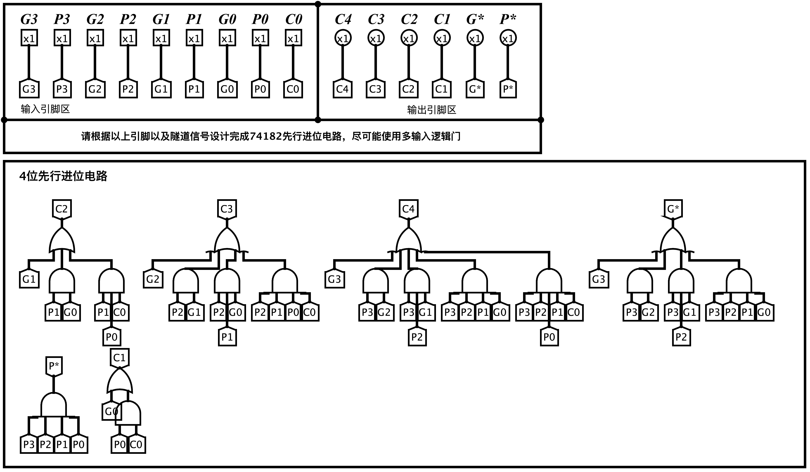
    
            - 总共 2 级门电路延迟
    
        - 以此，我们可以有：
    
            - 4 位快速加法器：总共 8T 的时间延迟
    
            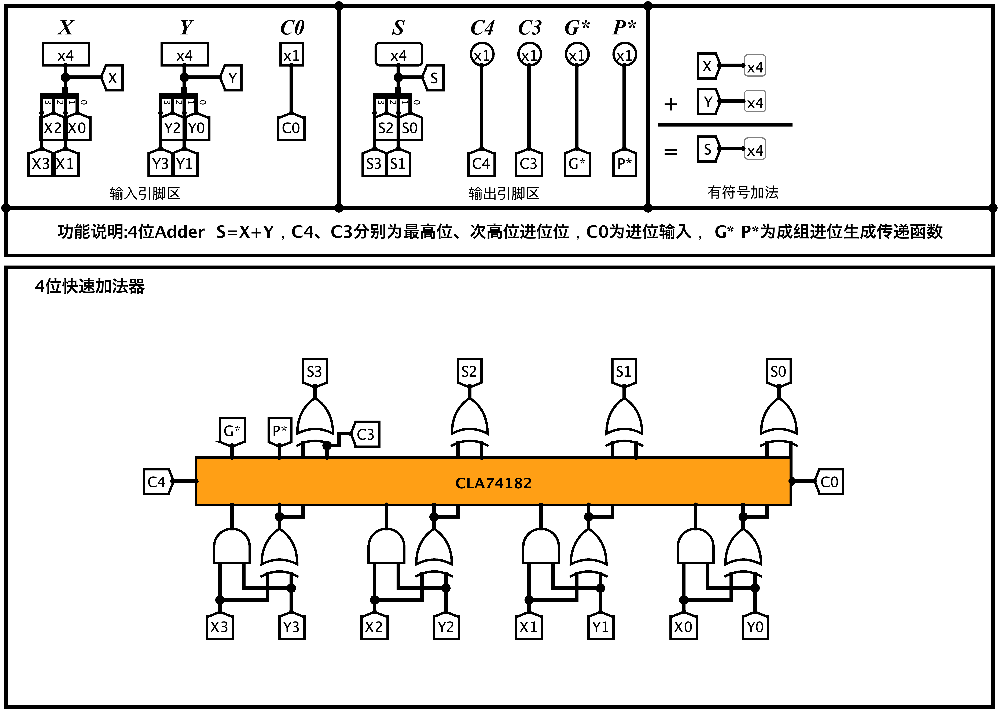 
    
            - 16 位快速加法器：总共 12T 的时间延迟（相比于 4 个串行连接的 4 位加法器构成的 14T 的延迟快了 2T）
    
            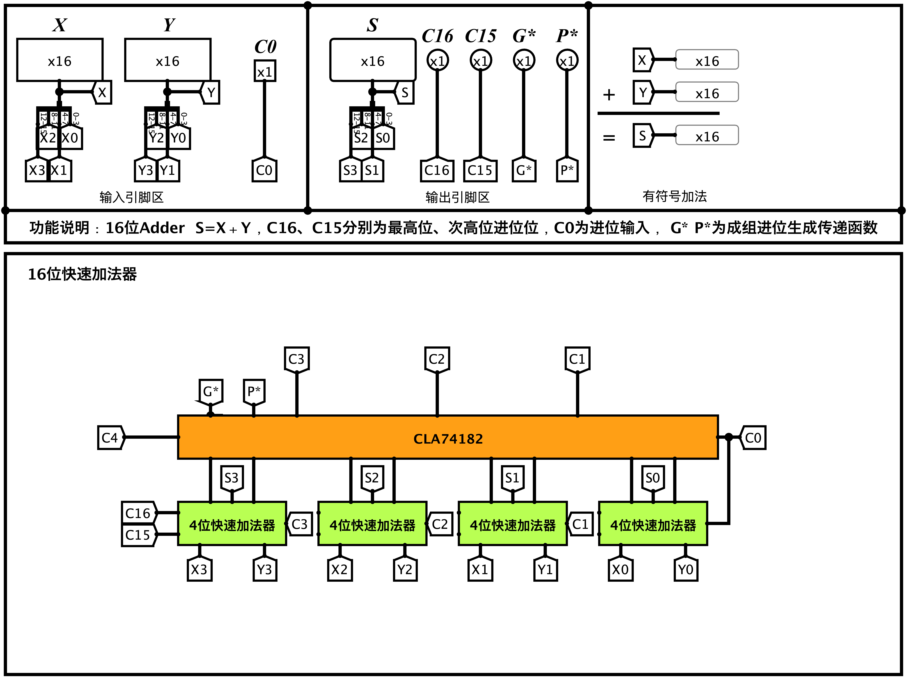
    
            - 32 位快速加法器（2 个 16 位快速加法器的串行连接）
        
            

# 第 4 章 存储系统
1. #### 存储器概述

    1. ##### 存储器的分类

        - 按存储介质分类

            - 半导体存储器
                - 存储元件由半导体器件组成的存储器
                - 可分为易失性存储器和非易失性存储器
                    - 易失性存储器：当电源消失时，所存信息也随即丢失 (RAM) 
                    - 非易失性存储器：当电源消失时，所存信息不会丢失 (ROM)
                - 常见的如 U 盘，内存条都是半导体存储器

            - 磁表面存储器
                - 在金属或塑料基体的表面上涂一层磁性材料作为记录介质，按剩磁状态的不同区分 `"0"` 或 `"1"`
                    - 由于剩磁状态不会轻易丢失，磁表村存储器属于非易失性存储器
                    - 按载磁体形状的不同，可分为磁盘、磁带
            - 光介质存储器
                - 通过激光读写光学材料实现数据的存储
                - 光介质存储器适合长期归档、成本低廉
                - 如光盘（CD、DVD、蓝光碟）是光介质存储器

        - 按存取方式分类

            - 随机访问存储器

                存取时间与物理地址无关，对不同物理地址的存储单元，可以在相同的时间内进行信息存取

                - 随机存储器 RAM

                    - 在程序的执行过程中**可读可写**
                    - 按照存储信息原理的不同分为静态 RAM（SRAM，常用于高速缓存场景）和动态 RAM（DRAM，常用于内存条）
                    - RAM 属于易失性存储，必须持续通电才能维持数据，断电后数据立即丢失

                - 只读存储器 ROM

                    - 在程序的执行过程中只读

                    - 常用于存放固定不变的程序和常数，如基本输入输出系统 BIOS (Basic Input/Output System)

                    - 非易失性存储，断电后数据能长期保留，无需持续供电

                    - 闪存：支持多次擦写，同时保留了非易失性存储的性质

                        U 盘和固态硬盘 SSD 都属于闪存

            - 串行访问存储器

                存取时间与物理地址有关，对给定存储单元的物理地址，需按存储单元的物理位置的先后顺序寻找存储单元

                - 顺序存取存储器：读写时需从介质的始端开始按顺序寻找地址，如磁带
                - 直接存取存储器：先直接访问存储器的某个小区域，再顺序寻找地址，如磁盘

        -  按在计算机中的作用分类

            - 主存储器
                - RAM（动态 RAM）：存放将要参与运行的程序和数据，例如内存条
                - ROM：存放固定不变的程序、常数
            - 闪存（Flash Memory）：主存和辅存间的缓冲，例如 SSD 固态硬盘
            - 高速缓冲存储器（Cache）：CPU 和主存间的缓冲（静态 RAM）
            - 辅助存储器：存放暂时不用的程序和数据，例如磁盘、磁带、光盘

    2. 存储器的层次结构

        - 存储器的三个主要性能指标：速度、容量、位价（每位价格）

        - 存储器三个主要性能指标的关系

            - 单一存储介质构成的存储器难以同时满足速度快，容量大，位价低的要求
            - 因此考虑把不同存储介质构成的存储器，按照一定的**层次结构**，用软件、硬件或者是软硬件相结合的方式，连接成一个整体形成**存储系统**，在总体上满足既要又要的要求
            - 现代计算机系统最重要的两个存储层次：主存 − 辅存层次、缓存 − 主存层次

        - 主存 − 辅存层次

            - CPU可直接访问主存，但其容量小，可能存放不下用户程序
            - CPU不能直接访问辅存，但其容量大
            - 考虑使主存存放将要运行的程序，辅存存放暂时不用的程序，将两者连接起来

            ```mermaid
            graph LR
            	CPU --> Main[主存]
            	Main --> CPU
            	Main <--> other[辅存]
            ```

            - 这样用**软硬件结合的方法将主存和辅存连接起来**，实现了接近主存的速度，同时接近辅存的容量和位价

        - 缓存 − 主存层次

            - 然而，CPU速度的发展远快于主存访存速度的发展，导致了CPU和主存速度不匹配的问题（内存墙）

            - 解决方法：在CPU和主存之间加上一层缓存（ Cache ）

                - 缓存速度比主存快，可被CPU直接访问，但容量较小
                - 将缓存和主存连接起来，不断将CPU近期要用的信息从主存调入缓存

                ```mermaid
                graph LR
                	CPU --> Main[主存]
                	CPU <--> Cache[缓存]
                	Cache <--> Main
                	Main --> CPU
                	Main <--> other[辅存]
                ```

                

            - 由**硬件将缓存和主存连接起来**，实现了接近缓存的速度，同时接近主存的容量和位价

        - 两种层次的区别：

            - 主存 - 辅存层次（虚拟存储器）

                这一层次的核心是**通过 "逻辑地址 + 辅存扩展"，"感觉" 自己拥有大容量主存**，解决主存容量不足的问题

                - **地址类型**：

                    - **虚地址（逻辑地址）**：是程序员写代码时 “认为可用” 的地址空间，属于 “逻辑上的内存范围”
                    - **实地址（物理地址）**：是程序实际执行时，能真正访问到的主存物理地址

                - **工作原理**：

                    逻辑地址空间比物理地址空间大得多（比如逻辑上你以为有 100G 内存，实际主存只有 16G）

                    程序执行时，需要把**逻辑地址转换成物理地址**；如果逻辑地址对应的内容不在主存里（因为主存装不下），就从辅存（如硬盘）把数据传到主存，再进行访问

            - 缓存 - 主存层次

                这一层次的核心是**通过 “高速缓存副本”，让 CPU 更快访问数据**，解决主存速度不足的问题

                - **地址空间**：只用**主存的物理地址**，因为缓存是主存的 “高速副本”，和主存共享物理地址空间

                - **工作原理**：

                    缓存里存的是主存中 “常用数据的副本”，CPU 访问数据时，先查缓存：如果找到（命中），直接从缓存取（速度快）；如果没找到（未命中），再去主存取，同时把数据复制到缓存，方便下次访问

            | 维度     | 主存 - 辅存层次（虚拟存储）                  | 缓存 - 主存层次                             |
            | -------- | -------------------------------------------- | ------------------------------------------- |
            | 核心目的 | 扩大**可用内存容量**（让程序员觉得内存很大） | 提高**数据访问速度**（让 CPU 更快拿到数据） |
            | 地址类型 | 涉及 “逻辑地址→物理地址” 的转换              | 只用物理地址                                |
            | 数据流向 | 辅存 → 主存（缺页时补充主存）                | 主存 → 缓存（复制常用数据）                 |

2. #### 主存储器

    1. ##### 基本结构框架

        - 存储体：存储二进制数据的核心载体，由大量存储单元按阵列形式排列

        - 控制逻辑：协调各部件有序工作，包含地址译码、时序控制和读写控制功能

        - 接口电路：作为主存与 CPU、总线的连接桥梁，负责信号转换与传输

    2. ##### 核心组成部件

        - 存储单元：最小存储单位，每个单元存放 1 位二进制数（0 或 1），多个单元组成存储字

        - 地址寄存器（MAR）：暂存 CPU 发送的存储地址，为地址译码提供输入

        - 数据寄存器（MDR）：临时存放待写入主存的数据，或从主存读出的数据

        - 地址译码器：将 MAR 中的地址信号转换为存储体的具体单元选择信号

        - 读写控制电路：接收 CPU 的读写命令，控制存储体执行数据写入或读出操作

        - 时序电路：产生同步时钟信号，保证地址、数据、控制信号的时序匹配

        ```mermaid
        graph TD
        		subgraph 主存储器核心部件
                MAR[地址寄存器]
                MDR[数据寄存器]
                Decoder[地址译码器]
                Memory[存储体]
                RW_Ctrl[读写控制电路]
                Timer[时序电路]
            end
            
            subgraph CPU
                CPU_addr[地址输出端]
                CPU_data[数据端口]
                CPU_ctrl[控制命令端]
            end
            
            CPU_addr -->|地址信号| MAR
            MAR -->|地址编码| Decoder
            Decoder -->|单元选择信号| Memory
            
            CPU_data <-->|数据输入输出| MDR
            MDR <-->|数据读写| Memory
            
            CPU_ctrl -->|读写命令| RW_Ctrl
            Timer -->|时序同步| MAR
            Timer -->|时序同步| MDR
            Timer -->|时序同步| Decoder
            Timer -->|时序同步| RW_Ctrl
            RW_Ctrl -->|读写控制| Memory
        ```

    3. ##### 主存中（存储数据时）存储单元地址的分配

        - 概念复习
            - 存储字长：主存的一个存储单元所存储的二进制位数
            - 机器字长：计算机一次能处理的二进制数的位数
            - 两者不一定相等！

        - 主存中存储单元的地址分配是通过**编址方式**实现的：**以字节为基本单位，按线性顺序分配唯一地址，通过地址总线和译码器将逻辑地址映射到物理存储单元**，同时通过地址对齐优化访问效率

        | 模式         | 描述                                                         | 字地址位置       | 常用于处理器    |
        | ------------ | :----------------------------------------------------------- | ---------------- | --------------- |
        | **大端模式** | 数据**高位字节存放在内存的低地址处**，低位字节存放在高地址处 | 高位字节为字地址 | PowerPC处理器   |
        | **小端模式** | 数据**低位字节存放在内存的低地址处**，高位字节存放在高地址处 | 低位字节为字地址 | Intel x86处理器 |

        - 补充：数据位数的判断

            - 数据的位数指的是将数据转为二进制后的位数，具体来讲：

            | 进制     | 判断方法                                                     |
            | -------- | ------------------------------------------------------------ |
            | 二进制   | 直接读取位数就是该数据的位数                                 |
            | 十进制   | 转换为二进制后判断；特别地，对于无符号整数，有：二进制位数 =  `[log₂N] + 1` |
            | 十六进制 | 每一位十六进制对应 4 位二进制，故总位数 = 十六进制的有效位数 × 4 |

    4. ##### 主存储器的技术指标

        - **存储容量（B，KB，MB，GB，TB ……）**：主存能存放二进制代码的总位数
            - 存储容量 （位） = 存储单元个数 × 存储字长（位）
            - 存储容量 （字节）= 存储单元个数 × 存储字长（位）/ 8
            - 决定计算机可同时运行的程序规模、处理的数据量上限
        - **存储速度（ns）**：核心是 “访问延迟”，包含两个关键参数
            - 存取时间（ 存储器的访问时间 ）：启动一次存储器操作（读或写）到完成该操作所需的时间
                - 读出时间：从存储器接收到有效地址开始，到产生有效输出所需的时间
                - 写入时间 ：从存储器接收到有效地址开始，到数据写入被选中单元为止所需的时间
            - 存取周期 ：连续两次独立的存储器操作（读或写）所需的最小间隔时间
                - 读周期、写周期
                - 通常存取周期大于存取时间
            - 直接影响 CPU 与主存的协作效率，延迟越低，程序运行越流畅
        - **存储器带宽（B/s，GB/s）**：单位时间内存储器存取的信息量
            - 决定大批量数据（如视频、大型文件）的读写速度，带宽越高，数据吞吐能力越强

    5. ##### 半导体存储芯片简介

        - 基本结构：

            - 核心存储层：存储矩阵 —— 数据的 “仓库”

                存储体是芯片中存放数据的核心区域，由大量**存储元**（最小存储单位，可存储 1 位二进制数 0/1）按 “行 × 列” 的二维阵列形式排列组成，类似 “网格” 结构：

                - **存储元**：基础存储单元，不同类型芯片的存储元实现不同（如 SRAM 用触发器，DRAM 用电容），但功能都是稳定保存 1 位数据

                - **存储单元**：由若干存储元组成，对应 “一个可独立寻址的最小数据单位”（通常为 1 字节，即 8 个存储元）

                - **存储阵列**：存储单元按行列排列形成的矩阵，例如 1024×1024 的阵列表示有 1024 行、1024 列，共 1048576 个存储单元（1MB）

            - 地址定位层：译码驱动 —— 数据的 “导航系统”

                CPU 访问存储芯片时，需通过地址信号定位目标存储单元，地址译码器的作用是将外部输入的**地址信号**（二进制编码）转换为存储阵列的 “行列选择信号”，精准定位存储单元：

                - **地址线拆分**：假设芯片有 N 条地址线，可表示 2ⁿ个地址，通常将地址线分为两部分，分别连接**行译码器**和**列译码器**（例如 10 条地址线，6 条用于行译码，4 条用于列译码，可定位 64 行 ×16 列 = 1024 个单元）
                - **行选通与列选通**：行译码器根据行地址信号激活某一行（使该行所有存储单元与列线连通），列译码器根据列地址信号从激活行中选中目标列（即目标存储单元），实现 “行列交叉定位”

            - 数据交互层：读写电路 —— 数据的 “传输通道”

                读写电路负责存储阵列与外部的数据交换，核心功能是信号放大和数据缓冲，包含两个关键部件：

                - **sense amplifier（sense 放大器）**：从存储元读出的电信号（如 DRAM 的电容电荷信号）非常微弱，需通过放大器增强为标准逻辑电平（0/1），确保数据正确传输
                - **数据寄存器（I/O 寄存器）**：暂存待写入存储体的数据或从存储体读出的数据，起缓冲作用（匹配芯片内部与外部总线的速度差异）

            - 控制协调层：控制逻辑 —— 芯片的 “指挥中心”

                控制逻辑接收外部控制信号，协调地址译码、读写电路的工作节奏，确保操作时序正确，核心信号包括：

                - **片选信号（CS，Chip Select）**：用于选择当前工作的存储芯片（同一总线可能连接多个芯片，仅 CS 有效时芯片响应操作）
                - **读写命令（WE，Write Enable；OE，Output Enable）**：WE 有效时执行写入操作（数据从外部写入存储体），OE 有效时执行读出操作（数据从存储体输出到外部）
                - **时序信号**：与外部时钟同步，确保地址、数据、控制信号的传输时序匹配（避免信号冲突）

            - 输入输出接口：

                包括三类信号线，连接存储芯片与外部（CPU 或总线）：

                - **地址线**：传输地址信号，数量决定芯片最大容量（n 条地址线对应 2ⁿ个存储单元）

                - **数据线**：双向传输数据，数量等于存储字长（如 8 条数据线对应 1 字节存储字长）

                    - 地址线表示了存储芯片的最大容量，数据线表示了存储字长，则可根据二者数量计算存储容量

                    - $芯片容量=存储单元数 × 每个单元的位数=2^{地址线数量}×数据线数量=2^{地址线数量-10}K×数据线数量(位)$

                - **控制线**：

                    - 读写线（\(\overline{WE}/ \overline{OE}\)）
                        - 一根线：WE：低电平写，高电平读
                        - 两根线：
                            - \(\overline{OE}\)：低电平有效，允许读
                            - \(\overline {WE}\)：低电平有效，允许写
                    - 传输片选线（\(\overline{CS}\)）：芯片选择线，用于选择某一或某些存储芯片同时进行工作，以组成大容量的存储器
                        - \(\overline {CS}\)：芯片选择，低电平有效
                        - \(\overline{CE}\)：芯片使能，低电平有效
                    - ……

        - 译码驱动方式

            - 线选法：每个存储单元（或一组单元）对应一根专属 “地址选择线”，地址信号直接控制这根线，选中就激活
            - 重合法：把存储单元排成矩阵，地址拆成 “行地址” 和 “列地址”，分别由行、列译码器翻译，交叉点就是目标单元

            | **对比维度**             | **线选法**                                                   | **重合法（矩阵译码法）**                                     |
            | ------------------------ | ------------------------------------------------------------ | ------------------------------------------------------------ |
            | **核心原理**             | 每个存储单元（或单元组）对应一根专属“选中线”，地址信号直接控制该线激活目标单元（“一对一”定位） | 将存储单元排成矩阵（M行×N列），地址拆分为“行地址”和“列地址”，通过行、列译码器输出的选中线交叉定位目标单元（“行列交叉”定位） |
            | **适用场景**             | 仅适合小容量存储（如早期简单ROM、小规模寄存器组）            | 几乎所有大容量存储芯片（如DRAM、SRAM、Flash），是主流方案    |
            | **地址线数量**           | 等于**存储单元总数（或单元组数）**<br>例：8个单元需要8根地址线 | 等于**“行地址线数+列地址线数”**，其中：<br>行地址线数$=[log_2(行数M)]$<br>列地址线数$=[log_2(列数N)]$<br>例：8个单元排成2行4列，需1（行）+2（列）=3根地址线 |
            | **选中线（输出线）数量** | **与地址线数量相同（一对一对应）**<br>例：8 个单元需要 8 根选中线 | 等于** “行数 M + 列数 N”**<br>例：8 个单元排成 2 行 4 列，需 2（行选线）+4（列选线）=6 根选中线 |
            | **地址信号处理**         | 无需拆分，地址信号直接驱动对应选中线                         | 需将地址信号拆分为行、列两部分，分别输入行、列译码器         |
            | **控制逻辑复杂度**       | 极简单，无需复杂译码器，仅需简单开关电路                     | 较复杂，需行、列两个译码器，且需同步控制信号确保行列选中线同步生效（避免误激活） |
            | **优势**                 | 结构简单，响应速度快（无拆分/译码延迟）                      | 大幅减少地址线和选中线数量（尤其大容量场景），节省芯片面积，适合规模化集成 |
            | **劣势**                 | 线数随存储容量呈线性增长（容量大时线数爆炸），占用芯片面积大，无法支持大容量存储 | 需额外译码电路，存在轻微延迟；对行列信号同步精度要求高（否则可能误选相邻单元） |

            - 存储器容量的扩展

                - **位扩展**（凑 “数据宽度”）—— 多个芯片一起凑位数

                    如果单个芯片的数据线不够宽（比如需要 8 位数据，但单个芯片只有 4 位），就需要多个芯片 “同时干活，凑出完整位数”，片选线负责 “同时点它们的名”

                    - 举个例子：用 2 个 “1K×4 位” 的芯片，拼成 “1K×8 位” 的存储（数据宽度从 4 位变 8 位）：

                        1. 把两个芯片的**地址线、控制线**（比如读写控制\(\overline{WE}\)）全部连在一起 —— 因为它们要 “同步接收同一个地址、同一个读写指令”

                        2. 把两个芯片的**片选线**也连在一起 —— CPU 发信号时，这两个芯片会被 “同时选中”
                        3. 最后，把第一个芯片的 4 条数据线当 “低 4 位”，第二个芯片的 4 条数据线当 “高 4 位”，合起来就是 8 位数据线

                    这样，CPU 读写时，两个芯片同时工作，一起输出 / 输入 8 位数据

                - **字扩展**（凑 “存储容量”）—— 多个芯片分区域干活

                    如果单个芯片的存储单元不够多（比如需要 4K 容量，但单个芯片只有 1K），就需要多个芯片 “分区域管不同的地址段”，片选线负责 “点其中一个芯片的名”

                    - 举个例子：用 4 个 “1K×8 位” 的芯片，拼成 “4K×8 位” 的存储（容量从 1K 变 4K）：

                        1. 先算地址线：1K 需要 10 条地址线（对应\(2^{10}=1024\)个单元），4K 需要 12 条地址线（\(2^{12}=4096\)个单元）

                        2. 把每个芯片的**低 10 位地址线、数据线、控制线**都连在一起 —— 它们的 “单元定位规则” 和 “数据宽度” 是一样的
                        3. 把**高 2 位地址线**接到 “译码器”（相当于 “分号器”），译码器会把这 2 位的 4 种组合（00、01、10、11），转换成 4 个 “片选有效信号”，分别连到 4 个芯片的片选线

                    这样，CPU 发地址时：

                    - 高 2 位是 “00”→ 第 1 个芯片被选中，负责 0~1023 号单元
                    - 高 2 位是 “01”→ 第 2 个芯片被选中，负责 1024~2047 号单元
                    - 以此类推，4 个芯片分区域管 4K 的容量

                - 既位扩展又字扩展（同时凑宽度和容量）

                    比如用 4 个 “1K×4 位” 的芯片，拼成 “2K×8 位” 的存储：

                    1. **先做位扩展**：把 2 个 “1K×4 位” 拼成 1 组 “1K×8 位”（片选线连一起），这样得到 2 组 “1K×8 位” 的芯片组
                    2. **再做字扩展**：把地址线的高 1 位（因为 2 组需要 1 位地址区分）连到译码器，输出 2 个片选信号，分别连到 2 个芯片组的片选线

                    最终，2 组芯片分别负责 0~1023、1024-2047 号单元，每组内部 2 个芯片同时工作凑 8 位数据

                | 扩展方式            | 地址线连接特点                                               | 数据线连接特点                                               | 核心目的                                                   |
                | ------------------- | ------------------------------------------------------------ | ------------------------------------------------------------ | ---------------------------------------------------------- |
                | 位扩展              | 所有存储芯片的地址线**完全并联**，与 CPU 地址线直接对接，无额外地址译码电路（仅芯片本身片选） | 各芯片的数据线**按位拼接**（如 8 位→16 位需 2 片，一片接 D0-D7、另一片接 D8-D15），共同构成完整数据总线 | 增加存储容量的 “位数”（如 8 位→16 位），不改变存储单元数量 |
                | 字扩展              | 各芯片地址线部分并联（低地址位共用），高地址位通过**地址译码器**生成片选信号，分别控制不同芯片 | 所有存储芯片的数据线**完全并联**，与 CPU 数据线直接对接，保持数据位数不变 | 增加存储容量的 “字数”（如 1KB→2KB），不改变数据位数        |
                | 同时扩展（位 + 字） | 低地址位并联供所有芯片共用，高地址位通过**地址译码器**分区选通芯片组，每组对应一个字扩展单元 | 每组芯片内部按位扩展规则拼接数据线，各组芯片的数据线**统一并联**到 CPU 数据总线 | 同时增加字数和位数（如 1KB×8 位→2KB×16 位），全面扩展容量  |

    6. ##### 存储器与 CPU 的连接

        - 注意事项

            - 合理选择存储芯片

                - 芯片类型

                    - **ROM（只读存储器）**：用于存放**系统程序、标准子程序、各类常数**等（如计算机的 BIOS 程序、打印机的固件），其特性是 “只读”，内容出厂或初始化后固定不变，保证了程序 / 数据的稳定性
                    - **RAM（随机存取存储器）**：用于存放**用户程序、临时数据**等（如我们运行的游戏、办公软件在内存中的加载区域），其特性是 “可读可写”，支持程序运行时的动态数据修改

                - 芯片参数

                    选择时要尽量 “使连线简单”，即通过匹配存储容量、引脚定义等参数，减少硬件连线的复杂度，降低电路设计和调试的难度

            - 数据线的连接

                CPU 的数据线需与存储芯片的数据线直接相连，若存储芯片的**位数（如 8 位）与 CPU 数据线的位数（如 16 位）不匹配**，则需要进行 **“位扩展”**

            - 读/写命令线的连接

                - 一般情况下，CPU 的读 / 写命令线需与**每个存储芯片的读 / 写控制端**一一对应连接，以此控制芯片执行 “读数据” 或 “写数据” 操作
                - 特别地，**ROM 仅需连接 CPU 的 “读命令线”**（因为 ROM 是只读的，不需要 “写” 操作），而 RAM 则需同时连接读、写命令线

        - 存储器与CPU的连接的基本方法

            - 地址线的连接：**“低位选单元，高位选芯片”**

                通常 CPU 的地址线数量**多于单个存储芯片的地址线数**（因为 CPU 需管理更大的地址空间，而单芯片容量有限），但**CPU 的全部地址线都要与各存储芯片连接**，以此实现对整个地址空间的管理

                - **低位地址线**：CPU 的**低位地址线直接与存储芯片的地址线相连**，用于选择**芯片内部的具体存储单元**
            
                    例：某存储芯片有 10 根地址线（对应\(2^{10}=1024\)个存储单元），CPU 的低 10 位地址线与该芯片地址线相连，即可指定访问芯片内的某一个单元
            
                - **高位地址线**：CPU 的**高位地址线用于形成 “片选信号”**，以此选择系统中多个存储芯片中的某一个（因为单芯片容量不足时，需多芯片扩展容量）
            
            - 片选线的连接
            
                1. **确定 CPU 是否访存：\(\overline{MREQ}\) 信号
            
                     CPU 的访存控制信号 \(\overline{MREQ}\) 是**低电平有效**的：
            
                     - 当 \(\overline{MREQ}\) 输出**低电平**时，表明 CPU 正在访问存储器，此时 “片选信号” 需有效（才能选中目标存储芯片）
                
                     - 当 \(\overline{MREQ}\) 输出**高电平**时，表明 CPU 正在访问 I/O 设备，此时 “片选信号” 无效（无需访问存储器） 
                     - *这一步实现了 “访存” 与 “访 I/O” 的功能区分*
            
                2. **字扩展时的地址空间划分**：当需要 “字扩展”（即增加存储容量，如从 1KB 扩展到 2KB）时，CPU 的**高位地址线用于划分地址空间**—— 不同的高位地址范围对应不同的存储芯片
                
                     例：若用两片 1KB 的芯片扩展为 2KB，可将 CPU 高位地址的某一位（如 A₁₀）作为区分：A₁₀=0 时选中芯片 1，A₁₀=1 时选中芯片 2
                
                3. **片选信号的最终产生**：片选信号由**CPU 的访存控制信号 \(\overline{MREQ}\)  **和 **CPU 高位地址线**共同控制产生：只有当\(\overline{MREQ}\) 低电平（CPU 访存）且高位地址匹配（选中目标芯片）时，片选信号才有效，从而准确选中要访问的存储芯片

3. #### 高速缓存存储器 Cache

    1. ##### 使用缓存的必要性：**缓解 CPU 与主存（内存）之间的速度不匹配矛盾**

        - **提升系统整体性能**

            - CPU 的运算速度（以 GHz 为单位）远快于主存的读写速度（以 ns 为单位），若 CPU 直接访问主存，会因等待数据而频繁 “闲置”

            - 而 Cache 的速度接近 CPU，可让 CPU 快速获取常用数据 / 指令，减少等待时间，充分发挥 CPU 的运算能力

        - **降低主存访问压力**

            - 程序运行时存在 “局部性原理”（时间局部性&空间局部性），Cache 会缓存这些高频信息，使 CPU 无需每次都访问主存，大幅减少主存的读写次数，减轻主存的负载

                | 时间局部性     | 当一个存储单元被访问时，它在未来可能会被多次访问           |
                | -------------- | ---------------------------------------------------------- |
                | **空间局部性** | **当一个存储单元被访问时，其附近的存储单元也可能将被访问** |

            - 主存和Cache间以字块为单位进行信息传递：将当前访问的存储字（时间局部性）及其相邻存储字（空间局限性）放入Cache

        - **优化程序响应速度**

            对于频繁执行的代码（如循环）或常用数据，Cache 能让 CPU “就近获取”，缩短指令执行的等待周期，让程序运行更流畅

    2. ##### 主存和缓存的编址

        - 主存的编址：由 $2^𝑛$ 个存储字组成，每个字有 𝑛 位地址，以此**将主存分成若干块**，每块包含同数量的存储字，其中，

            - 高𝑚位表示主存的块地址，低𝑏位表示块内地址
            - 主存块数𝑀 $= 2^𝑚$ ，块长（块内字数）𝐵 $=2^b$ $(m+b=n)$ 

        - 缓存的编址：将缓存分成若干块，每块包含相同数量的存储字，且**与主存块长相等**，其中，

            - 高𝑐位表示缓存的块地址，低𝑏位表示块内地址
            - 缓存块数𝐶 $= 2^𝑐$ ， 块长（块内字数）𝐵 $=2^b$

        -  **主存和缓存按块存储**，**两种块大小相同**，我们设缓存共有 𝐶 块，主存共有 𝑀 块，通常有：$𝑀 >> 𝐶$

            - 主存和缓存间按整个字块为单位进行信息传递，字块内对应存储字的块内地址完全相同

            - 用**标记**记录与该缓存块建立了对应关系的主存块的主存字块

                - 标记是缓存（Cache）中用于记录 “与该缓存块建立对应关系的主存块的**主存字块标记**” 的信息，简单来说，它是缓存块用来 “记住” 自己对应的是哪一个主存块的 “标识”

                - 标记的核心作用是**实现缓存命中的判断**：

                    当 CPU 访问内存时，会给出一个主存地址，这个地址可拆解为主存块号和块内地址（因为主存和缓存块大小相同，块内地址完全一致）

                    此时，缓存会将自身块的**标记**与主存地址中的**主存块号**进行比对：

                    - 若匹配（标记一致），说明该主存块已经被缓存，可直接从缓存中读取数据（**缓存命中**）
                    - 若不匹配，说明该主存块未被缓存，需要从主存中读取数据，并根据替换策略更新缓存（**缓存未命中**）

    3. ##### 缓存 Cache 的效率指标

        - **命中率** $h$：CPU 欲访问的信息已在 Cache 中的比率

            - 在一个程序执行期间，$𝑁_𝑐$ 为访问 Cache 的总命中次数， $𝑁_𝑚$ 为访问主存的总次数，则命中率 $h=\frac{N_c}{N_c+N_m}$

            - 命中率与 Cache 的容量与块长有关

                - **容量越大，一般命中率越高**

                - **块长由小变大，命中率一般先增加后减小**
                    - 块长过小，不能充分利用程序的局部性原理
                    - 块长过大，由于Cache容量是有限的，使得装入缓存的有用信息变少

        - **主存系统的访问效率** $e$ ：与命中率 $h$ 有关
            $$
            e=\frac{访问\ Cache\ 的时间}{平均访问时间} ×100 \%
            $$

            - 设 Cache 的命中率为 $h$，访问 Cache 的时间为 $t_c$，访问主存的时间为 $t_m$

            $$
            平均访问时间=h\times t_c+(1-h) \times t_m
            $$

            - 因此，访问效率 $c$ ：

            $$
            访问效率\ c=\frac{t_c}{h\times t_c+(1-h) \times t_m}
            $$

    4. ##### 缓存 Cache 的工作流程：

        CPU 访问数据时，会遵循 “先查 Cache，再查主存” 的逻辑：

        1. 命中判断（核心环节）

        CPU 发出主存地址后，地址映射机构会快速判断目标数据是否在 Cache 中：

        - 若数据在 Cache 中，即对应主存块已调入缓存，**主存块与缓存块建立了对应关系**，称为 “**Cache 命中**”（命中率通常在 90% 以上）

        - 若数据不在 Cache 中，即对应主存块未调入缓存，**主存块与缓存块未建立对应关系**，称为 “**Cache 未命中**”

        2. 若 Cache 命中（最常见）

            - **读操作**：CPU 直接从 Cache 中读取数据，速度接近 CPU 的运算速度（无需等待主存）

            - **写操作**：需保证 Cache 与主存的数据一致，常用两种策略：
                - 写直达（Write Through）：同时写入 Cache 和主存，确保数据一致，但会占用主存带宽
                - 写回（Write Back）：只写入 Cache，标记该 Cache 块为 “脏块”；仅当该块被替换时，才将 “脏块” 的数据写回主存，效率更高

        3. 若 Cache 未命中

            1. CPU 暂停访问，向主存发送请求，读取目标数据所在的 “主存块”（而非单个单元，利用空间局部性）

            2. 将读取到的主存块复制到 Cache 中（若 Cache 已满，触发 “替换策略” 淘汰旧块）

            3. CPU 从 Cache 中读取刚缓存的数据，恢复运算

        ```mermaid
        flowchart TD
            Start[CPU发出内存访问请求] --> CacheCheck{检查缓存}
            
            %% 缓存命中分支
            CacheCheck -->|缓存命中| HitFlow
            subgraph HitFlow [缓存命中流程]
                H1[从缓存读取数据] --> H2[数据总线传输到CPU]
                H3[写入缓存] --> H4{写策略判断}
                H4 -->|写直达| H5[数据总线写入主存]
                H4 -->|写回| H6[标记缓存行为脏]
            end
            
            %% 缓存未命中分支  
            CacheCheck -->|缓存未命中| MissFlow
            subgraph MissFlow [缓存未命中流程]
                M1[地址总线发送主存地址] --> M2{检查替换缓存行状态}
                M2 -->|脏行| M3[数据总线写回主存]
                M2 -->|干净行| M4[直接读取主存]
                M3 --> M4
                M4 --> M5[数据总线读取数据块]
                M5 --> M6[更新缓存并服务CPU]
            end
            
            %% 结束节点
            H2 --> End[操作完成]
            H5 --> End
            H6 --> End
            M6 --> End
        
            %% 简约配色方案
            classDef default fill:#f5f5f5,stroke:#666,stroke-width:1px
            classDef cache fill:#e8f5e8,stroke:#4CAF50,stroke-width:1px
            classDef memory fill:#e3f2fd,stroke:#2196F3,stroke-width:1px
            classDef bus fill:#fff3e0,stroke:#FF9800,stroke-width:1px
            classDef decision fill:#f3e5f5,stroke:#9C27B0,stroke-width:1px
            
            class HitFlow,M6 cache
            class M3,M4,M5 memory
            class H2,H5,M1,M5 bus
            class CacheCheck,H4,M2 decision
        ```

        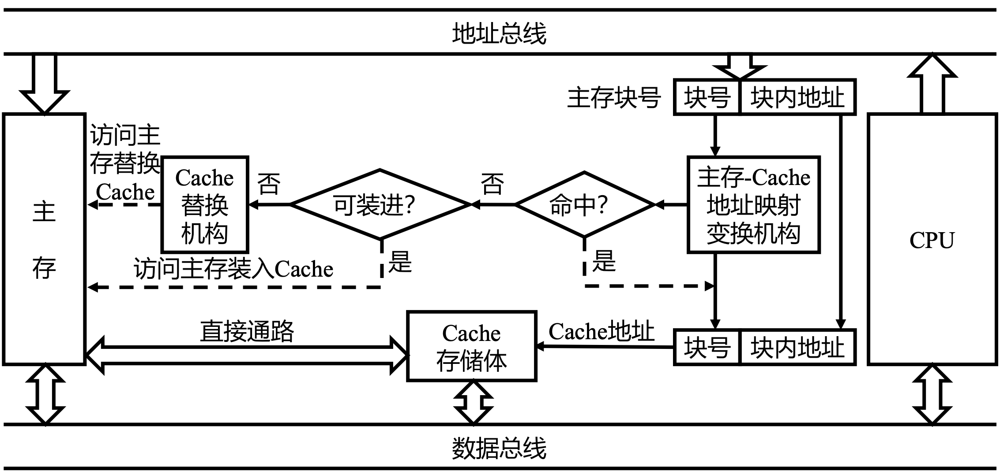

        - 缓存 Cache 的读流程

        ```mermaid
        graph LR
            A([开始]) --> B[CPU发出访问地址]
            B --> C{主存 - Cache<br>地址映射变换机构<br>确认是否命中}
            C -->|是| D[访问Cache取出信息送CPU]
            C -->|否| E[访问主存取出信息送CPU]
            E --> F{允许放该内存块的<br>那些Cache块位置<br>是否已满?}
            F -->|是| G[执行替换算法腾出空位]
            F -->|否| H[将新的主存块调入Cache中]
            G --> H
            D --> I([结束])
            H --> I
        ```

        读操作不影响 Cache 和主存内容的一致性，直接进行读取即可

        - 缓存 Cache 的写流程

            写操作更改 Cache 的内容，可能影响 Cache 和主存内容的一致性

            - 写直达法 (Write-through)：写操作时，数据既写入Cache又写入主存
                - 写操作时间就是访问主存的时间
                - 优点：
                    - 时刻保持了Cache 和主存内容的一致性
                    - 读操作时，即使发生Cache块的替换，也不涉及对主存的写操作，更新策略比较容易实现
                - 缺点：增加了访问存储的次数
            - 写回法 (Write-back)：写操作时，只把数据写入 Cache 而不写入主存，当 Cache 数据被替换出去时才写回主存
                - **允许在一段时间内，Cache 和主存内容不一致**
                - 写操作时间就是访问 Cache 的时间
                - 优点：对主存的写操作只发生在Cache块替换时，对同一 Cache 块的多次写操作只需一次写入 主存
                - 缺点：读操作，发生Cache块替换时，被替换的块需写回主存，增加了 Cache 的复杂性

    5. #####  Cache — 主存的地址映射

        如何由主存地址映射到Cache地址？主存块若写入Cache，可以写入到哪些Cache块？

        - ###### 直接映射

            - 核心规则

                主存的每个数据块（比如主存块 0、1、2…），通过固定算法（“主存块号 ÷ 缓存块数” 取余数），**只能映射到缓存中唯一的一个块位置**

            - 优缺点

                - 优点：查找速度极快，只需按公式计算地址，硬件实现简单、成本低
                - 缺点：**冲突严重**，如果多个常用主存块映射到同一个缓存块，会频繁替换数据，导致缓存命中率下降
                
            - 地址划分
            
                **主存地址 = 「主存字块标记」 + 「缓存字块地址」+ 「字块内地址（块内偏移）」**
            
                - **缓存字块地址**：长度 = log~2~(缓存总行数)，用于**确定这个主存块应该被放到 Cache 的哪一行**，例如，一个 512 行的 Cache，索引字段需要 9 位（因为 2^9^ = 512）
                - **字块内地址（块内偏移）**：长度 = log~2~(缓存字块长度)，用于在确定了 Cache 行后，这个地址用来**定位数据在该行（数据块）内的具体字节（或字）**，例如，一个64字节的 Cache 块，块内地址需要6位（因为 2^6^ = 64）
                - **主存字块标记**：长度即为地址剩余部分，用于**区分 “映射到同一个缓存块” 的不同主存块**（因为多个主存块会映射到同一个缓存块）
                
            - 命中判断步骤：
            
                1. 划分地址
            
                    1. 根据缓存的行数（大小 $\div$ 行（块）大小）以及行大小（字块长度）得到**缓存字块地址和字块内地址的位数**，进而得到主存字块标记的位数
                    2. 根据以上位数划分主存的地址为 「主存字块标记」 + 「缓存字块地址」+ 「字块内地址（块内偏移）」
            
                2. 使用**缓存字块地址**字段直接找到对应的缓存行
            
                3. 并行检查两项
            
                    1. 检查**主存字块标记**字段，将其与地址中的主存字块标记字段进行比较
            
                        - 如果标记相等 → 检查有效位
            
                        - 如果标记不相等 → 判定为缺失
            
                    2. 检查有效位：
            
                        - 如果有效位 = 0 → 判定为缺失
                        - 如果有效位 = 1 → 判定为命中
            
                4. 是否命中？
            
                    - 若命中，则直接根据主存地址中的**字块内地址取出 Cache 块**对应存储字
                    - 若未命中，则需从主存中读入新块来替代旧 Cache 块 
            
        - ###### 全相联映射
        
            - 核心规则
        
                主存的任何一个数据块，都可以映射到缓存中**任意一个空闲块**，没有固定限制
        
            - 优缺点
        
                - 优点：冲突最少，缓存利用率最高；只要缓存有空闲块，就不会浪费，命中率通常最高
        
                - 缺点：查找速度慢，要判断主存块是否在缓存中，需要遍历所有缓存块对比地址；硬件需要复杂的比较电路，成本高
        
            - 地址划分
        
                **主存地址 = 「主存字块标记」 + 「字块内地址（块内偏移）」**
        
                - 块内偏移（Offset）：指定了在某个 Cache 行（也就是一个数据块）内部，需要访问的具体是哪个字节或字，大小为 log~2~(缓存字块长度)
                - 标记位（Tag）：占地址剩余全部位数，且**包含了完整的主存块号**（因为要映射到任意缓存块，需用完整主存块号作为标记）
        
            - 命中判断步骤
                1. 划分地址：**根据缓存行长度计算字块内地址位数**，进而将主存地址划分为主存字块标记和字块内地址
        
                2. 并行比较：将主存地址的主存字块标记**同时与缓存中每一个有效行对应的标记位进行比较**
        
                3. 判定结果
        
                    1. 若在缓存中，**有且至少有一个缓存e行的标记与“目标的字块标记”完全一致**，并且该行的有效位为1
        
                        - 判定为命中
        
                        - 根据地址中的 **“块内偏移量”**，从**命中的那个缓存行**的数据块中，提取出CPU所需的具体字节或字
        
                    2. 若缓存中**所有有效行**的标记都与“目标的字块标记”**不匹配**，或匹配行的有效位为 0
        
                        - 判定为未命中
                        - 需从主内存中调入包含该地址的整个数据块，并将其放入缓存的一个空行中（或根据替换算法覆盖某一行），同时更新该行的标记
        
        - ###### 组相联映射（现代通用CPU缓存的事实标准）
        
            - 核心规则
        
                1. 先把缓存分成若干 “组”，每组包含若干个缓存行（每一行称为一路）
                2. 主存块先通过 “主存块号 ÷ 缓存组数” 取余数，映射到固定的一组（组间是直接映射）
                3. 该主存块可以放到这一组内的**任意一个空闲块**（组内是全相联映射）
        
            - 优缺点
        
                - 平衡了前两者的优缺点，查找速度比全相联快（只需在一组内查找），冲突比直接映射少（组内有多个选择）
                - 硬件复杂度和成本介于两者之间，是目前最常用的映射方式（比如 CPU 缓存常用 2 路、4 路组相联）
        
            - 地址划分
        
                主存地址 = 「主存字块标记」 + 「缓存组号」 + 「字块内地址（块内偏移）」
        
                - 块内偏移（Offset）：长度 = log₂(字块大小)，用于在确定了Cache行后，这个地址用来**定位数据在该行（数据块）内的具体字节（或字）**
                - 组号（Set）：长度 = log₂(缓存组数)，用于快速定位 “主存块对应的缓存组”
                - 标记位（Tag）：地址剩余部分，用于在 “目标组内” 区分不同主存块
        
            - 命中判断步骤
        
                1. 根据缓存组数和字块大小，确定缓存组号和字块内地址的位数，进而得到主存字块标记的位数，将主存地址从高位到低位划分为「主存字块标记」 + 「缓存组号」 + 「字块内地址（块内偏移）」
        
                2. 根据缓存组号的值，找到Cache中对应的**那一个组**（直接映射思想）
        
                3. 并行读取与比较（全相联映射思想）
        
                    1. **读取标记**：从定位到的那个组里，**并行地读出所有字块标记**和有效位
                    2. **并行比较**：同时，将CPU地址中的**主存字块标记** 部分送入**多个并行的比较器**中，与刚刚读出的所有行的标记进行比较
                    3. **检查有效位**：比较器不仅检查标记是否相等，还会检查对应Cache行的**有效位**是否为 1（表示该行数据是有效的）
        
                4. 结果判定
        
                    1. 若在缓存中，**有且至少有一个缓存 1 行的标记与“目标的字块标记”完全一致**，并且该行的有效位为1
        
                        - 判定为命中
        
                        - 根据地址中的 **“块内偏移量”**，从**命中的那个缓存行**的数据块中，提取出CPU所需的具体字节或字
        
                    2. 若缓存中**所有有效行**的标记都与“目标的字块标记”**不匹配**，或匹配行的有效位为 0
        
                        - 判定为未命中
                        - 需从主内存中调入包含该地址的整个数据块，并将其放入缓存的一个空行中（或根据替换算法覆盖某一行），同时更新该行的标记
        
            | 映射方式       | 优点                                 | 缺点                         | 适用性                                              |
            | :------------- | :----------------------------------- | :--------------------------- | :-------------------------------------------------- |
            | **直接映射**   | 硬件简单、速度快、成本低             | 冲突命中率低，容易发生“颠簸” | 适用于对成本敏感或容量很小的缓存                    |
            | **全相联映射** | 冲突命中率最高，缓存空间利用率最高   | 硬件极其复杂、速度慢、成本高 | 仅适用于小容量且对命中率要求极高的特殊场景（如TLB） |
            | **组相联映射** | 显著降低了冲突率，同时硬件复杂度可控 | 比直接映射稍慢、稍复杂       | 通过调整路数(n)可以灵活权衡性能和成本               |
        
    6. ##### 替换算法
    
        当新主存块需调入缓存 Cache 且其可用空间位置已被占满时，需替换已有的缓存块
    
        - 直接映射的Cache，每个主存块只跟一个Cache块对应，直接替换即可
        - 组相联和全相联映射的Cache，每个主存块可以调入Cache中的多个位置，需要由替换算法决定替换哪一个块
    
    | 算法名称      | 全称           | 核心淘汰策略        | 优点                     | 缺点                       |
    | :------------ | :------------- | :------------------ | :----------------------- | :------------------------- |
    | **FIFO**      | 先进先出       | 最先进入的          | 实现简单                 | 无视访问热度，性能差       |
    | **LRU**       | 最近最少使用   | 最久未访问的        | 符合局部性原理，通用性好 | 怕扫描，实现开销中等       |
    | **LFU**       | 最不经常使用   | 访问频率最低的      | 能保护持续热点           | 历史数据污染，对新数据不公 |
    | **MRU**       | 最近最多使用   | 最近访问的          | 适合循环访问模式         | 通用性极差                 |
    | **Random**    | 随机替换       | 随机的              | 实现极其简单             | 性能不可预测               |
    | **ARC**       | 自适应缓存替换 | 动态在LRU/LFU间调整 | 自适应性强，性能顶尖     | 实现非常复杂               |
    | **W-TinyLFU** | 窗口-TinyLFU   | 频率估算低的        | 频率评估准，空间效率高   | 实现极其复杂               |

# 第 5 章 指令系统
1. #### 机器指令

    - ##### 基本概念

        | 名称           | 内涵                                   |
        | -------------- | -------------------------------------- |
        | 机器指令       | 计算机能直接识别并执行的操作命令       |
        | 指令集         | 所有机器指令构成的集合                 |
        | 指令系统       | 计算机系统软件和硬件的交界面           |
        | 指令的一般格式 | $\boxed{操作码字段}\boxed{地址码字段}$ |

    - ##### 操作码

        - 是指令的核心组成部分，直接决定 CPU 要执行的操作（比如加法、减法、取数、存数）
        - 长度**可固定（如 8 位、16 位）或可变**，固定长度操作码解码速度快，可变长度则更灵活，但增加译码难度
        - 扩展操作码技术
            - 指令字长是固定的，可考虑使操作码的位数随地址数的减少而增加，利用地址码空置的字段尽可能多容纳操作
            - 例如，设指令字长为 16 位，由基本操作码字段 OP、地址字段 A~1~ 、A~2~ 、A~3~ 各 4 位构成，考虑不同长度地址：
                - 对于三地址指令（地址码占 3 个地址字段），剩 $OP$ 共 4 位存储操作码（**0000 ~ 1110 共 15 种地址码**）
                - 对于二地址指令，有 $OP + A_1$ 共 8 位存储操作码：
                    - 此时，OP 中存储 1111，表示应当把 A~1~ 中的数字解释为操作码
                    - A~1~ 的 4 位数字可表示 0000 ~ 1110 共 15 种操作码
                - 对于一地址指令，$OP + A_1 + A_2$ 共 12 位存储操作码：
                    - 此时，OP、A~1~ 中均存储 1111，表示应当把 A~2~ 中的数字解释为操作码
                    - A~2~ 中的 4 位数字可表示 0000 ~ 1110 共 15 种操作码
                - 对于零地址指令，$OP+A_1+A_2+A_3$ 共 16 位存储操作码：
                    - 此时，OP、A~1~、A~2~、中均存储 1111，表示应当把 A~3~ 中的数字解释为操作码
                    - A~3~ 中的 4 位数字可表示 **0000 ~ 1111 共 16 种操作码**（不需要继续预留 1111 作为前缀）

    - ##### 地址码

        - 用来指出指令的操作数地址、结果的地址和下一条指令的地址

        - 四地址指令 $\boxed{OP_{}}\boxed{A_1}\boxed{A_2}\boxed{A_3}\boxed{A_4}$

            - 表示操作 $[A_1]\ OP\ [A_2]\rightarrow [A_3]:$

                OP 为操作码，A~1~ 为第一操作数地址，A~2~ 为第二操作数地址，A~3~ 为结果的地址，A~4~ 为下一条指令地址

            - 共需 4 次访存（取指令一次，取两个操作数两次，存放结果一次）
            - 设指令字长为 32 位，操作码固定为 8 位，则每个地址字段占 6 位，直接寻址范围 2^6^ = 64
            - 由于程序中大多数指令是按序执行的，可用 PC 代替 A~4~，得到三地址指令

        - 三地址指令 $\boxed{OP_{}}\boxed{A_1}\boxed{A_2}\boxed{A_3}$

            - 表示操作 $[A_1]\ OP\ [A_2]\rightarrow [A_3]:$

                OP 为操作码，A~1~ 为第一操作数地址，A~2~ 为第二操作数地址，A~3~ 为结果的地址

            - 共需 4 次访存（取指令一次，取两个操作数两次，存放结果一次）
            - 设指令字长为 32 位，操作码固定为 8 位，则每个地址字段占 8 位，直接寻址范围 2^8^ = 256
            - 可将运算结果存放在 A~1~ 或 A~2~ 或 CPU 的寄存器中，省去 A~3~，得到二地址指令

        - 二地址指令 $\boxed{OP_{}}\boxed{A_1}\boxed{A_2}$

            - 可表示操作：

                - $[A_1]\ OP\ [A_2]\rightarrow [A_1]$ 或 $[A_1]\ OP\ [A_2]\rightarrow [A_2]:$ OP 为操作码，A~1~ 为第一操作数地址，A~2~ 为第二操作数地址

                    共需 4 次访存（取指令一次，取两个操作数两次，存放结果一次）

                - $[A_1]\ OP\ [A_2]\rightarrow [ACC]:$ OP 为操作码，A~1~ 为第一操作数地址，A~2~ 为第二操作数地址

                    共需 3 次访存（取指令一次，取两个操作数两次），结果暂存于 ACC 寄存器

            - 设指令字长为 32位，操作码固定为 8 位，则每个地址字段占 12 位，直接寻址范围 2^12^ = 4K

            - 若用 ACC 代替 A~1~ 或 A~2~，可构成一地址指令

        - 一地址指令 $\boxed{OP_{}}\boxed{A_1}$

            - 表示操作 $[ACC]\ OP\ [A_1]\rightarrow [ACC]:$ OP 为操作码，A~1~ 为第一操作数地址
            - 共需 2 次访存（取指令一次，取操作数一次）
            - 设指令字长为32位，操作码固定为8位，则每个地址字段占 24 位，直接寻址范围 2^24^ = 16M

        - 零地址指令：无需地址码的指令，如停机指令等

        - 总之，当用一些硬件资源代替指令中的地址字段后

            - 当指令字长不变时，可扩大指令操作数的寻址范围
            - 当地址字段长度不变时，可缩短指令字长
            - 可减少访存次数

    - ##### 指令字长

        - 指令字长决定于操作码的长度、地址字段的长度、地址字段的个数
        - 指令字长可固定也可变，具体由指令集规定
            - 固定的指令字长控制方式简单，有：可取指令字长 = 存储字长 = 机器字长
            - 可变的指令字长通常取字节（8位）的整数倍，如 IBM370 的指令字长可以是 16 位、32 位、48 位

2. #### 操作数类型和操作类型

    1. 操作数类型

        操作数是指令的操作对象，主要分为**数据型操作数**和**地址型操作数**两大类（前者是运算 / 处理的数据，后者是定位数据的地址信息）：

        - 数据型操作数

            这类是实际参与运算 / 处理的 “数据”，常见类型：

            - **整数类型**：
                - 无符号整数（用于表示非负数，如地址、计数）
                - 有符号整数（用补码表示，如正负整数），分字节、字、双字等长度（如 8 位、16 位、32 位）
            - **浮点类型**：
                - 用于表示小数（如单精度浮点 <32 位，IEEE 754 标准>、双精度浮点 < 64 位 >），支持科学计数法的数值
            - **字符类型**：
                - 用二进制编码表示的字符（如 ASCII 码 <8 位>、Unicode 码 < 16/32 位 >），本质是特殊的整数
            - **布尔类型**：
                - 仅表示 “真（1）” 或 “假（0）”，用于逻辑判断
            - **复杂数据类型**（进阶）：
                - 向量 / 矩阵（用于并行计算）、字符串（连续的字符序列）等

        - 地址型操作数

            这类是 “定位数据的地址信息”，本身不是最终运算数据，而是用来找到数据：

            - **立即数**：

                - 直接包含在指令中的常数（比如指令里写 “加 10”，10 就是立即数），本质是 “不需要寻址的操作数”

            - **寄存器操作数**：

                - 存放在 CPU 寄存器中的数据（比如指令操作 “寄存器 R1 中的值”，R1 就是寄存器操作数）

            - **内存操作数**：

                - 存放在内存单元中的数据（需要通过 “内存地址” 找到，比如 “内存地址 0x1000 中的值”）

            - **I/O 端口操作数**：

                - 对应外设端口的地址（比如读写硬盘时，端口地址就是操作数）

            - **跳转指令的操作数部分**

                跳转指令表示需要让程序跳转到非连续的指令地址执行，其操作数就是一个地址

                - 绝对地址：用 “无符号整数” 表示，是直接指定一个**固定的位置**（比如直接说 “跳转到位置 100”）
                - 相对地址：用 “有符号整数” 表示，是相对于**当前位置的偏移**（比如当前在位置 50，相对地址写 “+3” 就跳去 53，写 “-2” 就跳去 48）

    2. ##### 操作类型

        操作类型是操作码代表的 “指令功能”，常见类型及例子

        1. 数据传送操作（最基础操作）

            - 功能：在寄存器、内存、I/O 端口之间传递数据

            - 例子：
                - 传送（如`MOV`：寄存器→寄存器、内存→寄存器）
                    - 加载 / 存储（如`LOAD`：内存→寄存器；`STORE`：寄存器→内存）
                    - 交换（如`SWAP`：交换两个寄存器 / 内存单元的值）

        2. 算术运算操作

            - 功能：对数值型操作数进行算术计算

            - 例子：
                - 加减乘除（如`ADD`/`SUB`/`MUL`/`DIV`）
                - 增减操作（如`INC`：寄存器值 + 1；`DEC`：寄存器值 - 1）
                - 求补 / 求余（如`NEG`：取操作数的补码；`MOD`：取除法余数）
                - 比较（如`CMP`：比较两个操作数，仅设置标志位，不存结果）

        3. 逻辑运算与位操作

            - 功能：对操作数按 “位” 进行逻辑 / 位操作

            - 例子：
                - 逻辑运算（如`AND`/`OR`/`NOT`/`XOR`：与 / 或 / 非 / 异或）
                - 位操作（如`TEST`：测试某一位的值；`SET`：设置某一位为 1）

        4. 移位操作

            - 功能：对操作数的二进制位进行移动

            - 例子：
                - 算术移位（如`SAL`/`SAR`：带符号数的左移 / 右移，保持符号位）
                - 逻辑移位（如`SHL`/`SHR`：无符号数的左移 / 右移，空位补 0）
                - 循环移位（如`ROL`/`ROR`：位移动后，移出的位补到空位）

        5. 程序控制转移操作（改变程序执行顺序）

            - 功能：让程序跳转到非连续的指令地址执行

            - 例子：
                - 无条件跳转（如`JMP`：直接跳转到目标地址）
                - 条件分支（如`JZ`：零标志位为 1 时跳转；`JC`：进位标志位为 1 时跳转）
                - 子程序调用 / 返回（如`CALL`：跳转到子程序并保存返回地址；`RET`：从子程序返回）
                - 中断 / 异常（如`INT`：主动触发中断；`IRET`：中断处理完成后返回）

        6. 输入 / 输出（I/O）操作

            - 功能：与外部设备交换数据

            - 例子：
                - `IN`：从 I/O 端口读取数据到寄存器
                - `OUT`：将寄存器数据写入 I/O 端口

        7. 特权与控制操作（仅操作系统等特权程序使用）

            - 功能：管理 CPU / 系统资源、控制硬件状态

            - 例子：
                - 中断控制（如`CLI`：禁止中断；`STI`：允许中断）
                - 系统复位（如`RESET`：重启 CPU）
                - 资源管理（如`HLT`：让 CPU 进入休眠状态）

3. #### 寻址方式

    确定本条指令的操作数地址以及下一条欲执行指令的指令地址的方法，包括**数据寻址和指令寻址**

    1. ##### 指令寻址

        - ###### 顺序寻址：

            程序中的指令往往在主存中按序存放，且按序执行，通常按序取指即可

            - 当前指令的地址 + 一条指令所占存储单元（编址单位）的数量 = 下一条指令的地址
            - 例如，当前指令的地址保存在程序计数器 PC 中，主存编址单位为字节：
                - 若每条指令长度为1字节：( PC ) + 1 → PC
                - 若每条指令长度为4字节：( PC ) + 4 → PC

        - ###### 跳跃寻址

            由转移指令指出下一条指令的地址，有条件或无条件地执行对应地址的指令

    2. ##### 数据寻址

        - ###### 指令格式 $\boxed{操作码}\boxed{寻址特征}\boxed{形式地址A}$

            - 数据寻址方式较多，为此增加寻址特征，用于说明指令采用哪种数据寻址方式
            - 有效地址 EA：操作数的真实地址，由寻址方式和形式地址共同确定
            - 形式地址 A：指令字中的地址

        1. ###### 立即寻址

            指令的地址字段**直接存放操作数本身**，而非操作数地址，该操作数称为 “立即数”

            - 地址计算：无地址访问过程，操作数 = 指令地址字段内容

            - 特点：执行速度最快（无需访问存储器），操作数固定，同时 A 的位数也限制了立即数的范围

            - 示例：指令 “ADD R1, #5”（R1 = R1 + 5，#5 为立即数）

        2. ###### 直接寻址

            指令的地址字段存放**操作数的主存物理地址**（有效地址直接由形式地址给出，直接访问该地址即可获取操作数）

            - 地址计算：操作数地址 = 指令地址字段内容（直接地址 A）

            - 特点：寻址简单，只需 1 次主存访问，但地址字段长度限制主存寻址范围（如 16 位地址字段最多寻址 64KB），同时操作数的地址不易修改（必须修改 A）

            - 示例：指令 “ADD R1, (100H)”（ (100H) 表示从主存 100H 地址取数）

        3. 隐含寻址

            指令中仅显式指定部分操作数的地址（或直接指定一个操作数），而另一个（或多个）操作数的地址，是由操作码本身隐含规定的（比如默认存放在某个固定寄存器、堆栈等部件中）

            - 地址计算：根据不同显式指定操作数的方式来决定
            - 特点：指令字中少了一个地址字段，可缩短指令字长，节省了指令占用的内存空间

        4. ###### 间接寻址

            指令的地址字段存放**操作数地址的地址**（即 “间接地址”），需先访问该地址获取操作数的真实地址，再访问真实地址取操作数

            间接寻址允许多次间址，通常用存储字的首位来标志间接寻址是否结束（因此，若访问到的 A = 指令字长 - 1（标识位），则说明未访问到实际地址，直到 A = 指令字长所指向的地址才为实际地址）

            - 地址计算：操作数真实地址 = 主存（指令地址字段内容），操作数 = 主存（真实地址）

            - 特点：寻址范围大（间接地址可扩展地址长度），灵活，便于编制程序（可在不修改指令的条件下，通过修改（A）来修改所需的操作数地址）；但需多次主存访问，速度慢

            - 示例：指令 “ADD R1, @(100H)”（先取 100H 地址的内容，假设为 200H，再从 200H 地址取操作数）

        4. ###### 寄存器（直接）寻址

            操作数直接存放在 **CPU 内部寄存器**中，指令地址字段存放寄存器编号

            - 地址计算：操作数 = 有效地址 = 寄存器编号（指令地址字段的寄存器号）

            - 特点：执行速度最快（寄存器访问速度远快于主存），无需访问主存；但受寄存器数量限制（如 CPU 通常有 8/16 个通用寄存器），虽然存储数据有限，也因此所需地址字段长度较短，可缩短指令字长

            - 示例：指令 “ADD R1, R2”（R1 = R1 + R2，R2 为存放操作数的寄存器）

        5. ###### 寄存器间接寻址

            寄存器中存放的是**操作数的主存地址**，而非操作数本身，需通过寄存器获取地址后访问主存

            - 地址计算：操作数地址 = 寄存器（指令地址字段的寄存器号），操作数 = 主存（操作数地址）

            - 特点：结合寄存器和间接寻址优势，寻址灵活且比直接间接寻址快（仅 1 次主存访问），**便于编制循环程序**（若要修改操作数地址，只需修改寄存器中对应的内容即可）

            - 示例：指令 “ADD R1, @R2”（从 R2 寄存器获取主存地址，再从该地址取操作数与 R1 相加）

        6. ###### 基址寻址

            以**基址寄存器（BR）**（隐式）或用户指定通用寄存器（显式）中的基地址为基准，加上指令地址字段的位移量，得到操作数的主存地址

            - 地址计算：操作数地址 = 基址寄存器内容（BR） + 指令位移量（D）

            - 特点：基址寄存器由系统管理（如操作系统用于内存分区寻址），位移量可正可负，适合多任务环境下的内存地址重定位
            - 也可扩大寻址范围，可将主存空间分为若干段，基址寄存器用于保存每段首地址，形式地址指出段内位移量，通过改变基址寄存器内容，可访问任一主存单元
            - 适用场景：**在多道程序设计中为程序或数据分配存储空间**（基址寄存器的内容由操作系统或管理程序自动确定，在程序的执行过程中，用户不可修改基址寄存器的内容，但形式地址 A 可变）

        7. ###### 变址寻址

            以**变址寄存器（IX）** 或通用寄存器中的内容为偏移量，加上指令地址字段的基地址，得到操作数的主存地址

            - 地址计算：操作数地址 = 变址寄存器内容（IX） + 指令基地址（A）

            - 特点：变址寄存器由用户程序控制（如用于循环遍历数组），基地址固定，偏移量可动态修改

            - 适用场景：**数组、字符串等连续存储数据的批量访问**（如循环中 IX 自增，依次访问数组元素）

        8. **基址 - 变址寻址**

            通过**基址寄存器（BR）**提供系统级基地址、**变址寄存器（IX）**提供用户级动态偏移、**指令位移量（D）微调**，共同确定操作数主存地址

            - 地址计算：有效地址（EA）= 基址寄存器内容（BR） + 变址寄存器内容（IX） + 位移量（D）
            - 特点：三个变量协同扩展地址位数，可覆盖整个主存地址空间，寻址范围广；灵活而安全，BR 由系统管控（保证内存安全），IX 由用户编程控制（适配业务需求），仅修改 IX 即可连续访问批量数据，无需改动指令或 BR
            - 使用场景：如二维数组 / 多维数据访问、多任务内存管理、批量数据处理、结构体成员访问等

        9. ###### 相对寻址

            以**程序计数器（PC）的当前值**（即下一条指令地址）为基准，加上指令地址字段的相对位移量，得到操作数或目标指令地址

            - 地址计算：目标地址 = PC 当前值 + 相对位移量（D，用补码表示，可正可负）

            - 特点：位移量字段短（通常 8/16 位），指令长度紧凑；寻址范围与 PC 相关，程序可以随机地从主存的一个区域移动到另一个区域，程序被移动后仍丝毫不影响它的执行，适合编写位置无关代码（如子程序、分支指令、转移指令等）

            - 示例：指令 “JMP +5”（PC 当前值为 100H，下一条指令地址为 102H，跳转目标地址 = 102H + 5 = 107H）

        10. ###### 堆栈寻址

            操作数存放在**堆栈**中，通过堆栈指针（SP）指向栈顶元素，指令无需显式指定地址，默认操作栈顶数据

            - 地址计算：操作数地址 = 堆栈指针内容（SP），操作后 SP 自动增减（栈底固定，栈顶动态变化）

            - 特点：遵循 “先进后出（LIFO）” 原则，无需地址字段，指令简洁；适合子程序调用、中断处理时的现场保护与恢复

            - 示例：指令 “PUSH R1”（将 R1 内容压入栈顶，SP 自减）、“POP R2”（将栈顶内容弹出到 R2，SP 自增）

        | 寻址方式        | 主存访问次数      | 灵活性 | 速度 | 适用场景                      |
        | --------------- | ----------------- | ------ | ---- | ----------------------------- |
        | 立即寻址        | 0 次              | 低     | 最快 | 固定操作数（如常量赋值）      |
        | 寄存器寻址      | 0 次              | 中     | 最快 | 频繁访问的临时数据            |
        | 直接寻址        | 1 次              | 低     | 中   | 单字节 / 少量固定地址数据访问 |
        | 寄存器间接寻址  | 1 次              | 中     | 中快 | 灵活访问主存数据              |
        | 基址 / 变址寻址 | 1 次              | 高     | 中   | 数组、内存分区重定位          |
        | 相对寻址        | 1 次（取操作数）  | 高     | 中   | 分支、子程序调用（位置无关）  |
        | 间接寻址        | 2 次              | 高     | 最慢 | 大寻址范围的灵活访问          |
        | 堆栈寻址        | 1 次（压 / 弹栈） | 中     | 中   | 现场保护、子程序参数传递      |

# 第 6 章 中央处理器 `CPU`
1. #### CPU 的结构

    | 功能     | 描述                             | 功能对应的部件                                    |
    | -------- | -------------------------------- | ------------------------------------------------- |
    | 指令控制 | 控制指令的顺序执行（控制取指令） | PC（存放指令地址）<br/>IR（存放当前欲执行的指令） |
    | 操作控制 | 产生完成每条指令所需的控制命令   | CU（分析指令、执行指令）                          |
    | 时间控制 | 对各种操作加以时间上的控制       | CU                                                |
    | 数据加工 | 对数据进行算术运算和逻辑运算     | ALU、寄存器                                       |
    | 处理中断 | 处理异常情况和特殊请求           | 中断系统                                          |

    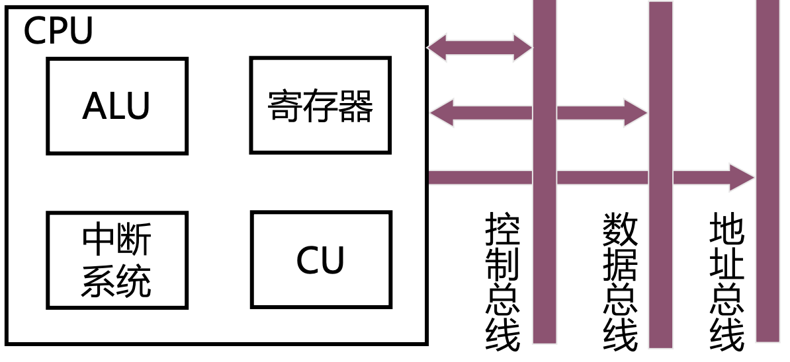

2. #### 指令周期

    **取出并执行一条指令**（即完成一条指令）所需的全部时间称为一个指令的指令周期

    - 一个指令的指令周期通常分为取指周期和执行周期

        - 在取指周期内，计算机进行**取指、分析（操作码、寻址方式）**的操作
        - 在执行周期内，计算机进行**执行指令**（包括取操作数、执行、结果的写回等）的操作
        - 对于含有间接寻址的指令，计算机额外需要在**间址周期**内取得操作数的有效地址
        - 对于含有中断请求的指令，计算机额外需要在**中断周期**内响应中断请求（包括保护程序断点、寻找中断服务程序的入口地址、关中断等）

    - 每条指令的指令周期并不相同

        | 指令距离              | 指令周期说明                                                 |
        | --------------------- | ------------------------------------------------------------ |
        | 空指令 NOP            | 表示计算机不做任何操作，因此**只包括取指周期**，不包括执行周期 |
        | 加法指令<br/> ADD mem | 表示将 ACC 中的数与存储单元 mem 中的数相加，结果保存在 ACC 中，<br/>取指周期和执行周期时间长度相同 |
        | 乘法指令<br/> MUL mem | 表示将 ACC 中的数与存储单元 mem 中的数相乘，结果保存在 ACC 中，<br/>取指周期和执行周期时间长度不同 |

    ```mermaid
    flowchart
    	subgraph 取指周期
        A[周期开始] --> B{有间址吗？}
        B -->|是| C[间址周期]
        C --> D[执行周期]
        B -->|否| D
        D --> E{有中断吗？}
        E -->|是| F[中断周期]
        F --> G[周期结束]
        E -->|否| G
        G -->|进入下一周期| A
        end
    ```

    - 指令周期的数据流

        - 取指周期的数据流

            1. **传送指令地址**

                1. **内部操作**：控制单元发出控制信号，将**程序计数器**中存储的“下一条指令地址”加载到**存储器地址寄存器 MAR **中
                2. **地址总线操作**：MAR中的地址被放到**地址总线**上，地址总线上的所有位（比如32根或64根线）同时被驱动，形成一个完整的二进制地址，指向内存中确切的某个存储单元
                3. **控制总线操作**：同时，控制单元通过**控制总线**向内存发送 **“读”信号**（例如，将“读使能”线置为有效电平），并可能发送“存储器请求”信号，告诉内存：“请准备好，我要从你这里读东西了”

            2. **从内存读取指令**

                1. **内存响应**：内存芯片接收到地址总线上的地址和控制总线上的“读”命令后，启动内部电路
                2. **内存查找**：内存的地址译码器根据收到的地址，定位到对应的存储单元（比如一组特定的电容和晶体管）
                3. **数据输出**：内存将该存储单元内保存的**指令代码（机器码）** 读出，并放置到**数据总线**上，此时数据总线由内存驱动

            3. **接收指令并暂存**

                1. **数据总线捕获**：CPU 一直在监控着数据总线，当它检测到数据总线上有来自内存的有效数据（通常需要等待一个或多个时钟周期以确保数据稳定）时，控制单元会发出控制信号
                2. **内部锁存**：CPU 将数据总线上的指令代码读入**存储器数据寄存器 MDR **中暂存，至此，指令已从内存传入了 CPU

            4. **指令送入 IR 并更新 PC**

                1. **内部传输**：控制单元发出信号，将 **MDR 中暂存的指令代码**传送到**指令寄存器 IR **中，IR 将牢牢“记住”这条指令，直到它被完全执行完毕

                2. **为下次取指做准备**：在取指周期结束前，**程序计数器**必须更新，以指向下一条指令的地址

                    对于顺序执行，这通常意味着 **`PC = PC + 指令长度`** 
                
                    在简单设计中，这个“加 n ”的操作（$n=1, 2, 4$ 等）会由控制单元触发，在一个专门的加法器或 ALU 通路中完成，并将结果写回 PC

            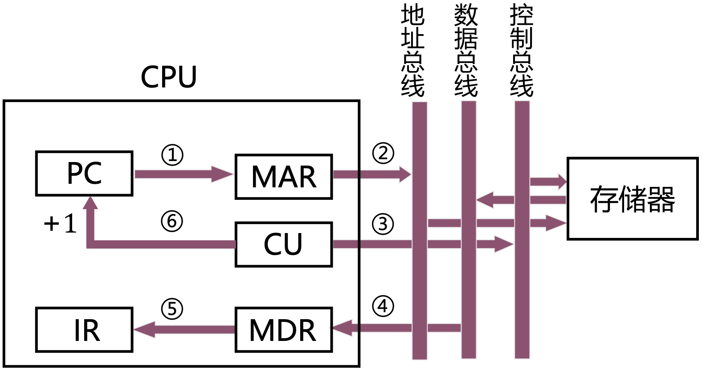

        - 间址周期的数据流

            1. **译码与地址准备**
        
                1. **指令译码**：控制单元对**指令寄存器**中的指令进行译码，译码器发现操作码（如`LOAD`）和寻址方式字段表明这是**间接寻址**
                2. **提取形式地址**：控制单元发出控制信号，从 **IR 的地址码字段**中提取出“形式地址”（即地址A），这个地址A就是指向存放“有效地址”的那个内存单元的指针
                3. **地址送入 MAR**：控制单元将提取出的地址A加载到**存储器地址寄存器**中，MAR 现在保存的是“存放有效地址的那个内存单元”的地址

            2. **发起内存读请求（读地址）**
        
                1. **地址总线输出**：MAR中的地址A被放到**地址总线**上
                2. **控制总线发出读命令**：同时，控制单元通过**控制总线**向内存发送**“读”信号**，命令内存读取地址A处的内容

            3. **从内存读取有效地址**
        
                1. **内存响应**：内存接收到地址A和读命令后，定位到对应单元，将该单元内存储的内容（这才是真正的“有效地址”，我们记为EA）读出
                2. **数据总线传输**：内存将有效地址EA放置到**数据总线**上

            4. **CPU接收并处理有效地址**

                1. **数据锁存**：CPU将数据总线上的有效地址EA读入**存储器数据寄存器**中暂存

                2. **关键操作：更新指令中的地址字段**：

                    - **方案 A（常见于早期/简单设计）**：控制单元发出信号，将**MDR中存放的有效地址EA直接传回IR的地址码字段**，覆盖原来的“形式地址” A

                        这样，IR中的指令就被“修正”了，其地址字段现在直接就是操作数的有效地址EA，为接下来的执行周期做好了准备

                    - **方案 B（现代或流水线设计）**：有效地址EA可能被送入一个**专用的地址寄存器**或**内部暂存器**中保存，供紧随其后的执行周期（如LOAD/STORE周期）直接使用，而不一定会写回IR

                        IR可能保持不变，控制逻辑记住这个地址

            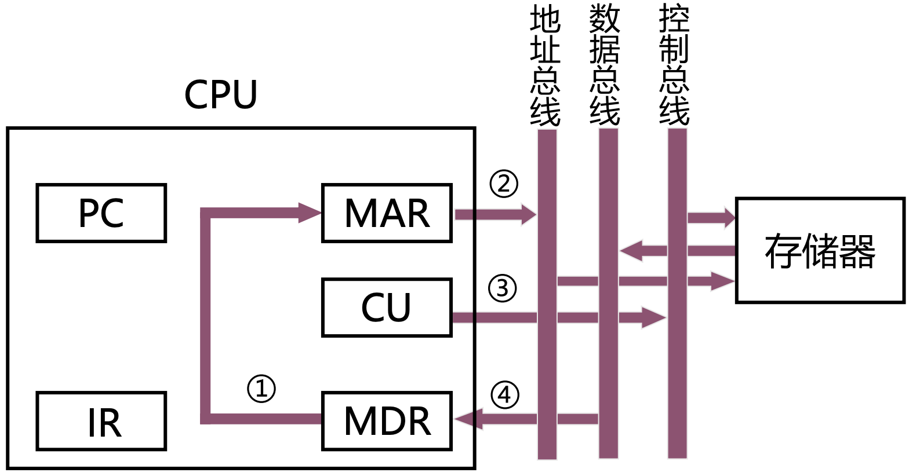

        - 中断周期的数据流

            1. **中断请求与响应**
        
                1. **中断发生**：某个外部设备（如键盘、硬盘）完成了任务，通过一根**控制总线**上的专用线路（如`INTR`）向 CPU 发出**中断请求信号**
                2. **CPU 检查与裁决**：在当前指令周期的末尾，CPU 的控制单元会检查：
                    - 中断请求触发器是否有效
                    - 中断允许触发器是否打开（即中断是否未被屏蔽）
                    - 是否有更高优先级的中断正在处理
                    - 如果所有条件满足，CPU 决定**响应**此中断

            2. **保存当前程序现场（核心步骤）**

                这是中断周期数据流的核心，目的是为了让被中断的程序在未来能毫发无损地恢复执行，**这个过程通常由硬件自动完成**
        
                1. **发出中断响应**：CPU 通过**控制总线**向发出请求的设备回送一个**中断响应信号**，告知对方“我受理了”，同时 CPU 内部关闭中断允许（防止在处理过程中被新的同级中断打断）
                2. **硬件保存断点**：
                    - **地址准备**：控制单元将**堆栈指针**的内容（当前栈顶地址）送入**存储器地址寄存器**
                    - **数据准备**：控制单元将**程序计数器**的内容（即**下一条将要执行的指令地址**，称为“断点”）送入**存储器数据寄存器**
                    - **执行保存**：CPU 通过**地址总线**送出 MAR 中的栈顶地址，通过**控制总线**发出**“写”信号**，通过**数据总线**将 MDR 中的 PC 值（断点）写入内存堆栈的栈顶位置
                3. **更新堆栈指针**：写入完成后，**堆栈指针**自动递减（或递增，取决于堆栈生长方向），指向新的栈顶，为保存下一个数据腾出空间
                4. **硬件保存程序状态**：
                    - 重复类似步骤4的过程：将 **PSW 寄存器**的内容送入 MDR ，用 SP 更新 MAR，然后将 PSW 的内容通过总线系统压入堆栈（保存在断点地址的旁边）

                至此，被中断程序的**关键现场（PC 和 PSW）** 已安全保存在系统堆栈中

            3. **获取中断服务程序入口地址**
        
                1. **获取中断向量**：提出请求的外部设备在收到 CPU 的中断响应后，通常会通过**数据总线**向 CPU 发送一个**中断类型码**（或称中断向量号），CPU 将此码存入内部暂存器
                2. **计算向量表地址**：控制单元根据这个类型码，通过一个固定的计算规则（例如，`类型码 × 4 + 向量表基址`），生成一个内存地址，这个地址指向**中断向量表**中的一个特定表项
                3. **读取入口地址**：
                    - 将计算出的向量表地址送入 **MAR**
                    - 通过**地址总线**送出该地址，通过**控制总线**发出**“读”信号**
                    - 内存将对应表项中存储的**中断服务程序的入口地址**放到**数据总线**上
                    - CPU通过 **MDR** 接收这个入口地址

            4. **跳转至中断服务程序**

                1. **加载 PC，开始新执行**：控制单元将刚刚读出的**入口地址**直接加载到**程序计数器**中

                2. **下个周期开始**：当中断周期结束，下一个 CPU 周期开始时，取指部件将依据PC中的新地址（即中断服务程序的第一条指令地址）去取指
        
                    至此，CPU 的控制权已完全移交给了中断服务程序

3. #### 中断系统

    - ##### 各种各样的中断源（需要中断的场景）

        - 人为设置的中断（如转管指令）
        - 程序性事故（如溢出、操作码不能识别、除法非法）
        - 硬件故障（如通风不良、磁盘损坏）
        - I/O 设备（如进行输入输出）
        - 外部事件（如用键盘中断现行程序）

    - ##### 中断请求标记：

        中断源如何向 CPU 提出中断请求？→ 中断请求标记触发器（中断请求触发器）**INTR**

        - 一个中断源对应一个中断请求标记触发器，多个 INTR 组成中断请求标记寄存器
        - 实现方式：INTR 分散在各个中断源的接口电路中或多个 INTR 集中在 CPU 的中断系统内

    - ##### 中断判优逻辑

        当各中断源同时提出中断请求时，系统需要优先响应对计算机工作影响最大、最重要的中断请求

        - 中断判优就是按中断请求的优先顺序响应中断请求

        - 中断判优逻辑：硬件实现（排队器）

            1. 硬件排队器的部署方式

                - 分散式：集成在各个中断源的接口电路中

                - 集中式：集成在 CPU 内部

            2. 硬件排队器的工作原理（以 4 个中断源为例）

                - 中断源优先级：`INTR₁ > INTR₂ > INTR₃ > INTR₄`（降序排列）
                    - 输入输出逻辑：
                        - 当某中断源请求中断时，其输入`INTR`为 1
                        - 输出`INTP`是否为 1，取决于该中断是否是**当前最高优先级的请求**

                - 电路逻辑（结合图示）：
                    - `INTR₁`的排队器仅需 “或门”：只要 `INTR₁=1`，直接输出 `INTP₁=1`（最高优先级）
                    - `INTR₂`的排队器需 “与门”：需同时满足 `INTR₂=1` 且 `INTP₁=0`（即`INTR₁`无请求），才输出`INTP₂=1`
                    - `INTR₃`同理：需 `INTR₃=1` 且 `INTP₁=0`、`INTP₂=0`，才输出 `INTP₃=1`
                    - `INTR₄`同理：需`INTR₄=1`且`INTP₁~INTP₃均为0`，才输出`INTP₄=1`

        - 中断判优逻辑：软件实现（程序查询）

            程序按**优先级从高到低**依次查询中断请求：

            ```mermaid
            graph LR
                start[开始] --> judgeA{是否A请求?}
                judgeA -->|是| A[转A的服务程序入口地址]
                judgeA -->|否| judgeB{是否B请求?}
                judgeB -->|是| B[转B的服务程序入口地址]
                judgeB -->|否| judgeC{是否C请求?}
                judgeC -->|是| C[转C的服务程序入口地址]
                judgeC -->|否| follow[...（后续逻辑）]
            ```

            | 对比维度 | 硬件排队器                 | 软件查询                   |
            | -------- | -------------------------- | -------------------------- |
            | 效率     | 速度快（硬件电路并行处理） | 速度慢（程序串行查询）     |
            | 灵活性   | 优先级固定（需改电路）     | 优先级易改（修改查询顺序） |
            | 资源占用 | 占用硬件资源               | 占用 CPU 运行时间          |

    - #### 中断服务程序

        中断服务程序（Interrupt Service Routine，ISR）是 **CPU 响应中断请求后自动执行的专用程序**，其核心作用是处理引发中断的事件，保障系统的实时性和高效性

        - ##### 中断服务程序的基本功能

            - **保护现场**

                中断是随机触发的，CPU 响应中断时，主程序正处于某一执行状态（如寄存器中存放着运算中间值、程序计数器 PC 指向主程序下一条指令地址）

                为了保证中断处理完成后，主程序能**从断点处继续正常执行**，ISR 首先要将当前 CPU 的关键状态信息（如通用寄存器、状态寄存器、PC 值等）保存到堆栈中，这个过程就是保护现场

            - **处理中断事件**

                这是 ISR 的**核心任务**，需要根据中断源的类型执行对应的操作，不同中断源的处理逻辑完全不同，例如：

                - 外部 IO 中断（如按键按下）：检测按键状态，执行按键对应的功能（如点亮 LED、切换模式）
                - 定时器中断：完成定时任务（如更新系统时钟、触发数据采样）
                - 串口中断：接收或发送串口数据，完成数据缓冲或解析
                - 异常中断（如除零错误）：进行错误处理（如记录错误日志、复位系统）

            - **清除中断标志位**

                多数外设触发中断后，会在内部寄存器中置位**中断标志位**，以此通知 CPU 有中断请求，如果不清除该标志位，CPU 会误认为中断请求未处理，中断返回后会**反复触发同一段 ISR**，导致程序卡死

                清除方式分为两种：一是软件手动清除（通过向标志位寄存器写入特定值）；二是硬件自动清除（部分外设完成数据传输后自动清零）

            - **恢复现场**

                中断事件处理完毕后，需要将之前保存在堆栈中的 CPU 状态信息（寄存器、PC 值等）**恢复到 CPU 中**，这个过程和保护现场是互逆的

                只有完成现场恢复，主程序才能在中断返回后，无缝接续断点处的执行流程

            - **中断返回**

                执行**中断返回指令**（如 51 单片机的`RETI`、ARM 架构的`BX LR`），该指令会让 CPU 退出 ISR，回到主程序的断点处继续执行

                中断返回指令还会自动处理中断嵌套的相关逻辑（如恢复优先级状态）

        - ##### 查找中断源对应的中断服务程序的方法

            - **硬件向量法**

                硬件向量法是借助硬件电路快速定位中断服务程序入口地址的方法，核心是 “硬件生成向量地址→通过向量地址找入口地址”

                1. 基本原理与特点

                    - **原理**：利用硬件电路生成 “向量地址”，再通过该向量地址找到中断服务程序的入口地址

                    - **特点**：速度快（由硬件直接处理地址，无需软件遍历）

                2. 向量地址形成部件

                    - **作用**：生成对应中断请求的向量地址

                    - **输入**：排队器的输出（排队器会筛选出当前优先级最高的中断请求，仅让该请求对应的输出为 1，其余中断请求的输出为 0）

                    - **输出**：与当前最高优先级中断请求对应的 “向量地址”

                    3. 具体实现方式

                        通过 “向量地址” 对应主存单元的内容，定位入口地址，有两种存储形式：

                        1. **存储无条件转移指令（JMP）**：在向量地址对应的主存单元中存放 “JMP+入口地址” 的指令
                        2. **直接存储入口地址**：在向量地址对应的主存单元中，直接存放中断服务程序的入口地址

                - **软件查询法**

                    软件查询法是通过执行 “中断识别程序”，依次检查中断源的请求状态，从而找到入口地址的方法

                    1. 基本原理

                        不依赖硬件生成地址，而是运行一段 “中断识别程序”，逐个查询中断源是否提出了请求，找到有请求的中断源后，跳转到其对应的服务程序入口地址

                    2. 核心要素

                        - **中断源**：通常有多个（例：8 个中断源，按 1、2、…、8 的降序排列优先级）

                        - **SKP 指令**：功能是 “跳过下一条指令”（用于无请求的中断源，继续查询下一个）

                        - **D（完成触发器）**：表示中断源的请求状态 ——D=1 代表对应中断源提出了中断请求；D=0 代表无请求

                    3. 中断识别程序的执行逻辑

                        中断识别程序的入口地址为 M，执行流程如下：

                        1. 从地址 M 开始，先检查 1# 中断源的 D1：
                            1. 若 $D1=0$（无请求）：执行 SKP 指令，跳过下一条`JMP 1#SR`，继续查询 2#
                            2. 若 $D1=1$（有请求）：不跳过，执行`JMP 1#SR`，跳转到 1# 中断服务程序
                        2. 按同样逻辑，依次检查 2# 到 8# 中断源的 $D2$ ~ $D8$，直到找到 $D=1$ 的中断源，跳转到其对应的服务程序（如 `JMP 2#SR` 对应 2# 服务程序）

                        ```mermaid
                        flowchart TD
                            B[当前指令周期结束<br>检测到中断请求]
                            B -- 是 --> C[进入中断识别程序（入口地址M）]
                            C --> D[检查1#中断源D触发器状态]
                            D --> E{1# D == 1?}
                            E -- 是 --> F[执行JMP 1#SR，跳转到<br>1#中断服务程序]
                            E -- 否 --> G[执行SKP DZ 1#，跳过当前分支]
                            G --> H[检查2#中断源D触发器状态]
                            H --> I{2# D == 1?}
                            I -- 是 --> J[执行JMP 2#SR，跳转到<br>2#中断服务程序]
                            I -- 否 --> K[执行SKP DZ 2#，跳过当前分支]
                            K --> L[...（依次检查3#-7#中断源）]
                            L --> M[检查8#中断源D触发器状态]
                            M --> N{8# D == 1?}
                            N -- 是 --> O[执行JMP 8#SR，跳转到<br>8#中断服务程序]
                            N -- 否 --> P[无有效中断请求，返回主程序]
                            F --> Q[执行中断服务程序]
                            J --> Q
                            O --> Q
                            Q --> R[中断处理完成，返回主程序]
                            R --> S[结束]
                            P --> S
                        ```

                        

                    4. 特点

                        更灵活：可通过调整 “中断识别程序” 里的查询顺序，改变中断请求的优先级（例：把 3# 的查询顺序提前，即可提高 3# 的优先级）

                | 对比维度       | 硬件向量法                                     | 软件查询法                                                   |
                | -------------- | ---------------------------------------------- | ------------------------------------------------------------ |
                | 核心原理       | 借助硬件生成向量地址，通过向量地址定位入口地址 | 执行中断识别程序，逐个查询中断源的 D 状态（D = 1 则跳转入口） |
                | 速度           | 快（硬件直接处理，无遍历过程）                 | 慢（需查询所有中断源，查询越多速度越慢）                     |
                | 灵活性         | 较低（功能由硬件电路决定）                     | 较高（可通过修改程序调整逻辑）                               |
                | 硬件依赖       | 依赖向量地址形成部件、排队器等                 | 仅依赖中断源的完成触发器（D）                                |
                | 优先级调整方式 | 需修改硬件电路（如排队器逻辑）                 | 直接调整中断识别程序的查询顺序即可                           |
                | 适用场景       | 对响应速度要求高、中断源数量较少的场景         | 中断源数量较多、需要灵活调整优先级的场景                     |

    - #### 中断响应

        当系统的**允许中断触发器（EINT）状态为 1**（即系统处于 “允许中断” 的状态），CPU 要响应中断请求

        - 响应中断的时间

            中断响应的时机与后续流程如下：

            1. **响应时机**：一般在**当前指令的执行周期结束后**（避免打断正在执行的指令）
            2. **查询动作触发**：在当前指令执行周期结束时，CPU 主动发出**中断查询信号**，检测是否存在未处理的中断请求
            3. **查询后的分支处理**：
                - 若检测到中断请求，CPU 进入**中断周期**，开始处理中断
                - 若未检测到中断请求，CPU 进入**下一条指令的取指周期**，继续执行程序

        - CPU 查询中断请求的机制

            当有中断请求产生时，CPU 通过以下流程识别中断源：

            1. **中断请求触发**：某中断源有请求时，该中断源对应的**中断请求触发器**的数据端（D）输入为 1
            2. **同步发送查询信号**：CPU 将 “中断查询信号” 同步发送到所有中断源的中断请求触发器
            3. **触发器输出有效信号**：在 CPU 查询信号的驱动下，存在请求的中断源对应的触发器，其输出端（Q）会置为 1
            4. **信号传递至排队器**：各触发器的输出（Q）会被传递到**排队器**，为后续中断优先级判定、中断服务做准备

    - #### 中断隐指令

        中断隐指令是 **CPU 响应中断、进入中断周期后，由硬件自动完成的操作序列**（它不属于程序员可调用的 “指令系统”，是硬件层面的 “隐含操作”）

        - 中断隐指令的核心操作

            1. 保护程序断点

                “程序断点” 是**原程序下一条要执行的指令地址**，若不保存，中断处理完成后，CPU 会找不到原程序的继续执行位置

                - 操作内容

                    保存当前**程序计数器 PC**的内容（即 “程序断点”），保存方式有两种：

                    - 存到存储器**特定固定地址**（如部分架构的 “0 号地址”）
                    - 存入**堆栈**（栈区）

                - 两种保存方式的区别

                    - 固定地址：实现简单，适合 “单中断” 场景，但多中断时容易覆盖断点

                    - 堆栈：按 “先进后出” 顺序保存，支持多中断嵌套，更灵活（主流架构常用）

                > 中断隐指令只负责保护程序断点（原程序下一条要执行的指令地址），CPU 内各寄存器的内容由中断服务程序负责保护

            2. 寻找中断服务程序的入口地址

                中断服务程序是 “处理中断事件的专用程序”，需找到其入口地址才能执行，常用两种方法：

                - 硬件向量法

                    - 操作流程：
                        1. 硬件自动获取 “中断向量地址”
                        2. 将向量地址送入 PC
                        3. 由向量地址对应的存储单元中，取出 “转移指令”，跳转到中断服务程序

                    - 特点：速度快（硬件直接定位），但需要额外的向量电路，硬件稍复杂

                - 软件查询法

                    - 操作流程：
                        1. 将 “中断识别程序” 的入口地址 M 送入 PC
                        2. 执行中断识别程序，逐个查询中断源，找到对应服务程序的入口地址

                    - 特点：硬件电路简单，但查询耗时（中断源越多，速度越慢），适合中断源较少的场景

            3. 关中断

                防止在处理当前中断的过程中，新的中断请求 “打断” 当前操作，避免程序执行混乱，（后续可在中断服务程序中，根据需要重新 “开中断”）

                - 操作内容：将 “允许中断触发器（EINT）” 置为 0（触发器是硬件电路，置 0 表示禁止中断）

# 第 7 章 总线
1. #### 总线的基本概念

    总线是**计算机系统中，连接多个硬件组件（如 CPU、内存、I/O 设备）的共享数据传输线路，以及控制这些线路的一套 “规则”（协议）的总称**

    - 如果不使用总线，每两个需要通信的两个部件直接就需要连接通讯线路，造成极大的空间占用和极高的成本增加，且不方便扩展外部组件（如 I/O 设备等）

    - 总线上信息的传送
        - 串行传送：多位数据在单条1位宽的传输线上，一位一位地按序分时传送 → 适合远距离传送
        - 并行传送：多位数据在多条并行1位宽的传输线上，同时传送 → 适合近距离传送

2. #### 总线的分类

    1. ##### 片内总线

        - 定义：芯片内部的总线
        - 作用：完成芯片内部不同部件间的连接（如 CPU 芯片内部的寄存器之间、寄存器与 ALU 之间的连接）

    2. ##### 系统总线

        - 定义：计算机各大部件之间的信息传输线
            - 连接对象：CPU、主存、I/O 设备（通过 I/O 接口）
        - 按传输信息类型细分：
            1. **数据总线**
                - 传输方向：双向，用于传输数据信息
                - 宽度（位数）：小于或等于机器字长和存储字长
            2. **地址总线**
                - 传输方向：单向，用于指出主存单元的地址或 I/O 地址
                - 宽度（条数）：与存储地址、I/O 地址范围有关
            3. **控制总线**
                - 定义：各种控制信号的传输线
                - 传输特点：
                    - 对任一控制线：单向传输
                    - 对控制总线整体：双向传输
                - 典型信号：
                    - CPU 输出：存储器读、存储器写、总线允许、中断确认
                    - 输入 CPU：中断请求、总线请求

    3. ##### 通信总线

        - 定义：用于计算机系统之间，或计算机系统与其他系统（如控制仪表等）之间的通信
        - 传输方式：
            1. **串行通信总线**
                - 传输方式：多位数据在单条 1 位宽的传输线上，一位一位地按序分时传送 → 适用场景：远距离传送
            2. **并行通信总线**
                - 传输方式：多位数据在多条并行 1 位宽的传输线上，同时传送 → 适用场景：近距离传送

3. #### 总线特性及性能指标

    - 总线的物理实现

        - 总线是直接印刷在主板（母版）上的
        - CPU、主存、I/O 插板通过预留插槽与总线进行连接
        - 为实现插板和总线的有效连接，需规定其机械特性、电气特性、功能特性和时间特性

    - 总线的特性

        - ##### 机械特性

            机械特性规定了总线接口的物理连接规范，具体包括总线连接器的尺寸、形状、引脚数量、引脚排列顺序及连接器的机械固定方式

            **核心作用**：明确硬件设备与总线之间的物理连接形式，确保不同厂商生产的硬件组件，其总线接口具备物理兼容性，能够实现合规的机械互连

        - ##### 电气特性

            电气特性规定了总线传输线上电信号的电气参数与传输规则，主要包括信号的传输方向、有效电平范围、信号的逻辑表示方式等

            **具体内容**：

            1. **信号传输方向**：明确信号的流向，分为输出信号（由 CPU 向其他硬件组件发送的信号）与输入信号（由其他硬件组件向 CPU 发送的信号）
            2. **电平与逻辑表示**：通常采用**正逻辑编码**，即高电平对应逻辑 1，低电平对应逻辑 0，同时定义了高 / 低电平的电压范围（如 TTL 电平中，高电平为 2.4V~5V，低电平为 0V~0.8V）
            3. **不同总线的电气规则**：
                - 地址总线：单向输出总线，仅由 CPU 向内存、I/O 设备传输地址信息，电平逻辑为 “高电平 = 1、低电平 = 0”
                - 数据总线：双向传输总线，支持 CPU 与其他硬件组件之间的双向数据交互，电平逻辑为 “高电平 = 1、低电平 = 0”
                - 控制总线：单根控制线为单向传输，但控制总线整体支持双向信号交互（如 CPU 输出 “存储器读 / 写” 信号，硬件组件向 CPU 输入 “中断请求” 信号），通过高 / 低电平表示不同控制指令的有效性

            **核心作用**：统一电信号的编码与识别规则，确保总线传输的电信号能够被各硬件组件正确解析，避免信号失真或误判

        - ##### 功能特性

            功能特性明确了总线中每一条传输线的功能定义，即每根线对应的信息传输类型

            - 地址总线：功能为传输内存单元或 I/O 设备的地址信息，以指定数据的存取目标
            - 数据总线：功能为传输实际的二进制数据（包括指令、运算结果、设备数据等）
            - 控制总线：功能为传输控制信号与状态信号，用于协调总线操作（如 “总线请求”“总线允许”“中断确认” 等）

            **核心作用**：明确总线各传输线的功能分工，避免不同类型的信息在总线上混淆，保障信息传输的针对性与有序性

        - ##### 时间特性

            时间特性规定了总线各类信号的**时序关系与有效时长**，即总线上各信号在时间维度上的先后顺序、持续时间及有效时刻（总线中的任一根线在什么时间内有效）

            **核心作用**：时序是总线操作同步性的保障，通过定义信号的触发、保持、结束时刻，协调各硬件组件的操作节奏（如 CPU 需先发送地址信号，待地址信号稳定后再发送控制信号，最后进行数据传输），避免信号冲突，确保数据传输的时序正确性与可靠性

    - 总线的性能指标

        - ##### 总线宽度

            - **定义**：通常特指**数据总线的位数（即数据总线的线路数量）**，单位为 “位（bit）”，例如 8 位、16 位、32 位、64 位总线
            - **核心作用**：决定总线**单次传输的数据量**—— 总线宽度越大，单次能传输的数据越多
                - 示例：8 位总线单次传输 1 字节（1 字节 = 8 位），64 位总线单次可传输 8 字节，后者的单次传输量是前者的 8 倍
            - **补充说明**：总线宽度仅针对数据总线（地址总线、控制总线的位数不称为 “总线宽度”），是影响总线 “单次传输效率” 的基础指标

        - ##### 总线带宽

            - **定义**：总线在单位时间内能够传输的**最大数据量**，是衡量总线 “传输速度” 的核心指标，常用单位为 “兆字节每秒（MBps）” 或 “吉字节每秒（GBps）”
            - **核心作用**：直接反映总线的实际数据传输能力，带宽越高，总线传输数据的速度越快
            - **计算公式**：总线带宽与总线宽度、总线工作频率直接相关，公式为： \(\text{总线带宽} = \frac{\text{总线宽度（bit）}}{8} \times \text{总线工作频率（Hz）}\)
                - 示例：32 位（4 字节）总线，工作频率为 100MHz，则带宽为 \(4 \times 100 = 400 \text{MBps}\)；64 位（8 字节）总线，频率为 3200MHz，则带宽为 \(8 \times 3200 = 25600 \text{MBps} = 25.6 \text{GBps}\)

        - ##### 时钟同步 / 异步

            - **定义**：指总线传输数据时的时序协调方式，分为同步总线与异步总线两类：
                1. **同步总线**：
                    - 特点：所有设备以**统一的时钟信号**为节拍传输数据（时钟信号由总线控制器提供）
                    - 优点：控制逻辑简单，易于实现
                    - 缺点：传输速度受限于总线上 “最慢的设备”（快设备需等待慢设备的时钟节拍）
                    - 示例：内存总线（如 DDR5）、PCIe 总线多采用同步方式
                2. **异步总线**：
                    - 特点：无统一时钟信号，设备间通过 “握手信号”（如 “请求 - 应答” 信号）协调节奏
                    - 优点：设备可按需调整传输速度，避免快设备等待慢设备，灵活性高
                    - 缺点：控制逻辑复杂，硬件设计成本较高
                    - 示例：早期的 RS-232 串行总线、部分工业控制总线采用异步方式

        - ##### 总线复用

            - **定义**：指**同一组总线线路在不同时间段承担不同的功能**（如地址线与数据线复用）
            - **核心作用**：减少总线的物理线路数量，降低硬件成本与接口复杂度
            - **示例**：早期 ISA 总线中，同一组线路先传输地址信息（地址阶段），随后切换为传输数据信息（数据阶段），实现 “地址线与数据线复用”
            - **补充说明**：复用会增加总线的控制逻辑复杂度（需区分不同阶段的功能），但能有效节省硬件资源，常见于资源受限的嵌入式系统总线

        - ##### 信号线数

            - **定义**：指总线中**地址总线、数据总线、控制总线的线路数量总和**
            - **核心作用**：信号线数越多，总线的功能区分越明确（如地址、数据、控制线路独立），传输效率与稳定性越高，但硬件成本与接口体积也会相应增加
            - **示例**：早期 ISA 总线的信号线数为 62 根（含复用），而 PCIe x16 总线的信号线数超过 100 根（含独立的地址、数据、控制线路）

        - ##### 总线控制方式

            - **定义**：指协调总线使用权分配与数据传输的管理机制，核心是解决 “多设备竞争总线” 的问题
            - **常见类型**：
                1. **集中式控制**：由专门的 “总线控制器”（如早期主板的北桥芯片，现多集成于 CPU）统一管理总线使用权
                2. **分布式控制**：无中央控制器，由总线上的设备通过协商（如优先级仲裁）分配总线使用权
            - **核心作用**：保障总线上的设备有序传输数据，避免信号冲突

        - ##### 负载能力

            - **负载能力**：指总线能够稳定驱动的**硬件设备数量（即 “负载”）**
            - **核心作用**：总线上挂载的设备过多时，会导致信号衰减、失真，进而引发传输错误
            - **示例**：USB 总线的负载能力为 127 个设备（由地址位宽度决定），PCI 总线的负载能力通常为 4~8 个设备（超过需通过 “总线桥” 扩展）

        ……

4. #### 总线结构

    1. 单总线结构

        将计算机当中的所有部件都连接到一组总线（系统总线）上的结构即为单总线结构

        - 单总线结构简单，成本低，但任何时刻只能有一个部件占用总线，总线成为系统的性能瓶颈

        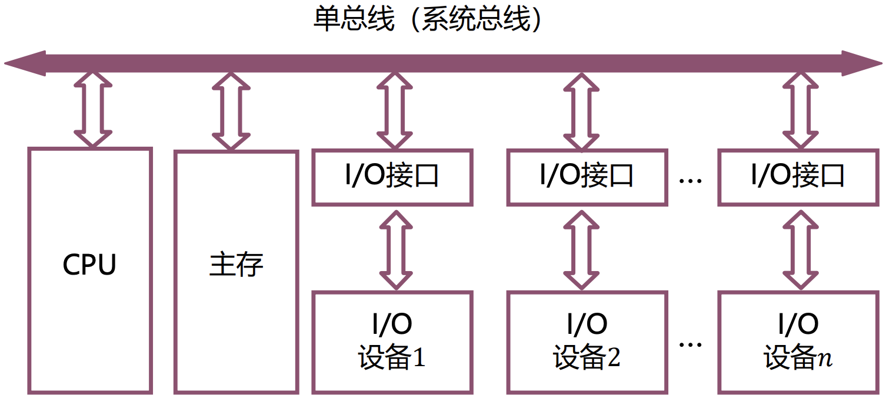

    2. 多总线结构

        1. 以 CPU 为中心的双总线结构

            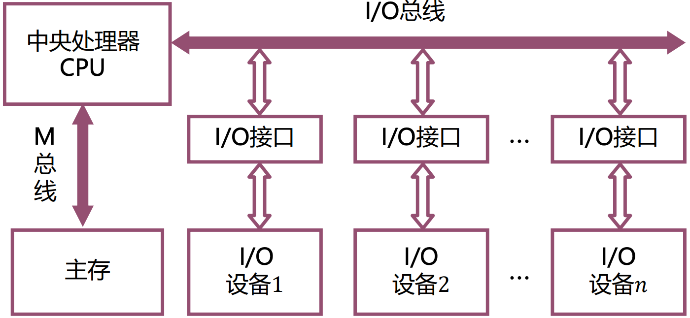

            - 存储总线（M 总线）：连接 CPU 和主存
            - 输入输出总线（I/O 总线）：连接 CPU 和各 I/O 设备
            -  CPU 和主存间有专用的 M 总线，有利于提高 CPU 的工作效率，但 I/O 设备在与主存交换信息时，需占用 CPU

        2. 以存储器为中心的双总线结构

            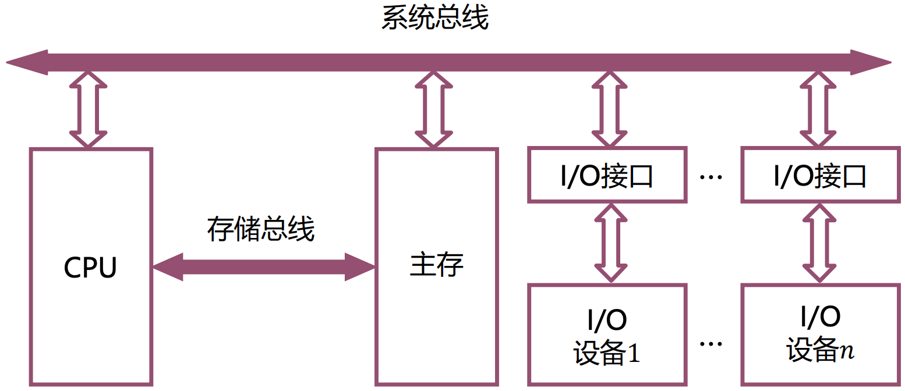

            - I/O 设备与主存交换信息时，无需经过 CPU

        3. 三总线结构

            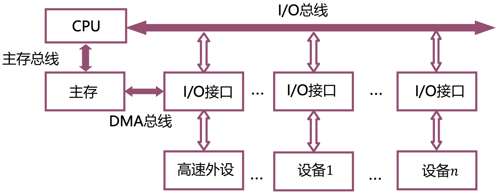

            - 双总线结构高速外设和低速外设共用总线，会影响其工作效率 → 增加 DMA （直接存储器访问）总线，高速外设可通过DMA总线直接与主存进行信息交换
            - 仍然保留以 CPU 为中心的结构，低速外设需通过CPU才能与主存进行信息交换

# 第 8 章 I/O 设备
1. #### 输入输出系统的组成

    - ##### I/O 硬件

        I/O 硬件是 I/O 系统的物理执行部分，负责承载数据的物理传输，核心是 “接口模块 + I/O 设备” 的组合

    - ##### I/O 软件

        I/O 软件是 I/O 系统的逻辑控制部分，负责调度硬件、协调主机与外设的工作流程，核心功能包括：

        - 数据传输控制
            - 将用户通过外设输入的程序 / 数据（如键盘输入的文本）传输至主机内存
            - 将主机运算得到的结果（如程序运行的输出）传输至外设（如显示到屏幕、打印到纸张）
        - 系统协调管理
            - 实现 I/O 系统与主机的工作协同（例如主机运算速度远快于打印机，软件需通过 “缓冲” 机制暂存数据，避免主机等待）
            - 对于带有接口的 I/O 系统，I/O 软件通过 **I/O 指令**向硬件发送控制命令，驱动硬件执行具体操作

    - ##### I/O 指令

        I/O 指令是 CPU 指令系统的专用子指令，由 CPU 译码后执行，是 “软件控制硬件” 的直接指令载体，用来控制输入输出操作

        - 一般格式： \(\boxed{操作码}\boxed{命令码}\boxed{设备码}\)

        - 各部分说明：
            - 操作码：I/O 指令与其他 CPU 指令（如访存指令、运算指令）的 “身份判别标志”——CPU 通过操作码识别该指令是用于控制 I/O 设备，而非操作内存或进行算术运算
            - 命令码：对 I/O 设备的**具体操作要求**，常见类型包括：
                - 输入操作：将数据从 I/O 设备传输至主机（如 “读取键盘当前输入的字符”）
                - 输出操作：将数据从主机传输至 I/O 设备（如 “将内存中的文本发送到显示器显示”）
                - 状态查询：查询 I/O 设备的当前工作状态（如 “询问打印机是否处于‘空闲可接收数据’状态”）
                - 其他操作：如设备复位、模式配置等
            - 设备码：I/O 设备的**唯一地址标识**（类似设备的 “身份证号”）—— 计算机系统中存在多个 I/O 设备时，CPU 通过设备码选择具体要控制的设备（如 “选择编号为 001 的键盘” 而非 “编号为 002 的打印机”）

2. #### I/O 设备与主机的联系方式

    1. ##### I/O 设备编址方式

        I/O 设备编址是为主机与 I/O 设备的通信分配 “地址标识”，使主机能唯一识别目标设备，主要分为两种方式：

        - **统一编址**
            - 定义：将 I/O 设备的端口 / 寄存器地址，纳入计算机的存储器地址空间，作为存储器地址的一部分
            - 实现方式：主机将 I/O 设备的端口视为 “特殊的内存单元”，通过**取数、存数等访存指令**访问 I/O 设备（无需专门的 I/O 指令）
            - 特点：无需额外设计 I/O 指令系统，但会占用部分存储器地址空间，使可分配给内存的地址范围缩小
            - 典型场景：部分单片机系统（如 51 单片机）的 I/O 端口采用统一编址
        - **不统一编址**
            - 定义：为 I/O 设备分配独立的地址空间，该空间与存储器地址空间完全分离（二者地址可重复，但不会冲突）
            - 实现方式：主机需通过**专门的 I/O 指令**访问 I/O 设备，指令中的设备码对应 I/O 独立地址空间内的标识
            - 特点：存储器地址空间不受 I/O 设备占用影响，但需额外设计 I/O 指令系统，指令集复杂度略有提升
            - 典型场景：x86 架构的计算机（如 PC）采用不统一编址

    2. ##### 设备寻址

        设备寻址是主机根据 I/O 设备的地址标识，定位并选中目标设备的过程，其核心是**设备选择电路**的工作：

        - 硬件基础：每个 I/O 设备均配备独立的设备选择电路，且预存了自身的固有地址

        - 工作原理：
            - CPU 执行 I/O 指令时，会向外发送指令中的 “设备码”
            - 所有 I/O 设备的选择电路都会接收该设备码，并将其与自身预存的固有地址进行比较
            - 若二者一致，该设备即被 “选中”，并开始响应主机的操作（如数据传输、状态反馈）

    3. ##### I/O 设备与主机的联系方式

        联络方式是 I/O 设备与主机之间**同步工作状态、协调数据传输**的机制，用于解决二者工作速度不匹配的问题，确保数据传输的准确性

        1. 立即响应

        - 定义：I/O 设备收到主机的 I/O 指令后，无需额外等待，直接执行操作并反馈结果的交互方式
        - 适用场景：操作逻辑简单、响应时间极短的 I/O 设备（如主机控制指示灯的亮 / 灭 —— 主机发送指令后，指示灯可立即完成状态切换）
        - 特点：无需额外状态同步信号，交互流程简洁，但仅适用于与主机速度匹配的简单设备

        2. 异步工作

        - 定义：当 I/O 设备与主机工作速度差异较大时，二者各自独立运行，仅通过**联络信号**同步状态、触发数据交换的方式

        - 核心逻辑：主机与 I/O 设备不固定等待对方，仅在自身准备好后发送信号，对方收到信号后再进行交互

        - 具体流程：

            （1）I/O 设备接收数据时

            - 主机将数据发送至 I/O 接口，接口向 I/O 设备发送 “Ready（就绪）” 信号，告知 “数据已准备好”
            - I/O 设备从接口取出数据后，向接口发送 “Strobe（选通）” 信号，告知 “数据已接收，可准备下一组数据”

            （2）I/O 设备发送数据时

            - I/O 设备将数据发送至 I/O 接口，同时向接口发送 “Strobe” 信号，告知 “数据已送达接口”
            - CPU 从接口取走数据后，接口向 I/O 设备发送 “Ready” 信号，告知 “数据已被取走，可发送下一组数据”

            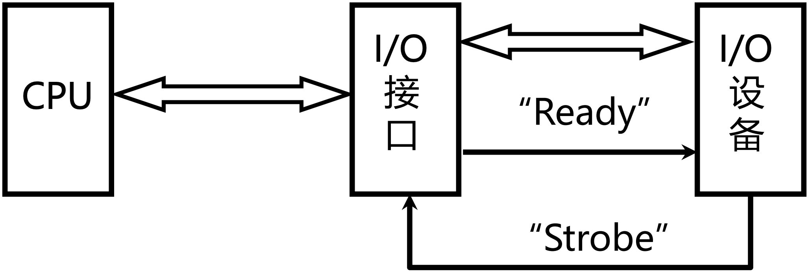

    4. ##### I/O 设备与主机的连接方式

        连接方式是 I/O 设备与主机之间的物理通信链路架构，决定了设备的扩展性、移植性等核心特性

        1. 辐射式连接（分散连接）

            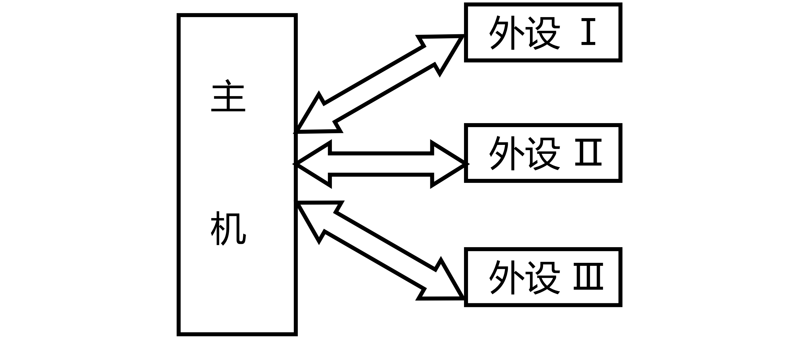

        - 结构：每台 I/O 设备单独配备一套控制线路与信号线，直接与主机的专属接口连接（即 “一台设备对应一条专用链路”）
        - 特点：
            - 优势：单设备通信时链路独立，信号干扰较少
            - 劣势：新增设备需额外部署线路，硬件成本高；设备增删操作复杂，扩展性差；设备与主机接口绑定，可移植性低
        - 适用场景：早期小型计算机系统（设备数量少、对扩展性要求低的场景）

        2. 总线连接

            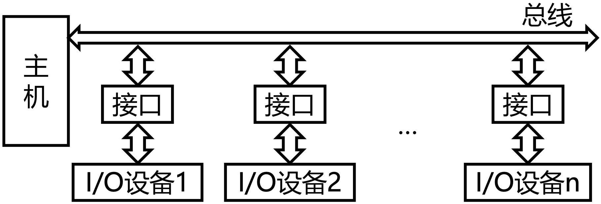

        - 结构：主机与所有 I/O 设备通过**一组共享的总线线路**连接，I/O 设备需通过标准接口接入总线（即 “所有设备共享一条公共通信干线”）
        - 核心概念：总线是计算机系统中共享的通信干线，可同时传输数据、地址、控制信号（如 PC 中的 PCI 总线、通用的 USB 总线）
        - 特点：
            - 优势：所有设备共享总线，硬件成本低；通过标准接口即可灵活增删设备，扩展性强；设备遵循总线规范，可移植性高
            - 劣势：总线为共享资源，多设备同时通信时需通过 “总线仲裁” 机制避免冲突
        - 适用场景：现代计算机系统（PC、服务器等设备数量多、对扩展性要求高的场景）

3. #### I/O 设备与主机信息传送的控制方式

    - ##### 程序查询方式：

        ```mermaid
        sequenceDiagram
            participant CPU
            participant IO as I/O设备
            participant MEM as 主存
        
            %% 第一步：CPU执行程序，发起查询
            CPU->>CPU: 执行现行程序
            CPU->>IO: 查询设备状态（“你准备好了吗？”）
        
            %% 第二步：设备未就绪，CPU循环查询
            loop 设备未就绪（循环查询）
                IO->>CPU: 返回“未就绪”状态
                CPU->>CPU: 继续执行查询程序（空等）
            end
        
            %% 第三步：设备就绪，传输数据
            IO->>CPU: 返回“已就绪”状态
            CPU->>IO: 写入数据（输出）
            IO->>CPU: 读取数据（输入）
            CPU->>MEM: 将数据存入主存（输入）
        
            %% 第四步：CPU恢复正常程序
            CPU->>CPU: 继续执行原来的程序
        ```

        - 等待 I/O 设备准备数据时，CPU 一直处于踏步等待状态，使 CPU 的效率降低

    - ##### 程序中断方式

        ```mermaid
        sequenceDiagram
            participant CPU
            participant IO as I/O设备
            participant MEM as 主存
        
            %% 第一步：CPU正常执行程序，设备准备数据
            CPU->>CPU: 执行现行程序
            IO->>IO: 准备要传输的数据
        
            %% 第二步：设备发中断请求
            IO->>CPU: 发送中断请求（“我准备好了，快来取数据！”）
        
            %% 第三步：CPU响应中断，处理数据传输
            note over CPU,IO: CPU完成当前指令后
            CPU->>CPU: 暂停原程序，保存断点（记录执行位置）
            CPU->>IO: 写入数据（输出）
            IO->>CPU: 读取数据（输入）
            CPU->>MEM: 将数据存入主存（输入）
        
            %% 第四步：CPU恢复原程序
            CPU->>CPU: 恢复断点，继续执行原来的程序
        ```

        - 发出启动设备的指令以后，CPU 继续执行原来的程序
        - 当外部设备准备好以后，向 CPU 提出一个中断请求，让 CPU 停止对当前程序的执行， 转而和 I/O 设备进行数据交换
            - 在 I/O 设备进行准备时，CPU 不必时刻查询 I/O 设备的准备情况，没有踏步等待现象
            - 但 I/O 设备与主存的信息交换仍然需要 CPU 的参与

    - ##### DMA（直接存储器访问）方式

        ```mermaid
        sequenceDiagram
            participant CPU
            participant IO as I/O设备
            participant MEM as 主存
        
            %% 第一步：CPU正常运行+启动I/O
            CPU->>CPU: 执行现行程序
            CPU->>IO: 启动I/O设备（告诉设备“准备传数据”）
            CPU->>CPU: 执行现行程序
        
            %% 第二步：I/O设备准备数据
            IO->>IO: 准备要传输的数据
        
            %% 第三步：DMA请求+数据传送
            note over CPU,IO: CPU当前存取周期结束
            IO->>CPU: 发送DMA请求（“我要传数据啦”）
            note over IO,MEM: “窃取”1个或多个存取周期
            IO->>MEM: 直接向主存传送数据
        
            %% 第四步：CPU恢复运行
            CPU->>CPU: 继续执行原来的程序
        ```

        - 主存和 I/O 之间有一条直接的数据通道 DMA，可直接进行数据交换，不中断现行程序，不需 CPU 参与

        -  **周期挪用（周期窃取）机制**

            DMA 通过 “周期挪用” 方式占用主存总线，是其实现高速传输的关键机制

            - **总线优先级**：若 DMA 与 CPU 同时请求访问主存，DMA 优先占用总线（因 I/O 设备通常对传输实时性要求较高）
            - **挪用时长**：窃取的时间为**一个主存存取周期**，称为 “窃取 / 挪用周期”
            - **CPU 的并行操作**：窃取周期内，CPU 无法通过总线访问主存，但可执行内部操作（如寄存器间运算、逻辑操作等）

        - **并行性增强手段**：通过**指令预取技术**（CPU 在空闲时提前读取后续指令并暂存），可进一步提升 CPU 与 I/O 在窃取周期内的并行工作效率

    - ##### 三种方式的 CPU 工作效率比较

        | 对比维度              | 程序查询方式                 | 程序中断方式                                       | DMA 方式                                             |
        | --------------------- | ---------------------------- | -------------------------------------------------- | ---------------------------------------------------- |
        | CPU 与 I/O 工作模式   | 串行工作                     | 部分并行工作                                       | 高度并行（ I/O 与主存直接连接）                      |
        | I/O 准备阶段 CPU 状态 | 持续查询等待，无法执行原程序 | 执行自身原程序，无需等待                           | 执行自身原程序                                       |
        | I/O 启动后 CPU 状态   | CPU 参与 I/O 数据的传输      | CPU 响应中断，暂停当前程序的执行，处理中断服务程序 | CPU 进入窃取周期，可继续执行当前程序不访问主存的操作 |
        | 数据传送控制主体      | CPU                          | CPU（通过中断服务程序）                            | DMA 控制器 / DMA 接口                                |
        | CPU 工作效率          | 最低                         | 中等（高于程序查询）                               | 最高                                                 |
        | 核心特点              | 流程简单但 CPU 资源浪费严重  | 兼顾 CPU 执行与 I/O 处理，需响应中断请求           | 不占用 CPU 控制数据交换，适合高速大量数据            |

        - 从程序查询方式到 DMA 方式，CPU 越来越从 I/O 设备与主机信息传送的工作中解放出来，I/O 系统的自治能力增强，CPU 的工作效率提高

4. #### I/O 设备

    除主机（CPU、主存）外的大部分硬件设备都是 I/O 设备，又称为外部设备/外围设备/外设

    - 外设通过 I/O 接口与主机连接，其（外设）中的设备控制器控制设备的具体动作

    ```mermaid
    graph LR
        A[主机]
        B[I/O接口]
        subgraph 外部设备
            C[设备控制器]
            D[机、电、磁、光部件]
        end
        
        style 外部设备 stroke-dasharray: 5,5, stroke-width:2px
        A <--> B  
        B <--> C  
        C --> D   
    ```

    - 分类
        - **人机交互设备**：实现用户与计算机之间的信息交流，分为输入、输出两类设备
            - 输入设备：将人可识别的信息转换为计算机可识别的信息，例如**键盘、鼠标**
            - 输出设备：将计算机的处理结果转换为人可识别的信息，例如**打印机、显示器**
        - **计算机信息存储设备**：用于长期存储计算机数据与信息
            - 辅助存储器：可持久保存大量数据，例如**磁盘、光盘、磁带**
        - **机 — 机通信设备**：实现计算机与其他设备 / 系统的互联通信
            - 核心作用：是计算机接入网络的基础，例如**网卡**
